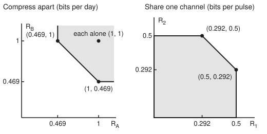

# Many users: compress apart, decode together, and share one channel

[Syllabus](../../../SYLLABUS.md) → [Applied and computational](../README.md) → [Information Theory](../README.md#s03) → Many users

---

## General Overview

Two weather stations sit on neighbouring hills. Each logs one reading a day, rain (1) or dry (0), and radios it to the same office in town. Half the days are wet. The hills are close, so the two readings disagree on only 1 day in 10.

Each station alone needs 1 bit a day, because a wet day is a coin toss. Sent separately, the pair costs 2 bits a day. But the pair holds only **1.469 bits** of uncertainty a day. Once station A's reading is known, station B's adds only **0.469 bits**: the doubt about whether today is one of the disagreeing days.

If B could see A's reading, B would send only the disagreements. B cannot: the stations never talk. Yet B can still get down to 0.469 bits a day: that is the Slepian–Wolf theorem, proved in 1973. The office holds A's record, and that is enough. That is a long-run average: about 171 bits per year of readings, not 365. A single year coded as one block needs 190 bits to come out right 9 years in 10.

The mirror problem runs the other way. Two radios share one receiver, at the same time and on the same frequency. Each has power 1 against noise of power 1. Alone, each could send 0.5 bits per pulse (one use of the channel). Together they cannot both do that: the pair's total is **0.792 bits per pulse**. The receiver reaches it by decoding one radio, subtracting it, then decoding the other: rates 0.5 and 0.292.

**Sources coded apart but decoded together need only their joint entropy in total; senders sharing one channel get at most the channel's joint limit in total; and in both cases a corner of the allowed region is reached by decoding one user first and using it to decode the next.**

**What kind of fact this is:** two theorems. The "no scheme does better" halves are proved on this card in Why it works, in key steps. The "this rate works" halves are long proofs: the card gives their key steps and names the full proofs in Sources. The radio numbers rest on a model, normal (bell-curve) noise, which fits many radio links well but is an assumption.

### The picture: the two regions, to scale

<p align="center"></p>

Left: the bits per day the two stations may send. Every point in the shaded area works; the point (1, 1), each station coding alone, wastes 0.531 bits a day. Right: the bits per pulse the two radios may send. Here the shaded area lies *below* the boundary. Scales: 150 pixels per bit on the left, 320 on the right.

---

## The formula

Notation first, in words.

- From [Entropy](01-entropy.md): $`h(p)`$ is the binary entropy, the bits in one yes-or-no answer of chance p.
- From [Conditional entropy and mutual information](02-conditional-entropy-and-mutual-information.md): $`H(A, B)`$ is the joint entropy of a pair, $`H(B \mid A)`$ the uncertainty about B left once A is known, and $`I(X; Y)`$ the mutual information, the bits Y tells about X.
- From [Channel capacity](07-channel-capacity-and-the-noisy-channel-theorem.md): a rate R in bits per use, and a link's capacity.
- New here: a **rate region**, the set of rate pairs that long enough codes can make work with an error chance as small as wanted.

**Compress apart, decode together.** Station A sends $`R_A`$ bits a day, station B sends $`R_B`$. The Slepian–Wolf theorem says the region is

```math
R_A \ge H(A \mid B), \qquad R_B \ge H(B \mid A), \qquad R_A + R_B \ge H(A, B)
```

**Read it aloud:** each station sends at least what the other's reading leaves uncertain about its own, and together they send at least the pair's whole uncertainty.

Here $`H(A \mid B) = H(B \mid A) = h(0.1) = 0.469`$ and $`H(A, B) = 1 + h(0.1) = 1.469`$ bits a day.

**Share one channel.** A **multiple-access channel** has two senders and one receiver. Radio 1 sends a pulse $`X_1`$, radio 2 sends $`X_2`$, and the receiver hears $`Y`$, made from both plus noise. For two senders who do not coordinate, and one choice of how each radio picks its pulses, the rates allowed are

```math
R_1 \le I(X_1; Y \mid X_2), \qquad R_2 \le I(X_2; Y \mid X_1), \qquad R_1 + R_2 \le I(X_1, X_2; Y)
```

**Read it aloud:** each radio gets at most what it could send if the other radio's pulses were known and removed, and together they get at most what one sender could send if it had to keep the two radios' pulses independent.

For radios in normal noise, $`Y = X_1 + X_2 + Z`$ with Z the noise. Write $`C(x) = \tfrac12 \log_2(1 + x)`$ for one user's bits per pulse at signal-to-noise ratio x, from [Channel capacity](07-channel-capacity-and-the-noisy-channel-theorem.md). Then

```math
R_1 \le C\!\left(\frac{P_1}{N}\right), \qquad R_2 \le C\!\left(\frac{P_2}{N}\right), \qquad R_1 + R_2 \le C\!\left(\frac{P_1 + P_2}{N}\right)
```

**Read it aloud:** each radio is held to its own capacity, and the pair is held to the capacity of one radio with both powers added.

The corner the receiver reaches by decoding radio 2 first:

```math
R_2 = C\!\left(\frac{P_2}{P_1 + N}\right) = C(0.5) = 0.292, \qquad R_1 = C\!\left(\frac{P_1}{N}\right) = C(1) = 0.5
```

**Read it aloud:** decode radio 2 while radio 1 still counts as noise, then subtract radio 2 and decode radio 1 against the noise alone.

| Symbol | Plain meaning | In our example | Push it up and the answer… |
| --- | --- | --- | --- |
| $`A`$, $`B`$ | the two stations' daily readings, 1 for rain and 0 for dry | half the days wet | — |
| $`p`$ | chance the two readings disagree on a day | 0.1 | $`H(B \mid A)`$ rises, to 1 bit at p = 0.5 |
| $`n`$, $`d`$, $`j`$ | days (or pulses) coded together in one block; in Step 1's fold, d counts disagreeing days and j runs from 0 to d | 7 for a week; 100 to 2,000; d about a tenth of n | at a rate inside the region, errors fall |
| $`R_A`$, $`R_B`$ | bits per day each station sends | corner (1, 0.469) | more room above the floor, fewer errors |
| $`H(A)`$, $`H(A, B)`$, $`H(B \mid A)`$, $`H(A \mid B)`$ | entropy of one reading, of the pair, of B once A is known, of A once B is known | 1, 1.469, 0.469 and 0.469 bits | the region's floor rises |
| $`h(p)`$, $`h(\cdot)`$ | binary entropy; applied to a measured value such as Y, the differential entropy of [Differential entropy and water-filling](11-differential-entropy-and-water-filling.md) | h(0.1) = 0.469 | — |
| $`X_1`$, $`X_2`$, $`Y`$, $`Z`$ | radio 1's pulse, radio 2's pulse, what the receiver hears, the noise | $`Y = X_1 + X_2 + Z`$ | — |
| $`P_1`$, $`P_2`$, $`N`$, $`v`$, $`e`$ | average power of each radio and of the noise; in Step 6's fold, v is a normal value's power and e the base of natural logs | 1, 1 and 1; v = 3 for Y | more power: higher limits, but only as a log |
| $`R_1`$, $`R_2`$ | bits per pulse each radio sends | corner (0.5, 0.292) | — |
| $`C(x)`$ | $`\tfrac12 \log_2(1 + x)`$: bits per pulse at signal-to-noise ratio x | C(1) = 0.5, C(2) = 0.792, C(0.5) = 0.292, C(4) = 1.161 | rises only as a log |
| $`I(X_1; Y \mid X_2)`$, $`I(X_2; Y \mid X_1)`$, $`I(X_2; Y)`$, $`I(X_1, X_2; Y)`$ | bits about radio 1 once radio 2 is known, and the reverse; about radio 2 with radio 1 as noise; about both | 0.5, 0.5, 0.292 and 0.792 | — |
| $`2^{nR}`$ | how many labels (bins) a rate R buys over n days | $`2^3 = 8`$ labels for a week at 3/7 bits a day | more labels, fewer clashes |

### When it holds

- **One decoder sees every label.** The office decodes A and B together. Send B's label to a different office that lacks A's record, and B needs H(B) = 1 bit a day: at 0.55 bits a day over 1,000 days, the best possible chance of decoding B is $`2^{-450}`$.
- **Long blocks.** Every rate here is a limit as n grows, never a promise at a given size: a week-long label decodes 85.0% of weeks. Long blocks cost delay, since 1,000 daily readings take almost three years to collect.
- **Known, steady statistics.** The codes assume a 10% disagreement rate and independent days. Built for the wrong rate, a code fails; for rain that comes in spells, the entropies become rates of the whole process.
- **Senders that do not coordinate.** The channel region assumes independent radios with pulses lined up in time, a receiver that knows both codebooks (each radio's list of the codewords it may send), and normal noise for C(x). Radios that shared messages could act as one sender and do better: 1.161 bits per pulse, as Step 5 shows.
- **Time sharing.** The full channel region joins the regions of all input choices by **time sharing**: one scheme on some pulses, another on the rest. So the region has no dents.

---

## Why it works

### Step 0: the office decodes everything at once, so each label only settles what the office still doubts

Hold A's 1,000-day record in hand. B's record differs from it on about 100 days, and the [Typical sequences](04-typical-sequences-and-the-aep.md) card counts the records that do: about $`2^{n h(0.1)} = 2^{469}`$ of them. B's label only has to pick one of those, which takes about 469 bits, or 0.469 a day.

The puzzle is how B can pick one out of a list it never sees. The answer is a label that works for *every* possible A record at once.

### Step 1: B labels its record without looking at A

Deal all $`2^n`$ possible B records into $`2^{n R_B}`$ piles, called **bins**, by a rule fixed in advance and known to the office. B sends only the number of its bin. The office looks inside that bin for the record that disagrees least with A's.

The office goes wrong only if a second record in the same bin also fits A's record. About $`2^{n h(0.1)}`$ records fit, and each one lands in B's bin with chance $`2^{-n R_B}`$. So the expected number of intruders is about $`2^{n(h(0.1) - R_B)}`$, which shrinks towards zero as n grows whenever $`R_B > 0.469`$.

The check adds this up exactly, for random bins at $`R_B = 0.55`$. The bound on the error chance is 0.145 at n = 100, 0.00198 at n = 1,000 and 0.000029 at n = 2,000.

<details>
<summary>The bound the check computes</summary>

Let d be the number of days on which A and B disagree. The true B record fails only if some other record of at most d disagreements with A shares its bin. A union bound (the chance of any one of several events is at most the sum of their chances) gives

$`\displaystyle P(\text{error}) \le \sum_{d=0}^{n} \binom{n}{d} p^d (1-p)^{n-d} \min\!\left(1,\; 2^{-n R_B} \sum_{j=0}^{d} \binom{n}{j}\right)`$

Here $`\binom{n}{d}`$ counts the ways to choose d days out of n. The check sums it in logarithms, so that numbers like $`2^{1000}`$ never overflow.

</details>

### A week of it, by hand: bins from a parity check

The bins can be the syndromes (the short pattern a parity check computes from a word) of a parity check from [Hamming and Reed-Solomon](08-error-correcting-codes-hamming-and-reed-solomon.md). Number the days of a week 1 to 7. B's label is the **XOR** of the numbers of its rainy days, written in binary: XOR adds binary digits without carrying, so 5 XOR 1 = 4. That is the syndrome under the Hamming (7,4) check, whose column i is the number i in binary.

1. A rains on days 1, 3, 4 and 7. B rains on days 1, 3, 4, 5 and 7.
2. B sends 1 XOR 3 XOR 4 XOR 5 XOR 7 = 4, three bits: 100.
3. The office works out A's label the same way: 1 XOR 3 XOR 4 XOR 7 = 1.
4. Matching days cancel, so 4 XOR 1 = 5 names the one day the weeks disagree.
5. The office flips day 5 of A's week and has B's week, right.

B sends 3 bits a week, $`3/7 = 0.429`$ bits a day. The label works whenever the week has at most one disagreement, which happens in $`0.9^7 + 7 \times 0.1 \times 0.9^6 = 0.850306`$ of weeks. No 3-bit label can do better: the check keeps the 8 likeliest disagreement patterns and gets the same 0.850306. At 7 days any label shorter than 7 bits must fail some weeks: fewer than $`2^7`$ labels cannot name every disagreement pattern, and each pattern has some chance. Below 0.469, failure stays forced however long the block, as Step 3 shows.

### Step 2: both stations bin, three ways to fail, three inequalities

Let both stations bin. The office looks in A's bin and B's bin for the one pair that fits the 10% pattern. A wrong pair is wrong in one of three ways:

| Wrong in | Rival pairs that fit | Chance a rival lands in the true bins | Vanishes when |
| --- | --- | --- | --- |
| A only | about $`2^{n H(A \mid B)}`$ | $`2^{-n R_A}`$ | $`R_A > H(A \mid B)`$ |
| B only | about $`2^{n H(B \mid A)}`$ | $`2^{-n R_B}`$ | $`R_B > H(B \mid A)`$ |
| both | about $`2^{n H(A, B)}`$ | $`2^{-n (R_A + R_B)}`$ | $`R_A + R_B > H(A, B)`$ |

Each kind of error dies out when its rate beats its count. Those are the three inequalities. The full proof, with typical sets for the pairs, is in the 1973 paper and in Cover and Thomas, section 15.4.

### Step 3: no scheme does better

- **The total.** The two labels together must let the office rebuild both records, nearly always. Fano's inequality, used on the [Channel capacity](07-channel-capacity-and-the-noisy-channel-theorem.md) card, then says the labels carry nearly all of the pair's uncertainty: $`n(R_A + R_B) \ge n H(A, B)`$, less a term that shrinks as the error chance does.
- **Each station.** Hand the office A's record for free. B's label must still settle the doubt that remains, $`n H(B \mid A)`$ bits.

The second bound can be seen directly. With $`2^{n R_B}`$ labels, the office can rebuild at most $`2^{n R_B}`$ disagreement patterns, so the best any scheme can do is cover the likeliest ones. Below 0.469 even that fails more and more. At $`R_B = 0.40`$ the best chance of success is 0.382 at n = 100, 0.0194 at n = 1,000 and 0.00124 at n = 2,000. The check confirms the method at n = 12 and rate 1/2 by listing all 4,096 patterns: 0.836828 both ways.

### Step 4: a corner, by decoding one station first

Take the corner (1, 0.469). A sends its record compressed on its own: at 1 bit a day there is nothing to remove. The office decodes A first, then uses A's record to pick B's record out of B's bin, as in Step 1.

The chain rule from [Conditional entropy and mutual information](02-conditional-entropy-and-mutual-information.md), $`H(A, B) = H(A) + H(B \mid A) = 1 + 0.469`$, says this corner already sits on the line of the total. Swap the order and the office reaches (0.469, 1). Sharing the days between the two orders fills the line between the corners.

### Step 5: the channel, with the inequalities turned round

On the channel the users *send*, so their rates are capped from above. The two kinds of cap mirror Step 3:

- **Each radio.** Give the receiver radio 2's message for free. It removes radio 2's pulses, and radio 1 is alone on its link, held to $`I(X_1; Y \mid X_2)`$.
- **The total.** The two messages are independent, so the two radios' pulses are too. Fano's inequality, as on [Channel capacity](07-channel-capacity-and-the-noisy-channel-theorem.md), caps $`n(R_1 + R_2)`$ by the sum, over the n pulses, of what each received pulse tells about the two sent pulses, plus a term that shrinks as the error chance does. Because the sent pulses are independent, their powers add: Y has power 1 + 1 + 1 = 3, and the cap is $`I(X_1, X_2; Y) = C(2) = 0.792`$ bits per pulse. Independence holds the total there: the same pulse from both radios would give Y signal power 4 and $`C(4) = 1.161`$.

Rates inside these caps work. Each radio draws a random codebook. The receiver looks for the one pair of codewords that fits what it heard. Wrong guesses again come in three kinds, each with its own inequality, exactly as in Step 2. The full proof is in Cover and Thomas, section 15.3, and El Gamal and Kim, chapter 4.

### Step 6: the radio corner, by peeling one radio off

The receiver hears $`Y = X_1 + X_2 + Z`$, with powers 1, 1 and 1.

1. **Decode radio 2 first.** Radio 1 is still mixed in, so it counts as extra noise: signal 1 against noise 1 + 1 = 2. Radio 2 can send $`C(1/2) = \tfrac12 \log_2 1.5 = 0.292`$ bits per pulse.
2. **Subtract.** Radio 2's pulses are now known, so the receiver removes them from what it heard. What is left is $`X_1 + Z`$.
3. **Decode radio 1.** Signal 1 against noise 1: $`C(1) = 0.5`$ bits per pulse.
4. **Add.** $`\tfrac12 \log_2 1.5 + \tfrac12 \log_2 2 = \tfrac12 \log_2 3 = 0.792`$, which is $`C(2)`$, the total cap.

This method is **successive interference cancellation**. The sum lands exactly on the cap because of the chain rule for mutual information: $`I(X_1, X_2; Y) = I(X_2; Y) + I(X_1; Y \mid X_2)`$.

<details>
<summary>Where the three Gaussian numbers come from</summary>

From [Differential entropy and water-filling](11-differential-entropy-and-water-filling.md): a normal value of power v has differential entropy $`\tfrac12 \log_2(2 \pi e v)`$ bits, and for a fixed power no value has more. With normal inputs, Y has power 1 + 1 + 1 = 3.

$`\displaystyle I(X_1, X_2; Y) = h(Y) - h(Z) = \tfrac12 \log_2(2 \pi e \cdot 3) - \tfrac12 \log_2(2 \pi e \cdot 1) = \tfrac12 \log_2 3 = 0.792`$

With radio 2 known, what remains of Y is $`X_1 + Z`$, of power 2:

$`\displaystyle I(X_2; Y) = h(Y) - h(Y \mid X_2) = \tfrac12 \log_2 \frac{3}{2} = 0.292`$

The check reaches 0.792 and 0.292 a second way, by measuring each entropy with Simpson's rule on the bell curve, and a third way, by averaging the log of the ratio of densities over 200,000 simulated pulses. Normal inputs give the largest h(Y) for the power allowed, so no other input does better.

</details>

### The two problems side by side

| | Compress apart, decode together | Share one channel |
| --- | --- | --- |
| Users | two sources, one decoder | two senders, one receiver |
| Each user | $`R_A \ge H(A \mid B)`$ | $`R_1 \le I(X_1; Y \mid X_2)`$ |
| The total | $`R_A + R_B \ge H(A, B)`$ | $`R_1 + R_2 \le I(X_1, X_2; Y)`$ |
| A corner | decode A, then B with A's help | decode radio 2, subtract it, then radio 1 |
| Our corner | (1, 0.469) bits a day | (0.5, 0.292) bits per pulse |

### Taking turns, and why it falls short

Taking turns at power 1 gives $`\tfrac12 C(1) + \tfrac12 C(1) = 0.5`$ bits per pulse in total. But a radio silent half the time has saved power. Spent as power 2 during its turn, the same average, the total is $`C(2) = 0.792`$. Taking turns this way reaches the cap, but only at the equal-rate point.

---

## Worked numbers, by hand

| Step | Arithmetic | Value |
| --- | --- | --- |
| doubt about a disagreement | $`h(0.1) = -0.1 \log_2 0.1 - 0.9 \log_2 0.9`$ | 0.469 bits |
| the pair | 1 + 0.469; or the four cells 0.45, 0.05, 0.05, 0.45 | 1.469 bits a day |
| B once A is known | 1.469 − 1 | 0.469 bits a day |
| saving over coding apart | 2 − 1.469 | 0.531 bits a day |
| B per year, long-run average | 365 × 0.469 | 171.2 bits |
| both per year, long-run average | 365 × 1.469 | 536.2 bits, not 730 |
| radio 2, radio 1 as noise | $`\tfrac12 \log_2(1 + 1/2)`$ | 0.292 bits per pulse |
| radio 1, radio 2 removed | $`\tfrac12 \log_2(1 + 1)`$ | 0.5 bits per pulse |
| the total | $`0.5 + 0.292 = \tfrac12 \log_2 3`$ | **0.792 bits per pulse** |
| at 1,000 pulses a second | 1,000 × 0.792 | 792 bits a second |

In the long run the stations save over a quarter of their airtime without ever talking to each other, and the radios together carry 792 bits a second, not the 1,000 that two single-user capacities would suggest.

### What breaks if you drop a piece

| Mistake | Comes out at | What went wrong |
| --- | --- | --- |
| B's label decoded without A's record | best chance $`2^{-450}`$ at 0.55 bits a day, n = 1,000 | The saving needs one decoder that sees A; B alone needs 1 bit a day |
| B's rate below the floor, 0.40 bits a day | best chance 0.0194 at n = 1,000, 0.00124 at n = 2,000 | Below $`H(B \mid A)`$, longer blocks make it worse, not better |
| A week-long label at 0.429 bits a day | right in 0.850306 of weeks | Below the floor, and far too short a block |
| One year coded as one block at the long-run 171 bits | right in 0.602091 of years; 9 years in 10 needs 190 bits | 0.469 bits a day is a limit as blocks grow, not a promise for 365 days |
| Both radios at their single-user rate | 0.5 + 0.5 = 1.0 bits per pulse | Each cap holds with the other radio removed, not both at once |
| Each radio treats the other as noise | 0.585 bits per pulse in total | Nobody subtracts anything, so both decode through extra noise |
| Taking turns at power 1 | 0.5 bits per pulse in total | The silent half wastes the power budget |

---

## Code, from first principles, and it actually runs

The script takes at least two independent roads to each answer:

- the joint entropy, by the formula 1 + h(0.1) and from the table's four cells;
- the week-long label, over all $`2^{14}`$ pairs of weeks, by its closed form, by the best-possible bound and by 100,000 simulated weeks, with the bound checked by listing all 4,096 patterns at n = 12;
- the random-binning bound, summed in logarithms, and again at n = 100 with whole-number counts and no logarithms;
- the radio numbers, by formula, by Simpson's rule on the entropies and by 200,000 simulated pulses.

The lines starting `try:` answer the Try changing box.

Random numbers come from SplitMix64, a small generator written out in both languages with seed 2026, so the two outputs match.

### Python

```python
# Slepian-Wolf and the multiple-access channel -- the check behind the card.
# Standard library only: math gives logs, exp, cos, sqrt, pi; nothing knows a rate region.
# Part 1: two weather stations A and B log rain (1) or dry (0); half the days are wet,
# and B disagrees with A on 10% of days.  Part 2: two radios, power 1 each, share
# one receiver with noise power 1.  Random numbers: SplitMix64, seed 2026.
from math import log, log2, cos, sqrt, pi

P_DIS, LOW, HIGH, P1, P2, NOISE, MASK = 0.1, 0.40, 0.55, 1.0, 1.0, 1.0, (1 << 64) - 1
def h(p): return -p * log2(p) - (1 - p) * log2(1 - p)          # binary entropy, bits
def H(ps): return -sum(q * log2(q) for q in ps if q > 0)       # entropy of a list of chances, bits
def C(snr): return 0.5 * log2(1 + snr)                         # bits per pulse at a signal-to-noise ratio

class SplitMix64:
    def __init__(self, seed): self.s = seed
    def next(self):
        self.s = (self.s + 0x9E3779B97F4A7C15) & MASK
        z = self.s
        z = ((z ^ (z >> 30)) * 0xBF58476D1CE4E5B9) & MASK
        z = ((z ^ (z >> 27)) * 0x94D049BB133111EB) & MASK
        return z ^ (z >> 31)
    def unif(self): return ((self.next() >> 11) + 0.5) / 2.0**53

def log2_binoms(n):                          # log2 of C(n, j) for j = 0..n, built up
    out, v = [0.0], 0.0
    for j in range(n): v += log2((n - j) / (j + 1)); out.append(v)
    return out
def log2_add(a, b):                          # log2(2^a + 2^b)
    if a < b: a, b = b, a
    return a + log2(1 + 2.0 ** (b - a)) if b > -1e300 else a
def best_success(n, rate):                   # any scheme: 2^(nR) bin labels name at most
    lb, room, used, s = log2_binoms(n), n * rate, -1e308, 0.0   # 2^(nR) disagreement patterns,
    for j in range(n + 1):                   # so keep the likeliest: fewest disagreements
        lp = j * log2(P_DIS) + (n - j) * log2(1 - P_DIS)
        if log2_add(used, lb[j]) <= room + 1e-9:
            s += 2.0 ** (lb[j] + lp); used = log2_add(used, lb[j])
        elif room - used < 1e-9: return s
        else: return s + 2.0 ** (room + log2(1 - 2.0 ** (used - room)) + lp)
    return s

def binning_error(n, rate):                  # random bins, decoder takes the candidate with the
    lb, vol, e = log2_binoms(n), -1e308, 0.0  # fewest disagreements: union bound on the error
    for d in range(n + 1):
        vol = log2_add(vol, lb[d])
        lp = lb[d] + d * log2(P_DIS) + (n - d) * log2(1 - P_DIS)
        e += 2.0 ** (lp + min(0.0, vol - n * rate))
    return e
HCOL = [1, 2, 3, 4, 5, 6, 7]                 # Hamming (7,4): column i of the check matrix is i in binary
def syndrome(word):                          # word: 7 bits in an int; XOR of the columns of its 1s
    s = 0
    for i in range(7): s ^= HCOL[i] * (word >> i & 1)
    return s
def decode(a, sB):                           # town holds A's week and B's 3-bit label
    s = syndrome(a) ^ sB
    return a if s == 0 else a ^ (1 << (s - 1))

def lp(x, v): return -x * x / (2 * v * log(2)) - 0.5 * log2(2 * pi * v)   # log2 of pdf
def entropy_simpson(v, m=4000):              # -integral of f log2 f for a normal of variance v
    a, b = -14 * sqrt(v), 14 * sqrt(v); w = (b - a) / m
    f = lambda x: -2.0 ** lp(x, v) * lp(x, v)
    return w / 3 * sum((1 if k in (0, m) else 4 if k % 2 else 2) * f(a + k * w) for k in range(m + 1))

out = []
def show(label, x): out.append(f"{label:<46}{x:>12.6f}"); return x

# ---- Part 1: Slepian-Wolf ----
hA = show("H(A) = H(B), one station alone", H([0.5, 0.5]))
hAB_f = show("H(A,B) by 1 + h(0.1)", 1 + h(P_DIS))
c4 = [(1 - P_DIS) / 2, P_DIS / 2, P_DIS / 2, (1 - P_DIS) / 2]   # (A, B) = dry-dry, dry-wet, wet-dry, wet-wet
hAB_t = show("H(A,B) from the four cells " + " ".join(f"{q:.2f}" for q in c4), H(c4))
hBgA = show("H(B|A) = H(A,B) - H(A)", hAB_t - hA)
show("separate coding, no correlation used", 2 * hA); show("saving per day, 2 - H(A,B)", 2 * hA - hAB_t)
show("B, long-run bits per 365 days, at H(B|A)", 365 * hBgA)
show("both, long-run bits per 365 days, at H(A,B)", 365 * hAB_t)
show("one 365-day block with 171 bits: best success", best_success(365, 171 / 365))
show("  fewest bits for success 0.9 or more", next(k for k in range(366) if best_success(365, k / 365) >= 0.9))
ok = 0.0
for a in range(128):
    for b in range(128):
        d = bin(a ^ b).count("1"); pr = 2.0**-7 * P_DIS**d * (1 - P_DIS)**(7 - d)
        ok += pr * (decode(a, syndrome(b)) == b)
rng, weeks, hits = SplitMix64(2026), 100000, 0
for _ in range(weeks):
    a = rng.next() & 127; e = 0
    for i in range(7): e |= (rng.unif() < P_DIS) << i
    hits += decode(a, syndrome(a ^ e)) == a ^ e
wa, wb = 0b1001101, 0b1011101                 # days 1..7 are bits 0..6: A rains days 1,3,4,7
out.append(f"example week: A rains days 1,3,4,7, B days 1,3,4,5,7: B's label {syndrome(wb)},"
           f" A's label {syndrome(wa)}, town flips day {syndrome(wa) ^ syndrome(wb)}, right: {'yes' if decode(wa, syndrome(wb)) == wb else 'no'}")
show("Hamming label: B's rate 3/7 bits per day", 3 / 7)
p_ham = show("  weeks decoded right, all 2^14 week pairs", ok)
p_sim = show("  weeks decoded right, 100,000 simulated", hits / weeks)
p_best7 = show("  best any 3-bit label can do, n = 7", best_success(7, 3 / 7))
w12 = [P_DIS**bin(e).count("1") * (1 - P_DIS)**(12 - bin(e).count("1")) for e in range(4096)]
p_b12 = show("n = 12, rate 1/2: top 64 of 4,096 patterns", sum(sorted(w12, reverse=True)[:64]))
bs = [show(f"best success at rate {LOW:.2f}, n = {n}", best_success(n, LOW)) for n in (100, 1000, 2000)]
be = [show(f"binning error bound at rate {HIGH:.2f}, n = {n}", binning_error(n, HIGH)) for n in (100, 1000, 2000)]
c, cum, e100 = 1, 0, 0.0                      # n = 100 again, a second road: whole-number counts, no logs
for d in range(101): cum += c; e100 += c * P_DIS**d * (1 - P_DIS)**(100 - d) * min(1.0, cum / 2.0**(100 * HIGH)); c = c * (100 - d) // (d + 1)
show(f"B alone at rate {HIGH:.2f}, n = 1000: log2 success", 1000 * HIGH - 1000)

# ---- Part 2: the Gaussian multiple-access channel ----
c1, c2 = show("R1 at most C(P1/N)", C(P1 / NOISE)), show("R2 at most C(P2/N)", C(P2 / NOISE))
csum = show("R1 + R2 at most C((P1+P2)/N)", C((P1 + P2) / NOISE))
r2c = show("corner: R2 = C(P2/(P1+N)), radio 1 as noise", C(P2 / (P1 + NOISE)))
show("corner: R1 = C(P1/N), radio 2 subtracted", c1)
s_sum = show("sum by Simpson: h(Y) - h(Z)", entropy_simpson(3) - entropy_simpson(1))
s_r2 = show("R2 by Simpson: h(Y) - h(Y|X2)", entropy_simpson(3) - entropy_simpson(2))
rng, n_mc, acc = SplitMix64(2026), 200000, [[0.0, 0.0], [0.0, 0.0]]
for _ in range(n_mc):
    g = []
    for _ in range(2):
        u1, u2 = rng.unif(), rng.unif(); r = sqrt(-2 * log(u1))
        g += [r * cos(2 * pi * u2), r * cos(2 * pi * u2 - pi / 2)]
    x1, x2, z = g[0], g[1], g[2]; y = x1 + x2 + z
    for k, s in enumerate((lp(z, 1) - lp(y, 3), lp(y - x2, 2) - lp(y, 3))):
        acc[k][0] += s; acc[k][1] += s * s
mc = [(m0 / n_mc, sqrt((m1 / n_mc - (m0 / n_mc)**2) / n_mc)) for m0, m1 in acc]
show("sum by simulation, 200,000 pulses", mc[0][0]); show("  its standard error", mc[0][1])
show("R2 corner by simulation", mc[1][0]); show("  its standard error", mc[1][1])
show("both treat the other as noise: sum", 2 * C(P1 / (P2 + NOISE)))
show("take turns, power 1 each: sum", 0.5 * C(P1 / NOISE) + 0.5 * C(P2 / NOISE))
show("take turns, power 2 in each turn: sum", 0.5 * C(2 * P1 / NOISE) + 0.5 * C(2 * P2 / NOISE))
show("wrong: both at single-user rate 0.5: sum", c1 + c2)
show("one sender, same pulse on both radios: C(4)", C((sqrt(P1) + sqrt(P2))**2 / NOISE))
show("sum rate x 1,000 pulses a second", 1000 * csum)
[show(f"try: HIGH = 0.50, binning bound, n = {n}", binning_error(n, 0.50)) for n in (100, 1000, 2000)]
[show(f"try: LOW = 0.45, best success, n = {n}", best_success(n, 0.45)) for n in (1000, 2000)]
show("try: P_DIS = 0.2, H(A,B) = 1 + h(0.2)", 1 + h(0.2)); show("  week-long label decodes", 0.8**7 + 7 * 0.2 * 0.8**6)
for line in out: print(line)
X0, Y0, S1, X0M, S2 = 42, 230, 150, 300, 320  # figure: pixels per bit, left and right panels
print(f"figure, SW corners ({X0 + S1 * 1:.1f},{Y0 - S1 * hBgA:.1f}) ({X0 + S1 * hBgA:.1f},{Y0 - S1 * 1:.1f});"
      f" MAC corners ({X0M + S2 * c1:.1f},{Y0 - S2 * r2c:.1f}) ({X0M + S2 * r2c:.1f},{Y0 - S2 * c2:.1f})")
assert abs(hAB_f - hAB_t) < 1e-12 and abs(hAB_t - 1.468996) < 1e-6          # two roads to H(A,B)
assert abs(p_ham - (0.9**7 + 7 * 0.1 * 0.9**6)) < 1e-12 and abs(p_ham - p_best7) < 1e-12
assert abs(p_sim - p_ham) < 4 * sqrt(p_ham * (1 - p_ham) / weeks)         # simulation within 4 SE
assert abs(s_sum - 0.5 * log2(3)) < 1e-9 and abs(s_r2 - (csum - c1)) < 1e-9  # Simpson against closed form
assert abs(mc[0][0] - csum) < 4 * mc[0][1] and abs(mc[1][0] - r2c) < 4 * mc[1][1]
assert abs(p_b12 - best_success(12, 0.5)) < 1e-12 and bs[2] < bs[1] < bs[0] and be[2] < be[1] < be[0]
assert abs(be[0] - e100) < 1e-9                                              # binning bound: logs against whole numbers
print("ALL CHECKS PASS")
```

**Ran 2026-11-23 on macOS, Python 3.14.10, standard library only. All checks passed. Output, pasted from the run:**

```
H(A) = H(B), one station alone                    1.000000
H(A,B) by 1 + h(0.1)                              1.468996
H(A,B) from the four cells 0.45 0.05 0.05 0.45    1.468996
H(B|A) = H(A,B) - H(A)                            0.468996
separate coding, no correlation used              2.000000
saving per day, 2 - H(A,B)                        0.531004
B, long-run bits per 365 days, at H(B|A)        171.183392
both, long-run bits per 365 days, at H(A,B)     536.183392
one 365-day block with 171 bits: best success     0.602091
  fewest bits for success 0.9 or more           190.000000
example week: A rains days 1,3,4,7, B days 1,3,4,5,7: B's label 4, A's label 1, town flips day 5, right: yes
Hamming label: B's rate 3/7 bits per day          0.428571
  weeks decoded right, all 2^14 week pairs        0.850306
  weeks decoded right, 100,000 simulated          0.852150
  best any 3-bit label can do, n = 7              0.850306
n = 12, rate 1/2: top 64 of 4,096 patterns        0.836828
best success at rate 0.40, n = 100                0.382313
best success at rate 0.40, n = 1000               0.019378
best success at rate 0.40, n = 2000               0.001243
binning error bound at rate 0.55, n = 100         0.144976
binning error bound at rate 0.55, n = 1000        0.001980
binning error bound at rate 0.55, n = 2000        0.000029
B alone at rate 0.55, n = 1000: log2 success   -450.000000
R1 at most C(P1/N)                                0.500000
R2 at most C(P2/N)                                0.500000
R1 + R2 at most C((P1+P2)/N)                      0.792481
corner: R2 = C(P2/(P1+N)), radio 1 as noise       0.292481
corner: R1 = C(P1/N), radio 2 subtracted          0.500000
sum by Simpson: h(Y) - h(Z)                       0.792481
R2 by Simpson: h(Y) - h(Y|X2)                     0.292481
sum by simulation, 200,000 pulses                 0.792929
  its standard error                              0.002634
R2 corner by simulation                           0.292850
  its standard error                              0.001861
both treat the other as noise: sum                0.584963
take turns, power 1 each: sum                     0.500000
take turns, power 2 in each turn: sum             0.792481
wrong: both at single-user rate 0.5: sum          1.000000
one sender, same pulse on both radios: C(4)       1.160964
sum rate x 1,000 pulses a second                792.481250
try: HIGH = 0.50, binning bound, n = 100          0.316654
try: HIGH = 0.50, binning bound, n = 1000         0.122319
try: HIGH = 0.50, binning bound, n = 2000         0.058506
try: LOW = 0.45, best success, n = 1000           0.329473
try: LOW = 0.45, best success, n = 2000           0.228126
try: P_DIS = 0.2, H(A,B) = 1 + h(0.2)             1.721928
  week-long label decodes                         0.576717
figure, SW corners (192.0,159.7) (112.3,80.0); MAC corners (460.0,136.4) (393.6,70.0)
ALL CHECKS PASS
```

### Rust

Same numbers, same labels, built with `rustc --edition 2021 -O`.

```rust
// Slepian-Wolf and the multiple-access channel -- the same check as the Python, in Rust.
// No crates: std's f64 gives logs, exp, cos, sqrt; nothing knows a rate region.
// Part 1: two weather stations A and B log rain (1) or dry (0); half the days are wet,
// and B disagrees with A on 10% of days.  Part 2: two radios, power 1 each, share
// one receiver with noise power 1.  Random numbers: SplitMix64, seed 2026.
use std::f64::consts::PI;
const P_DIS: f64 = 0.1; const LOW: f64 = 0.40; const HIGH: f64 = 0.55;
const P1: f64 = 1.0; const P2: f64 = 1.0; const NOISE: f64 = 1.0;

fn h(p: f64) -> f64 { -p * p.log2() - (1.0 - p) * (1.0 - p).log2() }  // binary entropy, bits
fn ent(ps: &[f64]) -> f64 { -ps.iter().filter(|&&q| q > 0.0).map(|q| q * q.log2()).sum::<f64>() }
fn cap(snr: f64) -> f64 { 0.5 * (1.0 + snr).log2() }       // bits per pulse at a signal-to-noise ratio

struct SplitMix64 { s: u64 }
impl SplitMix64 {
    fn next(&mut self) -> u64 {
        self.s = self.s.wrapping_add(0x9E3779B97F4A7C15);
        let mut z = self.s;
        z = (z ^ (z >> 30)).wrapping_mul(0xBF58476D1CE4E5B9);
        z = (z ^ (z >> 27)).wrapping_mul(0x94D049BB133111EB);
        z ^ (z >> 31)
    }
    fn unif(&mut self) -> f64 { ((self.next() >> 11) as f64 + 0.5) / 2f64.powi(53) }
}

fn log2_binoms(n: usize) -> Vec<f64> {                     // log2 of C(n, j) for j = 0..n, built up
    let (mut out, mut v) = (vec![0.0], 0.0);
    for j in 0..n { v += ((n - j) as f64 / (j + 1) as f64).log2(); out.push(v) }
    out
}

fn log2_add(a: f64, b: f64) -> f64 {                       // log2(2^a + 2^b)
    let (a, b) = if a < b { (b, a) } else { (a, b) };
    if b > -1e300 { a + (1.0 + 2f64.powf(b - a)).log2() } else { a }
}

fn best_success(n: usize, rate: f64) -> f64 {              // keep the 2^(nR) likeliest patterns
    let (lb, room) = (log2_binoms(n), n as f64 * rate);
    let (mut used, mut s) = (-1e308, 0.0);
    for j in 0..=n {
        let lp = j as f64 * P_DIS.log2() + (n - j) as f64 * (1.0 - P_DIS).log2();
        if log2_add(used, lb[j]) <= room + 1e-9 {
            s += 2f64.powf(lb[j] + lp); used = log2_add(used, lb[j]);
        } else if room - used < 1e-9 { return s }
        else { return s + 2f64.powf(room + (1.0 - 2f64.powf(used - room)).log2() + lp) }
    }
    s
}

fn binning_error(n: usize, rate: f64) -> f64 {             // union bound for random bins
    let (lb, mut vol, mut e) = (log2_binoms(n), -1e308, 0.0);
    for d in 0..=n {
        vol = log2_add(vol, lb[d]);
        let lp = lb[d] + d as f64 * P_DIS.log2() + (n - d) as f64 * (1.0 - P_DIS).log2();
        e += 2f64.powf(lp + (vol - n as f64 * rate).min(0.0));
    }
    e
}

fn syndrome(word: u32) -> u32 { (0..7).filter(|i| word >> i & 1 == 1).fold(0, |s, i| s ^ (i + 1)) } // Hamming (7,4): column i is i in binary
fn decode(a: u32, sb: u32) -> u32 { let s = syndrome(a) ^ sb; if s == 0 { a } else { a ^ (1 << (s - 1)) } } // town holds A's week and B's label

fn lp(x: f64, v: f64) -> f64 { -x * x / (2.0 * v * 2f64.ln()) - 0.5 * (2.0 * PI * v).log2() }

fn entropy_simpson(v: f64) -> f64 {                        // -integral of f log2 f, normal of variance v
    let m = 4000;
    let (a, b) = (-14.0 * v.sqrt(), 14.0 * v.sqrt());
    let w = (b - a) / m as f64;
    let f = |x: f64| -2f64.powf(lp(x, v)) * lp(x, v);
    w / 3.0 * (0..=m).map(|k| (if k == 0 || k == m { 1.0 } else if k % 2 == 1 { 4.0 } else { 2.0 })
        * f(a + k as f64 * w)).sum::<f64>()
}

fn main() {
    let out: std::cell::RefCell<Vec<String>> = std::cell::RefCell::new(Vec::new());
    let show = |label: &str, x: f64| -> f64 { out.borrow_mut().push(format!("{:<46}{:>12.6}", label, x)); x };
    // ---- Part 1: Slepian-Wolf ----
    let ha = show("H(A) = H(B), one station alone", ent(&[0.5, 0.5]));
    let hab_f = show("H(A,B) by 1 + h(0.1)", 1.0 + h(P_DIS));
    let c4 = [(1.0 - P_DIS) / 2.0, P_DIS / 2.0, P_DIS / 2.0, (1.0 - P_DIS) / 2.0]; // (A, B) = dry-dry, dry-wet, wet-dry, wet-wet
    let hab_t = show(&format!("H(A,B) from the four cells {}", c4.iter().map(|q| format!("{:.2}", q)).collect::<Vec<_>>().join(" ")), ent(&c4));
    let hbga = show("H(B|A) = H(A,B) - H(A)", hab_t - ha);
    show("separate coding, no correlation used", 2.0 * ha); show("saving per day, 2 - H(A,B)", 2.0 * ha - hab_t);
    show("B, long-run bits per 365 days, at H(B|A)", 365.0 * hbga);
    show("both, long-run bits per 365 days, at H(A,B)", 365.0 * hab_t);
    show("one 365-day block with 171 bits: best success", best_success(365, 171.0 / 365.0));
    show("  fewest bits for success 0.9 or more", (0..366).find(|&k| best_success(365, k as f64 / 365.0) >= 0.9).unwrap() as f64);
    let mut ok = 0.0;
    for a in 0..128u32 {
        for b in 0..128u32 {
            let d = (a ^ b).count_ones() as i32;
            let pr = 2f64.powi(-7) * P_DIS.powi(d) * (1.0 - P_DIS).powi(7 - d);
            if decode(a, syndrome(b)) == b { ok += pr }
        }
    }
    let (mut rng, weeks, mut hits) = (SplitMix64 { s: 2026 }, 100000, 0);
    for _ in 0..weeks {
        let a = (rng.next() & 127) as u32;
        let mut e = 0u32;
        for i in 0..7 { if rng.unif() < P_DIS { e |= 1 << i } }
        if decode(a, syndrome(a ^ e)) == a ^ e { hits += 1 }
    }
    let (wa, wb) = (0b1001101u32, 0b1011101u32);             // days 1..7 are bits 0..6
    out.borrow_mut().push(format!("example week: A rains days 1,3,4,7, B days 1,3,4,5,7: B's label {}, A's label {}, town flips day {}, right: {}",
        syndrome(wb), syndrome(wa), syndrome(wa) ^ syndrome(wb), if decode(wa, syndrome(wb)) == wb { "yes" } else { "no" }));
    show("Hamming label: B's rate 3/7 bits per day", 3.0 / 7.0);
    let p_ham = show("  weeks decoded right, all 2^14 week pairs", ok);
    let p_sim = show("  weeks decoded right, 100,000 simulated", hits as f64 / weeks as f64);
    let p_best7 = show("  best any 3-bit label can do, n = 7", best_success(7, 3.0 / 7.0));
    let mut w12: Vec<f64> = (0..4096u32).map(|e| { let d = e.count_ones() as i32;
        P_DIS.powi(d) * (1.0 - P_DIS).powi(12 - d) }).collect();
    w12.sort_by(|x, y| y.partial_cmp(x).unwrap());
    let p_b12 = show("n = 12, rate 1/2: top 64 of 4,096 patterns", w12[..64].iter().sum());
    let bs: Vec<f64> = [100, 1000, 2000].iter()
        .map(|&n| show(&format!("best success at rate {:.2}, n = {}", LOW, n), best_success(n, LOW))).collect();
    let be: Vec<f64> = [100, 1000, 2000].iter()
        .map(|&n| show(&format!("binning error bound at rate {:.2}, n = {}", HIGH, n), binning_error(n, HIGH))).collect();
    let (mut c, mut cum, mut e100) = (1u128, 0u128, 0.0f64); // n = 100 again, a second road: whole-number counts, no logs
    for d in 0..=100u32 { cum += c; e100 += c as f64 * P_DIS.powi(d as i32) * (1.0 - P_DIS).powi(100 - d as i32) * (cum as f64 / 2f64.powf(100.0 * HIGH)).min(1.0); c = c * (100 - d) as u128 / (d + 1) as u128; }
    show(&format!("B alone at rate {:.2}, n = 1000: log2 success", HIGH), 1000.0 * HIGH - 1000.0);
    // ---- Part 2: the Gaussian multiple-access channel ----
    let (c1, c2) = (show("R1 at most C(P1/N)", cap(P1 / NOISE)), show("R2 at most C(P2/N)", cap(P2 / NOISE)));
    let csum = show("R1 + R2 at most C((P1+P2)/N)", cap((P1 + P2) / NOISE));
    let r2c = show("corner: R2 = C(P2/(P1+N)), radio 1 as noise", cap(P2 / (P1 + NOISE)));
    show("corner: R1 = C(P1/N), radio 2 subtracted", c1);
    let s_sum = show("sum by Simpson: h(Y) - h(Z)", entropy_simpson(3.0) - entropy_simpson(1.0));
    let s_r2 = show("R2 by Simpson: h(Y) - h(Y|X2)", entropy_simpson(3.0) - entropy_simpson(2.0));
    let (mut rng, n_mc) = (SplitMix64 { s: 2026 }, 200000);
    let mut acc = [[0.0f64; 2]; 2];
    for _ in 0..n_mc {
        let mut g = Vec::new();
        for _ in 0..2 {
            let (u1, u2) = (rng.unif(), rng.unif());
            let r = (-2.0 * u1.ln()).sqrt();
            g.push(r * (2.0 * PI * u2).cos()); g.push(r * (2.0 * PI * u2 - PI / 2.0).cos());
        }
        let (x2, z) = (g[1], g[2]);
        let y = g[0] + x2 + z;
        for (k, s) in [lp(z, 1.0) - lp(y, 3.0), lp(y - x2, 2.0) - lp(y, 3.0)].iter().enumerate() {
            acc[k][0] += s; acc[k][1] += s * s;
        }
    }
    let nf = n_mc as f64;
    let mc: Vec<(f64, f64)> = acc.iter().map(|a| (a[0] / nf, ((a[1] / nf - (a[0] / nf).powi(2)) / nf).sqrt())).collect();
    show("sum by simulation, 200,000 pulses", mc[0].0); show("  its standard error", mc[0].1);
    show("R2 corner by simulation", mc[1].0); show("  its standard error", mc[1].1);
    show("both treat the other as noise: sum", 2.0 * cap(P1 / (P2 + NOISE)));
    show("take turns, power 1 each: sum", 0.5 * cap(P1 / NOISE) + 0.5 * cap(P2 / NOISE));
    show("take turns, power 2 in each turn: sum", 0.5 * cap(2.0 * P1 / NOISE) + 0.5 * cap(2.0 * P2 / NOISE));
    show("wrong: both at single-user rate 0.5: sum", c1 + c2);
    show("one sender, same pulse on both radios: C(4)", cap((P1.sqrt() + P2.sqrt()).powi(2) / NOISE));
    show("sum rate x 1,000 pulses a second", 1000.0 * csum);
    for n in [100, 1000, 2000] { show(&format!("try: HIGH = 0.50, binning bound, n = {}", n), binning_error(n, 0.50)); }
    for n in [1000, 2000] { show(&format!("try: LOW = 0.45, best success, n = {}", n), best_success(n, 0.45)); }
    show("try: P_DIS = 0.2, H(A,B) = 1 + h(0.2)", 1.0 + h(0.2)); show("  week-long label decodes", 0.8f64.powi(7) + 7.0 * 0.2 * 0.8f64.powi(6));
    for line in out.borrow().iter() { println!("{}", line) }
    let (x0, y0, s1, x0m, s2) = (42.0, 230.0, 150.0, 300.0, 320.0);  // figure: pixels per bit
    println!("figure, SW corners ({:.1},{:.1}) ({:.1},{:.1}); MAC corners ({:.1},{:.1}) ({:.1},{:.1})",
        x0 + s1 * 1.0, y0 - s1 * hbga, x0 + s1 * hbga, y0 - s1 * 1.0,
        x0m + s2 * c1, y0 - s2 * r2c, x0m + s2 * r2c, y0 - s2 * c2);
    assert!((hab_f - hab_t).abs() < 1e-12 && (hab_t - 1.468996).abs() < 1e-6);       // two roads to H(A,B)
    assert!((p_ham - (0.9f64.powi(7) + 7.0 * 0.1 * 0.9f64.powi(6))).abs() < 1e-12 && (p_ham - p_best7).abs() < 1e-12);
    assert!((p_sim - p_ham).abs() < 4.0 * (p_ham * (1.0 - p_ham) / weeks as f64).sqrt());  // within 4 SE
    assert!((s_sum - 0.5 * 3f64.log2()).abs() < 1e-9 && (s_r2 - (csum - c1)).abs() < 1e-9);
    assert!((mc[0].0 - csum).abs() < 4.0 * mc[0].1 && (mc[1].0 - r2c).abs() < 4.0 * mc[1].1);
    assert!((p_b12 - best_success(12, 0.5)).abs() < 1e-12 && bs[2] < bs[1] && bs[1] < bs[0] && be[2] < be[1] && be[1] < be[0]);
    assert!((be[0] - e100).abs() < 1e-9);                                            // binning bound: logs against whole numbers
    println!("ALL CHECKS PASS");
}
```

**Ran 2026-11-23 on macOS, rustc 1.98.1, no crates. All checks passed. Output, pasted from the run:**

```
H(A) = H(B), one station alone                    1.000000
H(A,B) by 1 + h(0.1)                              1.468996
H(A,B) from the four cells 0.45 0.05 0.05 0.45    1.468996
H(B|A) = H(A,B) - H(A)                            0.468996
separate coding, no correlation used              2.000000
saving per day, 2 - H(A,B)                        0.531004
B, long-run bits per 365 days, at H(B|A)        171.183392
both, long-run bits per 365 days, at H(A,B)     536.183392
one 365-day block with 171 bits: best success     0.602091
  fewest bits for success 0.9 or more           190.000000
example week: A rains days 1,3,4,7, B days 1,3,4,5,7: B's label 4, A's label 1, town flips day 5, right: yes
Hamming label: B's rate 3/7 bits per day          0.428571
  weeks decoded right, all 2^14 week pairs        0.850306
  weeks decoded right, 100,000 simulated          0.852150
  best any 3-bit label can do, n = 7              0.850306
n = 12, rate 1/2: top 64 of 4,096 patterns        0.836828
best success at rate 0.40, n = 100                0.382313
best success at rate 0.40, n = 1000               0.019378
best success at rate 0.40, n = 2000               0.001243
binning error bound at rate 0.55, n = 100         0.144976
binning error bound at rate 0.55, n = 1000        0.001980
binning error bound at rate 0.55, n = 2000        0.000029
B alone at rate 0.55, n = 1000: log2 success   -450.000000
R1 at most C(P1/N)                                0.500000
R2 at most C(P2/N)                                0.500000
R1 + R2 at most C((P1+P2)/N)                      0.792481
corner: R2 = C(P2/(P1+N)), radio 1 as noise       0.292481
corner: R1 = C(P1/N), radio 2 subtracted          0.500000
sum by Simpson: h(Y) - h(Z)                       0.792481
R2 by Simpson: h(Y) - h(Y|X2)                     0.292481
sum by simulation, 200,000 pulses                 0.792929
  its standard error                              0.002634
R2 corner by simulation                           0.292850
  its standard error                              0.001861
both treat the other as noise: sum                0.584963
take turns, power 1 each: sum                     0.500000
take turns, power 2 in each turn: sum             0.792481
wrong: both at single-user rate 0.5: sum          1.000000
one sender, same pulse on both radios: C(4)       1.160964
sum rate x 1,000 pulses a second                792.481250
try: HIGH = 0.50, binning bound, n = 100          0.316654
try: HIGH = 0.50, binning bound, n = 1000         0.122319
try: HIGH = 0.50, binning bound, n = 2000         0.058506
try: LOW = 0.45, best success, n = 1000           0.329473
try: LOW = 0.45, best success, n = 2000           0.228126
try: P_DIS = 0.2, H(A,B) = 1 + h(0.2)             1.721928
  week-long label decodes                         0.576717
figure, SW corners (192.0,159.7) (112.3,80.0); MAC corners (460.0,136.4) (393.6,70.0)
ALL CHECKS PASS
```

The two outputs match line for line.

### Lean

Lean proves the radio corner for any powers, the station corner for any finite table of chances, and the week-long label for every week.

- Suppose $`P_1, P_2 \ge 0`$ and $`N > 0`$. Then radio 2, decoded first, stays within its own cap: $`C(P_2/(P_1+N)) \le C(P_2/N)`$.
- Take the same powers. Then $`C(P_1/N) + C(P_2/(P_1+N)) = C((P_1+P_2)/N)`$, the total cap.
- Take any table of chances for the two readings, with finitely many values, each chance at least 0, all adding to 1. Then $`H(A \mid B) \le H(A)`$: the corner's rate for A clears A's floor.
- Take the same table. Then $`H(A) + H(B \mid A) = H(A, B)`$: the corner sits on the line of the total.
- Take two weeks, A's and B's, that agree every day or differ on exactly one day. Then the office rebuilds B's week from A's week and B's 3-bit label alone.
- The worked week checks out: B's label is 4, A's is 1, and 4 XOR 1 = 5 names day 5.
- The label works in exactly 0.8503056 of weeks, which rounds to 0.850306.

The binning bounds, the best-success chances, the Gaussian entropies, the simulations and the decimals are left to the Python and Rust checks.

```lean
-- Many users: decoding one radio first and then the other reaches the two-radio channel's total cap exactly, decoding one station first puts the Slepian-Wolf corner on the line of the pair's entropy, and a week's 3-bit Hamming label recovers any week within one disagreement.
import Mathlib.Analysis.SpecialFunctions.Log.Base
import Mathlib.Algebra.BigOperators.Ring.Finset
import Mathlib.Algebra.Order.BigOperators.Group.Finset
import Mathlib.Tactic

open Finset

namespace SlepianWolfMAC

/-! ## The two-radio channel in normal noise -/

/-- `C(x) = ½ log₂ (1 + x)`: one user's bits per pulse at signal-to-noise ratio `x`. -/
noncomputable def C (x : ℝ) : ℝ := (1 / 2) * Real.logb 2 (1 + x)

/-- Successive decoding reaches the corner of the two-radio region. Two radios of powers
`P₁, P₂ ≥ 0` share one receiver with normal noise of power `N > 0`. The receiver decodes radio 2
first, with radio 1 counted as extra noise, at `R₂ = C(P₂ / (P₁ + N))`; it subtracts radio 2 and
decodes radio 1 against the noise alone, at `R₁ = C(P₁ / N)`. Then radio 2's rate stays within its
own cap, `R₂ ≤ C(P₂ / N)`, and the two rates add up exactly to the total cap:
`R₁ + R₂ = C((P₁ + P₂) / N)`. -/
theorem successive_decoding_reaches_sum_capacity (P₁ P₂ N : ℝ) (hP₁ : 0 ≤ P₁) (hP₂ : 0 ≤ P₂)
    (hN : 0 < N) :
    C (P₂ / (P₁ + N)) ≤ C (P₂ / N) ∧
      C (P₁ / N) + C (P₂ / (P₁ + N)) = C ((P₁ + P₂) / N) := by
  have hPN : 0 < P₁ + N := by linarith
  have h2 : 0 < 1 + P₂ / (P₁ + N) := by positivity
  have h1 : 0 < 1 + P₁ / N := by positivity
  refine ⟨?_, ?_⟩
  · unfold C
    have : P₂ / (P₁ + N) ≤ P₂ / N := div_le_div_of_nonneg_left hP₂ hN (by linarith)
    have := Real.logb_le_logb_of_le (b := 2) (x := 1 + P₂ / (P₁ + N)) (y := 1 + P₂ / N) (by norm_num) h2 (by linarith)
    linarith
  · unfold C
    rw [← mul_add, ← Real.logb_mul h1.ne' h2.ne']
    congr 2
    field_simp
    ring

/-! ## Two stations coded apart, decoded together -/

variable {α β : Type*} [Fintype α] [Fintype β]

/-- Entropy in bits of a table of chances `q`: `H = -Σ q i · log₂ (q i)`
(Mathlib's `Real.logb 2 0 = 0`, so empty cells add nothing). -/
noncomputable def entropy {ι : Type*} [Fintype ι] (q : ι → ℝ) : ℝ :=
  -∑ i, q i * Real.logb 2 (q i)

/-- Station A's chances: the row sums of the joint table. -/
def margA (p : α × β → ℝ) (a : α) : ℝ := ∑ b, p (a, b)

/-- Station B's chances: the column sums of the joint table. -/
def margB (p : α × β → ℝ) (b : β) : ℝ := ∑ a, p (a, b)

/-- `H(B | A) = Σ_a P(A = a) · H(B | A = a)`. -/
noncomputable def condEntBA (p : α × β → ℝ) : ℝ :=
  ∑ a, margA p a * entropy (fun b => p (a, b) / margA p a)

/-- `H(A | B) = Σ_b P(B = b) · H(A | B = b)`. -/
noncomputable def condEntAB (p : α × β → ℝ) : ℝ :=
  ∑ b, margB p b * entropy (fun a => p (a, b) / margB p b)

omit [Fintype α] in
/-- A cell's chance is at most its row total. -/
lemma le_margA (p : α × β → ℝ) (hp : ∀ z, 0 ≤ p z) (a : α) (b : β) : p (a, b) ≤ margA p a :=
  single_le_sum (f := fun b => p (a, b)) (fun b _ => hp (a, b)) (mem_univ b)

omit [Fintype β] in
/-- A cell's chance is at most its column total. -/
lemma le_margB (p : α × β → ℝ) (hp : ∀ z, 0 ≤ p z) (a : α) (b : β) : p (a, b) ≤ margB p b :=
  single_le_sum (f := fun a => p (a, b)) (fun a _ => hp (a, b)) (mem_univ a)

/-- `m · (x/m) · logb (x/m) = x · logb (x/m)` whenever `0 ≤ x ≤ m`. -/
lemma mul_div_cell (x m : ℝ) (hx : 0 ≤ x) (hm : x ≤ m) :
    m * (x / m * Real.logb 2 (x / m)) = x * Real.logb 2 (x / m) := by
  rcases eq_or_lt_of_le hx with h | h
  · subst h; simp
  · have : m ≠ 0 := by linarith
    rw [← mul_assoc, mul_div_cancel₀ _ this]

/-- `x · logb (x/m) = x · logb x - x · logb m` whenever `0 ≤ x ≤ m`. -/
lemma cell_log_div (x m : ℝ) (hx : 0 ≤ x) (hm : x ≤ m) :
    x * Real.logb 2 (x / m) = x * Real.logb 2 x - x * Real.logb 2 m := by
  rcases eq_or_lt_of_le hx with h | h
  · subst h; simp
  · rw [Real.logb_div h.ne' (by linarith)]; ring

lemma condEntAB_eq (p : α × β → ℝ) (hp : ∀ z, 0 ≤ p z) :
    condEntAB p = -∑ a, ∑ b, p (a, b) * Real.logb 2 (p (a, b) / margB p b) := by
  unfold condEntAB entropy
  rw [sum_comm, ← sum_neg_distrib]
  refine sum_congr rfl fun b _ => ?_
  rw [mul_neg, mul_sum]
  congr 1
  refine sum_congr rfl fun a _ => ?_
  exact mul_div_cell _ _ (hp _) (le_margB p hp a b)

lemma condEntBA_eq (p : α × β → ℝ) (hp : ∀ z, 0 ≤ p z) :
    condEntBA p = -∑ a, ∑ b, p (a, b) * Real.logb 2 (p (a, b) / margA p a) := by
  unfold condEntBA entropy
  rw [← sum_neg_distrib]
  refine sum_congr rfl fun a _ => ?_
  rw [mul_neg, mul_sum]
  congr 1
  refine sum_congr rfl fun b _ => ?_
  exact mul_div_cell _ _ (hp _) (le_margA p hp a b)

lemma entropy_margA_eq (p : α × β → ℝ) :
    entropy (margA p) = -∑ a, ∑ b, p (a, b) * Real.logb 2 (margA p a) := by
  unfold entropy
  congr 1
  refine sum_congr rfl fun a _ => ?_
  rw [← sum_mul]; rfl

/-- The pointwise Gibbs bound: `x · (logb mA - logb (x/mB)) ≤ (mA · mB - x) / ln 2`. -/
lemma cell_gibbs (x mA mB : ℝ) (hx : 0 ≤ x) (hA : x ≤ mA) (hB : x ≤ mB) :
    x * Real.logb 2 mA - x * Real.logb 2 (x / mB) ≤ (mA * mB - x) / Real.log 2 := by
  have hl : 0 < Real.log 2 := Real.log_pos (by norm_num)
  rcases eq_or_lt_of_le hx with h | h
  · subst h
    have : 0 ≤ mA * mB := mul_nonneg hA hB
    simp only [zero_mul, sub_zero, zero_div]
    positivity
  · have hA' : 0 < mA := lt_of_lt_of_le h hA
    have hB' : 0 < mB := lt_of_lt_of_le h hB
    have key : x * Real.log (mA * mB / x) ≤ mA * mB - x := by
      have := Real.log_le_sub_one_of_pos (show 0 < mA * mB / x by positivity)
      calc x * Real.log (mA * mB / x) ≤ x * (mA * mB / x - 1) :=
            mul_le_mul_of_nonneg_left this hx
        _ = mA * mB - x := by field_simp
    rw [Real.log_div (by positivity) h.ne', Real.log_mul hA'.ne' hB'.ne'] at key
    rw [le_div_iff₀ hl]
    simp only [Real.logb, Real.log_div h.ne' hB'.ne']
    have e : (x * (Real.log mA / Real.log 2) - x * ((Real.log x - Real.log mB) / Real.log 2))
        * Real.log 2 = x * (Real.log mA + Real.log mB - Real.log x) := by
      field_simp; ring
    rw [e]; exact key

/-- The Slepian-Wolf corner reached by decoding station A first. For any joint table of chances
`p` on two stations' readings with finitely many values (each chance at least 0, all adding to 1),
the rate pair `(R_A, R_B) = (H(A), H(B | A))` lies in the Slepian-Wolf region
`R_A ≥ H(A | B)`, `R_B ≥ H(B | A)`, `R_A + R_B ≥ H(A, B)`: the first because `H(A | B) ≤ H(A)`,
the second with equality, and the third because the pair sits exactly on the line of the total,
`H(A) + H(B | A) = H(A, B)` (the chain rule). -/
theorem slepian_wolf_corner_on_sum_line (p : α × β → ℝ) (hp : ∀ z, 0 ≤ p z)
    (hsum : ∑ z, p z = 1) :
    condEntAB p ≤ entropy (margA p) ∧ entropy (margA p) + condEntBA p = entropy p := by
  have hA1 : ∑ a, margA p a = 1 := by
    rw [← hsum, Fintype.sum_prod_type]; rfl
  have hB1 : ∑ b, margB p b = 1 := by
    rw [← hsum, Fintype.sum_prod_type, sum_comm]; rfl
  refine ⟨?_, ?_⟩
  · rw [condEntAB_eq p hp, entropy_margA_eq]
    have hle : ∑ a, ∑ b, (p (a, b) * Real.logb 2 (margA p a)
        - p (a, b) * Real.logb 2 (p (a, b) / margB p b)) ≤
        ∑ a, ∑ b, (margA p a * margB p b - p (a, b)) / Real.log 2 :=
      sum_le_sum fun a _ => sum_le_sum fun b _ =>
        cell_gibbs _ _ _ (hp _) (le_margA p hp a b) (le_margB p hp a b)
    have hzero : ∑ a, ∑ b, (margA p a * margB p b - p (a, b)) / Real.log 2 = 0 := by
      simp only [← sum_div, sum_sub_distrib, ← mul_sum, ← sum_mul, hB1, hA1]
      rw [show (∑ a, ∑ b, p (a, b)) = 1 from hA1]
      simp
    simp only [sum_sub_distrib] at hle
    linarith
  · rw [condEntBA_eq p hp, entropy_margA_eq]
    unfold entropy
    rw [Fintype.sum_prod_type]
    have : ∀ a b, p (a, b) * Real.logb 2 (p (a, b) / margA p a)
        = p (a, b) * Real.logb 2 (p (a, b)) - p (a, b) * Real.logb 2 (margA p a) :=
      fun a b => cell_log_div _ _ (hp _) (le_margA p hp a b)
    simp only [this, sum_sub_distrib]
    ring

/-! ## A week of it: bins from the Hamming (7,4) parity check -/

/-- A week is 7 bits in a whole number, day `i + 1` being bit `i` (1 for rain). Its label is the
XOR of the numbers of its rainy days: the syndrome under the Hamming (7,4) check, whose column
`i` is the number `i` in binary. -/
def syndrome (w : ℕ) : ℕ :=
  (List.range 7).foldl (fun s i => if w.testBit i then s ^^^ (i + 1) else s) 0

/-- The office holds A's week `a` and B's 3-bit label `s`. It XORs A's own label with `s`; a
result of 0 means the weeks agree, and any other value `t` names the one day to flip. -/
def decode (a s : ℕ) : ℕ :=
  if syndrome a ^^^ s = 0 then a else a ^^^ 2 ^ ((syndrome a ^^^ s) - 1)

/-- Checked case by case: for every week `a` and every day `i`, flipping day `i + 1` gives a week
the office rebuilds from `a` and that week's label. -/
theorem flips_ok : ∀ a < 128, ∀ i < 7, decode a (syndrome (a ^^^ 2 ^ i)) = a ^^^ 2 ^ i := by
  decide

/-- The week-long label works whenever the week has at most one disagreement: for any weeks `a`
(station A) and `b` (station B) of 7 days, if they agree on every day or differ on exactly one,
the office rebuilds B's week from A's week and B's 3-bit label alone. -/
theorem hamming_label_recovers_week (a b : ℕ) (ha : a < 128) (hb : b < 128)
    (h1 : a ^^^ b = 0 ∨ ∃ i, i < 7 ∧ a ^^^ b = 2 ^ i) :
    decode a (syndrome b) = b := by
  clear hb
  have hb' : b = a ^^^ (a ^^^ b) := by
    rw [← Nat.xor_assoc, Nat.xor_self, Nat.zero_xor]
  rcases h1 with h | ⟨i, hi, h⟩
  · rw [h, Nat.xor_zero] at hb'
    subst hb'
    simp [decode]
  · rw [h] at hb'
    rw [hb']
    exact flips_ok a ha i hi

end SlepianWolfMAC

open SlepianWolfMAC

-- The card's worked week: A rains on days 1, 3, 4, 7 and B on days 1, 3, 4, 5, 7.
-- B sends 1 XOR 3 XOR 4 XOR 5 XOR 7 = 4; A's label is 1 XOR 3 XOR 4 XOR 7 = 1; 4 XOR 1 = 5.
example : 1 ^^^ 3 ^^^ 4 ^^^ 5 ^^^ 7 = 4 ∧ 1 ^^^ 3 ^^^ 4 ^^^ 7 = 1 ∧ 4 ^^^ 1 = 5 := by decide
-- The same with the definitions: days 1..7 are bits 0..6, so A's week is 0b1001101 and B's is
-- 0b1011101; the office flips day 5 and gets B's week right.
example : syndrome 0b1011101 = 4 ∧ syndrome 0b1001101 = 1 ∧
    decode 0b1001101 (syndrome 0b1011101) = 0b1011101 := by decide
-- 3 bits buy 2^3 = 8 labels, fewer than the 2^7 = 128 disagreement patterns of a week.
example : 2 ^ 3 = 8 ∧ 2 ^ 7 = 128 ∧ 8 < 128 := by decide
-- The label works in 0.9^7 + 7 × 0.1 × 0.9^6 = 0.8503056 of weeks (card: 0.850306).
example : (9 / 10 : ℚ) ^ 7 + 7 * (1 / 10) * (9 / 10) ^ 6 = 8503056 / 10 ^ 7 := by norm_num
-- B alone at 0.55 bits a day over 1,000 days: log₂ of the best success is 550 - 1000 = -450.
example : (550 : ℤ) - 1000 = -450 := by norm_num
-- The radio corner: 0.292 + 0.5 = 0.792 because (1 + 1/2) × (1 + 1) = 1 + 2 inside the logs.
example : (1 + 1 / 2 : ℚ) * (1 + 1) = 1 + 2 := by norm_num

#print axioms le_margA
#print axioms le_margB
#print axioms mul_div_cell
#print axioms cell_log_div
#print axioms condEntAB_eq
#print axioms condEntBA_eq
#print axioms entropy_margA_eq
#print axioms cell_gibbs
#print axioms flips_ok
#print axioms successive_decoding_reaches_sum_capacity
#print axioms slepian_wolf_corner_on_sum_line
#print axioms hamming_label_recovers_week
```

**Checked 2026-11-23 on macOS, Lean 4.36.0-rc2, Mathlib v4.36.0-rc2. Every proof is complete and uses only Lean's standard axioms. Output, pasted from the run:**

```
'SlepianWolfMAC.le_margA' depends on axioms: [propext, Classical.choice, Quot.sound]
'SlepianWolfMAC.le_margB' depends on axioms: [propext, Classical.choice, Quot.sound]
'SlepianWolfMAC.mul_div_cell' depends on axioms: [propext, Classical.choice, Quot.sound]
'SlepianWolfMAC.cell_log_div' depends on axioms: [propext, Classical.choice, Quot.sound]
'SlepianWolfMAC.condEntAB_eq' depends on axioms: [propext, Classical.choice, Quot.sound]
'SlepianWolfMAC.condEntBA_eq' depends on axioms: [propext, Classical.choice, Quot.sound]
'SlepianWolfMAC.entropy_margA_eq' depends on axioms: [propext, Classical.choice, Quot.sound]
'SlepianWolfMAC.cell_gibbs' depends on axioms: [propext, Classical.choice, Quot.sound]
'SlepianWolfMAC.flips_ok' depends on axioms: [propext]
'SlepianWolfMAC.successive_decoding_reaches_sum_capacity' depends on axioms: [propext, Classical.choice, Quot.sound]
'SlepianWolfMAC.slepian_wolf_corner_on_sum_line' depends on axioms: [propext, Classical.choice, Quot.sound]
'SlepianWolfMAC.hamming_label_recovers_week' depends on axioms: [propext, Quot.sound]
```

> [!TIP]
> **Try changing**
> - Guess first: closer to the floor, does random binning still work? Set `HIGH` to `0.50`. The bound reads 0.317, 0.122 and 0.0585 at n = 100, 1,000 and 2,000: still falling, but slowly.
> - Guess first: just under the floor, how fast does every scheme fail? Set `LOW` to `0.45`. The best chance of success is 0.329 at n = 1,000 and 0.228 at n = 2,000: falling, but slowly.
> - Guess first: stations that disagree 2 days in 10. Set `P_DIS` to `0.2`. Both roads now give the pair 1.721928 bits a day, and the week-long label decodes 0.576717 of weeks. The asserts are pinned to the 10% example, so the run then stops.
> - Guess first: how much do the simulations move with a new seed? Change both `SplitMix64(2026)` to `SplitMix64(7)`. Each simulated number moves by less than two standard errors, and every check still passes.

---

## The usual mistake

> [!warning]
> **Thinking B must see A's reading to save bits.** It is the decoder, not B, that needs A's record. B bins its own record by a fixed rule; the office, holding A's record, picks the right member of the bin. B gets down to 0.469 bits a day without ever hearing A.
>
> - **Adding single-user capacities.** Two radios at 0.5 bits per pulse each would make 1.0, but the pair's cap is 0.792.
> - **Treating the other radio as noise on both sides.** The total falls to 0.585 bits per pulse; decoding one and subtracting it recovers 0.792.
> - **Claiming the limit at the size run.** A week-long label is right in 0.850306 of weeks, not "error-free"; the region is a limit as blocks grow.
> - **Reading the corner as a rule.** Always decoding radio 2 first holds radio 2 to 0.292 bits per pulse, when decoding radio 1 first gives it 0.5. The order of decoding chooses the corner, and sharing time between orders reaches every point on the line between (0.5, 0.292) and (0.292, 0.5).

---

## Where you meet it in real life

- **Phone uplinks.** Many phones sending to one tower form a multiple-access channel. Receivers that decode the strongest signal, subtract it and decode the next were built for spread-spectrum (CDMA) uplinks, and non-orthogonal multiple access (phones sharing the same time and frequency, told apart by power and decoding order), studied for 5G, is built on the same idea.
- **Sensor networks.** Nearby sensors measure strongly related values, such as temperature or rainfall. Distributed source coding compresses each sensor's stream without the sensors talking. Practical versions use the syndromes of [LDPC, turbo and polar codes](09-ldpc-turbo-and-polar-codes-in-outline.md) as the bins.

> **Say it back**
> Two stations whose readings are related can compress apart and still need only the pair's joint entropy in total, as long as one office decodes both. Each station bins its record by a fixed rule, and the office picks the bin member that fits the other record. Two radios sharing one channel are held to each radio's own cap and a tighter joint cap. In both problems a corner of the region is reached by decoding one user first and using it to decode the other. The weather stations need 1.469 bits a day, not 2; the radios get 0.792 bits per pulse, not 1.

---

## What this builds on

- [Conditional entropy and mutual information](02-conditional-entropy-and-mutual-information.md): H(B | A), I(X; Y) and the chain rule that puts each corner on the line of the total.
- [Typical sequences](04-typical-sequences-and-the-aep.md): the count of about $`2^{n H}`$ records that fit, which sizes the bins.
- [Channel capacity](07-channel-capacity-and-the-noisy-channel-theorem.md): rates, random codebooks, Fano's inequality and $`\tfrac12 \log_2(1 + S/N)`$ for one user.
- [Hamming and Reed-Solomon](08-error-correcting-codes-hamming-and-reed-solomon.md): the syndrome that serves as a week's bin.
- [Differential entropy and water-filling](11-differential-entropy-and-water-filling.md): the entropy of a normal value, behind the three radio numbers.

## Where this goes next

The reverse of the multiple-access channel, one sender and several receivers, is the broadcast channel, whose region is known only in special cases. With two senders and two receivers, each pair disturbing the other, the capacity region is still not known exactly, and that interference channel is the question this card leaves open.

---

## Sources

Verified 2026-11-23: every link below resolves to the publisher's page.

- Slepian, D., and J. K. Wolf. "Noiseless Coding of Correlated Information Sources." *IEEE Transactions on Information Theory* 19, no. 4 (1973): 471–480. [doi:10.1109/TIT.1973.1055037](https://doi.org/10.1109/TIT.1973.1055037). The region for two correlated sources coded apart and decoded together.
- Cover, T. M. "A Proof of the Data Compression Theorem of Slepian and Wolf for Ergodic Sources." *IEEE Transactions on Information Theory* 21, no. 2 (1975): 226–228. [doi:10.1109/TIT.1975.1055356](https://doi.org/10.1109/TIT.1975.1055356). The random-binning proof of Step 1, extended to sources with memory.
- Wyner, A. D. "Recent Results in the Shannon Theory." *IEEE Transactions on Information Theory* 20, no. 1 (1974): 2–10. [doi:10.1109/TIT.1974.1055171](https://doi.org/10.1109/TIT.1974.1055171). A survey that includes the two-user Gaussian multiple-access channel and its region.
- Cover, Thomas M., and Joy A. Thomas. *Elements of Information Theory*, 2nd ed. Wiley, 2006. [doi:10.1002/047174882X](https://doi.org/10.1002/047174882X). Chapter 15: the multiple-access channel (15.3), Slepian–Wolf coding (15.4), and the Gaussian region with successive decoding.
- El Gamal, Abbas, and Young-Han Kim. *Network Information Theory*. Cambridge University Press, 2011. [doi:10.1017/CBO9781139030687](https://doi.org/10.1017/CBO9781139030687). Chapter 4: the multiple-access channel; chapter 10: distributed lossless compression.
