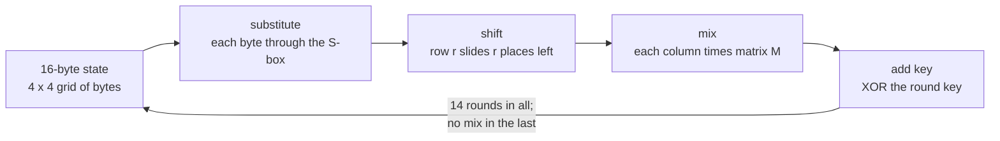
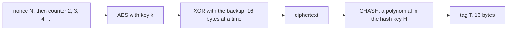

# AES: a block cipher as a keyed shuffle, and the modes that use it safely

[Syllabus](../../../SYLLABUS.md) → [Applied and computational](../README.md) → [Cryptography](../README.md#s04) → AES

---

## General Overview

A laptop writes a 4 GB backup of its disk to a cloud drive every night. That is 4 × 2^30 = 4,294,967,296 bytes: this card counts a gigabyte as 2^30 bytes, strictly a gibibyte (GiB). The owner wants two things. Nobody at the cloud company should be able to read it. And if anyone changes a single bit of it, the restore should refuse rather than quietly hand back a damaged disk.

The one-time pad already gives perfect secrecy ([The one-time pad](01-one-time-pad-and-perfect-secrecy.md)), but it needs a fresh random key as long as the message: another 4 GB of secret, every night. AES-256-GCM does the job with one 32-byte key and a 12-byte number that is new each night. It stores 28 extra bytes beside the backup and nothing else.

It works in two layers. **AES** (the Advanced Encryption Standard, US federal standard FIPS 197) is a **block cipher**: for each key it is a fixed shuffle of all possible 16-byte blocks, scrambled so thoroughly that without the key it looks like a random shuffle. **GCM** (Galois/Counter Mode) is a **mode**: a recipe that uses AES to make a long pad for the 4 GB file, then stamps the result with a 16-byte **tag**, a checksum only the key holder can make.

**AES turns a 32-byte key into a shuffle of 16-byte blocks that only the key can undo, and GCM uses that shuffle, with a number never used twice, to hide a file of any size and detect any change to it.**

**What kind of fact this is:** a standard, and an assumption behind it. That AES-256 needs about 2^256 operations to break is an assumption: it has survived public attack since 2001, but nobody has proved it. The best published attack on a single key saves under 2 bits of the 256; stronger attacks need several keys with a known relation between them, which keys chosen independently at random do not have. Proved on this card, in Why it works: every AES step can be undone, one changed byte reaches all 16 bytes in two rounds, and a forged GCM tag succeeds with chance at most about 1 in 2^100 for this backup.

### The picture: one round of AES, then the mode around it





Schematic: the first chart is the inside of AES, the second is GCM using AES as a part.

---

## The formula

One AES round on the state $s$, which starts as a 16-byte block XORed with round key $k_0$, and GCM on the backup's blocks:

$$s \;\leftarrow\; M \cdot \mathrm{ShiftRows}\big(S(s)\big) \,\oplus\, k_r, \qquad r = 1, 2, \dots, 14 \quad (\text{no } M \text{ in round } 14)$$

$$c_i = m_i \oplus E_k(N \,\|\, i{+}1), \qquad T = E_k(N \,\|\, 1) \oplus \mathrm{GHASH}_H(c_1, \dots, c_n), \qquad H = E_k(0)$$

**Read it aloud:** each round swaps every byte through a fixed table, slides the rows, mixes each column, and adds a key; GCM XORs each block of the file with AES of a never-repeated counter, then masks a polynomial checksum of the result to make the tag.

| Symbol | Plain meaning | In our example | Push it up and the answer… |
| --- | --- | --- | --- |
| $s$, $\leftarrow$ | the **state**: 16 bytes in a 4 × 4 grid, filled column by column; $s \leftarrow x$ means "replace $s$ by $x$" | starts as one 16-byte block of the backup | change one bit and about 65 of 128 output bits flip |
| $S$ | the **S-box**: each byte replaced by its reciprocal in the 256-element field, then scrambled by a fixed bit-mix | S(50) = 53 | — |
| ShiftRows | row $r$ of the grid slides $r$ places left (row 0 stays put) | moves 53 into column 0 | — |
| $M$ | the **mix matrix**, 4 × 4, entries 2, 3, 1, 1 rotated, arithmetic in the field | column 63 53 e0 8c becomes 5f 72 64 15 | — |
| $k_r$ | **round key** $r$, one of 15 ($k_0$ to $k_{14}$), 16 bytes each, grown from the 32-byte key by the key schedule (a short recipe of byte rotations, S-box lookups and XORs) | $k_1$ = 10 11 … 1f | — |
| $\oplus$, $\delta$, $\Delta$ | XOR: add bit by bit with 1 + 1 = 0 ([The one-time pad](01-one-time-pad-and-perfect-secrecy.md)); $\delta$ and $\Delta$ are XOR differences, between two versions of one byte and of the tag | 5f ⊕ 10 = 4f | — |
| $E_k$; $L$, $v$ | AES itself under key $k$: 16 bytes in, 16 bytes out, 14 rounds. Without the S-box it would be $E(x) = Lx \oplus v$: a fixed 128 × 128 bit matrix $L$ and a constant block $v$ | $k$ is 32 bytes, 256 bits | each extra key bit doubles the work of trying every key |
| $m_i$, $c_i$, $B_i$; $m$, $m'$, $c$, $c'$ | block $i$ of the backup, and of the stored ciphertext, called $B_i$ once GHASH reads it as a field element ($B'_i$ after a forger's change); $m$ and $m'$ are two whole backups under one nonce, $c$ and $c'$ their ciphertexts | 16 bytes each | — |
| $n$ | the number of 16-byte blocks | 268,435,456 | more AES calls and a weaker forgery bound, both in proportion |
| $N \,\|\, j$ | the **nonce** $N$ (a 12-byte number used once per key) followed by a 4-byte counter $j$ | one nonce per nightly backup | reuse it and the pad repeats |
| $H$, GHASH | the **hash key** $H = E_k(0)$, and the checksum that treats blocks as coefficients of a polynomial evaluated at $H$ | 128-bit field elements | — |
| $T$ | the **tag**: 16 bytes stored with the ciphertext and checked before decrypting | one per backup | — |

The S-box and $M$ use arithmetic in GF(2^8), the field of 256 bytes where adding is XOR and multiplying wraps by $x^8 + x^4 + x^3 + x + 1$; [Finite fields](../../03-Algebra/09-Rings%20and%20Fields/05-finite-fields.md) builds such fields, and AES is one of its named users. $M$ is an ordinary matrix multiplied in the usual row-by-column way ([Matrices](../../03-Algebra/04-Matrices/01-matrices-and-the-matrix-zoo.md)), only with field arithmetic inside.

### When it holds

- **The nonce is never reused under one key.** Reuse it and the two pads are identical, so XORing the two ciphertexts gives the XOR of the two backups: the reused one-time pad again.
- **AES behaves like a random shuffle for each key.** This is the assumption. If a shortcut were found, every bound on this card would shrink with it.
- **The tag is checked before any byte is used.** Decrypt first and a tampered backup restores silently, with exactly the bits the attacker chose flipped.
- **One message stays under the counter's limit.** The 4-byte counter allows at most 68,719,476,704 bytes in one GCM message; the 4 GB backup is far inside it.
- **With random nonces, at most 2^32 messages per key.** NIST SP 800-38D caps this so that the chance of a repeated nonce stays below about 1 in 2^32.

---

## Why it works

### Step 0: build a shuffle that looks random from steps that are easy to undo

A block cipher must be undoable, or the owner could not restore the backup. It must also look random to anyone without the key, or patterns in the disk would show through. The two ingredients were named in 1949, in the founding paper on secret writing as mathematics. **Confusion** makes each output bit depend on the key in a tangled, non-linear way. **Diffusion** spreads the effect of each input bit across the whole block. AES gets both by repeating one cheap round fourteen times. Each round is four steps, and every step is a bijection: it can be run backwards. A chain of bijections is a bijection, so the whole cipher can be run backwards with the key.

### Step 1: every step can be undone

- **Add key.** XOR with $k_r$ is undone by XOR with $k_r$ again.
- **Shift.** Sliding rows is a reordering; slide them back.
- **Substitute.** In a field every nonzero byte has exactly one reciprocal, so "replace by the reciprocal" is a bijection (0 is sent to 0). The fixed bit-mix afterwards is also undoable. For the byte 50: its reciprocal is ed, because 50 × ed = 01 in the field, and the bit-mix XORs ed with itself rotated 1, 2, 3 and 4 places (db, b7, 6f, de) and with 63, giving **53**.
- **Mix.** $M$ has an inverse matrix, with entries 0e, 0b, 0d, 09 (14, 11, 13, 9) rotated. The code multiplies them in the field and gets the identity.

So decryption exists: run the steps backwards with the inverse table, the inverse matrix and the round keys in reverse order. The code decrypts the standard's test block back to 00112233…ff.

### Step 2: the S-box supplies the confusion

Everything except the S-box is **linear** over bits: shifting and mixing send the XOR of two inputs to the XOR of their outputs, and adding a key only adds a constant. Take the S-box out, replacing it by "leave the byte alone", and the whole cipher obeys $E(a) \oplus E(b) \oplus E(c) = E(a \oplus b \oplus c)$ for every three blocks: XOR three outputs and the constant appears three times, which is once. The code checks this: **True** with no S-box, **False** with the real one. A cipher with that property is an affine map, $E(x) = Lx \oplus v$ for a fixed 128 × 128 bit matrix $L$ and constant block $v$. Then about 129 known blocks, one per input bit plus one, pin down $L$ and $v$ by elimination, and every other block decrypts without ever finding the key. The reciprocal map is very far from linear, and that is what stops the elimination.

### Step 3: shift and mix supply the diffusion

Change one byte of the state. The S-box changes that one byte. Shifting moves it but keeps it alone. Then mixing: if one byte of a column changes by $\delta$ (an XOR difference), each output byte of that column changes by $\delta$ times one entry of $M$'s column. Every entry of $M$ is nonzero, and in a field a product of two nonzero numbers is never zero. So **all 4 bytes of the column change**.

In round 2 the shift sends those 4 changed bytes into 4 different columns, one each. Mixing turns each into a fully changed column: **all 16 bytes change**. The code flips one plaintext bit and counts changed bytes after each round:

```
after round 1   ####                     4 of 16 bytes
after round 2   ################        16 of 16 bytes
after round 3   ################        16 of 16 bytes
after round 4   ################        16 of 16 bytes
no mix, 14      #                        1 of 16 bytes
```

The last bar is the same cipher with the mix step removed. Fourteen rounds later the change is still trapped in one byte. Over the full cipher, a one-bit change flips 65 of the 128 output bits, and averaged over all 128 single-bit flips it flips 65.19, close to half of the 128 bits, which is what a random shuffle would give.

Two rounds reach every byte. The other twelve are safety margin against attacks that look for patterns surviving a few rounds ([The Design of Rijndael](https://doi.org/10.1007/978-3-662-60769-5) gives the full argument, called the wide trail strategy).

### Step 4: AES alone is not enough, because it is deterministic

AES encrypts exactly 16 bytes, and the same block under the same key always gives the same output. A disk image is full of identical blocks, mostly zeros. Encrypt each 16-byte block separately (**ECB mode**, the electronic code book) and every zero block encrypts to the same 16 bytes. The code encrypts a header and three zero blocks: the ciphertext shows **2 distinct blocks out of 4**, and anyone can see where the empty space on the disk is.

**Counter mode** fixes this by never feeding AES the data at all. AES encrypts the nonce followed by a counter, 2, 3, 4 and so on, and the outputs are XORed onto the backup as a pad. Each counter value is different, so each pad block is different, and the four blocks come out **4 distinct**. This is the one-time pad with the pad generated from a short key. It inherits the pad's rule: never reuse a pad. Use the same key and nonce for two backups, $m$ on Monday and $m'$ on Tuesday, and the pads cancel: $c \oplus c' = m \oplus m'$. In the code Monday's backup held "balance: 1200.00". Anyone who knows that recovers Tuesday's "balance: 9875.50" from the two ciphertexts alone.

Counter mode has a second weakness. Flipping a ciphertext bit flips exactly that plaintext bit on decryption, and nothing notices. The code flips one bit and the header decrypts as "CACKUP v1 part 1".

### Step 5: the GCM tag catches any change, by counting polynomial roots

GCM adds a tag. Split the ciphertext into blocks $B_1, \dots, B_n$, add one last block $B_{n+1}$ holding the lengths, and read each block as an element of GF(2^128), a field of 2^128 elements. Then

$$\mathrm{GHASH}_H = B_1 H^{n+1} \oplus B_2 H^{n} \oplus \cdots \oplus B_{n+1} H,$$

a polynomial in the secret $H$ whose coefficients are the ciphertext blocks. The code computes it two ways: by Horner's rule (multiply as you go, which is how GCM is specified) and as this sum of powers. They agree.

<details>
<summary>Why a forger wins with chance at most about (n + 1) in 2^128</summary>

A forger changes the ciphertext from blocks $B$ to blocks $B'$ and must produce a matching tag. The mask $E_k(N \| 1)$ is the same for both, so the forger needs $\mathrm{GHASH}_H(B') = \mathrm{GHASH}_H(B) \oplus \Delta$ for some tag change $\Delta$ of their choosing. Move everything to one side: $H$ must be a root of the polynomial

$$(B_1 \oplus B'_1) H^{n+1} \oplus \cdots \oplus (B_{n+1} \oplus B'_{n+1}) H \oplus \Delta .$$

It is not the zero polynomial, because some block changed. A nonzero polynomial of degree at most $n + 1$ over a field has at most $n + 1$ roots. $H$ is one of 2^128 values, unknown to the forger. So the forgery works for at most $n + 1$ of them: chance at most $(n+1)/2^{128}$. Treating $H$ and the mask as truly random is where the AES assumption enters; The GCM paper in the Sources gives the full bound.

</details>

For the backup, $n + 1$ = 268,435,457, just over 2^28, so a forger's chance per attempt is about **2^-100**. When the code flips one ciphertext bit, the tag check says **False** and the restore refuses; the untouched ciphertext checks **True**.

One more bound, about the pad. AES under one key never gives the same output twice, while a truly random pad would repeat a block now and then. Over $n$ blocks that difference is visible with chance at most about $n^2 / 2^{129}$, the birthday bound for 128-bit blocks ([Hashes and MACs](03-hash-functions-and-macs.md) derives birthday bounds in general). For 2^28 blocks that is **2^-73**.

---

## Worked numbers, by hand

The standard's AES-256 test (FIPS 197, Appendix C.3): key 00 01 02 … 1f, plaintext 00 11 22 … ff. Round 0 is just "add key 0", which gives the round-1 start 00 10 20 30 40 50 … f0. Follow column 0 through round 1. After shifting, column 0 holds the diagonal bytes 00, 50, a0, f0. In hexadecimal, 02 · 63 means "63 times 2 in the field".

| Step | Arithmetic | Value |
| --- | --- | --- |
| reciprocal of 50 in GF(2^8) | search, or 50 raised to the power 254; check 50 × ed | ed, and 50 × ed = 01 |
| bit-mix of ed | ed ⊕ db ⊕ b7 ⊕ 6f ⊕ de ⊕ 63 | 53 |
| S-box on the diagonal | S(00), S(50), S(a0), S(f0) | 63, 53, e0, 8c |
| shift | row r slides r places left, lining them up | column 63 53 e0 8c |
| 02 · 63 | 63 is 0110 0011; shift left, top bit was 0 | c6 |
| 03 · 53 | 02 · 53 ⊕ 53 = a6 ⊕ 53 | f5 |
| top byte of the mixed column | c6 ⊕ f5 = 33; 33 ⊕ e0 = d3; d3 ⊕ 8c | 5f |
| the whole mixed column | the same with rows (1, 2, 3, 1), (1, 1, 2, 3), (3, 1, 1, 2) of M | 5f 72 64 15 |
| add round key 1 | 5f ⊕ 10, 72 ⊕ 11, 64 ⊕ 12, 15 ⊕ 13 | **4f 63 76 06** |

That column matches the standard's printed round-2 start, 4f637606…. Thirteen more rounds give the ciphertext **8ea2b7ca516745bfeafc49904b496089**, and the inverse cipher turns it back into 00112233…ff. So every byte of the backup goes through 14 such rounds, and the code reproduces the standard's answer to the bit.

GCM's own test vectors check the mode: with an all-zero key and nonce, the tag of an empty message is 530f8afbc74536b9a963b4f1c4cb738b, and one zero block encrypts to cea7403d4d606b6e074ec5d3baf39d18 with tag d0d1c8a799996bf0265b98b5d48ab919.

For the whole 4 GB backup:

| Step | Arithmetic | Value |
| --- | --- | --- |
| bytes | 4 × 2^30 | 4,294,967,296 |
| blocks, $n$ | 4,294,967,296 / 16 | 268,435,456 |
| AES calls | one per block, plus $H = E_k(0)$, plus the tag mask | 268,435,458 |
| GHASH multiplications | one per block, plus the length block | 268,435,457 |
| stored beside the backup | 12-byte nonce + 16-byte tag | **28 bytes** |
| forgery chance per attempt | about 2^28 / 2^128 | about 2^-100 |
| pad distinguishable from random | about (2^28)^2 / 2^129 | about 2^-73 |

So the backup grows by just 28 bytes, and both failure chances are far below anything that matters.

### What breaks if you drop a piece

| Mistake | Comes out at | What went wrong |
| --- | --- | --- |
| Drop the mix step | 1 byte of 16 changed after all 14 rounds | No diffusion: each byte is encrypted on its own, a 256-entry code book per position |
| Replace the S-box by "leave the byte alone" | E(a) ⊕ E(b) ⊕ E(c) = E(a ⊕ b ⊕ c): True | No confusion: the cipher is linear, solvable by elimination |
| Encrypt each block separately (ECB) | 2 distinct ciphertext blocks of 4 | Equal blocks give equal ciphertext; the zeros show |
| Reuse the nonce for two nights | Tuesday's "balance: 9875.50" recovered | The pad cancels: $c \oplus c' = m \oplus m'$ |
| Counter mode with no tag | one flipped bit restores as "CACKUP v1 part 1" | Counter mode is malleable; only the tag catches it |

---

## Code, from first principles, and it actually runs

Nothing is imported. The code builds the field GF(2^8), makes the S-box from reciprocals and the bit-mix, then writes out AES-256, its inverse, counter mode, GHASH and GCM. It takes four independent roads. The reciprocal is found by search and by raising to the 254th power. The cipher meets the standard's published round-1 state and ciphertext, and the inverse cipher undoes it. GCM meets two published test vectors, and GHASH is computed by Horner's rule and as a sum of powers. Then it counts the diffusion round by round, and prints every failure in the what-breaks table.

### Python

```python
# AES-256 and GCM -- the check behind the card.  Nothing is imported: the field
# GF(2^8), the S-box, the cipher, its inverse and GCM are all written out here.
# The key is a published test key (FIPS 197): never use it for real data.

def xt(a): return ((a << 1) ^ 0x11B) if a & 0x80 else a << 1   # times x, wrapped by x^8+x^4+x^3+x+1
def gmul(a, b):                                                # multiply in GF(2^8)
    p = 0
    while b:
        if b & 1: p ^= a
        a, b = xt(a), b >> 1
    return p
def inv_search(a): return next((b for b in range(1, 256) if gmul(a, b) == 1), 0)
def power(a, n): return 1 if n == 0 else gmul(a, power(a, n - 1))
def inv_power(a): return power(a, 254)                         # a^254 is a^-1, since a^255 = 1
def rotl(b, n): return ((b << n) | (b >> (8 - n))) & 0xFF
def affine(b): return b ^ rotl(b, 1) ^ rotl(b, 2) ^ rotl(b, 3) ^ rotl(b, 4) ^ 0x63
SBOX = [affine(inv_search(a)) for a in range(256)]
INV = [SBOX.index(y) for y in range(256)]
M = [[2, 3, 1, 1], [1, 2, 3, 1], [1, 1, 2, 3], [3, 1, 1, 2]]
MI = [[14, 11, 13, 9], [9, 14, 11, 13], [13, 9, 14, 11], [11, 13, 9, 14]]
def mix(A, s):                                                 # each column of s times the 4 x 4 matrix A
    return [gmul(A[r][0], s[4 * c]) ^ gmul(A[r][1], s[4 * c + 1]) ^ gmul(A[r][2], s[4 * c + 2])
            ^ gmul(A[r][3], s[4 * c + 3]) for c in range(4) for r in range(4)]
def shift(s, d=1): return [s[r + 4 * ((c + d * r) % 4)] for c in range(4) for r in range(4)]
def xor(a, b): return [x ^ y for x, y in zip(a, b)]
def expand(key):                                               # 32-byte key -> 15 round keys
    w = [list(key[4 * i:4 * i + 4]) for i in range(8)]
    rc = 1
    for i in range(8, 60):
        t = list(w[i - 1])
        if i % 8 == 0:
            t = [SBOX[b] for b in t[1:] + t[:1]]; t[0] ^= rc; rc = xt(rc)
        elif i % 8 == 4:
            t = [SBOX[b] for b in t]
        w.append(xor(w[i - 8], t))
    return [sum(w[4 * r:4 * r + 4], []) for r in range(15)]
def rounds(rk, block, mixing=True, sbox=SBOX):                 # the state after each of the 14 rounds
    s, out = xor(block, rk[0]), []
    for r in range(1, 15):
        s = shift([sbox[b] for b in s])
        if mixing and r < 14: s = mix(M, s)
        s = xor(s, rk[r]); out.append(s)
    return out
def E(rk, b): return rounds(rk, b)[-1]
def D(rk, b):                                                  # the inverse cipher, run backwards
    s = list(b)
    for r in range(14, 0, -1):
        s = xor(s, rk[r])
        if r < 14: s = mix(MI, s)
        s = [INV[x] for x in shift(s, -1)]
    return xor(s, rk[0])

def gf128(x, y):                                               # multiply in GF(2^128), GCM's bit order
    z = 0
    for i in range(127, -1, -1):
        if (x >> i) & 1: z ^= y
        y = (y >> 1) ^ (0xE1 << 120) if y & 1 else y >> 1
    return z
def num(b): return int.from_bytes(bytes(b), "big")
def blk(n): return list(n.to_bytes(16, "big"))
def pieces(c, aad=()):                                         # padded 128-bit blocks, then the lengths
    bs = [num(list(p[i:i + 16]) + [0] * (16 - len(p[i:i + 16]))) for p in (aad, c) for i in range(0, len(p), 16)]
    return bs + [(len(aad) * 8) << 64 | len(c) * 8]
def ghash(H, bs):                                              # road 1: multiply as you go (Horner)
    x = 0
    for b in bs: x = gf128(x ^ b, H)
    return x
def ghash_sum(H, bs):                                          # road 2: sum of block_j times H^(n+1-j)
    total, p = 0, H
    for b in reversed(bs): total, p = total ^ gf128(b, p), gf128(p, H)
    return total
def ctr(rk, j0, data):                                         # counter mode: XOR with E(nonce || 2, 3, ...)
    return [x for i in range(0, len(data), 16) for x in xor(data[i:i + 16], E(rk, blk(j0 + 1 + i // 16)))]
def gcm(key, nonce, data):                                     # returns ciphertext and tag
    rk = expand(key); H = num(E(rk, [0] * 16)); j0 = num(list(nonce) + [0, 0, 0, 1])
    c = ctr(rk, j0, list(data))
    return c, num(E(rk, blk(j0))) ^ ghash(H, pieces(c))
def opens(key, nonce, c, tag):                                 # the receiver: check the tag first
    rk = expand(key); H = num(E(rk, [0] * 16)); j0 = num(list(nonce) + [0, 0, 0, 1])
    return num(E(rk, blk(j0))) ^ ghash(H, pieces(c)) == tag
def hx(b): return bytes(b).hex()
key, pt = list(range(32)), list(bytes.fromhex("00112233445566778899aabbccddeeff"))
rk = expand(key)
print("AES-256: key", 8 * len(key), "bits, block", 8 * len(pt), "bits,", len(rk) - 1, "rounds; GCM nonce 96 bits, tag 128 bits")
print("S(00) S(50) S(a0) S(f0) S(53):", " ".join(f"{SBOX[a]:02x}" for a in (0, 0x50, 0xA0, 0xF0, 0x53)))
print(f"inverse of 50: by search {inv_search(0x50):02x}, by power 254 {inv_power(0x50):02x}, 50 x it = {gmul(0x50, inv_power(0x50)):02x}")
print("affine(ed): xor of", " ".join(f"{rotl(0xED, n):02x}" for n in range(5)), f"and 63 = {affine(0xED):02x}")
eye = [int(r == c) for c in range(4) for r in range(4)]
MMI = mix(M, [MI[r][c] for c in range(4) for r in range(4)])   # M times MI, column by column
print("M times its inverse is the identity:", MMI == eye)
st = xor(pt, rk[0]); sb = [SBOX[b] for b in st]; sr = shift(sb); mc = mix(M, sr)
for name, v in (("start", st), ("s_box", sb), ("s_row", sr), ("m_col", mc), ("k_sch", rk[1]), ("end", xor(mc, rk[1]))):
    print(f"round 1 {name:<6}{hx(v)}")
a, b = gmul(2, 0x63), gmul(3, 0x53)
print(f"column 0 by hand: 02.63={a:02x} 02.53={gmul(2, 0x53):02x} 03.53={b:02x}; {a:02x}^{b:02x}={a ^ b:02x} ^e0={a ^ b ^ 0xE0:02x} ^8c={a ^ b ^ 0xE0 ^ 0x8C:02x}")
ct = E(rk, pt)
print("FIPS 197 C.3 ciphertext", hx(ct), "decrypts to", hx(D(rk, ct)))
flip = [pt[0] ^ 1] + pt[1:]
diff = [sum(x != y for x, y in zip(s1, s2)) for s1, s2 in zip(rounds(rk, pt), rounds(rk, flip))]
bits = lambda u, v: sum(bin(x ^ y).count("1") for x, y in zip(u, v))
avg = sum(bits(ct, E(rk, pt[:i // 8] + [pt[i // 8] ^ (1 << (i % 8))] + pt[i // 8 + 1:])) for i in range(128)) / 128
nomix = [sum(x != y for x, y in zip(s1, s2)) for s1, s2 in zip(rounds(rk, pt, False), rounds(rk, flip, False))]
print("one plaintext bit flipped, bytes changed after rounds 1-4:", diff[:4], "after 14:", diff[13])
print(f"bits changed: this flip {bits(ct, E(rk, flip))} of 128, average over all 128 flips {avg:.2f}")
print("no MixColumns, bytes changed after 14 rounds:", nomix[13])
ident, m2, m3 = list(range(256)), [7] * 16, list(range(16, 32))
lin = lambda sb: xor(xor(rounds(rk, pt, True, sb)[-1], rounds(rk, m2, True, sb)[-1]), rounds(rk, m3, True, sb)[-1]) == rounds(rk, xor(xor(pt, m2), m3), True, sb)[-1]
print("E(a)^E(b)^E(c) == E(a^b^c): identity S-box", lin(ident), "| real S-box", lin(SBOX), "| blocks to solve a linear one, 128 + 1:", 8 * len(pt) + 1)
c13, t13 = gcm([0] * 32, [0] * 12, [])
c14, t14 = gcm([0] * 32, [0] * 12, [0] * 16)
print(f"GCM test 13 tag {t13:032x}")
print(f"GCM test 14 ct {hx(c14)} tag {t14:032x}")
H0, bs = num(E(expand([0] * 32), [0] * 16)), pieces(c14)
print("GHASH by Horner equals GHASH as a sum of powers:", ghash(H0, bs) == ghash_sum(H0, bs))
nonce, backup = list(bytes.fromhex("cafebabefacedbaddecaf888")), list(b"BACKUP v1 part 1") + [0] * 48
ecb = [hx(E(rk, backup[i:i + 16]))[:8] for i in range(0, 64, 16)]
cg, tg = gcm(key, nonce, backup)
gc = [hx(cg[i:i + 16])[:8] for i in range(0, 64, 16)]
print("backup, 4 blocks, ECB:", " ".join(ecb), "distinct", len(set(ecb)))
print("backup, 4 blocks, GCM:", " ".join(gc), "distinct", len(set(gc)))
bad = [cg[0] ^ 1] + cg[1:]
j0 = num(nonce + [0, 0, 0, 1])
print("one bit flipped: counter mode alone reads", bytes(ctr(rk, j0, bad)[:16]).decode("latin-1"), "| GCM accepts:", opens(key, nonce, bad, tg), "| untouched:", opens(key, nonce, cg, tg))
m1, m2 = list(b"balance: 1200.00"), list(b"balance: 9875.50")
k1, k2 = gcm(key, nonce, m1)[0], gcm(key, nonce, m2)[0]
print("nonce reused: c1^c2 == m1^m2:", xor(k1, k2) == xor(m1, m2), "| m1 known, so m2 =", bytes(xor(xor(k1, k2), m1)).decode("latin-1"))
size = 4 * 2 ** 30; nb = size // 16; q = 2 ** 32
print(f"4 GB backup: {size} bytes = {nb} blocks; AES calls {nb + 2}; GHASH multiplies {nb + 1}; stored extra {12 + 16} bytes")
print(f"one GCM message may hold at most {(2 ** 32 - 2) * 16} bytes")
print(f"random 96-bit nonces, {q} messages: repeat chance about 1 in {2 ** 97 // (q * (q - 1))}")
print(f"tag forgery per try at most about 2^{(nb + 1).bit_length() - 1 - 128}; block birthday 2^{2 * (nb.bit_length() - 1) - 129}")
assert SBOX[0x00] == 0x63 and SBOX[0x53] == 0xED and all(SBOX[a] == affine(inv_power(a)) for a in range(256))
assert hx(mc) == "5f72641557f5bc92f7be3b291db9f91a"           # FIPS 197 C.3, round[1].m_col
assert hx(ct) == "8ea2b7ca516745bfeafc49904b496089" and D(rk, ct) == pt
assert t13 == 0x530f8afbc74536b9a963b4f1c4cb738b and hx(c14) == "cea7403d4d606b6e074ec5d3baf39d18"
assert t14 == 0xd0d1c8a799996bf0265b98b5d48ab919 and ghash(H0, bs) == ghash_sum(H0, bs)
assert diff[:2] == [4, 16] and nomix[13] == 1 and 60 < avg < 68 and lin(ident) and not lin(SBOX)
assert len(set(ecb)) == 2 and len(set(gc)) == 4 and not opens(key, nonce, bad, tg) and opens(key, nonce, cg, tg)
assert bytes(xor(xor(k1, k2), m1)) == b"balance: 9875.50" and MMI == eye
print("ALL CHECKS PASS")
```

**Ran 2026-11-11 on macOS, Python 3.14.10, standard library only. All checks passed. Output, pasted from the run:**

```
AES-256: key 256 bits, block 128 bits, 14 rounds; GCM nonce 96 bits, tag 128 bits
S(00) S(50) S(a0) S(f0) S(53): 63 53 e0 8c ed
inverse of 50: by search ed, by power 254 ed, 50 x it = 01
affine(ed): xor of ed db b7 6f de and 63 = 53
M times its inverse is the identity: True
round 1 start 00102030405060708090a0b0c0d0e0f0
round 1 s_box 63cab7040953d051cd60e0e7ba70e18c
round 1 s_row 6353e08c0960e104cd70b751bacad0e7
round 1 m_col 5f72641557f5bc92f7be3b291db9f91a
round 1 k_sch 101112131415161718191a1b1c1d1e1f
round 1 end   4f63760643e0aa85efa7213201a4e705
column 0 by hand: 02.63=c6 02.53=a6 03.53=f5; c6^f5=33 ^e0=d3 ^8c=5f
FIPS 197 C.3 ciphertext 8ea2b7ca516745bfeafc49904b496089 decrypts to 00112233445566778899aabbccddeeff
one plaintext bit flipped, bytes changed after rounds 1-4: [4, 16, 16, 16] after 14: 16
bits changed: this flip 65 of 128, average over all 128 flips 65.19
no MixColumns, bytes changed after 14 rounds: 1
E(a)^E(b)^E(c) == E(a^b^c): identity S-box True | real S-box False | blocks to solve a linear one, 128 + 1: 129
GCM test 13 tag 530f8afbc74536b9a963b4f1c4cb738b
GCM test 14 ct cea7403d4d606b6e074ec5d3baf39d18 tag d0d1c8a799996bf0265b98b5d48ab919
GHASH by Horner equals GHASH as a sum of powers: True
backup, 4 blocks, ECB: 780b30d9 f29000b6 f29000b6 f29000b6 distinct 2
backup, 4 blocks, GCM: c8e2e36d 0d20c051 ad50c146 5954a951 distinct 4
one bit flipped: counter mode alone reads CACKUP v1 part 1 | GCM accepts: False | untouched: True
nonce reused: c1^c2 == m1^m2: True | m1 known, so m2 = balance: 9875.50
4 GB backup: 4294967296 bytes = 268435456 blocks; AES calls 268435458; GHASH multiplies 268435457; stored extra 28 bytes
one GCM message may hold at most 68719476704 bytes
random 96-bit nonces, 4294967296 messages: repeat chance about 1 in 8589934594
tag forgery per try at most about 2^-100; block birthday 2^-73
ALL CHECKS PASS
```

### Rust

The same checks with the same inputs. Rust's 128-bit integers hold one GF(2^128) element exactly, so GHASH needs no big-number code.

```rust
// AES-256 and GCM -- the same check as symmetric_ciphers_and_aes_check.py, in Rust.
// Standard library only, no crates.  The field GF(2^8), the S-box, the cipher, its
// inverse and GCM are all written out.  The key is a published test key (FIPS 197).
// Compile: rustc --edition 2021 -O symmetric_ciphers_and_aes_check.rs -o /tmp/aes_check
fn xt(a: u8) -> u8 { if a & 0x80 != 0 { (a << 1) ^ 0x1B } else { a << 1 } } // times x, wrapped
fn gmul(mut a: u8, mut b: u8) -> u8 {                                       // multiply in GF(2^8)
    let mut p = 0;
    while b != 0 { if b & 1 != 0 { p ^= a; } a = xt(a); b >>= 1; } p
}
fn inv_search(a: u8) -> u8 { (1..=255u8).find(|&b| gmul(a, b) == 1).unwrap_or(0) }
fn inv_power(a: u8) -> u8 { (0..254).fold(1u8, |r, _| gmul(r, a)) }       // a^254 is a^-1
fn affine(b: u8) -> u8 { b ^ b.rotate_left(1) ^ b.rotate_left(2) ^ b.rotate_left(3) ^ b.rotate_left(4) ^ 0x63 }
const M: [[u8; 4]; 4] = [[2, 3, 1, 1], [1, 2, 3, 1], [1, 1, 2, 3], [3, 1, 1, 2]];
const MI: [[u8; 4]; 4] = [[14, 11, 13, 9], [9, 14, 11, 13], [13, 9, 14, 11], [11, 13, 9, 14]];
type B = Vec<u8>;
fn mix(a: &[[u8; 4]; 4], s: &[u8]) -> B {                                 // each column of s times a
    (0..16).map(|i| (0..4).fold(0, |v, j| v ^ gmul(a[i % 4][j], s[4 * (i / 4) + j]))).collect()
}
fn shift(s: &[u8], d: i32) -> B { (0..16i32).map(|i| s[(i % 4 + 4 * (i / 4 + d * (i % 4)).rem_euclid(4)) as usize]).collect() }
fn xor(a: &[u8], b: &[u8]) -> B { a.iter().zip(b).map(|(x, y)| x ^ y).collect() }
fn hx(b: &[u8]) -> String { b.iter().map(|x| format!("{:02x}", x)).collect() }
fn py(b: bool) -> &'static str { if b { "True" } else { "False" } }
struct Aes { sbox: [u8; 256], inv: [u8; 256] }
impl Aes {
    fn expand(&self, key: &[u8]) -> Vec<B> {                                // 32-byte key -> 15 round keys
        let mut w: Vec<B> = (0..8).map(|i| key[4 * i..4 * i + 4].to_vec()).collect();
        let mut rc = 1u8;
        for i in 8..60 {
            let mut t = w[i - 1].clone();
            if i % 8 == 0 {
                t.rotate_left(1); t = t.iter().map(|&b| self.sbox[b as usize]).collect(); t[0] ^= rc; rc = xt(rc);
            } else if i % 8 == 4 { t = t.iter().map(|&b| self.sbox[b as usize]).collect(); }
            w.push(xor(&w[i - 8], &t));
        }
        (0..15).map(|r| w[4 * r..4 * r + 4].concat()).collect()
    }
    fn rounds(&self, rk: &[B], block: &[u8], mixing: bool, sbox: &[u8; 256]) -> Vec<B> {
        let mut s = xor(block, &rk[0]);
        let mut out = vec![];
        for r in 1..15 {
            s = shift(&s.iter().map(|&b| sbox[b as usize]).collect::<B>(), 1);
            if mixing && r < 14 { s = mix(&M, &s); }
            s = xor(&s, &rk[r]); out.push(s.clone());
        }
        out
    }
    fn e(&self, rk: &[B], b: &[u8]) -> B { self.rounds(rk, b, true, &self.sbox)[13].clone() }
    fn d(&self, rk: &[B], b: &[u8]) -> B {                                  // the inverse cipher
        let mut s = b.to_vec();
        for r in (1..15).rev() {
            s = xor(&s, &rk[r]);
            if r < 14 { s = mix(&MI, &s); }
            s = shift(&s, -1).iter().map(|&x| self.inv[x as usize]).collect();
        }
        xor(&s, &rk[0])
    }
}
fn gf128(x: u128, mut y: u128) -> u128 {                                   // GF(2^128), GCM's bit order
    let mut z = 0;
    for i in (0..128).rev() {
        if (x >> i) & 1 == 1 { z ^= y; }
        y = if y & 1 == 1 { (y >> 1) ^ (0xE1u128 << 120) } else { y >> 1 };
    }
    z
}
fn num(b: &[u8]) -> u128 { b.iter().fold(0, |v, &x| (v << 8) | x as u128) }
fn blk(n: u128) -> B { n.to_be_bytes().to_vec() }
fn pieces(c: &[u8]) -> Vec<u128> {                                         // padded blocks, then lengths
    let mut bs: Vec<u128> = c.chunks(16).map(|p| { let mut v = p.to_vec(); v.resize(16, 0); num(&v) }).collect();
    bs.push(c.len() as u128 * 8); bs
}
fn ghash(h: u128, bs: &[u128]) -> u128 { bs.iter().fold(0, |x, &b| gf128(x ^ b, h)) }
fn ghash_sum(h: u128, bs: &[u128]) -> u128 {                               // sum of block_j times H^(n+1-j)
    let (mut total, mut p) = (0, h);
    for &b in bs.iter().rev() { total ^= gf128(b, p); p = gf128(p, h); } total
}
fn ctr(a: &Aes, rk: &[B], j0: u128, data: &[u8]) -> B {
    data.chunks(16).enumerate().flat_map(|(i, p)| xor(p, &a.e(rk, &blk(j0 + 1 + i as u128)))).collect()
}
fn tag(a: &Aes, key: &[u8], nonce: &[u8], c: &[u8]) -> u128 {            // E(nonce || 1) xor GHASH
    let rk = a.expand(key);
    let j0 = num(&[nonce, &[0, 0, 0, 1]].concat());
    num(&a.e(&rk, &blk(j0))) ^ ghash(num(&a.e(&rk, &[0; 16])), &pieces(c))
}
fn gcm(a: &Aes, key: &[u8], nonce: &[u8], data: &[u8]) -> (B, u128) {
    let c = ctr(a, &a.expand(key), num(&[nonce, &[0, 0, 0, 1]].concat()), data);
    let t = tag(a, key, nonce, &c); (c, t)
}
fn opens(a: &Aes, key: &[u8], nonce: &[u8], c: &[u8], t: u128) -> bool { tag(a, key, nonce, c) == t }
fn unhex(s: &str) -> B { (0..s.len()).step_by(2).map(|i| u8::from_str_radix(&s[i..i + 2], 16).unwrap()).collect() }
fn changed(u: &[B], v: &[B]) -> Vec<usize> { u.iter().zip(v).map(|(s1, s2)| s1.iter().zip(s2).filter(|(x, y)| x != y).count()).collect() }
fn bits(u: &[u8], v: &[u8]) -> u32 { u.iter().zip(v).map(|(x, y)| (x ^ y).count_ones()).sum() }
fn main() {
    let (mut sbox, mut inv) = ([0u8; 256], [0u8; 256]);
    for a in 0..256 { sbox[a] = affine(inv_search(a as u8)); inv[sbox[a] as usize] = a as u8; }
    let aes = Aes { sbox, inv };
    let (key, pt): (B, B) = ((0..32).collect(), unhex("00112233445566778899aabbccddeeff"));
    let rk = aes.expand(&key);
    println!("AES-256: key {} bits, block {} bits, {} rounds; GCM nonce 96 bits, tag 128 bits", 8 * key.len(), 8 * pt.len(), rk.len() - 1);
    println!("S(00) S(50) S(a0) S(f0) S(53): {}", [0, 0x50, 0xA0, 0xF0, 0x53].iter().map(|&a| format!("{:02x}", sbox[a])).collect::<Vec<_>>().join(" "));
    println!("inverse of 50: by search {:02x}, by power 254 {:02x}, 50 x it = {:02x}", inv_search(0x50), inv_power(0x50), gmul(0x50, inv_power(0x50)));
    println!("affine(ed): xor of {} and 63 = {:02x}", (0..5).map(|n| format!("{:02x}", 0xEDu8.rotate_left(n))).collect::<Vec<_>>().join(" "), affine(0xED));
    let eye: B = (0..16).map(|i| (i % 4 == i / 4) as u8).collect();
    let mi_cols: B = (0..16).map(|i| MI[i % 4][i / 4]).collect();
    let mmi = mix(&M, &mi_cols);                                            // M times MI, column by column
    println!("M times its inverse is the identity: {}", py(mmi == eye));
    let st = xor(&pt, &rk[0]);
    let sb: B = st.iter().map(|&b| sbox[b as usize]).collect();
    let (sr, mc) = (shift(&sb, 1), mix(&M, &shift(&sb, 1)));
    for (name, v) in [("start", &st), ("s_box", &sb), ("s_row", &sr), ("m_col", &mc), ("k_sch", &rk[1]), ("end", &xor(&mc, &rk[1]))] {
        println!("round 1 {:<6}{}", name, hx(v));
    }
    let (a, b) = (gmul(2, 0x63), gmul(3, 0x53));                           // one column, by hand
    println!("column 0 by hand: 02.63={:02x} 02.53={:02x} 03.53={:02x}; {:02x}^{:02x}={:02x} ^e0={:02x} ^8c={:02x}", a, gmul(2, 0x53), b, a, b, a ^ b, a ^ b ^ 0xE0, a ^ b ^ 0xE0 ^ 0x8C);
    let ct = aes.e(&rk, &pt);
    println!("FIPS 197 C.3 ciphertext {} decrypts to {}", hx(&ct), hx(&aes.d(&rk, &ct)));
    let mut flip = pt.clone(); flip[0] ^= 1;
    let diff = changed(&aes.rounds(&rk, &pt, true, &sbox), &aes.rounds(&rk, &flip, true, &sbox));
    let total: u32 = (0..128).map(|i| { let mut f = pt.clone(); f[i / 8] ^= 1 << (i % 8); bits(&ct, &aes.e(&rk, &f)) }).sum();
    let avg = total as f64 / 128.0;
    let nomix = changed(&aes.rounds(&rk, &pt, false, &sbox), &aes.rounds(&rk, &flip, false, &sbox));
    println!("one plaintext bit flipped, bytes changed after rounds 1-4: {:?} after 14: {}", &diff[..4], diff[13]);
    println!("bits changed: this flip {} of 128, average over all 128 flips {:.2}", bits(&ct, &aes.e(&rk, &flip)), avg);
    println!("no MixColumns, bytes changed after 14 rounds: {}", nomix[13]);
    let ident: [u8; 256] = std::array::from_fn(|i| i as u8);
    let (m2, m3): (B, B) = (vec![7; 16], (16..32).collect());
    let lin = |s: &[u8; 256]| {
        let f = |m: &[u8]| aes.rounds(&rk, m, true, s)[13].clone();
        xor(&xor(&f(&pt), &f(&m2)), &f(&m3)) == f(&xor(&xor(&pt, &m2), &m3))
    };
    println!("E(a)^E(b)^E(c) == E(a^b^c): identity S-box {} | real S-box {} | blocks to solve a linear one, 128 + 1: {}", py(lin(&ident)), py(lin(&sbox)), 8 * pt.len() + 1);
    let (_, t13) = gcm(&aes, &[0; 32], &[0; 12], &[]);
    let (c14, t14) = gcm(&aes, &[0; 32], &[0; 12], &[0; 16]);
    println!("GCM test 13 tag {:032x}", t13);
    println!("GCM test 14 ct {} tag {:032x}", hx(&c14), t14);
    let (h0, bs) = (num(&aes.e(&aes.expand(&[0; 32]), &[0; 16])), pieces(&c14));
    println!("GHASH by Horner equals GHASH as a sum of powers: {}", py(ghash(h0, &bs) == ghash_sum(h0, &bs)));
    let nonce = unhex("cafebabefacedbaddecaf888");
    let backup: B = [b"BACKUP v1 part 1".to_vec(), vec![0; 48]].concat();
    let ecb: Vec<String> = backup.chunks(16).map(|p| hx(&aes.e(&rk, p))[..8].to_string()).collect();
    let (cg, tg) = gcm(&aes, &key, &nonce, &backup);
    let gc: Vec<String> = cg.chunks(16).map(|p| hx(p)[..8].to_string()).collect();
    let distinct = |v: &Vec<String>| v.iter().enumerate().filter(|(i, x)| !v[..*i].contains(x)).count();
    println!("backup, 4 blocks, ECB: {} distinct {}", ecb.join(" "), distinct(&ecb));
    println!("backup, 4 blocks, GCM: {} distinct {}", gc.join(" "), distinct(&gc));
    let mut bad = cg.clone(); bad[0] ^= 1;
    let j0 = num(&[&nonce[..], &[0, 0, 0, 1]].concat());
    let read = ctr(&aes, &rk, j0, &bad)[..16].iter().map(|&x| x as char).collect::<String>();
    println!("one bit flipped: counter mode alone reads {} | GCM accepts: {} | untouched: {}", read, py(opens(&aes, &key, &nonce, &bad, tg)), py(opens(&aes, &key, &nonce, &cg, tg)));
    let (m1, m2b) = (b"balance: 1200.00".to_vec(), b"balance: 9875.50".to_vec());
    let (k1, k2) = (gcm(&aes, &key, &nonce, &m1).0, gcm(&aes, &key, &nonce, &m2b).0);
    let got = xor(&xor(&k1, &k2), &m1).iter().map(|&x| x as char).collect::<String>();
    println!("nonce reused: c1^c2 == m1^m2: {} | m1 known, so m2 = {}", py(xor(&k1, &k2) == xor(&m1, &m2b)), got);
    let (size, q): (u128, u128) = (4 << 30, 1 << 32);
    let nb = size / 16;
    let log2 = |n: u128| 127 - n.leading_zeros() as i64;
    println!("4 GB backup: {} bytes = {} blocks; AES calls {}; GHASH multiplies {}; stored extra {} bytes", size, nb, nb + 2, nb + 1, 12 + 16);
    println!("one GCM message may hold at most {} bytes", ((1u128 << 32) - 2) * 16);
    println!("random 96-bit nonces, {} messages: repeat chance about 1 in {}", q, (1u128 << 97) / (q * (q - 1)));
    println!("tag forgery per try at most about 2^{}; block birthday 2^{}", log2(nb + 1) - 128, 2 * log2(nb) - 129);
    assert!(sbox[0x00] == 0x63 && sbox[0x53] == 0xED && (0..=255u8).all(|a| sbox[a as usize] == affine(inv_power(a))));
    assert_eq!(hx(&mc), "5f72641557f5bc92f7be3b291db9f91a");               // FIPS 197 C.3, round[1].m_col
    assert!(hx(&ct) == "8ea2b7ca516745bfeafc49904b496089" && aes.d(&rk, &ct) == pt);
    assert!(t13 == 0x530f8afbc74536b9a963b4f1c4cb738b && hx(&c14) == "cea7403d4d606b6e074ec5d3baf39d18");
    assert!(t14 == 0xd0d1c8a799996bf0265b98b5d48ab919 && ghash(h0, &bs) == ghash_sum(h0, &bs));
    assert!(diff[..2] == [4, 16] && nomix[13] == 1 && 60.0 < avg && avg < 68.0 && lin(&ident) && !lin(&sbox));
    assert!(distinct(&ecb) == 2 && distinct(&gc) == 4 && !opens(&aes, &key, &nonce, &bad, tg) && opens(&aes, &key, &nonce, &cg, tg));
    assert!(got == "balance: 9875.50" && mmi == eye);
    println!("ALL CHECKS PASS");
}
```

**Ran 2026-11-11 on macOS, rustc 1.98.1, no crates. All checks passed. Output, pasted from the run:**

```
AES-256: key 256 bits, block 128 bits, 14 rounds; GCM nonce 96 bits, tag 128 bits
S(00) S(50) S(a0) S(f0) S(53): 63 53 e0 8c ed
inverse of 50: by search ed, by power 254 ed, 50 x it = 01
affine(ed): xor of ed db b7 6f de and 63 = 53
M times its inverse is the identity: True
round 1 start 00102030405060708090a0b0c0d0e0f0
round 1 s_box 63cab7040953d051cd60e0e7ba70e18c
round 1 s_row 6353e08c0960e104cd70b751bacad0e7
round 1 m_col 5f72641557f5bc92f7be3b291db9f91a
round 1 k_sch 101112131415161718191a1b1c1d1e1f
round 1 end   4f63760643e0aa85efa7213201a4e705
column 0 by hand: 02.63=c6 02.53=a6 03.53=f5; c6^f5=33 ^e0=d3 ^8c=5f
FIPS 197 C.3 ciphertext 8ea2b7ca516745bfeafc49904b496089 decrypts to 00112233445566778899aabbccddeeff
one plaintext bit flipped, bytes changed after rounds 1-4: [4, 16, 16, 16] after 14: 16
bits changed: this flip 65 of 128, average over all 128 flips 65.19
no MixColumns, bytes changed after 14 rounds: 1
E(a)^E(b)^E(c) == E(a^b^c): identity S-box True | real S-box False | blocks to solve a linear one, 128 + 1: 129
GCM test 13 tag 530f8afbc74536b9a963b4f1c4cb738b
GCM test 14 ct cea7403d4d606b6e074ec5d3baf39d18 tag d0d1c8a799996bf0265b98b5d48ab919
GHASH by Horner equals GHASH as a sum of powers: True
backup, 4 blocks, ECB: 780b30d9 f29000b6 f29000b6 f29000b6 distinct 2
backup, 4 blocks, GCM: c8e2e36d 0d20c051 ad50c146 5954a951 distinct 4
one bit flipped: counter mode alone reads CACKUP v1 part 1 | GCM accepts: False | untouched: True
nonce reused: c1^c2 == m1^m2: True | m1 known, so m2 = balance: 9875.50
4 GB backup: 4294967296 bytes = 268435456 blocks; AES calls 268435458; GHASH multiplies 268435457; stored extra 28 bytes
one GCM message may hold at most 68719476704 bytes
random 96-bit nonces, 4294967296 messages: repeat chance about 1 in 8589934594
tag forgery per try at most about 2^-100; block birthday 2^-73
ALL CHECKS PASS
```

The two outputs match line for line.

> [!TIP]
> **Try changing**
> Guess first, then run it. The asserts are pinned to the published test vectors, so most changes stop the script.
> - **Guess first: does the cipher still match the standard without the mix step?** In `rounds`, change the default to `mixing=False`. No: the third assert stops it, and a one-bit change now stays in 1 byte.
> - **Guess first: what does a different field do?** Change `0x11B` to `0x11D` in `xt`, another polynomial of degree 8. The S-box changes completely, so the first assert stops it. The field is part of the standard, not a free choice.
> - **Guess first: does a fresh nonce stop the leak?** Give the Tuesday backup its own nonce, for example `nonce[:11] + [nonce[11] ^ 1]`. The leak line prints `False` and the "recovered" text is noise, so the last assert stops it.
> - **Guess first: can a forger fix the tag instead?** Pass `tg ^ 1` to `opens` with the untouched ciphertext. It prints `False`: any change to ciphertext or tag is caught.

---

## The usual mistake

> [!warning]
> **Reusing a nonce.** GCM's whole safety rests on never using the same key and nonce twice. Reuse it once and the two pads cancel: $c \oplus c' = m \oplus m'$, and Monday's known "balance: 1200.00" hands over Tuesday's "balance: 9875.50". Worse, NIST SP 800-38D warns that the two tags then let an attacker solve for $H$ and forge tags at will. A backup tool that restarts its nonce counter after a crash, or copies a configuration to a second laptop with the same key, does exactly this.
>
> - **Using AES "on its own" (ECB).** Equal blocks encrypt equally: the code's four blocks show 2 distinct ciphertexts, and the empty space on the disk is visible.
> - **Decrypting before checking the tag.** Counter mode returns "CACKUP v1 part 1" for one flipped bit, with no warning. Check the tag over the whole file first.
> - **Random nonces with no count.** A 12-byte random nonce is fine for a while: after 2^32 messages a repeat has chance about 1 in 8,589,934,594, and NIST stops there. A counter that never repeats has no such limit.
> - **One giant message.** A single GCM message holds at most 68,719,476,704 bytes. Split anything bigger into parts, each with its own nonce.

---

## Where you meet it in real life

- **Web pages.** AES-GCM is one of the standard ciphers of TLS 1.3, the protocol behind HTTPS, and encrypts the traffic once the keys are agreed ([The TLS handshake](08-key-exchange-in-practice-the-tls-handshake.md)).
- **Laptop and phone disks.** Full-disk encryption runs AES on every sector, usually in XTS mode, a mode built for disks that cannot store an extra nonce per sector.
- **Wi-Fi.** WPA2 and WPA3 protect each radio frame with AES in an authenticated mode.
- **Processors.** Most laptop and phone chips have AES instructions built in, so one AES round costs one instruction and the 268,435,458 AES calls of the backup are cheap.
- **Backups and archives.** Encrypted backup tools and encrypted archive formats use AES-256 with an authenticated mode, exactly as on this card.

> **Say it back**
> AES is a keyed shuffle of 16-byte blocks: fourteen rounds of substitute, shift, mix and add key, each step undoable, so the key can run it backwards. The S-box gives confusion; without it the cipher is linear and solvable. Shift and mix give diffusion: one changed byte reaches all 16 in two rounds. AES alone repeats on equal blocks, so a mode is needed: GCM XORs the file with AES of a never-repeated nonce and counter, then adds a tag that catches any change except with chance about 2^-100 for a 4 GB backup. Reuse a nonce and both the secrecy and the tag fail.

---

## What this builds on

- [The one-time pad](01-one-time-pad-and-perfect-secrecy.md): XOR, and why a pad used twice leaks the XOR of the two messages. Counter mode is a pad grown from a short key, with the same rule.
- [Finite fields](../../03-Algebra/09-Rings%20and%20Fields/05-finite-fields.md): building a field from polynomials wrapped by one that does not factor. AES uses the 256-element field for its S-box and mix step, and GCM uses the 2^128-element field for its tag.
- [Matrices](../../03-Algebra/04-Matrices/01-matrices-and-the-matrix-zoo.md): a matrix times a column. The mix step is a 4 × 4 matrix times each column of the state.

## Where this goes next

- [Hashes and MACs](03-hash-functions-and-macs.md): checksums without a block cipher, the birthday bound in general, and MACs, of which the GCM tag is one kind.

The question this card leaves open: GCM's tag needs the secret key, so how can anyone check that a file is unchanged with no key at all, and how long must such a fingerprint be before two different files are unlikely to share one?

---

## Sources

Verified 2026-11-11: every link below resolves to the publisher's page.

- National Institute of Standards and Technology. *Advanced Encryption Standard (AES)*. FIPS 197, updated 2023. [doi:10.6028/NIST.FIPS.197-upd1](https://doi.org/10.6028/NIST.FIPS.197-upd1). The standard: the field, the S-box, the four steps, the key schedule and the AES-256 test vector of Appendix C.3 used here.
- Dworkin, Morris. *Recommendation for Block Cipher Modes of Operation: Galois/Counter Mode (GCM) and GMAC*. NIST SP 800-38D, 2007. [doi:10.6028/NIST.SP.800-38D](https://doi.org/10.6028/NIST.SP.800-38D). GCM as specified, the message-length limit, the 2^32 cap on random nonces, and Appendix A on what a repeated nonce breaks.
- McGrew, David A., and John Viega. "The Security and Performance of the Galois/Counter Mode (GCM) of Operation." In *Progress in Cryptology: INDOCRYPT 2004*, Lecture Notes in Computer Science (2004): 343–355. [doi:10.1007/978-3-540-30556-9_27](https://doi.org/10.1007/978-3-540-30556-9_27). GCM's design and its security bound, which the fold in Step 5 follows.
- Daemen, Joan, and Vincent Rijmen. *The Design of Rijndael: The Advanced Encryption Standard (AES)*, 2nd ed. Springer, 2020. [doi:10.1007/978-3-662-60769-5](https://doi.org/10.1007/978-3-662-60769-5). The designers' reasons for each step, including the full diffusion argument behind Step 3.
- Shannon, C. E. "Communication Theory of Secrecy Systems." *Bell System Technical Journal* 28, no. 4 (1949): 656–715. [doi:10.1002/j.1538-7305.1949.tb00928.x](https://doi.org/10.1002/j.1538-7305.1949.tb00928.x). Where confusion and diffusion are named.
