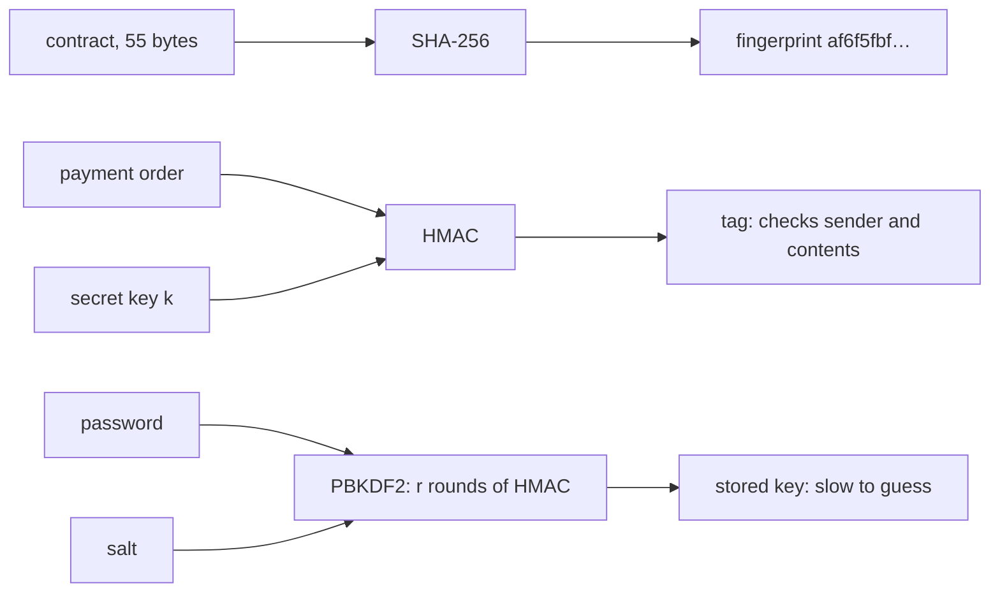
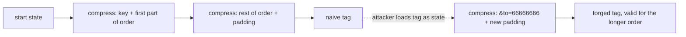

# Hashes and MACs: a fingerprint for data, and a tag only a key could make

[Syllabus](../../../SYLLABUS.md) → [Applied and computational](../README.md) → [Cryptography](../README.md#s04) → Hashes and MACs

---

## General Overview

A buyer agrees a house sale, and the bank lending the money keeps a copy of the contract. It is one line of 55 characters: *Sale of 14 Elm Road for GBP 250,000; completes 1/3/2027*. Both sides want to be sure, months later, that nobody has changed a word.

They run the text through **SHA-256**, a fixed public recipe that turns any file into 256 bits, written as 64 hexadecimal characters. Here it gives `af6f5fbf…28b8e`. That string is the contract's **fingerprint**, or **hash**. Change 250,000 to 260,000 and the fingerprint becomes `5be035ac…e3725`: 129 of the 256 bits flip, about half, which is what a random new string would look like. Anyone can recompute the fingerprint and compare. No known method works backwards from it to the text: the only way is to guess texts and test each one.

A fingerprint proves the text is unchanged, not who sent it: anyone can compute one. So when the buyer's laptop sends the bank a payment order, it attaches a **MAC tag** (message authentication code): a fingerprint mixed with a secret key only the laptop and the bank share. The standard recipe is **HMAC**. A slow, salted form of it, **PBKDF2**, is how the bank should store passwords.

The safety margin is a count of work. Finding any two contracts with the same SHA-256 fingerprint takes about $2^{128}$ tries, 3.4 × 10^38: not $2^{256}$, because of the birthday effect.

**A hash turns any data into a short fingerprint that is easy to compute and hard to match: finding two inputs with the same $n$-bit fingerprint costs about $2^{n/2}$ tries and matching a given one costs about $2^n$; a MAC mixes in a secret key so that only key holders can make a valid tag, and HMAC does this safely where the obvious recipe fails.**

**What kind of fact this is:** the costs $2^{n/2}$ and $2^n$ are theorems about an ideal hash, one that behaves like a random function, proved in Why it works. That SHA-256 behaves like one is an assumption, unproved but unbroken by decades of public attack. HMAC's security is a theorem resting on an assumption about SHA-256's inner step, quoted from its source.

### The picture: one recipe, three jobs



Schematic. One hash sits inside all three: with no key a public fingerprint, with a shared key a tag, run many times over a password a deliberately slow lock.

---

## The formula

An attacker can try to break a hash in three ways. Each has a name, and resisting it is a separate promise.

- **Preimage resistance.** Given a fingerprint, find any message with that fingerprint.
- **Second-preimage resistance.** Given the real contract, find a *different* contract with the same fingerprint.
- **Collision resistance.** Find *any* two different messages with the same fingerprint, both chosen freely.

For an ideal hash with an $n$-bit output, so $d = 2^n$ possible fingerprints, the work in tries is

$$\text{(second) preimage: about } 2^{n}, \qquad \text{collision: half-chance at } \sqrt{2\ln 2}\;2^{n/2} \approx 1.1774 \cdot 2^{n/2},\ \text{ average } T \approx \sqrt{\pi/2}\;2^{n/2} \approx 1.2533 \cdot 2^{n/2}$$

and the two keyed recipes are

$$t = \mathrm{HMAC}(k, m) = h\big((k \oplus \text{opad}) \,\|\, h((k \oplus \text{ipad}) \,\|\, m)\big)$$

$$U_1 = \mathrm{HMAC}(P,\ s \,\|\, 1), \quad U_i = \mathrm{HMAC}(P,\ U_{i-1}), \quad \text{key} = U_1 \oplus U_2 \oplus \cdots \oplus U_r$$

In the password line, the 1 is the block number written as four bytes.

**Read it aloud:** matching a given fingerprint takes about $2^n$ guesses but any matching pair only about $2^{n/2}$; the tag hashes key and message, then hashes the key again over that; the password key runs the tag $r$ times and combines every round.

| Symbol | Plain meaning | In our example | Push it up and the answer… |
| --- | --- | --- | --- |
| $h(m)$ | the hash (fingerprint) of message $m$, here SHA-256 | `af6f5fbf…` for the contract | — |
| $m$ | the message: any string of bytes | the 55-byte contract; the payment order | longer messages cost more blocks, same 256 bits out |
| $n$ | bits in the fingerprint | 256 | each extra bit doubles guessing; two extra bits double collision work |
| $d$ | number of possible fingerprints, $2^n$ | $2^{256}$ | collisions come later, at about $\sqrt{d}$ tries |
| $T$, $T_{1/2}$, $q$ | $T$: tries until two messages first share a fingerprint, a chance quantity; $T_{1/2}$: the number of drafts that gives an even chance of a shared one; $q$: a number of drafts so far | average $T$ 1.2533 × 2^128; $T_{1/2}$ = 1.1774 × 2^128 | — |
| $k$, $t$ | the shared secret key, and the tag it makes | a 32-byte toy key; a 256-bit tag | a longer random key makes guessing it hopeless |
| ipad, opad | the bytes 0x36 and 0x5C, each repeated 64 times | mixed into the key for the inner and outer hash | — |
| $\oplus$, $\Vert$ | exclusive or, bit by bit; and "join end to end" | $k \oplus$ ipad; $s \,\Vert\, 1$ | — |
| $P$, $s$ | a password, and a salt: a public random string stored per customer | `letmein1`, `customer-000001` | a longer salt keeps every customer's lock different |
| $r$ | rounds of HMAC in the password recipe | 1,000 in the run; 100,000 in the cost sums | each guess costs $2r + 2$ inner steps |
| $U_i$ | the $i$-th HMAC output in the password chain | 32 bytes each | — |
| $\pi$, $e$, $\ln$ | the circle constant 3.14159…, inside $\sqrt{\pi/2} = 1.2533$; $e$ = 2.71828…, and $\ln$ its logarithm, inside $\sqrt{2 \ln 2} = 1.1774$ | — | — |

Here $\oplus$ is the exclusive or from [The one-time pad](01-one-time-pad-and-perfect-secrecy.md): a bit is 1 when exactly one of the two input bits is 1.

### When it holds

- **The hash has no shortcut.** The counts assume an attacker can only try messages and look. SHA-1, a 160-bit hash, promised $2^{80}$ collision work; a published attack found one in $2^{63.1}$, about $2^{17}$ times less.
- **$n$ is the number of bits actually kept.** Cut to 32 bits, the run below found two contract references with the same fingerprint after 45,147 tries.
- **The attacker chooses both messages for a collision.** If one is fixed, as with a contract already signed, the job is a second preimage: $2^n$, not $2^{n/2}$.
- **The key is secret and the recipe is HMAC.** The tempting tag $h(k \,\|\, m)$ lets anyone extend a message and compute a valid tag without the key. The run below forges a payment order this way.
- **Passwords have many possible values.** PBKDF2 multiplies the cost of each guess by about $2r$; a password from a short list still falls.

---

## Why it works

### Step 0: collisions must exist, so the promise is only about effort

SHA-256 takes messages of any length and returns one of $2^{256}$ fingerprints. There are $2^{264}$ different 33-byte messages alone. By [Pigeonhole](../../01-Foundations/08-Relations%20and%20Functions/08-pigeonhole-principle.md), with more messages than fingerprints, some fingerprint is shared; here some fingerprint is shared by at least 256 of them. So a hash can never promise "no collisions". It promises only that finding one takes an impossible amount of work.

### Step 1: how SHA-256 builds the fingerprint

SHA-256 works on 64-byte blocks. It pads the message with a 1 bit, then zeros, then the message length in bits as a 64-bit number, so the total is a whole number of blocks. A 55-byte message, like the contract, fits in one block; the key plus the payment order takes two.

It starts from eight fixed 32-bit words, the **state**. A **compression function** takes the state and one block and returns a new state: 64 rounds of adding, rotating and mixing bits. Each block is folded in this way, in order. The final state, written out, is the fingerprint. This chaining is the **Merkle–Damgård construction**.

The constants hide nothing: the starting words are the first 32 bits after the point of the square roots of the first 8 primes ($\sqrt{2} = 1.6a09e667…$ in hexadecimal gives `6a09e667`), and the 64 round constants come from cube roots of the first 64 primes, `428a2f98` to `c67178f2`. The code rebuilds them all from the primes.

The rounds make every output bit depend on every input bit. Flipping each of the contract's 440 bits in turn changes on average 127.83 of the 256 output bits, against 128 for a random string, and never fewer than 106.

### Step 2: matching a given fingerprint costs about $2^n$ tries

An attacker holds the signed contract and wants a different one, at GBP 25,000, with the same fingerprint. With no shortcut, each draft matches with chance $1/2^n$, so the wait is geometric ([Waiting for a success](../../09-Probability%20and%20statistics/03-Discrete%20Distributions/02-geometric-and-negative-binomial.md)), with average $2^n$.

The code tests this on fingerprints cut to $n$ = 8, 10 and 12 bits, 20 attacks each. Measured over all 60, the work was 0.822 times $2^n$. With a standard error of 0.129, that is within the four standard errors the code allows. For $n = 256$ the work is $2^{256}$: a preimage and a second preimage cost the same.

### Step 3: finding any pair costs only about $2^{n/2}$

Now the attacker writes both contracts. Each new draft is compared with *every* earlier one, so after $q$ drafts there are $q(q-1)/2$ pairs, each matching with chance $1/d$.

This is the birthday problem with $d$ days. [Two classics](../../09-Probability%20and%20statistics/03-Discrete%20Distributions/07-birthday-and-coupon-collector.md) shows the chance of no match is about $e^{-q^2/(2d)}$, which falls to one half near $q = \sqrt{2d \ln 2}$. Call that count $T_{1/2}$ and put $d = 2^n$:

$$T_{1/2} \approx \sqrt{2 \ln 2}\;\sqrt{2^n} = 1.1774 \cdot 2^{n/2}.$$

The average wait, the average of $T$, adds up the chance that the first $q$ drafts are all different, for $q = 0, 1, 2, \ldots$, which comes to a little more than $\sqrt{\pi d/2} = 1.2533 \cdot 2^{n/2}$. The code computes that sum exactly and runs 40 collision hunts at each of 8, 12, 16 and 20 bits:

| Bits kept, $n$ | Measured average | Exact average | $\sqrt{\pi/2 \cdot 2^n}$ |
| ---: | ---: | ---: | ---: |
| 8 | 24.57 | 20.73 | 20.05 |
| 12 | 77.67 | 80.88 | 80.21 |
| 16 | 339.75 | 321.52 | 320.85 |
| 20 | 1480.33 | 1284.06 | 1283.39 |

Each measured average is within four standard errors of the exact one, the tolerance the code asserts. Four extra bits multiply the work by 4, not 16: the square root.

So an $n$-bit hash gives $n/2$ bits of collision security. SHA-256 gives 128-bit security: about $2^{128}$ operations, if no shortcut exists.

### Step 4: a collision in the chain means a collision in one step

The chain is no weaker than its compression function: two different messages with one SHA-256 fingerprint hide a collision in a single compression step, as the fold shows. So designers can focus on one fixed-size function.

<details>
<summary>Detailed proof: a hash collision contains a compression collision</summary>

Take two different messages with equal fingerprints. Pad both and compare the last compression step of each. Its outputs are equal, since they are the fingerprints.

If the messages have different lengths, their last blocks differ, because the last block holds the length. So the last step had two different inputs and the same output: a compression collision.

If the lengths are equal, both have the same number of blocks. Look at the last step. If its inputs (incoming state, block) differ, that is a compression collision. If they are equal, the incoming states are equal, which are the outputs of the step before. Move back one step and repeat. The messages differ somewhere, so some block pair differs, and the walk must stop at a step with different inputs and equal outputs before it runs out of blocks.

</details>

### Step 5: why $h(k \,\|\, m)$ is not a MAC, and HMAC is

The fingerprint *is* the final state. Anyone who sees $h(k \,\|\, m)$ holds the state after the key and the message have been folded in. They know the padding too, because it depends only on the total length: the message's, which they see, plus the key's, which is usually known or found by trying a few lengths. So they can load that state and keep folding in more blocks. The result is a valid fingerprint of $k \,\|\, m \,\|\, \text{padding} \,\|\, \text{extra}$, computed without $k$. This is a **length-extension attack**.



Schematic. Solid arrows are what the laptop computed with the key; the dotted arrow and the last step are all the attacker needs.

In the run, the order `from=laptop&pay=250000.00&to=12345678` gets the naive tag. The attacker appends 59 bytes of padding and `&to=66666666`, making a 108-byte order. A bank that reads the last `to=` field pays account 66666666, and its check accepts the forged tag.

HMAC wraps the inner hash in a second, outer hash with a different key mix. Extending the outer hash gives the hash of (outer key block, inner result, padding, extra), which is not the HMAC of any message. In the run, the bank recomputes HMAC on the forged order and rejects it. RFC 2104 bases HMAC's security on properties of the compression function when its starting state is secret; this card quotes that result. A forger left to guess a tag is right with chance $1/2^{256}$ per guess.

### Step 6: slow on purpose, and salted, for passwords

A bank must check passwords without storing them, so it stores a hash. A fast hash helps a thief who steals the file: each guess costs one compression, and all $26^8$ = 208,827,064,576 eight-letter lower-case passwords cost that many.

PBKDF2 makes each guess cost $r$ rounds of HMAC. Plain code spends 4 compressions per round. Careful code folds the two key blocks into the state once and reuses them, so it spends 2 per round plus 2: at $r = 1{,}000$ the run counted 4,000 and 2,002, with identical outputs. At $r = 100{,}000$, trying all 8-letter passwords costs 41,765,830,569,329,152 compressions.

The salt is a random string stored beside each customer's key. Two customers with the password `letmein1` store the same plain hash, `2e844ad6…`. With salts they store `646c75ea…` and `dc56a537…`. Without salt, one pass over the guesses checks all 1,000,000 customers at once. With salt, each customer needs a separate pass: 1,000,000 times the work.

---

## Worked numbers, by hand

How much work would forging a SHA-256 collision for the contract take?

| Step | Arithmetic | Value |
| --- | --- | --- |
| 1. Possible fingerprints | $d = 2^{256}$ | $2^{256}$ |
| 2. Square root | $\sqrt{d} = 2^{128}$ | 3.4028 × 10^38 |
| 3. Half-chance factor | $\sqrt{2 \ln 2}$ | 1.1774 |
| 4. Drafts for a half chance of a pair | 1.1774 × 3.4028 × 10^38 | **4.0065 × 10^38** |
| 5. Average drafts to the first pair | $\sqrt{\pi/2} \cdot 2^{128}$ | 1.2533 × 2^128 |
| 6. To match the real contract instead | $2^{256}$ | $2^{128}$ times more |

Forging a pair of contracts with the same SHA-256 fingerprint takes about 4 × 10^38 hashes for an even chance. That is 128-bit security.

### What breaks if you drop a piece

| Mistake | Comes out at | What went wrong |
| --- | --- | --- |
| Tag the payment order as $h(k \,\Vert\, m)$ | forged order to account 66666666 accepted | the tag is the hash's state; anyone can extend it |
| Keep only 32 bits of the fingerprint | two contract references collide after 45,147 tries | $n$ is the bits kept; $2^{16}$ work is nothing |
| Rate a 64-bit checksum by guessing, $2^{64}$ | collision after about 5,382,943,231 tries on average | collisions cost $2^{n/2}$, not $2^n$ |
| Trust SHA-1's promised $2^{80}$ | broken in $2^{63.1}$ | a shortcut beats the ideal count |
| Store passwords as one fast hash, no salt | 208,827,064,576 compressions crack every 8-letter password for all 1,000,000 customers at once | no slowness and no salt |

---

## Code, from first principles, and it actually runs

Nothing imported holds an answer: SHA-256, HMAC and PBKDF2 are written out, constants included. Attacks run on fingerprints cut to a few bits, insecure on purpose. Four roads check the work. The recipes meet published test vectors (FIPS 180-4, RFC 4231, RFC 7914). Measured collision and second-preimage searches meet the exact birthday sum and $2^n$. The forgery made without the key is checked against the tag the bank computes with it. The password code counts its own compressions, plain and careful, against $4r$ and $2r + 2$, and both versions give the same key. The Rust program prints the same lines.

### Python

```python
# Hashes and MACs -- the check behind the card.  Standard library only.
# SHA-256 (FIPS 180-4), HMAC (RFC 2104) and PBKDF2 are written out: no hashlib, no hmac.
# The attacks run on digests cut to a few bits: toy sizes, insecure on purpose.
import math
M32 = 0xFFFFFFFF
def primes(c):
    out, x = [], 2
    while len(out) < c:
        if all(x % p for p in out if p * p <= x): out.append(x)
        x += 1
    return out
def frac_root(r, x):                         # 32 bits after the point of x^(1/r), integers only
    lo, hi = 0, 1 << 40
    while lo < hi:
        mid = (lo + hi + 1) // 2
        if mid ** r <= x << (32 * r): lo = mid
        else: hi = mid - 1
    return lo & M32
K = [frac_root(3, p) for p in primes(64)]    # round constants: cube roots of the first 64 primes
H0 = [frac_root(2, p) for p in primes(8)]    # starting state: square roots of the first 8 primes
COUNT = [0]                                  # compressions done: the unit of cost
# (x >> s | x << 32 - s) below is x rotated right by s places, written inline for speed
def compress(st, blk):                       # one 64-byte block folded into the 8-word state
    COUNT[0] += 1
    w = [int.from_bytes(blk[4 * i:4 * i + 4], 'big') for i in range(16)]
    for i in range(16, 64):
        a, b = w[i - 15], w[i - 2]
        s0 = (a >> 7 | a << 25) ^ (a >> 18 | a << 14) ^ (a >> 3); s1 = (b >> 17 | b << 15) ^ (b >> 19 | b << 13) ^ (b >> 10)
        w.append((w[i - 16] + s0 + w[i - 7] + s1) & M32)
    a, b, c, d, e, f, g, h = st
    for i in range(64):
        t1 = (h + ((e >> 6 | e << 26) ^ (e >> 11 | e << 21) ^ (e >> 25 | e << 7)) + ((e & f) ^ (~e & g)) + K[i] + w[i]) & M32
        t2 = (((a >> 2 | a << 30) ^ (a >> 13 | a << 19) ^ (a >> 22 | a << 10)) + ((a & b) ^ (a & c) ^ (b & c))) & M32
        a, b, c, d, e, f, g, h = (t1 + t2) & M32, a, b, c, (d + t1) & M32, e, f, g
    return [(x + y) & M32 for x, y in zip(st, [a, b, c, d, e, f, g, h])]
def pad(total): return b'\x80' + b'\0' * ((55 - total) % 64) + (8 * total).to_bytes(8, 'big')
def sha256(m, st=H0, done=0):                # done = bytes already folded into st
    m = m + pad(done + len(m))
    for i in range(0, len(m), 64): st = compress(st, m[i:i + 64])
    return b''.join(x.to_bytes(4, 'big') for x in st)
def top(dg, bits): return int.from_bytes(dg[:4], 'big') >> (32 - bits)
def hmac(k, m):
    k = (sha256(k) if len(k) > 64 else k).ljust(64, b'\0')
    return sha256(bytes(x ^ 0x5C for x in k) + sha256(bytes(x ^ 0x36 for x in k) + m))
def xor(a, b): return bytes(x ^ y for x, y in zip(a, b))
def pbkdf2(pw, salt, r, blocks=1, cached=False):
    mac = lambda m: hmac(pw, m)              # plain: 4 compressions per HMAC
    if cached:                               # careful: fold the two key blocks once, then 2 per HMAC
        k = pw.ljust(64, b'\0')              # passwords here are under 64 bytes
        ist, ost = compress(H0, xor(k, b'\x36' * 64)), compress(H0, xor(k, b'\x5C' * 64))
        mac = lambda m: sha256(sha256(m, ist, 64), ost, 64)
    out = b''
    for j in range(1, blocks + 1):
        u = acc = mac(salt + j.to_bytes(4, 'big'))
        for _ in range(r - 1): u = mac(u); acc = xor(acc, u)
        out += acc
    return out
def bitdiff(a, b): return sum(bin(x ^ y).count('1') for x, y in zip(a, b))
print("== SHA-256 against FIPS 180-4 ==")
print(f"K[0] = {K[0]:08x}  K[63] = {K[63]:08x}  H0[0] = {H0[0]:08x}")
abc = sha256(b"abc").hex(); print(f"h(abc) = {abc}")
assert abc == "ba7816bf8f01cfea414140de5dae2223b00361a396177a9cb410ff61f20015ad", "FIPS vector 1"
assert sha256(b"abcdbcdecdefdefgefghfghighijhijkijkljklmklmnlmnomnopnopq").hex() == "248d6a61d20638b8e5c026930c3e6039a33ce45964ff2167f6ecedd419db06c1", "FIPS vector 2"
print("== the contract ==")
C = b"Sale of 14 Elm Road for GBP 250,000; completes 1/3/2027"
dc, dc2 = sha256(C), sha256(C.replace(b"250,000", b"260,000"))
print(f"bytes {len(C)}  h = {dc.hex()}")
print(f"260,000 h = {dc2.hex()}")
flips = [bitdiff(dc, sha256(bytes(C[:i // 8]) + bytes([C[i // 8] ^ (1 << (i % 8))]) + C[i // 8 + 1:])) for i in range(8 * len(C))]
mean = sum(flips) / len(flips); se = math.sqrt(sum((f - mean) ** 2 for f in flips) / (len(flips) - 1) / len(flips))
print(f"one char changed: {bitdiff(dc, dc2)} of 256 bits differ")
print(f"all {len(flips)} one-bit edits: mean {mean:.2f} bits differ (ideal 128, se {se:.2f}), min {min(flips)} max {max(flips)}")
assert abs(mean - 128) < 4 * se, "avalanche: a one-bit edit should flip half the bits"
print(f"pigeonhole: 2^{8 * 33} messages of 33 bytes into 2^256 digests, some digest shared by >= {2 ** (8 * 33) // 2 ** 256}")
print("== the bounds, for an ideal n-bit hash ==")
def exact_mean(d):                           # E[T] = sum over k of P(first k values all differ)
    s, p, k = 0.0, 1.0, 0
    while p > 1e-18: s += p; p *= 1 - k / d; k += 1
    return s
for n in (256, 160, 64):
    print(f"n={n}: half-chance at {math.sqrt(2 * math.log(2)):.4f} x 2^{n // 2}, mean {math.sqrt(math.pi / 2):.4f} x 2^{n // 2}, guessing 2^{n}")
print(f"n=256 in tries: 2^128 = {2 ** 128 / 1e38:.4f} x 10^38, half-chance {math.sqrt(2 * math.log(2)) * 2 ** 128 / 1e38:.4f} x 10^38")
print(f"SHA-1: promised 2^80, published attack 2^63.1, short by about 2^{round(80 - 63.1)} = {2 ** round(80 - 63.1)}")
print(f"64-bit digest, mean tries to a collision = {math.sqrt(math.pi / 2 * 2 ** 64):.0f}")
print("== collisions on digests cut to n bits (toy, insecure) ==")
def first_repeat(bits, label):
    seen, i = {}, 0
    while True:
        v = top(sha256(label + b"%d" % i), bits)
        if v in seen: return i + 1, seen[v], i
        seen[v] = i; i += 1
for n in (8, 12, 16, 20):
    t = [first_repeat(n, b"Elm Road draft %d." % r)[0] for r in range(40)]
    m = sum(t) / 40; se = math.sqrt(sum((x - m) ** 2 for x in t) / 39 / 40); ex = exact_mean(2 ** n)
    print(f"n={n:2d} runs 40 measured {m:8.2f} (se {se:6.2f})  exact {ex:8.2f}  sqrt(pi/2 2^n) {math.sqrt(math.pi / 2 * 2 ** n):8.2f}")
    assert abs(m - ex) < 4 * se, f"collision cost at n={n}"
L = b"Sale of 14 Elm Road for GBP 250,000; ref "
tries, a, b = first_repeat(32, L)
print(f"n=32: refs {a} and {b} share {sha256(L + b'%d' % a)[:4].hex()}, after {tries} tries (exact mean {exact_mean(2 ** 32):.0f})")
assert top(sha256(L + b"%d" % a), 32) == top(sha256(L + b"%d" % b), 32) and a != b, "32-bit collision"
print("== second preimages: match the contract's first n bits ==")
ratios = []
for n in (8, 10, 12):
    t = [next(i for i in range(1, 10 ** 6) if top(sha256(b"Sale of 14 Elm Road for GBP 25,000; v%d.%d" % (r, i)), n) == top(dc, n)) for r in range(20)]
    ratios += [x / 2 ** n for x in t]
    print(f"n={n:2d} runs 20 measured {sum(t) / 20:8.1f}  ideal 2^n = {2 ** n}")
rm = sum(ratios) / len(ratios)
print(f"all 60 runs: measured / 2^n = {rm:.3f} (ideal 1, se {1 / math.sqrt(60):.3f})")
assert abs(rm - 1) < 4 / math.sqrt(60), "second preimage cost should be 2^n"
print("== MACs: one message from the laptop to the bank ==")
KEY = bytes(range(32))                       # a toy key, printed, so insecure on purpose
MSG = b"from=laptop&pay=250000.00&to=12345678"
naive = sha256(KEY + MSG); glue = pad(len(KEY) + len(MSG)); EXT = b"&to=66666666"
state = [int.from_bytes(naive[4 * i:4 * i + 4], 'big') for i in range(8)]   # the tag IS the state
forged = sha256(EXT, state, len(KEY) + len(MSG) + len(glue))                 # no key used
print(f"naive tag h(k||m) = {naive.hex()[:16]}...  glue {len(glue)} bytes, forged message {len(MSG + glue + EXT)} bytes")
print(f"forged tag, made without k = {forged.hex()[:16]}...  bank's check: {'accepted' if forged == sha256(KEY + MSG + glue + EXT) else 'rejected'}")
assert forged == sha256(KEY + MSG + glue + EXT), "length extension"
real = hmac(KEY, MSG + glue + EXT)
print(f"HMAC tag of forged message = {real.hex()[:16]}...  bank's check: {'accepted' if forged == real else 'rejected'}")
assert forged != real, "HMAC must not fall to length extension"
rfc = hmac(b"Jefe", b"what do ya want for nothing?").hex()
print(f"RFC 4231 case 2: {rfc[:16]}...")
assert rfc == "5bdcc146bf60754e6a042426089575c75a003f089d2739839dec58b964ec3843", "HMAC vector"
print("== password key derivation ==")
v, v2 = pbkdf2(b"passwd", b"salt", 1, 2).hex(), pbkdf2(b"Password", b"NaCl", 80000, 1, True).hex()
print(f"RFC 7914 PBKDF2 vectors: r=1 {v[:16]}..., r=80000 {v2[:16]}...")
assert v.startswith("55ac046e56e3089fec1691c22544b605") and v.endswith("49ca9cccf179b645991664b39d77ef317c71b845b1e30bd509112041d3a19783"), "PBKDF2 vector"
assert v2 == "4ddcd8f60b98be21830cee5ef22701f9641a4418d04c0414aeff08876b34ab56", "PBKDF2 vector 2: the XOR over 80000 rounds"
pw, s1, s2 = b"letmein1", b"customer-000001", b"customer-000002"
print(f"same password, no salt: both customers store {sha256(pw).hex()[:8]}")
print(f"same password, salted, r=1000: {pbkdf2(pw, s1, 1000).hex()[:8]} and {pbkdf2(pw, s2, 1000).hex()[:8]}")
for cached in (False, True):
    COUNT[0] = 0; out = pbkdf2(pw, s1, 1000, 1, cached)
    print(f"{'cached' if cached else 'plain '} code: {COUNT[0]} compressions per guess, key {out.hex()[:8]}")
    assert COUNT[0] == (2 * 1000 + 2 if cached else 4 * 1000) and out == pbkdf2(pw, s1, 1000), "cost count"
G, R, U = 26 ** 8, 100000, 10 ** 6
print(f"8 lower-case letters: {G} guesses; plain hash {G} compressions; r={R}: {G * (2 * R + 2)}")
print(f"{U} customers: unsalted, one pass {G * (2 * R + 2)}; salted, {U} passes {G * (2 * R + 2) * U}")
print("ALL CHECKS PASS")
```

**Ran 2026-11-11 on macOS, Python 3.14.10, standard library only. All checks passed. Output, pasted from the run:**

```
== SHA-256 against FIPS 180-4 ==
K[0] = 428a2f98  K[63] = c67178f2  H0[0] = 6a09e667
h(abc) = ba7816bf8f01cfea414140de5dae2223b00361a396177a9cb410ff61f20015ad
== the contract ==
bytes 55  h = af6f5fbfd826d683d4765eb43e9d4f47a0c68025309d22c484e6f13536528b8e
260,000 h = 5be035acbcb509ca1b1a503633a386ae248a4ccb484f9be5ade8a4d944fe3725
one char changed: 129 of 256 bits differ
all 440 one-bit edits: mean 127.83 bits differ (ideal 128, se 0.36), min 106 max 148
pigeonhole: 2^264 messages of 33 bytes into 2^256 digests, some digest shared by >= 256
== the bounds, for an ideal n-bit hash ==
n=256: half-chance at 1.1774 x 2^128, mean 1.2533 x 2^128, guessing 2^256
n=160: half-chance at 1.1774 x 2^80, mean 1.2533 x 2^80, guessing 2^160
n=64: half-chance at 1.1774 x 2^32, mean 1.2533 x 2^32, guessing 2^64
n=256 in tries: 2^128 = 3.4028 x 10^38, half-chance 4.0065 x 10^38
SHA-1: promised 2^80, published attack 2^63.1, short by about 2^17 = 131072
64-bit digest, mean tries to a collision = 5382943231
== collisions on digests cut to n bits (toy, insecure) ==
n= 8 runs 40 measured    24.57 (se   1.63)  exact    20.73  sqrt(pi/2 2^n)    20.05
n=12 runs 40 measured    77.67 (se   5.49)  exact    80.88  sqrt(pi/2 2^n)    80.21
n=16 runs 40 measured   339.75 (se  28.20)  exact   321.52  sqrt(pi/2 2^n)   320.85
n=20 runs 40 measured  1480.33 (se 137.24)  exact  1284.06  sqrt(pi/2 2^n)  1283.39
n=32: refs 10262 and 45146 share 1aa7161d, after 45147 tries (exact mean 82138)
== second preimages: match the contract's first n bits ==
n= 8 runs 20 measured    202.4  ideal 2^n = 256
n=10 runs 20 measured    877.2  ideal 2^n = 1024
n=12 runs 20 measured   3347.4  ideal 2^n = 4096
all 60 runs: measured / 2^n = 0.822 (ideal 1, se 0.129)
== MACs: one message from the laptop to the bank ==
naive tag h(k||m) = dc1b7d1c99950fcc...  glue 59 bytes, forged message 108 bytes
forged tag, made without k = 54549dc0da8b6f70...  bank's check: accepted
HMAC tag of forged message = 2c1697c75082a042...  bank's check: rejected
RFC 4231 case 2: 5bdcc146bf60754e...
== password key derivation ==
RFC 7914 PBKDF2 vectors: r=1 55ac046e56e3089f..., r=80000 4ddcd8f60b98be21...
same password, no salt: both customers store 2e844ad6
same password, salted, r=1000: 646c75ea and dc56a537
plain  code: 4000 compressions per guess, key 646c75ea
cached code: 2002 compressions per guess, key 646c75ea
8 lower-case letters: 208827064576 guesses; plain hash 208827064576 compressions; r=100000: 41765830569329152
1000000 customers: unsalted, one pass 41765830569329152; salted, 1000000 passes 41765830569329152000000
ALL CHECKS PASS
```

### Rust

```rust
// Hashes and MACs -- the check behind the card.  std only, no crates.
// SHA-256 (FIPS 180-4), HMAC (RFC 2104) and PBKDF2 are written out.
// The attacks run on digests cut to a few bits: toy sizes, insecure on purpose.
use std::{collections::HashMap, f64::consts::PI};
use std::sync::atomic::{AtomicU64, Ordering::Relaxed};
static COUNT: AtomicU64 = AtomicU64::new(0); // compressions done: the unit of cost
fn primes(c: usize) -> Vec<u128> {
    let (mut out, mut x): (Vec<u128>, u128) = (vec![], 2);
    while out.len() < c { if out.iter().filter(|&&p| p * p <= x).all(|&p| x % p != 0) { out.push(x); } x += 1; }
    out
}
fn frac_root(r: u32, x: u128) -> u32 { // 32 bits after the point of x^(1/r), integers only
    let (mut lo, mut hi) = (0u128, 1u128 << 40);
    while lo < hi { let mid = (lo + hi + 1) / 2; if mid.pow(r) <= x << (32 * r) { lo = mid; } else { hi = mid - 1; } }
    (lo & 0xFFFF_FFFF) as u32
}
struct Sha { k: Vec<u32>, h0: [u32; 8] }
impl Sha {
    fn new() -> Sha {
        let h0: Vec<u32> = primes(8).iter().map(|&p| frac_root(2, p)).collect();
        Sha { k: primes(64).iter().map(|&p| frac_root(3, p)).collect(), h0: h0.try_into().unwrap() }
    }
    fn compress(&self, st: [u32; 8], blk: &[u8]) -> [u32; 8] {
        COUNT.fetch_add(1, Relaxed);
        let mut w = [0u32; 64];
        for i in 0..16 { w[i] = u32::from_be_bytes([blk[4 * i], blk[4 * i + 1], blk[4 * i + 2], blk[4 * i + 3]]); }
        for i in 16..64 {
            let (a, b) = (w[i - 15], w[i - 2]);
            let (s0, s1) = (a.rotate_right(7) ^ a.rotate_right(18) ^ (a >> 3), b.rotate_right(17) ^ b.rotate_right(19) ^ (b >> 10));
            w[i] = w[i - 16].wrapping_add(s0).wrapping_add(w[i - 7]).wrapping_add(s1);
        }
        let [mut a, mut b, mut c, mut d, mut e, mut f, mut g, mut h] = st;
        for i in 0..64 {
            let t1 = h.wrapping_add(e.rotate_right(6) ^ e.rotate_right(11) ^ e.rotate_right(25))
                .wrapping_add((e & f) ^ (!e & g)).wrapping_add(self.k[i]).wrapping_add(w[i]);
            let t2 = (a.rotate_right(2) ^ a.rotate_right(13) ^ a.rotate_right(22)).wrapping_add((a & b) ^ (a & c) ^ (b & c));
            h = g; g = f; f = e; e = d.wrapping_add(t1); d = c; c = b; b = a; a = t1.wrapping_add(t2);
        }
        let (v, mut out) = ([a, b, c, d, e, f, g, h], st);
        for i in 0..8 { out[i] = st[i].wrapping_add(v[i]); }
        out
    }
    fn hash_from(&self, m: &[u8], st: [u32; 8], done: usize) -> Vec<u8> { // done = bytes already folded in
        let mut s = st;
        for blk in [m, &pad(done + m.len())[..]].concat().chunks(64) { s = self.compress(s, blk); }
        s.iter().flat_map(|x| x.to_be_bytes()).collect()
    }
    fn hash(&self, m: &[u8]) -> Vec<u8> { self.hash_from(m, self.h0, 0) }
    fn hmac(&self, k: &[u8], m: &[u8]) -> Vec<u8> {
        let key = pad64(if k.len() > 64 { self.hash(k) } else { k.to_vec() });
        let inner = self.hash(&[&xor(&key, 0x36)[..], m].concat());
        self.hash(&[xor(&key, 0x5C), inner].concat())
    }
    fn pbkdf2(&self, pw: &[u8], salt: &[u8], r: usize, blocks: u32, cached: bool) -> Vec<u8> {
        let key = pad64(pw.to_vec()); // passwords here are under 64 bytes; careful code folds the key blocks once
        let (ist, ost) = if cached { (self.compress(self.h0, &xor(&key, 0x36)), self.compress(self.h0, &xor(&key, 0x5C))) } else { (self.h0, self.h0) };
        let mac = |m: &[u8]| if cached { self.hash_from(&self.hash_from(m, ist, 64), ost, 64) } else { self.hmac(pw, m) };
        let mut out = vec![];
        for j in 1..=blocks {
            let mut u = mac(&[salt, &j.to_be_bytes()[..]].concat());
            let mut acc = u.clone();
            for _ in 1..r { u = mac(&u); for i in 0..32 { acc[i] ^= u[i]; } }
            out.extend(acc);
        }
        out
    }
}
fn pad(total: usize) -> Vec<u8> { [vec![0x80u8], vec![0u8; (55 + 64 * 64 - total) % 64], (8 * total as u64).to_be_bytes().to_vec()].concat() }
fn xor(k: &[u8], b: u8) -> Vec<u8> { k.iter().map(|x| x ^ b).collect() }
fn pad64(mut k: Vec<u8>) -> Vec<u8> { k.resize(64, 0); k }
fn hex(b: &[u8]) -> String { b.iter().map(|x| format!("{:02x}", x)).collect() }
fn top(d: &[u8], bits: u32) -> u32 { u32::from_be_bytes([d[0], d[1], d[2], d[3]]) >> (32 - bits) }
fn bitdiff(a: &[u8], b: &[u8]) -> u32 { a.iter().zip(b).map(|(x, y)| (x ^ y).count_ones()).sum() }
fn exact_mean(d: f64) -> f64 { // E[T] = sum over k of P(first k values all differ)
    let (mut s, mut p, mut k) = (0.0, 1.0, 0.0);
    while p > 1e-18 { s += p; p *= 1.0 - k / d; k += 1.0; }
    s
}
fn mean_se(t: &[f64]) -> (f64, f64) {
    let (n, m) = (t.len() as f64, t.iter().sum::<f64>() / t.len() as f64);
    (m, (t.iter().map(|x| (x - m) * (x - m)).sum::<f64>() / (n - 1.0) / n).sqrt())
}
fn first_repeat(sh: &Sha, bits: u32, label: &str) -> (u64, u64, u64) {
    let mut seen: HashMap<u32, u64> = HashMap::new();
    for i in 0u64.. {
        let v = top(&sh.hash(format!("{}{}", label, i).as_bytes()), bits);
        if let Some(&j) = seen.get(&v) { return (i + 1, j, i); }
        seen.insert(v, i);
    }
    unreachable!()
}
fn main() {
    let sh = Sha::new();
    println!("== SHA-256 against FIPS 180-4 ==");
    println!("K[0] = {:08x}  K[63] = {:08x}  H0[0] = {:08x}", sh.k[0], sh.k[63], sh.h0[0]);
    let abc = hex(&sh.hash(b"abc")); println!("h(abc) = {}", abc);
    assert!(abc == "ba7816bf8f01cfea414140de5dae2223b00361a396177a9cb410ff61f20015ad", "FIPS vector 1");
    assert!(hex(&sh.hash(b"abcdbcdecdefdefgefghfghighijhijkijkljklmklmnlmnomnopnopq")) == "248d6a61d20638b8e5c026930c3e6039a33ce45964ff2167f6ecedd419db06c1", "FIPS vector 2");
    println!("== the contract ==");
    let c: &[u8] = b"Sale of 14 Elm Road for GBP 250,000; completes 1/3/2027";
    let (dc, dc2) = (sh.hash(c), sh.hash(b"Sale of 14 Elm Road for GBP 260,000; completes 1/3/2027"));
    println!("bytes {}  h = {}\n260,000 h = {}", c.len(), hex(&dc), hex(&dc2));
    let flips: Vec<f64> = (0..8 * c.len()).map(|i| { let mut e = c.to_vec(); e[i / 8] ^= 1 << (i % 8); bitdiff(&dc, &sh.hash(&e)) as f64 }).collect();
    let ((mean, se), mn, mx) = (mean_se(&flips), flips.iter().cloned().fold(1e9, f64::min), flips.iter().cloned().fold(0.0, f64::max));
    println!("one char changed: {} of 256 bits differ", bitdiff(&dc, &dc2));
    println!("all {} one-bit edits: mean {:.2} bits differ (ideal 128, se {:.2}), min {} max {}", flips.len(), mean, se, mn, mx);
    assert!((mean - 128.0).abs() < 4.0 * se, "avalanche: a one-bit edit should flip half the bits");
    println!("pigeonhole: 2^{} messages of 33 bytes into 2^256 digests, some digest shared by >= {}", 8 * 33, 1u32 << (8 * 33 - 256));
    println!("== the bounds, for an ideal n-bit hash ==");
    let (half, avg) = ((2.0 * 2f64.ln()).sqrt(), (PI / 2.0).sqrt());
    for n in [256, 160, 64] { println!("n={}: half-chance at {:.4} x 2^{}, mean {:.4} x 2^{}, guessing 2^{}", n, half, n / 2, avg, n / 2, n); }
    println!("n=256 in tries: 2^128 = {:.4} x 10^38, half-chance {:.4} x 10^38", 2f64.powi(128) / 1e38, half * 2f64.powi(128) / 1e38);
    println!("SHA-1: promised 2^80, published attack 2^63.1, short by about 2^{} = {}", (80.0f64 - 63.1).round(), 1u64 << (80.0f64 - 63.1).round() as u32);
    println!("64-bit digest, mean tries to a collision = {:.0}", (PI / 2.0 * 2f64.powi(64)).sqrt());
    println!("== collisions on digests cut to n bits (toy, insecure) ==");
    for n in [8u32, 12, 16, 20] {
        let t: Vec<f64> = (0..40).map(|r| first_repeat(&sh, n, &format!("Elm Road draft {}.", r)).0 as f64).collect();
        let ((m, se), ex) = (mean_se(&t), exact_mean(2f64.powi(n as i32)));
        println!("n={:2} runs 40 measured {:8.2} (se {:6.2})  exact {:8.2}  sqrt(pi/2 2^n) {:8.2}", n, m, se, ex, (PI / 2.0 * 2f64.powi(n as i32)).sqrt());
        assert!((m - ex).abs() < 4.0 * se, "collision cost at n={}", n);
    }
    let l = "Sale of 14 Elm Road for GBP 250,000; ref ";
    let (tries, a, b) = first_repeat(&sh, 32, l);
    let (ha, hb) = (sh.hash(format!("{}{}", l, a).as_bytes()), sh.hash(format!("{}{}", l, b).as_bytes()));
    println!("n=32: refs {} and {} share {}, after {} tries (exact mean {:.0})", a, b, hex(&ha[..4]), tries, exact_mean(2f64.powi(32)));
    assert!(top(&ha, 32) == top(&hb, 32) && a != b, "32-bit collision");
    println!("== second preimages: match the contract's first n bits ==");
    let mut ratios = vec![];
    for n in [8u32, 10, 12] {
        let t: Vec<u64> = (0..20).map(|r| (1u64..).find(|i| top(&sh.hash(format!("Sale of 14 Elm Road for GBP 25,000; v{}.{}", r, i).as_bytes()), n) == top(&dc, n)).unwrap()).collect();
        ratios.extend(t.iter().map(|&x| x as f64 / 2f64.powi(n as i32)));
        println!("n={:2} runs 20 measured {:8.1}  ideal 2^n = {}", n, t.iter().sum::<u64>() as f64 / 20.0, 1u64 << n);
    }
    let rm = ratios.iter().sum::<f64>() / ratios.len() as f64;
    println!("all 60 runs: measured / 2^n = {:.3} (ideal 1, se {:.3})", rm, 1.0 / 60f64.sqrt());
    assert!((rm - 1.0).abs() < 4.0 / 60f64.sqrt(), "second preimage cost should be 2^n");
    println!("== MACs: one message from the laptop to the bank ==");
    let key: Vec<u8> = (0..32).collect(); // a toy key, printed, so insecure on purpose
    let (msg, ext): (&[u8], &[u8]) = (b"from=laptop&pay=250000.00&to=12345678", b"&to=66666666");
    let (naive, glue) = (sh.hash(&[&key[..], msg].concat()), pad(key.len() + msg.len()));
    let state: [u32; 8] = std::array::from_fn(|i| u32::from_be_bytes(naive[4 * i..4 * i + 4].try_into().unwrap())); // the tag IS the state
    let forged = sh.hash_from(ext, state, key.len() + msg.len() + glue.len()); // no key used
    let fmsg = [msg, &glue[..], ext].concat(); let keyed = sh.hash(&[&key[..], &fmsg[..]].concat()); // the bank uses k
    println!("naive tag h(k||m) = {}...  glue {} bytes, forged message {} bytes", &hex(&naive)[..16], glue.len(), fmsg.len());
    println!("forged tag, made without k = {}...  bank's check: {}", &hex(&forged)[..16], if forged == keyed { "accepted" } else { "rejected" });
    assert!(forged == keyed, "length extension");
    let real = sh.hmac(&key, &fmsg);
    println!("HMAC tag of forged message = {}...  bank's check: {}", &hex(&real)[..16], if forged == real { "accepted" } else { "rejected" });
    assert!(forged != real, "HMAC must not fall to length extension");
    let rfc = hex(&sh.hmac(b"Jefe", b"what do ya want for nothing?")); println!("RFC 4231 case 2: {}...", &rfc[..16]);
    assert!(rfc == "5bdcc146bf60754e6a042426089575c75a003f089d2739839dec58b964ec3843", "HMAC vector");
    println!("== password key derivation ==");
    let (v, v2) = (hex(&sh.pbkdf2(b"passwd", b"salt", 1, 2, false)), hex(&sh.pbkdf2(b"Password", b"NaCl", 80000, 1, true)));
    println!("RFC 7914 PBKDF2 vectors: r=1 {}..., r=80000 {}...", &v[..16], &v2[..16]);
    assert!(v.starts_with("55ac046e56e3089fec1691c22544b605") && v.ends_with("49ca9cccf179b645991664b39d77ef317c71b845b1e30bd509112041d3a19783"), "PBKDF2 vector"); assert!(v2 == "4ddcd8f60b98be21830cee5ef22701f9641a4418d04c0414aeff08876b34ab56", "PBKDF2 vector 2");
    let (pw, s1, s2): (&[u8], &[u8], &[u8]) = (b"letmein1", b"customer-000001", b"customer-000002");
    println!("same password, no salt: both customers store {}", &hex(&sh.hash(pw))[..8]);
    println!("same password, salted, r=1000: {} and {}", &hex(&sh.pbkdf2(pw, s1, 1000, 1, false))[..8], &hex(&sh.pbkdf2(pw, s2, 1000, 1, false))[..8]);
    let reference = sh.pbkdf2(pw, s1, 1000, 1, false);
    for cached in [false, true] {
        COUNT.store(0, Relaxed);
        let (out, cnt) = (sh.pbkdf2(pw, s1, 1000, 1, cached), COUNT.load(Relaxed));
        println!("{} code: {} compressions per guess, key {}", if cached { "cached" } else { "plain " }, cnt, &hex(&out)[..8]);
        assert!(cnt == if cached { 2 * 1000 + 2 } else { 4 * 1000 } && out == reference, "cost count");
    }
    let (g, r, u): (u128, u128, u128) = (26u128.pow(8), 100000, 1000000);
    println!("8 lower-case letters: {} guesses; plain hash {} compressions; r={}: {}", g, g, r, g * (2 * r + 2));
    println!("{} customers: unsalted, one pass {}; salted, {} passes {}", u, g * (2 * r + 2), u, g * (2 * r + 2) * u);
    println!("ALL CHECKS PASS");
}
```

**Ran 2026-11-11 on macOS, rustc 1.98.1, no crates. All checks passed. Output, pasted from the run:**

```
== SHA-256 against FIPS 180-4 ==
K[0] = 428a2f98  K[63] = c67178f2  H0[0] = 6a09e667
h(abc) = ba7816bf8f01cfea414140de5dae2223b00361a396177a9cb410ff61f20015ad
== the contract ==
bytes 55  h = af6f5fbfd826d683d4765eb43e9d4f47a0c68025309d22c484e6f13536528b8e
260,000 h = 5be035acbcb509ca1b1a503633a386ae248a4ccb484f9be5ade8a4d944fe3725
one char changed: 129 of 256 bits differ
all 440 one-bit edits: mean 127.83 bits differ (ideal 128, se 0.36), min 106 max 148
pigeonhole: 2^264 messages of 33 bytes into 2^256 digests, some digest shared by >= 256
== the bounds, for an ideal n-bit hash ==
n=256: half-chance at 1.1774 x 2^128, mean 1.2533 x 2^128, guessing 2^256
n=160: half-chance at 1.1774 x 2^80, mean 1.2533 x 2^80, guessing 2^160
n=64: half-chance at 1.1774 x 2^32, mean 1.2533 x 2^32, guessing 2^64
n=256 in tries: 2^128 = 3.4028 x 10^38, half-chance 4.0065 x 10^38
SHA-1: promised 2^80, published attack 2^63.1, short by about 2^17 = 131072
64-bit digest, mean tries to a collision = 5382943231
== collisions on digests cut to n bits (toy, insecure) ==
n= 8 runs 40 measured    24.57 (se   1.63)  exact    20.73  sqrt(pi/2 2^n)    20.05
n=12 runs 40 measured    77.67 (se   5.49)  exact    80.88  sqrt(pi/2 2^n)    80.21
n=16 runs 40 measured   339.75 (se  28.20)  exact   321.52  sqrt(pi/2 2^n)   320.85
n=20 runs 40 measured  1480.33 (se 137.24)  exact  1284.06  sqrt(pi/2 2^n)  1283.39
n=32: refs 10262 and 45146 share 1aa7161d, after 45147 tries (exact mean 82138)
== second preimages: match the contract's first n bits ==
n= 8 runs 20 measured    202.4  ideal 2^n = 256
n=10 runs 20 measured    877.2  ideal 2^n = 1024
n=12 runs 20 measured   3347.4  ideal 2^n = 4096
all 60 runs: measured / 2^n = 0.822 (ideal 1, se 0.129)
== MACs: one message from the laptop to the bank ==
naive tag h(k||m) = dc1b7d1c99950fcc...  glue 59 bytes, forged message 108 bytes
forged tag, made without k = 54549dc0da8b6f70...  bank's check: accepted
HMAC tag of forged message = 2c1697c75082a042...  bank's check: rejected
RFC 4231 case 2: 5bdcc146bf60754e...
== password key derivation ==
RFC 7914 PBKDF2 vectors: r=1 55ac046e56e3089f..., r=80000 4ddcd8f60b98be21...
same password, no salt: both customers store 2e844ad6
same password, salted, r=1000: 646c75ea and dc56a537
plain  code: 4000 compressions per guess, key 646c75ea
cached code: 2002 compressions per guess, key 646c75ea
8 lower-case letters: 208827064576 guesses; plain hash 208827064576 compressions; r=100000: 41765830569329152
1000000 customers: unsalted, one pass 41765830569329152; salted, 1000000 passes 41765830569329152000000
ALL CHECKS PASS
```

The 32-bit hunt matched references 10,262 and 45,146 on `1aa7161d`, an early find against an average of 82,138 tries. The second-preimage averages, 202.4, 877.2 and 3347.4 against 256, 1024 and 4096, came in low by chance, within tolerance.

> [!TIP]
> **Try changing**
> - Guess first: does the forgery depend on what the attacker appends? Change `EXT` to `b"&pay=999999.00"`. Answer: no. The naive check still says accepted and HMAC still says rejected; only the tags change.
> - Guess first: does a longer key stop the length extension? Change `KEY` to `bytes(range(64))`. Answer: no. The glue shrinks from 59 to 27 bytes and the forged tag is still accepted. Key length is not the problem; the recipe is.
> - Guess first: what happens if the outer pad uses the same byte as the inner one? Change `0x5C` in `hmac` to `0x36`. Answer: the HMAC test-vector assert fails. A test vector catches a one-byte slip that no reading of the output would.

---

## The usual mistake

> [!warning]
> **Making a tag by hashing the key and message together, $h(k \,\|\, m)$.** It looks like a MAC, and with SHA-256 it is forgeable. The tag is the hash's internal state, so anyone can extend the message and compute the new tag without the key. In the run, a payment order redirected to account 66666666 passed the bank's check. Use HMAC, which hashes twice with two key mixes.
>
> - **Hashing passwords with one fast, unsalted hash.** One pass of 208,827,064,576 compressions tries every 8-letter lower-case password for all 1,000,000 customers at once. PBKDF2 at 100,000 rounds raises one pass to 41,765,830,569,329,152, and salts multiply it by 1,000,000.
> - **Reading $n$ bits as $n$ bits of collision security.** A 64-bit checksum collides after about 5,382,943,231 tries on average, not $2^{64}$. Collision security is $n/2$ bits.
> - **Cutting a hash short without redoing the sum.** At 32 bits, two contract references collided after 45,147 tries.
> - **Trusting an old hash's label.** SHA-1's 160 bits promised $2^{80}$ collision work; it fell to $2^{63.1}$.

---

## Where you meet it in real life

- **Software downloads.** Download pages publish a file's SHA-256 fingerprint, so anyone can check the file was not altered: second-preimage resistance at work.
- **Version control.** Git names every saved version by the hash of its contents. It was built on SHA-1; after SHA-1 collisions became practical, it added a SHA-256 mode.
- **Secure web connections.** Every protected web page relies on HMAC inside the key derivation that turns one shared secret into the many keys a connection needs ([The TLS handshake](08-key-exchange-in-practice-the-tls-handshake.md)).
- **Wi-Fi passwords.** Home Wi-Fi with WPA2 turns the passphrase into a key with PBKDF2, many rounds of HMAC-SHA-1, salted with the network name.
- **Signed documents and certificates.** A signature is made on a document's hash, so it is only as strong as the hash's collision resistance ([Digital signatures](07-digital-signatures.md)).

> **Say it back**
> A hash turns any data into a short fingerprint that anyone can recompute but nobody can steer. Pigeonhole guarantees collisions exist, so the promise is about work: about $2^n$ tries to match a given $n$-bit fingerprint, and about $2^{n/2}$ to find any matching pair, by the birthday effect. SHA-256 therefore gives 128-bit security against collisions. A MAC adds a secret key; the naive $h(k \,\|\, m)$ falls to length extension, and HMAC's second, outer hash closes that hole. For passwords, PBKDF2 runs HMAC many rounds with a salt, so each guess costs thousands of times more and no two customers share a lock.

---

## What this builds on

- [AES](02-symmetric-ciphers-and-aes.md): the shared secret key and symmetric encryption; a MAC is what keeps that key's messages from being altered, and some MACs are built from AES itself.
- [Two classics](../../09-Probability%20and%20statistics/03-Discrete%20Distributions/07-birthday-and-coupon-collector.md): the birthday chance and its square-root threshold $\sqrt{2d \ln 2}$; this card sets $d = 2^n$.
- [Pigeonhole](../../01-Foundations/08-Relations%20and%20Functions/08-pigeonhole-principle.md): why every hash with more inputs than outputs has collisions, so security can only mean "hard to find".

## Where this goes next

- [RSA in full](04-rsa-in-full.md): encryption and signatures with a public key; RSA pads and signs using a hash, so this card's collision bound sets the hash size it needs.
- [Digital signatures](07-digital-signatures.md): hash then sign, and why a hash collision becomes a signature forgery.
- [The TLS handshake](08-key-exchange-in-practice-the-tls-handshake.md): HMAC used to turn one shared secret into the keys for a whole connection.

The question this card leaves open: a MAC needs a key both sides already share, so how do a laptop and a bank that have never met agree on one?

---

## Sources

Verified 2026-11-11: every link below resolves to the publisher's page.

- National Institute of Standards and Technology. *Secure Hash Standard (SHS)*, FIPS PUB 180-4, 2015. [doi:10.6028/NIST.FIPS.180-4](https://doi.org/10.6028/NIST.FIPS.180-4). SHA-256 in full: padding, the compression function, the constants from roots of primes, and the test vectors the code meets.
- Krawczyk, Hugo, Mihir Bellare, and Ran Canetti. "HMAC: Keyed-Hashing for Message Authentication." RFC 2104, 1997. [doi:10.17487/RFC2104](https://doi.org/10.17487/RFC2104). The HMAC recipe with ipad and opad, and the basis of its security.
- Nystrom, Magnus. "Identifiers and Test Vectors for HMAC-SHA-224, HMAC-SHA-256, HMAC-SHA-384, and HMAC-SHA-512." RFC 4231, 2005. [doi:10.17487/RFC4231](https://doi.org/10.17487/RFC4231). Test case 2, the HMAC-SHA-256 vector the code meets.
- Percival, Colin, and Simon Josefsson. "The scrypt Password-Based Key Derivation Function." RFC 7914, 2016. [doi:10.17487/RFC7914](https://doi.org/10.17487/RFC7914). Section 11 gives the PBKDF2-HMAC-SHA-256 test vectors; the code meets both, at 1 and 80,000 rounds.
- Stevens, Marc, Elie Bursztein, Pierre Karpman, Ange Albertini, and Yarik Markov. "The First Collision for Full SHA-1." *Advances in Cryptology – CRYPTO 2017*, 570–596. [doi:10.1007/978-3-319-63688-7_19](https://doi.org/10.1007/978-3-319-63688-7_19). The 2^63.1 attack on a hash that promised 2^80.
