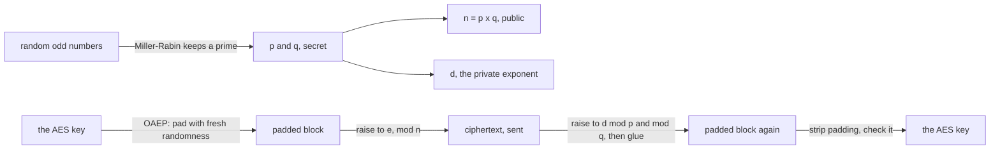
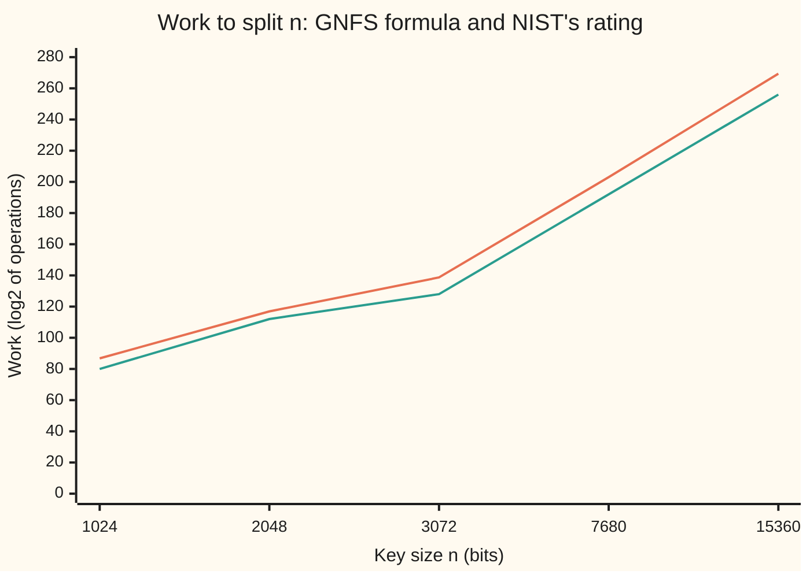

# RSA in full: key generation, padding, and why factoring is the whole game

[Syllabus](../../../SYLLABUS.md) → [Applied and computational](../README.md) → [Cryptography](../README.md#s04) → RSA in full

---

## General Overview

A laptop is about to talk to a bank. First it makes a fresh 32-byte AES key (the secret that will protect the rest of the session, see [AES](02-symmetric-ciphers-and-aes.md)). It must send that key across the internet so that only the bank can read it.

The bank has published a public key: a 2048-bit number n, 617 digits long, and the number e = 65537. Only the bank knows the two 1024-bit primes that multiply to n. The laptop locks the AES key with n and e; the real term is **encrypts**. Only the holder of the primes can unlock it, that is, **decrypt** it. From here on the card uses those two words.

The round trip itself is already on [RSA in outline](../../02-Number%20theory/06-Codes%20and%20Secrets/03-rsa-in-outline.md): encrypt by raising to e, decrypt by raising to d, and Euler's theorem brings the message back. That card used the toy clock 3233. A real key needs four more things, and this card supplies them:

- **Primes hundreds of digits long**, found fast.
- **Padding**, so the same message never encrypts the same way twice and a tampered ciphertext is caught.
- **Faster decryption** that works on the two primes separately: about 4 times faster.
- **The reason it is safe**: everything secret follows from the two primes, so splitting n is the whole game.

The checks below do all of this at full size. They build a 2048-bit key from two 1024-bit primes, send the laptop's 32-byte AES key with OAEP padding, and decrypt it two ways. Their random numbers come from a seeded formula, so this particular key is **insecure** and labelled so; a real key needs a secret random source. A 64-bit toy key appears only where a method cannot reach 2048 bits: Pollard's rho, a factoring walk.

**An RSA key is two secret primes and their public product: padding makes each encryption random and tamper-evident, the two primes make decryption about 4 times faster, and anyone who splits the product holds everything.**

**What kind of fact this is:** the round trip is a theorem, proved on [RSA in outline](../../02-Number%20theory/06-Codes%20and%20Secrets/03-rsa-in-outline.md). The security is an assumption: nobody knows a fast way to split a 2048-bit n, and nobody has proved that no fast way exists.

### The picture: one key, from random numbers to the decrypted message



---

## The formula

Making the key, then using it:

$$n = pq, \qquad e\,d \equiv 1 \pmod{\varphi(n)}, \qquad c = \mathrm{EM}^{\,e} \bmod n, \qquad \mathrm{EM} = \mathrm{CRT}\big(c^{d_p} \bmod p,\; c^{d_q} \bmod q\big)$$

**Read it aloud:** multiply two secret primes to get the public modulus; pick d to undo e on the clock of size phi(n); encrypt the padded block by raising it to e; decrypt it by raising to the two halves of d on the two prime clocks and gluing the answers.

Here mod n means "keep the remainder after dividing by n", and phi(n), Euler's totient, counts the numbers below n that share no factor with it. Both come from the number-theory wing. Long numbers below are written in hexadecimal (base 16), showing their first and last 8 digits.

| Symbol | Plain meaning | In our example | Push it up and the answer… |
| --- | --- | --- | --- |
| $p, q$ | the two secret primes | 1024 bits each: cf8ab650…50560399 and ff72ba87…17e95c4b | n grows; splitting it gets harder |
| $n$ | the public modulus, $p \times q$ | cf182e97…77bf09d3: 2048 bits, 617 digits | each multiply costs more; factoring costs far more |
| $\varphi(n)$ | phi of n: $(p-1)(q-1)$, the clock the exponents live on | just below n | (fixed by $p, q$) |
| $e$ | the public exponent | 65537 | encryption slows; nothing gets safer |
| $d$ | the private exponent: what undoes $e$ on the phi(n) clock | 31a8a7cb…820be7d1, 2046 bits | (fixed by $e$ and phi(n)) |
| $m$ | the message, read as a number | the 32-byte AES key cb75f112…149a08ed; the amount 500 in the textbook breaks | OAEP takes at most 190 bytes |
| $r$ | OAEP's fresh random seed | 32 bytes: d6d87f83…388ac86a | a fresh seed gives a fresh ciphertext |
| EM | the encoded message: $m$ after OAEP padding | 256 bytes: 001caf98…9bdc6a82 | (set by $m$ and $r$) |
| $c$ | the ciphertext, $\mathrm{EM}^e \bmod n$ | b48cfbb3…fb06ac30 | (set by EM) |
| $d_p, d_q$ | $d$ cut down to the clocks $p-1$ and $q-1$ | each smaller than its prime | (set by $d$) |
| CRT | the Chinese remainder theorem's glue: one number from its remainders mod $p$ and mod $q$ | gives back EM | (exact, no error) |
| $a, x$ | Step 5 only: a base, and the square root of 1 it turns up | $a = 2$; its $x$ splits off $p$ | most bases work; a few give only 1 or −1 |

### When it holds

- **p and q are random, secret and distinct.** If two keys share a prime, one gcd (greatest common divisor) splits both: break 4 below.
- **e shares no factor with phi(n).** Otherwise nothing undoes e. Key generation redraws a prime whenever p − 1 is a multiple of e.
- **The message is padded.** Raw "textbook" RSA, $m^e \bmod n$ with no padding, can be guessed and edited: breaks 1 and 2.
- **Both CRT halves are computed correctly.** One wrong bit in one half hands out a prime: break 3.
- **Splitting n is hard.** At 2048 bits the best known method needs about $2^{112}$ operations (NIST SP 800-57). A large quantum computer would change this; see [Lattices](09-lattices-and-post-quantum-cryptography.md).

---

## Why it works

### Step 0: the trapdoor is the factorisation

Every private number on this card, phi(n), d, $d_p$, $d_q$, is a few lines of arithmetic once you hold p and q. Every public number, n and e, hides them. So the design has one job: make primes easy to find and their product hard to split.

### Step 1: finding a 1024-bit prime

Draw a random odd number with its top two bits set, so that p × q fills all 2048 bits. Test it with [The Miller-Rabin test](../../02-Number%20theory/06-Codes%20and%20Secrets/05-miller-rabin.md). If it fails, draw again. The checks use the first 12 primes as Miller-Rabin bases. That gives a certain answer for the 32-bit toy primes and a probable one at 1024 bits; a composite p or q would make the decryption below fail, so the round trip is a second check.

How many draws? Near any large number, about one number in its natural logarithm is prime (the prime number theorem). Skipping even numbers halves that, so a 1024-bit search expects **354.8 odd draws**. Each draw costs one quick test, so a key takes moments.

The run's p took 399 odd draws and its q took 188, either side of that average. The toy primes took 13 and 18, and over 400 toy primes the average was 10.69 draws, against 11.02 from the formula.

### Step 2: the private exponent

phi(n) = (p − 1)(q − 1). Then d is the number that undoes e on a clock of size phi(n). The Python check finds it with the extended Euclidean algorithm. The Rust check has no big-number division, so it finds the k below 65537 that makes 1 + k × phi(n) a multiple of e, and divides by e. Both get the same 2046-bit d, and e × d mod phi(n) = 1. Why $m^{ed}$ comes back to m is [Euler's theorem](../../02-Number%20theory/04-Powers%20on%20the%20Clock/04-eulers-theorem.md), shown in full on RSA in outline.

The original 1978 paper gives a test vector: p = 47, q = 59, e = 17. Its d is 157, and the block 920 encrypts to 948. The checks rebuild both.

### Step 3: padding with OAEP

Textbook RSA has two leaks.

- **It is deterministic.** 500 always encrypts to the same c. Anyone who can guess the message can encrypt each guess and compare.
- **It is multiplicative.** $(a^e)(b^e) = (ab)^e$. Multiply a ciphertext by $2^e$ and the hidden message doubles, without anyone touching the key.

OAEP (Optimal Asymmetric Encryption Padding, RFC 8017) fixes both. Before encrypting, it builds a 256-byte block EM in two masking rounds:

1. Build a data block: the SHA-256 hash of a label (an optional tag, empty here), a run of zero bytes, one 01 byte, then the message. SHA-256 is on [Hashes and MACs](03-hash-functions-and-macs.md).
2. Draw a fresh 32-byte seed r. XOR (flip each bit where the mask has a 1) the data block with a mask made from r by MGF1, a recipe that stretches SHA-256 to any length by hashing r with a counter.
3. Mask r the same way, with a mask made from the masked data block.
4. EM is a zero byte, then the masked seed, then the masked data block. The zero byte keeps EM below n.

Decryption undoes the masks in reverse order, then checks the zero byte, the label hash and the 01 byte. If any is wrong, it refuses, and it gives the same answer for every failure, because different errors leak information.

So the seed makes every encryption different, and the check bytes catch tampering. A doubled ciphertext decrypts to a block whose masks no longer line up, the 32-byte label hash fails, and the message is thrown away.

In the run, the AES key cb75f112…149a08ed and the seed d6d87f83…388ac86a make EM = 001caf98…9bdc6a82. At 2048 bits the longest message is 256 − 2 × 32 − 2 = 190 bytes: the key's 256 bytes, less the 32-byte seed, the 32-byte label hash, the zero byte and the 01 byte. The laptop's 32-byte AES key fits easily.

How strong is this? RFC 8017 records a proof: if RSA is hard to invert, OAEP resists **chosen-ciphertext attacks** (the attacker may ask for other ciphertexts to be decrypted). The proof treats the hash as a perfectly random function, an idealisation called the random-oracle model.

### Step 4: decrypting on two small clocks

Decryption means raising c to d, an exponent of about 2048 bits (2046 here), on a 2048-bit clock. The bank can do better, because it knows p and q.

1. Cut the exponent: $d_p = d \bmod (p-1)$ and $d_q = d \bmod (q-1)$. On a prime clock, exponents run on a clock of size one less ([Euler's theorem](../../02-Number%20theory/04-Powers%20on%20the%20Clock/04-eulers-theorem.md)).
2. Compute $c^{d_p} \bmod p$ and $c^{d_q} \bmod q$: two jobs with half-size numbers and half-size exponents.
3. Glue the two remainders into one number below n with [The Chinese remainder theorem](../../02-Number%20theory/03-Clock%20Arithmetic/06-chinese-remainder-theorem.md).

Why about 4 times faster? Count multiplications. Square-and-multiply (the fast power method: one squaring per bit of the exponent after the first, one extra multiply per further 1 bit) on this d made **3067** multiplications of 2048-bit numbers. The two CRT halves made 1523 each, **3046** in total, but of 1024-bit numbers. Schoolbook multiplication of numbers twice as long costs four times as much. So the cost is 3067 × 4 against 3046 × 1: a speed-up of **4.03**. Both routes gave the same EM. Libraries with faster multiplication methods gain a little less.

Encryption is cheap by comparison: raising to e = 65537 took 17 multiplications.

### Step 5: why factoring is the whole game

**The factors give d.** With p and q, phi(n) is one multiplication and d is one run of Euclid's algorithm. Pollard's rho method (a random walk on the n clock that tends to repeat modulo p long before modulo n) takes steps in proportion to the square root of the smaller prime, hopeless at 1024 bits. So the checks run it on a toy key, 3516228229 × 4270626263, a 64-bit n. It split the toy n in 74725 steps; the square root of p is 59297. Single runs scatter widely around that square root, and only the average grows with it. The d rebuilt from that factor matches the toy key's d.

**d gives the factors.** This is the surprising half. Since $ed - 1$ is a multiple of phi(n), raising any base a that shares no factor with n to the power $ed - 1$ gives 1. (A base that does share a factor splits n at once: gcd(a, n) is a prime.) Halve that exponent until it is odd, raise a to it, then square step by step until 1 appears. The value just before the 1 is a square root of 1.

On a prime clock, 1 has only two square roots, 1 and −1 (Step 0 of the Miller-Rabin card). On n = pq it has four. If the walk lands on one of the extra two, call it x, then x − 1 shares exactly one prime with n, and gcd(x − 1, n) is that prime. Most bases work. Base 2 worked here and gave p, cf8ab650…50560399.

So **knowing d and knowing the factors are the same knowledge**. Leaking d means making a new key with new primes, not just a new d.

One gap remains open. Decrypting a single ciphertext without d (the "RSA problem") is not proved to be as hard as factoring. No faster route is known.

**What factoring costs.** For a 2048-bit n, trial division by every odd number up to the square root takes about $2^{1023}$ steps. Pollard's rho takes about $2^{512}$. The general number field sieve (GNFS), the best known method, grows more slowly than any power of n but faster than any power of its digit count. Its formula, without the small correction term, gives $2^{116.9}$. NIST rates a 2048-bit key at 112 bits of security: about $2^{112}$ operations, if no better method exists.



Upper line: the GNFS formula. Lower line: NIST SP 800-57's security rating. Doubling the key from 1024 to 2048 bits moves the formula only from 86.8 to 116.9 bits of work. That slow climb is why RSA keys are so long.

---

## Worked numbers, by hand

The 2048-bit key, seed 2026, sending the laptop's 32-byte AES key to the bank. The sizes and steps are real; only the seeded random source makes the key insecure. Long numbers show their first and last 8 hexadecimal digits.

| Step | Arithmetic | Value |
| --- | --- | --- |
| p, found on the 399th odd draw | Miller-Rabin test | cf8ab650…50560399, 1024 bits |
| q, found on the 188th odd draw | same | ff72ba87…17e95c4b, 1024 bits |
| n | p × q | cf182e97…77bf09d3: 2048 bits, 617 digits |
| d | undo 65537 on the phi(n) clock | 31a8a7cb…820be7d1, 2046 bits |
| check | e × d mod phi(n) | 1 |
| OAEP block | AES key cb75f112…149a08ed, seed d6d87f83…388ac86a | EM = 001caf98…9bdc6a82, 256 bytes |
| encrypt | EM to the 65537th, mod n: 17 multiplications | c = b48cfbb3…fb06ac30 |
| decrypt, full clock | c to the d, mod n: 3067 multiplications of 2048-bit numbers | EM |
| decrypt, two prime clocks | 1523 + 1523 multiplications of 1024-bit numbers, then glue | EM |
| strip and check the padding | zero byte, label hash, 01 byte | **cb75f112…149a08ed, the AES key** |

The bank recovers the laptop's AES key, and the two prime clocks do it for about a quarter of the work: 3067 × 4 against 3046, a speed-up of 4.03. Encrypting the same key again with a fresh seed gave 852879e6…42a08c57, unrelated to the first ciphertext, and it decrypts to the same key.

### What breaks if you drop a piece

| Mistake | Comes out at | What went wrong |
| --- | --- | --- |
| Textbook RSA, attacker guesses amounts 1, 2, 3… | 500 found after 500 encryptions | Encryption is deterministic: encrypt each guess and compare |
| Textbook RSA, attacker multiplies c by $2^e$ | the bank reads 1000 | Encryption multiplies: the amount doubled without the key |
| The same tampering against OAEP | 0 of 200 tampered copies (c times $s^e$, for 200 values of s) accepted | The check bytes fail; a random block passes with chance below 1 in $2^{256}$, since the 32-byte label hash alone must match |
| CRT decryption with one bit wrong in the mod-q half | the faulty result, bad, gives gcd(bad^e − c, n) = cf8ab650…50560399 = p | The wrong answer is still right mod p, so p divides (answer to the e) − c |
| Two keys sharing the prime p | gcd(n, p × q2) = cf8ab650…50560399 = p | One gcd, no factoring needed |
| The private d leaks | base 2 splits n: cf8ab650…50560399 = p | d and the factors are the same secret |

---

## Code, from first principles, and it actually runs

Both programs build the 2048-bit key from a SplitMix64 generator (seed 2026), so Python and Rust draw the same primes and print the same lines. No three-argument `pow` and no `random`: square-and-multiply, Euclid, Miller-Rabin, OAEP and Pollard's rho are written out. Python takes SHA-256 from its standard library (`hashlib`). Rust's standard library has neither SHA-256 nor big integers, so the Rust program writes out SHA-256 as on [Hashes and MACs](03-hash-functions-and-macs.md), and a small big-number type: numbers held as 64-bit pieces, with Montgomery multiplication (a way to work mod n that adds multiples of n instead of dividing). The two outputs match line for line, which checks each SHA-256 and each big-number routine against the other. The answers are reached by **four independent roads**: Miller-Rabin against trial division for the toy primes, and the draw count against the prime number theorem; direct decryption against the CRT route, with the multiplication count checked against the bits of d; published test vectors, the 1978 paper's and, for Rust's SHA-256, FIPS 180-4's; and three separate ways to split n (a CRT fault, a shared prime, the leaked d), plus rho on the toy key, each checked against the true primes. Every assert can fail: a broken inverse, a wrong CRT glue, a miscounted multiply, a reused seed or broken big-number arithmetic each stop the run.

### Python

```python
# RSA in full -- the check behind the card.  Standard library only; no three-argument pow.
# A real-size key: two 1024-bit primes, a 2048-bit n, and OAEP with SHA-256 (RFC 8017).
# INSECURE: every random number comes from SplitMix64, seed 2026, so the Rust twin draws the
# same ones; a real key needs a secret random source.  A 64-bit toy key serves Pollard's rho.
from hashlib import sha256                         # Rust's std has no SHA-256, so the twin writes it out
from math import log, log10, sqrt
M64 = (1 << 64) - 1
state = 2026
def rand64():                                      # SplitMix64
    global state
    state = (state + 0x9E3779B97F4A7C15) & M64
    z = ((state ^ (state >> 30)) * 0xBF58476D1CE4E5B9) & M64
    z = ((z ^ (z >> 27)) * 0x94D049BB133111EB) & M64
    return z ^ (z >> 31)
def rand_bytes(k): return b"".join(rand64().to_bytes(8, "big") for _ in range(k // 8))
def power(b, x, m):                                # square and multiply, top bit down; counts multiplies
    r, mults = b % m, 0
    for i in range(x.bit_length() - 2, -1, -1):
        r, mults = r * r % m, mults + 1
        if x >> i & 1: r, mults = r * b % m, mults + 1
    return r, mults
def pw(b, x, m): return power(b, x, m)[0]
def gcd(a, b):
    while b: a, b = b, a % b
    return a
def inverse(a, m):                                 # extended Euclid
    r0, r1, s0, s1 = m, a % m, 0, 1
    while r1: k = r0 // r1; r0, r1, s0, s1 = r1, r0 - k * r1, s1, s0 - k * s1
    return s0 % m
def miller_rabin(n):                               # bases: the first 12 primes, a sure answer below 3.3 x 10^24
    t, s = n - 1, 0
    while t % 2 == 0: t, s = t // 2, s + 1
    for a in (2, 3, 5, 7, 11, 13, 17, 19, 23, 29, 31, 37):
        x = pw(a, t, n)
        if x in (1, n - 1): continue
        for _ in range(s - 1):
            x = x * x % n
            if x == n - 1: break
        else: return False
    return True
E = 65537
def new_prime(bits):                               # odd, top two bits set; redraw until prime
    for draws in range(1, 20001):
        x = 0
        for _ in range((bits + 63) // 64): x = x << 64 | rand64()
        x = x >> (-bits % 64) | 3 << (bits - 2) | 1
        if miller_rabin(x) and (x - 1) % E: return x, draws
    raise AssertionError("no prime in 20,000 draws")    # about 355 are expected at 1024 bits
def by_trial(n): return all(n % k for k in range(3, int(sqrt(n)) + 1, 2))
def row(name, *v): print(f"{name:<48}" + ", ".join(str(x) for x in v))
def hx(x, size=0): h = x.to_bytes(size or (x.bit_length() + 7) // 8, "big").hex(); return h[:8] + "..." + h[-8:]
HL, K = 32, 256                                    # SHA-256 output, and the key, in bytes
LH = sha256(b"").digest()                          # the hash of the empty label
def mgf1(z, n): return b"".join(sha256(z + i.to_bytes(4, "big")).digest() for i in range(-(-n // HL)))[:n]
def xor(a, b): return bytes(x ^ y for x, y in zip(a, b))
def oaep_pad(msg, seed):                           # RFC 8017 7.1.1: EM = 00 | maskedSeed | maskedDB
    assert len(msg) <= K - 2 * HL - 2, "message too long for OAEP"
    mdb = xor(LH + bytes(K - len(msg) - 2 * HL - 2) + b"\x01" + msg, mgf1(seed, K - HL - 1))
    return int.from_bytes(b"\0" + xor(seed, mgf1(mdb, HL)) + mdb, "big")
def oaep_unpad(x):                                 # None for every kind of failure, never a reason
    em = x.to_bytes(K, "big"); mdb = em[1 + HL:]
    db = xor(mdb, mgf1(xor(em[1:1 + HL], mgf1(mdb, HL)), K - HL - 1)); rest = db[HL:].lstrip(b"\0")
    return rest[1:] if em[0] == 0 and db[:HL] == LH and rest[:1] == b"\x01" else None
(tp, tdp), (tq, tdq) = new_prime(32), new_prime(32)   # the toy key is drawn first, then 400 more toy primes
draws = [new_prime(32)[1] for _ in range(400)]
(p, dp_), (q, dq_) = new_prime(1024), new_prime(1024)
n, phi = p * q, (p - 1) * (q - 1)
d = inverse(E, phi); dP, dQ, qinv = d % (p - 1), d % (q - 1), inverse(q, p)
assert E * d % phi == 1                            # checked at once: the loops below rely on it
print("2048-bit key from SplitMix64, seed 2026: real size, INSECURE source")
row("p: odd draws, bits, hex", dp_, p.bit_length(), hx(p))
row("q: odd draws, bits, hex", dq_, q.bit_length(), hx(q))
row("n = p x q: bits, decimal digits, hex", n.bit_length(), len(str(n)), hx(n))
row("d: bits, hex; e x d mod phi", d.bit_length(), hx(d), E * d % phi)
row("expected odd draws, one 1024-bit prime", f"{(1024 * log(2) + log(0.875)) / 2:.1f}")
aes, seed = rand_bytes(32), rand_bytes(32)
em = oaep_pad(aes, seed); c = pw(em, E, n)
row("AES key, 32 bytes; OAEP seed, 32 bytes", hx(int.from_bytes(aes, "big"), 32), hx(int.from_bytes(seed, "big"), 32))
row("OAEP block EM: bytes, hex", K, hx(em, K))
row("e; c = EM^e mod n: multiplies, hex", E, power(em, E, n)[1], hx(c))
em1, k_direct = power(c, d, n)
def crt(c, flip=0):                                # decrypt mod p and mod q, then glue
    (m1, k1), (m2, k2) = power(c % p, dP, p), power(c % q, dQ, q)
    m2 ^= flip                                     # flip=1: one bit of the mod-q half goes wrong
    return m2 + (qinv * (m1 - m2) % p) * q, k1, k2
em2, k1, k2 = crt(c)
assert em1 == em2 == em and oaep_unpad(em2) == aes # direct = CRT; OAEP round trip; checked at once
row("decrypt: direct multiplies; CRT mod p, mod q", k_direct, k1, k2)
print(f"{'cost: direct, CRT, speed-up':<48}{k_direct} x 4, {k1 + k2} x 1, {4 * k_direct / (k1 + k2):.2f}")
row("direct and CRT both give EM; OAEP gives key", "yes" if em1 == em2 == em else "no", "yes" if oaep_unpad(em2) == aes else "no")
c2 = pw(oaep_pad(aes, rand_bytes(32)), E, n)
row("same key, fresh seed: c, decodes to the key", hx(c2), "yes" if oaep_unpad(crt(c2)[0]) == aes else "no")
row("OAEP, 2048-bit key: largest message, bytes", K - 2 * HL - 2)
m, c500 = 500, pw(500, E, n)                       # a small amount, sent textbook-style
guess = next(k for k in range(1, 10001) if pw(k, E, n) == c500)
row("break 1, textbook 500: found, encryptions", guess, guess)
doubled = crt(c500 * pw(2, E, n) % n)[0]
row("break 2, textbook c x 2^e decrypts to", doubled)
tamper = sum(oaep_unpad(crt(c * pw(s, E, n) % n)[0]) is not None for s in range(2, 202))
row("break 2 on OAEP: accepted, tried; 1 in 2^", tamper, 200, 8 * HL)
g3 = gcd((pw(crt(c, 1)[0], E, n) - c) % n, n)
row("break 3, CRT fault: gcd(bad^e - c, n)", hx(g3))
q2 = new_prime(1024)[0]
row("break 4, shared prime: gcd(n, p x q2)", hx(gcd(n, p * q2)))
k = E * d - 1
while k % 2 == 0: k //= 2
for a in range(2, 1000):                           # bases sharing no factor with n
    x = pw(a, k, n); y = x * x % n
    while y != 1: x, y = y, y * y % n
    if x not in (1, n - 1): break                  # a square root of 1 that is not +1 or -1
g5 = gcd(x - 1, n)
row("break 5, leaked d: base used, factor", a, hx(g5))
tn, td = tp * tq, inverse(E, (tp - 1) * (tq - 1))
row("toy key, INSECURE: 32-bit p, q; n = p x q, bits", tp, tq, tn, tn.bit_length())
mean = sum(draws) / 400; se = sqrt(sum((x - mean) ** 2 for x in draws) / 399 / 400)
theory = (32 * log(2) + log(0.875)) / 2
row("odd draws: toy p, q; mean of 400; theory", tdp, tdq, f"{mean:.2f}", f"{theory:.2f}")
x, y, steps, f = 2, 2, 0, 1                        # Pollard rho, f(x) = x^2 + 1; the hare takes two steps
while f == 1:
    x, y, steps = (x * x + 1) % tn, ((y * y + 1) ** 2 + 1) % tn, steps + 1
    f = gcd((x - y) % tn, tn)
row("Pollard rho on toy n: factor, steps; sqrt(p)", f, steps, int(sqrt(tp)))
d2 = inverse(E, (f - 1) * (tn // f - 1))
row("toy d rebuilt from that factor matches", "yes" if d2 == td else "no")
row("RSA 1978, p 47, q 59, e 17: d, 920^17 mod 2773", inverse(17, 46 * 58), pw(920, 17, 2773))
row("log2 work, 2048-bit n: trial division, rho", 2048 // 2 - 1, 2048 // 4)
print("log2 work to factor: key bits, GNFS formula, NIST")
for bits, nist in ((1024, 80), (2048, 112), (3072, 128), (7680, 192), (15360, 256)):
    ln_n = bits * log(2)
    gnfs = (64 / 9) ** (1 / 3) * ln_n ** (1 / 3) * log(ln_n) ** (2 / 3) / log(2)
    print(f"  {bits:>5}  {gnfs:6.1f}  {nist:>3}")
    assert 0 < gnfs - nist < 15                    # formula without its o(1) sits a little above
assert by_trial(tp) and by_trial(tq) and abs(mean - theory) < 3 * se
assert len(str(n)) == int(2047 * log10(2)) + 1 and c2 != c
assert k_direct == d.bit_length() - 2 + bin(d).count("1") and 3.5 < 4 * k_direct / (k1 + k2) < 4.5
assert guess == m and doubled == 2 * m and tamper == 0
assert g3 == p and gcd(n, p * q2) == p and g5 in (p, q)
assert f in (tp, tq) and d2 == td and inverse(17, 2668) == 157 and pw(920, 17, 2773) == 948
print("ALL CHECKS PASS")
```

**Ran 2026-11-11 on macOS, Python 3.14.10, standard library only. All checks passed. Output, pasted from the run:**

```
2048-bit key from SplitMix64, seed 2026: real size, INSECURE source
p: odd draws, bits, hex                         399, 1024, cf8ab650...50560399
q: odd draws, bits, hex                         188, 1024, ff72ba87...17e95c4b
n = p x q: bits, decimal digits, hex            2048, 617, cf182e97...77bf09d3
d: bits, hex; e x d mod phi                     2046, 31a8a7cb...820be7d1, 1
expected odd draws, one 1024-bit prime          354.8
AES key, 32 bytes; OAEP seed, 32 bytes          cb75f112...149a08ed, d6d87f83...388ac86a
OAEP block EM: bytes, hex                       256, 001caf98...9bdc6a82
e; c = EM^e mod n: multiplies, hex              65537, 17, b48cfbb3...fb06ac30
decrypt: direct multiplies; CRT mod p, mod q    3067, 1523, 1523
cost: direct, CRT, speed-up                     3067 x 4, 3046 x 1, 4.03
direct and CRT both give EM; OAEP gives key     yes, yes
same key, fresh seed: c, decodes to the key     852879e6...42a08c57, yes
OAEP, 2048-bit key: largest message, bytes      190
break 1, textbook 500: found, encryptions       500, 500
break 2, textbook c x 2^e decrypts to           1000
break 2 on OAEP: accepted, tried; 1 in 2^       0, 200, 256
break 3, CRT fault: gcd(bad^e - c, n)           cf8ab650...50560399
break 4, shared prime: gcd(n, p x q2)           cf8ab650...50560399
break 5, leaked d: base used, factor            2, cf8ab650...50560399
toy key, INSECURE: 32-bit p, q; n = p x q, bits 3516228229, 4270626263, 15016496621469378227, 64
odd draws: toy p, q; mean of 400; theory        13, 18, 10.69, 11.02
Pollard rho on toy n: factor, steps; sqrt(p)    3516228229, 74725, 59297
toy d rebuilt from that factor matches          yes
RSA 1978, p 47, q 59, e 17: d, 920^17 mod 2773  157, 948
log2 work, 2048-bit n: trial division, rho      1023, 512
log2 work to factor: key bits, GNFS formula, NIST
   1024    86.8   80
   2048   116.9  112
   3072   138.7  128
   7680   203.0  192
  15360   269.4  256
ALL CHECKS PASS
```

### Rust

Same numbers, same labels, built with `rustc --edition 2021 -O`. Rust's standard library has no big integers and no SHA-256, so this program carries its own: numbers held as 64-bit pieces, Montgomery multiplication for the work mod n, and SHA-256 as on [Hashes and MACs](03-hash-functions-and-macs.md).

```rust
// RSA in full -- the Python twin in Rust, std only.  A real-size key: two 1024-bit primes, a 2048-bit n, OAEP with SHA-256
// (RFC 8017).  Rust's std has no big integers and no SHA-256, so both are written out.  INSECURE: SplitMix64, seed 2026,
// draws every random number, so the twins agree; a real key needs a secret random source.  A toy key serves Pollard's rho.
use std::cmp::Ordering::{self, Less};
const E: u64 = 65537; const HL: usize = 32; const K: usize = 256;   // e; SHA-256 output and key, in bytes
type Big = Vec<u64>;                                // little-endian 64-bit limbs, no zero limbs on top
struct Rng(u64);                                    // SplitMix64
impl Rng {
    fn next(&mut self) -> u64 { self.0 = self.0.wrapping_add(0x9E3779B97F4A7C15); let z = (self.0 ^ (self.0 >> 30)).wrapping_mul(0xBF58476D1CE4E5B9); let z = (z ^ (z >> 27)).wrapping_mul(0x94D049BB133111EB); z ^ (z >> 31) }
    fn bytes(&mut self, k: usize) -> Vec<u8> { (0..k / 8).flat_map(|_| self.next().to_be_bytes()).collect() }
}
fn small(x: u64) -> Big { vec![x] }
fn limb(a: &Big, i: usize) -> u128 { a.get(i).copied().unwrap_or(0) as u128 }
fn trim(mut a: Big) -> Big { while a.len() > 1 && a[a.len() - 1] == 0 { a.pop(); } a }
fn cmp(a: &Big, b: &Big) -> Ordering { a.len().cmp(&b.len()).then_with(|| a.iter().rev().cmp(b.iter().rev())) }
fn add(a: &Big, b: &Big) -> Big { let mut c = 0u128; trim((0..=a.len().max(b.len())).map(|i| { c += limb(a, i) + limb(b, i); let v = c as u64; c >>= 64; v }).collect()) }
fn sub(a: &Big, b: &Big) -> Big { let mut br = 0u128; trim((0..a.len()).map(|i| { let v = (limb(a, i) | 1 << 64) - limb(b, i) - br; br = 1 - (v >> 64); v as u64 }).collect()) } // a >= b
fn mul(a: &Big, b: &Big) -> Big { let mut out = vec![0u64; a.len() + b.len()];    // schoolbook: every limb times every limb
    for i in 0..a.len() { let mut c = 0u128; for j in 0..b.len() { c += out[i + j] as u128 + limb(a, i) * limb(b, j); out[i + j] = c as u64; c >>= 64; } out[i + b.len()] = c as u64; } trim(out) }
fn shr1(a: &Big) -> Big { trim((0..a.len()).map(|i| a[i] >> 1 | (limb(a, i + 1) as u64) << 63).collect()) }
fn rem_small(a: &Big, m: u64) -> u64 { a.iter().rev().fold(0u128, |r, &x| ((r << 64) | x as u128) % m as u128) as u64 }
fn div_small(a: &Big, m: u64) -> Big { let mut r = 0u128; let mut q: Big = a.iter().rev().map(|&x| { let v = (r << 64) | x as u128; r = v % m as u128; (v / m as u128) as u64 }).collect(); q.reverse(); trim(q) }
fn bits(a: &Big) -> u32 { 64 * a.len() as u32 - a[a.len() - 1].leading_zeros() }
fn to_bytes(a: &Big, size: usize) -> Vec<u8> { (0..size).rev().map(|i| (limb(a, i / 8) >> (8 * (i % 8))) as u8).collect() }
fn from_bytes(b: &[u8]) -> Big { trim(b.rchunks(8).map(|c| c.iter().fold(0u64, |v, &x| v << 8 | x as u64)).collect()) }
fn hx(a: &Big, size: usize) -> String { let h: String = to_bytes(a, if size > 0 { size } else { (bits(a) as usize + 7) / 8 }).iter().map(|x| format!("{:02x}", x)).collect(); format!("{}...{}", &h[..8], &h[h.len() - 8..]) }
fn gcd(mut a: Big, mut b: Big) -> Big { while a != small(0) { while a[0] & 1 == 0 { a = shr1(&a); } if cmp(&a, &b) == Less { std::mem::swap(&mut a, &mut b); } a = sub(&a, &b); } b } // binary, odd b
struct Mont { n: Big, k: usize, ninv: u64, r2: Big } // Montgomery arithmetic mod an odd n, with R = 2^(64k)
impl Mont {
    fn new(n: &Big) -> Mont {                       // -1/n mod 2^64 by Newton's method; R^2 mod n by doubling
        let inv = (0..6).fold(1u64, |v, _| v.wrapping_mul(2u64.wrapping_sub(n[0].wrapping_mul(v))));
        let r2 = (0..128 * n.len()).fold(small(1), |r, _| { let r = add(&r, &r); if cmp(&r, n) != Less { sub(&r, n) } else { r } });
        Mont { n: n.clone(), k: n.len(), ninv: inv.wrapping_neg(), r2 } }
    fn fit(&self, v: Big) -> Big { if cmp(&v, &self.n) != Less { sub(&v, &self.n) } else { v } }
    fn mm(&self, a: &Big, b: &Big) -> Big {         // a b / R mod n, for a b < n R: add multiples of n until R divides
        let (k, mut t) = (self.k, mul(a, b)); t.resize(2 * k + 1, 0);
        for i in 0..k {
            let (u, mut c) = (t[i].wrapping_mul(self.ninv) as u128, 0u128);
            for j in 0..k { c += t[i + j] as u128 + u * self.n[j] as u128; t[i + j] = c as u64; c >>= 64; }
            for j in i + k..=2 * k { c += t[j] as u128; t[j] = c as u64; c >>= 64; }
        }
        self.fit(trim(t[k..].to_vec())) }
    fn mulmod(&self, a: &Big, b: &Big) -> Big { self.mm(&self.mm(a, b), &self.r2) }
    fn power(&self, b: &Big, x: &Big) -> (Big, u32) { // square and multiply, top bit down; counts multiplies
        let (bm, mut mults) = (self.mm(b, &self.r2), 0); let mut r = bm.clone();
        for i in (0..bits(x) - 1).rev() { r = self.mm(&r, &r); mults += 1; if x[i as usize / 64] >> (i % 64) & 1 == 1 { r = self.mm(&r, &bm); mults += 1; } }
        (self.mm(&r, &small(1)), mults) }
    fn reduce(&self, x: &Big) -> Big {              // x mod n, for x < n R and n >= R / 2
        let hi = if x.len() > self.k { x[self.k..].to_vec() } else { small(0) };
        self.fit(add(&self.fit(trim(x[..x.len().min(self.k)].to_vec())), &self.mm(&hi, &self.r2))) }
}
fn inverse(a: u64, m: u64) -> u64 { let (mut r0, mut r1, mut s0, mut s1) = (m as i128, (a % m) as i128, 0i128, 1i128); // extended Euclid, 64-bit
    while r1 != 0 { let k = r0 / r1; (r0, r1) = (r1, r0 - k * r1); (s0, s1) = (s1, s0 - k * s1); } s0.rem_euclid(m as i128) as u64 }
fn inv_e(m: &Big) -> Big { let k = (E - inverse(rem_small(m, E), E)) % E; div_small(&add(&mul(m, &small(k)), &small(1)), E) } // 1/e mod m = (1 + k m) / e
fn miller_rabin(n: &Big) -> bool {                  // bases: the first 12 primes, a sure answer below 3.3 x 10^24
    let (mo, nm1, mut s) = (Mont::new(n), sub(n, &small(1)), 0);
    let mut t = nm1.clone(); while t[0] & 1 == 0 { t = shr1(&t); s += 1; }
    [2u64, 3, 5, 7, 11, 13, 17, 19, 23, 29, 31, 37].iter().all(|&a| { let mut x = mo.power(&small(a), &t).0;
        x == small(1) || x == nm1 || (1..s).any(|_| { x = mo.mulmod(&x, &x); x == nm1 }) })
}
fn new_prime(g: &mut Rng, bits: usize) -> (Big, u32) { // odd, top two bits set; redraw until prime (about 355 draws at 1024 bits)
    (1..=20000).map(|draws| { let mut x: Big = (0..(bits + 63) / 64).map(|_| g.next()).collect(); x.reverse(); if bits < 64 { x[0] >>= 64 - bits; }
        x[(bits - 1) / 64] |= 3u64 << ((bits - 2) % 64); x[0] |= 1; (x, draws) }).find(|(x, _)| miller_rabin(x) && rem_small(x, E) != 1).expect("no prime in 20,000 draws")
}
fn by_trial(n: u128) -> bool { let mut k = 3; while k * k <= n { if n % k == 0 { return false; } k += 2; } true }
fn sha256(msg: &[u8]) -> Vec<u8> {                  // FIPS 180-4, written out as on the Hashes and MACs card
    let primes: Vec<u128> = (2u128..312).filter(|&x| (2..x).all(|p| x % p != 0)).collect(); // the first 64 primes
    let root = |x: u128, r: u32| (0..40).rev().fold(0u128, |v, b| if (v | 1 << b).pow(r) <= x << (32 * r) { v | 1 << b } else { v }) as u32;
    let (k, mut h): (Vec<u32>, Vec<u32>) = (primes.iter().map(|&p| root(p, 3)).collect(), primes[..8].iter().map(|&p| root(p, 2)).collect());
    for blk in [msg, &[0x80], &vec![0; (119 - msg.len() % 64) % 64], &(8 * msg.len() as u64).to_be_bytes()].concat().chunks(64) {
        let mut w: Vec<u32> = blk.chunks(4).map(|b| u32::from_be_bytes([b[0], b[1], b[2], b[3]])).collect();
        for i in 16..64 { let (a, b) = (w[i - 15], w[i - 2]); w.push(w[i - 16].wrapping_add(a.rotate_right(7) ^ a.rotate_right(18) ^ a >> 3).wrapping_add(w[i - 7]).wrapping_add(b.rotate_right(17) ^ b.rotate_right(19) ^ b >> 10)); }
        let v = (0..64).fold(h.clone(), |v, i| { let (a, e) = (v[0], v[4]);
            let t1 = v[7].wrapping_add(e.rotate_right(6) ^ e.rotate_right(11) ^ e.rotate_right(25)).wrapping_add(e & v[5] ^ !e & v[6]).wrapping_add(k[i]).wrapping_add(w[i]);
            let t2 = (a.rotate_right(2) ^ a.rotate_right(13) ^ a.rotate_right(22)).wrapping_add(a & v[1] ^ a & v[2] ^ v[1] & v[2]);
            vec![t1.wrapping_add(t2), a, v[1], v[2], v[3].wrapping_add(t1), e, v[5], v[6]] });
        h = h.iter().zip(&v).map(|(x, y)| x.wrapping_add(*y)).collect();
    }
    h.iter().flat_map(|x| x.to_be_bytes()).collect() }
fn mgf1(z: &[u8], n: usize) -> Vec<u8> { (0..((n + HL - 1) / HL) as u32).flat_map(|i| sha256(&[z, &i.to_be_bytes()[..]].concat())).take(n).collect() }
fn xor(a: &[u8], b: &[u8]) -> Vec<u8> { a.iter().zip(b).map(|(x, y)| x ^ y).collect() }
fn oaep_pad(msg: &[u8], seed: &[u8]) -> Big {      // RFC 8017 7.1.1: EM = 00 | maskedSeed | maskedDB
    assert!(msg.len() <= K - 2 * HL - 2, "message too long for OAEP");
    let mdb = xor(&[&sha256(b"")[..], &vec![0; K - msg.len() - 2 * HL - 2], &[1], msg].concat(), &mgf1(seed, K - HL - 1));
    from_bytes(&[&[0u8][..], &xor(seed, &mgf1(&mdb, HL)), &mdb].concat()) }
fn oaep_unpad(x: &Big) -> Option<Vec<u8>> {        // None for every kind of failure, never a reason
    let em = to_bytes(x, K); let mdb = &em[1 + HL..];
    let db = xor(mdb, &mgf1(&xor(&em[1..1 + HL], &mgf1(mdb, HL)), K - HL - 1));
    let rest: Vec<u8> = db[HL..].iter().copied().skip_while(|&b| b == 0).collect();
    if em[0] == 0 && db[..HL] == sha256(b"")[..] && rest.first() == Some(&1) { Some(rest[1..].to_vec()) } else { None } }
fn row(name: &str, v: String) { println!("{:<48}{}", name, v); }
fn yes(b: bool) -> &'static str { if b { "yes" } else { "no" } }
fn main() {
    let mut g = Rng(2026);                          // the toy key is drawn first, then 400 more toy primes
    let ((tp, tdp), (tq, tdq)) = (new_prime(&mut g, 32), new_prime(&mut g, 32));
    let draws: Vec<f64> = (0..400).map(|_| new_prime(&mut g, 32).1 as f64).collect();
    let ((p, dp_), (q, dq_), one) = (new_prime(&mut g, 1024), new_prime(&mut g, 1024), small(1));
    let (n, pm1, qm1) = (mul(&p, &q), sub(&p, &one), sub(&q, &one));
    let (phi, mp, mq, mn) = (mul(&pm1, &qm1), Mont::new(&p), Mont::new(&q), Mont::new(&n));
    let (d, dp, dq, qinv) = (inv_e(&phi), inv_e(&pm1), inv_e(&qm1), mp.power(&mp.reduce(&q), &sub(&pm1, &one)).0); // 1/q mod p = q^(p-2)
    let ed = (0..E).fold(mul(&d, &small(E)), |x, _| if cmp(&x, &phi) != Less { sub(&x, &phi) } else { x }); // e x d mod phi, by subtraction
    assert!(ed == one);                             // checked at once: the loops below rely on it
    println!("2048-bit key from SplitMix64, seed 2026: real size, INSECURE source");
    row("p: odd draws, bits, hex", format!("{}, {}, {}", dp_, bits(&p), hx(&p, 0)));
    row("q: odd draws, bits, hex", format!("{}, {}, {}", dq_, bits(&q), hx(&q, 0)));
    row("n = p x q: bits, decimal digits, hex", format!("{}, {}, {}", bits(&n), ((bits(&n) - 1) as f64 * 2f64.log10()) as u32 + 1, hx(&n, 0)));
    row("d: bits, hex; e x d mod phi", format!("{}, {}, {}", bits(&d), hx(&d, 0), ed[0]));
    row("expected odd draws, one 1024-bit prime", format!("{:.1}", (1024.0 * 2f64.ln() + 0.875f64.ln()) / 2.0));
    let (aes, seed) = (g.bytes(32), g.bytes(32));   // the AES key to send, and OAEP's fresh seed
    let em = oaep_pad(&aes, &seed); let (c, enc) = mn.power(&em, &small(E));
    row("AES key, 32 bytes; OAEP seed, 32 bytes", format!("{}, {}", hx(&from_bytes(&aes), 32), hx(&from_bytes(&seed), 32)));
    row("OAEP block EM: bytes, hex", format!("{}, {}", K, hx(&em, K)));
    row("e; c = EM^e mod n: multiplies, hex", format!("{}, {}, {}", E, enc, hx(&c, 0)));
    let crt = |c: &Big, flip: u64| {                // decrypt mod p and mod q, then glue
        let ((m1, k1), (mut m2, k2)) = (mp.power(&mp.reduce(c), &dp), mq.power(&mq.reduce(c), &dq));
        m2[0] ^= flip;                              // flip=1: one bit of the mod-q half goes wrong
        (add(&m2, &mul(&mp.mulmod(&qinv, &mp.reduce(&sub(&add(&m1, &p), &mp.reduce(&m2)))), &q)), k1, k2)
    };
    let ((em1, k_direct), (em2, k1, k2)) = (mn.power(&c, &d), crt(&c, 0)); let (ratio, back) = (4.0 * k_direct as f64 / (k1 + k2) as f64, oaep_unpad(&em2));
    assert!(em1 == em && em2 == em && back == Some(aes.clone())); // direct = CRT; OAEP round trip; checked at once
    row("decrypt: direct multiplies; CRT mod p, mod q", format!("{}, {}, {}", k_direct, k1, k2));
    row("cost: direct, CRT, speed-up", format!("{} x 4, {} x 1, {:.2}", k_direct, k1 + k2, ratio));
    row("direct and CRT both give EM; OAEP gives key", format!("{}, {}", yes(em1 == em && em2 == em), yes(back == Some(aes.clone()))));
    let c2 = mn.power(&oaep_pad(&aes, &g.bytes(32)), &small(E)).0;
    row("same key, fresh seed: c, decodes to the key", format!("{}, {}", hx(&c2, 0), yes(oaep_unpad(&crt(&c2, 0).0) == Some(aes.clone()))));
    row("OAEP, 2048-bit key: largest message, bytes", (K - 2 * HL - 2).to_string());
    let enc_e = |x: u64| mn.power(&small(x), &small(E)).0; let (m, c500) = (500u64, enc_e(500)); // a small amount, sent textbook-style
    let guess = (1..10001u64).find(|&k| enc_e(k) == c500).unwrap();
    row("break 1, textbook 500: found, encryptions", format!("{}, {}", guess, guess));
    let doubled = crt(&mn.mulmod(&c500, &enc_e(2)), 0).0;
    row("break 2, textbook c x 2^e decrypts to", doubled[0].to_string());
    let tamper = (2..202u64).filter(|&s| oaep_unpad(&crt(&mn.mulmod(&c, &enc_e(s)), 0).0).is_some()).count();
    row("break 2 on OAEP: accepted, tried; 1 in 2^", format!("{}, {}, {}", tamper, 200, 8 * HL));
    let g3 = gcd(mn.reduce(&sub(&add(&mn.power(&crt(&c, 1).0, &small(E)).0, &n), &c)), n.clone());
    row("break 3, CRT fault: gcd(bad^e - c, n)", hx(&g3, 0));
    let g4 = gcd(n.clone(), mul(&p, &new_prime(&mut g, 1024).0));
    row("break 4, shared prime: gcd(n, p x q2)", hx(&g4, 0));
    let (mut k, nm1) = (sub(&mul(&d, &small(E)), &one), sub(&n, &one));
    while k[0] & 1 == 0 { k = shr1(&k); }
    let (a, x) = (2..1000u64).find_map(|a| {        // bases sharing no factor with n; want a square root of 1 not +1 or -1
        let mut x = mn.power(&small(a), &k).0; let mut y = mn.mulmod(&x, &x);
        while y != one { x = y.clone(); y = mn.mulmod(&y, &y); } if x != one && x != nm1 { Some((a, x)) } else { None } }).unwrap();
    let g5 = gcd(sub(&x, &one), n.clone());
    row("break 5, leaked d: base used, factor", format!("{}, {}", a, hx(&g5, 0)));
    let (tp, tq) = (tp[0] as u128, tq[0] as u128);
    let (tn, td) = (tp * tq, inverse(E, ((tp - 1) * (tq - 1)) as u64));
    row("toy key, INSECURE: 32-bit p, q; n = p x q, bits", format!("{}, {}, {}, {}", tp, tq, tn, 128 - tn.leading_zeros()));
    let (mean, theory) = (draws.iter().sum::<f64>() / 400.0, (32.0 * 2f64.ln() + 0.875f64.ln()) / 2.0);
    let se = (draws.iter().map(|x| (x - mean) * (x - mean)).sum::<f64>() / 399.0 / 400.0).sqrt();
    row("odd draws: toy p, q; mean of 400; theory", format!("{}, {}, {:.2}, {:.2}", tdp, tdq, mean, theory));
    let gcd2 = |mut a: u128, mut b: u128| { while b != 0 { (a, b) = (b, a % b); } a };
    let (mut x, mut y, mut steps, mut f) = (2u128, 2u128, 0, 1u128); // Pollard rho, f(x) = x^2 + 1; the hare takes two steps
    while f == 1 { x = (x * x + 1) % tn; y = (y * y + 1) % tn; y = (y * y + 1) % tn; steps += 1; f = gcd2((x + tn - y) % tn, tn); }
    row("Pollard rho on toy n: factor, steps; sqrt(p)", format!("{}, {}, {}", f, steps, (tp as f64).sqrt() as u64));
    let (d2, v1978) = (inverse(E, ((f - 1) * (tn / f - 1)) as u64), Mont::new(&small(2773)).power(&small(920), &small(17)).0[0]);
    row("toy d rebuilt from that factor matches", yes(d2 == td).to_string());
    row("RSA 1978, p 47, q 59, e 17: d, 920^17 mod 2773", format!("{}, {}", inverse(17, 46 * 58), v1978));
    row("log2 work, 2048-bit n: trial division, rho", format!("{}, {}", 2048 / 2 - 1, 2048 / 4));
    println!("log2 work to factor: key bits, GNFS formula, NIST");
    for (b, nist) in [(1024, 80), (2048, 112), (3072, 128), (7680, 192), (15360, 256)] { let ln_n = b as f64 * 2f64.ln();
        let gnfs = (64.0f64 / 9.0).powf(1.0 / 3.0) * ln_n.powf(1.0 / 3.0) * ln_n.ln().powf(2.0 / 3.0) / 2f64.ln();
        println!("  {:>5}  {:6.1}  {:>3}", b, gnfs, nist); assert!(0.0 < gnfs - nist as f64 && gnfs - (nist as f64) < 15.0); } // no o(1): a little above
    let abc: String = sha256(b"abc").iter().map(|x| format!("{:02x}", x)).collect();
    assert!(abc == "ba7816bf8f01cfea414140de5dae2223b00361a396177a9cb410ff61f20015ad"); // FIPS 180-4 test vector
    assert!(by_trial(tp) && by_trial(tq) && (mean - theory).abs() < 3.0 * se && c2 != c);
    assert!(k_direct == bits(&d) - 2 + d.iter().map(|x| x.count_ones()).sum::<u32>() && 3.5 < ratio && ratio < 4.5);
    assert!(guess == m && doubled == small(2 * m) && tamper == 0 && g3 == p && g4 == p && (g5 == p || g5 == q));
    assert!((f == tp || f == tq) && d2 == td && inverse(17, 2668) == 157 && v1978 == 948);
    println!("ALL CHECKS PASS");
}
```

**Ran 2026-11-11 on macOS, rustc 1.98.1, no crates. All checks passed. Output, pasted from the run:**

```
2048-bit key from SplitMix64, seed 2026: real size, INSECURE source
p: odd draws, bits, hex                         399, 1024, cf8ab650...50560399
q: odd draws, bits, hex                         188, 1024, ff72ba87...17e95c4b
n = p x q: bits, decimal digits, hex            2048, 617, cf182e97...77bf09d3
d: bits, hex; e x d mod phi                     2046, 31a8a7cb...820be7d1, 1
expected odd draws, one 1024-bit prime          354.8
AES key, 32 bytes; OAEP seed, 32 bytes          cb75f112...149a08ed, d6d87f83...388ac86a
OAEP block EM: bytes, hex                       256, 001caf98...9bdc6a82
e; c = EM^e mod n: multiplies, hex              65537, 17, b48cfbb3...fb06ac30
decrypt: direct multiplies; CRT mod p, mod q    3067, 1523, 1523
cost: direct, CRT, speed-up                     3067 x 4, 3046 x 1, 4.03
direct and CRT both give EM; OAEP gives key     yes, yes
same key, fresh seed: c, decodes to the key     852879e6...42a08c57, yes
OAEP, 2048-bit key: largest message, bytes      190
break 1, textbook 500: found, encryptions       500, 500
break 2, textbook c x 2^e decrypts to           1000
break 2 on OAEP: accepted, tried; 1 in 2^       0, 200, 256
break 3, CRT fault: gcd(bad^e - c, n)           cf8ab650...50560399
break 4, shared prime: gcd(n, p x q2)           cf8ab650...50560399
break 5, leaked d: base used, factor            2, cf8ab650...50560399
toy key, INSECURE: 32-bit p, q; n = p x q, bits 3516228229, 4270626263, 15016496621469378227, 64
odd draws: toy p, q; mean of 400; theory        13, 18, 10.69, 11.02
Pollard rho on toy n: factor, steps; sqrt(p)    3516228229, 74725, 59297
toy d rebuilt from that factor matches          yes
RSA 1978, p 47, q 59, e 17: d, 920^17 mod 2773  157, 948
log2 work, 2048-bit n: trial division, rho      1023, 512
log2 work to factor: key bits, GNFS formula, NIST
   1024    86.8   80
   2048   116.9  112
   3072   138.7  128
   7680   203.0  192
  15360   269.4  256
ALL CHECKS PASS
```

The two outputs match line for line.

> [!TIP]
> **Try changing**
> - Guess first: can OAEP carry a 192-byte message at 2048 bits? Change the AES key's `rand_bytes(32)` to `rand_bytes(192)` (in Rust, `g.bytes(192)`). No. Both programs stop at the length check in `oaep_pad` with "message too long for OAEP": Python raises an AssertionError, Rust panics. The limit is 190 bytes.
> - Guess first: what if the second encryption reuses the first seed? In the `c2` line, change `rand_bytes(32)` to `seed` (in Rust, `&g.bytes(32)` to `&seed`). The second ciphertext comes out as b48cfbb3…fb06ac30, identical to the first, and the assert `c2 != c` stops the run: without fresh randomness, OAEP is as predictable as textbook RSA.
> - Guess first: in `crt`, change `m2 ^= flip` to `m1 ^= flip`, so the fault hits the mod-p half (in Rust, change `m2[0]` to `m1[0]` and mark `m1`, not `m2`, as `mut`). Which prime leaks now? q: break 3 prints ff72ba87…17e95c4b, and the assert that expects p fails.
> - Guess first: change the seed 2026. Do the rho steps stay near the square root of p? Not in a single run: other seeds give anywhere from a small fraction of that square root to a little more. Only the average follows it, and it follows the smaller prime, not n. The 2048-bit key changes completely too, and every check still passes.

---

## The usual mistake

> [!warning]
> **Treating "RSA" as raising the message to e.** Raw $m^e \bmod n$ is textbook RSA, and it is broken as an encryption scheme: the same message always gives the same ciphertext, and ciphertexts can be multiplied. Here that found the amount after 500 guesses and turned 500 into 1000, under a full 2048-bit key. Real RSA encryption is RSA with OAEP padding.
>
> Smaller traps:
> - **Old padding.** RFC 8017 keeps the older PKCS #1 v1.5 encryption padding only for compatibility and asks new systems to use OAEP. The old padding's error messages have been used to decrypt ciphertexts one query at a time.
> - **Releasing an unchecked CRT result.** One faulty bit in the mod-q half, and gcd turned the wrong answer into p, cf8ab650…50560399. Re-encrypt the answer with e and compare before releasing it.
> - **A weak random generator at key time.** Two keys with a shared prime fall to one gcd, which returned p.
> - **Replacing only d after a leak.** d splits n (base 2 gave p), so the primes are gone too. Make a new key.

---

## Where you meet it in real life

- **Bank websites, a few years back.** TLS 1.2, the protocol behind the browser's padlock, let the browser encrypt a session secret under the server's RSA key. TLS 1.3 removed that mode; the server's RSA key now signs the handshake, to prove the server holds the key. See [The TLS handshake](08-key-exchange-in-practice-the-tls-handshake.md) and [Digital signatures](07-digital-signatures.md).
- **Encrypted email.** S/MIME, the standard for signed and encrypted email, can encrypt each message's AES key with RSA-OAEP under the recipient's certificate: the laptop-to-bank pattern above.
- **Key wrapping.** Cloud key services and key-holding hardware accept keys encrypted with RSA-OAEP, so a key never travels in the clear.
- **Smart cards and hardware security modules** (tamper-resistant boxes that hold keys). They decrypt and sign with the CRT for speed, and re-check each answer to stop fault attacks.
- **Key-size rules.** NIST's 112-bit rating of 2048-bit keys is why 2048 is the usual minimum, and why 3072 bits is quoted for 128-bit security.

> **Say it back**
> An RSA key is two random primes, found by drawing odd numbers and testing them with Miller-Rabin, about 354.8 draws each at 1024 bits. Their product n and the exponent e are public; d undoes e on the phi(n) clock. OAEP pads each message with fresh randomness and check bytes, so ciphertexts never repeat and tampering is caught. The bank decrypts on the two prime clocks and glues the answers, about 4 times faster. Knowing the primes and knowing d are the same secret, so the key is exactly as strong as n is hard to split.

---

## What this builds on

- [Hashes and MACs](03-hash-functions-and-macs.md): SHA-256, which makes OAEP's masks and its label hash.
- [RSA in outline](../../02-Number%20theory/06-Codes%20and%20Secrets/03-rsa-in-outline.md): the encrypt-and-decrypt round trip on the toy clock 3233.
- [Euler's theorem](../../02-Number%20theory/04-Powers%20on%20the%20Clock/04-eulers-theorem.md): why $m^{ed}$ comes back to m, and why exponents can be cut mod p − 1.
- [The Miller-Rabin test](../../02-Number%20theory/06-Codes%20and%20Secrets/05-miller-rabin.md): the prime test inside key generation, and the extra square roots of 1 that let d split n.
- [The Chinese remainder theorem](../../02-Number%20theory/03-Clock%20Arithmetic/06-chinese-remainder-theorem.md): gluing the mod-p and mod-q answers into one.

## Where this goes next

- [Diffie-Hellman and ElGamal](05-diffie-hellman-and-elgamal.md): the next card. Two parties agree a secret in public, with a different hard problem underneath.
- Average-case hardness (planned): why "hard" must mean hard for random keys, not just for the worst one.
- [The one-time pad](01-one-time-pad-and-perfect-secrecy.md): where factoring sits among hard problems, and why no proof of its hardness exists.

The question this card leaves open: is decrypting without d really as hard as splitting n, and is splitting n really hard?

---

## Sources

Verified 2026-11-11: every link below resolves to the publisher's page.

- Rivest, R. L., A. Shamir, and L. Adleman. "A Method for Obtaining Digital Signatures and Public-Key Cryptosystems." *Communications of the ACM* 21, no. 2 (1978): 120–126. [doi:10.1145/359340.359342](https://doi.org/10.1145/359340.359342). The original scheme, and the test vector p = 47, q = 59, e = 17.
- Bellare, Mihir, and Phillip Rogaway. "Optimal Asymmetric Encryption." In *Advances in Cryptology — EUROCRYPT '94*, LNCS 950. Springer, 1995. [doi:10.1007/BFb0053428](https://doi.org/10.1007/BFb0053428). The OAEP construction and its first security argument.
- Moriarty, K. (editor), B. Kaliski, J. Jonsson, and A. Rusch. *PKCS #1: RSA Cryptography Specifications Version 2.2*. RFC 8017, 2016. [doi:10.17487/RFC8017](https://doi.org/10.17487/RFC8017). The standard: OAEP's layout, the 190-byte limit, CRT keys, and the status of the security proof.
- Barker, Elaine. *Recommendation for Key Management: Part 1 – General*. NIST SP 800-57 Part 1 Rev. 5, 2020. [doi:10.6028/NIST.SP.800-57pt1r5](https://doi.org/10.6028/NIST.SP.800-57pt1r5). Table 2: the security rating of each RSA key size.
- Boneh, Dan, Richard A. DeMillo, and Richard J. Lipton. "On the Importance of Eliminating Errors in Cryptographic Computations." *Journal of Cryptology* 14 (2001): 101–119. [doi:10.1007/s001450010016](https://doi.org/10.1007/s001450010016). The fault attack on CRT decryption.
