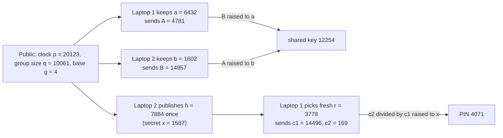

# Diffie-Hellman and ElGamal: agreeing a secret in public, then encrypting with it

[Syllabus](../../../SYLLABUS.md) → [Applied and computational](../README.md) → [Cryptography](../README.md#s04) → Diffie-Hellman and ElGamal

---

## General Overview

Two laptops sit in a cafe on open wifi. Anyone on the network, and the hotspot itself, can read every packet. The laptops share no password, yet they want a secret number to lock everything that follows.

The number-theory wing already shows how: each laptop keeps a private count, posts a power of a public base, and raises the other's post to its own count ([Diffie-Hellman key exchange](../../02-Number%20theory/06-Codes%20and%20Secrets/02-diffie-hellman.md)). On this card's toy clock of 20123, laptop 1 posts 4781, laptop 2 posts 14957, and both arrive at **12254**, a number that never crossed the air.

This card answers three follow-up questions. Which clock and base are safe? What exactly must be hard for a listener? And how can laptop 1 send laptop 2 a PIN, 4071, without waiting for a reply? The answers: a **prime-order group** (a group whose member count is a prime), three named **assumptions** (problems believed hard but not proved hard), and **ElGamal encryption**, which is the exchange with the shared number used as a mask on the message.

**Diffie-Hellman lets two machines agree a number in public because powers commute; it is safe only in a group of prime order where nobody can tell the agreed number from a random one, and ElGamal turns that same agreement into encryption by multiplying the message by a fresh agreed number.**

**What kind of fact this is:** the agreement and the decryption are theorems, proved on this card in Why it works. Security is not proved. It rests on the discrete-log and Diffie-Hellman assumptions, unproved as of 2026-11-11; ElGamal's security given the decisional assumption is a theorem, sketched here and proved in full in the Tsiounis–Yung source.

### The picture: one exchange, then one encrypted PIN



Schematic. Top: the exchange. Bottom: ElGamal, where laptop 2's public key plays the part of its post. Toy sizes, so every step can be checked; real clocks are 3072 bits.

---

## The formula

Everything is on a clock of size $p$, a prime. "On the clock" means: multiply, then keep the remainder after dividing by $p$. The base $g$ is chosen so its powers form a group of prime size $q$; here $p = 2q + 1$, and $g = 4$ reaches exactly the $q$ slots that are **squares** on the clock (numbers you can reach as some number times itself).

The exchange:

$$A = g^{a}, \qquad B = g^{b}, \qquad K = B^{a} = A^{b} = g^{ab}.$$

ElGamal, with laptop 2's long-term secret $x$ and public key $h$:

$$h = g^{x}, \qquad (c_1,\; c_2) = \bigl(g^{r},\; m \cdot h^{r}\bigr), \qquad m = c_2 \,/\, c_1^{\,x}.$$

**Read it aloud:** each side raises the other's post to its own secret count and both reach $g^{ab}$; to encrypt, pick a fresh count $r$, send $g^r$ as a hint, and multiply the message by $h^r$; to decrypt, rebuild $h^r$ from the hint as $c_1^{\,x}$ and divide it back out.

"Divide" on a clock means multiply by the **undo**: the number that multiplies back to 1, found by the extended Euclidean algorithm. On the 20123 clock the undo of 4073 is 15217.

| Symbol | Plain meaning | In our example | Push it up and the answer… |
| --- | --- | --- | --- |
| $p$ | the clock size, a prime | 20123 (15 bits; real: 3072 bits) | a bigger clock defeats the fastest attacks, which work on the clock itself |
| $q$ | the group size: how many distinct powers $g$ has; prime, $q = (p-1)/2$ | 10061 | baby-step giant-step costs about $2\sqrt{q}$ steps |
| $g$ | the generator: the public base whose powers make the group | 4 | a different generator of the same group changes nothing |
| $a$, $b$ | the laptops' secret counts, from 1 to $q-1$ | 6432, 1602 | more bits of count, more work to guess it |
| $A$, $B$ | the posts, $g^a$ and $g^b$ | 4781, 14957 | – |
| $K$ | the shared key, $g^{ab}$ | 12254 | – |
| $x$ | laptop 2's long-term secret count | 1587 | – |
| $h$ | laptop 2's public key, $g^x$ | 7884 | – |
| $m$ | the message, placed inside the group | 16052, standing for PIN 4071 | – |
| $r$ | a fresh secret count for one message only | 3778 | – |
| $(c_1, c_2)$ | the ciphertext: the hint $g^r$ and the masked message | (14496, 169) | – |
| $Z$ | a candidate key a listener is shown: either $g^{ab}$ or a random member | – | – |

The three assumptions, for a group of prime size $q$ with generator $g$:

- **Discrete log (DL).** Given $A = g^a$, finding $a$ is infeasible.
- **Computational Diffie-Hellman (CDH).** Given $g^a$ and $g^b$, computing $g^{ab}$ is infeasible.
- **Decisional Diffie-Hellman (DDH).** Given $g^a$, $g^b$ and $Z$, no feasible method tells whether $Z = g^{ab}$ or a random member of the group noticeably better than a coin toss.

"Infeasible" is a cost, counted in bits: **128-bit security** means about $2^{128}$ operations to break, if the assumption holds. A group whose secret counts are 256 bits long costs baby-step giant-step about $2^{128}$ steps.

**IND-CPA** (indistinguishable under chosen-plaintext attack) is what "ElGamal is secure" means here: a listener picks two messages, is handed the encryption of one of them at random, and must say which. The scheme is IND-CPA secure when no feasible listener does noticeably better than a coin toss.

### When it holds

- **The group has prime size.** With generator 2, which reaches all 20122 slots, $A$ reveals whether $a$ is even, and a listener spots the real key 75% of the time instead of 50%.
- **Every received post is checked.** A forged $B = 20122$ has only two powers, so the key is one of 2 values; here, 1. The TLS rule: reject a post equal to 1 or $p - 1$.
- **The count $r$ is fresh for every message.** Reuse it, and knowing one PIN reveals the other.
- **The message is placed inside the group.** Otherwise $c_2$ shows whether the PIN is a square: one bit leaks.
- **Someone vouches for the posts.** Nothing says who sent $B$; a hotspot in the middle can run one exchange with each laptop (see The usual mistake).

---

## Why it works

### Step 0: powers commute, and that is the whole trick

$(g^b)^a$ and $(g^a)^b$ are both $g$ multiplied by itself $ab$ times. Dropping whole multiples of $p$ along the way does not change which slot you land on, so both laptops land on the same slot. The rest of the card is about choosing a group where that shared slot stays hidden, and about reusing the trick to encrypt.

### Step 1: exponents wrap at the group size $q$, not at $p$

Since $g^q = 1$ ($4^{10061}$ lands on 1), any count can be cut down by whole multiples of $q$ without changing the power. So $K = g^{ab \bmod q}$, and the check computes it that way as a third road: $4^{(6432 \cdot 1602 \bmod 10061)} = 12254$. Cutting by $p$ instead gives 1103, a wrong key.

### Step 2: why the group must have prime size

The full clock has $p - 1 = 20122 = 2 \times 10061$ non-zero slots, and 2 is a primitive root: its powers visit all of them ([The order of a number and primitive roots](../../02-Number%20theory/04-Powers%20on%20the%20Clock/05-order-and-primitive-roots.md)). Raise any slot to the power $q$. A square, some number times itself, becomes that number raised to $p - 1$, which is 1, because every order divides $p - 1$. A non-square gives $p - 1$, which acts as $-1$. The reason: raised to the power $q$ and then squared, any slot reaches the power $p - 1$, which is 1, and on a prime clock only 1 and $-1$ square to 1. An equation of degree $q$ has at most $q$ answers on a prime clock, and the $q$ squares already give 1, so every non-square gives $-1$. This is Euler's test, and it is cheap.

Now $2^a$ is a square exactly when $a$ is even. So the post $A$ leaks the last bit of $a$, and $B$ the last bit of $b$. From those a listener knows whether $ab$ is even, and so whether the real key is a square. Shown a candidate $Z$, it says "real" when $Z$'s squareness matches. A real key always matches; a random member matches half the time. Its win rate is $\tfrac12 \cdot 1 + \tfrac12 \cdot \tfrac12 = \tfrac34$, or 75%, and the check's 4000-round game measures 75.78%. DDH is false on the full clock.

The leak came from the factor 2 in 20122. Every small factor of the group size leaks a piece of the secret this way, and the pieces combine into the whole count (the Pohlig–Hellman method). A group of prime size has no factors to split. Using $g = 4 = 2^2$ keeps every value inside the 10061 squares, a group of prime size. By [Cosets and Lagrange's theorem](../../03-Algebra/08-Groups/04-cosets-and-lagranges-theorem.md), each member's order divides 10061, so it is 1 or 10061: every member except 1 generates the whole group. Every value is a square, Euler's test says "square" every time, and the same guesser wins 50.05% of the time, a coin toss.

### Step 3: the three assumptions are nested

If you can solve DL, you can solve CDH: find $a$ from $A$, then compute $B^a$. If you can solve CDH, you can solve DDH: compute $g^{ab}$ and compare it with $Z$. So DDH is the strongest assumption, the most to believe, and it is the one ElGamal needs. Whether the reverse steps hold in general is not known.

DL is the one an attacker attacks. Trying every count costs up to $q - 1$ multiplications: 6432 to find $a = 6432$. **Baby-step giant-step** costs about $2\sqrt q$. Write the secret count as some number of 101s plus a remainder from 0 to 100. Store the 101 "baby" powers $g^0, \dots, g^{100}$. Then take "giant" steps: multiply $A$ by the undo of $g^{101}$ again and again. Each giant step strips one 101 off the count, so once they are all gone what is left is a baby power, and the table finds it. For $a = 6432 = 63 \times 101 + 69$ that took 101 baby steps and 64 giant steps: 165 in all. On a 24-bit clock it took 3389 steps where trying every count took 2,744,220.

That square root is why real secret counts are at least 256 bits long. The clock itself has to be far longer, 3072 bits, because faster attacks (index calculus and the number field sieve) work on the clock's own arithmetic rather than on the group; the [Elliptic curves](06-elliptic-curve-cryptography.md) card swaps the clock for a curve where no such shortcut is known.

### Step 4: ElGamal is Diffie-Hellman with the receiver's half done in advance

Laptop 2 runs its half once: it picks $x$ and publishes $h = g^x$, like a post left on a noticeboard. To send a message, laptop 1 runs its half on the spot with a fresh count $r$: its post is $c_1 = g^r$, and the shared number is $h^r = g^{xr}$. It sends $c_2 = m \cdot h^r$. Laptop 2 rebuilds the same shared number as $c_1^{\,x} = g^{rx}$ (Step 0 again) and divides it out:

$$c_2 \,/\, c_1^{\,x} = m \cdot g^{xr} \,/\, g^{rx} = m.$$

That proves decryption always works. Security is the sketch below.

<details>
<summary>Sketch: ElGamal is IND-CPA secure if DDH holds</summary>

The listener sees $h = g^x$, $c_1 = g^r$ and $c_2 = m \cdot g^{xr}$.

Suppose the mask $g^{xr}$ were replaced by a truly random member $Z$ of the group. Multiplying any fixed $m$ by a uniformly random member gives a uniformly random member, whatever $m$ was. That is a one-time pad written with multiplication instead of XOR ([The one-time pad](01-one-time-pad-and-perfect-secrecy.md)), and in the IND-CPA game the listener's chance is exactly one half.

So any listener that wins the real game noticeably more than half the time is noticing the difference between $(g^x, g^r, g^{xr})$ and $(g^x, g^r, Z)$. That listener is a DDH distinguisher. If DDH holds, no feasible one exists, so no feasible listener wins. The full argument, with the margins counted, is in the Tsiounis–Yung paper.

</details>

One consequence is visible in the run. IND-CPA forces encryption to be random: if the same PIN always gave the same ciphertext, a listener could encrypt both candidate messages itself and compare. With a fresh $r$, the PIN 4071 encrypts once as (14496, 169) and once as (4442, 3384).

---

## Worked numbers, by hand

Clock $p = 20123$, group size $q = 10061$, generator $g = 4$. Each power is square-and-multiply: for $a = 6432$, a 13-bit number with 4 one-bits, that is 12 squarings and 3 multiplications: one squaring for each bit after the first, and one multiplication for each 1-bit after the first.

| Step | Arithmetic | Value |
| --- | --- | --- |
| $g$ has prime order | $4^{10061}$ on the 20123 clock | 1 |
| laptop 1's post $A$ | $4^{6432}$ | 4781 |
| laptop 2's post $B$ | $4^{1602}$ | 14957 |
| laptop 1's key | $14957^{6432}$ | 12254 |
| laptop 2's key | $4781^{1602}$ | 12254 |
| third road | $4^{(6432 \times 1602 \bmod 10061)}$ | 12254 |
| listener, baby-step giant-step | $63 \times 101 + 69$, in 165 steps | 6432 |
| laptop 2's public key $h$ | $4^{1587}$ | 7884 |
| put PIN 4071 in the group | 4071 is not a square, so use $20123 - 4071$ | 16052 |
| hint $c_1$ | $4^{3778}$ | 14496 |
| mask $h^r$ | $7884^{3778}$ | 4073 |
| masked message $c_2$ | $16052 \times 4073$ on the clock | 169 |
| laptop 2 rebuilds the mask | $14496^{1587}$ | 4073 |
| undo of the mask | extended Euclid on 4073 | 15217 |
| unmask | $169 \times 15217$ on the clock | 16052 |
| **read the PIN** | $20123 - 16052$ | **4071** |

Laptop 2 has the PIN, and the air carried only 7884, 14496 and 169. Placing the PIN works because on this clock exactly one of a number and $p$ minus it is a square: $p$ minus a number is $-1$ times it, and Euler's test gives $(-1)^{10061} = -1$, so $-1$ is not a square and multiplying by it flips the test's answer. A PIN is at most 9999, below half the clock, so decoding takes the smaller of the two.

### What breaks if you drop a piece

| Mistake | Comes out at | What went wrong |
| --- | --- | --- |
| Generator 2, the whole clock, instead of 4 | a listener tells the real key from random 75.78% of the time (theory 75%) | the group size 20122 has the factor 2, so $A$ leaks $a$'s last bit |
| Accept the post $B = 20122$ without checking | shared key 1, one of only 2 values | the forged post sits in a group of size 2 |
| Cut the exponent down by $p$ instead of $q$ | 1103 instead of 12254 | powers of $g$ repeat every $q$ steps, not every $p$ |
| Encrypt a second PIN, 9306, with the same $r$ | $c_2 / c_2' = 13552$, and the first PIN turns it into 9306 | the mask cancels in the ratio |
| Send the raw PIN 9306 without placing it in the group | $c_2$ is not a square, so neither is the PIN | the mask is always a square; it cannot hide squareness |

---

## Code, from first principles, and it actually runs

The scripts check the group has prime size, then run the exchange, ElGamal and every mistake above. Nothing imported knows the answer: powers are square-and-multiply, undos are extended Euclid, and the laptops' coins are SplitMix64, seed 2026, written out. Independent roads: the shared key three ways ($B^a$, $A^b$, $g^{ab \bmod q}$); the discrete log two ways, every count against baby-step giant-step, on four clocks with the steps counted; decryption two ways (extended Euclid, and $c_1^{\,q-x}$, which undoes $c_1^{\,x}$ because $c_1^{\,q} = 1$); and the DDH guessing game simulated against its formula, 75% and 50%. TOY SIZES, INSECURE: the real group named in the output is RFC 7919's ffdhe3072.

### Python

```python
# Diffie-Hellman and ElGamal -- the check behind the card.  Standard library only.
# TOY SIZES, INSECURE: a 15-bit prime stands in for the 3,072-bit prime of RFC 7919.
# Nothing imported.  No three-argument pow: powers are square-and-multiply written out.
P = 20123                     # the clock: a prime with P = 2Q + 1
Q = (P - 1) // 2              # 10061, also prime: the order of the group we use
G = 4                         # 2 squared; its powers are the Q squares on the clock
ROOT = 2                      # a primitive root: its powers reach all P - 1 slots
def power(b, e, p=P):         # square and multiply
    out, b = 1, b % p
    while e:
        if e & 1: out = out * b % p
        b, e = b * b % p, e >> 1
    return out
def inverse(a, p=P):          # extended Euclid: the number that multiplies a back to 1
    t0, t1, s0, s1 = p, a % p, 0, 1
    while t1: k = t0 // t1; t0, t1, s0, s1 = t1, t0 - k * t1, s1, s0 - k * s1
    return s0 % p
def is_prime(n): return n > 1 and all(n % d for d in range(2, int(n ** 0.5) + 1))
def is_square(y, p=P): return power(y, (p - 1) // 2, p) == 1    # Euler's test
state = 2026                  # SplitMix64, seed 2026: stands in for the laptops' coins
def splitmix():
    global state
    state = (state + 0x9E3779B97F4A7C15) % 2 ** 64
    z = state
    z = (z ^ (z >> 30)) * 0xBF58476D1CE4E5B9 % 2 ** 64
    z = (z ^ (z >> 27)) * 0x94D049BB133111EB % 2 ** 64
    return z ^ (z >> 31)
def secret(q=Q): return splitmix() % (q - 1) + 1          # a count from 1 to q - 1
def brute_log(y, g=G, p=P):   # road 1 for the listener: try every count in turn
    x, t = 0, 1
    while t != y: t, x = t * g % p, x + 1
    return x, x
def bsgs_log(y, q, g=G, p=P): # road 2: baby-step giant-step, about 2 sqrt(q) steps
    m = int(q ** 0.5) + 1
    baby, t = {}, 1
    for j in range(m): baby[t] = j; t = t * g % p
    shift, gamma = inverse(power(g, m, p), p), y
    for i in range(m):
        if gamma in baby: return i * m + baby[gamma], m + i + 1
        gamma = gamma * shift % p
assert is_prime(P) and is_prime(Q) and power(G, Q) == 1
assert power(ROOT, Q) == P - 1 and power(ROOT, 2) != 1
print(f"group: clock P = {P}, order Q = {Q} (prime), generator G = {G}; TOY SIZE, INSECURE")
print(f"G = {G} has order {Q}: {G}^{Q} = {power(G, Q)}; ROOT = {ROOT} has order {P - 1}: {ROOT}^{Q} = {power(ROOT, Q)}")
# ---- the exchange over cafe wifi ----
a, b = secret(), secret()
A, B = power(G, a), power(G, b)
key_a, key_b, key_direct = power(B, a), power(A, b), power(G, a * b % Q)
print(f"laptop 1 keeps a = {a}, sends A = {A}; laptop 2 keeps b = {b}, sends B = {B}")
print(f"laptop 1: B^a = {key_a}; laptop 2: A^b = {key_b}; G^(ab mod Q) = {key_direct}")
assert key_a == key_b == key_direct and is_square(key_a)
print(f"laptop 1's work: a has {a.bit_length()} bits, {bin(a).count('1')} of them 1s, so {a.bit_length() - 1} squarings and {bin(a).count('1') - 1} multiplications")
# ---- the listener: two roads to the discrete log ----
x1, n1 = brute_log(A)
x2, n2 = bsgs_log(A, Q)
print(f"listener, every count in turn: a = {x1} after {n1} multiplications")
M = int(Q ** 0.5) + 1
print(f"listener, baby-step giant-step: a = {x2} = {x2 // M} x {M} + {x2 % M} after {n2} steps ({M} baby, {n2 - M} giant)")
assert x1 == a and x2 == a and n2 <= 2 * M and n2 < n1
print("cost:              bits(P)       Q  worst: every count   baby-giant   one run: every count vs baby-giant")
for p in (2063, 20123, 524387, 8389163):
    q = (p - 1) // 2
    y = power(4, secret(q), p)
    xb, nb = brute_log(y, 4, p)
    xg, ng = bsgs_log(y, q, 4, p)
    assert xb == xg and power(4, xg, p) == y and ng <= 2 * (int(q ** 0.5) + 1)
    print(f"cost, p = {p:>7}: {p.bit_length():>9} {q:>7} {q - 1:>20} {2 * (int(q ** 0.5) + 1):>12} {nb:>20} vs {ng}")
print(f"real size, RFC 7919 ffdhe3072: P of 3072 bits, counts of 275+ bits; a 256-bit count takes about 2^{256 // 2} baby-giant steps")
# ---- ElGamal: laptop 2 publishes H = G^x once; laptop 1 sends a PIN with no reply needed ----
x = secret()
H = power(G, x)
pin = 4071
enc = pin if is_square(pin) else P - pin              # put the PIN inside the group
assert is_square(enc)
def encrypt(e, r): return power(G, r), e * power(H, r) % P
def decrypt(c1, c2):
    e = c2 * inverse(power(c1, x)) % P                 # road 1: extended Euclid
    e2 = c2 * power(c1, Q - x) % P                     # road 2: c1^(Q-x) undoes c1^x
    assert e == e2
    return min(e, P - e)
r1, r2 = secret(), secret()
c, c_again = encrypt(enc, r1), encrypt(enc, r2)
print(f"laptop 2: x = {x}, publishes H = {H}")
print(f"PIN {pin} is a square: {is_square(pin)}; sent inside the group as {enc}")
print(f"encrypt with r = {r1}: (c1, c2) = {c}; mask H^r = {power(H, r1)}")
print(f"decrypt: c1^x = {power(c[0], x)}, its inverse {inverse(power(c[0], x))}, PIN = {decrypt(*c)}")
print(f"same PIN, fresh r = {r2}: (c1, c2) = {c_again}, PIN = {decrypt(*c_again)}")
assert decrypt(*c) == pin and decrypt(*c_again) == pin and c != c_again and power(H, r1) == power(c[0], x)
# ---- what breaks ----
pin2 = 9306
enc2 = pin2 if is_square(pin2) else P - pin2
d = encrypt(enc2, r1)                                  # the same r used twice
leak = c[1] * inverse(d[1]) % P
guess = enc * inverse(leak) % P
print(f"break, reuse r: second PIN {pin2}; c2/c2' = {leak}; knowing the first PIN gives {min(guess, P - guess)}")
assert min(guess, P - guess) == pin2
bad = P - 1                                            # a forged B of order 2
vals = {power(bad, t) for t in range(1, 5)}
print(f"break, unchecked B = {bad}: shared key B^a = {power(bad, a)}, one of only {len(vals)} values")
assert power(bad, a) == (1 if a % 2 == 0 else P - 1) and len(vals) == 2 and not is_square(bad)
wrong = power(G, a * b % P)
print(f"break, exponent reduced mod P not mod Q: {wrong} instead of {key_a}")
assert wrong != key_a
raw = pin2                                             # skip the encoding step
cr = encrypt(raw, r2)
print(f"break, raw PIN {raw} outside the group: c2 is a square: {is_square(cr[1])}, so the PIN is not")
assert is_square(cr[1]) == is_square(raw) == False
# ---- the parity leak: a DDH guessing game, 4000 rounds each ----
def ddh_game(g, q, rounds=4000):     # q: the size of the group g generates
    wins = 0
    for _ in range(rounds):
        u, v, w = secret(q), secret(q), secret(q)
        real = splitmix() % 2 == 1
        Z = power(g, u * v) if real else power(g, w)
        sq_u, sq_v = is_square(power(g, u)), is_square(power(g, v))
        predicted = sq_u or sq_v                       # g^(uv) is a square if u or v is even
        says_real = is_square(Z) == predicted
        wins += (says_real == real)
    return wins / rounds
win_root, win_sub = ddh_game(ROOT, P - 1), ddh_game(G, Q)
print(f"break, DDH game with generator {ROOT} (all {P - 1} slots), 4000 rounds: guesser wins {win_root:.4f}; theory 0.75")
print(f"DDH game with generator {G} (the {Q} squares), 4000 rounds: guesser wins {win_sub:.4f}; theory 0.50")
assert abs(win_root - 0.75) < 0.03 and abs(win_sub - 0.5) < 0.03
print("ALL CHECKS PASS")
```

**Ran 2026-11-11 on macOS, Python 3.14.10, standard library only. All checks passed. Output, pasted from the run:**

```
group: clock P = 20123, order Q = 10061 (prime), generator G = 4; TOY SIZE, INSECURE
G = 4 has order 10061: 4^10061 = 1; ROOT = 2 has order 20122: 2^10061 = 20122
laptop 1 keeps a = 6432, sends A = 4781; laptop 2 keeps b = 1602, sends B = 14957
laptop 1: B^a = 12254; laptop 2: A^b = 12254; G^(ab mod Q) = 12254
laptop 1's work: a has 13 bits, 4 of them 1s, so 12 squarings and 3 multiplications
listener, every count in turn: a = 6432 after 6432 multiplications
listener, baby-step giant-step: a = 6432 = 63 x 101 + 69 after 165 steps (101 baby, 64 giant)
cost:              bits(P)       Q  worst: every count   baby-giant   one run: every count vs baby-giant
cost, p =    2063:        12    1031                 1030           66                  365 vs 45
cost, p =   20123:        15   10061                10060          202                 2667 vs 128
cost, p =  524387:        20  262193               262192         1026                53386 vs 618
cost, p = 8389163:        24 4194581              4194580         4098              2744220 vs 3389
real size, RFC 7919 ffdhe3072: P of 3072 bits, counts of 275+ bits; a 256-bit count takes about 2^128 baby-giant steps
laptop 2: x = 1587, publishes H = 7884
PIN 4071 is a square: False; sent inside the group as 16052
encrypt with r = 3778: (c1, c2) = (14496, 169); mask H^r = 4073
decrypt: c1^x = 4073, its inverse 15217, PIN = 4071
same PIN, fresh r = 1321: (c1, c2) = (4442, 3384), PIN = 4071
break, reuse r: second PIN 9306; c2/c2' = 13552; knowing the first PIN gives 9306
break, unchecked B = 20122: shared key B^a = 1, one of only 2 values
break, exponent reduced mod P not mod Q: 1103 instead of 12254
break, raw PIN 9306 outside the group: c2 is a square: False, so the PIN is not
break, DDH game with generator 2 (all 20122 slots), 4000 rounds: guesser wins 0.7578; theory 0.75
DDH game with generator 4 (the 10061 squares), 4000 rounds: guesser wins 0.5005; theory 0.50
ALL CHECKS PASS
```

### Rust

Same labels, same numbers, built with `rustc --edition 2021 -O`. Rust has no big integers, but every toy product here fits in 64 bits. The baby-step table is a `HashMap` used only for look-ups, never printed.

```rust
// Diffie-Hellman and ElGamal -- the same check as the Python twin, in Rust.  No crates.
// TOY SIZES, INSECURE: a 15-bit prime stands in for the 3,072-bit prime of RFC 7919.
use std::collections::HashMap;
const P: u64 = 20123;         // the clock: a prime with P = 2Q + 1
const Q: u64 = (P - 1) / 2;   // 10061, also prime: the order of the group we use
const G: u64 = 4;             // 2 squared; its powers are the Q squares on the clock
const ROOT: u64 = 2;          // a primitive root: its powers reach all P - 1 slots
fn power(b: u64, mut e: u64, p: u64) -> u64 {        // square and multiply
    let (mut out, mut b) = (1, b % p);
    while e > 0 {
        if e & 1 == 1 { out = out * b % p; }
        b = b * b % p; e >>= 1;
    }
    out
}
fn inverse(a: u64, p: u64) -> u64 {                  // extended Euclid
    let (mut t0, mut t1, mut s0, mut s1) = (p as i64, (a % p) as i64, 0i64, 1i64);
    while t1 != 0 {
        let k = t0 / t1;
        (t0, t1) = (t1, t0 - k * t1);
        (s0, s1) = (s1, s0 - k * s1);
    }
    s0.rem_euclid(p as i64) as u64
}
fn is_prime(n: u64) -> bool { n > 1 && (2..=((n as f64).sqrt() as u64)).all(|d| n % d != 0) }
fn is_square(y: u64, p: u64) -> bool { power(y, (p - 1) / 2, p) == 1 }   // Euler's test
fn isqrt1(q: u64) -> u64 { (q as f64).sqrt() as u64 + 1 }
struct Rng(u64);              // SplitMix64, seed 2026: stands in for the laptops' coins
impl Rng {
    fn next(&mut self) -> u64 {
        self.0 = self.0.wrapping_add(0x9E3779B97F4A7C15);
        let mut z = self.0;
        z = (z ^ (z >> 30)).wrapping_mul(0xBF58476D1CE4E5B9);
        z = (z ^ (z >> 27)).wrapping_mul(0x94D049BB133111EB);
        z ^ (z >> 31)
    }
    fn secret(&mut self, q: u64) -> u64 { self.next() % (q - 1) + 1 }
}
fn brute_log(y: u64, g: u64, p: u64) -> (u64, u64) { // road 1: try every count in turn
    let (mut x, mut t) = (0, 1);
    while t != y { t = t * g % p; x += 1; }
    (x, x)
}
fn bsgs_log(y: u64, q: u64, g: u64, p: u64) -> (u64, u64) { // road 2: about 2 sqrt(q) steps
    let m = isqrt1(q);
    let mut baby = HashMap::new();
    let mut t = 1;
    for j in 0..m { baby.entry(t).or_insert(j); t = t * g % p; }
    let (shift, mut gamma) = (inverse(power(g, m, p), p), y);
    for i in 0..m {
        if let Some(j) = baby.get(&gamma) { return (i * m + j, m + i + 1); }
        gamma = gamma * shift % p;
    }
    panic!("no log found")
}
fn bits(n: u64) -> u32 { 64 - n.leading_zeros() }
fn sq(y: u64) -> &'static str { if is_square(y, P) { "True" } else { "False" } }
fn main() {
    let mut rng = Rng(2026);
    assert!(is_prime(P) && is_prime(Q) && power(G, Q, P) == 1);
    assert!(power(ROOT, Q, P) == P - 1 && power(ROOT, 2, P) != 1);
    println!("group: clock P = {}, order Q = {} (prime), generator G = {}; TOY SIZE, INSECURE", P, Q, G);
    println!("G = {} has order {}: {}^{} = {}; ROOT = {} has order {}: {}^{} = {}", G, Q, G, Q, power(G, Q, P), ROOT, P - 1, ROOT, Q, power(ROOT, Q, P));
    // ---- the exchange over cafe wifi ----
    let (a, b) = (rng.secret(Q), rng.secret(Q));
    let (ca, cb) = (power(G, a, P), power(G, b, P));
    let (key_a, key_b, key_direct) = (power(cb, a, P), power(ca, b, P), power(G, a * b % Q, P));
    println!("laptop 1 keeps a = {}, sends A = {}; laptop 2 keeps b = {}, sends B = {}", a, ca, b, cb);
    println!("laptop 1: B^a = {}; laptop 2: A^b = {}; G^(ab mod Q) = {}", key_a, key_b, key_direct);
    assert!(key_a == key_b && key_b == key_direct && is_square(key_a, P));
    println!("laptop 1's work: a has {} bits, {} of them 1s, so {} squarings and {} multiplications", bits(a), a.count_ones(), bits(a) - 1, a.count_ones() - 1);
    // ---- the listener: two roads to the discrete log ----
    let (x1, n1) = brute_log(ca, G, P);
    let (x2, n2) = bsgs_log(ca, Q, G, P);
    println!("listener, every count in turn: a = {} after {} multiplications", x1, n1);
    let m = isqrt1(Q);
    println!("listener, baby-step giant-step: a = {} = {} x {} + {} after {} steps ({} baby, {} giant)", x2, x2 / m, m, x2 % m, n2, m, n2 - m);
    assert!(x1 == a && x2 == a && n2 <= 2 * isqrt1(Q) && n2 < n1);
    println!("cost:              bits(P)       Q  worst: every count   baby-giant   one run: every count vs baby-giant");
    for p in [2063u64, 20123, 524387, 8389163] {
        let q = (p - 1) / 2;
        let y = power(4, rng.secret(q), p);
        let (xb, nb) = brute_log(y, 4, p);
        let (xg, ng) = bsgs_log(y, q, 4, p);
        assert!(xb == xg && power(4, xg, p) == y && ng <= 2 * isqrt1(q));
        println!("cost, p = {:>7}: {:>9} {:>7} {:>20} {:>12} {:>20} vs {}", p, bits(p), q, q - 1, 2 * isqrt1(q), nb, ng);
    }
    println!("real size, RFC 7919 ffdhe3072: P of 3072 bits, counts of 275+ bits; a 256-bit count takes about 2^{} baby-giant steps", 256 / 2);
    // ---- ElGamal: laptop 2 publishes H = G^x once; laptop 1 sends a PIN with no reply needed ----
    let x = rng.secret(Q);
    let h = power(G, x, P);
    let pin = 4071u64;
    let enc = if is_square(pin, P) { pin } else { P - pin }; // put the PIN inside the group
    assert!(is_square(enc, P));
    let encrypt = |e: u64, r: u64| (power(G, r, P), e * power(h, r, P) % P);
    let decrypt = |c1: u64, c2: u64| {
        let e = c2 * inverse(power(c1, x, P), P) % P;    // road 1: extended Euclid
        let e2 = c2 * power(c1, Q - x, P) % P;           // road 2: c1^(Q-x) undoes c1^x
        assert!(e == e2);
        e.min(P - e)
    };
    let (r1, r2) = (rng.secret(Q), rng.secret(Q));
    let (c, c_again) = (encrypt(enc, r1), encrypt(enc, r2));
    println!("laptop 2: x = {}, publishes H = {}", x, h);
    println!("PIN {} is a square: {}; sent inside the group as {}", pin, sq(pin), enc);
    println!("encrypt with r = {}: (c1, c2) = ({}, {}); mask H^r = {}", r1, c.0, c.1, power(h, r1, P));
    println!("decrypt: c1^x = {}, its inverse {}, PIN = {}", power(c.0, x, P), inverse(power(c.0, x, P), P), decrypt(c.0, c.1));
    println!("same PIN, fresh r = {}: (c1, c2) = ({}, {}), PIN = {}", r2, c_again.0, c_again.1, decrypt(c_again.0, c_again.1));
    assert!(decrypt(c.0, c.1) == pin && decrypt(c_again.0, c_again.1) == pin && c != c_again && power(h, r1, P) == power(c.0, x, P));
    // ---- what breaks ----
    let pin2 = 9306u64;
    let enc2 = if is_square(pin2, P) { pin2 } else { P - pin2 };
    let d = encrypt(enc2, r1);                            // the same r used twice
    let leak = c.1 * inverse(d.1, P) % P;
    let guess = enc * inverse(leak, P) % P;
    println!("break, reuse r: second PIN {}; c2/c2' = {}; knowing the first PIN gives {}", pin2, leak, guess.min(P - guess));
    assert!(guess.min(P - guess) == pin2);
    let bad = P - 1;                                      // a forged B of order 2
    let mut vals: Vec<u64> = Vec::new();
    for t in 1..5 { let v = power(bad, t, P); if !vals.contains(&v) { vals.push(v); } }
    println!("break, unchecked B = {}: shared key B^a = {}, one of only {} values", bad, power(bad, a, P), vals.len());
    assert!(power(bad, a, P) == (if a % 2 == 0 { 1 } else { P - 1 }) && vals.len() == 2 && !is_square(bad, P));
    let wrong = power(G, a * b % P, P);
    println!("break, exponent reduced mod P not mod Q: {} instead of {}", wrong, key_a);
    assert!(wrong != key_a);
    let raw = pin2;                                       // skip the encoding step
    let cr = encrypt(raw, r2);
    println!("break, raw PIN {} outside the group: c2 is a square: {}, so the PIN is not", raw, sq(cr.1));
    assert!(!is_square(cr.1, P) && !is_square(raw, P));
    // ---- the parity leak: a DDH guessing game, 4000 rounds each ----
    let mut ddh_game = |g: u64, q: u64| {               // q: the size of the group g generates
        let mut wins = 0u32;
        for _ in 0..4000 {
            let (u, v, w) = (rng.secret(q), rng.secret(q), rng.secret(q));
            let real = rng.next() % 2 == 1;
            let z = if real { power(g, u * v, P) } else { power(g, w, P) };
            let predicted = is_square(power(g, u, P), P) || is_square(power(g, v, P), P);
            let says_real = is_square(z, P) == predicted;
            if says_real == real { wins += 1; }
        }
        wins as f64 / 4000.0
    };
    let (win_root, win_sub) = (ddh_game(ROOT, P - 1), ddh_game(G, Q));
    println!("break, DDH game with generator {} (all {} slots), 4000 rounds: guesser wins {:.4}; theory 0.75", ROOT, P - 1, win_root);
    println!("DDH game with generator {} (the {} squares), 4000 rounds: guesser wins {:.4}; theory 0.50", G, Q, win_sub);
    assert!((win_root - 0.75).abs() < 0.03 && (win_sub - 0.5).abs() < 0.03);
    println!("ALL CHECKS PASS");
}
```

**Ran 2026-11-11 on macOS, rustc 1.98.1, no crates. All checks passed. Output, pasted from the run:**

```
group: clock P = 20123, order Q = 10061 (prime), generator G = 4; TOY SIZE, INSECURE
G = 4 has order 10061: 4^10061 = 1; ROOT = 2 has order 20122: 2^10061 = 20122
laptop 1 keeps a = 6432, sends A = 4781; laptop 2 keeps b = 1602, sends B = 14957
laptop 1: B^a = 12254; laptop 2: A^b = 12254; G^(ab mod Q) = 12254
laptop 1's work: a has 13 bits, 4 of them 1s, so 12 squarings and 3 multiplications
listener, every count in turn: a = 6432 after 6432 multiplications
listener, baby-step giant-step: a = 6432 = 63 x 101 + 69 after 165 steps (101 baby, 64 giant)
cost:              bits(P)       Q  worst: every count   baby-giant   one run: every count vs baby-giant
cost, p =    2063:        12    1031                 1030           66                  365 vs 45
cost, p =   20123:        15   10061                10060          202                 2667 vs 128
cost, p =  524387:        20  262193               262192         1026                53386 vs 618
cost, p = 8389163:        24 4194581              4194580         4098              2744220 vs 3389
real size, RFC 7919 ffdhe3072: P of 3072 bits, counts of 275+ bits; a 256-bit count takes about 2^128 baby-giant steps
laptop 2: x = 1587, publishes H = 7884
PIN 4071 is a square: False; sent inside the group as 16052
encrypt with r = 3778: (c1, c2) = (14496, 169); mask H^r = 4073
decrypt: c1^x = 4073, its inverse 15217, PIN = 4071
same PIN, fresh r = 1321: (c1, c2) = (4442, 3384), PIN = 4071
break, reuse r: second PIN 9306; c2/c2' = 13552; knowing the first PIN gives 9306
break, unchecked B = 20122: shared key B^a = 1, one of only 2 values
break, exponent reduced mod P not mod Q: 1103 instead of 12254
break, raw PIN 9306 outside the group: c2 is a square: False, so the PIN is not
break, DDH game with generator 2 (all 20122 slots), 4000 rounds: guesser wins 0.7578; theory 0.75
DDH game with generator 4 (the 10061 squares), 4000 rounds: guesser wins 0.5005; theory 0.50
ALL CHECKS PASS
```

> [!TIP]
> **Try changing**
> - Guess first: what happens if `G = 4` becomes `G = 2`? The first assert fires before any key is made, because $2^{10061}$ lands on 20122, not 1: the group no longer has prime size, and the DDH game above shows what that costs.
> - Guess first: in `key_direct`, change `a * b % Q` to `a * b % P`. The third road gives 1103, not 12254, and the assert on the three keys fires.
> - Guess first: encrypt the PIN a second time with `r1` instead of `r2`. Both ciphertexts come out (14496, 169), so a listener sees the same PIN was sent twice, and the assert `c != c_again` fires.

---

## The usual mistake

> [!warning]
> **Believing the exchange alone makes the cafe wifi safe.** It does not. The arithmetic proves that whoever is on the other end shares the key, not who that is. A hotspot in the middle can run one exchange with laptop 1 and another with laptop 2, then pass every message along after reading it. The fix is to sign the posts ([Digital signatures](07-digital-signatures.md)), which is what [The TLS handshake](08-key-exchange-in-practice-the-tls-handshake.md) does.
>
> Three smaller traps, each with the wrong number it produces:
> - **Reusing the fresh count $r$.** Two PINs under one $r$ give $c_2 / c_2' = 13552$, and knowing the first PIN, 4071, hands over the second, 9306.
> - **Not checking a received post.** A forged $B = 20122$ forces the key to 1, one of only 2 values. Reject a post equal to 1 or $p - 1$.
> - **Using the shared number raw as a key.** 12254 is a member of a structured group, not a string of random bits. Real protocols pass it through a hash first ([Hashes and MACs](03-hash-functions-and-macs.md)).

---

## Where you meet it in real life

- **Secure web connections.** A TLS 1.3 connection normally opens with a Diffie-Hellman exchange. The clock-based groups it may use are the ones RFC 7919 fixes, all of the safe-prime kind used here, $p = 2q + 1$. Most connections today run the same exchange on an elliptic curve instead ([Elliptic curves](06-elliptic-curve-cryptography.md)).
- **Forward secrecy.** Fresh counts for every connection, thrown away afterwards, mean a server key stolen later cannot unlock traffic recorded earlier.
- **Encrypted email and files.** OpenPGP's 2007 standard, RFC 4880, used ElGamal to wrap a short symmetric key rather than the whole message ([AES](02-symmetric-ciphers-and-aes.md)). Its 2024 revision, RFC 9580, forbids encrypting with ElGamal and requires X25519, the same exchange on a curve ([Elliptic curves](06-elliptic-curve-cryptography.md)).
- **Signatures in the same groups.** DSA and Schnorr signatures reuse the prime-order group, generator and public key $h = g^x$ from this card ([Digital signatures](07-digital-signatures.md)).
- **Weak groups in the wild.** In 2015 the Logjam attack forced connections down to small "export-grade" clocks and broke them with precomputed discrete logs.

> **Say it back**
> Two laptops agree a key in public because $(g^b)^a$ and $(g^a)^b$ are both $g^{ab}$. The group must have prime size, or the posts leak pieces of the secret counts. Security rests on three nested assumptions, DL, CDH and DDH, none proved, and baby-step giant-step means a count of 256 bits gives about $2^{128}$ steps of work. ElGamal is the same exchange with the receiver's half published in advance: send $g^r$ and $m \cdot h^r$, and the receiver divides out $c_1^{\,x}$. A fresh $r$ for every message makes encryption random, which IND-CPA security needs.

---

## What this builds on

- [RSA in full](04-rsa-in-full.md): the other public-key system on this shelf; its hard problem is factoring, this card's is the discrete log.
- [Diffie-Hellman key exchange](../../02-Number%20theory/06-Codes%20and%20Secrets/02-diffie-hellman.md): the exchange itself, run on a 23 clock, with what a listener sees.
- [The order of a number and primitive roots](../../02-Number%20theory/04-Powers%20on%20the%20Clock/05-order-and-primitive-roots.md): why 2 reaches all 20122 slots and 4 only half of them.
- [Groups](../../03-Algebra/08-Groups/01-groups.md): the word "group", and the rules that let exponents wrap at the group size.

## Where this goes next

- [Elliptic curves](06-elliptic-curve-cryptography.md): the same exchange and the same encryption on a curve, where a 256-bit group gives the security a 3072-bit clock gives here.

The open question this card leaves is the one under all of it: is the discrete log in a well-chosen prime-order group really as hard as the best known attacks suggest, or only as hard as anyone has managed so far?

---

## Sources

Verified 2026-11-11: every link below resolves to the publisher's page.

- Diffie, Whitfield, and Martin E. Hellman. "New Directions in Cryptography." *IEEE Transactions on Information Theory* 22, no. 6 (1976): 644–654. [doi:10.1109/TIT.1976.1055638](https://doi.org/10.1109/TIT.1976.1055638). The exchange, and the idea of public-key cryptography.
- ElGamal, Taher. "A Public Key Cryptosystem and a Signature Scheme Based on Discrete Logarithms." *IEEE Transactions on Information Theory* 31, no. 4 (1985): 469–472. [doi:10.1109/TIT.1985.1057074](https://doi.org/10.1109/TIT.1985.1057074). The encryption scheme on this card.
- Pohlig, Stephen C., and Martin E. Hellman. "An Improved Algorithm for Computing Logarithms over GF(p) and Its Cryptographic Significance." *IEEE Transactions on Information Theory* 24, no. 1 (1978): 106–110. [doi:10.1109/TIT.1978.1055817](https://doi.org/10.1109/TIT.1978.1055817). Why small factors of the group size break the discrete log, and so why the group must have prime size.
- Tsiounis, Yiannis, and Moti Yung. "On the Security of ElGamal Based Encryption." In *Public Key Cryptography (PKC 1998)*, Lecture Notes in Computer Science 1431, 117–134. Springer, 1998. [doi:10.1007/BFb0054019](https://doi.org/10.1007/BFb0054019). The proof that ElGamal is IND-CPA secure exactly when DDH holds, sketched in Step 4.
- Gillmor, D. *Negotiated Finite Field Diffie-Hellman Ephemeral Parameters for Transport Layer Security (TLS)*. RFC 7919, 2016. [rfc-editor.org](https://www.rfc-editor.org/rfc/rfc7919.html). The safe-prime groups used in TLS, ffdhe3072 among them, and the rule for checking a received post (Section 5.1).
