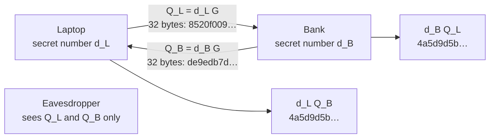

# Elliptic curves: the same protocols with 256-bit keys instead of 3,072

[Syllabus](../../../SYLLABUS.md) → [Applied and computational](../README.md) → [Cryptography](../README.md#s04) → Elliptic curves

---

## General Overview

A laptop opens a connection to its bank. Before the first order goes out, the two need a shared secret key that nobody on the café Wi-Fi knows. [Diffie-Hellman and ElGamal](05-diffie-hellman-and-elgamal.md) builds one from powers on a clock with a prime number of hours. For about 128-bit security (about 2^128 operations to break it, if the underlying assumption holds), that clock needs a 3,072-bit modulus, so each side sends a 384-byte public number.

Most connections today run the same protocol on a curve called Curve25519. Each side sends **32 bytes**. With the published test keys of the standard, RFC 7748, the laptop sends a key starting `8520f009`, the bank sends one starting `de9edb7d`, and both compute the same shared secret, starting `4a5d9d5b`. The eavesdropper sees both public keys and still cannot find it.

Only the group changes. Here the things combined are points on an elliptic curve, with coordinates on a clock of p = 2^255 − 19 hours. Raising a number to a secret power becomes adding a fixed starting point, the base point G, to itself a secret number of times. Going forward takes 255 steps. Going back has no known shortcut much better than about 2^125.8 steps.

**Elliptic-curve cryptography runs Diffie-Hellman and signatures in the group of points on a curve over a prime field, where the best known way to undo a multiple kG costs about the square root of the group's size, so a 256-bit curve gives the security that powers mod a prime need 3,072 bits for.**

**What kind of fact this is:** a construction resting on an assumption. That ECDH and ECDSA give the right answers is a theorem, proved in Why it works. That no attack on Curve25519 beats the square-root methods is an assumption, unproved as of 2026-11-11.

### The picture: one exchange, two 32-byte messages



Schematic. Each side keeps one number secret and sends one point. Each then multiplies the other's point by its own secret number, and both land on the same point.

---

## The formula

Notation first, in words. The curve's points are added by the chord-and-tangent rule of [Elliptic curves](../../05-Geometry%20and%20trig/06-Beyond%20Euclid/05-elliptic-curves-and-point-addition.md), with every coordinate reduced mod a prime p. Dividing is allowed, because every nonzero remainder mod a prime has a reciprocal ([Finite fields](../../03-Algebra/09-Rings%20and%20Fields/05-finite-fields.md)). O is the zero point. Here O means only that. It is not the big-O of shelf 01.

This card introduces **kP**, read "k times P": the point P added to itself k times. A **base point** G is a fixed point everyone agrees on. Its **order** n is how many multiples of G there are before the list returns to O: nG = O.

Key agreement (ECDH, elliptic-curve Diffie-Hellman):

$$Q_L = d_L G, \qquad Q_B = d_B G, \qquad S = d_L Q_B = d_B Q_L = (d_L d_B \bmod n)\,G$$

**Read it aloud:** each side's public key is its secret number times G, and each side's secret number times the other's public key gives the same shared point.

Signing (ECDSA, the elliptic-curve digital signature algorithm, standardised in FIPS 186-5). The bank holds a signing key $d_S$ and publishes $Q_S = d_S G$. To sign a message whose hash is z, it picks a fresh secret number k:

$$r = x\text{-coordinate of } kG \bmod n, \qquad s = k^{-1}(z + r\,d_S) \bmod n$$

To check the pair (r, s), anyone computes

$$u_1 = z\,s^{-1} \bmod n, \qquad u_2 = r\,s^{-1} \bmod n, \qquad \text{valid when the } x\text{-coordinate of } u_1 G + u_2 Q_S \text{ is } r \bmod n$$

**Read it aloud:** the signature mixes the hash and the key using a one-time number; the checker rebuilds the point kG from public pieces alone, and the x-coordinate must match.

The cost of breaking it, by the best known general method (the rho method, run on a group of prime order n):

$$\text{steps} \approx \sqrt{\pi n / 4}$$

| Symbol | Plain meaning | In our example | Push it up and the answer… |
| --- | --- | --- | --- |
| $p$ | the prime: coordinates are remainders mod p | 17 (toy); $2^{255} - 19$ (real) | more points, a harder search |
| $a$, $b$, $A$ | the curve's fixed numbers: $y^2 = x^3 + ax + b$; Curve25519 is $v^2 = u^3 + Au^2 + u$ | 2, 2; $A$ = 486662 | a different curve |
| $x$, $y$, $u$, $v$, $m$ | a point's coordinates: x and y on the toy curves, u and v on Curve25519, which sends only u; $m$ the chord or tangent slope | G is (5, 1); u = 9 | — |
| $G$ | the base point, agreed by everyone | (5, 1); the point with u = 9 | — |
| $n$ | the order of G: multiples before O returns | 19; a prime just above $2^{252}$ | attack cost grows like $\sqrt{n}$ |
| $O$, $kP$ | the zero point; P added to itself k times | 19G = O | — |
| $d_L$, $d_B$ | the laptop's and the bank's secret numbers | 13 and 7 | — |
| $Q_L$, $Q_B$, $S$ | their public keys; the shared point | (16, 4) and (0, 6); (3, 16) | — |
| $d_S$, $Q_S$ | the bank's signing key and its public key | 9 and (7, 6) | — |
| $k$, $z$ | the signature's one-time number (the code calls it the nonce); the message's hash, a number | 10; 5 (a stand-in) | — |
| $r$, $s$, $u_1$, $u_2$ | the signature; the checker's two multipliers | 7, 3; 8, 15 | — |
| $Q$, $w$, $i$, $j$ | in the attack: a public key to undo; the step size, about √n; the key written as $i w + j$ | 32-bit toy: w = 65,536 | cost grows like 2w |

In kP, k is any whole number; in ECDSA it is the one-time number. Security levels are written out, as in "128-bit security", so the shelf's "k-bit security" never clashes with it.

### When it holds

- **n is a large prime.** The square-root bound is the whole defence. On the 19-point toy curve the laptop's key falls on try 13. On a 32-bit toy curve it falls in 113,472 steps.
- **Received points are checked.** The maths assumes the other side's point is a multiple of G. Curve25519 has 8n points in all, and a point outside G's multiples can force the answer. A bank "key" of u = 0 makes the shared secret 32 zero bytes.
- **The one-time number k is fresh and secret.** Two signatures that share k reveal the signing key by two divisions. The toy recovers $d_S$ = 9.
- **z is a real hash of the message.** A signature covers the hash, not the text ([Hashes and MACs](03-hash-functions-and-macs.md)). The toy uses stand-in numbers. A weak hash lets a forger find a second message with the same z.
- **No large quantum computer.** A quantum algorithm would undo kP in polynomial time. That threat is why [Lattices](09-lattices-and-post-quantum-cryptography.md) exist.

---

## Why it works

### Step 0: any group will do, so pick the one with no shortcut

Diffie-Hellman needs only a group (a set with one way of combining, a zero and undos) where repeating the operation is quick and undoing it is slow. Powers mod a prime are one such group, but their structure helps the attacker: numbers factor into primes, and the fastest attack (the number field sieve) exploits that. That is why the modulus needs 3,072 bits.

Points on a well-chosen curve have no such structure. Nobody has found a general method there faster than the square-root ones in Step 5. So security of about 2^128 needs n near 2^256, and points that fit in 32 bytes. The comparison is the table in SP 800-57 from NIST, the US standards institute: 128-bit security needs RSA ([RSA in full](04-rsa-in-full.md)) or Diffie-Hellman moduli of 3,072 bits, or curves of 256 to 383 bits.

### Step 1: adding points mod p

The chord-and-tangent rule uses only adding, subtracting, multiplying and dividing. So it runs unchanged on remainders mod a prime ([Elliptic curves](../../05-Geometry%20and%20trig/06-Beyond%20Euclid/05-elliptic-curves-and-point-addition.md) does this mod 7). The toy curve here is y² = x³ + 2x + 2 mod 17. Testing every pair (x, y) counts 19 points, O included. Adding G = (5, 1) to itself returns to O after exactly 19 steps. So n = 19, and every point is a multiple of G.

### Step 2: double-and-add, the repeated squaring of points

Computing 13G by adding G one step at a time is slow, and for a 255-bit number it would take about 2^254 additions. [Powers on the clock](../../02-Number%20theory/04-Powers%20on%20the%20Clock/01-modular-exponentiation.md) solved the same problem for powers by repeated squaring. Written with addition, squaring becomes **doubling** and multiplying by the base becomes **adding G**.

Read 13 in binary, 1101, from the top. Start at G. For each later bit, double; if the bit is 1, also add G. That gives G, 2G, 3G, 6G, 12G, 13G: three doublings and two additions. Every bit after the first costs one doubling, plus one addition when the bit is 1. The laptop's real 255-bit key costs 254 doublings and 128 additions.

### Step 3: why both sides reach the same point

The laptop computes $d_L Q_B$, which is $d_L$ copies of $d_B$ copies of G. Adding is associative, so this is $d_L d_B$ copies of G, in any grouping, and the bank's $d_B Q_L$ is the same count. Since nG = O, copies of G repeat every n, and only $d_L d_B \bmod n$ matters. On the toy, 13 × 7 = 91, and 91 mod 19 = 15, so both sides reach 15G = (3, 16).

### Step 4: why a valid signature checks

Every multiplier in ECDSA is a count of copies of G, so it lives mod n, not mod p. The checker forms $u_1 G + u_2 Q_S$, which is $(u_1 + u_2 d_S)$ copies of G. Put in the definitions:

$$u_1 + u_2 d_S = s^{-1}(z + r\,d_S) = s^{-1} \cdot s\,k = k \pmod n$$

The middle step is the signing equation, $s = k^{-1}(z + r d_S)$, turned round: $z + r d_S = s k$. So the checker lands on kG, whose x-coordinate gave r. [Digital signatures](07-digital-signatures.md) takes up what a forger can and cannot do.

### Step 5: the square-root attack, and why it sets the key size

Baby step, giant step ([Diffie-Hellman and ElGamal](05-diffie-hellman-and-elgamal.md) runs it on a clock) works unchanged on points. Let w be the whole number at or just above √n, and write the unknown key as $i w + j$, with i and j below w. Store O, G, 2G, …, (w − 1)G (the baby steps), then walk Q, Q − wG, Q − 2wG, … (the giant steps) until a point matches. That is at most 2w steps, against up to n − 1 for trying keys in order.

On the 32-bit toy curve, n = 4,294,956,467. Here w = 65,536. The search takes 65,536 baby steps and 47,936 giant steps, 113,472 in all, and the key 3,141,592,653 comes out. Trying keys in order could need 4,294,956,466 additions. The rho method reaches the same square root with almost no memory. For Curve25519, n has 253 bits, so the attack costs about 2^125.8 steps. That is why the standard calls its security "slightly under" 128 bits.

<details>
<summary>Why nothing faster is known for curves</summary>

Attacks on powers mod a prime split numbers into small prime factors and combine the pieces. Points on a curve have no factoring like that. The known shortcuts work only on special curves, such as an order n with small factors, and standard curves are chosen to avoid each one. Any method that treats the group as a black box provably needs square-root work (a theorem about generic algorithms). For a specific curve, nobody has proved that a cleverer method does not exist.

</details>

### Step 6: Curve25519 as the standard writes it

Curve25519 is $v^2 = u^3 + 486662\,u^2 + u$ mod $2^{255} - 19$, with base point u = 9 and n a prime just above $2^{252}$, 253 bits long. It is the same kind of curve in another form. A point P and its mirror image −P share u and differ only in the sign of v, and so do kP and −kP. So u alone fixes the u of kP, and a public key is u alone: 32 bytes. RFC 7748 calls Diffie-Hellman done this way, with u alone, X25519.

The standard computes kP by a **ladder**. It keeps two running points, one always exactly P ahead of the other, and at every bit does one doubling and one addition, whatever the bit: 255 identical steps. Double-and-add does an addition only on 1-bits, so a timer can count them; the ladder gives a timer nothing.

The secret 32 bytes are also **clamped**. Three bits are cleared so the number is a multiple of 8, the curve's extra factor, and the top bit is fixed so every key has the same length. The code checks the ladder two ways: it reproduces the RFC's test vectors, and nG comes out as O (u = 0) while (n + 1)G returns u = 9.

---

## Worked numbers, by hand

The toy curve y² = x³ + 2x + 2 mod 17, G = (5, 1), n = 19. Each slope uses the formula from [Elliptic curves](../../05-Geometry%20and%20trig/06-Beyond%20Euclid/05-elliptic-curves-and-point-addition.md), with division done as multiplying by the reciprocal mod 17.

| Step | Arithmetic | Value |
| --- | --- | --- |
| double G | slope $(3 \cdot 5^2 + 2) \div (2 \cdot 1)$ mod 17 | slope 13, 2G = (6, 3) |
| add G | slope $(1 - 3) \div (5 - 6)$ mod 17 | slope 2, 3G = (10, 6) |
| double | slope $(3 \cdot 10^2 + 2) \div (2 \cdot 6)$ mod 17 | slope 11, 6G = (16, 13) |
| double | slope $(3 \cdot 16^2 + 2) \div (2 \cdot 13)$ mod 17 | slope 10, 12G = (0, 11) |
| add G | slope $(1 - 11) \div (5 - 0)$ mod 17 | slope 15, **13G = (16, 4) = $Q_L$** |
| bank's public key | 7G, the same way | $Q_B$ = (0, 6) |
| shared point | laptop: 13 $Q_B$; bank: 7 $Q_L$ | both (3, 16), which is 15G |
| sign: kG, r | k = 10, 10G = (7, 11) | r = 7 |
| sign: s | $1/k$ = 2; $2 \times (5 + 7 \times 9)$ mod 19 | **s = 3** |
| check: $u_1$, $u_2$ | $1/s$ = 13; $5 \times 13$ and $7 \times 13$ mod 19 | 8 and 15 |
| check: point | $8G + 15 Q_S$; 8 + 15 × 9 leaves 10 mod 19 | (7, 11): x is 7 = r, **valid** |

So the laptop and the bank share the point (3, 16), which a listener could get only by undoing 13G or 7G, and the signature (7, 3) shows that the holder of the key 9 signed the hash 5.

### What breaks if you drop a piece

| Mistake | Comes out at | What went wrong |
| --- | --- | --- |
| Same k = 10 used to sign hashes 5 and 11 | k = 10 and key 9 recovered | $s - s_2 = k^{-1}(z - z_2)$ gives k; then the signing equation gives $d_S$ |
| Accept u = 0 as the bank's public key | shared secret: 32 zero bytes | u = 0 is a point of order 2, outside G's multiples: every secret number gives the same answer |
| A 19-point group | laptop key found on try 13 of at most 18 | n far too small: trying every key is the attack |
| A 32-bit group | key found in 113,472 steps | the square-root attack is fast when n is near 2^32 |

Changing the hash from 5 to 6 while keeping (7, 3) makes the check fail, as it should.

---

## Code, from first principles, and it actually runs

The script works the toy curve, runs ECDH and ECDSA on it, attacks two toy groups, and runs X25519 on the standard's test vectors. It takes **five independent roads**:

- Double-and-add is checked against plain repeated addition.
- The group size is found by testing every pair (x, y) and, separately, by walking G back to O.
- ECDH and the signature are checked against multiples of G found by repeated addition.
- Baby step, giant step must recover the known secret within 2w steps.
- X25519 must reproduce the published RFC 7748 test vectors, and nG must come out as O.

The toy curves are **insecure** on purpose. Rust has no big integers, so the Rust check holds each 256-bit number as four 64-bit pieces and uses $2^{256} = 38$ mod p.

### Python

```python
# Elliptic-curve cryptography -- the check behind the card.  Standard library only.
# The toy curves are INSECURE: sized so every step can be followed and checked.
# The real curve, Curve25519, is run on the test vectors printed in RFC 7748.
from math import isqrt, log2, pi

def inv(x, m):  # reciprocal mod m, by the extended Euclid method
    r0, r1, s0, s1 = x % m, m, 1, 0
    while r1:
        q = r0 // r1
        r0, r1, s0, s1 = r1, r0 - q * r1, s1, s0 - q * s1
    assert r0 == 1
    return s0 % m

def slope(P, Q, p, a):
    if P == Q: return (3 * P[0] * P[0] + a) * inv(2 * P[1], p) % p
    return (Q[1] - P[1]) * inv(Q[0] - P[0], p) % p

def add(P, Q, p, a):  # chord and tangent; None is the zero point O
    if P is None: return Q
    if Q is None: return P
    if P[0] == Q[0] and (P[1] + Q[1]) % p == 0: return None
    m = slope(P, Q, p, a)
    x = (m * m - P[0] - Q[0]) % p
    return (x, (m * (P[0] - x) - P[1]) % p)

def mul(k, P, p, a, trace=None):  # double-and-add, top bit first
    R, ops = (P if k else None), [0, 0]
    for bit in bin(k)[3:]:
        for op in ["double"] + ["add G"] * (bit == "1"):
            Q = R if op == "double" else P
            m = slope(R, Q, p, a) if trace is not None else 0
            R = add(R, Q, p, a); ops[op == "add G"] += 1
            if trace is not None: trace.append((op, m, R))
    return R, ops

def rep(k, P, p, a):  # road two: add P to itself, one step at a time
    R = None
    for _ in range(k): R = add(R, P, p, a)
    return R

# ---- toy curve: y^2 = x^3 + 2x + 2 mod 17, base point G = (5, 1) ----
p, a, b, G = 17, 2, 2, (5, 1)
count = 1 + sum(1 for x in range(p) for y in range(p) if (y*y - x**3 - a*x - b) % p == 0)
n = next(k for k in range(1, 100) if rep(k, G, p, a) is None)
print("toy curve mod 17: points", count, " order of G", n)
assert count == 19 and n == 19

# ---- ECDH on the toy: laptop key 13, bank key 7 ----
dL, dB, tr = 13, 7, []
QL, ops = mul(dL, G, p, a, tr)
for t in tr: print(f"  {t[0]:6s} slope {t[1]:2d} -> {t[2]}")
QB = mul(dB, G, p, a)[0]
SL, SB = mul(dL, QB, p, a)[0], mul(dB, QL, p, a)[0]
print("QL = 13G", QL, " QB = 7G", QB, " doublings, additions", ops)
print("laptop 13*QB", SL, " bank 7*QL", SB, " 91 mod 19 =", 91 % 19)
assert QL == rep(13, G, p, a) and SL == SB == rep(91 % 19, G, p, a)
tries = next(k for k in range(1, n) if rep(k, G, p, a) == QL)
print("exhaustive search: laptop key found on try", tries, "of at most", n - 1)
assert tries == dL

# ---- ECDSA on the toy: signing key dS = 9, nonce k = 10, hash stand-in z = 5 ----
dS, k, z = 9, 10, 5
QS = mul(dS, G, p, a)[0]
def sign(z, k, d): return mul(k, G, p, a)[0][0] % n, inv(k, n) * (z + mul(k, G, p, a)[0][0] * d) % n
def verify(z, r, s):
    w = inv(s, n)
    u1, u2 = z * w % n, r * w % n
    R = add(mul(u1, G, p, a)[0], mul(u2, QS, p, a)[0], p, a)
    return R is not None and R[0] % n == r, u1, u2, R
r, s = sign(z, k, dS)
ok, u1, u2, R = verify(z, r, s)
print("QS = 9G", QS, " kG", mul(k, G, p, a)[0], " r", r, " s", s, " 1/k", inv(k, n))
print("verify: 1/s", inv(s, n), " u1", u1, " u2", u2, " u1 G + u2 QS", R, " valid", ok)
assert ok and R == rep(k, G, p, a) and s * k % n == (z + r * dS) % n
print("same signature, hash stand-in 6 instead of 5: valid", verify(6, r, s)[0])
assert not verify(6, r, s)[0]

# ---- what breaks: one nonce, two messages ----
z2 = 11
r2, s2 = sign(z2, k, dS)
kk = (z - z2) * inv(s - s2, n) % n
dd = (s * kk - z) * inv(r, n) % n
print("nonce reused: s2", s2, " recovered k", kk, " recovered key", dd)
assert (kk, dd) == (k, dS)

# ---- a generic attack on a 32-bit toy curve: baby step, giant step ----
p, a, G, n = 4294967291, 3, (2, 6), 4294956467
assert (G[1]**2 - G[0]**3 - a*G[0] - 22) % p == 0 and mul(n, G, p, a)[0] is None
assert all(n % q for q in range(2, isqrt(n) + 1))
secret = 3141592653
Q = mul(secret, G, p, a)[0]
m = isqrt(n - 1) + 1
table, R = {}, None
for j in range(m):
    table.setdefault(R, j); R = add(R, G, p, a)
step = (R[0], -R[1] % p)  # -mG
T, i = Q, 0
while T not in table: T, i = add(T, step, p, a), i + 1
found = i * m + table[T]
print("32-bit toy: n", n, " baby steps", m, " giant steps", i, " total", m + i)
print("found key", found, " exhaustive search would need up to", n - 1, "additions")
assert found == secret and m + i <= 2 * m

# ---- Curve25519, X25519 as in RFC 7748 ----
P25 = 2**255 - 19
N25 = 2**252 + 27742317777372353535851937790883648493
def ladder(kint, u):  # Montgomery ladder: one doubling and one addition per bit
    x1, x2, z2, x3, z3 = u, 1, 0, u, 1
    for t in range(254, -1, -1):
        if (kint >> t) & 1: x2, x3, z2, z3 = x3, x2, z3, z2
        A, B, C, D = x2 + z2, x2 - z2, x3 + z3, x3 - z3
        AA, BB, DA, CB = A * A % P25, B * B % P25, D * A % P25, C * B % P25
        E = AA - BB
        x3, z3 = (DA + CB) ** 2 % P25, x1 * (DA - CB) ** 2 % P25
        x2, z2 = AA * BB % P25, E * (AA + 121665 * E) % P25
        if (kint >> t) & 1: x2, x3, z2, z3 = x3, x2, z3, z2
    return x2 * inv(z2, P25) % P25 if z2 else 0  # O has u = 0, as in RFC 7748
def clamp(h):
    kb = bytearray.fromhex(h); kb[0] &= 248; kb[31] = (kb[31] & 127) | 64
    return int.from_bytes(kb, "little")
def x25519(h, u): return ladder(clamp(h), u).to_bytes(32, "little").hex()
def ux(h): return int.from_bytes(bytes.fromhex(h), "little") & (2**255 - 1)
a_hex = "77076d0a7318a57d3c16c17251b26645df4c2f87ebc0992ab177fba51db92c2a"
b_hex = "5dab087e624a8a4b79e17f8b83800ee66f3bb1292618b6fd1c2f8b27ff88e0eb"
KA, KB = x25519(a_hex, 9), x25519(b_hex, 9)
K1, K2 = x25519(a_hex, ux(KB)), x25519(b_hex, ux(KA))
print("laptop public", KA); print("bank public  ", KB); print("shared, both ", K1)
assert KA == "8520f0098930a754748b7ddcb43ef75a0dbf3a0d26381af4eba4a98eaa9b4e6a"
assert KB == "de9edb7d7b7dc1b4d35b61c2ece435373f8343c85b78674dadfc7e146f882b4f"
assert K1 == K2 == "4a5d9d5ba4ce2de1728e3bf480350f25e07e21c947d19e3376f09b3c1e161742"
print("order check: u of nG", ladder(N25, 9), " u of (n+1)G", ladder(N25 + 1, 9))
assert ladder(N25, 9) == 0 and ladder(N25 + 1, 9) == 9
ka = clamp(a_hex)
print("laptop scalar bits", ka.bit_length(), " double-and-add: doublings", ka.bit_length() - 1,
      " additions", bin(ka).count("1") - 1, " ladder steps", 255)
print("bank sends u = 0, a point of order 2: shared", x25519(a_hex, 0))
assert x25519(a_hex, 0) == "0" * 64
print("bytes: public key 32, RSA-3072 modulus", 3072 // 8, " n has", N25.bit_length(), "bits  A", 4 * 121665 + 2)
print(f"generic attack, about sqrt(pi n / 4) steps: 2^{(log2(pi / 4) + N25.bit_length() - 1) / 2:.1f}")
print("ALL CHECKS PASS")
```

**Ran 2026-11-11 on macOS, Python 3.14.10, standard library only. All checks passed. Output, pasted from the run:**

```
toy curve mod 17: points 19  order of G 19
  double slope 13 -> (6, 3)
  add G  slope  2 -> (10, 6)
  double slope 11 -> (16, 13)
  double slope 10 -> (0, 11)
  add G  slope 15 -> (16, 4)
QL = 13G (16, 4)  QB = 7G (0, 6)  doublings, additions [3, 2]
laptop 13*QB (3, 16)  bank 7*QL (3, 16)  91 mod 19 = 15
exhaustive search: laptop key found on try 13 of at most 18
QS = 9G (7, 6)  kG (7, 11)  r 7  s 3  1/k 2
verify: 1/s 13  u1 8  u2 15  u1 G + u2 QS (7, 11)  valid True
same signature, hash stand-in 6 instead of 5: valid False
nonce reused: s2 15  recovered k 10  recovered key 9
32-bit toy: n 4294956467  baby steps 65536  giant steps 47936  total 113472
found key 3141592653  exhaustive search would need up to 4294956466 additions
laptop public 8520f0098930a754748b7ddcb43ef75a0dbf3a0d26381af4eba4a98eaa9b4e6a
bank public   de9edb7d7b7dc1b4d35b61c2ece435373f8343c85b78674dadfc7e146f882b4f
shared, both  4a5d9d5ba4ce2de1728e3bf480350f25e07e21c947d19e3376f09b3c1e161742
order check: u of nG 0  u of (n+1)G 9
laptop scalar bits 255  double-and-add: doublings 254  additions 128  ladder steps 255
bank sends u = 0, a point of order 2: shared 0000000000000000000000000000000000000000000000000000000000000000
bytes: public key 32, RSA-3072 modulus 384  n has 253 bits  A 486662
generic attack, about sqrt(pi n / 4) steps: 2^125.8
ALL CHECKS PASS
```

### Rust

```rust
// Elliptic-curve cryptography -- the check behind the card.  std only, no crates.
// The toy curves are INSECURE: sized so every step can be followed and checked.
// Curve25519 runs on RFC 7748's test vectors, 256-bit numbers as four 64-bit limbs.
use std::collections::HashMap;
type Pt = Option<(u64, u64)>; // None is the zero point O
fn inv(x: u64, m: u64) -> u64 { // reciprocal mod m, by the extended Euclid method
    let (mut r0, mut r1, mut s0, mut s1) = ((x % m) as i128, m as i128, 1i128, 0i128);
    while r1 != 0 { let q = r0 / r1; (r0, r1, s0, s1) = (r1, r0 - q * r1, s1, s0 - q * s1); }
    assert!(r0 == 1);
    s0.rem_euclid(m as i128) as u64
}
fn mm(x: u64, y: u64, p: u64) -> u64 { ((x as u128 * y as u128) % p as u128) as u64 }
fn slope(a: (u64, u64), b: (u64, u64), p: u64, c: u64) -> u64 {
    if a == b { mm((3 * mm(a.0, a.0, p) + c) % p, inv(2 * a.1 % p, p), p) }
    else { mm((b.1 + p - a.1) % p, inv((b.0 + p - a.0) % p, p), p) }
}
fn add(pp: Pt, qq: Pt, p: u64, c: u64) -> Pt { // chord and tangent
    let (a, b) = match (pp, qq) { (None, _) => return qq, (_, None) => return pp, (Some(a), Some(b)) => (a, b) };
    if a.0 == b.0 && (a.1 + b.1) % p == 0 { return None; }
    let m = slope(a, b, p, c);
    let x = (mm(m, m, p) + 2 * p - a.0 - b.0) % p;
    Some((x, (mm(m, (a.0 + p - x) % p, p) + p - a.1) % p))
}
fn mul(k: u64, g: Pt, p: u64, c: u64, trace: &mut Vec<(&'static str, u64, Pt)>) -> (Pt, [u64; 2]) {
    let (mut r, mut ops) = (g, [0u64; 2]);
    if k == 0 { return (None, ops); }
    for t in (0..63 - k.leading_zeros()).rev() {
        for op in ["double", "add G"].into_iter().take(1 + ((k >> t) & 1) as usize) {
            let q = if op == "double" { r } else { g };
            let m = if trace.capacity() > 0 { slope(r.unwrap(), q.unwrap(), p, c) } else { 0 };
            r = add(r, q, p, c); ops[(op == "add G") as usize] += 1;
            if trace.capacity() > 0 { trace.push((op, m, r)); }
        }
    }
    (r, ops)
}
fn m0(k: u64, g: Pt, p: u64, c: u64) -> Pt { mul(k, g, p, c, &mut Vec::new()).0 }
fn rep(k: u64, g: Pt, p: u64, c: u64) -> Pt { let mut r = None; for _ in 0..k { r = add(r, g, p, c); } r }
fn sh(q: Pt) -> String { match q { Some((x, y)) => format!("({}, {})", x, y), None => "O".into() } }
type F = [u64; 4]; // ---- 256-bit arithmetic mod p = 2^255 - 19 ----
const P25: F = [0xffffffffffffffed, u64::MAX, u64::MAX, 0x7fffffffffffffff];
fn geq(a: &F, b: &F) -> bool { for i in (0..4).rev() { if a[i] != b[i] { return a[i] > b[i]; } } true }
fn sub_raw(a: &F, b: &F) -> F { // a - b, for a >= b
    let (mut r, mut br) = ([0u64; 4], false);
    for i in 0..4 { let (d1, o1) = a[i].overflowing_sub(b[i]); let (d2, o2) = d1.overflowing_sub(br as u64); r[i] = d2; br = o1 | o2; } r
}
fn fold(t: &[u64; 8]) -> F { // low half + 38 * high half, since 2^256 = 38 mod p
    let (mut r, mut c) = ([0u64; 4], 0u128);
    for i in 0..4 { c += t[i] as u128 + 38 * t[i + 4] as u128; r[i] = c as u64; c >>= 64; }
    while c > 0 { let mut d = c * 38; for i in 0..4 { d += r[i] as u128; r[i] = d as u64; d >>= 64; } c = d; }
    while geq(&r, &P25) { r = sub_raw(&r, &P25); } r
}
fn fadd(a: &F, b: &F) -> F {
    let (mut t, mut c) = ([0u64; 8], 0u128);
    for i in 0..4 { c += a[i] as u128 + b[i] as u128; t[i] = c as u64; c >>= 64; } t[4] = c as u64; fold(&t)
}
fn fsub(a: &F, b: &F) -> F { fadd(a, &sub_raw(&P25, b)) }
fn fmul(a: &F, b: &F) -> F {
    let mut t = [0u64; 8];
    for i in 0..4 { let mut c = 0u128;
        for j in 0..4 { c += t[i + j] as u128 + a[i] as u128 * b[j] as u128; t[i + j] = c as u64; c >>= 64; }
        t[i + 4] = c as u64; }
    fold(&t)
}
fn finv(x: &F) -> F { // x^(p-2), square-and-multiply
    let (mut e, mut r): (F, F) = (P25, [1, 0, 0, 0]); e[0] -= 2;
    for t in (0..255).rev() { r = fmul(&r, &r); if (e[t / 64] >> (t % 64)) & 1 == 1 { r = fmul(&r, x); } } r
}
fn ladder(k: &F, u: &F) -> F { // Montgomery ladder: one doubling and one addition per bit
    let (x1, mut x2, mut z2, mut x3, mut z3) = (*u, [1u64, 0, 0, 0], [0u64; 4], *u, [1u64, 0, 0, 0]);
    for t in (0..255).rev() {
        let bit = (k[t / 64] >> (t % 64)) & 1 == 1;
        if bit { std::mem::swap(&mut x2, &mut x3); std::mem::swap(&mut z2, &mut z3); }
        let (a, b, c, d) = (fadd(&x2, &z2), fsub(&x2, &z2), fadd(&x3, &z3), fsub(&x3, &z3));
        let (aa, bb, da, cb) = (fmul(&a, &a), fmul(&b, &b), fmul(&d, &a), fmul(&c, &b));
        let (e, s, df) = (fsub(&aa, &bb), fadd(&da, &cb), fsub(&da, &cb));
        x3 = fmul(&s, &s); z3 = fmul(&x1, &fmul(&df, &df));
        x2 = fmul(&aa, &bb); z2 = fmul(&e, &fadd(&aa, &fmul(&[121665, 0, 0, 0], &e)));
        if bit { std::mem::swap(&mut x2, &mut x3); std::mem::swap(&mut z2, &mut z3); }
    }
    fmul(&x2, &finv(&z2)) // O has z = 0, and 0^(p-2) = 0, as in RFC 7748
}
fn from_hex(h: &str) -> [u8; 32] { let mut b = [0u8; 32]; for i in 0..32 { b[i] = u8::from_str_radix(&h[2 * i..2 * i + 2], 16).unwrap(); } b }
fn limbs(b: &[u8; 32]) -> F { let mut r = [0u64; 4]; for i in 0..32 { r[i / 8] |= (b[i] as u64) << (8 * (i % 8)); } r }
fn clamp(h: &str) -> F { let mut b = from_hex(h); b[0] &= 248; b[31] = (b[31] & 127) | 64; limbs(&b) }
fn hex(f: &F) -> String { (0..32).map(|i| format!("{:02x}", (f[i / 8] >> (8 * (i % 8))) as u8)).collect() }
fn ux(h: &str) -> F { let mut f = limbs(&from_hex(h)); f[3] &= 0x7fffffffffffffff; f }
fn x25519(h: &str, u: &F) -> String { hex(&ladder(&clamp(h), u)) }

fn main() {
    // ---- toy curve: y^2 = x^3 + 2x + 2 mod 17, base point G = (5, 1) ----
    let ((p, c, b, g), mut count): ((u64, u64, u64, Pt), u64) = ((17, 2, 2, Some((5, 1))), 1);
    for x in 0..p { for y in 0..p { if (y * y) % p == (x * x * x + c * x + b) % p { count += 1; } } }
    let n = (1..100).find(|&k| rep(k, g, p, c).is_none()).unwrap();
    println!("toy curve mod 17: points {}  order of G {}", count, n);
    assert!(count == 19 && n == 19);
    // ---- ECDH on the toy: laptop key 13, bank key 7 ----
    let (dl, db, mut tr) = (13u64, 7u64, Vec::with_capacity(8));
    let (ql, ops) = mul(dl, g, p, c, &mut tr);
    for t in &tr { println!("  {:6} slope {:2} -> {}", t.0, t.1, sh(t.2)); }
    let qb = m0(db, g, p, c);
    let (sl, sb) = (m0(dl, qb, p, c), m0(db, ql, p, c)); // each side uses its own key on the other's point
    println!("QL = 13G {}  QB = 7G {}  doublings, additions [{}, {}]", sh(ql), sh(qb), ops[0], ops[1]);
    println!("laptop 13*QB {}  bank 7*QL {}  91 mod 19 = {}", sh(sl), sh(sb), 91 % 19);
    assert!(ql == rep(13, g, p, c) && sl == sb && sb == rep(91 % 19, g, p, c));
    let tries = (1..n).find(|&k| rep(k, g, p, c) == ql).unwrap();
    println!("exhaustive search: laptop key found on try {} of at most {}", tries, n - 1);
    assert!(tries == dl);
    // ---- ECDSA on the toy: signing key dS = 9, nonce k = 10, hash stand-in z = 5 ----
    let (ds, k, z) = (9u64, 10u64, 5u64);
    let qs = m0(ds, g, p, c);
    let sign = |z: u64, k: u64, d: u64| { let r = m0(k, g, p, c).unwrap().0 % n; (r, mm(inv(k, n), (z + r * d) % n, n)) };
    let verify = |z: u64, r: u64, s: u64| {
        let (u1, u2) = (z * inv(s, n) % n, r * inv(s, n) % n);
        let rr = add(m0(u1, g, p, c), m0(u2, qs, p, c), p, c);
        (rr.map_or(false, |q| q.0 % n == r), u1, u2, rr)
    };
    let ((r, s), qk) = (sign(z, k, ds), m0(k, g, p, c));
    let (ok, u1, u2, rr) = verify(z, r, s);
    println!("QS = 9G {}  kG {}  r {}  s {}  1/k {}", sh(qs), sh(qk), r, s, inv(k, n));
    println!("verify: 1/s {}  u1 {}  u2 {}  u1 G + u2 QS {}  valid {}", inv(s, n), u1, u2, sh(rr), if ok { "True" } else { "False" });
    assert!(ok && rr == qk && qk == rep(k, g, p, c) && s * k % n == (z + r * ds) % n);
    println!("same signature, hash stand-in 6 instead of 5: valid {}", if verify(6, r, s).0 { "True" } else { "False" });
    assert!(!verify(6, r, s).0);
    // ---- what breaks: one nonce, two messages ----
    let (z2, s2) = (11u64, sign(11, k, ds).1);
    let kk = mm((z + n - z2) % n, inv((s + n - s2) % n, n), n);
    let dd = mm((s * kk + n - z) % n, inv(r, n), n);
    println!("nonce reused: s2 {}  recovered k {}  recovered key {}", s2, kk, dd);
    assert!((kk, dd) == (k, ds));
    // ---- a generic attack on a 32-bit toy curve: baby step, giant step ----
    let (p, c, g, n): (u64, u64, Pt, u64) = (4294967291, 3, Some((2, 6)), 4294956467);
    let (gx, gy) = g.unwrap(); // G on y^2 = x^3 + 3x + 22, and nG = O
    assert!((mm(gy, gy, p) + p - (mm(mm(gx, gx, p), gx, p) + c * gx + 22) % p) % p == 0 && m0(n, g, p, c).is_none());
    let mut q = 2u64; while q * q <= n { assert!(n % q != 0); q += 1; }
    let secret = 3141592653u64;
    let qq = m0(secret, g, p, c);
    let m = { let mut s = 0u64; while s * s < n { s += 1; } s };
    let (mut table, mut rr): (HashMap<Pt, u64>, Pt) = (HashMap::new(), None);
    for j in 0..m { table.entry(rr).or_insert(j); rr = add(rr, g, p, c); }
    let step = rr.map(|(x, y)| (x, (p - y) % p)); // -mG
    let (mut t, mut i) = (qq, 0u64);
    while !table.contains_key(&t) { t = add(t, step, p, c); i += 1; }
    let found = i * m + table[&t];
    println!("32-bit toy: n {}  baby steps {}  giant steps {}  total {}", n, m, i, m + i);
    println!("found key {}  exhaustive search would need up to {} additions", found, n - 1);
    assert!(found == secret && m + i <= 2 * m);
    // ---- Curve25519, X25519 as in RFC 7748 ----
    let n25: F = [0x5812631a5cf5d3ed, 0x14def9dea2f79cd6, 0, 0x1000000000000000];
    let ahex = "77076d0a7318a57d3c16c17251b26645df4c2f87ebc0992ab177fba51db92c2a";
    let bhex = "5dab087e624a8a4b79e17f8b83800ee66f3bb1292618b6fd1c2f8b27ff88e0eb";
    let (nine, n1): (F, F) = ([9, 0, 0, 0], [n25[0] + 1, n25[1], n25[2], n25[3]]);
    let (ka, kb) = (x25519(ahex, &nine), x25519(bhex, &nine));
    let (k1, k2) = (x25519(ahex, &ux(&kb)), x25519(bhex, &ux(&ka)));
    println!("laptop public {}", ka); println!("bank public   {}", kb); println!("shared, both  {}", k1);
    assert!(ka == "8520f0098930a754748b7ddcb43ef75a0dbf3a0d26381af4eba4a98eaa9b4e6a");
    assert!(kb == "de9edb7d7b7dc1b4d35b61c2ece435373f8343c85b78674dadfc7e146f882b4f");
    assert!(k1 == k2 && k2 == "4a5d9d5ba4ce2de1728e3bf480350f25e07e21c947d19e3376f09b3c1e161742");
    let (o0, o1) = (ladder(&n25, &nine), ladder(&n1, &nine));
    println!("order check: u of nG {}  u of (n+1)G {}", o0[0], o1[0]);
    assert!(o0 == [0u64; 4] && o1 == nine);
    let (sa, nbits) = (clamp(ahex), 256 - n25[3].leading_zeros());
    let (bits, ones) = (256 - sa[3].leading_zeros(), sa.iter().map(|w| w.count_ones()).sum::<u32>());
    println!("laptop scalar bits {}  double-and-add: doublings {}  additions {}  ladder steps {}", bits, bits - 1, ones - 1, 255);
    println!("bank sends u = 0, a point of order 2: shared {}", x25519(ahex, &[0u64; 4]));
    assert!(x25519(ahex, &[0u64; 4]) == "0".repeat(64));
    println!("bytes: public key 32, RSA-3072 modulus {}  n has {} bits  A {}", 3072 / 8, nbits, 4 * 121665 + 2);
    println!("generic attack, about sqrt(pi n / 4) steps: 2^{:.1}", ((std::f64::consts::PI / 4.0).log2() + (nbits - 1) as f64) / 2.0);
    println!("ALL CHECKS PASS");
}
```

**Ran 2026-11-11 on macOS, rustc 1.98.1, no crates. All checks passed. Output, pasted from the run:**

```
toy curve mod 17: points 19  order of G 19
  double slope 13 -> (6, 3)
  add G  slope  2 -> (10, 6)
  double slope 11 -> (16, 13)
  double slope 10 -> (0, 11)
  add G  slope 15 -> (16, 4)
QL = 13G (16, 4)  QB = 7G (0, 6)  doublings, additions [3, 2]
laptop 13*QB (3, 16)  bank 7*QL (3, 16)  91 mod 19 = 15
exhaustive search: laptop key found on try 13 of at most 18
QS = 9G (7, 6)  kG (7, 11)  r 7  s 3  1/k 2
verify: 1/s 13  u1 8  u2 15  u1 G + u2 QS (7, 11)  valid True
same signature, hash stand-in 6 instead of 5: valid False
nonce reused: s2 15  recovered k 10  recovered key 9
32-bit toy: n 4294956467  baby steps 65536  giant steps 47936  total 113472
found key 3141592653  exhaustive search would need up to 4294956466 additions
laptop public 8520f0098930a754748b7ddcb43ef75a0dbf3a0d26381af4eba4a98eaa9b4e6a
bank public   de9edb7d7b7dc1b4d35b61c2ece435373f8343c85b78674dadfc7e146f882b4f
shared, both  4a5d9d5ba4ce2de1728e3bf480350f25e07e21c947d19e3376f09b3c1e161742
order check: u of nG 0  u of (n+1)G 9
laptop scalar bits 255  double-and-add: doublings 254  additions 128  ladder steps 255
bank sends u = 0, a point of order 2: shared 0000000000000000000000000000000000000000000000000000000000000000
bytes: public key 32, RSA-3072 modulus 384  n has 253 bits  A 486662
generic attack, about sqrt(pi n / 4) steps: 2^125.8
ALL CHECKS PASS
```

### Lean

Lean proves the facts behind Steps 3 to 5 in any group, and checks the worked numbers on the toy curves.

- Take any group, a base point G of order n, and secret numbers $d_L$ and $d_B$. Then $d_L (d_B G) = d_B (d_L G) = (d_L d_B \bmod n)\,G$.
- Take n prime, G of order n, and $s = k^{-1}(z + r\,d_S) \bmod n$ with s not 0. Then the checker's point $u_1 G + u_2 Q_S$ is kG.
- Take a whole number w with $w^2 \ge n$, and a key below n. Then the key is $i w + j$, with i and j both below w.
- On the toy curve mod 17, Lean counts 19 points, O included, and checks that each point in the worked table lies on the curve.
- It checks the five slopes, 91 mod 19 = 15, and the signature's numbers s = 3, $u_1$ = 8 and $u_2$ = 15.
- On the 32-bit toy, it checks w = 65,536, the key 3,141,592,653 = 47,936 w + 58,957, and 113,472 steps in all.

Point addition, the attacks themselves and X25519 on the RFC 7748 test vectors are left to the Python and Rust checks.

```lean
-- Elliptic curves: in any group of points, both sides of Diffie-Hellman reach the same point (d_L d_B mod n)G, a correctly made ECDSA signature always checks, and baby step, giant step needs at most 2w steps.
import Mathlib.GroupTheory.OrderOfElement
import Mathlib.Algebra.Field.ZMod
import Mathlib.Tactic.NormNum
import Mathlib.Tactic.Ring

/-- Key agreement (ECDH) gives both sides the same point. In any group of points,
with base point G of order n, the laptop's d_L Q_B and the bank's d_B Q_L are the
same point, and it equals (d_L d_B mod n) G. -/
theorem ecdh_shared_point {A : Type*} [AddCommGroup A] (G : A) (n dL dB : ℕ)
    (hn : addOrderOf G = n) :
    dL • (dB • G) = dB • (dL • G) ∧ dB • (dL • G) = ((dL * dB) % n) • G := by
  refine ⟨?_, ?_⟩
  · rw [smul_smul, smul_smul, mul_comm]
  · rw [smul_smul, ← hn, mod_addOrderOf_nsmul, mul_comm]

/-- A correctly made ECDSA signature always checks. With base point G of prime order n,
signing key d_S, public key Q_S = d_S G, one-time number k, hash z, first half r, and
s = k⁻¹ (z + r d_S) mod n with s invertible, the checker's point
u₁ G + u₂ Q_S, where u₁ = z s⁻¹ and u₂ = r s⁻¹ mod n, is exactly k G. -/
theorem ecdsa_valid_signature_checks {A : Type*} [AddCommGroup A] (G : A) (n : ℕ)
    [Fact n.Prime] (hn : addOrderOf G = n) (dS k z r s : ZMod n)
    (hs_def : s = k⁻¹ * (z + r * dS)) (hs : s ≠ 0) :
    (z * s⁻¹).val • G + (r * s⁻¹).val • (dS.val • G) = k.val • G := by
  have key : ∀ m : ℕ, m • G = ((m : ZMod n).val) • G := by
    intro m
    rw [ZMod.val_natCast, ← hn, mod_addOrderOf_nsmul]
  have hk : k ≠ 0 := by
    rintro rfl
    simp at hs_def
    exact hs hs_def
  have hX : z + r * dS = k * s := by
    rw [hs_def, ← mul_assoc, mul_inv_cancel₀ hk, one_mul]
  have hsum : z * s⁻¹ + r * s⁻¹ * dS = k := by
    calc z * s⁻¹ + r * s⁻¹ * dS = (z + r * dS) * s⁻¹ := by ring
      _ = k := by rw [hX, mul_assoc, mul_inv_cancel₀ hs, mul_one]
  rw [smul_smul, ← add_nsmul, key]
  congr 2
  push_cast
  simp only [ZMod.natCast_val, ZMod.cast_id', id]
  rw [← hsum]

/-- Baby step, giant step covers every key. If w is a whole number with w² ≥ n,
every key below n can be written as i w + j with i and j both below w, so at most
w baby steps and w giant steps find it. -/
theorem baby_step_giant_step_split (n w k : ℕ) (hw : n ≤ w * w) (hk : k < n) :
    ∃ i < w, ∃ j < w, k = i * w + j := by
  have hw0 : 0 < w := by
    rcases Nat.eq_zero_or_pos w with h | h
    · subst h; omega
    · exact h
  refine ⟨k / w, ?_, k % w, Nat.mod_lt _ hw0, (Nat.div_add_mod' k w).symm⟩
  exact (Nat.div_lt_iff_lt_mul hw0).2 (by omega)

/-! Worked numbers from the card: the toy curve y² = x³ + 2x + 2 mod 17, n = 19. -/

-- The points of the worked table lie on the toy curve.
example : ((1 : ZMod 17))^2 = (5 : ZMod 17)^3 + 2 * 5 + 2 := by decide
example : ((4 : ZMod 17))^2 = (16 : ZMod 17)^3 + 2 * 16 + 2 := by decide
example : ((6 : ZMod 17))^2 = (0 : ZMod 17)^3 + 2 * 0 + 2 := by decide
example : ((16 : ZMod 17))^2 = (3 : ZMod 17)^3 + 2 * 3 + 2 := by decide
example : ((11 : ZMod 17))^2 = (7 : ZMod 17)^3 + 2 * 7 + 2 := by decide
example : ((6 : ZMod 17))^2 = (7 : ZMod 17)^3 + 2 * 7 + 2 := by decide
example : ((3 : ZMod 17))^2 = (6 : ZMod 17)^3 + 2 * 6 + 2 := by decide
example : ((6 : ZMod 17))^2 = (10 : ZMod 17)^3 + 2 * 10 + 2 := by decide

-- Testing every pair (x, y) mod 17 finds 18 points; with O that is 19.
example : ((Finset.univ : Finset (ZMod 17 × ZMod 17)).filter
    (fun q => q.2 ^ 2 = q.1 ^ 3 + 2 * q.1 + 2)).card + 1 = 19 := by decide

-- Slopes in the double-and-add table, mod 17.
example : (13 : ZMod 17) * (2 * 1) = 3 * 5 ^ 2 + 2 := by decide
example : (2 : ZMod 17) * (5 - 6) = 1 - 3 := by decide
example : (11 : ZMod 17) * (2 * 6) = 3 * 10 ^ 2 + 2 := by decide
example : (10 : ZMod 17) * (2 * 13) = 3 * 16 ^ 2 + 2 := by decide
example : (15 : ZMod 17) * (5 - 0) = 1 - 11 := by decide

-- Shared point: 13 × 7 = 91, and 91 mod 19 = 15.
example : 13 * 7 % 19 = 15 := by norm_num

-- Signing with k = 10, z = 5, r = 7, d_S = 9: 1/k = 2 and s = 3.
example : (10 : ZMod 19) * 2 = 1 := by decide
example : (2 : ZMod 19) * (5 + 7 * 9) = 3 := by decide
-- Checking: 1/s = 13, u₁ = 8, u₂ = 15, and 8 + 15 × 9 leaves 10 = k mod 19.
example : (3 : ZMod 19) * 13 = 1 := by decide
example : (5 : ZMod 19) * 13 = 8 ∧ (7 : ZMod 19) * 13 = 15 := by decide
example : (8 + 15 * 9) % 19 = 10 := by norm_num

-- The 32-bit toy group: w = 65,536 is the whole number at or just above √n.
example : 65535 * 65535 < 4294956467 ∧ 4294956467 ≤ 65536 * 65536 := by norm_num
-- The key 3,141,592,653 = 47,936 w + 58,957, so 47,936 giant steps find it,
-- and 65,536 + 47,936 = 113,472 steps in all.
example : 3141592653 = 47936 * 65536 + 58957 ∧ 65536 + 47936 = 113472 := by norm_num

#print axioms ecdh_shared_point
#print axioms ecdsa_valid_signature_checks
#print axioms baby_step_giant_step_split
```

**Checked 2026-11-14 on macOS, Lean 4.36.0-rc2, Mathlib v4.36.0-rc2. Every proof is complete and uses only Lean's standard axioms. Output, pasted from the run:**

```
'ecdh_shared_point' depends on axioms: [propext, Classical.choice, Quot.sound]
'ecdsa_valid_signature_checks' depends on axioms: [propext, Classical.choice, Quot.sound]
'baby_step_giant_step_split' depends on axioms: [propext, Quot.sound]
```

> [!TIP]
> **Try changing**
> - Guess first: does the bank's key have to be below 19? Change the bank's key from 7 to 26 on the ECDH line of either script. Every printed point stays the same, because 26 is 7 + 19 and 19G = O. Only the count mod n matters.
> - Guess first: what if the bank signs the same hash twice with the same k? Change the second hash from 11 to 5 on the nonce-reuse line. The second signature then equals the first, s = 3, and the recovery stops on the reciprocal of 0. Identical signatures leak nothing new. The attack needs two different messages.
> - Guess first: does the baby-step attack's cost depend on the secret? Change `secret` to any number below n. The giant steps change, but the total never exceeds twice the 65,536 baby steps.
> - Guess first: is clamping optional? Change `248` to `255` in `clamp`. The public key no longer matches RFC 7748 and the assert stops the run. Clamping is part of the standard, not a detail.

---

## The usual mistake

> [!warning]
> **Reusing or predicting the signature's one-time number k.** ECDSA is only as safe as k. Two signatures with the same k give k by one division and the key by another: the toy recovered $d_S$ = 9. A games console's signing key was lost this way in 2010 ([Digital signatures](07-digital-signatures.md) traces it). FIPS 186-5 allows a deterministic k, computed from the key and the hash, so no perfect random source is needed.
>
> Smaller traps:
> - **Using any 32 bytes as a public key.** A point outside G's multiples can steer the answer. Sent u = 0, the laptop's shared secret is 32 zero bytes. RFC 7748 lets each side check for an all-zero result and abort.
> - **Reading key length as security.** A 256-bit key does not mean 2^256 steps to break. The square-root attack makes it about 2^125.8 for Curve25519.
> - **Branching on secret bits.** Plain double-and-add on the laptop's key does 254 doublings and 128 additions. The count of additions, one fewer than the number of 1-bits, or their timing, gives the key's bits away. The ladder does 255 identical steps for every key.
> - **Trusting a toy.** The 32-bit toy curve fell in 113,472 steps. A curve's safety needs n of about 256 bits and none of the special weaknesses in Step 5.

---

## Where you meet it in real life

- **The padlock in a browser.** In [The TLS handshake](08-key-exchange-in-practice-the-tls-handshake.md), X25519 is the most common way the laptop and the bank agree a key. The shared secret then keys the cipher of [AES](02-symmetric-ciphers-and-aes.md).
- **Secure shell logins.** Servers prove who they are with curve signatures, and sessions start with X25519.
- **Cryptocurrency.** A wallet's address comes from a public key on a 256-bit curve called secp256k1, and spending coins means an ECDSA signature.
- **Messaging apps and software updates.** End-to-end encrypted chats agree keys with X25519; updates carry curve signatures the device checks before installing.

> **Say it back**
> Elliptic-curve cryptography runs the familiar protocols in the group of points on a curve mod a prime. A public key is a secret number times a base point, computed by double-and-add or the ladder in about 255 steps. ECDH works because both sides count the same number of copies of G. ECDSA works because the checker rebuilds kG from public pieces. Undoing kP is believed to cost about the square root of n, so 32-byte keys give about 128-bit security, where powers mod a prime need 384 bytes.

---

## What this builds on

- [Diffie-Hellman and ElGamal](05-diffie-hellman-and-elgamal.md): the protocols themselves, in the group of powers mod a prime. This card swaps the group.
- [Elliptic curves](../../05-Geometry%20and%20trig/06-Beyond%20Euclid/05-elliptic-curves-and-point-addition.md): the chord-and-tangent rule, the zero point O, and the group laws, already checked mod 7.
- [Finite fields](../../03-Algebra/09-Rings%20and%20Fields/05-finite-fields.md): why remainders mod a prime can be divided, which every slope needs.
- [Powers on the clock](../../02-Number%20theory/04-Powers%20on%20the%20Clock/01-modular-exponentiation.md): repeated squaring, which becomes double-and-add when the group is written with addition.

## Where this goes next

- [Digital signatures](07-digital-signatures.md): what any signature promises, with ECDSA as one scheme among several.
- [Lattices](09-lattices-and-post-quantum-cryptography.md): the replacement when a quantum computer could undo kP.
- Curves for keys (planned): how standard curves are chosen and checked against the special weaknesses.

The open question this card leaves: is the square-root attack really the best possible on a well-chosen curve, or does a classical shortcut exist that nobody has found?

---

## Sources

Verified 2026-11-11: every link below resolves to the publisher's page.

- Koblitz, Neal. "Elliptic Curve Cryptosystems." *Mathematics of Computation* 48, no. 177 (1987): 203–209. [doi:10.1090/S0025-5718-1987-0866109-5](https://doi.org/10.1090/S0025-5718-1987-0866109-5). Proposes running Diffie-Hellman and ElGamal in the group of a curve over a finite field.
- Bernstein, Daniel J. "Curve25519: New Diffie-Hellman Speed Records." *Public Key Cryptography – PKC 2006*, Lecture Notes in Computer Science 3958 (2006): 207–228. [doi:10.1007/11745853_14](https://doi.org/10.1007/11745853_14). The curve, the u-coordinate-only ladder and the 32-byte keys.
- Langley, A., M. Hamburg, and S. Turner. "Elliptic Curves for Security." RFC 7748 (2016). [doi:10.17487/RFC7748](https://doi.org/10.17487/RFC7748). The X25519 function, clamping, the all-zero check and the test vectors the code meets.
- National Institute of Standards and Technology. *Digital Signature Standard (DSS)*, FIPS 186-5 (2023). [doi:10.6028/NIST.FIPS.186-5](https://doi.org/10.6028/NIST.FIPS.186-5). ECDSA as standardised, including deterministic k.
- Barker, Elaine. *Recommendation for Key Management: Part 1 – General*, NIST SP 800-57 Part 1 Rev. 5 (2020). [doi:10.6028/NIST.SP.800-57pt1r5](https://doi.org/10.6028/NIST.SP.800-57pt1r5). The table matching 128-bit security to 3,072-bit RSA and Diffie-Hellman and to 256-to-383-bit curves.
