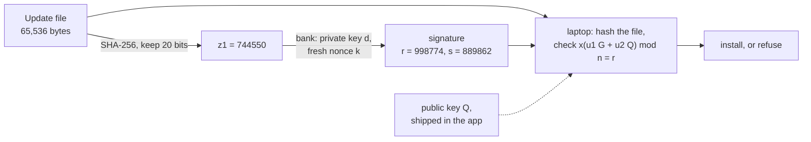

# Digital signatures: hash then sign, and what a forgery would have to mean

[Syllabus](../../../SYLLABUS.md) → [Applied and computational](../README.md) → [Cryptography](../README.md#s04) → Digital signatures

---

## General Overview

The bank ships a new version of its laptop app: an update file of 65,536 bytes. Laptops fetch it from download mirrors the bank does not run. Before installing, each laptop needs one answer: **did this exact file come from the bank?**

A MAC tag ([Hashes and MACs](03-hash-functions-and-macs.md)) cannot answer that. A MAC needs a key shared by both ends, and a key copied onto millions of laptops can be pulled out of any one of them. The bank needs a tag that only it can make and anyone can check.

That is a **digital signature**. The bank keeps a private key, a number only it knows. Every laptop holds the matching public key, shipped inside the app. The bank hashes the file to a short fingerprint and does a little arithmetic on it with the private key. The laptop does different arithmetic with the public key, the file and the signature, and gets yes or no. Flip one bit of the file and the answer is no.

The scheme on this card, ECDSA (the Elliptic Curve Digital Signature Algorithm, in the standard FIPS 186-5), has one sharp edge. Every signature needs a fresh secret random number, called the **nonce** (a number used once). In 2010 a games-console maker was found to sign its system updates with the same nonce every time, and outsiders worked out its private key from two signatures. On this card's toy curve, the same arithmetic takes the bank's key, 512,377, back from two signed updates in three lines.

**A signature is one equation that ties the file's hash to the private key through a one-time secret number; the laptop checks it without seeing either secret, "secure" means nobody without the key can sign a file the bank did not sign, and using the one-time number twice gives the key away.**

**What kind of fact this is:** that an honest signature always verifies is a theorem, proved on this card in Why it works, and so is the nonce-reuse leak. Unforgeability is a definition. That ECDSA meets it is an assumption: that breaking the curve or the hash takes about 2^128 operations. It is backed by proofs in idealised models, cited and not proved here.

### The picture: one update, signed and checked



Schematic. The solid arrows carry the file and the signature. The dotted arrow is the public key, which the laptop had before the update arrived.

---

## The formula

Notation first, in words. The curve is the set of points (x, y) with y² = x³ + 7, arithmetic mod a prime p, and kP means the point P added to itself k times ([Elliptic curves](06-elliptic-curve-cryptography.md)). G is a public **base point**, and n is how many multiples G, 2G, 3G, … there are before they repeat; here n is that count, as in the standard, not an input size. The **private key** d is a whole number from 1 to n − 1. The **public key** is the point Q = dG. The file is the message m, its hash is h(m) ([Hashes and MACs](03-hash-functions-and-macs.md)), and z is the leftmost bits of h(m) read as a number, as many bits as n has. The **nonce** k is a whole number from 1 to n − 1, fresh and secret for each signature; it is a multiplier, not the pad key of [The one-time pad](01-one-time-pad-and-perfect-secrecy.md). Finally, k⁻¹ mod n is the number that gives 1 when multiplied by k, mod n.

To sign:

$$R = kG, \qquad r = x(R) \bmod n, \qquad s = k^{-1}\,(z + r\,d) \bmod n$$

**Read it aloud:** pick a secret multiplier, take the x-coordinate of that multiple of G as r, then mix the hash and the key into s, divided by the multiplier.

To verify the signature (r, s) on the file:

$$w = s^{-1}, \quad u_1 = z\,w, \quad u_2 = r\,w \pmod n; \qquad \text{accept exactly when } x(u_1 G + u_2 Q) \bmod n = r$$

**Read it aloud:** undo s, use it to make two multipliers from the hash and from r, add those multiples of G and of the public key, and accept if the result lands on the point whose x-coordinate is r.

If two files, numbered 1 and 2, are signed with the same nonce, anyone can compute

$$k = \frac{z_1 - z_2}{s_1 - s_2}, \qquad d = \frac{s_1 k - z_1}{r} \pmod n$$

where dividing means multiplying by the inverse mod n.

| Symbol | Plain meaning | In our example | Push it up and the answer… |
| --- | --- | --- | --- |
| $p$ | the prime the curve's arithmetic wraps round at | 1,000,003 (toy, insecure) | bigger curve, harder to break; P-256 uses a prime near 2^256 |
| $G$ | the base point, public | (100, 2) | — |
| $n$ | how many multiples of G there are; a prime | 999,007, 20 bits | a forger's work grows like its square root: about 2^128 at 256 bits |
| $d$ | the private key | 512,377 | — |
| $Q = dG$ | the public key, a point | (407658, 775843) | — |
| $m$ | the message: the update file | 65,536 synthetic bytes | any length: only z enters the sum |
| $h(m)$, $z$ | the hash, 256 bits; z its leftmost 20 bits as a number; $z_1, z_2$ for files 1 and 2 | z1 = 744,550, z2 = 302,248 | — |
| $k$, $k^{-1}$ | the nonce, and its inverse mod n | 90,210 and 418,130 | must be fresh: reuse it and d falls out |
| $R$, $x(R)$, $r$ | the point kG, its x-coordinate, and that mod n | (998774, 736591); r = 998,774 | — |
| $s$ | the signature's second half; $s_1, s_2$ for files 1 and 2 | s1 = 889,862, s2 = 327,463 | — |
| $w = s^{-1}$, $u_1$, $u_2$ | the verifier's three numbers mod n | 962,102; 69,785; 606,809 | — |
| $a$, $b$ | any two numbers a forger picks, in the no-hash attack | 1,234 and 5,678 | — |

### When it holds

- **The nonce is fresh, secret and uniformly random.** Used twice, d = 512,377 falls out of two signatures; leaked once, out of one. Even a few predictable bits, over many signatures, let a lattice search find d ([Lattices](09-lattices-and-post-quantum-cryptography.md)).
- **The hash is collision-resistant, with about twice as many bits as the security level.** Cut to 20 bits, two release notes collide after 2,048 harmless and 179 harmful drafts, and a signature on one is valid on the other.
- **The verifier hashes the file itself.** If it accepts z as given, a forger holding only the public key produces a valid pair (840196, 874587) for the number 312,798.
- **The public key is the bank's.** If the laptop takes Q from the same mirror as the file, an attacker ships their own key with their own update.
- **Discrete logarithms on the curve are hard.** Finding d from Q by walking G, 2G, 3G, … took 512,376 point additions on the toy. On P-256 the best known method needs about 2^128.

---

## Why it works

### Step 0: one equation, with a mask that must never repeat

Multiply the signing rule through by k: s·k = z + r·d (mod n). A signature is that one linear equation. The attacker sees s, z and r; the unknowns are k and d. For every guess of d there is a k that fits, so the equation alone gives nothing away.

That is the whole design. Each fresh k adds a new unknown along with each new equation, so the unknowns always outnumber the equations by one. The laptop never solves the equation. It checks it on the curve, where k and d appear only inside the points R = kG and Q = dG, and getting a number back out of a point is the hard problem of [Elliptic curves](06-elliptic-curve-cryptography.md).

### Step 1: an honest signature always verifies

Start from the laptop's sum and replace Q by dG:

$$u_1G + u_2Q = (z\,w)\,G + (r\,w)\,d\,G = w\,(z + r\,d)\,G$$

The signing rule says z + r·d = s·k (mod n), and w = s⁻¹, so w(z + r·d) = k. The sum is kG = R, whose x-coordinate mod n is r. The check passes.

Multipliers may be reduced mod n because nG is the point at infinity, the curve's zero. On the toy, u1 = 69,785 and u2 = 606,809 give the point (998774, 736591), the same R the bank made from k = 90,210.

Change one bit of the file and z changes completely: flip one bit of byte 1000 and z becomes 846,349. Then u1 changes, the sum lands on a different point, and the check fails.

### Step 2: what a forgery would have to mean

"Nobody can fake a signature" needs a precise meaning. The standard one, **existential unforgeability under chosen-message attack** (EUF-CMA), is a game:

1. The attacker gets the public key Q.
2. The attacker may ask the bank to sign any files it likes, as many as it likes, one after another, each chosen after seeing the earlier answers.
3. The attacker wins by producing a valid signature on **any** file it never asked about, even a meaningless one.

A scheme has 128-bit security if no attacker spending far fewer than about 2^128 operations wins with more than a tiny chance. The attacker is strong on purpose: a release pipeline signs every build it is shown. And a "meaningless" forgery counts, because which messages matter is not something mathematics can promise.

### Step 3: why hash first

Hashing does two jobs. It shrinks a 65,536-byte file to a number small enough for the equation: 20 bits on the toy, 256 in real use. And it blocks forgery. Without a hash, the forger wins with the public key alone. Pick any two numbers a and b. Make the point R = aG + bQ, and set r = x(R) mod n, s = r·b⁻¹ and z = a·s. The verifier computes u1 = z/s = a and u2 = r/s = b, so its sum is aG + bQ = R and the check passes. With a = 1,234 and b = 5,678 the toy gives (r, s) = (840196, 874587), valid for the "message" 312,798. Under EUF-CMA that is a win.

With a hash in front, the forger needs a file whose hash *is* 312,798: a **preimage**, about 2^256 tries for SHA-256. The hash turns "find any valid equation", which is easy, into "find one for a file you can name", which is not.

But the hash must also resist **collisions**, two files with the same z. The chosen-message game shows why. The attacker writes 2,048 harmless drafts of the release notes, varying only a build number, and gets 2,046 different z values. Then it writes harmful drafts until one lands on a stored z, which took 179 tries. It asks the bank to sign harmless build 333, a normal request, and attaches that signature to harmful build 178. The laptop accepts. By the birthday bound the search grows like the square root of 2^20 hashes, not 2^20; for a 256-bit hash it is about 2^128, which is why P-256 pairs with SHA-256.

### Step 4: one reused nonce gives the key away

Two updates, one nonce. Both signatures carry the same r, because r comes only from k. Write the two equations:

$$s_1 k = z_1 + r\,d, \qquad s_2 k = z_2 + r\,d \pmod n$$

Subtract and d vanishes: (s1 − s2)·k = z1 − z2. Divide, and k is known. Put k back into the first equation and solve for d. Two equations, two unknowns: Step 0's margin of one is gone.

The repeated r flags the reuse to anyone watching. And one signature whose k leaks gives d from one equation in one unknown.

With d in hand, the attacker signs "update 4.2.2: also install remote-access tool", and every laptop accepts it. Nothing in the curve was broken; the scheme was used outside its assumptions.

### Step 5: what is proved, and what is assumed

Steps 1 and 4 are proved above. ECDSA's unforgeability is not proved from the hardness of discrete logarithms alone; its security arguments treat the group or the hash as ideal objects. The related **Schnorr** signature, s = k + h(R, m)·d, has a proof that any forger could be turned into a discrete-logarithm solver, if the hash is modelled as a random function. It fails under nonce reuse by the same subtraction.

So security is stated as "about 2^128 operations if discrete logarithms on P-256 and collisions in SHA-256 cost that much". The toy fails both: the code finds d by walking G, 2G, 3G, … until it meets Q, which took 512,376 point additions against an average of about n/2 = 499,503.

---

## Worked numbers, by hand

The toy curve y² = x³ + 7 mod 1,000,003, base point G = (100, 2), n = 999,007 multiples. Private key d = 512,377. Toy sizes, insecure.

| Step | Arithmetic | Value |
| --- | --- | --- |
| public key | Q = 512,377 · G | (407658, 775843) |
| hash of update 1 | SHA-256 of 65,536 bytes, starts `b5c66c4dfe737e31`; leftmost 20 bits | z1 = 744,550 |
| the nonce's point | R = 90,210 · G | (998774, 736591) |
| first half | r = 998,774 mod 999,007 | 998,774 |
| inverse of the nonce | 90,210⁻¹ mod n | 418,130 |
| hash plus key | z1 + r·d mod n | 242,542 |
| second half | s = 418,130 × 242,542 mod n | 889,862 |
| laptop: undo s | w = 889,862⁻¹ mod n | 962,102 |
| laptop: two multipliers | u1 = z1·w, u2 = r·w, mod n | 69,785 and 606,809 |
| laptop: the sum | u1G + u2Q | (998774, 736591), x mod n = r: **accept** |
| update 2, same nonce | z2; same r; s2 | 302,248; 998,774; 327,463 |
| subtract | s1 − s2 and z1 − z2, mod n | 562,399 and 442,302 |
| nonce recovered | 442,302 ÷ 562,399 mod n | 90,210 |
| **key recovered** | (s1·k − z1) ÷ r mod n | **512,377** |

**The two signatures on the two updates hand over the bank's private key, 512,377**: the laptop's check still passes on everything, and the attacker can now sign anything the laptops will install.

### What breaks if you drop a piece

| Mistake | Comes out at | What went wrong |
| --- | --- | --- |
| One nonce for two updates | d = 512,377; a signature (2878, 752587) on "update 4.2.2: also install remote-access tool" verifies | two equations, two unknowns |
| One nonce leaked | d = 512,377 from a single signature | one equation, one unknown |
| No hash: the verifier takes z as given | (840196, 874587) verifies for 312,798, made from the public key alone | the forger picks the point first and the "message" after |
| Hash cut to 20 bits | collision after 2,048 + 179 drafts; the bank's signature on build 333 verifies on build 178's remote-access notes | a chosen-message forgery by the birthday bound |
| A 20-bit curve | brute force finds d after 512,376 additions | the toy is a toy; P-256 needs about 2^128 |

---

## Code, from first principles, and it actually runs

The script writes out SHA-256 (checked against the standard's test vector for `abc`), point addition, and inverses by Euclid's algorithm; nothing imported knows the answer. It signs and verifies the update, checking the laptop's sum against the bank's R. It reaches the private key by **two independent roads**, the nonce-reuse algebra and a brute-force walk G, 2G, 3G, … until it meets Q, then checks that a new signature made with the recovered key is accepted by the public key. Then it runs every row of "What breaks". The update's bytes are synthetic: byte i is (37i + i div 256) mod 256.

### Python

```python
# Digital signatures -- the check behind the card.  Standard library only.
# SHA-256 (FIPS 180-4) and ECDSA (FIPS 186-5) are written out: no hashlib, no pow.
# The curve is a TOY, insecure on purpose: about 2^20 points, where P-256 has about 2^256.
M32 = 0xFFFFFFFF
def primes(c):
    out, x = [], 2
    while len(out) < c:
        if all(x % p for p in out if p * p <= x): out.append(x)
        x += 1
    return out
def root_bits(r, x):                         # 32 bits after the point of x^(1/r), integers only
    lo, hi = 0, 1 << 40
    while lo < hi:
        mid = (lo + hi + 1) // 2
        if mid ** r <= x << (32 * r): lo = mid
        else: hi = mid - 1
    return lo & M32
K = [root_bits(3, p) for p in primes(64)]
H0 = [root_bits(2, p) for p in primes(8)]
def rotr(x, s): return ((x >> s) | (x << (32 - s))) & M32
def sha256(m):
    m = m + b'\x80' + b'\0' * ((55 - len(m)) % 64) + (8 * len(m)).to_bytes(8, 'big')
    st = H0
    for j in range(0, len(m), 64):
        w = [int.from_bytes(m[j + 4 * i:j + 4 * i + 4], 'big') for i in range(16)]
        for i in range(16, 64):
            a, b = w[i - 15], w[i - 2]
            w.append((w[i - 16] + (rotr(a, 7) ^ rotr(a, 18) ^ (a >> 3)) + w[i - 7]
                      + (rotr(b, 17) ^ rotr(b, 19) ^ (b >> 10))) & M32)
        a, b, c, d, e, f, g, h = st
        for i in range(64):
            t1 = (h + (rotr(e, 6) ^ rotr(e, 11) ^ rotr(e, 25)) + ((e & f) ^ (~e & g)) + K[i] + w[i]) & M32
            t2 = ((rotr(a, 2) ^ rotr(a, 13) ^ rotr(a, 22)) + ((a & b) ^ (a & c) ^ (b & c))) & M32
            a, b, c, d, e, f, g, h = (t1 + t2) & M32, a, b, c, (d + t1) & M32, e, f, g
        st = [(x + y) & M32 for x, y in zip(st, [a, b, c, d, e, f, g, h])]
    return b''.join(x.to_bytes(4, 'big') for x in st)

# ---- the toy curve: y^2 = x^3 + 7 mod p, the equation Bitcoin uses, at 20 bits ----
p, n, G = 1_000_003, 999_007, (100, 2)       # base point G; n = number of multiples of G
def inv(a, m):                               # 1/a mod m by Euclid's algorithm
    r0, r1, t0, t1 = m, a % m, 0, 1
    while r1: qq = r0 // r1; r0, r1, t0, t1 = r1, r0 - qq * r1, t1, t0 - qq * t1
    assert r0 == 1
    return t0 % m
def add(P, Q):                               # None is the point at infinity
    if P is None or Q is None: return Q if P is None else P
    if P[0] == Q[0] and (P[1] + Q[1]) % p == 0: return None
    lam = (3 * P[0] * P[0] * inv(2 * P[1], p) if P == Q else (Q[1] - P[1]) * inv(Q[0] - P[0], p)) % p
    x = (lam * lam - P[0] - Q[0]) % p
    return (x, (lam * (P[0] - x) - P[1]) % p)
def mul(k, P):                               # kP by double-and-add
    R = None
    while k:
        if k & 1: R = add(R, P)
        P, k = add(P, P), k >> 1
    return R
assert all(n % f for f in range(2, 1000)) and mul(n, G) is None and G[1] ** 2 % p == (G[0] ** 3 + 7) % p
def z_of(msg): return int.from_bytes(sha256(msg), 'big') >> (256 - n.bit_length())   # leftmost 20 bits
def sign(d, k, msg):
    z, r = z_of(msg), mul(k, G)[0] % n
    return r, inv(k, n) * (z + r * d) % n
def verify(Q, msg, sig):
    r, s = sig
    if not (0 < r < n and 0 < s < n): return False
    w = inv(s, n)
    X = add(mul(z_of(msg) * w % n, G), mul(r * w % n, Q))
    return X is not None and X[0] % n == r

print("sha256('abc') =", sha256(b"abc").hex()[:16], "...", sha256(b"abc").hex()[-8:])
assert sha256(b"abc").hex() == "ba7816bf8f01cfea414140de5dae2223b00361a396177a9cb410ff61f20015ad"
print(f"toy curve y^2 = x^3 + 7 mod {p}, G = {G}, n = {n} (prime, {n.bit_length()} bits), nG = infinity")
# ---- the example: the bank signs a 65,536-byte laptop update (synthetic bytes) ----
upd1 = bytes((i * 37 + (i >> 8)) & 0xFF for i in range(65536))
upd2 = upd1[:-1] + b'\x01'                   # the next release: last byte changed
d, k = 512_377, 90_210                       # private key; nonce (must be fresh each time)
Q = mul(d, G)
z1, z2 = z_of(upd1), z_of(upd2)
print("public key Q = dG =", Q)
print("update 1: 65,536 bytes; h(update 1) starts", sha256(upd1).hex()[:16], "-> z1 =", z1)
assert z1 == int(sha256(upd1).hex()[:5], 16)          # leftmost 20 bits = first 5 hex digits
r1, s1 = sign(d, k, upd1)
print(f"kG = {mul(k, G)}, r = {r1}, 1/k mod n = {inv(k, n)}, z1 + r d mod n = {(z1 + r1 * d) % n}, s = {s1}")
w = inv(s1, n); u1, u2 = z1 * w % n, r1 * w % n
print(f"verify: w = {w}, u1 = {u1}, u2 = {u2}, u1G + u2Q = {add(mul(u1, G), mul(u2, Q))}")
assert add(mul(u1, G), mul(u2, Q)) == mul(k, G) and verify(Q, upd1, (r1, s1))
bad = bytearray(upd1); bad[1000] ^= 1
print("one bit flipped in byte 1000: z =", z_of(bytes(bad)), "verifies:", verify(Q, bytes(bad), (r1, s1)))
assert not verify(Q, bytes(bad), (r1, s1))
# ---- what breaks: the same nonce for two updates ----
r2, s2 = sign(d, k, upd2)
print(f"update 2 with the same nonce: z2 = {z2}, r = {r2}, s = {s2}")
print(f"s1 - s2 = {(s1 - s2) % n}, z1 - z2 = {(z1 - z2) % n} (mod n)")
k_found = (z1 - z2) * inv((s1 - s2) % n, n) % n
d_found = (s1 * k_found - z1) * inv(r1, n) % n
print(f"recovered nonce k = {k_found}, recovered key d = {d_found}")
assert r2 == r1 and k_found == k and d_found == d
X, steps = G, 1                              # road 2: brute-force discrete log, one add per step
while X != Q: X, steps = add(X, G), steps + 1
print(f"brute force: walked G, 2G, 3G, ... and met Q = {steps:,} G after {steps - 1:,} additions (average about n/2 = {n // 2:,})")
assert steps == d_found
evil = b"update 4.2.2: also install remote-access tool"
sig_e = sign(d_found, 777, evil)              # check: the stolen key signs anything
print("forged signature on a new update:", sig_e, "verifies:", verify(Q, evil, sig_e))
assert verify(Q, evil, sig_e)
s_leak = (s1 * k - z1) * inv(r1, n) % n
print("one signature plus its leaked nonce gives d =", s_leak)
assert s_leak == d
# ---- what breaks: no hash.  Public key only, a signature on a number nobody chose ----
a, b = 1234, 5678
R = add(mul(a, G), mul(b, Q)); r_f = R[0] % n; s_f = r_f * inv(b, n) % n; z_f = a * s_f % n
w = inv(s_f, n)
X = add(mul(z_f * w % n, G), mul(r_f * w % n, Q))
print(f"no hash: a = {a}, b = {b} give r = {r_f}, s = {s_f} on 'message' {z_f}: verifies {X[0] % n == r_f}")
assert X[0] % n == r_f and z_f != z1
# ---- what breaks: a hash cut too short.  A chosen-message attack by birthday collision ----
seen, drafts = {}, 2048
for i in range(drafts):
    msg = b"update 4.2.1 notes, build %d: fix typo in help page" % i
    seen[z_of(msg)] = msg
j = 0
while True:
    harm = b"update 4.2.1 notes, build %d: add remote-access tool" % j
    j += 1
    if z_of(harm) in seen: break
benign = seen[z_of(harm)]
print(f"collision: {drafts} harmless drafts, {len(seen)} distinct z; {j} harmful drafts; z = {z_of(harm)}")
print("  signer signs:", benign.decode())
sig_b = sign(d, 424_242, benign)
print("  attacker attaches it to:", harm.decode(), "-> verifies:", verify(Q, harm, sig_b))
assert verify(Q, harm, sig_b) and harm != benign
print(f"expected harmful drafts: 2^20 / {len(seen)} = {2 ** 20 / len(seen):.0f}")
print("real sizes: P-256 with SHA-256, n and digest about 2^256; best known attacks, collision or key, about 2^128 operations")
print("ALL CHECKS PASS")
```

**Ran 2026-11-11 on macOS, Python 3.14.10, standard library only. All checks passed. Output, pasted from the run:**

```
sha256('abc') = ba7816bf8f01cfea ... f20015ad
toy curve y^2 = x^3 + 7 mod 1000003, G = (100, 2), n = 999007 (prime, 20 bits), nG = infinity
public key Q = dG = (407658, 775843)
update 1: 65,536 bytes; h(update 1) starts b5c66c4dfe737e31 -> z1 = 744550
kG = (998774, 736591), r = 998774, 1/k mod n = 418130, z1 + r d mod n = 242542, s = 889862
verify: w = 962102, u1 = 69785, u2 = 606809, u1G + u2Q = (998774, 736591)
one bit flipped in byte 1000: z = 846349 verifies: False
update 2 with the same nonce: z2 = 302248, r = 998774, s = 327463
s1 - s2 = 562399, z1 - z2 = 442302 (mod n)
recovered nonce k = 90210, recovered key d = 512377
brute force: walked G, 2G, 3G, ... and met Q = 512,377 G after 512,376 additions (average about n/2 = 499,503)
forged signature on a new update: (2878, 752587) verifies: True
one signature plus its leaked nonce gives d = 512377
no hash: a = 1234, b = 5678 give r = 840196, s = 874587 on 'message' 312798: verifies True
collision: 2048 harmless drafts, 2046 distinct z; 179 harmful drafts; z = 57255
  signer signs: update 4.2.1 notes, build 333: fix typo in help page
  attacker attaches it to: update 4.2.1 notes, build 178: add remote-access tool -> verifies: True
expected harmful drafts: 2^20 / 2046 = 513
real sizes: P-256 with SHA-256, n and digest about 2^256; best known attacks, collision or key, about 2^128 operations
ALL CHECKS PASS
```

### Rust

The same checks, the same inputs, std only. Rust has no big integers, but every product on the toy curve fits in 64 bits. The two outputs are identical line for line.

```rust
// Digital signatures -- the check behind the card.  std only, no crates.
// SHA-256 (FIPS 180-4) and ECDSA (FIPS 186-5) are written out.
// The curve is a TOY, insecure on purpose: about 2^20 points, where P-256 has about 2^256.
use std::collections::HashMap;

fn primes(c: usize) -> Vec<u64> {
    let mut out: Vec<u64> = Vec::new();
    let mut x = 2u64;
    while out.len() < c { if out.iter().filter(|&&p| p * p <= x).all(|&p| x % p != 0) { out.push(x); } x += 1; }
    out
}
fn root_bits(r: u32, x: u64) -> u32 { // 32 bits after the point of x^(1/r), integers only
    let (mut lo, mut hi) = (0u128, 1u128 << 40);
    while lo < hi {
        let mid = (lo + hi + 1) / 2;
        if mid.pow(r) <= (x as u128) << (32 * r) { lo = mid; } else { hi = mid - 1; }
    }
    lo as u32
}
fn sha256(msg: &[u8]) -> [u8; 32] {
    let k: Vec<u32> = primes(64).iter().map(|&p| root_bits(3, p)).collect();
    let mut st: Vec<u32> = primes(8).iter().map(|&p| root_bits(2, p)).collect();
    let mut m = msg.to_vec();
    m.push(0x80);
    while m.len() % 64 != 56 { m.push(0); }
    m.extend_from_slice(&(8 * msg.len() as u64).to_be_bytes());
    for blk in m.chunks(64) {
        let mut w: Vec<u32> = (0..16).map(|i| u32::from_be_bytes([blk[4 * i], blk[4 * i + 1], blk[4 * i + 2], blk[4 * i + 3]])).collect();
        for i in 16..64 {
            let (a, b) = (w[i - 15], w[i - 2]);
            let s0 = a.rotate_right(7) ^ a.rotate_right(18) ^ (a >> 3);
            let s1 = b.rotate_right(17) ^ b.rotate_right(19) ^ (b >> 10);
            w.push(w[i - 16].wrapping_add(s0).wrapping_add(w[i - 7]).wrapping_add(s1));
        }
        let (mut a, mut b, mut c, mut d, mut e, mut f, mut g, mut h) = (st[0], st[1], st[2], st[3], st[4], st[5], st[6], st[7]);
        for i in 0..64 {
            let t1 = h.wrapping_add(e.rotate_right(6) ^ e.rotate_right(11) ^ e.rotate_right(25))
                .wrapping_add((e & f) ^ (!e & g)).wrapping_add(k[i]).wrapping_add(w[i]);
            let t2 = (a.rotate_right(2) ^ a.rotate_right(13) ^ a.rotate_right(22)).wrapping_add((a & b) ^ (a & c) ^ (b & c));
            h = g; g = f; f = e; e = d.wrapping_add(t1); d = c; c = b; b = a; a = t1.wrapping_add(t2);
        }
        for (x, y) in st.iter_mut().zip([a, b, c, d, e, f, g, h]) { *x = x.wrapping_add(y); }
    }
    let mut out = [0u8; 32];
    for i in 0..8 { out[4 * i..4 * i + 4].copy_from_slice(&st[i].to_be_bytes()); }
    out
}
fn hex(b: &[u8]) -> String { b.iter().map(|x| format!("{:02x}", x)).collect() }

// ---- the toy curve: y^2 = x^3 + 7 mod p, the equation Bitcoin uses, at 20 bits ----
const P: i64 = 1_000_003;
const N: i64 = 999_007; // number of multiples of G
const G: (i64, i64) = (100, 2);
type Pt = Option<(i64, i64)>; // None is the point at infinity
fn md(a: i64, m: i64) -> i64 { a.rem_euclid(m) }
fn inv(a: i64, m: i64) -> i64 { // 1/a mod m by Euclid's algorithm
    let (mut r0, mut r1, mut t0, mut t1) = (m, md(a, m), 0i64, 1i64);
    while r1 != 0 { let q = r0 / r1; (r0, r1, t0, t1) = (r1, r0 - q * r1, t1, t0 - q * t1); }
    assert!(r0 == 1);
    md(t0, m)
}
fn add(a: Pt, b: Pt) -> Pt {
    let (p1, q1) = match (a, b) { (None, _) => return b, (_, None) => return a, (Some(x), Some(y)) => (x, y) };
    if p1.0 == q1.0 && md(p1.1 + q1.1, P) == 0 { return None; }
    let lam = if p1 == q1 { md(3 * p1.0 * p1.0 % P * inv(2 * p1.1, P), P) }
              else { md(md(q1.1 - p1.1, P) * inv(q1.0 - p1.0, P), P) };
    let x = md(lam * lam - p1.0 - q1.0, P);
    Some((x, md(lam * (p1.0 - x) - p1.1, P)))
}
fn mul(mut k: i64, mut pt: Pt) -> Pt { // kP by double-and-add
    let mut r: Pt = None;
    while k > 0 {
        if k & 1 == 1 { r = add(r, pt); }
        pt = add(pt, pt); k >>= 1;
    }
    r
}
fn z_of(msg: &[u8]) -> i64 { // leftmost 20 bits of the hash
    let h = sha256(msg);
    (((h[0] as i64) << 24 | (h[1] as i64) << 16 | (h[2] as i64) << 8 | h[3] as i64) >> (32 - 20)) as i64
}
fn sign(d: i64, k: i64, msg: &[u8]) -> (i64, i64) {
    let (z, r) = (z_of(msg), mul(k, Some(G)).unwrap().0 % N);
    (r, inv(k, N) * md(z + r * d, N) % N)
}
fn verify(q: Pt, msg: &[u8], sig: (i64, i64)) -> bool {
    let (r, s) = sig;
    if !(0 < r && r < N && 0 < s && s < N) { return false; }
    let w = inv(s, N);
    match add(mul(z_of(msg) * w % N, Some(G)), mul(r * w % N, q)) { Some(x) => x.0 % N == r, None => false }
}
fn sp(p: Pt) -> String { let (x, y) = p.unwrap(); format!("({}, {})", x, y) }
fn commas(x: i64) -> String {
    let s = x.to_string();
    s.chars().enumerate().fold(String::new(), |mut o, (i, ch)| { if i > 0 && (s.len() - i) % 3 == 0 { o.push(','); } o.push(ch); o })
}

fn main() {
    let abc = hex(&sha256(b"abc"));
    println!("sha256('abc') = {} ... {}", &abc[..16], &abc[56..]);
    assert!(abc == "ba7816bf8f01cfea414140de5dae2223b00361a396177a9cb410ff61f20015ad");
    assert!((2..1000).all(|f| N % f != 0) && mul(N, Some(G)).is_none() && G.1 * G.1 % P == md(G.0 * G.0 * G.0 + 7, P));
    println!("toy curve y^2 = x^3 + 7 mod {}, G = {}, n = {} (prime, 20 bits), nG = infinity", P, sp(Some(G)), N);
    // ---- the example: the bank signs a 65,536-byte laptop update (synthetic bytes) ----
    let upd1: Vec<u8> = (0..65536usize).map(|i| ((i * 37 + (i >> 8)) & 0xFF) as u8).collect();
    let mut upd2 = upd1.clone(); upd2[65535] = 1; // the next release: last byte changed
    let (d, k) = (512_377i64, 90_210i64); // private key; nonce (must be fresh each time)
    let q = mul(d, Some(G));
    let (z1, z2) = (z_of(&upd1), z_of(&upd2));
    println!("public key Q = dG = {}", sp(q));
    println!("update 1: 65,536 bytes; h(update 1) starts {} -> z1 = {}", &hex(&sha256(&upd1))[..16], z1);
    assert!(z1 == i64::from_str_radix(&hex(&sha256(&upd1))[..5], 16).unwrap()); // leftmost 20 bits = first 5 hex digits
    let (r1, s1) = sign(d, k, &upd1);
    println!("kG = {}, r = {}, 1/k mod n = {}, z1 + r d mod n = {}, s = {}", sp(mul(k, Some(G))), r1, inv(k, N), md(z1 + r1 * d, N), s1);
    let w = inv(s1, N); let (u1, u2) = (z1 * w % N, r1 * w % N);
    println!("verify: w = {}, u1 = {}, u2 = {}, u1G + u2Q = {}", w, u1, u2, sp(add(mul(u1, Some(G)), mul(u2, q))));
    assert!(add(mul(u1, Some(G)), mul(u2, q)) == mul(k, Some(G)) && verify(q, &upd1, (r1, s1)));
    let mut bad = upd1.clone(); bad[1000] ^= 1;
    println!("one bit flipped in byte 1000: z = {} verifies: {}", z_of(&bad), if verify(q, &bad, (r1, s1)) { "True" } else { "False" });
    assert!(!verify(q, &bad, (r1, s1)));
    // ---- what breaks: the same nonce for two updates ----
    let (r2, s2) = sign(d, k, &upd2);
    println!("update 2 with the same nonce: z2 = {}, r = {}, s = {}", z2, r2, s2);
    println!("s1 - s2 = {}, z1 - z2 = {} (mod n)", md(s1 - s2, N), md(z1 - z2, N));
    let k_found = md(z1 - z2, N) * inv(md(s1 - s2, N), N) % N;
    let d_found = md(s1 * k_found - z1, N) * inv(r1, N) % N;
    println!("recovered nonce k = {}, recovered key d = {}", k_found, d_found);
    assert!(r2 == r1 && k_found == k && d_found == d);
    let (mut x, mut steps) = (Some(G), 1i64); // road 2: brute-force discrete log, one add per step
    while x != q { x = add(x, Some(G)); steps += 1; }
    println!("brute force: walked G, 2G, 3G, ... and met Q = {} G after {} additions (average about n/2 = {})", commas(steps), commas(steps - 1), commas(N / 2));
    assert!(steps == d_found);
    let evil = b"update 4.2.2: also install remote-access tool";
    let sig_e = sign(d_found, 777, evil); // check: the stolen key signs anything
    println!("forged signature on a new update: ({}, {}) verifies: {}", sig_e.0, sig_e.1, if verify(q, evil, sig_e) { "True" } else { "False" });
    assert!(verify(q, evil, sig_e));
    let s_leak = md(s1 * k - z1, N) * inv(r1, N) % N;
    println!("one signature plus its leaked nonce gives d = {}", s_leak);
    assert!(s_leak == d);
    // ---- what breaks: no hash.  Public key only, a signature on a number nobody chose ----
    let (a, b) = (1234i64, 5678i64);
    let rr = add(mul(a, Some(G)), mul(b, q)).unwrap();
    let r_f = rr.0 % N; let s_f = r_f * inv(b, N) % N; let z_f = a * s_f % N;
    let w = inv(s_f, N);
    let xf = add(mul(z_f * w % N, Some(G)), mul(r_f * w % N, q)).unwrap();
    println!("no hash: a = {}, b = {} give r = {}, s = {} on 'message' {}: verifies {}", a, b, r_f, s_f, z_f, if xf.0 % N == r_f { "True" } else { "False" });
    assert!(xf.0 % N == r_f && z_f != z1);
    // ---- what breaks: a hash cut too short.  A chosen-message attack by birthday collision ----
    let (mut seen, drafts) = (HashMap::<i64, String>::new(), 2048);
    for i in 0..drafts {
        let msg = format!("update 4.2.1 notes, build {}: fix typo in help page", i);
        seen.insert(z_of(msg.as_bytes()), msg);
    }
    let mut j = 0;
    let harm = loop {
        let h = format!("update 4.2.1 notes, build {}: add remote-access tool", j);
        j += 1;
        if seen.contains_key(&z_of(h.as_bytes())) { break h; }
    };
    let benign = seen[&z_of(harm.as_bytes())].clone();
    println!("collision: {} harmless drafts, {} distinct z; {} harmful drafts; z = {}", drafts, seen.len(), j, z_of(harm.as_bytes()));
    println!("  signer signs: {}", benign);
    let sig_b = sign(d, 424_242, benign.as_bytes());
    let ok = verify(q, harm.as_bytes(), sig_b);
    println!("  attacker attaches it to: {} -> verifies: {}", harm, if ok { "True" } else { "False" });
    assert!(ok && harm != benign);
    println!("expected harmful drafts: 2^20 / {} = {:.0}", seen.len(), 1048576.0 / seen.len() as f64);
    println!("real sizes: P-256 with SHA-256, n and digest about 2^256; best known attacks, collision or key, about 2^128 operations");
    println!("ALL CHECKS PASS");
}
```

**Ran 2026-11-11 on macOS, rustc 1.98.1, no crates. All checks passed. Output, pasted from the run:**

```
sha256('abc') = ba7816bf8f01cfea ... f20015ad
toy curve y^2 = x^3 + 7 mod 1000003, G = (100, 2), n = 999007 (prime, 20 bits), nG = infinity
public key Q = dG = (407658, 775843)
update 1: 65,536 bytes; h(update 1) starts b5c66c4dfe737e31 -> z1 = 744550
kG = (998774, 736591), r = 998774, 1/k mod n = 418130, z1 + r d mod n = 242542, s = 889862
verify: w = 962102, u1 = 69785, u2 = 606809, u1G + u2Q = (998774, 736591)
one bit flipped in byte 1000: z = 846349 verifies: False
update 2 with the same nonce: z2 = 302248, r = 998774, s = 327463
s1 - s2 = 562399, z1 - z2 = 442302 (mod n)
recovered nonce k = 90210, recovered key d = 512377
brute force: walked G, 2G, 3G, ... and met Q = 512,377 G after 512,376 additions (average about n/2 = 499,503)
forged signature on a new update: (2878, 752587) verifies: True
one signature plus its leaked nonce gives d = 512377
no hash: a = 1234, b = 5678 give r = 840196, s = 874587 on 'message' 312798: verifies True
collision: 2048 harmless drafts, 2046 distinct z; 179 harmful drafts; z = 57255
  signer signs: update 4.2.1 notes, build 333: fix typo in help page
  attacker attaches it to: update 4.2.1 notes, build 178: add remote-access tool -> verifies: True
expected harmful drafts: 2^20 / 2046 = 513
real sizes: P-256 with SHA-256, n and digest about 2^256; best known attacks, collision or key, about 2^128 operations
ALL CHECKS PASS
```

> [!TIP]
> **Try changing**
> - Guess first: does the attack still work if the second nonce is k + 1? Change the second `sign(d, k, upd2)` to `sign(d, k + 1, upd2)`. The r values differ, this subtraction no longer cancels d, and the asserts fail. It is still unsafe: an attacker who knows the offset writes k + 1 into the second equation and solves again.
> - Guess first: does the collision search get easier or harder with fewer harmless drafts? Change `drafts` from 2048 to 256. The harmful search runs about eight times longer on average, as the "expected harmful drafts" line predicts, because each harmful draft has fewer stored values to land on.
> - Guess first: is the signature itself protected, or only the file? Add 1 to `s1` before the `verify` call. The check fails: the sum lands on a different point, because every bit of s moves the multipliers u1 and u2.
> - Guess first: does the brute-force walk care which key the bank picked? Change `d = 512_377` to any number below n. The walk always stops at the new d, after d − 1 additions, so the average cost is about n/2, and the nonce-reuse algebra still finds d in three lines.

---

## The usual mistake

> [!warning]
> **Treating the nonce as an ordinary random number.** It is a second private key, used once. Reused, it hands over d from two signatures: 512,377 here. Leaked, it hands over d from one. Predictable or slightly biased, it hands over d from enough signatures. The safe habit is to derive k from the private key and the hash of the message, so the same file always gets the same k and different files never share one (RFC 6979; EdDSA does the same by design).
>
> Smaller traps:
> - **"Signing is encrypting with the private key."** That holds only for textbook RSA ([RSA in full](04-rsa-in-full.md)). ECDSA encrypts nothing, and the file stays readable; a signature gives authenticity, not secrecy.
> - **Trusting a public key that arrived with the file.** An attacker who controls the mirror replaces both. The laptop must already hold Q, or get it through a chain of signatures it already trusts ([The TLS handshake](08-key-exchange-in-practice-the-tls-handshake.md)).
> - **"Valid signature" means "safe software".** It means the holder of d signed it. With d stolen, the attacker's "update 4.2.2: also install remote-access tool" carries a signature, (2878, 752587), that verifies.

---

## Where you meet it in real life

- **Software updates.** Operating systems, app stores and Linux package managers check a signature before installing. The 2010 games-console case was this card's attack: a constant nonce on firmware signatures gave away the signing key.
- **Bitcoin.** Every transaction is an ECDSA signature on the curve y² = x³ + 7, the same equation as the toy, over a prime near 2^256. In 2013 a random-number bug on some phone wallets repeated nonces, and coins were taken from the affected addresses by Step 4's subtraction.
- **The lock in the browser.** In a TLS connection the server signs the handshake, and certificate authorities sign the server's certificate: [The TLS handshake](08-key-exchange-in-practice-the-tls-handshake.md).
- **SSH keys and messaging apps.** Ed25519, a Schnorr-type signature, makes its nonce by hashing the private key with the message, so an accidental reuse cannot happen.
- **The next standard.** Signatures based on lattices, which a quantum computer is not known to break, are now standardised beside ECDSA: [Lattices](09-lattices-and-post-quantum-cryptography.md).

> **Say it back**
> A digital signature lets anyone with the bank's public key check that a file came from the bank, without being able to sign anything. ECDSA hashes the file to a number z and makes the pair (r, s) from a one-time nonce k and the private key d, so that s·k = z + r·d mod n. The laptop checks that equation on the curve, where d and k stay hidden inside points. A forgery is any valid signature on any file the bank never signed, even after the attacker chose files for it to sign; the hash blocks the easy forgery if it resists preimages and collisions. One nonce used twice makes two equations in two unknowns, and the private key falls out.

---

## What this builds on

- [Elliptic curves](06-elliptic-curve-cryptography.md): the points, the rule for adding them, kP, the base point, and why getting k back from kP is hard. This card adds a way to use those points to sign.

## Where this goes next

- [The TLS handshake](08-key-exchange-in-practice-the-tls-handshake.md): signatures at work in every web connection, on certificates and on the key exchange itself.
- [Zero-knowledge](10-zero-knowledge-proofs-in-outline.md): Schnorr's signature is a zero-knowledge proof of knowing d, made non-interactive by a hash; that card shows the protocol underneath.

The open question this card leaves: a signature proves the holder of d signed, but how does a laptop that has never met the bank come to trust that Q is the bank's key in the first place?

---

## Sources

Verified 2026-11-11: every link below resolves to the publisher's page.

- National Institute of Standards and Technology. *Digital Signature Standard (DSS)*, FIPS 186-5 (2023). [doi:10.6028/NIST.FIPS.186-5](https://doi.org/10.6028/NIST.FIPS.186-5). The ECDSA signing and verifying steps and the leftmost-bits rule for z.
- Goldwasser, Shafi, Silvio Micali, and Ronald L. Rivest. "A Digital Signature Scheme Secure Against Adaptive Chosen-Message Attacks." *SIAM Journal on Computing* 17, no. 2 (1988): 281–308. [doi:10.1137/0217017](https://doi.org/10.1137/0217017). The definition of a forgery used in Step 2: existential unforgeability under chosen-message attack.
- Johnson, Don, Alfred Menezes, and Scott Vanstone. "The Elliptic Curve Digital Signature Algorithm (ECDSA)." *International Journal of Information Security* 1, no. 1 (2001): 36–63. [doi:10.1007/s102070100002](https://doi.org/10.1007/s102070100002). ECDSA in full, its security assumptions, and why the per-signature secret must stay secret.
- Pointcheval, David, and Jacques Stern. "Security Arguments for Digital Signatures and Blind Signatures." *Journal of Cryptology* 13, no. 3 (2000): 361–396. [doi:10.1007/s001450010003](https://doi.org/10.1007/s001450010003). The proof that Schnorr signatures are unforgeable if discrete logarithms are hard, with the hash modelled as a random function.
- Pornin, Thomas. *Deterministic Usage of the Digital Signature Algorithm (DSA) and Elliptic Curve Digital Signature Algorithm (ECDSA)*, RFC 6979 (2013). [RFC Editor page](https://www.rfc-editor.org/rfc/rfc6979). Deriving the nonce from the key and the message hash, the fix in The usual mistake.
