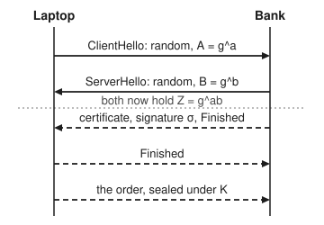
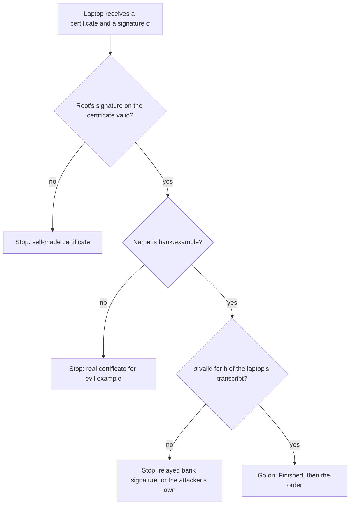

# The TLS handshake: every primitive in one short conversation

[Syllabus](../../../SYLLABUS.md) → [Applied and computational](../README.md) → [Cryptography](../README.md#s04) → The TLS handshake

---

## General Overview

A laptop on café Wi-Fi opens its bank's page. Before the padlock appears in the address bar, the laptop and the bank's server swap seven short messages: the laptop's hello, the bank's reply of five messages in one burst (hello, settings, certificate, signature and a closing check called Finished), and the laptop's own Finished. That takes one round trip. Then the laptop sends `TRANSFER 750 TO BOB.`, and anyone copying the Wi-Fi traffic sees only noise: 36 bytes of it in this card's toy.

The two machines have never met and share no secret. Everything they say crosses a network that a stranger can read and rewrite. In those seven messages they still manage three things. They agree a fresh secret key in public. The laptop confirms the other end really is the bank, not someone in between. And from then on every byte is locked with that key, so it can be neither read nor changed.

Each job uses a primitive from earlier on this shelf. A Diffie–Hellman exchange makes the key. Signatures, checked through a certificate, prove who holds it. A hash and a MAC (a keyed checksum) bind every message so far. A fast symmetric cipher carries the data. This card follows one handshake through all of them, in a toy small enough to print. The toy keeps the six messages that carry cryptography and leaves out the settings message. Then it tries four ways to sit in the middle. Each fails at a named check.

**The handshake sends a fresh Diffie–Hellman share each way to agree a secret that only the two ends can compute, has the bank sign a hash of everything said so far with a key that a certificate ties to its name, and seals the traffic with a key derived from that secret; a man in the middle must change a share to learn the key, and the signature over the whole conversation exposes the change.**

**What kind of fact this is:** a protocol, specified in RFC 8446. Its security rests on proofs by reduction (an argument that any break would also break a named hard problem), assuming the Diffie–Hellman problem is hard, the signatures are unforgeable and the hash behaves well. The proofs cited here cover its design (SIGMA) and its KEM-DEM split, not TLS 1.3 message by message, and they are not reproduced. This card runs the mechanics and checks each attack against them.

### The picture: one round trip, then the order

<p align="center"></p>

Schematic. Solid arrows travel in the clear. Dashed arrows are encrypted under keys made from the shared secret Z. In real TLS 1.3 the certificate is already encrypted, so an eavesdropper cannot even see which certificate was sent. Real TLS 1.3 also sends a short settings message (EncryptedExtensions) straight after ServerHello; the toy and the picture leave it out.

---

## The formula

Notation first, in words. The group is the one from [Diffie-Hellman and ElGamal](05-diffie-hellman-and-elgamal.md): numbers mod a prime p, generated by g, where g has prime order q (q steps before g's powers repeat). Each side picks a secret exponent and sends a power of g, its **key share**. The **transcript** T is every handshake byte sent so far, in order. h is a hash, SHA-256 here. KDF is a key derivation function: it turns a secret number and a label into uniform key bytes.

$$Z = B^{a} \bmod p = A^{b} \bmod p = g^{ab} \bmod p$$

$$K = \mathrm{KDF}\big(Z,\ h(T)\big), \qquad c = \mathrm{Seal}_K(m)$$

$$\text{the laptop goes on only if}\quad \sigma^{e} \bmod n = h(T) \bmod n$$

**Read it aloud:** both ends raise the other's share to their own secret and land on the same number Z; they hash the conversation into Z to get the key K that seals the order; and the laptop goes on only if the bank's signature over the conversation checks out under the key its certificate names.

This is **hybrid encryption**, also called **KEM-DEM**. A KEM (key encapsulation mechanism) uses public-key maths to move a short random key: here the laptop's share A acts as a one-use public key, and the bank's reply B "encapsulates" Z for it. A DEM (data encapsulation mechanism) is a fast symmetric cipher with a tag that carries the actual data under that key. The signature is the third piece: it says whose KEM this is.

| Symbol | Plain meaning | In our example | Push it up and the answer… |
| --- | --- | --- | --- |
| $p$, $g$ | the group's prime and its generator | p = 2305843009213699919 (62 bits, toy), g = 4 | a bigger group makes the discrete log harder |
| $q$ | the order of g: powers of g repeat after q steps | 1152921504606849959 | generic attacks cost about √q steps |
| $a$, $b$, $x$ | secret exponents: laptop's, bank's, attacker's; fresh each handshake, then deleted | a = 1060721914930473132 | — |
| $A$, $B$, $X$ | key shares g^a, g^b, g^x mod p, sent in the clear | A = 1437164254505495502 | — |
| $Z$ | the shared secret g^ab mod p | 1685396047651910608 | — |
| $T$ | the transcript: every handshake byte so far | ClientHello, ServerHello, certificate | any changed byte changes h(T) |
| $h$, KDF | the hash SHA-256; HKDF built from it | 32-byte outputs | — |
| $K$ | the session key from the KDF | starts a0f4845e19b383a1 | — |
| $m$, $c$, Seal | the order; the sealed order; the DEM that seals it | 20 bytes in, 36 bytes out (16 are the tag) | longer orders, longer c |
| $n$, $e$ | the bank's public signing key, in its certificate; the root's key is n_R, d_R | n = 7000000130300000051, e = 65537 | 2048-bit n in practice |
| $d$ | the bank's private signing key, never sent | kept on the server | — |
| $\sigma$ | the signature on the transcript (the CertificateVerify message) | 6479597438339797622 | — |

### When it holds

- **The Diffie–Hellman problem is hard in the group.** From A and B alone, Z must cost about 2^126 steps, as in X25519 (a widely used elliptic curve). In this 62-bit toy it costs about 2^30 steps by generic methods, and fewer by index calculus (an attack that works on numbers mod p but not on curves), which is why the toy is labelled insecure.
- **The laptop checks the certificate and the name.** Skip either and an attacker with any certificate, or none, sits in the middle unseen. Below, a real certificate for evil.example is accepted once the name check is dropped.
- **The secret exponents come from a secure random generator.** A guessable a gives away Z. Seeded from a process number, it falls in 23452 tries.
- **The private key d stays private, or leaks only after the session.** A key stolen later cannot open a recorded session (forward secrecy), but it lets the thief pose as the bank until the certificate is withdrawn.
- **The root authorities in the laptop's trust store sign only true certificates.** One wrong certificate for bank.example defeats every check on this card.

---

## Why it works

### Step 0: three jobs, three tools, one transcript

Agreeing a key in public is Diffie–Hellman. Proving who you talk to is a signature. Moving data fast is a symmetric cipher. None of them alone is enough: a key agreed with a stranger may be agreed with the attacker, and a signature on its own says nothing about this conversation. The handshake glues them with the transcript. The bank signs a hash of the exact shares that were sent, so a share swapped in transit no longer matches the signature.

### Step 1: a secret both ends compute and nobody else sees

The laptop picks a, sends A = g^a mod p and keeps a. The bank picks b and sends B = g^b mod p. Then

$$B^{a} = (g^{b})^{a} = g^{ab} = (g^{a})^{b} = A^{b} \pmod p$$

so both reach the same Z. The code computes it three ways: B^a, A^b, and g raised to ab mod q. All three agree on 1685396047651910608.

An eavesdropper holds A and B, but getting g^ab from g^a and g^b is the computational Diffie–Hellman problem ([Diffie-Hellman and ElGamal](05-diffie-hellman-and-elgamal.md)). On a well-chosen curve, the best known attack costs about √q steps: about 2^126 for X25519. In a group of numbers mod p, like this toy, index calculus beats √q, which is why such groups need a far larger p. Real TLS usually does this step on a curve ([Elliptic curves](06-elliptic-curve-cryptography.md)), but the algebra is the same.

### Step 2: a short secret becomes a fast cipher (KEM-DEM)

Public-key maths is slow and moves only short numbers. So the handshake uses it once, to agree Z, and hands everything else to symmetric cryptography.

Z is a number with structure (it lies in a group), not uniform bytes. The KDF fixes that. HKDF first runs HMAC with Z as input (the "extract" step), then runs HMAC again with a label and h(T) (the "expand" step) to produce as many key bytes as needed. Different labels give independent keys: one for each direction, and one for each Finished message ([Hashes and MACs](03-hash-functions-and-macs.md)).

The order then goes through a DEM: encrypt, then attach a 16-byte tag computed under the same key. Real TLS uses AES-GCM or ChaCha20-Poly1305, two ciphers with a built-in tag ([AES](02-symmetric-ciphers-and-aes.md)). The toy uses an HMAC keystream and an HMAC tag, which play the same two roles. Flip one bit on the wire and the tag fails: the bank refuses the order instead of reading a changed one.

A 2003 theorem (Cramer and Shoup, in Sources) says the split is safe: a KEM and a DEM that each resist chosen-ciphertext attack (an attacker who can get other ciphertexts opened) together make public-key encryption that resists it too. Each half can be designed and checked on its own.

### Step 3: the certificate ties a key to a name

A certificate is a short document: "the key (n, e) belongs to bank.example", signed by a **certificate authority** (a body whose public key ships inside every browser, in its **trust store**). The laptop already holds the root's public key n_R. Checking a certificate is one signature check, as in [Digital signatures](07-digital-signatures.md). That card signs with ECDSA (the elliptic-curve signature). This toy signs the RSA way, σ = h^d mod n, checked by σ^e mod n = h ([RSA in full](04-rsa-in-full.md)), because it fits in one line; TLS accepts both, and their role here is the same. Here n is the RSA modulus, not a group order.

The laptop makes three checks, in order:

1. The root's signature on the certificate is valid.
2. The name in the certificate is the name in the address bar, bank.example.
3. The bank's signature σ on h(T) is valid under the key in the certificate.

The third check is what involves this conversation. σ is computed with d, which never leaves the bank, over the hash of ClientHello, ServerHello and the certificate. It proves that whoever sent B holds d, and saw the same A.

### Step 4: where the man in the middle is stopped

An attacker on the café Wi-Fi wants to read the order. Copying A and B is useless: Z needs a or b. So he must replace them. He sends his own share X = g^x to both sides, and now shares one secret with the laptop (X^a) and another with the bank (B^x).

Without step 3 that works perfectly. The code shows him reading `TRANSFER 750 TO BOB.` and handing the bank `TRANSFER 950 TO EVE.` under a fresh seal. Neither end can tell.

With the checks, the laptop's transcript contains X where the bank's contains B. He needs a signature over the laptop's transcript. Every way to get one runs into a check:



- **Relay the bank's signature.** The bank signed its own view, with X in the ClientHello and B in the ServerHello. The laptop's view has A and X. Different bytes give a different hash, so σ fails check 3.
- **Sign with his own key.** The signature is valid, but under his key, not the n in the bank's certificate. Check 3 fails.
- **Show his own real certificate, for evil.example.** Checks 1 and 3 pass. Check 2 fails.
- **Make a certificate for bank.example himself.** The root never signed it. Check 1 fails.

Each escape needs either a forged signature, a mis-issued certificate, or a skipped check. That is the whole security argument in outline. The SIGMA design (Sources), which TLS 1.3 follows, proves it in full: sign the shares, and MAC the identities under the new key.

### Step 5: Finished, both ends saw the same conversation

After the certificate, each side sends a **Finished** message: an HMAC of h(T) under a key derived from Z. Only someone who knows Z can compute it, and it covers every message, including the lists of ciphers each side offered. If an attacker deleted the strong options from the laptop's list to force a weak one (a **downgrade attack**), the two transcripts would differ and Finished would fail. The code changes one bit of the bank's copy of the ClientHello: the bank's Finished and the session key both change, so the laptop rejects that Finished. The bank's signature in Step 3 covers the same lists, and that matters more. If the weakened exchange can be broken during the handshake, the attacker learns Z and computes Finished himself. That is how the Logjam attack of 2015 downgraded TLS 1.2 connections, whose signature did not cover the lists.

### Step 6: forward secrecy, why a key stolen later opens nothing

After the handshake both sides delete a and b. The long-term key d was used only to sign, never to make Z. So if d is stolen a year later, a recorded session is still locked behind Z, and Z must still be computed from A and B alone: the Diffie–Hellman problem again. This is **forward secrecy**: past sessions survive a later theft.

The old way had none. In TLS 1.2's "RSA key transport", the laptop picked the secret itself and encrypted it to the bank's RSA key ([RSA in full](04-rsa-in-full.md)). The bank's d decrypted it. Steal d later, and every recorded session opens: the code decrypts the recorded order in one exponentiation. TLS 1.3 removed that option for this reason.

Forward secrecy protects the past, not the future. With d, a thief can sign as the bank, so his next man-in-the-middle session is accepted, as the code shows. The fix there is to withdraw (revoke) the certificate.

---

## Worked numbers, by hand

One handshake, laptop to bank, toy sizes.

| Step | Arithmetic | Value |
| --- | --- | --- |
| group | first q above 2^60 with q and 2q + 1 both prime; p = 2q + 1, g = 4 | p = 2305843009213699919 |
| laptop's share | A = 4^a mod p, a = 1060721914930473132 | A = 1437164254505495502 |
| bank's share | B = 4^b mod p, b = 17370367526383645 | B = 2024737343351428284 |
| laptop's secret | B^a mod p | 1685396047651910608 |
| bank's secret | A^b mod p | 1685396047651910608 |
| certificate | root signs h("subject=bank.example;n=…") with its d_R | 4204762322323585310 |
| signature on transcript | σ = h(ClientHello, ServerHello, certificate)^d mod n | 6479597438339797622 |
| laptop's checks | root signature, name, σ^65537 mod n = h(T) mod n | accepted |
| session key | K = HKDF(Z, label, h(T + Finished)) | starts a0f4845e19b383a1 |
| sealed order | 20 bytes of order + 16-byte tag | 36 bytes, starting 20054e3d0b8f1e6a |
| bank opens it | same Z, same T, same K | **TRANSFER 750 TO BOB.** |

**The bank reads the order, and only the bank could:** the café sees A, B and 36 bytes, and turning A and B into Z takes about 2^30 steps by generic methods even in this toy (fewer by index calculus), about 2^126 for X25519.

### What breaks if you drop a piece

| Mistake | Comes out at | What went wrong |
| --- | --- | --- |
| No certificate at all (bare Diffie–Hellman) | attacker reads TRANSFER 750 TO BOB.; bank receives TRANSFER 950 TO EVE. | Nothing ties B to the bank, so the attacker's X looks the same |
| Name check skipped | a real certificate for evil.example is accepted | A valid certificate proves a name, not the right name |
| RSA key transport, and d leaks a year later | the recorded order reads TRANSFER 750 TO BOB. | One long-term key opened every past session: no forward secrecy |
| Secret exponent from a seeded generator, seed = process number | seed found in 23452 of 32768 tries; a recovered | 15 bits of unpredictability, not the 128 or more needed |

---

## Code, from first principles, and it actually runs

The script writes SHA-256, HMAC and HKDF from scratch and checks them against the standard test vectors: the "abc" vector of FIPS 180-4 and test case 1 of RFC 5869. It then builds a toy group, three toy RSA keys (a root, the bank, the attacker) and a toy DEM. It runs one handshake and reaches the shared secret by **three independent roads** (B^a, A^b and g^(ab mod q)). It checks that one changed bit in the ClientHello changes both Finished and the session key, and that the bank opens the order and rejects it with one bit flipped. Then it plays the attacker: bare Diffie–Hellman, four ways through the checks, the skipped name check, a leaked key under both designs, and an exhaustive search over 32768 seeds. Every size is a toy, labelled insecure.

### Python

```python
# The TLS handshake -- the check behind the card.  Standard library only.  INSECURE TOY SIZES: a 62-bit
# group stands in for X25519, 64-bit RSA for 2048-bit RSA, an HMAC stream for AES-GCM, SplitMix64 for a CSPRNG.
M32, M64 = (1 << 32) - 1, (1 << 64) - 1
def iroot(x, k):                                   # largest r with r^k <= x, bit by bit
    r = 0
    for i in range(40, -1, -1): r |= (1 << i) * ((r | 1 << i) ** k <= x)
    return r
PR = [n for n in range(2, 312) if all(n % d for d in range(2, n))]
H0 = [iroot(p << 64, 2) & M32 for p in PR[:8]]     # SHA-256 constants: square roots
KK = [iroot(p << 96, 3) & M32 for p in PR[:64]]    # and cube roots of the first primes
def rotr(x, n): return ((x >> n) | (x << (32 - n))) & M32
def sha256(msg):
    h, n = H0[:], len(msg)
    msg = msg + b"\x80" + b"\x00" * ((55 - n) % 64) + (8 * n).to_bytes(8, "big")
    for i in range(0, len(msg), 64):
        w = [int.from_bytes(msg[i + 4 * j:i + 4 * j + 4], "big") for j in range(16)]
        for j in range(16, 64):
            s0 = rotr(w[j - 15], 7) ^ rotr(w[j - 15], 18) ^ (w[j - 15] >> 3)
            s1 = rotr(w[j - 2], 17) ^ rotr(w[j - 2], 19) ^ (w[j - 2] >> 10)
            w.append((w[j - 16] + s0 + w[j - 7] + s1) & M32)
        a, b, c, d, e, f, g, hh = h
        for j in range(64):
            t1 = hh + (rotr(e, 6) ^ rotr(e, 11) ^ rotr(e, 25)) + ((e & f) ^ (~e & g)) + KK[j] + w[j]
            t2 = (rotr(a, 2) ^ rotr(a, 13) ^ rotr(a, 22)) + ((a & b) ^ (a & c) ^ (b & c))
            a, b, c, d, e, f, g, hh = (t1 + t2) & M32, a, b, c, (d + t1) & M32, e, f, g
        h = [(x + y) & M32 for x, y in zip(h, [a, b, c, d, e, f, g, hh])]
    return b"".join(x.to_bytes(4, "big") for x in h)
def hmac(key, msg):                                # keys here are at most 64 bytes
    key = key + b"\x00" * (64 - len(key))
    return sha256(bytes(x ^ 0x5C for x in key) + sha256(bytes(x ^ 0x36 for x in key) + msg))
def expand(prk, info, n):                          # HKDF-Expand, RFC 5869
    t = [b""]
    for i in range(1, n // 32 + 2): t.append(hmac(prk, t[-1] + info + bytes([i])))
    return b"".join(t)[:n]
assert sha256(b"abc").hex() == "ba7816bf8f01cfea414140de5dae2223b00361a396177a9cb410ff61f20015ad"
assert expand(hmac(bytes(range(13)), b"\x0b" * 22), bytes(range(0xF0, 0xFA)), 42).hex() == (
    "3cb25f25faacd57a90434f64d0362f2a2d2d0a90cf1a5a4c5db02d56ecc4c5bf34007208d5b887185865")
print("SHA-256 'abc' vector and RFC 5869 HKDF test 1: both match")
def mpow(x, e, m):
    r, x = 1, x % m
    while e: r, x, e = (r * x % m if e & 1 else r), x * x % m, e >> 1
    return r
def is_prime(n):                                   # Miller-Rabin, exact below 3.3 x 10^24
    if n < 2 or any(n % s == 0 for s in PR[:12]): return n in PR[:12]
    s = ((n - 1) & (1 - n)).bit_length() - 1       # n - 1 = d * 2^s with d odd
    d = (n - 1) >> s
    return all(mpow(a, d, n) == 1 or any(mpow(a, d << r, n) == n - 1 for r in range(s)) for a in PR[:12])
def inv(a, m):                                     # extended Euclid
    r0, r1, s0, s1 = m, a % m, 0, 1
    while r1: k = r0 // r1; r0, r1, s0, s1 = r1, r0 - k * r1, s1, s0 - k * s1
    assert r0 == 1
    return s0 % m
def splitmix(s):                                   # the next 64-bit output after state s
    s = (s + 0x9E3779B97F4A7C15) & M64
    z = ((s ^ (s >> 30)) * 0xBF58476D1CE4E5B9) & M64
    z = ((z ^ (z >> 27)) * 0x94D049BB133111EB) & M64
    return s, z ^ (z >> 31)
q = 1 << 60                                        # the group: p = 2q + 1, both prime
while not (is_prime(q) and is_prime(2 * q + 1)): q += 1
p, g = 2 * q + 1, 4                                # g = 2^2 lies in the order-q subgroup
assert mpow(g, q, p) == 1
print(f"group: p = {p} ({p.bit_length()} bits), g = {g}, order q = {q}")
def rsa(x, y):                                     # the first primes above x and y
    a, b = (next(i for i in range(v, v + 9999) if is_prime(i)) for v in (x, y))
    return a * b, inv(65537, (a - 1) * (b - 1))
nR, dR = rsa(3_000_000_000, 3_500_000_000)         # the root, in the laptop's trust store
nB, dB = rsa(2_500_000_000, 2_800_000_000)         # the bank's long-term signing key
nX, dX = rsa(2_600_000_000, 3_200_000_000)         # the attacker's own key
def hnum(data, n): return int.from_bytes(sha256(data), "big") % n
def sign(d, n, data): return mpow(hnum(data, n), d, n)
def verify(n, data, s): return mpow(s, 65537, n) == hnum(data, n)
def cert(name, n, d_by, n_by): return (b := f"subject={name};n={n};e=65537;issuer=Root".encode()), sign(d_by, n_by, b)
def check(crt, t, cv, names=True):                 # the laptop's three checks
    if not verify(nR, crt[0], crt[1]): return "rejected: root signature fails"
    f = dict(x.split("=") for x in crt[0].decode().split(";"))
    if names and f["subject"] != "bank.example": return "rejected: name is not bank.example"
    return "accepted" if verify(int(f["n"]), t + crt[0], cv) else "rejected: transcript signature fails"
def b8(x): return x.to_bytes(8, "big")
def party(seed):                                   # a fresh random and a fresh secret exponent
    s, rnd = splitmix(seed)
    x = splitmix(s)[1] % (q - 1) + 1
    return b8(rnd), x, mpow(g, x, p)
def kdf(z, label, t): return expand(hmac(b"\x00" * 32, b8(z)), label + sha256(t), 32)
def stream(k, m): return bytes(x ^ y for x, y in zip(m, expand(k, b"stream", len(m))))
def seal(k, m): return (c := stream(k, m)) + hmac(k, b"tag" + c)[:16]   # the DEM, with a tag
def unseal(k, ct): return stream(k, ct[:-16]) if hmac(k, b"tag" + ct[:-16])[:16] == ct[-16:] else None
m = b"TRANSFER 750 TO BOB."                        # ---- the honest handshake ----
rc, a, A = party(0x1A97_0B5E_ED00_2026)
rs, b, B = party(0xBA4C_0B5E_ED00_2026)
CH, SH = b"CH" + rc + b8(A), b"SH" + rs + b8(B)
Zc, Zs = mpow(B, a, p), mpow(A, b, p)
assert Zc == Zs == mpow(g, a * b % q, p)           # both sides, and the exponent road
crt = cert("bank.example", nB, dR, nR)
CV = sign(dB, nB, CH + SH + crt[0])
print(f"laptop: a = {a}, A = {A}\nbank:   b = {b}, B = {B}\nshared: Z = B^a = A^b = {Zc}")
print(f"bank's n = {nB}, root's signature = {crt[1]}, CertificateVerify = {CV}")
print("laptop's verdict:", verdict := check(crt, CH + SH, CV))
T, Td = CH + SH + crt[0] + b8(CV), bytes([CH[0] ^ 1]) + CH[1:] + SH + crt[0] + b8(CV)   # Td: one ClientHello bit changed
fin, fin_d = hmac(kdf(Zs, b"s fin", T), sha256(T)), hmac(kdf(Zs, b"s fin", Td), sha256(Td))   # the bank's Finished
Kc, Ks = kdf(Zc, b"c app", T + fin), kdf(Zs, b"c app", T + fin)
assert verdict == "accepted" and fin_d != fin and kdf(Zs, b"c app", Td + fin_d) != Kc   # Finished and K follow T
ct = seal(Kc, m)
print(f"K starts {Kc[:8].hex()}; order on the wire: {ct[:8].hex()}..., {len(ct)} bytes = {len(m)} of order + {len(ct) - len(m)} of tag")
assert unseal(Ks, ct) == m and unseal(Ks, ct[:3] + bytes([ct[3] ^ 1]) + ct[4:]) is None
print("bank opens:", unseal(Ks, ct).decode(), "| one bit flipped on the wire: rejected")
print(f"one ClientHello bit changed in transit: the bank's Finished starts {fin_d[:4].hex()}, not {fin[:4].hex()}; K changes too")
_, x, X = party(0xE7E_2026)                        # ---- a man in the middle, secret x ----
CHx, SHx = b"CH" + rc + b8(X), b"SH" + rs + b8(X)  # what the bank and the laptop now see
read = unseal(kdf(mpow(A, x, p), b"c app", CH + SHx), seal(kdf(mpow(X, a, p), b"c app", CH + SHx), m))
fwd = seal(kdf(mpow(B, x, p), b"c app", CHx + SH), b"TRANSFER 950 TO EVE.")
print("no certificate: attacker reads", read.decode(), "| bank receives", unseal(kdf(mpow(X, b, p), b"c app", CHx + SH), fwd).decode())
assert read == m
tL = CH + SHx                                      # the laptop's view of the transcript
evil = cert("evil.example", nX, dR, nR)            # a real certificate, for the wrong name
fake = cert("bank.example", nX, dX, nX)            # made by the attacker, not the root
tries = [("relay the bank's signature", crt, sign(dB, nB, CHx + SH + crt[0])),
         ("sign with his own key", crt, sign(dX, nX, tL + crt[0])),
         ("real certificate for evil.example", evil, sign(dX, nX, tL + evil[0])),
         ("self-made certificate", fake, sign(dX, nX, tL + fake[0]))]
for name, c, s in tries:
    print(f"  {name}: {check(c, tL, s)}")
    assert check(c, tL, s) != "accepted"
lax = check(evil, tL, sign(dX, nX, tL + evil[0]), names=False)
print("  evil.example with the name check skipped:", lax)
assert lax == "accepted"
pm = splitmix(7)[1] % nB                           # ---- the bank's key d leaks later ----
E = mpow(pm, 65537, nB)                            # old style: RSA carries the laptop's secret
old = seal(kdf(pm, b"c app", CH + SH), m)
print("RSA key transport, recorded, d leaked:", unseal(kdf(mpow(E, dB, nB), b"c app", CH + SH), old).decode())
assert mpow(E, dB, nB) == pm
stolen = check(crt, tL, sign(dB, nB, tL + crt[0]))
print("ephemeral DH, d leaked: a new session in the middle is", stolen)
assert stolen == "accepted"
print(f"the recorded session needs Z from A and B alone: about 2^{iroot(q, 2).bit_length() - 1} generic steps here (index calculus needs fewer), 2^126 for X25519")
_, _, A_bad = party(pid := 23451)                         # ---- a predictable seed ----
seed = next(s for s in range(32768) if party(s)[2] == A_bad)
print(f"seed from a process number, {(32768).bit_length() - 1} bits, not 128: found in {seed + 1} of 32768 tries, a = {(a_bad := party(seed)[1])}")
assert seed == pid and mpow(B, a_bad, p) == mpow(A_bad, b, p)   # attacker's Z = the bank's Z
print("figure, arrows at y = 62, 102, 142, 182, 222 on a 360 x 250 panel (schematic)")
print("ALL CHECKS PASS")
```

**Ran 2026-11-11 on macOS, Python 3.14.10, standard library only. All checks passed. Output, pasted from the run:**

```
SHA-256 'abc' vector and RFC 5869 HKDF test 1: both match
group: p = 2305843009213699919 (62 bits), g = 4, order q = 1152921504606849959
laptop: a = 1060721914930473132, A = 1437164254505495502
bank:   b = 17370367526383645, B = 2024737343351428284
shared: Z = B^a = A^b = 1685396047651910608
bank's n = 7000000130300000051, root's signature = 4204762322323585310, CertificateVerify = 6479597438339797622
laptop's verdict: accepted
K starts a0f4845e19b383a1; order on the wire: 20054e3d0b8f1e6a..., 36 bytes = 20 of order + 16 of tag
bank opens: TRANSFER 750 TO BOB. | one bit flipped on the wire: rejected
one ClientHello bit changed in transit: the bank's Finished starts 052ee47b, not 349f4490; K changes too
no certificate: attacker reads TRANSFER 750 TO BOB. | bank receives TRANSFER 950 TO EVE.
  relay the bank's signature: rejected: transcript signature fails
  sign with his own key: rejected: transcript signature fails
  real certificate for evil.example: rejected: name is not bank.example
  self-made certificate: rejected: root signature fails
  evil.example with the name check skipped: accepted
RSA key transport, recorded, d leaked: TRANSFER 750 TO BOB.
ephemeral DH, d leaked: a new session in the middle is accepted
the recorded session needs Z from A and B alone: about 2^30 generic steps here (index calculus needs fewer), 2^126 for X25519
seed from a process number, 15 bits, not 128: found in 23452 of 32768 tries, a = 642839780607183145
figure, arrows at y = 62, 102, 142, 182, 222 on a 360 x 250 panel (schematic)
ALL CHECKS PASS
```

### Rust

```rust
// The TLS handshake -- the check behind the card.  std only, no crates.  INSECURE TOY SIZES: a 62-bit
// group stands in for X25519, 64-bit RSA for 2048-bit RSA, an HMAC stream for AES-GCM, SplitMix64 for a CSPRNG.
type Bytes = Vec<u8>;
fn iroot(x: u128, k: u32) -> u128 { // largest r with r^k <= x, bit by bit
    (0..=40).rev().fold(0, |r, i| if (r | 1 << i).pow(k) <= x { r | 1 << i } else { r })
}
fn primes() -> Vec<u128> { (2..312u128).filter(|n| (2..*n).all(|d| n % d != 0)).collect() }
fn sha256(msg: &[u8]) -> Bytes {
    let pr = primes(); // SHA-256 constants: square and cube roots of the first primes
    let (mut h, kk): (Vec<u32>, Vec<u32>) = (pr[..8].iter().map(|p| iroot(p << 64, 2) as u32).collect(),
        pr[..64].iter().map(|p| iroot(p << 96, 3) as u32).collect());
    let mut m = [msg, &[0x80u8][..]].concat();
    while m.len() % 64 != 56 { m.push(0); }
    m.extend_from_slice(&(msg.len() as u64 * 8).to_be_bytes());
    for blk in m.chunks(64) {
        let mut w: Vec<u32> = blk.chunks(4).map(|c| u32::from_be_bytes([c[0], c[1], c[2], c[3]])).collect();
        for j in 16..64 {
            let s0 = w[j - 15].rotate_right(7) ^ w[j - 15].rotate_right(18) ^ (w[j - 15] >> 3);
            let s1 = w[j - 2].rotate_right(17) ^ w[j - 2].rotate_right(19) ^ (w[j - 2] >> 10);
            w.push(w[j - 16].wrapping_add(s0).wrapping_add(w[j - 7]).wrapping_add(s1));
        }
        let mut v = h.clone();
        for j in 0..64 {
            let (a, b, c, d, e, f, g, hh) = (v[0], v[1], v[2], v[3], v[4], v[5], v[6], v[7]);
            let t1 = hh.wrapping_add(e.rotate_right(6) ^ e.rotate_right(11) ^ e.rotate_right(25))
                .wrapping_add((e & f) ^ (!e & g)).wrapping_add(kk[j]).wrapping_add(w[j]);
            let t2 = (a.rotate_right(2) ^ a.rotate_right(13) ^ a.rotate_right(22)).wrapping_add((a & b) ^ (a & c) ^ (b & c));
            v = vec![t1.wrapping_add(t2), a, b, c, d.wrapping_add(t1), e, f, g];
        }
        for i in 0..8 { h[i] = h[i].wrapping_add(v[i]); }
    }
    h.iter().flat_map(|x| x.to_be_bytes()).collect()
}
fn hmac(key: &[u8], msg: &[u8]) -> Bytes { // keys here are at most 64 bytes
    let pad = |c: u8| (0..64).map(|i| key.get(i).unwrap_or(&0) ^ c).collect::<Bytes>();
    sha256(&[pad(0x5C), sha256(&[pad(0x36), msg.to_vec()].concat())].concat())
}
fn expand(prk: &[u8], info: &[u8], n: usize) -> Bytes { // HKDF-Expand, RFC 5869
    let (mut t, mut out) = (Bytes::new(), Bytes::new());
    for i in 1..=(n / 32 + 1) { t = hmac(prk, &[&t[..], info, &[i as u8]].concat()); out.extend(&t); }
    out.truncate(n);
    out
}
fn hx(b: &[u8]) -> String { b.iter().map(|x| format!("{:02x}", x)).collect() }
fn mpow(x: u128, mut e: u128, m: u128) -> u128 { let (mut r, mut x) = (1u128, x % m);
    while e > 0 { if e & 1 == 1 { r = r * x % m; } x = x * x % m; e >>= 1; }
    r
}
fn is_prime(n: u128) -> bool { // Miller-Rabin, exact below 3.3 x 10^24
    let pr = &primes()[..12];
    if n < 2 || pr.iter().any(|s| n % s == 0) { return pr.contains(&n); }
    let (s, d) = ((n - 1).trailing_zeros(), (n - 1) >> (n - 1).trailing_zeros()); // n - 1 = d * 2^s, d odd
    pr.iter().all(|&a| mpow(a, d, n) == 1 || (0..s).any(|r| mpow(a, d << r, n) == n - 1))
}
fn inv(a: u128, m: u128) -> u128 { // extended Euclid
    let (mut r0, mut r1, mut s0, mut s1) = (m as i128, (a % m) as i128, 0i128, 1i128);
    while r1 != 0 { let k = r0 / r1; (r0, r1, s0, s1) = (r1, r0 - k * r1, s1, s0 - k * s1); }
    assert!(r0 == 1);
    s0.rem_euclid(m as i128) as u128
}
fn splitmix(s: u64) -> (u64, u64) { // the next 64-bit output after state s
    let s = s.wrapping_add(0x9E3779B97F4A7C15);
    let z = (s ^ (s >> 30)).wrapping_mul(0xBF58476D1CE4E5B9);
    let z = (z ^ (z >> 27)).wrapping_mul(0x94D049BB133111EB);
    (s, z ^ (z >> 31))
}
fn rsa(x: u128, y: u128) -> (u128, u128) { // the first primes above x and y
    let (a, b) = ((x..).find(|&i| is_prime(i)).unwrap(), (y..).find(|&i| is_prime(i)).unwrap());
    (a * b, inv(65537, (a - 1) * (b - 1)))
}
fn hnum(data: &[u8], n: u128) -> u128 { sha256(data).iter().fold(0, |r, &x| (r * 256 + x as u128) % n) }
fn sign(d: u128, n: u128, data: &[u8]) -> u128 { mpow(hnum(data, n), d, n) }
fn verify(n: u128, data: &[u8], s: u128) -> bool { mpow(s, 65537, n) == hnum(data, n) }
fn cert(name: &str, n: u128, d_by: u128, n_by: u128) -> (Bytes, u128) {
    let body = format!("subject={};n={};e=65537;issuer=Root", name, n).into_bytes();
    (body.clone(), sign(d_by, n_by, &body)) }
fn check(crt: &(Bytes, u128), t: &[u8], cv: u128, names: bool, n_root: u128) -> &'static str { // the laptop's three checks
    if !verify(n_root, &crt.0, crt.1) { return "rejected: root signature fails"; }
    let body = String::from_utf8(crt.0.clone()).unwrap();
    let f: Vec<(&str, &str)> = body.split(';').map(|x| x.split_once('=').unwrap()).collect();
    if names && f[0].1 != "bank.example" { return "rejected: name is not bank.example"; }
    if verify(f[1].1.parse().unwrap(), &[t, &crt.0[..]].concat(), cv) { "accepted" } else { "rejected: transcript signature fails" }
}
fn b8(x: u128) -> Bytes { (x as u64).to_be_bytes().to_vec() }
fn kdf(z: u128, label: &[u8], t: &[u8]) -> Bytes { expand(&hmac(&[0u8; 32], &b8(z)), &[label, &sha256(t)[..]].concat(), 32) }
fn stream(k: &[u8], m: &[u8]) -> Bytes { m.iter().zip(expand(k, b"stream", m.len())).map(|(x, y)| x ^ y).collect() }
fn seal(k: &[u8], m: &[u8]) -> Bytes { let c = stream(k, m); [&c[..], &hmac(k, &[b"tag", &c[..]].concat())[..16]].concat() } // the DEM, with a tag
fn unseal(k: &[u8], ct: &[u8]) -> Option<Bytes> { let (c, tag) = ct.split_at(ct.len() - 16);
    if hmac(k, &[b"tag", c].concat())[..16] == *tag { Some(stream(k, c)) } else { None }
}
fn txt(b: Option<Bytes>) -> String { String::from_utf8(b.unwrap()).unwrap() }
fn main() {
    assert_eq!(hx(&sha256(b"abc")), "ba7816bf8f01cfea414140de5dae2223b00361a396177a9cb410ff61f20015ad");
    assert_eq!(hx(&expand(&hmac(&(0..13).collect::<Bytes>(), &[0x0b; 22]), &(0xF0..0xFA).collect::<Bytes>(), 42)),
        "3cb25f25faacd57a90434f64d0362f2a2d2d0a90cf1a5a4c5db02d56ecc4c5bf34007208d5b887185865");
    println!("SHA-256 'abc' vector and RFC 5869 HKDF test 1: both match");
    let mut q: u128 = 1 << 60; // the group: p = 2q + 1, both prime
    while !(is_prime(q) && is_prime(2 * q + 1)) { q += 1; }
    let (p, g) = (2 * q + 1, 4u128); // g = 2^2 lies in the order-q subgroup
    assert!(mpow(g, q, p) == 1);
    println!("group: p = {} ({} bits), g = {}, order q = {}", p, 128 - p.leading_zeros(), g, q);
    let (n_r, d_r) = rsa(3_000_000_000, 3_500_000_000); // the root, in the laptop's trust store
    let (n_b, d_b) = rsa(2_500_000_000, 2_800_000_000); // the bank's long-term signing key
    let (n_x, d_x) = rsa(2_600_000_000, 3_200_000_000); // the attacker's own key
    let party = |seed: u64| -> (Bytes, u128, u128) { // a fresh random and a fresh secret exponent
        let (s, rnd) = splitmix(seed); let x = (splitmix(s).1 as u128) % (q - 1) + 1;
        (b8(rnd as u128), x, mpow(g, x, p))
    };
    let hello = |tag: &[u8], r: &[u8], share: u128| [tag, r, &b8(share)[..]].concat();
    let m = b"TRANSFER 750 TO BOB."; // ---- the honest handshake ----
    let (rc, a, aa) = party(0x1A97_0B5E_ED00_2026);
    let (rs, b, bb) = party(0xBA4C_0B5E_ED00_2026);
    let (ch, sh) = (hello(b"CH", &rc, aa), hello(b"SH", &rs, bb));
    let (zc, zs) = (mpow(bb, a, p), mpow(aa, b, p));
    assert!(zc == zs && zs == mpow(g, a * b % q, p)); // both sides, and the exponent road
    let crt = cert("bank.example", n_b, d_r, n_r);
    let chsh = [&ch[..], &sh[..]].concat();
    let cv = sign(d_b, n_b, &[&chsh[..], &crt.0[..]].concat());
    println!("laptop: a = {}, A = {}\nbank:   b = {}, B = {}\nshared: Z = B^a = A^b = {}", a, aa, b, bb, zc);
    println!("bank's n = {}, root's signature = {}, CertificateVerify = {}", n_b, crt.1, cv);
    let verdict = check(&crt, &chsh, cv, true, n_r); println!("laptop's verdict: {}", verdict);
    let (t, td) = ([&chsh[..], &crt.0[..], &b8(cv)[..]].concat(), [&[ch[0] ^ 1][..], &ch[1..], &sh[..], &crt.0[..], &b8(cv)[..]].concat()); // td: one ClientHello bit changed
    let (fin, fin_d) = (hmac(&kdf(zs, b"s fin", &t), &sha256(&t)), hmac(&kdf(zs, b"s fin", &td), &sha256(&td))); // the bank's Finished
    let tf = [&t[..], &fin[..]].concat();
    let (kc, kb) = (kdf(zc, b"c app", &tf), kdf(zs, b"c app", &tf));
    assert!(verdict == "accepted" && fin_d != fin && kdf(zs, b"c app", &[&td[..], &fin_d[..]].concat()) != kc); // Finished and K follow T
    let ct = seal(&kc, m);
    println!("K starts {}; order on the wire: {}..., {} bytes = {} of order + {} of tag", hx(&kc[..8]), hx(&ct[..8]), ct.len(), m.len(), ct.len() - m.len());
    let bad: Bytes = ct.iter().enumerate().map(|(i, &c)| if i == 3 { c ^ 1 } else { c }).collect();
    assert!(unseal(&kb, &ct).unwrap() == m && unseal(&kb, &bad).is_none());
    println!("bank opens: {} | one bit flipped on the wire: rejected", txt(unseal(&kb, &ct)));
    println!("one ClientHello bit changed in transit: the bank's Finished starts {}, not {}; K changes too", hx(&fin_d[..4]), hx(&fin[..4]));
    let (_, x, xx) = party(0xE7E_2026); // ---- a man in the middle, secret x ----
    let (chx, shx) = (hello(b"CH", &rc, xx), hello(b"SH", &rs, xx)); // what the bank and the laptop now see
    let (tl, tb) = ([&ch[..], &shx[..]].concat(), [&chx[..], &sh[..]].concat()); // the laptop's view, the bank's
    let read = txt(unseal(&kdf(mpow(aa, x, p), b"c app", &tl), &seal(&kdf(mpow(xx, a, p), b"c app", &tl), m)));
    let fwd = seal(&kdf(mpow(bb, x, p), b"c app", &tb), b"TRANSFER 950 TO EVE.");
    println!("no certificate: attacker reads {} | bank receives {}", read, txt(unseal(&kdf(mpow(xx, b, p), b"c app", &tb), &fwd)));
    assert!(read.as_bytes() == m);
    let evil = cert("evil.example", n_x, d_r, n_r); // a real certificate, for the wrong name
    let fake = cert("bank.example", n_x, d_x, n_x); // made by the attacker, not the root
    let with = |c: &(Bytes, u128)| [&tl[..], &c.0[..]].concat();
    let tries = [("relay the bank's signature", &crt, sign(d_b, n_b, &[&tb[..], &crt.0[..]].concat())),
        ("sign with his own key", &crt, sign(d_x, n_x, &with(&crt))),
        ("real certificate for evil.example", &evil, sign(d_x, n_x, &with(&evil))),
        ("self-made certificate", &fake, sign(d_x, n_x, &with(&fake)))];
    for (name, c, s) in tries.iter() {
        let v = check(c, &tl, *s, true, n_r);
        println!("  {}: {}", name, v);
        assert!(v != "accepted");
    }
    let lax = check(&evil, &tl, sign(d_x, n_x, &with(&evil)), false, n_r);
    println!("  evil.example with the name check skipped: {}", lax);
    assert!(lax == "accepted");
    let pm = splitmix(7).1 as u128 % n_b; // ---- the bank's key d leaks later ----
    let e = mpow(pm, 65537, n_b); // old style: RSA carries the laptop's secret
    let old = seal(&kdf(pm, b"c app", &chsh), m);
    println!("RSA key transport, recorded, d leaked: {}", txt(unseal(&kdf(mpow(e, d_b, n_b), b"c app", &chsh), &old)));
    assert!(mpow(e, d_b, n_b) == pm);
    let stolen = check(&crt, &tl, sign(d_b, n_b, &with(&crt)), true, n_r);
    println!("ephemeral DH, d leaked: a new session in the middle is {}", stolen);
    assert!(stolen == "accepted");
    println!("the recorded session needs Z from A and B alone: about 2^{} generic steps here (index calculus needs fewer), 2^126 for X25519", 127 - iroot(q, 2).leading_zeros());
    let pid = 23451; let (_, _, a_bad) = party(pid); // ---- a predictable seed ----
    let seed = (0..32768u64).find(|&s| party(s).2 == a_bad).unwrap();
    println!("seed from a process number, {} bits, not 128: found in {} of 32768 tries, a = {}", 32768u32.trailing_zeros(), seed + 1, party(seed).1);
    assert!(seed == pid && mpow(bb, party(seed).1, p) == mpow(a_bad, b, p)); // attacker's Z = the bank's Z
    println!("figure, arrows at y = 62, 102, 142, 182, 222 on a 360 x 250 panel (schematic)");
    println!("ALL CHECKS PASS");
}
```

**Ran 2026-11-11 on macOS, rustc 1.98.1, no crates. All checks passed. Output, pasted from the run:**

```
SHA-256 'abc' vector and RFC 5869 HKDF test 1: both match
group: p = 2305843009213699919 (62 bits), g = 4, order q = 1152921504606849959
laptop: a = 1060721914930473132, A = 1437164254505495502
bank:   b = 17370367526383645, B = 2024737343351428284
shared: Z = B^a = A^b = 1685396047651910608
bank's n = 7000000130300000051, root's signature = 4204762322323585310, CertificateVerify = 6479597438339797622
laptop's verdict: accepted
K starts a0f4845e19b383a1; order on the wire: 20054e3d0b8f1e6a..., 36 bytes = 20 of order + 16 of tag
bank opens: TRANSFER 750 TO BOB. | one bit flipped on the wire: rejected
one ClientHello bit changed in transit: the bank's Finished starts 052ee47b, not 349f4490; K changes too
no certificate: attacker reads TRANSFER 750 TO BOB. | bank receives TRANSFER 950 TO EVE.
  relay the bank's signature: rejected: transcript signature fails
  sign with his own key: rejected: transcript signature fails
  real certificate for evil.example: rejected: name is not bank.example
  self-made certificate: rejected: root signature fails
  evil.example with the name check skipped: accepted
RSA key transport, recorded, d leaked: TRANSFER 750 TO BOB.
ephemeral DH, d leaked: a new session in the middle is accepted
the recorded session needs Z from A and B alone: about 2^30 generic steps here (index calculus needs fewer), 2^126 for X25519
seed from a process number, 15 bits, not 128: found in 23452 of 32768 tries, a = 642839780607183145
figure, arrows at y = 62, 102, 142, 182, 222 on a 360 x 250 panel (schematic)
ALL CHECKS PASS
```

> [!TIP]
> **Try changing**
> - Guess first: does the attacker do better with a different secret? Change `party(0xE7E_2026)` to any other seed. All four tries are still rejected, at the same checks: the defence does not depend on luck.
> - Guess first: what happens if the root signs a certificate for bank.example with the attacker's key? Change `evil = cert("evil.example", nX, dR, nR)` to `cert("bank.example", nX, dR, nR)`. The third try is accepted and the script stops with an AssertionError: a mis-issued certificate defeats every check.
> - Guess first: does the length of the order show? Change `m` to `b"TRANSFER 7500 TO BOB."`. The sealed order grows from 36 to 37 bytes. TLS hides content, not length.
> - Guess first: how long does a guessable seed last? Change `pid := 23451` to `pid := 32000`. The search finds it in 32001 tries; no seed below 32768 survives.

---

## The usual mistake

> [!warning]
> **Thinking encryption means you are talking to the bank.** Bare Diffie–Hellman encrypts perfectly, to whoever answered. With no certificate check, the attacker here reads TRANSFER 750 TO BOB. and the bank receives TRANSFER 950 TO EVE., both under strong-looking keys. The padlock means "encrypted to whoever holds the key for the name in the address bar". The authentication is the signature, not the encryption.
>
> Smaller traps:
> - **Checking the signature but not the name.** A real certificate for evil.example passes checks 1 and 3; skip check 2 and it is accepted. A lookalike address, such as one with a swapped letter, can hold a perfectly valid certificate for its own name.
> - **Treating forward secrecy as protection against a key stolen today.** It protects recorded sessions. With d in hand, the thief's next session in the middle is accepted until the certificate is revoked.
> - **Seeding the secret exponent from something guessable.** A process number gives 32768 possibilities; the seed falls in 23452 tries. Z is only as secret as a and b.
> - **Believing the certificate's key encrypts the data.** In TLS 1.3 it only signs. The data key comes from Z, which is why a later theft of d opens no recorded session.

---

## Where you meet it in real life

- **Every https address.** The padlock is a TLS handshake like this one, usually TLS 1.3 with an X25519 key share, an elliptic-curve (ECDSA) or RSA signature on the transcript, and AES-GCM or ChaCha20-Poly1305 (two authenticated ciphers) carrying the data.
- **Post-quantum key shares.** Major browsers now send a hybrid share: an X25519 share and an ML-KEM-768 (a lattice-based KEM) share side by side, with Z built from both. It is the KEM-DEM split in action: swap the KEM, keep the rest. See [Lattices](09-lattices-and-post-quantum-cryptography.md).
- **A certificate authority broken into, 2011.** An attacker got a Dutch authority to issue certificates for well-known sites, and used them to sit in the middle of real users' connections. Browsers removed that authority from their trust stores. Public logs of every certificate issued (Certificate Transparency) followed, so a wrong certificate is easier to spot.
- **A randomness bug in 2008.** One Linux distribution's patched cryptography library drew its keys from only 32768 seeds, the process number. Every key it had made had to be replaced.
- **"Record now, decrypt later".** Traffic stored today waits for a key tomorrow. That is why TLS 1.3 dropped RSA key transport, and why the key share is going post-quantum.
- **Inspection boxes at work.** Some employers install their own root on staff laptops, so a proxy can stand in the middle with certificates the laptop trusts. The handshake still works exactly as designed: the trust store decides who counts as the bank.

> **Say it back**
> The laptop and the bank each send a fresh key share, g^a and g^b, and both compute g^ab, which an eavesdropper cannot. A key derivation function turns that secret and a hash of the conversation into keys, and a fast cipher with a tag carries the data: public-key maths to move a key, symmetric maths to move the message. The bank signs a hash of the whole conversation with a key that a certificate, signed by a root the laptop already trusts, ties to the name bank.example. A man in the middle must swap a key share to learn the secret, and the swap breaks that signature, so he is stopped unless a check is skipped or a certificate is mis-issued. Because the shares are deleted after use, a long-term key stolen later opens no recorded session.

---

## What this builds on

- [Digital signatures](07-digital-signatures.md): a tag only the private-key holder can make and anyone can check. The handshake uses it twice: the root on the certificate, and the bank on the transcript.

## Where this goes next

- [Lattices](09-lattices-and-post-quantum-cryptography.md): the KEM that survives a quantum computer. Browsers already pair it with X25519 in the key share, leaving the rest of the handshake unchanged.

The open question this card leaves: when a large quantum computer can take discrete logs, what replaces g^ab, and how sure can anyone be that the replacement is hard?

---

## Sources

Verified 2026-11-11: every link below resolves to the publisher's page.

- Rescorla, E. "The Transport Layer Security (TLS) Protocol Version 1.3." RFC 8446, August 2018. [doi:10.17487/RFC8446](https://doi.org/10.17487/RFC8446). The handshake messages, the CertificateVerify signature over the transcript hash, Finished, the key schedule, and the removal of RSA key transport.
- Krawczyk, H., and P. Eronen. "HMAC-based Extract-and-Expand Key Derivation Function (HKDF)." RFC 5869, May 2010. [doi:10.17487/RFC5869](https://doi.org/10.17487/RFC5869). The extract-then-expand design and test case 1, which the checks reproduce.
- Cooper, D., et al. "Internet X.509 Public Key Infrastructure Certificate and Certificate Revocation List (CRL) Profile." RFC 5280, May 2008. [doi:10.17487/RFC5280](https://doi.org/10.17487/RFC5280). What a certificate contains and how a chain to a trusted root is checked.
- Cramer, R., and V. Shoup. "Design and Analysis of Practical Public-Key Encryption Schemes Secure against Adaptive Chosen Ciphertext Attack." *SIAM Journal on Computing* 33, no. 1 (2003): 167–226. [doi:10.1137/S0097539702403773](https://doi.org/10.1137/S0097539702403773). The KEM-DEM split and the theorem that a secure KEM plus a secure DEM gives secure hybrid encryption.
- Krawczyk, H. "SIGMA: The 'SIGn-and-MAc' Approach to Authenticated Diffie-Hellman and Its Use in the IKE Protocols." In *Advances in Cryptology – CRYPTO 2003*, LNCS 2729, 400–425. Springer, 2003. [doi:10.1007/978-3-540-45146-4_24](https://doi.org/10.1007/978-3-540-45146-4_24). Why signing the key shares and MACing under the new key stops the man in the middle, the design TLS 1.3 follows.
