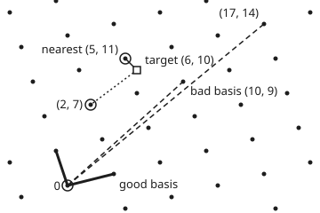

# Lattices: hard problems a quantum computer does not break, and the new standards

[Syllabus](../../../SYLLABUS.md) → [Applied and computational](../README.md) → [Cryptography](../README.md#s04) → Lattices

---

## General Overview

A laptop opens a connection to its bank. Before any order is sent, the two must agree on a fresh secret key. Today they usually do it with X25519, an elliptic-curve key exchange: each side sends a 32-byte public key ([Elliptic curves](06-elliptic-curve-cryptography.md)). It is fast and small. It also has a known end date. A large enough quantum computer running Shor's algorithm would recover the key from those 32 bytes. Anyone who records the traffic today can read it on that day. This is called "harvest now, decrypt later".

So browsers and banks now add a second exchange that a quantum computer is not known to break. It is Kyber-768, published by the US standards body NIST in 2024 as ML-KEM-768 (FIPS 203). The laptop sends a public key of **1,184 bytes**. The bank sends back a ciphertext (the locked message) of **1,088 bytes**. Both sides end up with the same 32-byte secret, 256 bits. The price is size: the public key is 37 times larger than an X25519 key.

The hard problem underneath is about a **lattice**: a regular grid of points in space, such as every whole-number mix of two arrows. Given a point near the grid, find the nearest grid point. In two dimensions that is easy. In 768 dimensions, described by a deliberately bad set of arrows, nobody knows a fast way, with or without a quantum computer. Kyber hides its secret as exactly such a point: a set of linear equations with small random errors added. The equations are worked mod q = 3329: on a clock of size q, where numbers wrap round.

**Kyber publishes linear equations mod q with small errors mixed in; the owner of the secret can strip the errors because they stay below a quarter of q, while anyone else must find a short vector in a lattice of more than 768 dimensions, which the best known attacks, classical or quantum, put at about 2^182 or 2^165 operations.**

**What kind of fact this is:** the decryption identity is a theorem, proved on this card in Why it works. Decryption then succeeds whenever the noise stays under q/4; that is a probability, not a certainty, and the standard sets the failure chance so low it is never expected in practice.

Security is an assumption: that learning with errors is hard, for quantum computers too. It is unproved as of 2026-11-11. The 2^182 figure is an estimate from the standard rule of thumb, not a bound. Shor's algorithm is a theorem, proved in the source cited below.

### The picture: one grid, two descriptions

<p align="center"></p>

Drawn to scale. The short thick arrows (4, 1) and (-1, 3) and the long dashed arrows (17, 14) and (10, 9) build the same dots. With the short arrows, rounding finds the dot nearest the target. With the long ones, rounding lands on (2, 7), five units away. In Kyber the public key gives only a bad basis like the long arrows, but the secret is not a good basis: it is one short vector of small numbers (Step 2).

---

## The formula

Notation first, in words. A **lattice** $L(B)$ is every whole-number mix of the arrows in a **basis** $B$ ([Basis and dimension](../../03-Algebra/03-Vectors/05-basis-and-dimension.md)). In two dimensions:

$$L(B) = \{\, x_1 b_1 + x_2 b_2 \;:\; x_1, x_2 \text{ whole numbers} \,\}$$

**Read it aloud:** the lattice is every point you can reach by whole steps along each arrow, forwards or backwards.

The **shortest-vector problem** (SVP) asks for a nonzero point of $L(B)$ of the smallest length, $\lambda_1$, given only $B$.

**Learning with errors** (LWE) hides a secret $s$ of small numbers. Everyone sees a random table $A$ and the result $t$, all mod $q$ (arithmetic on a clock of size $q$):

$$t = A\,s + e \pmod q$$

**Read it aloud:** each published number is a known mix of the secret numbers, plus a small error, wrapped round the clock.

Kyber's encryption uses LWE twice. Below, $A^{\mathsf T}$ is $A$ with rows and columns swapped, $t^{\mathsf T} r$ and $s^{\mathsf T} u$ are dot products, and 1665 is q/2 rounded, so a 1 bit is sent as half the clock. To send bits $m$ to the key's owner, pick fresh small $r$, $e_1$, $e_2$ and send

$$u = A^{\mathsf T} r + e_1, \qquad v = t^{\mathsf T} r + e_2 + 1665\, m \pmod q$$

The owner, knowing $s$, computes

$$v - s^{\mathsf T} u = 1665\, m + \big(e^{\mathsf T} r - s^{\mathsf T} e_1 + e_2\big) \pmod q$$

**Read it aloud:** take away the secret's share and what is left is each message bit, as 0 or about half the clock, plus a small noise that rounding removes.

| Symbol | Plain meaning | In our example | Push it up and the answer… |
| --- | --- | --- | --- |
| $b_1, b_2$, $B$, $x_1, x_2$ | arrows of a basis, the list of them, and the whole numbers of steps taken along each | good (4, 1), (-1, 3); bad (17, 14), (10, 9) | longer, more skewed arrows hide the short ones better |
| $L(B)$ | the lattice: all whole-number mixes of the arrows | the dots in the picture, one per area of 13 | — |
| $\lambda_1$ | length of the shortest nonzero lattice point | length² 10, at (1, -3) | — |
| $q$ | the clock size: all arithmetic is mod q | 3329 | more room for noise, larger keys |
| $n$, $k$ | each entry is a polynomial of n numbers in a variable X, with $X^{256} = -1$; the table is k by k | n = 256, k = 3: 768 secret numbers | more secret numbers, harder attack, bigger key |
| $A$, $A^{\mathsf T}$ | the public random table, mod q, and the same with rows and columns swapped | 3 × 3 polynomials, rebuilt from a 32-byte seed | — |
| $s$, $e$ | the secret and the key's error: small numbers, each from −η to η | η = 2 | larger η: more noise, harder attack, more decryption failures |
| $t$ | the public key's main part: $As + e$ | 3 polynomials of 12-bit numbers, 1,152 bytes plus the seed | — |
| $r$, $e_1$, $e_2$ | fresh small numbers chosen for each encryption | same size as s | must never repeat |
| $u$, $v$ | the ciphertext, rounded to 10 and 4 bits a number | 1,088 bytes | — |
| $m$ | the message bits, 256 of them; 1665 is q/2 rounded | 256 random bits, hashed into the 32-byte shared key | — |
| $\beta$ | block size the best attack must handle; cost about $2^{0.292\beta}$ | 624 for Kyber-768 | bigger β, costlier attack |

### When it holds

- **The errors are small next to q.** Decryption needs the total noise below q/4 = 832. With η = 2 the largest noise in 2,048 bits is 280. Widen to η = 24 and 30 of 256 bits come out wrong.
- **The errors are there at all.** Without $e$, $t = As$ is ordinary linear equations, and elimination returns the secret exactly.
- **Fresh randomness for every encryption.** Reuse $r$, $e_1$, $e_2$ for two messages and their XOR (where the bits differ) can be read off in all 256 places.
- **The dimension is large.** The toy below with 8 unknowns is insecure: try every secret. Kyber-768's 768 unknowns put the best known attack near 2^182.
- **The receiving key is reused safely only with the full wrapper.** The bare scheme on this card is secure against eavesdroppers. ML-KEM adds hashing and a re-encryption check, so a forged ciphertext tells the attacker nothing.

---

## Why it works

### Step 0: small errors make algebra useless, but cost the owner nothing

Without errors, $t = As$ is a set of linear equations. School elimination solves them, mod q as easily as with ordinary numbers. The toy in the code has 8 unknowns: elimination returns the secret `[0, 1, 1, 2, 0, 0, -1, 0]` exactly.

Add an error of −2 to 2 to each equation and elimination returns `[-793, 1365, -1647, -1425, -252, 44, -311, 598]`. Elimination mixes the equations, so the errors are multiplied and added until they fill the whole clock. Each equation now only says "close to", and "close to" does not survive mixing.

The owner never mixes. Decryption takes one subtraction, so the errors stay small, and small errors are removed by rounding. That gap is the whole scheme: the owner does one step, the attacker must search.

### Step 1: a lattice can be described well or badly

The good basis (4, 1), (-1, 3) and the bad basis (17, 14), (10, 9) make the same lattice. The bad arrows are whole-number mixes of the good ones: (17, 14) = 5 × (4, 1) + 3 × (-1, 3), and (10, 9) = 3 × (4, 1) + 2 × (-1, 3). The mix can be undone with whole numbers too, because its own area factor is 5 × 2 − 3 × 3 = 1. Both bases span cells of the same area, 13.

**Finding the short arrows again.** In two dimensions the Lagrange-Gauss method does it: subtract from the longer arrow the nearest whole multiple of the shorter, swap, repeat. From the bad basis it takes 3 steps to reach (1, -3) and (-4, -1). Brute force over every mix agrees that length² 10 is the shortest.

This is [Gram-Schmidt](../../03-Algebra/06-Dot%20Products%20and%20Best%20Fits/03-gram-schmidt-and-orthonormal-bases.md) with the rule that only whole multiples may be subtracted. The LLL algorithm extends it to many dimensions. It runs fast but only promises a vector within a factor that grows exponentially with the dimension.

The better tool, BKZ, solves SVP exactly in blocks of β dimensions, and its cost grows like $2^{0.292\beta}$ with the best known classical method.

**Finding the nearest point.** Write the target (6, 10) in the basis and round each amount. With the good basis the amounts are 28/13 and 34/13, which round to 2 and 3: the point (5, 11), distance² 2. With the bad basis they are −46/13 and 86/13, which round to −4 and 7: the point (2, 7), distance² 25.

Long, skewed arrows turn a small rounding error into a big jump. So a good basis can serve as a trapdoor (a secret shortcut) while a bad one is published: that is the older GGH scheme, and the Falcon signature still works this way. Kyber's secret is not a basis but one short vector, as Step 2 shows.

### Step 2: LWE is a short-vector problem in disguise

Rewrite $t = As + e$ as $A s + e - t \equiv 0 \pmod q$. The list of whole numbers $(s, e, -1)$ satisfies it. The set of all whole-number lists that satisfy it is a lattice, and the attacker can write down a basis for it from $A$, $t$ and $q$. That basis is a bad one.

In that lattice, $(s, e, -1)$ is unusually short: every entry is between −2 and 2, while a typical lattice point has entries spread over the whole clock. So recovering the secret means finding an unusually short vector in a lattice with more dimensions than the 768 secret numbers. This is the "primal attack".

How hard is it? The standard estimate (from the 2016 New Hope paper) asks for the smallest block size β at which BKZ would expose that short vector. The code runs the estimate. For Kyber-768 it gives β = 624: about $2^{0.292 \times 624} = 2^{182.2}$ operations classically. The standard quantum estimate changes 0.292 to 0.265, giving $2^{165.4}$.

Kyber-512 and Kyber-1024 come out at 2^118.6 and 2^255.2 classically. Run on New Hope's own parameters, the same code gives β = 968 against the 967 in that paper's Table 1, so the rule is implemented as published. These are estimates of the best known attack, not proofs.

Regev proved the link in the other direction too: solving random LWE would solve hard lattice problems in their worst case, using a quantum reduction. That is why LWE, and not some ad hoc puzzle, is trusted.

### Step 3: Kyber in outline, and why decryption is right

Kyber packs 256 numbers into each entry as a polynomial with $X^{256} = -1$. A 3 × 3 table of polynomials then acts like a 768 × 768 table of numbers, and it is rebuilt from a 32-byte seed instead of being sent. The polynomial structure also lets one key of 768 numbers carry all 256 message bits. Together they keep the key at 1,184 bytes instead of hundreds of kilobytes.

- **Key generation (the laptop).** Pick $A$ from a seed, small $s$ and $e$. Publish $t = As + e$ and the seed: 3 × 256 numbers of 12 bits each, 1,152 bytes, plus 32 bytes of seed, so 1,184.
- **Encryption (the bank; ML-KEM calls it encapsulation).** Pick 256 random bits $m$. Send $u = A^{\mathsf T} r + e_1$ and $v = t^{\mathsf T} r + e_2 + 1665\,m$, rounded to 10 bits and 4 bits a number: (3 × 256 × 10 + 256 × 4) / 8 = 1,088 bytes.
- **Decryption (the laptop).** Compute $v - s^{\mathsf T}u$ and round each number to 0 or 1665.

Why it is right, in four lines of algebra:

$$v - s^{\mathsf T}u = (As + e)^{\mathsf T} r + e_2 + 1665\,m - s^{\mathsf T} A^{\mathsf T} r - s^{\mathsf T} e_1$$

The terms $(As)^{\mathsf T} r$ and $s^{\mathsf T}A^{\mathsf T} r$ are the same number, so they cancel. What remains is $1665\,m + e^{\mathsf T} r - s^{\mathsf T} e_1 + e_2$. Each noise term is a sum of hundreds of products of small numbers with random signs. They mostly cancel, so the total stays far below q/4 = 832.

In the worst case, every product large and the same sign, it would not; the parameters make that so unlikely that FIPS 203 treats failure as negligible. Then rounding to the nearer of 0 and 1665 returns each bit.

The code checks the identity in all 256 places, and decrypts 8 messages, 2,048 bits, with no error and a largest noise of 280. The rounding to 10 and 4 bits adds a little more noise, and that is included in the 280.

ML-KEM wraps this inner scheme. The 256 bits are hashed into the shared key, and the laptop re-encrypts what it decrypted to check the ciphertext was honest (the Fujisaki-Okamoto transform). The code skips this wrapper and the fast multiplication (the NTT).

### Step 4: Dilithium in outline, a signature from the same problem

ML-DSA (Dilithium, FIPS 204) signs by proving knowledge of a short secret, in the style of the Schnorr signature named on [Digital signatures](07-digital-signatures.md), whose commit, challenge, answer pattern is laid out on [Zero-knowledge](10-zero-knowledge-proofs-in-outline.md):

1. Pick a random mask, as long as the secret, and commit to the rough size (the high bits) of the table $A$ times the mask.
2. Hash that commitment with the message to get a small challenge.
3. Answer with the mask plus the challenge times the secret $s$.

The verifier multiplies the answer by $A$, takes away the challenge times $t$, and checks the high bits match the commitment.

The catch: the answer is the secret pushed by a random mask, and when it lands near the edge of its allowed range, it leaks which way $s$ pushed it. So the signer **throws away** any answer that lands too near an edge, and tries again. The kept answers have the same spread whatever the secret is.

The standard's parameters set how near is too near. Worked through in the code, they give 5.09 expected tries for ML-DSA-65, against 5.1 in the standard's table. The cost is size: a 1,952-byte public key and a 3,309-byte signature.

### Step 5: what Shor's algorithm ends, and what it does not

RSA, Diffie-Hellman and elliptic curves all rest on a hidden **period**. For RSA modulus 3233 (61 × 53), the powers of 3 repeat every 260 steps. Knowing that is enough: 3^130 = 794 mod 3233, and the greatest common divisors of 793 and 795 with 3233 are 61 and 53. The factors fall out, and with them the private key ([RSA in full](04-rsa-in-full.md)).

Classically, finding the period of a full-size modulus is hopeless. Shor's algorithm finds it on a quantum computer in polynomial time, with a quantum Fourier transform. Discrete logarithms, so Diffie-Hellman and elliptic curves, fall the same way.

So Shor ends RSA, finite-field Diffie-Hellman ([Diffie-Hellman and ElGamal](05-diffie-hellman-and-elgamal.md)), ECDH and ECDSA (key exchange and signatures on elliptic curves) outright: making the keys longer only delays the attack a little. It does not touch hashes ([Hashes and MACs](03-hash-functions-and-macs.md)) or the block cipher [AES](02-symmetric-ciphers-and-aes.md). Grover's search, the other quantum algorithm, only takes a square root of the guessing work, so it is answered by doubling key lengths.

Lattice problems have no known hidden period to find. Decades of work have produced no quantum algorithm for them that does more than shave the exponent: the standard estimates use 0.265 in place of 0.292, and the best quantum sieves published since go only slightly lower. That is evidence, not a proof.

---

## Worked numbers, by hand

Kyber-768: n = 256, k = 3, q = 3329, η = 2.

| Step | Arithmetic | Value |
| --- | --- | --- |
| secret numbers | k × n = 3 × 256 | 768 |
| public key | 3 × 256 numbers × 12 bits / 8, plus 32-byte seed | 1,152 + 32 = 1,184 bytes |
| ciphertext, $u$ | 3 × 256 numbers × 10 bits / 8 | 960 bytes |
| ciphertext, $v$ | 256 numbers × 4 bits / 8 | 128 bytes |
| ciphertext | 960 + 128 | 1,088 bytes |
| a 1 bit is sent as | q/2 rounded | 1665 |
| decryption margin | q/4, rounded down | 832 |
| largest noise seen, 2,048 bits | from the run | 280 |
| attack block size β | primal estimate | 624 |
| attack cost, classical | 0.292 × 624 | about 2^182.2 |
| attack cost, quantum | 0.265 × 624 | about 2^165.4 |
| **sent in each direction** | laptop to bank, bank to laptop | **1,184 and 1,088 bytes** |

**The laptop and the bank agree a 256-bit secret by swapping 1,184 and 1,088 bytes; the noise used 280 of its 832 margin, and the best known attack needs about 2^182 operations, 2^165 on a quantum computer, if learning with errors is as hard as believed.**

In practice the two exchanges run side by side, the "hybrid" X25519MLKEM768 in [The TLS handshake](08-key-exchange-in-practice-the-tls-handshake.md). The laptop's share is 1,184 + 32 = 1,216 bytes, and the bank's is 1,088 + 32 = 1,120. An attacker must break both.

### What breaks if you drop a piece

| Mistake | Comes out at | What went wrong |
| --- | --- | --- |
| No error: publish $t = As$ | elimination on the 8-unknown toy returns the secret exactly | Without noise, LWE is linear algebra |
| Noise too wide, η = 24 | 30 of 256 bits wrong; largest noise 1511, past the margin 832 | The noise crossed q/4, so rounding picks the wrong bit |
| Same $r$, $e_1$, $e_2$ for two messages | XOR of the two messages read off in 256 of 256 places | The masks cancel when the two $v$ are subtracted, as with a reused pad |
| Rounding in the bad basis | (2, 7) at distance² 25, not (5, 11) at distance² 2 | Skewed arrows magnify rounding error: no trapdoor |
| Shor's step with base 2 on 3233 | period 780, but 2^390 = 3232 = −1: no factor | The method needs a period whose half-power is not −1; retry with another base |

The reused-randomness row repeats the reused-pad failure of [The one-time pad](01-one-time-pad-and-perfect-secrecy.md). The term $t^{\mathsf T} r + e_2$ acts as a pad on the message, and it cancels when it is used twice.

---

## Code, from first principles, and it actually runs

The script builds Kyber-768's inner encryption at full size: 3 × 3 polynomials of 256 numbers, mod 3329, with the real rounding to 12, 10 and 4 bits. It multiplies polynomials the slow, schoolbook way, with no NTT, and checks that a product wraps round to −1, the rule X^256 = −1.

The randomness comes from SplitMix64 with a fixed seed, so Python and Rust print the same keys. That makes every key here **insecure**. Real ML-KEM draws its table from a SHAKE hash of a public seed and its noise from SHAKE hashes of secret seeds. Without SHAKE, this code cannot reproduce the FIPS 203 test vectors.

The roads are independent. Key and ciphertext sizes come from the formula and from actually packing the bits. Decryption is checked by running it on 2,048 bits and by computing the noise identity from the small numbers alone. The shortest vector comes from Gauss reduction and from brute force over every mix, and the nearest point from rounding and from brute force.

The toy secret comes from elimination and is compared against the secret drawn. Dilithium's tries and sizes are compared against the standard's tables. The factors from Shor's period are multiplied back to 3233. The attack estimate scans every block size and sample count, and meets the New Hope paper's own table.

### Python

```python
# Lattices and post-quantum cryptography -- the check behind the card.  Standard library only.
# Kyber-768's inner encryption (K-PKE in FIPS 203) at real sizes; INSECURE: SplitMix64, no SHAKE/NTT/FO.
from math import pi, sqrt, exp
M64 = (1 << 64) - 1
class SplitMix64:
    def __init__(self, seed): self.s = seed
    def next(self):
        self.s = (self.s + 0x9E3779B97F4A7C15) & M64
        z = ((self.s ^ (self.s >> 30)) * 0xBF58476D1CE4E5B9) & M64
        z = ((z ^ (z >> 27)) * 0x94D049BB133111EB) & M64
        return z ^ (z >> 31)
Q, N, K = 3329, 256, 3
def cbd(rng, eta):                         # eta coin flips minus eta coin flips: a small number
    x, m = rng.next(), (1 << eta) - 1
    return bin(x & m).count("1") - bin((x >> eta) & m).count("1")
def small(rng, eta): return [cbd(rng, eta) for _ in range(N)]
def pmul(a, b):                            # polynomial product with X^256 = -1, mod q (a is small)
    c = [0] * (2 * N)
    for i, ai in enumerate(a):
        if ai:
            for j, bj in enumerate(b): c[i + j] += ai * bj
    return [(c[i] - c[i + N]) % Q for i in range(N)]
def padd(*ps): return [sum(x) % Q for x in zip(*ps)]
def centred(x): x %= Q; return x - Q if x > Q // 2 else x
def compress(x, d): return ((x << (d + 1)) + Q) // (2 * Q) % (1 << d)
def decompress(y, d): return (y * Q * 2 + (1 << d)) >> (d + 1)
def pack(polys, d):                        # every number in d bits, 8 bits to a byte
    bits = [(c >> i) & 1 for p in polys for c in p for i in range(d)]
    return bytes(sum(bits[j + i] << i for i in range(8)) for j in range(0, len(bits), 8))
def keygen(rng, eta):
    A = [[[rng.next() % Q for _ in range(N)] for _ in range(K)] for _ in range(K)]
    s, e = [small(rng, eta) for _ in range(K)], [small(rng, eta) for _ in range(K)]
    t = [padd(*[pmul(s[j], A[i][j]) for j in range(K)], e[i]) for i in range(K)]   # t = A s + e
    return A, s, e, t
def encrypt(rng, A, t, m, eta):
    r, e1, e2 = [small(rng, eta) for _ in range(K)], [small(rng, eta) for _ in range(K)], small(rng, eta)
    u = [padd(*[pmul(r[i], A[i][j]) for i in range(K)], e1[j]) for j in range(K)]  # u = A^T r + e1
    v = padd(*[pmul(r[i], t[i]) for i in range(K)], e2, [1665 * b for b in m])      # v = t.r + e2 + 1665 m
    return [[compress(x, 10) for x in p] for p in u], [compress(x, 4) for x in v], (r, e1, e2, u, v)
def decrypt(s, cu, cv):                    # w = v - s.u, then round each number to 0 or 1665
    u = [[decompress(x, 10) for x in p] for p in cu]
    w = [(decompress(y, 4) - z) % Q for y, z in zip(cv, padd(*[pmul(s[i], u[i]) for i in range(K)]))]
    return [compress(x, 1) for x in w], w
def run(eta, trials, seed):                # wrong bits and the largest noise over several messages
    rng = SplitMix64(seed); A, s, e, t = keygen(rng, eta); bad = big = 0
    for _ in range(trials):
        m = [rng.next() & 1 for _ in range(N)]
        cu, cv, _ = encrypt(rng, A, t, m, eta); got, w = decrypt(s, cu, cv)
        bad += sum(x != y for x, y in zip(got, m)); big = max(big, max(abs(centred(x - 1665 * b)) for x, b in zip(w, m)))
    return bad, big, (A, s, e, t, cu, cv, m, rng)
print("Kyber-768 inner scheme, k = 3, n = 256, q = 3329, eta = 2; SplitMix64 seed 2026: INSECURE")
bad, big, (A, s, e, t, cu, cv, m, rng) = run(2, 8, 2026)
pk, ct = pack(t, 12) + bytes(32), pack(cu, 10) + pack([cv], 4)   # + 32-byte seed that rebuilds A
print(f"public key bytes: 3 x 256 x 12 bits / 8 = {384 * K}, + 32 = {384 * K + 32}, packed {len(pk)}")
print(f"ciphertext bytes: 3 x 256 x 10 / 8 = {320 * K}, + 256 x 4 / 8 = 128, total {32 * (10 * K + 4)}, packed {len(ct)}")
print(f"secret numbers hidden in the key: {K * N}; shared secret 32 bytes = 256 bits")
print(f"8 messages, {8 * N} bits: wrong bits {bad}, largest noise {big}, margin q/4 = {Q // 4}")
assert len(pk) == 384 * K + 32 == 1184 and len(ct) == 32 * (10 * K + 4) == 1088 and bad == 0 and big < Q // 4
r, e1, e2, u, v = encrypt(SplitMix64(5), A, t, m, 2)[2]   # Step 3's identity, uncompressed
lhs = [(x - y) % Q for x, y in zip(v, padd(*[pmul(s[i], u[i]) for i in range(K)]))]
rhs = [(a - b + c + 1665 * d) % Q for a, b, c, d in zip(padd(*[pmul(r[i], e[i]) for i in range(K)]),
       padd(*[pmul(s[i], e1[i]) for i in range(K)]), e2, m)]
print("v - s.u equals e.r - s.e1 + e2 + 1665 m in all 256 places:", lhs == rhs)
assert lhs == rhs and pmul([0] * (N - 1) + [1], [0, 1] + [0] * (N - 2)) == [Q - 1] + [0] * (N - 1)   # and X^255 * X = -1
print(f"X25519 key 32 bytes; Kyber-768 key {len(pk) / 32:.1f} times larger; hybrid shares {len(pk) + 32} and {len(ct) + 32}")
print("; ".join(f"Kyber-{nm}: key {384 * kk + 32}, ciphertext {32 * (du * kk + dv)} bytes" for nm, kk, du, dv in (("512", 2, 10, 4), ("1024", 4, 11, 5))))
# ---- what breaks ----
bad24, big24, _ = run(24, 1, 2026)
print(f"noise too wide, eta = 24: wrong bits {bad24} of 256, largest noise {big24}")
assert bad24 > 0 and big24 > Q // 4
m1, m2 = [rng.next() & 1 for _ in range(N)], [rng.next() & 1 for _ in range(N)]
v1, v2 = encrypt(SplitMix64(99), A, t, m1, 2)[1], encrypt(SplitMix64(99), A, t, m2, 2)[1]
guess = [1 if 4 <= (a - b) % 16 <= 12 else 0 for a, b in zip(v1, v2)]
same = sum(g == x ^ y for g, x, y in zip(guess, m1, m2))
print(f"randomness reused for two messages: their XOR read off in {same} of 256 places")
assert same == 256
def mpow(b, k, mod): return 1 if k == 0 else mpow(b * b % mod, k >> 1, mod) * (b if k & 1 else 1) % mod
def solve(Am, b):                          # Gaussian elimination mod q, inverse by Fermat
    M = [row[:] + [x] for row, x in zip(Am, b)]
    for c in range(len(M)):
        p = next(i for i in range(c, len(M)) if M[i][c]); M[c], M[p] = M[p], M[c]
        iv = mpow(M[c][c], Q - 2, Q); M[c] = [x * iv % Q for x in M[c]]
        for i in range(len(M)):
            if i != c: f = M[i][c]; M[i] = [(x - f * y) % Q for x, y in zip(M[i], M[c])]
    return [centred(row[-1]) for row in M]
g = SplitMix64(7); At = [[g.next() % Q for _ in range(8)] for _ in range(8)]
st, et = [cbd(g, 2) for _ in range(8)], [cbd(g, 2) for _ in range(8)]
b0 = [sum(a * x for a, x in zip(row, st)) % Q for row in At]
s0, s1 = solve(At, b0), solve(At, [(x + y) % Q for x, y in zip(b0, et)])
print(f"toy LWE, 8 unknowns: secret {st}\n  no noise, elimination gives {s0}\n  with noise it gives {s1}")
assert s0 == st and s1 != st
# ---- the lattice picture: a good basis and a bad one for the same grid ----
dot, det = lambda a, b: a[0] * b[0] + a[1] * b[1], lambda p, q: p[0] * q[1] - p[1] * q[0]
def comb(x, y, p, q): return (x * p[0] + y * q[0], x * p[1] + y * q[1])
def rnd(n, d): return (2 * n + d) // (2 * d) if d > 0 else rnd(-n, -d)
g1, g2 = (4, 1), (-1, 3); c1, c2 = comb(5, 3, g1, g2), comb(3, 2, g1, g2)
def gauss(a, b):                           # Lagrange-Gauss: subtract the nearest multiple, swap, repeat
    steps = 0
    while True:
        if dot(a, a) > dot(b, b): a, b = b, a
        k = rnd(dot(a, b), dot(a, a))
        if k == 0: return a, b, steps
        b, steps = comb(-k, 1, a, b), steps + 1
brute = min(dot(p, p) for x in range(-20, 21) for y in range(-20, 21) if (p := comb(x, y, g1, g2)) != (0, 0))
ra, rb, st2 = gauss(c1, c2)
print(f"bad basis {c1} {c2}, area {det(c1, c2)}; good basis {g1} {g2}, area {det(g1, g2)}")
print(f"Gauss reduction of the bad basis, {st2} steps: {ra} {rb}; shortest by brute force has length^2 {brute}")
assert dot(ra, ra) == brute == 10 and abs(det(ra, rb)) == 13
def babai(tg, p, q):                       # write the target in the basis, round each amount
    d = det(p, q); return comb(rnd(det(tg, q), d), rnd(det(p, tg), d), p, q)
tg = (6, 10); okp, badp = babai(tg, g1, g2), babai(tg, c1, c2); dist2 = lambda a: (a[0] - tg[0]) ** 2 + (a[1] - tg[1]) ** 2
print(f"target {tg}: rounding in good basis -> {okp}, distance^2 {dist2(okp)}; in bad basis -> {badp}, distance^2 {dist2(badp)}")
assert dist2(okp) == 2 and dist2(badp) == 25 and min((dist2(p), p) for x in range(-20, 21) for y in range(-20, 21) for p in [comb(x, y, g1, g2)])[1] == okp
print(f"bad = 5 g1 + 3 g2 and 3 g1 + 2 g2, mix area 5 x 2 - 3 x 3 = {5 * 2 - 3 * 3}; amounts good {det(tg, g2)}/13 {det(g1, tg)}/13, bad {det(tg, c2)}/13 {det(c1, tg)}/13")
print(f"figure, good {g1} {g2}; bad {c1} {c2}; target {tg}; right {okp}; bad-basis answer {badp}")
# ---- security estimate (primal attack, core-SVP rule) and what Shor ends ----
def delta(b): return ((pi * b) ** (1 / b) * b / (2 * pi * exp(1))) ** (1 / (2 * (b - 1)))
def beta(n, sigma, q=Q, top=0):            # smallest BKZ block size that finds the short vector
    best = top = top or n                  # m, the samples used, runs up to top (Kyber gives n)
    for m in range(n // 2, top + 1):
        d = n + m + 1
        best = next((b for b in range(60, best) if sigma * sqrt(b) <= delta(b) ** (2 * b - d - 1) * q ** (m / d)), best)
    return best
bs = [beta(512, sqrt(1.5)), beta(768, 1.0), beta(1024, 1.0)]
print("block size beta for Kyber-512/768/1024:", bs, "-> classical 2^(0.292 beta):",
      " ".join(f"{0.292 * b:.1f}" for b in bs), "quantum 2^(0.265 beta):", " ".join(f"{0.265 * b:.1f}" for b in bs))
assert bs[0] < bs[1] < bs[2] and 0.292 * bs[1] > 128
nh = beta(1024, sqrt(8), 12289, 2048); print(f"same rule on New Hope, n = 1024, q = 12289: beta {nh}; its paper, Table 1: 967"); assert abs(nh - 967) <= 2
for nm, tau, eta, ga, gb, k, l, lam, om in (("44", 39, 2, 2 ** 17, 95232, 4, 4, 128, 80),
        ("65", 49, 4, 2 ** 19, 261888, 6, 5, 192, 55), ("87", 60, 2, 2 ** 19, 261888, 8, 7, 256, 75)):
    reps = exp(256 * tau * eta * (l / ga + k / gb))   # expected tries before a signature is safe to release
    sig = lam // 4 + l * 32 * (1 + (ga.bit_length() - 1)) + om + k
    print(f"ML-DSA-{nm}: public key {32 + 320 * k} bytes, signature {sig} bytes, expected tries {reps:.2f}")
    assert abs(reps - {"44": 4.25, "65": 5.1, "87": 3.85}[nm]) < 0.01 and (32 + 320 * k, sig) == {"44": (1312, 2420), "65": (1952, 3309), "87": (2592, 4627)}[nm]   # FIPS 204, Tables 1 and 2
R, a = 3233, 3; r = next(r for r in range(1, R) if mpow(a, r, R) == 1)   # the step Shor does on a quantum computer
gcd = lambda x, y: x if y == 0 else gcd(y, x % y); h = mpow(a, r // 2, R); f1, f2 = gcd(h - 1, R), gcd(h + 1, R)
print(f"Shor's idea on RSA modulus {R}: period of {a} is {r}; {a}^{r // 2} = {h}; factors {f1} x {f2}")
assert f1 * f2 == R and 1 < f1 < R
print(f"period of 2 is {next(r for r in range(1, R) if mpow(2, r, R) == 1)}: 2^390 = {mpow(2, 390, R)} = -1, no factor")
print("ALL CHECKS PASS")
```

**Ran 2026-11-11 on macOS, Python 3.14.10, standard library only. All checks passed. Output, pasted from the run:**

```
Kyber-768 inner scheme, k = 3, n = 256, q = 3329, eta = 2; SplitMix64 seed 2026: INSECURE
public key bytes: 3 x 256 x 12 bits / 8 = 1152, + 32 = 1184, packed 1184
ciphertext bytes: 3 x 256 x 10 / 8 = 960, + 256 x 4 / 8 = 128, total 1088, packed 1088
secret numbers hidden in the key: 768; shared secret 32 bytes = 256 bits
8 messages, 2048 bits: wrong bits 0, largest noise 280, margin q/4 = 832
v - s.u equals e.r - s.e1 + e2 + 1665 m in all 256 places: True
X25519 key 32 bytes; Kyber-768 key 37.0 times larger; hybrid shares 1216 and 1120
Kyber-512: key 800, ciphertext 768 bytes; Kyber-1024: key 1568, ciphertext 1568 bytes
noise too wide, eta = 24: wrong bits 30 of 256, largest noise 1511
randomness reused for two messages: their XOR read off in 256 of 256 places
toy LWE, 8 unknowns: secret [0, 1, 1, 2, 0, 0, -1, 0]
  no noise, elimination gives [0, 1, 1, 2, 0, 0, -1, 0]
  with noise it gives [-793, 1365, -1647, -1425, -252, 44, -311, 598]
bad basis (17, 14) (10, 9), area 13; good basis (4, 1) (-1, 3), area 13
Gauss reduction of the bad basis, 3 steps: (1, -3) (-4, -1); shortest by brute force has length^2 10
target (6, 10): rounding in good basis -> (5, 11), distance^2 2; in bad basis -> (2, 7), distance^2 25
bad = 5 g1 + 3 g2 and 3 g1 + 2 g2, mix area 5 x 2 - 3 x 3 = 1; amounts good 28/13 34/13, bad -46/13 86/13
figure, good (4, 1) (-1, 3); bad (17, 14) (10, 9); target (6, 10); right (5, 11); bad-basis answer (2, 7)
block size beta for Kyber-512/768/1024: [406, 624, 874] -> classical 2^(0.292 beta): 118.6 182.2 255.2 quantum 2^(0.265 beta): 107.6 165.4 231.6
same rule on New Hope, n = 1024, q = 12289: beta 968; its paper, Table 1: 967
ML-DSA-44: public key 1312 bytes, signature 2420 bytes, expected tries 4.25
ML-DSA-65: public key 1952 bytes, signature 3309 bytes, expected tries 5.09
ML-DSA-87: public key 2592 bytes, signature 4627 bytes, expected tries 3.85
Shor's idea on RSA modulus 3233: period of 3 is 260; 3^130 = 794; factors 61 x 53
period of 2 is 780: 2^390 = 3232 = -1, no factor
ALL CHECKS PASS
```

### Rust

```rust
// Lattices and post-quantum cryptography -- the check behind the card.  std only, no crates.
// Kyber-768's inner encryption (K-PKE in FIPS 203) at real sizes; INSECURE: SplitMix64, no SHAKE/NTT/FO.
use std::f64::consts::{E, PI};
struct SplitMix64 { s: u64 }
impl SplitMix64 {
    fn next(&mut self) -> u64 {
        self.s = self.s.wrapping_add(0x9E3779B97F4A7C15);
        let z = (self.s ^ (self.s >> 30)).wrapping_mul(0xBF58476D1CE4E5B9);
        let z = (z ^ (z >> 27)).wrapping_mul(0x94D049BB133111EB);
        z ^ (z >> 31)
    }
}
const Q: i64 = 3329; const N: usize = 256; const K: usize = 3;
type P = Vec<i64>;
fn cbd(rng: &mut SplitMix64, eta: u32) -> i64 { // eta coin flips minus eta coin flips: a small number
    let (x, m) = (rng.next(), (1u64 << eta) - 1);
    (x & m).count_ones() as i64 - ((x >> eta) & m).count_ones() as i64
}
fn small(rng: &mut SplitMix64, eta: u32) -> P { (0..N).map(|_| cbd(rng, eta)).collect() }
fn smalls(rng: &mut SplitMix64, eta: u32) -> Vec<P> { (0..K).map(|_| small(rng, eta)).collect() }
fn pmul(a: &P, b: &P) -> P { // polynomial product with X^256 = -1, mod q (a is small)
    let mut c = vec![0i64; 2 * N];
    for (i, &ai) in a.iter().enumerate() {
        if ai != 0 { for (j, &bj) in b.iter().enumerate() { c[i + j] += ai * bj; } }
    }
    (0..N).map(|i| (c[i] - c[i + N]).rem_euclid(Q)).collect()
}
fn padd(ps: &[P]) -> P { (0..N).map(|i| ps.iter().map(|p| p[i]).sum::<i64>().rem_euclid(Q)).collect() }
fn dotp(a: &[P], b: &[P]) -> P { padd(&(0..K).map(|i| pmul(&a[i], &b[i])).collect::<Vec<_>>()) }
fn centred(x: i64) -> i64 { let x = x.rem_euclid(Q); if x > Q / 2 { x - Q } else { x } }
fn compress(x: i64, d: u32) -> i64 { ((x << (d + 1)) + Q) / (2 * Q) % (1 << d) }
fn decompress(y: i64, d: u32) -> i64 { (y * Q * 2 + (1 << d)) >> (d + 1) }
fn pack(polys: &[P], d: u32) -> Vec<u8> { // every number in d bits, 8 bits to a byte
    let bits: Vec<u8> = polys.iter().flat_map(|p| p.iter()).flat_map(|&c| (0..d).map(move |i| ((c >> i) & 1) as u8)).collect();
    bits.chunks(8).map(|ch| ch.iter().enumerate().map(|(i, &b)| b << i).sum()).collect()
}
struct Key { a: Vec<Vec<P>>, s: Vec<P>, e: Vec<P>, t: Vec<P> }
fn keygen(rng: &mut SplitMix64, eta: u32) -> Key {
    let a: Vec<Vec<P>> = (0..K).map(|_| (0..K).map(|_| (0..N).map(|_| (rng.next() % Q as u64) as i64).collect()).collect()).collect();
    let (s, e) = (smalls(rng, eta), smalls(rng, eta));
    let t = (0..K).map(|i| padd(&[dotp(&a[i], &s), e[i].clone()])).collect(); // t = A s + e
    Key { a, s, e, t }
}
// returns compressed u, compressed v, and the raw (r, e1, e2, u, v)
fn encrypt(rng: &mut SplitMix64, k: &Key, m: &[i64], eta: u32) -> (Vec<P>, P, (Vec<P>, Vec<P>, P, Vec<P>, P)) {
    let (r, e1, e2) = (smalls(rng, eta), smalls(rng, eta), small(rng, eta));
    let u: Vec<P> = (0..K).map(|j| { let col: Vec<P> = (0..K).map(|i| k.a[i][j].clone()).collect(); padd(&[dotp(&r, &col), e1[j].clone()]) }).collect();
    let v = padd(&[dotp(&r, &k.t), e2.clone(), m.iter().map(|b| 1665 * b).collect()]); // v = t.r + e2 + 1665 m
    (u.iter().map(|p| p.iter().map(|&x| compress(x, 10)).collect()).collect(), v.iter().map(|&x| compress(x, 4)).collect(), (r, e1, e2, u, v))
}
fn decrypt(s: &[P], cu: &[P], cv: &P) -> (P, P) { // w = v - s.u, then round each number to 0 or 1665
    let u: Vec<P> = cu.iter().map(|p| p.iter().map(|&x| decompress(x, 10)).collect()).collect();
    let su = dotp(s, &u); let w: P = (0..N).map(|i| (decompress(cv[i], 4) - su[i]).rem_euclid(Q)).collect();
    (w.iter().map(|&x| compress(x, 1)).collect(), w)
}
fn run(eta: u32, trials: usize, seed: u64) -> (usize, i64, Key, Vec<P>, P, P, SplitMix64) {
    let mut rng = SplitMix64 { s: seed }; let key = keygen(&mut rng, eta);
    let (mut bad, mut big, mut last) = (0, 0, (vec![], vec![], vec![]));
    for _ in 0..trials {
        let m: P = (0..N).map(|_| (rng.next() & 1) as i64).collect();
        let (cu, cv, _) = encrypt(&mut rng, &key, &m, eta); let (got, w) = decrypt(&key.s, &cu, &cv);
        bad += (0..N).filter(|&i| got[i] != m[i]).count();
        big = big.max((0..N).map(|i| centred(w[i] - 1665 * m[i]).abs()).max().unwrap());
        last = (cu, cv, m);
    }
    (bad, big, key, last.0, last.1, last.2, rng)
}
fn mpow(b: i64, k: i64, m: i64) -> i64 { if k == 0 { 1 } else { mpow(b * b % m, k >> 1, m) * (if k & 1 == 1 { b } else { 1 }) % m } }
fn solve(a: &[Vec<i64>], b: &[i64]) -> Vec<i64> { // Gaussian elimination mod q, inverse by Fermat
    let n = a.len(); let mut mm: Vec<Vec<i64>> = (0..n).map(|i| { let mut r = a[i].clone(); r.push(b[i]); r }).collect();
    for c in 0..n {
        let p = (c..n).find(|&i| mm[i][c] != 0).unwrap(); mm.swap(c, p);
        let iv = mpow(mm[c][c], Q - 2, Q); mm[c] = mm[c].iter().map(|x| x * iv % Q).collect();
        let rc = mm[c].clone();
        for i in (0..n).filter(|&i| i != c) { let f = mm[i][c]; mm[i] = mm[i].iter().zip(&rc).map(|(x, y)| (x - f * y).rem_euclid(Q)).collect(); }
    }
    mm.iter().map(|r| centred(r[n])).collect()
}
type V = (i64, i64);
fn dot(a: V, b: V) -> i64 { a.0 * b.0 + a.1 * b.1 }  fn det(p: V, q: V) -> i64 { p.0 * q.1 - p.1 * q.0 }
fn comb(x: i64, y: i64, p: V, q: V) -> V { (x * p.0 + y * q.0, x * p.1 + y * q.1) }
fn rnd(n: i64, d: i64) -> i64 { if d > 0 { (2 * n + d).div_euclid(2 * d) } else { rnd(-n, -d) } }
fn gauss(mut a: V, mut b: V) -> (V, V, i32) { // Lagrange-Gauss: subtract the nearest multiple, swap, repeat
    for steps in 0.. {
        if dot(a, a) > dot(b, b) { std::mem::swap(&mut a, &mut b); }
        let k = rnd(dot(a, b), dot(a, a));
        if k == 0 { return (a, b, steps); }
        b = comb(-k, 1, a, b);
    }
    unreachable!()
}
fn babai(tg: V, p: V, q: V) -> V { let d = det(p, q); comb(rnd(det(tg, q), d), rnd(det(p, tg), d), p, q) }
fn delta(b: f64) -> f64 { ((PI * b).powf(1.0 / b) * b / (2.0 * PI * E)).powf(1.0 / (2.0 * (b - 1.0))) }
fn beta(n: usize, sigma: f64, q: f64, top: usize) -> usize { // smallest BKZ block size that finds the short vector
    let mut best = top; // m, the samples used, runs up to top (Kyber gives n)
    for m in n / 2..=top {
        let d = (n + m + 1) as f64;
        best = (60..best).find(|&b| { let bf = b as f64; sigma * bf.sqrt() <= delta(bf).powf(2.0 * bf - d - 1.0) * q.powf(m as f64 / d) }).unwrap_or(best);
    }
    best
}
fn gcd(x: i64, y: i64) -> i64 { if y == 0 { x } else { gcd(y, x % y) } }
fn main() {
    println!("Kyber-768 inner scheme, k = 3, n = 256, q = 3329, eta = 2; SplitMix64 seed 2026: INSECURE");
    let (bad, big, key, cu, cv, m, mut rng) = run(2, 8, 2026);
    let mut pk = pack(&key.t, 12); pk.extend([0u8; 32]); // + 32-byte seed that rebuilds A
    let mut ct = pack(&cu, 10); ct.extend(pack(&[cv], 4));
    println!("public key bytes: 3 x 256 x 12 bits / 8 = {}, + 32 = {}, packed {}", 384 * K, 384 * K + 32, pk.len());
    println!("ciphertext bytes: 3 x 256 x 10 / 8 = {}, + 256 x 4 / 8 = 128, total {}, packed {}", 320 * K, 32 * (10 * K + 4), ct.len());
    println!("secret numbers hidden in the key: {}; shared secret 32 bytes = 256 bits", K * N);
    println!("8 messages, {} bits: wrong bits {}, largest noise {}, margin q/4 = {}", 8 * N, bad, big, Q / 4);
    assert!(pk.len() == 384 * K + 32 && pk.len() == 1184 && ct.len() == 32 * (10 * K + 4) && ct.len() == 1088 && bad == 0 && big < Q / 4);
    let (r, e1, e2, u, v) = encrypt(&mut SplitMix64 { s: 5 }, &key, &m, 2).2; // Step 3's identity, uncompressed
    let su = dotp(&key.s, &u); let lhs: P = (0..N).map(|i| (v[i] - su[i]).rem_euclid(Q)).collect();
    let (er, se1) = (dotp(&r, &key.e), dotp(&key.s, &e1));
    let rhs: P = (0..N).map(|i| (er[i] - se1[i] + e2[i] + 1665 * m[i]).rem_euclid(Q)).collect();
    println!("v - s.u equals e.r - s.e1 + e2 + 1665 m in all 256 places: {}", if lhs == rhs { "True" } else { "False" });
    assert!(lhs == rhs && pmul(&(0..N).map(|j| (j == N - 1) as i64).collect(), &(0..N).map(|j| (j == 1) as i64).collect()) == (0..N).map(|j| if j == 0 { Q - 1 } else { 0 }).collect::<P>()); // and X^255 * X = -1
    println!("X25519 key 32 bytes; Kyber-768 key {:.1} times larger; hybrid shares {} and {}", pk.len() as f64 / 32.0, pk.len() + 32, ct.len() + 32);
    println!("Kyber-512: key {}, ciphertext {} bytes; Kyber-1024: key {}, ciphertext {} bytes", 384 * 2 + 32, 32 * (10 * 2 + 4), 384 * 4 + 32, 32 * (11 * 4 + 5));
    // ---- what breaks ----
    let (bad24, big24, ..) = run(24, 1, 2026);
    println!("noise too wide, eta = 24: wrong bits {} of 256, largest noise {}", bad24, big24);
    assert!(bad24 > 0 && big24 > Q / 4);
    let (m1, m2): (P, P) = ((0..N).map(|_| (rng.next() & 1) as i64).collect(), (0..N).map(|_| (rng.next() & 1) as i64).collect());
    let (v1, v2) = (encrypt(&mut SplitMix64 { s: 99 }, &key, &m1, 2).1, encrypt(&mut SplitMix64 { s: 99 }, &key, &m2, 2).1);
    let same = (0..N).filter(|&i| { let d = (v1[i] - v2[i]).rem_euclid(16); ((4..=12).contains(&d) as i64) == (m1[i] ^ m2[i]) }).count();
    println!("randomness reused for two messages: their XOR read off in {} of 256 places", same);
    assert!(same == 256);
    let mut g = SplitMix64 { s: 7 };
    let at: Vec<Vec<i64>> = (0..8).map(|_| (0..8).map(|_| (g.next() % Q as u64) as i64).collect()).collect();
    let (st, et): (Vec<i64>, Vec<i64>) = ((0..8).map(|_| cbd(&mut g, 2)).collect(), (0..8).map(|_| cbd(&mut g, 2)).collect());
    let b0: Vec<i64> = at.iter().map(|row| row.iter().zip(&st).map(|(a, x)| a * x).sum::<i64>().rem_euclid(Q)).collect();
    let (s0, s1) = (solve(&at, &b0), solve(&at, &b0.iter().zip(&et).map(|(x, y)| (x + y).rem_euclid(Q)).collect::<Vec<_>>()));
    println!("toy LWE, 8 unknowns: secret {:?}\n  no noise, elimination gives {:?}\n  with noise it gives {:?}", st, s0, s1);
    assert!(s0 == st && s1 != st);
    // ---- the lattice picture: a good basis and a bad one for the same grid ----
    let (g1, g2): (V, V) = ((4, 1), (-1, 3)); let (c1, c2) = (comb(5, 3, g1, g2), comb(3, 2, g1, g2));
    let mut brute = i64::MAX;
    for x in -20..=20 { for y in -20..=20 { let p = comb(x, y, g1, g2); if p != (0, 0) { brute = brute.min(dot(p, p)); } } }
    let (ra, rb, st2) = gauss(c1, c2);
    println!("bad basis {:?} {:?}, area {}; good basis {:?} {:?}, area {}", c1, c2, det(c1, c2), g1, g2, det(g1, g2));
    println!("Gauss reduction of the bad basis, {} steps: {:?} {:?}; shortest by brute force has length^2 {}", st2, ra, rb, brute);
    assert!(dot(ra, ra) == brute && brute == 10 && det(ra, rb).abs() == 13);
    let tg: V = (6, 10); let (okp, badp) = (babai(tg, g1, g2), babai(tg, c1, c2)); let dist2 = |a: V| (a.0 - tg.0).pow(2) + (a.1 - tg.1).pow(2);
    println!("target {:?}: rounding in good basis -> {:?}, distance^2 {}; in bad basis -> {:?}, distance^2 {}", tg, okp, dist2(okp), badp, dist2(badp));
    assert!(dist2(okp) == 2 && dist2(badp) == 25 && (-20..=20).flat_map(|x| (-20..=20).map(move |y| comb(x, y, g1, g2))).min_by_key(|&p| (dist2(p), p)) == Some(okp));
    println!("bad = 5 g1 + 3 g2 and 3 g1 + 2 g2, mix area 5 x 2 - 3 x 3 = {}; amounts good {}/13 {}/13, bad {}/13 {}/13", 5 * 2 - 3 * 3, det(tg, g2), det(g1, tg), det(tg, c2), det(c1, tg));
    println!("figure, good {:?} {:?}; bad {:?} {:?}; target {:?}; right {:?}; bad-basis answer {:?}", g1, g2, c1, c2, tg, okp, badp);
    // ---- security estimate (primal attack, core-SVP rule) and what Shor ends ----
    let bs = vec![beta(512, 1.5f64.sqrt(), Q as f64, 512), beta(768, 1.0, Q as f64, 768), beta(1024, 1.0, Q as f64, 1024)];
    let f = |c: f64| bs.iter().map(|&b| format!("{:.1}", c * b as f64)).collect::<Vec<_>>().join(" ");
    println!("block size beta for Kyber-512/768/1024: {:?} -> classical 2^(0.292 beta): {} quantum 2^(0.265 beta): {}", bs, f(0.292), f(0.265));
    assert!(bs[0] < bs[1] && bs[1] < bs[2] && 0.292 * bs[1] as f64 > 128.0);
    let nh = beta(1024, 8f64.sqrt(), 12289.0, 2048); println!("same rule on New Hope, n = 1024, q = 12289: beta {}; its paper, Table 1: 967", nh); assert!((nh as i64 - 967).abs() <= 2);
    for (nm, tau, eta, ga, gb, k, l, lam, om, want) in [("44", 39.0, 2.0, 1u64 << 17, 95232.0, 4u64, 4u64, 128u64, 80u64, 4.25),
        ("65", 49.0, 4.0, 1 << 19, 261888.0, 6, 5, 192, 55, 5.1), ("87", 60.0, 2.0, 1 << 19, 261888.0, 8, 7, 256, 75, 3.85)] {
        let reps = (256.0 * tau * eta * (l as f64 / ga as f64 + k as f64 / gb)).exp(); // expected tries before release
        let sig = lam / 4 + l * 32 * (1 + ga.trailing_zeros() as u64) + om + k;
        println!("ML-DSA-{}: public key {} bytes, signature {} bytes, expected tries {:.2}", nm, 32 + 320 * k, sig, reps);
        assert!((reps - want).abs() < 0.01 && (32 + 320 * k, sig) == match nm { "44" => (1312, 2420), "65" => (1952, 3309), _ => (2592, 4627) }); // FIPS 204, Tables 1 and 2
    }
    let (rr, a) = (3233i64, 3i64);
    let r = (1..rr).find(|&r| mpow(a, r, rr) == 1).unwrap(); // the step Shor does on a quantum computer
    let h = mpow(a, r / 2, rr); let (f1, f2) = (gcd(h - 1, rr), gcd(h + 1, rr));
    println!("Shor's idea on RSA modulus {}: period of {} is {}; {}^{} = {}; factors {} x {}", rr, a, r, a, r / 2, h, f1, f2);
    assert!(f1 * f2 == rr && 1 < f1 && f1 < rr);
    println!("period of 2 is {}: 2^390 = {} = -1, no factor", (1..rr).find(|&r| mpow(2, r, rr) == 1).unwrap(), mpow(2, 390, rr));
    println!("ALL CHECKS PASS");
}
```

**Ran 2026-11-11 on macOS, rustc 1.98.1, no crates. All checks passed. Output, pasted from the run:**

```
Kyber-768 inner scheme, k = 3, n = 256, q = 3329, eta = 2; SplitMix64 seed 2026: INSECURE
public key bytes: 3 x 256 x 12 bits / 8 = 1152, + 32 = 1184, packed 1184
ciphertext bytes: 3 x 256 x 10 / 8 = 960, + 256 x 4 / 8 = 128, total 1088, packed 1088
secret numbers hidden in the key: 768; shared secret 32 bytes = 256 bits
8 messages, 2048 bits: wrong bits 0, largest noise 280, margin q/4 = 832
v - s.u equals e.r - s.e1 + e2 + 1665 m in all 256 places: True
X25519 key 32 bytes; Kyber-768 key 37.0 times larger; hybrid shares 1216 and 1120
Kyber-512: key 800, ciphertext 768 bytes; Kyber-1024: key 1568, ciphertext 1568 bytes
noise too wide, eta = 24: wrong bits 30 of 256, largest noise 1511
randomness reused for two messages: their XOR read off in 256 of 256 places
toy LWE, 8 unknowns: secret [0, 1, 1, 2, 0, 0, -1, 0]
  no noise, elimination gives [0, 1, 1, 2, 0, 0, -1, 0]
  with noise it gives [-793, 1365, -1647, -1425, -252, 44, -311, 598]
bad basis (17, 14) (10, 9), area 13; good basis (4, 1) (-1, 3), area 13
Gauss reduction of the bad basis, 3 steps: (1, -3) (-4, -1); shortest by brute force has length^2 10
target (6, 10): rounding in good basis -> (5, 11), distance^2 2; in bad basis -> (2, 7), distance^2 25
bad = 5 g1 + 3 g2 and 3 g1 + 2 g2, mix area 5 x 2 - 3 x 3 = 1; amounts good 28/13 34/13, bad -46/13 86/13
figure, good (4, 1) (-1, 3); bad (17, 14) (10, 9); target (6, 10); right (5, 11); bad-basis answer (2, 7)
block size beta for Kyber-512/768/1024: [406, 624, 874] -> classical 2^(0.292 beta): 118.6 182.2 255.2 quantum 2^(0.265 beta): 107.6 165.4 231.6
same rule on New Hope, n = 1024, q = 12289: beta 968; its paper, Table 1: 967
ML-DSA-44: public key 1312 bytes, signature 2420 bytes, expected tries 4.25
ML-DSA-65: public key 1952 bytes, signature 3309 bytes, expected tries 5.09
ML-DSA-87: public key 2592 bytes, signature 4627 bytes, expected tries 3.85
Shor's idea on RSA modulus 3233: period of 3 is 260; 3^130 = 794; factors 61 x 53
period of 2 is 780: 2^390 = 3232 = -1, no factor
ALL CHECKS PASS
```

### Lean

Lean proves the decryption algebra, the rounding rule and the same-lattice fact for all inputs, and checks the worked numbers exactly.

- Take $t = As + e$, $u = A^{\mathsf T} r + e_1$ and $v = t^{\mathsf T} r + e_2 + 1665\, m$. Then $v - s^{\mathsf T} u = 1665\, m + e^{\mathsf T} r - s^{\mathsf T} e_1 + e_2$. This holds for any table size, with numbers mod q or with Kyber's polynomials.
- Take a bit $b$ sent as $1665\, b$, and a total noise $d$ with $|d| < 832$. Then rounding $1665\, b + d$ mod 3329 to the nearer of 0 and 1665 returns $b$.
- Take two arrows $g_1, g_2$ and whole numbers $a, b, c, d$ with $ad - bc = 1$. Then $a g_1 + b g_2$ and $c g_1 + d g_2$ build the same lattice as $g_1, g_2$.
- The bad arrows (17, 14) and (10, 9) are whole-number mixes of the good ones, with area factor 1. Both cells have area 13.
- No nonzero lattice point has length² below 10. No lattice point is nearer the target (6, 10) than (5, 11), at distance² 2.
- Rounding in the bad basis gives the amounts −4 and 7, so the point (2, 7) at distance² 25.
- The sizes in Worked numbers check: 1,184 and 1,088 bytes, the hybrid shares, Kyber-512, Kyber-1024 and ML-DSA-65.
- The powers of 3 mod 3233 repeat every 260 steps, and $3^{130} = 794$ gives the factors 61 and 53.
- The powers of 2 repeat every 780 steps, but $2^{390} = 3232 = -1$, so no factor comes out.

The noise run, the attack estimates, Dilithium's tries and the broken variants are left to the Python and Rust checks.

```lean
-- Lattices: Kyber's decryption identity v - sᵀu = 1665·m + (eᵀr - sᵀe₁ + e₂) holds over every commutative ring, rounding mod 3329 returns each bit whenever the noise stays below 832, two bases related by a whole-number mix of area factor 1 make the same lattice, and the card's size, lattice and Shor numbers are exact.
import Mathlib.Data.Matrix.Mul
import Mathlib.Data.ZMod.Basic
import Mathlib.LinearAlgebra.Span.Defs
import Mathlib.Algebra.Order.Group.Abs
import Mathlib.Tactic.NormNum
import Mathlib.Tactic.NormNum.PowMod
import Mathlib.Tactic.NormNum.GCD
import Mathlib

namespace LatticesAndPostQuantumCryptography

open Matrix

/-- The decryption identity (Step 3). Work in any commutative ring `R` (for Kyber, polynomials
mod q with X^256 = -1) and any number of rows. Let the public key be t = A s + e, and let the
ciphertext be u = Aᵀ r + e₁ and v = tᵀ r + e₂ + 1665 m. Then the owner of s computes
v - sᵀ u = 1665 m + (eᵀ r - sᵀ e₁ + e₂): the terms (A s)ᵀ r and sᵀ Aᵀ r cancel, and only
the message and a noise made of the small numbers remain. -/
theorem kyber_decryption_identity {R ι : Type*} [CommRing R] [Fintype ι]
    (A : Matrix ι ι R) (s e r e₁ t u : ι → R) (e₂ m v : R)
    (ht : t = A *ᵥ s + e) (hu : u = Aᵀ *ᵥ r + e₁) (hv : v = t ⬝ᵥ r + e₂ + 1665 * m) :
    v - s ⬝ᵥ u = 1665 * m + (e ⬝ᵥ r - s ⬝ᵥ e₁ + e₂) := by
  subst ht hu hv
  simp only [add_dotProduct, dotProduct_add, dotProduct_mulVec, vecMul_transpose]
  rw [dotProduct_comm (A *ᵥ s) r]
  ring

/-- Kyber's rounding of one number mod q = 3329 to a bit: `compress(x, 1)` in the card's code,
⌊(4x + q) / 2q⌋ mod 2. It gives 1 when x is nearer 1665 than 0 on the clock, and 0 otherwise. -/
def roundBit (x : ZMod 3329) : ℕ := (4 * x.val + 3329) / 6658 % 2

/-- Decryption succeeds when the noise is small (When it holds). If a bit b is sent as
1665·b and the total noise d is below q/4 = 832 in size, then rounding 1665·b + d mod 3329
to the nearer of 0 and 1665 returns b. -/
theorem round_recovers_bit_of_noise_lt_832 (b : ℕ) (hb : b ≤ 1) (d : ℤ) (hd : |d| < 832) :
    roundBit (((1665 * b : ℤ) + d : ℤ) : ZMod 3329) = b := by
  unfold roundBit
  have hx := ZMod.val_intCast (n := 3329) ((1665 * b : ℤ) + d)
  generalize ((((1665 * b : ℤ) + d : ℤ) : ZMod 3329)).val = x at hx ⊢
  rw [abs_lt] at hd
  push_cast at hx
  obtain ⟨hd1, hd2⟩ := hd
  interval_cases b
  · rcases le_or_gt 0 d with h0 | h0
    · have : (x : ℤ) = d := by rw [hx]; omega
      omega
    · have : (x : ℤ) = d + 3329 := by rw [hx]; omega
      omega
  · have : (x : ℤ) = 1665 + d := by rw [hx]; omega
    omega

/-- A good basis and a bad basis make the same lattice (Step 1). If the arrows c₁ = a g₁ + b g₂
and c₂ = c g₁ + d g₂ are whole-number mixes of g₁ and g₂ whose area factor a d - b c is 1,
the mix can be undone with whole numbers, so every whole-number mix of c₁, c₂ is one of
g₁, g₂ and back: L(c₁, c₂) = L(g₁, g₂). -/
theorem same_lattice_of_mix_with_area_factor_one {n : ℕ} (g₁ g₂ : Fin n → ℤ) (a b c d : ℤ)
    (h : a * d - b * c = 1) :
    Submodule.span ℤ ({a • g₁ + b • g₂, c • g₁ + d • g₂} : Set (Fin n → ℤ)) =
      Submodule.span ℤ ({g₁, g₂} : Set (Fin n → ℤ)) := by
  apply le_antisymm
  · rw [Submodule.span_le, Set.insert_subset_iff, Set.singleton_subset_iff]
    have m1 : g₁ ∈ Submodule.span ℤ ({g₁, g₂} : Set (Fin n → ℤ)) :=
      Submodule.subset_span (by simp)
    have m2 : g₂ ∈ Submodule.span ℤ ({g₁, g₂} : Set (Fin n → ℤ)) :=
      Submodule.subset_span (by simp)
    exact ⟨Submodule.add_mem _ (Submodule.smul_mem _ _ m1) (Submodule.smul_mem _ _ m2),
      Submodule.add_mem _ (Submodule.smul_mem _ _ m1) (Submodule.smul_mem _ _ m2)⟩
  · rw [Submodule.span_le, Set.insert_subset_iff, Set.singleton_subset_iff]
    set S := Submodule.span ℤ ({a • g₁ + b • g₂, c • g₁ + d • g₂} : Set (Fin n → ℤ)) with hS
    have m1 : a • g₁ + b • g₂ ∈ S := Submodule.subset_span (by simp)
    have m2 : c • g₁ + d • g₂ ∈ S := Submodule.subset_span (by simp)
    have h1 : g₁ = d • (a • g₁ + b • g₂) + (-b) • (c • g₁ + d • g₂) := by
      ext i
      simp only [Pi.add_apply, Pi.smul_apply, smul_eq_mul]
      linear_combination (-(g₁ i)) * h
    have h2 : g₂ = (-c) • (a • g₁ + b • g₂) + a • (c • g₁ + d • g₂) := by
      ext i
      simp only [Pi.add_apply, Pi.smul_apply, smul_eq_mul]
      linear_combination (-(g₂ i)) * h
    refine ⟨?_, ?_⟩
    · rw [h1]
      exact Submodule.add_mem _ (Submodule.smul_mem _ _ m1) (Submodule.smul_mem _ _ m2)
    · rw [h2]
      exact Submodule.add_mem _ (Submodule.smul_mem _ _ m1) (Submodule.smul_mem _ _ m2)

-- Kyber-768 sizes: 3 × 256 = 768 secret numbers; key 3 × 256 × 12 / 8 + 32 = 1,184 bytes;
-- ciphertext 3 × 256 × 10 / 8 + 256 × 4 / 8 = 960 + 128 = 1,088 bytes.
example : 3 * 256 = 768 ∧ 3 * 256 * 12 / 8 = 1152 ∧ 1152 + 32 = 1184 := by decide
example : 3 * 256 * 10 / 8 = 960 ∧ 256 * 4 / 8 = 128 ∧ 960 + 128 = 1088 := by decide
-- 1665 is q/2 rounded, 832 is q/4 rounded down; the key is 37 times an X25519 key.
example : (3329 + 1) / 2 = 1665 ∧ 3329 / 4 = 832 ∧ 1184 = 37 * 32 := by decide
-- Hybrid shares 1,184 + 32 = 1,216 and 1,088 + 32 = 1,120; Kyber-512 800 and 768,
-- Kyber-1024 1,568 and 1,568.
example : 1184 + 32 = 1216 ∧ 1088 + 32 = 1120 := by decide
example : 384 * 2 + 32 = 800 ∧ 32 * (10 * 2 + 4) = 768 ∧
    384 * 4 + 32 = 1568 ∧ 32 * (11 * 4 + 5) = 1568 := by decide
-- ML-DSA-65: public key 32 + 320 × 6 = 1,952 bytes, signature 192/4 + 5 × 32 × 20 + 55 + 6 = 3,309.
example : 32 + 320 * 6 = 1952 ∧ 192 / 4 + 5 * 32 * (1 + 19) + 55 + 6 = 3309 := by decide

-- The bad arrows are mixes of the good ones: (17, 14) = 5 (4, 1) + 3 (-1, 3),
-- (10, 9) = 3 (4, 1) + 2 (-1, 3), with area factor 5 × 2 - 3 × 3 = 1; both cells have area 13.
example : ((5 * 4 + 3 * (-1) : ℤ), (5 * 1 + 3 * 3 : ℤ)) = (17, 14) ∧
    ((3 * 4 + 2 * (-1) : ℤ), (3 * 1 + 2 * 3 : ℤ)) = (10, 9) := by decide
example : (5 * 2 - 3 * 3 : ℤ) = 1 ∧ (4 * 3 - 1 * (-1) : ℤ) = 13 ∧ (17 * 9 - 14 * 10 : ℤ) = 13 := by
  decide
-- The shortest nonzero point of the lattice x (4, 1) + y (-1, 3) has length² 10, at (1, -3).
example : ∀ x y : ℤ, (x, y) ≠ (0, 0) → 10 ≤ (4 * x - y) ^ 2 + (x + 3 * y) ^ 2 := by 
  intro x y hxy
  by_cases hx : x = 0
  · subst hx
    have hy : y ≠ 0 := by
      intro hy
      exact hxy (by simp [hy])
    have : 1 ≤ y ^ 2 := by
      have : 0 < |y| := abs_pos.mpr hy
      nlinarith [sq_abs y]
    nlinarith
  · have : 1 ≤ x ^ 2 := by
      have : 0 < |x| := abs_pos.mpr hx
      nlinarith [sq_abs x]
    nlinarith [sq_nonneg (x - y), sq_nonneg y]
example : ((0 * 4 + (-1) * (-1) : ℤ), (0 * 1 + (-1) * 3 : ℤ)) = (1, -3) ∧
    (1 : ℤ) ^ 2 + (-3) ^ 2 = 10 := by decide
-- Nearest point to the target (6, 10): (5, 11) = 2 (4, 1) + 3 (-1, 3) at distance² 2,
-- and no lattice point is nearer.
example : ((2 * 4 + 3 * (-1) : ℤ), (2 * 1 + 3 * 3 : ℤ)) = (5, 11) ∧
    (5 - 6 : ℤ) ^ 2 + (11 - 10) ^ 2 = 2 := by decide
example : ∀ x y : ℤ, 2 ≤ (4 * x - y - 6) ^ 2 + (x + 3 * y - 10) ^ 2 := by 
  intro x y
  by_contra hlt
  rw [not_le] at hlt
  have h1 : (4 * x - y - 6) ^ 2 ≤ 1 := by nlinarith [sq_nonneg (x + 3 * y - 10)]
  have h2 : (x + 3 * y - 10) ^ 2 ≤ 1 := by nlinarith [sq_nonneg (4 * x - y - 6)]
  rw [sq_le_one_iff_abs_le_one, abs_le] at h1 h2
  have : (4 * x - y - 6) ^ 2 + (x + 3 * y - 10) ^ 2 ≤ 1 := by omega
  rcases (show 4 * x - y - 6 = -1 ∨ 4 * x - y - 6 = 0 ∨ 4 * x - y - 6 = 1 by omega) with e | e | e <;>
  rcases (show x + 3 * y - 10 = -1 ∨ x + 3 * y - 10 = 0 ∨ x + 3 * y - 10 = 1 by omega) with f | f | f <;>
  first | omega | (rw [e, f] at hlt; norm_num at hlt)
-- Rounding the amounts: good basis 28/13 → 2 and 34/13 → 3; bad basis -46/13 → -4 and
-- 86/13 → 7, giving (2, 7) = -4 (17, 14) + 7 (10, 9) at distance² 25.
example : (6 * 3 - 10 * (-1) : ℤ) = 28 ∧ (4 * 10 - 1 * 6 : ℤ) = 34 ∧
    (6 * 9 - 10 * 10 : ℤ) = -46 ∧ (17 * 10 - 14 * 6 : ℤ) = 86 := by decide
example : 2 * |(28 : ℤ) - 13 * 2| < 13 ∧ 2 * |(34 : ℤ) - 13 * 3| < 13 ∧
    2 * |(-46 : ℤ) - 13 * (-4)| < 13 ∧ 2 * |(86 : ℤ) - 13 * 7| < 13 := by decide
example : ((-4 * 17 + 7 * 10 : ℤ), (-4 * 14 + 7 * 9 : ℤ)) = (2, 7) ∧
    (2 - 6 : ℤ) ^ 2 + (7 - 10) ^ 2 = 25 := by decide

-- Shor's step on 3233 = 61 × 53: the powers of 3 repeat every 260 steps, 3^130 = 794,
-- and gcd(793, 3233) = 61, gcd(795, 3233) = 53.
example : 61 * 53 = 3233 := by decide
example : orderOf (3 : ZMod 3233) = 260 := by 
  apply orderOf_eq_of_pow_and_pow_div_prime (by norm_num) (by decide)
  intro p hp hdvd
  have h260 : (260 : ℕ) = 2 * 2 * 5 * 13 := by norm_num
  rw [h260] at hdvd
  rcases (Nat.Prime.dvd_mul hp).1 hdvd with h | h
  · rcases (Nat.Prime.dvd_mul hp).1 h with h | h
    · rcases (Nat.Prime.dvd_mul hp).1 h with h | h <;>
      · rw [(Nat.prime_dvd_prime_iff_eq hp Nat.prime_two).1 h]; decide
    · rw [(Nat.prime_dvd_prime_iff_eq hp (by norm_num : Nat.Prime _)).1 h]; decide
  · rw [(Nat.prime_dvd_prime_iff_eq hp (by norm_num : Nat.Prime _)).1 h]; decide
example : (3 : ℕ) ^ 130 % 3233 = 794 ∧ Nat.gcd 793 3233 = 61 ∧ Nat.gcd 795 3233 = 53 := by norm_num
-- With base 2 the period is 780, but 2^390 = 3232 = -1 mod 3233: no factor.
example : orderOf (2 : ZMod 3233) = 780 := by 
  apply orderOf_eq_of_pow_and_pow_div_prime (by norm_num) (by decide)
  intro p hp hdvd
  have h780 : (780 : ℕ) = 2 * 2 * 3 * 5 * 13 := by norm_num
  rw [h780] at hdvd
  rcases (Nat.Prime.dvd_mul hp).1 hdvd with h | h
  · rcases (Nat.Prime.dvd_mul hp).1 h with h | h
    · rcases (Nat.Prime.dvd_mul hp).1 h with h | h
      · rcases (Nat.Prime.dvd_mul hp).1 h with h | h <;>
        · rw [(Nat.prime_dvd_prime_iff_eq hp Nat.prime_two).1 h]; decide
      · rw [(Nat.prime_dvd_prime_iff_eq hp Nat.prime_three).1 h]; decide
    · rw [(Nat.prime_dvd_prime_iff_eq hp (by norm_num : Nat.Prime _)).1 h]; decide
  · rw [(Nat.prime_dvd_prime_iff_eq hp (by norm_num : Nat.Prime _)).1 h]; decide
example : (2 : ℕ) ^ 390 % 3233 = 3232 := by decide

#print axioms kyber_decryption_identity
#print axioms round_recovers_bit_of_noise_lt_832
#print axioms same_lattice_of_mix_with_area_factor_one

end LatticesAndPostQuantumCryptography
```

**Checked 2026-11-14 on macOS, Lean 4.36.0-rc2, Mathlib v4.36.0-rc2. Every proof is complete and uses only Lean's standard axioms. Output, pasted from the run:**

```
'LatticesAndPostQuantumCryptography.kyber_decryption_identity' depends on axioms: [propext, Classical.choice, Quot.sound]
'LatticesAndPostQuantumCryptography.round_recovers_bit_of_noise_lt_832' depends on axioms: [propext, Classical.choice, Quot.sound]
'LatticesAndPostQuantumCryptography.same_lattice_of_mix_with_area_factor_one' depends on axioms: [propext, Classical.choice, Quot.sound]
```

> [!TIP]
> **Try changing**
> - Guess first: how many bits go wrong if η rises from 2 to 24? Change `run(2, 8, 2026)` to `run(24, 8, 2026)`. The line for 8 messages reads 199 wrong bits of 2,048 and a largest noise of 1659 against a margin of 832, and then the assert stops the run.
> - Guess first: does any base work for Shor's step? Change `a = 3` to `a = 2`. The period is 780, but 2^390 = 3232 = −1 mod 3233, so both greatest common divisors are trivial and the assert fails. Base 3 works.
> - Guess first: ML-DSA-87 needs the fewest tries, 3.85 against 5.09 for ML-DSA-65. Does it sign fastest? Change `expected tries {reps:.2f}` to `products per signature {reps * k * l:.0f}`; each try multiplies the table A by the mask, and A grows with the level. The lines read 68, 153 and 216: ML-DSA-44 signs fastest and ML-DSA-87 slowest.
> - Guess first: how much does a newer quantum sieve change? Replace both 0.265s in the block-size print with 0.257, the exponent of a 2021 quantum sieve. Kyber-768's quantum figure falls from 2^165.4 to 2^160.4: five bits, not a break.

---

## The usual mistake

> [!warning]
> **Thinking "post-quantum" means "proven safe against quantum computers".** It means only that no quantum algorithm is known that does much better than the classical attacks. Shor's algorithm proves that RSA and elliptic curves fall once a large enough quantum computer exists. For lattices there is only the absence of such a proof the other way: decades of failed attempts, and an estimate of about 2^165 quantum operations for Kyber-768. That is why deployments run the hybrid, X25519 plus ML-KEM: an attacker must break both.
>
> Smaller traps:
> - **Dropping or shrinking the noise "for efficiency".** Without it the key is linear equations: elimination returns the toy secret exactly. Too much noise fails the other way: 30 of 256 bits wrong at η = 24.
> - **Reusing encryption randomness.** The same $r$ for two messages leaks their XOR in 256 of 256 places, the reused-pad failure again.
> - **Using the bare inner scheme with a long-lived key.** It resists eavesdroppers only. Without ML-KEM's re-encryption check, an attacker who sends crafted ciphertexts to a server that keeps one key for many connections, and watches its reactions, can learn the secret bit by bit.
> - **Expecting small keys.** A Kyber-768 key is 1,184 bytes, 37.0 times an X25519 key, and an ML-DSA-65 signature is 3,309 bytes. Protocols with fixed small message sizes have to be redesigned.

---

## Where you meet it in real life

- **Your browser.** Major browsers and content networks have used the hybrid X25519MLKEM768 for TLS by default since 2024. Each new connection carries a 1,216-byte share one way and a 1,120-byte share back.
- **Messaging apps.** End-to-end encrypted messengers have added Kyber to their key agreement, so that messages recorded today stay sealed after a quantum computer exists.
- **Code signing and certificates.** ML-DSA-65 signatures of 3,309 bytes replace far smaller ECDSA signatures. Certificate chains grow, which is why the migration is slow.
- **Fully homomorphic encryption.** Schemes that compute on encrypted data are built on the same learning with errors problem, with the noise growing at each operation.

> **Say it back**
> A lattice is every whole-number mix of some arrows, and a short, square basis lets you round a point to its nearest lattice point while a long, skewed one does not. Learning with errors publishes linear equations mod q with small errors added: without the errors, elimination solves them; with them, finding the secret is finding an unusually short vector in a huge lattice. Kyber-768 builds a key agreement from this in 1,184 and 1,088 bytes, and its owner removes the noise with one subtraction because the noise stays below q/4. Dilithium signs with the same problem, retrying about five times so that signatures do not leak the secret. Shor's algorithm finds the hidden periods that break RSA and elliptic curves, but no such structure is known for lattices.

---

## What this builds on

- [Elliptic curves](06-elliptic-curve-cryptography.md): the X25519 exchange this card adds to, and the discrete-log problem that Shor ends.
- [The TLS handshake](08-key-exchange-in-practice-the-tls-handshake.md): where the key shares travel, and the hybrid share that pairs X25519 with ML-KEM-768.
- [Basis and dimension](../../03-Algebra/03-Vectors/05-basis-and-dimension.md): a basis as a list of arrows that reaches every point once. A lattice keeps only the whole-number mixes.
- [Gram-Schmidt](../../03-Algebra/06-Dot%20Products%20and%20Best%20Fits/03-gram-schmidt-and-orthonormal-bases.md): straightening a skewed basis. Gauss and LLL reduction do the same with whole multiples only.

## Where this goes next

- Shor and Grover (planned): the quantum algorithms themselves, with the period-finding step this card does by brute force.

The open question this card leaves: is learning with errors truly hard for quantum computers, or has nobody yet found the structure that would make it easy?

---

## Sources

Verified 2026-11-11: every link below resolves to the publisher's page.

- Regev, Oded. "On Lattices, Learning with Errors, Random Linear Codes, and Cryptography." *Journal of the ACM* 56, no. 6 (2009): 1–40. [doi:10.1145/1568318.1568324](https://doi.org/10.1145/1568318.1568324). Defines learning with errors and proves it as hard as worst-case lattice problems, by a quantum reduction.
- National Institute of Standards and Technology. *Module-Lattice-Based Key-Encapsulation Mechanism Standard*, FIPS 203 (2024). [doi:10.6028/NIST.FIPS.203](https://doi.org/10.6028/NIST.FIPS.203). ML-KEM: the parameters, the 1,184-byte key and 1,088-byte ciphertext of ML-KEM-768, and the wrapper the code leaves out.
- National Institute of Standards and Technology. *Module-Lattice-Based Digital Signature Standard*, FIPS 204 (2024). [doi:10.6028/NIST.FIPS.204](https://doi.org/10.6028/NIST.FIPS.204). ML-DSA: the parameters, sizes and expected repetitions used in Step 4.
- Shor, Peter W. "Polynomial-Time Algorithms for Prime Factorization and Discrete Logarithms on a Quantum Computer." *SIAM Journal on Computing* 26, no. 5 (1997): 1484–1509. [doi:10.1137/S0097539795293172](https://doi.org/10.1137/S0097539795293172). The proof that period finding breaks factoring and discrete logarithms.
- Alkim, Erdem, Léo Ducas, Thomas Pöppelmann, and Peter Schwabe. "Post-quantum Key Exchange—A New Hope." *25th USENIX Security Symposium* (2016): 327–343. [Publisher page](https://www.usenix.org/conference/usenixsecurity16/technical-sessions/presentation/alkim). The primal-attack estimate and the $2^{0.292\beta}$ and $2^{0.265\beta}$ cost rule that the code runs.
