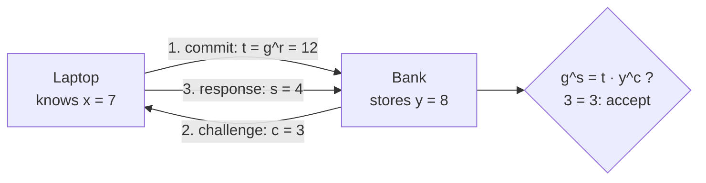

# Zero-knowledge: convincing someone you know a secret without showing it

[Syllabus](../../../SYLLABUS.md) → [Applied and computational](../README.md) → [Cryptography](../README.md#s04) → Zero-knowledge

---

## General Overview

A customer logs in to a bank from a laptop. The usual way, the laptop sends the password. That means the bank's server sees it, a fake bank page can collect it, and a stolen password file leaks it.

There is another way. The bank never stores the password. It stores one public number made from it. At login, the laptop answers a fresh question from the bank. Only someone who knows the password can answer it correctly. The answer is a number that looks random and is useless on its own. The bank ends up sure the customer knows the password, and it has learned nothing else.

That is a **zero-knowledge proof**: a conversation that convinces a checker a claim is true and reveals nothing more. The claim here is "I know the secret number behind this public number". The method is Schnorr's protocol, three messages long: a **sigma protocol**, the general name for this commit, challenge, response shape. Every number below comes from a toy group with an 11-step clock, small enough to check by hand and **insecure** for that reason; real systems use a 256-bit clock.

**The prover commits to a random number, the checker asks a random question, and the prover answers in a way that only the secret makes consistent; one answer proves nothing about the secret, but answers to two questions about the same commitment would reveal it, so a prover who can always answer must know it.**

**What kind of fact this is:** three theorems about the protocol, proved on this card in Why it works: an honest prover always passes (completeness), a prover who can answer two questions knows the secret (special soundness; the rewinding argument that turns it into full soundness is cited, not proved), and the conversation can be faked without the secret (zero knowledge, against a checker who asks random questions). The step to a non-interactive proof, Fiat-Shamir, is proved secure only in an idealised model where the hash behaves like a perfectly random function. Hiding the secret also rests on an assumption: that discrete logarithms are hard.

### The picture: one login, three messages



Schematic. The secret x never travels. The bank sees only 12, 3 and 4.

---

## The formula

Notation first, in words. The setting is a **prime-order group with generator g**, taught on [Diffie-Hellman and ElGamal](05-diffie-hellman-and-elgamal.md): numbers mod a prime p, and inside them a cycle of q powers of g, where q is also prime. Here p = 23, q = 11 and g = 4. The powers 4^0 to 4^10 mod 23 are 1, 4, 16, 18, 3, 12, 2, 8, 9, 13, 6, and then they repeat. Exponents therefore work mod 11.

The password becomes a secret exponent x. The bank stores y = g^x mod p. Finding x from y is the **discrete logarithm** problem, assumed hard at real sizes.

On this card c is the bank's challenge, not a ciphertext as on [The one-time pad](01-one-time-pad-and-perfect-secrecy.md).

One round has three moves. The laptop picks a fresh random r and sends t = g^r mod p. The bank sends a random c from 0 to q − 1. The laptop sends s = r + c·x mod q. The bank accepts if

$$g^{s} \equiv t \cdot y^{c} \pmod p$$

**Read it aloud:** g raised to the response must equal the commitment times the public number raised to the challenge, on the clock of size p.

A cheater who does not know x passes one round with chance 1/q. After ℓ independent rounds the chance is $(1/q)^{\ell}$.

**Fiat-Shamir** removes the bank's turn. The laptop makes the challenge itself, from a hash of everything so far:

$$c = h(g \,\|\, y \,\|\, t \,\|\, \text{msg}) \bmod q$$

**Read it aloud:** the challenge is the hash of the group, the public number, the commitment and the message, joined end to end and cut down mod q.

| Symbol | Plain meaning | In our example | Push it up and the answer… |
| --- | --- | --- | --- |
| $p$ | the prime the clock wraps at | 23 (real: 3072 bits) | — |
| $q$ | how many powers of g before they repeat; also prime | 11 (real: 256 bits) | cheater's chance 1/q falls |
| $g$ | the generator: the base everyone uses | 4 | — |
| $x$ | the secret exponent, made from the password | 7 | — |
| $y$ | the public number the bank stores: g^x mod p | 8 | — |
| $r$ | a fresh random exponent, used for one round only | 5 | reused, it leaks x |
| $t$ | the commitment: g^r mod p | 12 | — |
| $c$ | the challenge, a random number from 0 to q − 1 | 3 | — |
| $s$ | the response: r + c·x mod q | 4 | — |
| $\ell$ | how many rounds are run | 6 rounds for under 1 in a million | cheater's chance $(1/q)^{\ell}$ falls |
| $h$ | a hash function, written out on [Hashes and MACs](03-hash-functions-and-macs.md); the code uses the toy FNV-1a | — | — |
| msg | what the non-interactive proof is bound to | `login 2026-11-11 session 41` | — |

### When it holds

- **r is fresh and random every round.** Reuse r for two challenges and anyone holding both transcripts computes x: 7 here, in one division.
- **The challenge comes after the commitment.** If the cheater knows c before sending t, they build t backwards and pass 11 times in 11.
- **The challenge space is large.** With q = 11 a cheater passes 1 round in 11. Interactively, more rounds fix that; after Fiat-Shamir, retries are free, and a forger needs about 11 hash attempts per fake proof.
- **The Fiat-Shamir hash covers everything, including the message.** Hash t alone and a copied proof replays at the next login.
- **Discrete logs are hard.** In the toy group, trying all 11 exponents finds x = 7 from y = 8 in 8 tries. At real sizes this costs about 2^128 operations, if no shortcut exists.

---

## Why it works

### Step 0: one equation, two unknowns

Taken alone, s = r + c·x is one equation in two unknowns, r and x. Every possible x fits, each with its own r, so s alone says nothing about x; Step 3 shows that t adds nothing either. Two answers to the same t give two equations, and x falls out. An honest prover gives one answer per t; a cheater would need to be ready with two.

### Step 1: completeness, the honest prover always passes

Substitute s = r + c·x:

$$g^{s} = g^{r + c x} = g^{r} \cdot (g^{x})^{c} = t \cdot y^{c}$$

The exponent is taken mod q, which is safe because g^q = 1. In the example, s = 5 + 3·7 = 26, which is 4 mod 11. Then g^4 = 3, and t·y^3 = 12·6 mod 23 = 3. The code checks all 121 pairs of r and c: every one is accepted.

### Step 2: soundness, two answers give the secret away

Suppose someone can answer two different challenges c and c' for one commitment t, with responses s and s'. Both pass, so g^s = t·y^c and g^{s'} = t·y^{c'}. Divide one by the other and t cancels:

$$g^{s - s'} = y^{c - c'} \quad\Rightarrow\quad x = \frac{s - s'}{c - c'} \bmod q$$

Division mod q works because q is prime. In the example, the challenges 3 and 8 give responses 4 and 6. Then (4 − 6) mod 11 = 9. Dividing by (3 − 8) mod 11 means multiplying by its inverse, which is 2. So x = 9 · 2 mod 11 = 7, the secret. This turning of two answers into the secret is called **extraction**.

So a prover who does not know x can, for each t, answer at most one challenge. The bank picks c at random from 11 values, so the cheater passes with chance at most 1/11. Their best strategy reaches it: guess c in advance, pick any s, and set t = g^s · y^{−c}. The code counts all 1,331 combinations of guess, s and c for that strategy: 121 pass, exactly 1 in 11. A simulation of 100,000 cheating rounds passes 0.0914 of the time, within one standard error of 0.0909.

<details>
<summary>What "knows" means, more carefully</summary>

This is **special soundness**. If a prover passes with chance noticeably above 1/q, an extractor can rewind it to just after the commitment and ask a second challenge. Often enough both answers pass, and the division returns x. So any program that passes reliably holds x in usable form. Katz and Lindell give the averaging argument in full.

</details>

### Step 3: zero knowledge, the conversation can be faked

To show the bank learns nothing, show it could have written the whole conversation itself, without x. Such a forger is a **simulator**. A transcript that can be made without the secret cannot teach the secret.

The simulator works backwards. Pick the challenge c and the response s first, both at random. Then set t = g^s · y^{−c}. The check passes by construction.

Why do fakes look exactly like real ones? Fix c. In a real run r is uniform, and s = r + c·x is r shifted by a fixed amount, so s is uniform too, and the check fixes t. In a fake, s is uniform and the check fixes t. Both are "a uniform s, a random c, and the one t that fits". The code lists all 121 real transcripts and all 121 fakes: the two lists are identical, each transcript appearing once.

This proves **honest-verifier** zero knowledge: it assumes the bank picks c at random. A bank that picks c to depend on t is not covered by this argument. Fiat-Shamir removes the bank's choice altogether.

Completeness, special soundness and an honest-verifier simulator are exactly what make a three-move protocol a sigma protocol; Schnorr's is the standard example.

### Step 4: Fiat-Shamir, one message instead of three

A live conversation cannot be posted or checked later. Fiat and Shamir's 1986 idea: let a hash play the bank. The laptop computes t, then c = h(g‖y‖t‖msg) mod q, then s. It sends t and s. Anyone recomputes c and runs the same check.

The hash protects the order of events. Changing t changes c unpredictably, so the cheater cannot fix c before t, which was the honest bank's job. In the example, r = 9 gives t = 13. The toy hash of `4|8|13|login 2026-11-11 session 41` gives c = 6 mod 11, and s = 9 + 6·7 mod 11 = 7. The proof verifies.

Proving that this is secure needs the **random oracle model**: the hash is treated as a perfectly random function that everyone queries. Real hash functions are not that, so the result is a strong heuristic, not a theorem about SHA-256.

When msg is a document, the non-interactive proof is a **Schnorr signature** ([Digital signatures](07-digital-signatures.md)): proof that the holder of x approved exactly this text.

---

## Worked numbers, by hand

Toy group p = 23, q = 11, g = 4; password `blue-kettle-17`.

| Step | Arithmetic | Value |
| --- | --- | --- |
| secret from the password | 1 + FNV-1a(`blue-kettle-17`) mod 10 | x = 7 |
| what the bank stores | 4^7 mod 23 | y = 8 |
| laptop commits | r = 5; 4^5 mod 23 | t = 12 |
| bank challenges | random from 0 to 10 | c = 3 |
| laptop responds | 5 + 3·7 = 26, mod 11 | s = 4 |
| left side of the check | 4^4 mod 23 | 3 |
| right side of the check | 12 · 8^3 = 12 · 6, mod 23 | 3 |
| **verdict** | 3 = 3 | **accept** |

**The bank is convinced and has seen only 12, 3 and 4**, a triple its own simulator could have produced without knowing 7.

### What breaks if you drop a piece

| Mistake | Comes out at | What went wrong |
| --- | --- | --- |
| Reusing r = 5 for challenges 3 and 8 | x = 7, recovered by anyone | Two answers to one t: the extraction of Step 2, run by an attacker |
| Challenge known before the commitment | cheater passes 11 of 11 | t built backwards from c, as the simulator does |
| Fiat-Shamir hashing t only, not the login | copied proof accepted at `login 2026-11-12 session 42` | Nothing ties the proof to this session, so it replays |
| Fiat-Shamir with q = 11 | 1,000 successful forgeries at 11.33 tries each, only 11 of them distinct (one per t) | Retries are free offline; only a huge q makes them hopeless |
| A toy-sized group | x = 7 found from y = 8 in 8 tries | Zero knowledge hides x only as well as discrete logs hide it |

The code prints every row.

---

## Code, from first principles, and it actually runs

The script runs the protocol in the toy group and checks each promise by more than one road. Completeness: all 121 pairs of r and c. Soundness: extraction recovers x, matching a brute-force discrete log; and the best cheating strategy, guessing c, reaches exactly 1/q, counted over all 1,331 cases (121 pass) and simulated over 100,000 seeded rounds, within one standard error. Zero knowledge: every real and every simulated transcript, listed and compared. Powers, the FNV-1a hash and the SplitMix64 generator are written out, so both languages print the same thing, and the hash is checked against FNV-1a's published value for the text `a`. All of it is **insecure**: an 11-step group, a non-cryptographic hash, a predictable generator. Real deployments use a 256-bit q and SHA-256 or stronger, as in RFC 8235.

### Python

```python
# Zero-knowledge in outline -- the check behind the card.  Standard library only.
# Schnorr's proof that the laptop knows x with y = g^x mod p, in a TOY group:
# p = 23, q = 11, g = 4.  INSECURE: real proofs use a q of 256 bits (RFC 8235).
# The hash is FNV-1a, also a toy; real Fiat-Shamir uses SHA-256 or better.
from math import sqrt
P, Q, G, M64 = 23, 11, 4, (1 << 64) - 1

def power(b, e, m):                       # square-and-multiply, written out
    out, b = 1, b % m
    while e:
        if e & 1:
            out = out * b % m
        b, e = b * b % m, e >> 1
    return out

def fnv(text):                            # FNV-1a, 64 bits: a toy hash, NOT secure
    h = 0xCBF29CE484222325
    for ch in text.encode():
        h = ((h ^ ch) * 0x100000001B3) & M64
    return h

assert fnv("a") == 0xAF63DC4C8601EC8C               # FNV-1a's published 64-bit test value
print(f"FNV-1a test vector: fnv('a') = {fnv('a'):016x}, matches")

class SplitMix64:                         # seeded generator, same in Rust
    def __init__(self, seed): self.s = seed
    def next(self):
        self.s = (self.s + 0x9E3779B97F4A7C15) & M64
        z = self.s
        z = ((z ^ (z >> 30)) * 0xBF58476D1CE4E5B9) & M64
        z = ((z ^ (z >> 27)) * 0x94D049BB133111EB) & M64
        return z ^ (z >> 31)

def verify(y, t, c, s):                   # the bank's one test: g^s = t * y^c
    return power(G, s, P) == t * power(y, c, P) % P

def fake_t(y, c, s):                      # t made backwards: g^s * y^(-c)
    return power(G, s, P) * power(y, Q - c, P) % P

def fs(y, t, msg):                        # Fiat-Shamir challenge from the hash
    return fnv(f"{G}|{y}|{t}|{msg}") % Q

def fs_weak(y, t, msg):                   # a flawed challenge: hashes t only, ignores msg
    return fnv(f"{t}") % Q

def accepts(y, t, s, msg, ch):            # check a non-interactive proof (t, s) for msg
    return verify(y, t, ch(y, t, msg), s)

def yn(b): return "yes" if b else "no"

# ---- the example: a password becomes x; the bank keeps only y ----
pw = "blue-kettle-17"
x = 1 + fnv(pw) % (Q - 1)
y = power(G, x, P)
print(f"group: p = {P}, q = {Q}, g = {G}; powers of g: {[power(G, k, P) for k in range(Q)]}")
print(f"password {pw!r} -> secret x = {x}; bank stores y = g^x mod p = {y}")
r, c = 5, 3
t, s = power(G, r, P), (r + c * x) % Q
print(f"one round: r = {r}, t = g^r = {t}; challenge c = {c}; s = r + c*x = {r + c * x} -> mod q {s}")
print(f"check: g^s = {power(G, s, P)}, t * y^c = {t} * {power(y, c, P)} mod p = "
      f"{t * power(y, c, P) % P} -> accept: {yn(verify(y, t, c, s))}")
ok = sum(verify(y, power(G, a, P), b, (a + b * x) % Q) for a in range(Q) for b in range(Q))
print(f"completeness: {ok} of {Q * Q} (r, c) pairs accepted")
# ---- soundness: two answers to one t give x away ----
c2 = 8
s2 = (r + c2 * x) % Q
ds, inv = (s - s2) % Q, power((c - c2) % Q, Q - 2, Q)   # inverse by Fermat
xx = ds * inv % Q
print(f"extraction: same t, c = {c} and {c2} give s = {s} and {s2}; x = ({s} - {s2}) / "
      f"({c} - {c2}) = {ds} * {inv} mod {Q} = {xx}")
wins = sum(verify(y, fake_t(y, g_, s_), c_, s_)
           for g_ in range(Q) for s_ in range(Q) for c_ in range(Q))
print(f"cheater without x, exact: {wins} of {Q ** 3} (guess, s, c) cases pass "
      f"= {wins / Q ** 3:.4f}; 1/q = {1 / Q:.4f}")
rng, n, hits = SplitMix64(2026), 100000, 0
for _ in range(n):
    g_, s_, c_ = rng.next() % Q, rng.next() % Q, rng.next() % Q
    hits += verify(y, fake_t(y, g_, s_), c_, s_)
rate, se = hits / n, sqrt((1 / Q) * (1 - 1 / Q) / n)
print(f"cheater, simulated over {n} rounds (seed 2026): {rate:.4f}, standard error {se:.4f}")
rounds = 1
while Q ** rounds < 10 ** 6:
    rounds += 1
print(f"rounds for under 1 in a million: {rounds} ({Q}^{rounds} = {Q ** rounds})")
print("real sizes: q of 256 bits, p of 3072 bits; cheater 2^-256 per round; "
      "finding x from y about 2^128 operations")
# ---- zero knowledge: a simulator that never sees x ----
real = sorted((power(G, a, P), b, (a + b * x) % Q) for a in range(Q) for b in range(Q))
sim = sorted((fake_t(y, b, s_), b, s_) for s_ in range(Q) for b in range(Q))
print(f"simulator: {len(real)} real transcripts, {len(sim)} simulated; same list: "
      f"{yn(real == sim)}; all distinct: {yn(len(set(real)) == len(real))}")
# ---- Fiat-Shamir: the hash plays the bank ----
msg, r3 = "login 2026-11-11 session 41", 9
t3 = power(G, r3, P)
c3 = fs(y, t3, msg)
s3 = (r3 + c3 * x) % Q
print(f"Fiat-Shamir: msg {msg!r}, r = {r3}, t = {t3}, c = h(g|y|t|msg) mod q = {c3}, "
      f"s = {s3}; verifies: {yn(verify(y, t3, fs(y, t3, msg), s3))}")
# ---- what breaks ----
tries, rng, forged, distinct = 0, SplitMix64(7), 0, set()
while forged < 1000 and tries < 10 ** 5:  # 1000 successful forgeries, by trial and error
    tries += 1
    g_, s_ = rng.next() % Q, rng.next() % Q
    t_ = fake_t(y, g_, s_)
    if fs(y, t_, msg) == g_ and verify(y, t_, fs(y, t_, msg), s_):
        forged += 1
        distinct.add((t_, s_))
print(f"break 1, toy q: forger without x grinds the hash: {forged} valid proofs ({len(distinct)} distinct), "
      f"{tries / max(forged, 1):.2f} tries each; q = {Q}")
msg2 = "login 2026-11-12 session 42"
s4 = (r3 + fs_weak(y, t3, msg) * x) % Q    # a proof for msg under the flawed hash
replay = accepts(y, t3, s4, msg2, fs_weak)  # the same proof, checked for msg2
print(f"break 2, hash of t only: copied proof replayed on {msg2!r} accepted: "
      f"{yn(replay)}; with msg hashed: {yn(accepts(y, t3, s3, msg2, fs))}")
print(f"break 3, r reused for c = {c} and {c2}: x = {xx} (same as extraction)")
early = sum(verify(y, fake_t(y, b, 0), b, 0) for b in range(Q))
print(f"break 4, challenge known before t: cheater passes {early} of {Q}")
dl = next(k for k in range(Q) if power(G, k, P) == y)
print(f"break 5, toy group: brute force finds x = {dl} from y = {y} in {dl + 1} tries")
assert ok == Q * Q and verify(y, t, c, s)                        # completeness
assert xx == x and dl == x                                       # two roads to x
assert wins * Q == Q ** 3 and abs(rate - 1 / Q) < 4 * se         # exact, formula, simulated
assert real == sim and len(set(real)) == Q * Q                   # simulator matches
assert verify(y, t3, c3, s3) and not verify(y, t3, fs(y, t3, msg2), s3)
assert replay and early == Q and abs(tries / max(forged, 1) - Q) < 1.5 and len(distinct) <= Q   # breaks 1, 2, 4
print("ALL CHECKS PASS")
```

**Ran 2026-11-11 on macOS, Python 3.14.10, standard library only. All checks passed. Output, pasted from the run:**

```
FNV-1a test vector: fnv('a') = af63dc4c8601ec8c, matches
group: p = 23, q = 11, g = 4; powers of g: [1, 4, 16, 18, 3, 12, 2, 8, 9, 13, 6]
password 'blue-kettle-17' -> secret x = 7; bank stores y = g^x mod p = 8
one round: r = 5, t = g^r = 12; challenge c = 3; s = r + c*x = 26 -> mod q 4
check: g^s = 3, t * y^c = 12 * 6 mod p = 3 -> accept: yes
completeness: 121 of 121 (r, c) pairs accepted
extraction: same t, c = 3 and 8 give s = 4 and 6; x = (4 - 6) / (3 - 8) = 9 * 2 mod 11 = 7
cheater without x, exact: 121 of 1331 (guess, s, c) cases pass = 0.0909; 1/q = 0.0909
cheater, simulated over 100000 rounds (seed 2026): 0.0914, standard error 0.0009
rounds for under 1 in a million: 6 (11^6 = 1771561)
real sizes: q of 256 bits, p of 3072 bits; cheater 2^-256 per round; finding x from y about 2^128 operations
simulator: 121 real transcripts, 121 simulated; same list: yes; all distinct: yes
Fiat-Shamir: msg 'login 2026-11-11 session 41', r = 9, t = 13, c = h(g|y|t|msg) mod q = 6, s = 7; verifies: yes
break 1, toy q: forger without x grinds the hash: 1000 valid proofs (11 distinct), 11.33 tries each; q = 11
break 2, hash of t only: copied proof replayed on 'login 2026-11-12 session 42' accepted: yes; with msg hashed: no
break 3, r reused for c = 3 and 8: x = 7 (same as extraction)
break 4, challenge known before t: cheater passes 11 of 11
break 5, toy group: brute force finds x = 7 from y = 8 in 8 tries
ALL CHECKS PASS
```

### Rust

Same numbers, same labels, built with `rustc --edition 2021 -O`.

```rust
// Zero-knowledge in outline -- the same check as the Python, in Rust.  No crates.
// Schnorr's proof that the laptop knows x with y = g^x mod p, in a TOY group:
// p = 23, q = 11, g = 4.  INSECURE: real proofs use a q of 256 bits (RFC 8235).
// The hash is FNV-1a, also a toy; real Fiat-Shamir uses SHA-256 or better.
const P: u64 = 23;
const Q: u64 = 11;
const G: u64 = 4;

fn power(b: u64, mut e: u64, m: u64) -> u64 {      // square-and-multiply, written out
    let (mut out, mut b) = (1u64, b % m);
    while e > 0 {
        if e & 1 == 1 { out = out * b % m }
        b = b * b % m;
        e >>= 1;
    }
    out
}

fn fnv(text: &str) -> u64 {                        // FNV-1a, 64 bits: a toy hash, NOT secure
    let mut h: u64 = 0xCBF29CE484222325;
    for ch in text.bytes() { h = (h ^ ch as u64).wrapping_mul(0x100000001B3) }
    h
}

struct SplitMix64 { s: u64 }                       // seeded generator, same in Python
impl SplitMix64 {
    fn next(&mut self) -> u64 {
        self.s = self.s.wrapping_add(0x9E3779B97F4A7C15);
        let mut z = self.s;
        z = (z ^ (z >> 30)).wrapping_mul(0xBF58476D1CE4E5B9);
        z = (z ^ (z >> 27)).wrapping_mul(0x94D049BB133111EB);
        z ^ (z >> 31)
    }
}

fn verify(y: u64, t: u64, c: u64, s: u64) -> bool {   // the bank's one test: g^s = t * y^c
    power(G, s, P) == t * power(y, c, P) % P
}

fn fake_t(y: u64, c: u64, s: u64) -> u64 {         // t made backwards: g^s * y^(-c)
    power(G, s, P) * power(y, Q - c, P) % P
}

fn fs(y: u64, t: u64, msg: &str) -> u64 {           // Fiat-Shamir challenge from the hash
    fnv(&format!("{}|{}|{}|{}", G, y, t, msg)) % Q
}

fn fs_weak(_y: u64, t: u64, _msg: &str) -> u64 {    // a flawed challenge: hashes t only, ignores msg
    fnv(&format!("{}", t)) % Q
}

fn accepts(y: u64, t: u64, s: u64, msg: &str, ch: fn(u64, u64, &str) -> u64) -> bool { // check a proof (t, s) for msg
    verify(y, t, ch(y, t, msg), s)
}

fn yn(b: bool) -> &'static str { if b { "yes" } else { "no" } }

fn main() {
    assert!(fnv("a") == 0xAF63DC4C8601EC8C);           // FNV-1a's published 64-bit test value
    println!("FNV-1a test vector: fnv('a') = {:016x}, matches", fnv("a"));
    // ---- the example: a password becomes x; the bank keeps only y ----
    let pw = "blue-kettle-17";
    let x = 1 + fnv(pw) % (Q - 1);
    let y = power(G, x, P);
    let pows: Vec<u64> = (0..Q).map(|k| power(G, k, P)).collect();
    println!("group: p = {}, q = {}, g = {}; powers of g: {:?}", P, Q, G, pows);
    println!("password '{}' -> secret x = {}; bank stores y = g^x mod p = {}", pw, x, y);
    let (r, c) = (5u64, 3u64);
    let (t, s) = (power(G, r, P), (r + c * x) % Q);
    println!("one round: r = {}, t = g^r = {}; challenge c = {}; s = r + c*x = {} -> mod q {}",
             r, t, c, r + c * x, s);
    println!("check: g^s = {}, t * y^c = {} * {} mod p = {} -> accept: {}", power(G, s, P), t,
             power(y, c, P), t * power(y, c, P) % P, yn(verify(y, t, c, s)));
    let mut ok = 0u64;
    for a in 0..Q { for b in 0..Q { if verify(y, power(G, a, P), b, (a + b * x) % Q) { ok += 1 } } }
    println!("completeness: {} of {} (r, c) pairs accepted", ok, Q * Q);
    // ---- soundness: two answers to one t give x away ----
    let c2 = 8u64;
    let s2 = (r + c2 * x) % Q;
    let (ds, inv) = ((s + Q - s2) % Q, power((c + Q - c2) % Q, Q - 2, Q));   // inverse by Fermat
    let xx = ds * inv % Q;
    println!("extraction: same t, c = {} and {} give s = {} and {}; x = ({} - {}) / ({} - {}) = {} * {} mod {} = {}",
             c, c2, s, s2, s, s2, c, c2, ds, inv, Q, xx);
    let mut wins = 0u64;
    for g_ in 0..Q { for s_ in 0..Q { for c_ in 0..Q {
        if verify(y, fake_t(y, g_, s_), c_, s_) { wins += 1 }
    } } }
    println!("cheater without x, exact: {} of {} (guess, s, c) cases pass = {:.4}; 1/q = {:.4}",
             wins, Q * Q * Q, wins as f64 / (Q * Q * Q) as f64, 1.0 / Q as f64);
    let (mut rng, n, mut hits) = (SplitMix64 { s: 2026 }, 100000u64, 0u64);
    for _ in 0..n {
        let (g_, s_, c_) = (rng.next() % Q, rng.next() % Q, rng.next() % Q);
        if verify(y, fake_t(y, g_, s_), c_, s_) { hits += 1 }
    }
    let pq = 1.0 / Q as f64;
    let (rate, se) = (hits as f64 / n as f64, (pq * (1.0 - pq) / n as f64).sqrt());
    println!("cheater, simulated over {} rounds (seed 2026): {:.4}, standard error {:.4}", n, rate, se);
    let mut rounds = 1u32;
    while Q.pow(rounds) < 1_000_000 { rounds += 1 }
    println!("rounds for under 1 in a million: {} ({}^{} = {})", rounds, Q, rounds, Q.pow(rounds));
    println!("real sizes: q of 256 bits, p of 3072 bits; cheater 2^-256 per round; \
              finding x from y about 2^128 operations");
    // ---- zero knowledge: a simulator that never sees x ----
    let mut real: Vec<(u64, u64, u64)> = Vec::new();
    let mut sim: Vec<(u64, u64, u64)> = Vec::new();
    for a in 0..Q { for b in 0..Q { real.push((power(G, a, P), b, (a + b * x) % Q)) } }
    for s_ in 0..Q { for b in 0..Q { sim.push((fake_t(y, b, s_), b, s_)) } }
    real.sort();
    sim.sort();
    let mut uniq = real.clone();
    uniq.dedup();
    println!("simulator: {} real transcripts, {} simulated; same list: {}; all distinct: {}",
             real.len(), sim.len(), yn(real == sim), yn(uniq.len() == real.len()));
    // ---- Fiat-Shamir: the hash plays the bank ----
    let (msg, r3) = ("login 2026-11-11 session 41", 9u64);
    let t3 = power(G, r3, P);
    let c3 = fs(y, t3, msg);
    let s3 = (r3 + c3 * x) % Q;
    println!("Fiat-Shamir: msg '{}', r = {}, t = {}, c = h(g|y|t|msg) mod q = {}, s = {}; verifies: {}",
             msg, r3, t3, c3, s3, yn(verify(y, t3, fs(y, t3, msg), s3)));
    // ---- what breaks ----
    let (mut tries, mut rng, mut forged, mut distinct) = (0u64, SplitMix64 { s: 7 }, 0u64, Vec::new());
    while forged < 1000 && tries < 100000 {      // 1000 successful forgeries, by trial and error
        tries += 1;
        let (g_, s_) = (rng.next() % Q, rng.next() % Q);
        let t_ = fake_t(y, g_, s_);
        if fs(y, t_, msg) == g_ && verify(y, t_, fs(y, t_, msg), s_) {
            forged += 1;
            if !distinct.contains(&(t_, s_)) { distinct.push((t_, s_)) }
        }
    }
    let each = tries as f64 / forged.max(1) as f64;
    println!("break 1, toy q: forger without x grinds the hash: {} valid proofs ({} distinct), {:.2} tries each; q = {}",
             forged, distinct.len(), each, Q);
    let msg2 = "login 2026-11-12 session 42";
    let s4 = (r3 + fs_weak(y, t3, msg) * x) % Q;    // a proof for msg under the flawed hash
    let replay = accepts(y, t3, s4, msg2, fs_weak); // the same proof, checked for msg2
    println!("break 2, hash of t only: copied proof replayed on '{}' accepted: {}; with msg hashed: {}",
             msg2, yn(replay), yn(accepts(y, t3, s3, msg2, fs)));
    println!("break 3, r reused for c = {} and {}: x = {} (same as extraction)", c, c2, xx);
    let early = (0..Q).filter(|&b| verify(y, fake_t(y, b, 0), b, 0)).count() as u64;
    println!("break 4, challenge known before t: cheater passes {} of {}", early, Q);
    let dl = (0..Q).find(|&k| power(G, k, P) == y).unwrap();
    println!("break 5, toy group: brute force finds x = {} from y = {} in {} tries", dl, y, dl + 1);
    assert!(ok == Q * Q && verify(y, t, c, s));                       // completeness
    assert!(xx == x && dl == x);                                      // two roads to x
    assert!(wins * Q == Q * Q * Q && (rate - pq).abs() < 4.0 * se);   // exact, formula, simulated
    assert!(real == sim && uniq.len() as u64 == Q * Q);               // simulator matches
    assert!(verify(y, t3, c3, s3) && !verify(y, t3, fs(y, t3, msg2), s3));
    assert!(replay && early == Q && (each - Q as f64).abs() < 1.5 && distinct.len() as u64 <= Q); // breaks 1, 2, 4
    println!("ALL CHECKS PASS");
}
```

**Ran 2026-11-11 on macOS, rustc 1.98.1, no crates. All checks passed. Output, pasted from the run:**

```
FNV-1a test vector: fnv('a') = af63dc4c8601ec8c, matches
group: p = 23, q = 11, g = 4; powers of g: [1, 4, 16, 18, 3, 12, 2, 8, 9, 13, 6]
password 'blue-kettle-17' -> secret x = 7; bank stores y = g^x mod p = 8
one round: r = 5, t = g^r = 12; challenge c = 3; s = r + c*x = 26 -> mod q 4
check: g^s = 3, t * y^c = 12 * 6 mod p = 3 -> accept: yes
completeness: 121 of 121 (r, c) pairs accepted
extraction: same t, c = 3 and 8 give s = 4 and 6; x = (4 - 6) / (3 - 8) = 9 * 2 mod 11 = 7
cheater without x, exact: 121 of 1331 (guess, s, c) cases pass = 0.0909; 1/q = 0.0909
cheater, simulated over 100000 rounds (seed 2026): 0.0914, standard error 0.0009
rounds for under 1 in a million: 6 (11^6 = 1771561)
real sizes: q of 256 bits, p of 3072 bits; cheater 2^-256 per round; finding x from y about 2^128 operations
simulator: 121 real transcripts, 121 simulated; same list: yes; all distinct: yes
Fiat-Shamir: msg 'login 2026-11-11 session 41', r = 9, t = 13, c = h(g|y|t|msg) mod q = 6, s = 7; verifies: yes
break 1, toy q: forger without x grinds the hash: 1000 valid proofs (11 distinct), 11.33 tries each; q = 11
break 2, hash of t only: copied proof replayed on 'login 2026-11-12 session 42' accepted: yes; with msg hashed: no
break 3, r reused for c = 3 and 8: x = 7 (same as extraction)
break 4, challenge known before t: cheater passes 11 of 11
break 5, toy group: brute force finds x = 7 from y = 8 in 8 tries
ALL CHECKS PASS
```

The two outputs match line for line.

> [!TIP]
> **Try changing**
> - Guess first: does a bigger clock help the cheater or hurt them? Set `P, Q, G = 47, 23, 2` (2 has 23 powers mod 47). The exact count becomes 529 of 12,167, which is 0.0435 or 1/23, and the simulated rate follows it down. The forger needs about 23 tries per fake proof.
> - Guess first: does the secret change what the simulator produces? Change the password. x and y change, but the real and simulated lists still match exactly, because the proof in Step 3 never used the value of x.
> - Guess first: does reusing r leak x for any pair of challenges? Change `c2 = 8` to any value from 0 to 10 other than 3. Extraction still prints x = 7. Set it to 3 and extraction prints x = 0, so an assert stops the run: one answer is not enough.
> - Guess first: can a replayed proof get lucky? Change `msg2` to other session names. About 1 in 11 of them collide with the toy hash, and the assert that the proof fails for msg2 stops the run: with q = 11 even a correct hash leaves a 1-in-11 gap.

---

## The usual mistake

> [!warning]
> **Treating the random r as a detail.** The secrecy argument rests on r being fresh, uniform and unknown. Reuse it with two different challenges and the attacker runs the extraction of Step 2: here x = 7, from four public numbers. A predictable random generator does the same damage more slowly. Real signing keys have been lost exactly this way.
>
> Smaller traps:
> - **"Zero knowledge" read as "the secret is safe".** The proof leaks nothing, but y itself is public. In the toy group trying 8 exponents finds x. With a real group, a weak password can still be guessed offline by anyone who steals y.
> - **A weak Fiat-Shamir hash.** Leave out the message or the public number and proofs replay or can be forged: a copied proof was accepted at `login 2026-11-12 session 42`.
> - **Counting rounds after Fiat-Shamir.** Six interactive rounds of q = 11 give under 1 in a million, but an offline forger just retries: about 1,771,561 hashes, an instant for a laptop.
> - **Honest-verifier zero knowledge read as full zero knowledge.** The simulator in Step 3 assumes random challenges. A checker that chooses c cleverly is outside that proof.

---

## Where you meet it in real life

- **Bitcoin.** Since the 2021 Taproot upgrade, Bitcoin accepts Schnorr signatures (BIP 340): this card's protocol, made non-interactive by Fiat-Shamir, on an elliptic curve.
- **Ed25519 signatures.** Used for SSH keys and in many messaging apps, they have the same Schnorr shape on an elliptic curve, and make r by hashing the key with the message, so a bad generator cannot cause the reuse in the warning box.
- **Password-authenticated key exchange.** J-PAKE, used to pair devices and set up home networks, has each side prove knowledge of its secret exponents with exactly the Schnorr proof of RFC 8235, with the identity and session hashed in.
- **Private payments.** Zcash's shielded payments prove a transaction is valid without showing amounts or addresses, using much larger proof systems called zk-SNARKs that keep the same three promises.

> **Say it back**
> The laptop proves it knows x behind the public y = g^x in three moves: commit t = g^r, receive a random challenge c, answer s = r + c·x. The bank checks g^s = t·y^c, which holds for an honest prover every time. Two answers to one commitment would reveal x by one division, so a prover without x passes one round in q. A simulator that picks c and s first and makes t to fit produces exactly the same transcripts without x, so the bank learns nothing. Fiat-Shamir replaces the bank's challenge with a hash of everything, including the message, which turns the proof into one message and, for a document, into a Schnorr signature.

---

## What this builds on

- [Digital signatures](07-digital-signatures.md): hash-then-sign, ECDSA and the nonce-reuse leak, with the Schnorr signature named in one line. This card is the three-message protocol under Schnorr's version: that card's nonce k is our r, its private key d our x, and its hash our Fiat-Shamir challenge.

## Where this goes next

- Interactive proofs (planned): the general theory of prover and checker, for claims beyond "I know a discrete log".

The open question this card leaves: can every claim that has a short checkable proof also be proved in zero knowledge, and how short can such a proof be?

---

## Sources

Verified 2026-11-11: every link below resolves to the publisher's page.

- Goldwasser, Shafi, Silvio Micali, and Charles Rackoff. "The Knowledge Complexity of Interactive Proof Systems." *SIAM Journal on Computing* 18, no. 1 (1989): 186–208. [doi:10.1137/0218012](https://doi.org/10.1137/0218012). Defines interactive proofs and zero knowledge through the simulator.
- Fiat, Amos, and Adi Shamir. "How to Prove Yourself: Practical Solutions to Identification and Signature Problems." *Advances in Cryptology, CRYPTO '86*, LNCS 263 (1987): 186–194. [doi:10.1007/3-540-47721-7_12](https://doi.org/10.1007/3-540-47721-7_12). Replaces the checker's challenge with a hash.
- Schnorr, C. P. "Efficient Signature Generation by Smart Cards." *Journal of Cryptology* 4 (1991): 161–174. [doi:10.1007/BF00196725](https://doi.org/10.1007/BF00196725). The identification protocol on this card and the signature it gives.
- Hao, F., ed. *Schnorr Non-interactive Zero-Knowledge Proof*. RFC 8235, 2017. [RFC Editor page](https://www.rfc-editor.org/rfc/rfc8235). Real sizes, what goes into the hash, and the attack when r is reused.
- Katz, Jonathan, and Yehuda Lindell. *Introduction to Modern Cryptography*, revised 3rd ed. CRC Press. [Publisher page](https://www.routledge.com/Introduction-to-Modern-Cryptography-Revised-Third-Edition/Katz-Lindell/p/book/9781032496795). Schnorr identification, special soundness, honest-verifier zero knowledge and Fiat-Shamir in textbook form.
