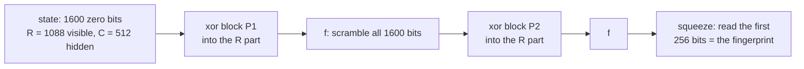
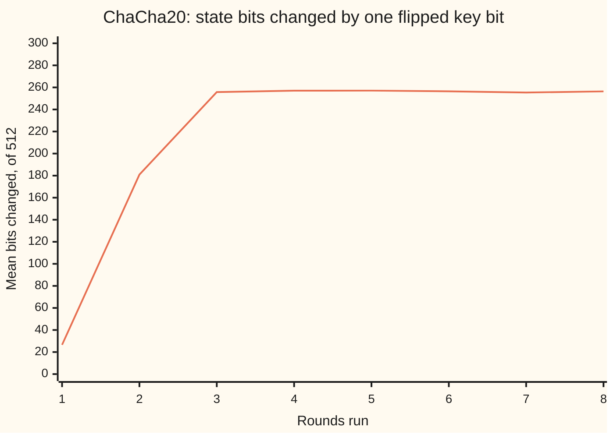

# SHA-3 and ChaCha20: absorb and squeeze, or add, rotate and xor

[Syllabus](../../../SYLLABUS.md) → [Applied and computational](../README.md) → [Cryptography](../README.md#s04) → SHA-3 and ChaCha20

---

## General Overview

A laptop sends one payment order to its bank: `from=laptop&pay=250000.00&to=12345678`, 37 bytes. TLS 1.3, the protocol behind a browser's padlock, seals it with AES-GCM from [AES](02-symmetric-ciphers-and-aes.md) or with **ChaCha20-Poly1305**. On a processor with no AES instructions, ChaCha20 is the faster of the two.

This card covers that cipher and a newer hash, **SHA-3**. Both are built differently from the earlier cards' designs.

- **SHA-3** is a **sponge**: it keeps a 1600-bit state. It absorbs the message into one part of the state, scrambles all of it, and squeezes the fingerprint out of the same part. The rest is never shown. The order's SHA3-256 fingerprint is `0e2a4e3e…0f42`; the empty string's is `a7ffc6f8…8434a`, the value in NIST's worked examples for the standard, FIPS 202.
- **ChaCha20** is a **stream cipher**: from a 32-byte key it makes a long stream of pad bytes, using only add, rotate and xor on 32-bit words. The order is xored with that stream, as in [The one-time pad](01-one-time-pad-and-perfect-secrecy.md). **Poly1305** then adds a 16-byte tag: a polynomial evaluated at a secret point used for one message only.

**SHA-3 hides most of a large state and shows only a part of it, so its security comes from the hidden part; ChaCha20 stirs a key into a 512-bit block with add, rotate and xor, and Poly1305 tags the result with a polynomial at a one-time secret point.**

**What kind of fact this is:** two standards, FIPS 202 and RFC 8439, and the assumptions behind them. Proved on this card, in Why it works: $`C`$ hidden bits limit a sponge to about $`2^{C/2}`$ work; every ChaCha20 step can be undone; a Poly1305 forgery works for at most $`8\lceil L/16 \rceil`$ of the $`2^{106}`$ possible secret points, where $`L`$ is the message length in bytes and $`\lceil L/16 \rceil`$ is $`L/16`$ rounded up. The sponge's matching lower bound is a theorem quoted from its source. That Keccak-f and the ChaCha20 rounds behave like random scrambles is an assumption, unbroken by public attack.

### The picture: the sponge, absorbing and squeezing



Schematic. Blocks enter only through the visible $`R`$ bits. Only the scramble $`f`$ touches the $`C`$ hidden bits, so an attacker never sets or reads them.

---

## The formula

The sponge, for a message padded and cut into $`q`$ blocks $`P_1, \dots, P_q`$ of $`R`$ bits:

```math
S_0 = 0^{1600}, \qquad S_i = f\big(S_{i-1} \oplus (P_i \,\|\, 0^{C})\big), \qquad h = \text{first } n \text{ bits of } S_q
```

The ChaCha20 quarter round on four 32-bit words $`w, x, y, z`$, run twice, the second time with rotations 8 and 7:

```math
w \leftarrow w \boxplus x, \quad z \leftarrow (z \oplus w) \lll 16, \quad y \leftarrow y \boxplus z, \quad x \leftarrow (x \oplus y) \lll 12
```

Poly1305, on a message cut into $`q`$ chunks $`B_1, \dots, B_q`$:

```math
t = \Big( \big( B_1 r^{q} + B_2 r^{q-1} + \cdots + B_q r \big) \bmod p \;+\; s \Big) \bmod 2^{128}, \qquad p = 2^{130} - 5
```

The promises, for an $`n`$-bit sponge output and a Poly1305 message of at most $`L`$ bytes:

```math
\text{collision} \approx \min\big(2^{C/2}, 2^{n/2}\big), \qquad \text{preimage} \approx \min\big(2^{C/2}, 2^{n}\big), \qquad \Pr[\text{forgery}] \le \frac{8 \lceil L/16 \rceil}{2^{106}}
```

**Read it aloud:** the sponge xors each block into the visible part of its state and scrambles everything; the quarter round adds, xors and rotates four words in a fixed order; the tag is the message's polynomial at a secret point, plus a secret mask.

| Symbol | Plain meaning | In our example | Push it up and the answer… |
| --- | --- | --- | --- |
| $`f`$ | Keccak-f[1600]: a fixed, public, invertible scramble of 1600 bits, 24 rounds | one call per 136-byte block | — |
| $`R`$, $`C`$ | the **rate** (bits a block may touch) and the **capacity** (bits never touched or shown); $`R + C = 1600`$ | SHA3-256: $`R`$ = 1088, $`C`$ = 512 | more $`C`$: more security, fewer bytes per call |
| $`S_i`$, $`P_i`$, $`q`$ | the state after block $`i`$; padded block $`i`$; the number of blocks (or chunks, for Poly1305); $`0^{C}`$ means $`C`$ zero bits | the order: $`q`$ = 1 block | — |
| $`X`$, $`\Delta`$ | in the inner-collision attack: a second block, and the difference in the visible bits that it cancels | 197-byte blocks at $`C`$ = 24 | — |
| $`h`$, $`n`$, $`\pi`$ | the fingerprint, and its length in bits; $`\pi`$ = 3.14159…, in the birthday count | 256 bits | collisions need $`2^{n/2}`$ until $`C/2`$ caps it |
| $`w, x, y, z`$ | four of the sixteen 32-bit words in the ChaCha20 state | `11111111 01020304 9b8d6f43 01234567` | — |
| $`\boxplus`$, $`\lll`$, $`\oplus`$, $`\Vert`$ | add modulo $`2^{32}`$; rotate the bits left; exclusive or; join end to end | — | — |
| $`k`$, $`m`$, $`N`$, $`j`$ | ChaCha20's 32-byte key; a message; the 12-byte **nonce** (a number used once per key); the 4-byte block counter | toy key bytes 00 to 1f; counter 0 for the tag key, 1 onwards for data | reuse $`N`$ and both the pad and the tag key repeat |
| $`r`$, $`s`$, $`p`$ | Poly1305's one-time key: the secret point $`r`$, with 22 bits forced to zero (**clamped**) so 106 bits are free, and the mask $`s`$; the prime $`p = 2^{130} - 5`$ | 32 bytes from ChaCha20 block 0 | — |
| $`B_i`$, $`B'_i`$, $`H_r`$ | chunk $`i`$: 16 message bytes with a byte 01 after them, read as a number ($`B'_i`$ for a forged message); $`H_r`$ is the polynomial part of the tag, before $`s`$ | 4 chunks for the order | — |
| $`t`$, $`t_1`$, $`t_2`$, $`g`$ | the 16-byte tag; two tags under one key; the tag shift a forger chooses | `cc07faa2…e7e4` for the order | — |
| $`L`$, $`u`$, $`D_u`$, $`v`$ | bytes fed to Poly1305, so $`\lceil L/16 \rceil`$ chunks ($`L/16`$ rounded up); one of at most 8 wrap values; the polynomial that $`r`$ must be a root of for a forgery, in the variable $`v`$ | $`L`$ = 64 for the order | the forgery bound grows with $`L`$ |

FIPS 202 writes rate and capacity as $`r`$ and $`c`$. This card uses capitals so that $`r`$ keeps its RFC 8439 meaning, Poly1305's secret point.

### When it holds

- **The capacity is large.** A sponge never gives more than about $`2^{C/2}`$, whatever its output length. With $`C`$ = 24, two messages shared a 256-bit output after 2442 tries.
- **The padding keeps messages apart.** Padded with zeros only, `abc` and `abc` plus a zero byte both hash to `d54b0514420fb62f…`.
- **ChaCha20 adds its input back at the end.** Without that, the rounds run backwards and one keystream block gives back the key.
- **No nonce repeats under one key.** A repeat repeats the keystream, leaking the xor of two messages, and repeats the Poly1305 key, so two tags reveal $`r`$ and $`s`$ and a forged order passes.
- **There are enough rounds.** One round changes 26.54 of 512 state bits after a one-bit key change; three change about half. Published attacks reach 7 rounds of the 20.

---

## Why it works

### Step 0: a public scramble, made secret by what the attacker cannot see

Both scrambles are public and can be run backwards from a whole input. Security comes from what the attacker is missing: the $`C`$ hidden bits of the sponge; ChaCha20's key, locked in by a final addition; and Poly1305's one-time $`r`$ and $`s`$.

### Step 1: how SHA3-256 absorbs and squeezes

SHA3-256 uses $`R`$ = 1088 bits, so each block is 136 bytes, and $`C`$ = 512 bits.

1. **Pad.** Add the byte 06, then zeros to a multiple of 136 bytes, then set the last byte's top bit (add 80).
2. **Absorb.** From 1600 zero bits, xor each block into the first 136 bytes and run $`f`$.
3. **Squeeze.** Read the first 32 bytes. SHAKE, in the same standard, gives longer outputs by running $`f`$ again and reading another rate-sized block each time (136 bytes for SHAKE256, 168 for SHAKE128).

The empty string and the 37-byte order each fit in one block, so one call to $`f`$ gives each fingerprint.

Inside $`f`$ are 24 rounds of five steps. Four move or mix bits linearly; one, called chi, combines bits with AND and is the only nonlinear part. Nothing is hidden in the constants: the code makes the round constants from the small shift register that FIPS 202 specifies, `RC[0]` = 1 to `RC[23]` = 8000000080008008, and the rotation amounts from $`(i+1)(i+2)/2`$ for $`i`$ = 0 to 23.

### Step 2: the padding must keep every message apart

Two messages that pad to the same blocks share a fingerprint with no attack at all. SHA-3's padding can be undone: from the end, drop the final 1 bit, the zeros, and the 1 bit that closes the 06, and the message remains. The other bits of 06 are a domain label, so SHAKE, the extendable-output form, never pads to the same blocks as SHA3-256.

Zero padding fails: `abc` and `abc` plus a zero byte pad to the same 136 bytes and both give `d54b0514420fb62f…`.

### Step 3: the capacity sets the security, and an attack shows why

The attacker controls the visible $`R`$ bits completely, since the next block can xor them to any value. Only the $`C`$ hidden bits resist, so the attack aims there.

1. **Find an inner collision.** Hash many one-block messages, and look only at the hidden $`C`$ bits of the state after $`f`$. By the birthday effect of [Hashes and MACs](03-hash-functions-and-macs.md), two of them match after about $`\sqrt{\pi/2 \cdot 2^{C}}`$ tries.
2. **Cancel the visible difference.** The two states now differ only in their visible part, by some difference $`\Delta`$. Give the first message a second block $`X`$ and the second message the block $`X \oplus \Delta`$. After the xor, the two states are equal in all 1600 bits.
3. **Ride along.** From equal states, equal padding gives equal outputs at every length.

The code runs this with the real $`f`$ and toy capacities, insecure on purpose.

| Capacity $`C`$ | Run | Tries | Birthday prediction |
| ---: | --- | ---: | ---: |
| 16 bits | mean of 40 hunts | 299.75 (standard error 26.15) | exact 321.52; $`\sqrt{\pi/2 \cdot 2^{16}}`$ = 320.85 |
| 24 bits | one full attack | 2442 | — |

The 24-bit run ends with two different 394-byte messages whose 256-bit outputs are both `2af84acd…c8c16123`. The long output did not help.

So a sponge gives at most about $`2^{C/2}`$. Bertoni, Daemen, Peeters and Van Assche proved the converse: if $`f`$ is a random permutation, no attack that treats $`f`$ as a black box does much better. This card quotes that theorem without proof.

SHA3-256 has $`C`$ = 512, so the 256-bit output is the tighter limit for collisions. FIPS 202 lists it at 128 bits for collisions and 256 for preimages: $`\min(2^{C/2}, 2^{n/2})`$ and $`\min(2^{C/2}, 2^{n})`$.

### Step 4: no length extension

SHA-256's fingerprint is its whole state, so anyone can keep hashing from it: the length-extension forgery of [Hashes and MACs](03-hash-functions-and-macs.md). SHA3-256 shows 256 of its 1600 bits and hides 1344. Absorbing one more block needs the whole state, so the tag $`h(k \,\Vert\, m)`$, key and message hashed together, does not fall to that attack.

### Step 5: the ChaCha20 state and its quarter round

The ChaCha20 state is sixteen 32-bit words, 512 bits:

| Words | Contents |
| --- | --- |
| 0 to 3 | the constant text `expand 32-byte k` |
| 4 to 11 | the 32-byte key $`k`$ |
| 12 | the block counter $`j`$ |
| 13 to 15 | the 12-byte nonce $`N`$ |

A **column round** runs the quarter round on the four columns of the 4 × 4 grid; a **diagonal round** on the four diagonals. ChaCha20 alternates them for 20 rounds, then adds the starting state back, word by word: the result is 64 bytes of keystream. For key 00 to 1f and counter 1, the code matches all 64 bytes of RFC 8439's block, `10f1e7e4…a2503c4e`.

Each operation does a job the others cannot. Addition carries bits upward; xor mixes without carries; rotation moves bits to new positions, where the next addition carries them on.

### Step 6: every step can be undone, and why the final addition matters

Subtract undoes add, rotate right undoes rotate left, and xor undoes itself. Run the eight inverse steps in reverse and the RFC output returns to the input `11111111 01020304 9b8d6f43 01234567`. So the rounds shuffle 512-bit states without losing information.

That cuts both ways. If the cipher output the rounds' result directly, one keystream block run backwards would give the key; the run recovers `000102…1e1f` this way. The final addition stops it: undoing the rounds now means first subtracting the input, which holds the unknown key.

### Step 7: how fast the rounds mix

The code flips each of the 256 key bits in turn and counts how many of the 512 state bits change after each round.



The line is the mean over all 256 key bits; a random change would alter 256. After one round only 26.54 change, and as few as 7. From round 3 on, the mean stays between 255.38 and 257.09. The remaining rounds of the 20 are a margin against attacks cleverer than counting bits, which reach 7 rounds.

### Step 8: a stream cipher is a pad from a short key

The data is xored with keystream blocks 1, 2, 3 and so on: a one-time pad generated from a 32-byte key. The order's ciphertext begins `0f2e13b40c66d90a591e0e09`. Like counter mode in [AES](02-symmetric-ciphers-and-aes.md), it is malleable: flip the first ciphertext bit and the order decrypts as `grom=laptop&…`. Catching that is the tag's job.

### Step 9: Poly1305 tags with a polynomial at a secret point

ChaCha20 block 0, under the same key and nonce, gives $`r`$ (clamped) and $`s`$. Each 16-byte chunk gets a byte 01 after it, so trailing zeros still count, and becomes the number $`B_i`$. The code computes the tag by Horner's rule (add the next chunk, then multiply by $`r`$, chunk by chunk), as RFC 8439 specifies, and by the sum of powers; both give the RFC tag `a8061dc1305136c6c22b8baf0c0127a9`.

**Why a forger fails.** A forged message must shift the polynomial's value by an amount the forger picks. So $`r`$ must be a root of the difference of the two polynomials minus a constant $`u`$, and the final $`\bmod 2^{128}`$ allows at most 8 values of $`u`$. Each such polynomial is nonzero with degree at most $`\lceil L/16 \rceil`$, so it has at most that many roots: at most $`8 \lceil L/16 \rceil`$ bad values of $`r`$ out of $`2^{106}`$.

<details>
<summary>Detailed proof: at most 8⌈L/16⌉ values of r let a forgery through</summary>

Write $`H_r(m) = (B_1 r^{q} + \dots + B_q r) \bmod p`$, and give the forged message $`m'`$ its own $`q'`$ chunks $`B'_i`$. A forger who saw $`(m, t)`$ wins with $`(m', t')`$, $`m' \ne m`$, when $`H_r(m') - H_r(m) \equiv g \pmod{2^{128}}`$, where $`g = t' - t`$ is their choice; the mask $`s`$ cancels.

The difference lies strictly between $`-2^{130}`$ and $`2^{130}`$, and at most 8 numbers there are congruent to $`g`$ modulo $`2^{128}`$. For each such $`u`$, $`r`$ must be a root modulo $`p`$ of

$`\displaystyle D_u(v) = \Big(\sum_i B'_i v^{q'+1-i}\Big) - \Big(\sum_i B_i v^{q+1-i}\Big) - u,`$

a polynomial in the variable $`v`$.

The 01 byte after each chunk keeps different messages different as polynomials (Bernstein's Theorem 3.2), so $`D_u`$ is not zero, and its degree is at most $`\lceil L/16 \rceil`$. Modulo the prime $`p`$, a nonzero polynomial has no more roots than its degree. So at most $`8 \lceil L/16 \rceil`$ of the $`2^{106}`$ equally likely clamped values of $`r`$ work.

</details>

For the order, Poly1305 reads $`L`$ = 64 bytes: the ciphertext padded with zeros to whole chunks, then a block holding the lengths. A forgery succeeds with chance at most $`32/2^{106}`$, about 1 in $`2^{101}`$. GCM's tag in [AES](02-symmetric-ciphers-and-aes.md) rests on the same root counting.

### Step 10: why the Poly1305 key is one-time

With one tag, the mask $`s`$ leaves every $`r`$ possible. Subtract two tags made under one key and $`s`$ cancels. For one-chunk messages what remains is linear, $`t_1 - t_2 \equiv (B_1 - B_2)\, r`$, up to a small multiple of $`2^{128}`$ lost to the final wrap.

The run tags `PAY GBP 250 #001` and `PAY GBP 120 #002` under one key, tries all 9 wraps, and divides by $`B_1 - B_2`$ modulo $`p`$. Exactly 1 answer has the clamped shape: the true $`r`$, `0bfa51f0022b49a80689fa1801b92301`. Then $`s`$ follows, and a tag for `PAY GBP 950 #003`, made without the key, passes the bank's check. The Poly1305 key comes from the nonce, so this is what a repeated nonce allows.

### Step 11: the sealed cipher in full

ChaCha20-Poly1305 is an **AEAD** (authenticated encryption with associated data): it encrypts, then tags the ciphertext and any header sent in the clear.

1. Make the Poly1305 key from ChaCha20 block 0.
2. Encrypt with keystream blocks 1, 2, 3 and so on.
3. Tag the header and the ciphertext, each padded to 16 bytes, then both lengths.

The code meets RFC 8439's test vector: ciphertext `d31a8d34648e60db…`, tag `1ae10b594f09e26a7e902ecbd0600691`. The order's tag is `cc07faa2d5bb4ce4c78f1d142252e7e4`. After one flipped bit the bank recomputes `beb2398e030ecf6a…` and rejects the order.

---

## Worked numbers, by hand

The RFC 8439 quarter round, step by step, in hexadecimal (base 16), on $`w, x, y, z`$ = `11111111 01020304 9b8d6f43 01234567`:

| Step | Arithmetic | Value |
| --- | --- | --- |
| 1. $`w \leftarrow w \boxplus x`$ | 11111111 + 01020304 | `12131415` |
| 2. $`z \leftarrow (z \oplus w) \lll 16`$ | 01234567 xor 12131415, then swap the two halves | `51721330` |
| 3. $`y \leftarrow y \boxplus z`$ | 9b8d6f43 + 51721330 | `ecff8273` |
| 4. $`x \leftarrow (x \oplus y) \lll 12`$ | 01020304 xor ecff8273, rotate 3 hex digits | `d8177edf` |
| 5. $`w \leftarrow w \boxplus x`$ | 12131415 + d8177edf | `ea2a92f4` |
| 6. $`z \leftarrow (z \oplus w) \lll 8`$ | 51721330 xor ea2a92f4, rotate 2 hex digits | `5881c4bb` |
| 7. $`y \leftarrow y \boxplus z`$ | ecff8273 + 5881c4bb, carry past 32 bits dropped | `4581472e` |
| 8. $`x \leftarrow (x \oplus y) \lll 7`$ | d8177edf xor 4581472e, rotate 7 bits | `cb1cf8ce` |
| Result | $`(w, x, y, z)`$ | **`ea2a92f4 cb1cf8ce 4581472e 5881c4bb`** |

This is the RFC's published output. Rotating by 16 bits swaps the word's halves; each 4 bits of rotation moves one hex digit. In step 7 the sum passes 32 bits and the top carry is dropped.

The sponge, on the empty string:

| Step | Arithmetic | Value |
| --- | --- | --- |
| 1. Pad | 06, then zero bytes, then 80 in the last place | one 136-byte block |
| 2. Absorb | zero state xor block, then one call to $`f`$ | 1 permutation |
| 3. Squeeze | first 32 bytes of the 200-byte state | **`a7ffc6f8…8434a`** |

That is the value in NIST's worked example for the empty message, a fingerprint with $`2^{128}`$ collision security and $`2^{256}`$ preimage security.

### What breaks if you drop a piece

| Mistake | Comes out at | What went wrong |
| --- | --- | --- |
| Capacity cut to 24 bits | two 394-byte messages share a 256-bit output after 2442 tries | security is $`2^{C/2}`$, not $`2^{n/2}`$ |
| Pad with zeros only | `abc` and `abc` + 00 both hash to `d54b0514420fb62f…` | the padding must be reversible |
| Drop ChaCha20's final addition | key `000102…1e1f` read back from one block | the rounds alone can be run backwards |
| Reuse a nonce, so the Poly1305 key repeats | $`r`$ recovered from 2 tags; forged `PAY GBP 950 #003` accepted | the key is one-time: $`s`$ cancels |

---

## Code, from first principles, and it actually runs

Nothing imported holds an answer: Keccak-f[1600], the sponge, ChaCha20, Poly1305 and the AEAD are written out, and Rust, lacking big integers, does Poly1305 in five 26-bit pieces per number. Toy capacities and the printed key are insecure on purpose. Six independent roads check the work:

- **Test vectors:** two from NIST's worked examples for FIPS 202 (the empty message, and 200 bytes that are each a3 in hex, which take two blocks), four from RFC 8439.
- **Constants rebuilt** from FIPS 202's shift register meet `RC[0]` and `RC[23]` as NIST's empty-message example shows them: the last step of rounds 0 and 23 adds them in.
- **Inverses:** the inverse quarter round returns the RFC input; 20 inverse rounds return the key.
- **Two formulas:** Poly1305 by Horner's rule and by the sum of powers.
- **Measured against exact:** inner-collision hunts against the birthday mean.
- **Attacks against the key holder:** forged tags against tags made with the real key.

The Rust program prints the same lines.

### Python

```python
# SHA-3 and ChaCha20-Poly1305 -- the check behind the card.  Standard library only: Keccak-f[1600], the sponge,
# ChaCha20, Poly1305 and the AEAD are written out.  Toy capacities and printed keys are insecure on purpose.
import math
M64, M32 = (1 << 64) - 1, (1 << 32) - 1
def rol64(v, n): return ((v << n) | (v >> (64 - n))) & M64 if n else v
RC, R = [0] * 24, 1                               # round constants from FIPS 202's 8-bit LFSR
for i in range(24):
    for j in range(7): R = ((R << 1) ^ ((R >> 7) * 0x71)) & 0xFF; RC[i] |= (R >> 1 & 1) << ((1 << j) - 1)
PERMS = [0]                                       # permutations run: the unit of cost
def keccak_f(A):                                  # A[x][y]: 25 lanes of 64 bits
    PERMS[0] += 1
    for rc in RC:
        C = [A[x][0] ^ A[x][1] ^ A[x][2] ^ A[x][3] ^ A[x][4] for x in range(5)]
        D = [C[(x - 1) % 5] ^ rol64(C[(x + 1) % 5], 1) for x in range(5)]
        A = [[A[x][y] ^ D[x] for y in range(5)] for x in range(5)]               # theta
        x, y, cur = 1, 0, A[1][0]
        for t in range(24):                       # rho and pi: offsets (t+1)(t+2)/2
            x, y = y, (2 * x + 3 * y) % 5
            cur, A[x][y] = A[x][y], rol64(cur, (t + 1) * (t + 2) // 2 % 64)
        A = [[A[x][y] ^ (~A[(x + 1) % 5][y] & A[(x + 2) % 5][y]) for y in range(5)] for x in range(5)]  # chi
        A[0][0] ^= rc                             # iota
    return A
def absorb(A, blk):                               # XOR a block into the rate part, then permute
    for i in range(0, len(blk), 8): A[i // 8 % 5][i // 40] ^= int.from_bytes(blk[i:i + 8], 'little')
    return keccak_f(A)
def state_bytes(A): return b''.join(A[i % 5][i // 5].to_bytes(8, 'little') for i in range(25))
def sponge(m, rate, zero_pad=False):              # rate in bytes; capacity = 200 - rate; 32 bytes out
    if zero_pad: m = m + b'\0' * (-len(m) % rate)                # the broken padding
    else: m = m + b'\x06' + b'\0' * (-(len(m) + 1) % rate); m = m[:-1] + bytes([m[-1] | 0x80])
    A = [[0] * 5 for _ in range(5)]
    for i in range(0, len(m), rate): A = absorb(A, m[i:i + rate])
    return state_bytes(A)[:32]                    # one squeeze: 32 bytes <= rate
def sha3_256(m): return sponge(m, 136)
print(f"== SHA3-256: the FIPS 202 sponge, against NIST's worked examples ==\nwidth 1600 bits, rate R = {136 * 8}, capacity C = {1600 - 136 * 8}, block 136 bytes, {len(RC)} rounds; RC[0] = {RC[0]:016x}  RC[23] = {RC[23]:016x}")
assert RC[0] == 1 and RC[23] == 0x8000000080008008, "LFSR round constants against the iota steps of rounds 0 and 23 in NIST's example"
PERMS[0] = 0; e = sha3_256(b"").hex(); print(f"h('') = {e}  ({PERMS[0]} permutation)")
assert e == "a7ffc6f8bf1ed76651c14756a061d662f580ff4de43b49fa82d80a4b80f8434a", "NIST example: the 0-bit message"
assert sha3_256(b"\xa3" * 200).hex() == "79f38adec5c20307a98ef76e8324afbfd46cfd81b22e3973c65fa1bd9de31787", "NIST example: the 1600-bit message, two blocks"
ORDER = b"from=laptop&pay=250000.00&to=12345678"
print(f"order, {len(ORDER)} bytes: h = {sha3_256(ORDER).hex()}\nbits shown 256, bits kept hidden {1600 - 256}; collision 2^{256 // 2}, preimage 2^{min(512 // 2, 256)}")
z1, z2 = sponge(b"abc", 136, True), sponge(b"abc\0", 136, True); print(f"zero padding: h(abc) = {z1.hex()[:16]}...  h(abc+00) = {z2.hex()[:16]}...  equal: {z1 == z2}")
assert z1 == z2 and sha3_256(b"abc") != sha3_256(b"abc\0"), "zero padding merges messages; SHA-3 padding does not"
print("== capacity sets the security: inner collisions (toy capacities, insecure) ==")
def inner_hunt(cap, label):                       # one-block messages until two share the hidden part
    rate, seen, i = 200 - cap, {}, 0
    while True:
        blk = (label + b" #%d" % i).ljust(rate, b"."); s = state_bytes(absorb([[0] * 5 for _ in range(5)], blk))
        if s[rate:] in seen: return i + 1, seen[s[rate:]], (blk, s)
        seen[s[rate:]] = (blk, s); i += 1
def exact_mean(d, s=0.0, p=1.0, k=0):            # E[T] = sum over k of P(first k values all differ)
    while p > 1e-18: s += p; p *= 1 - k / d; k += 1
    return s
t = [inner_hunt(2, b"order %d" % run)[0] for run in range(40)]; m = sum(t) / 40; se = math.sqrt(sum((x - m) ** 2 for x in t) / 39 / 40)
print(f"C=16 bits, 40 hunts: mean tries {m:.2f} (se {se:.2f}), exact {exact_mean(2 ** 16):.2f}, sqrt(pi/2 2^16) {math.sqrt(math.pi / 2 * 2 ** 16):.2f}")
assert abs(m - exact_mean(2 ** 16)) < 4 * se, "inner collisions arrive at the birthday count for c bits"
tries, (b1, s1), (b2, s2) = inner_hunt(3, b"pay GBP 250,000 to account 12345678")
X = b"&memo=rent".ljust(197, b".")                  # second block; the other message cancels the rate difference
M1, M2 = b1 + X, b2 + bytes(a ^ b ^ c for a, b, c in zip(X, s1, s2))
H1, H2 = sponge(M1, 197), sponge(M2, 197)
print(f"C=24 bits: inner collision after {tries} tries; two {len(M1)}-byte messages, 256-bit outputs\n  h1 = {H1.hex()}\n  h2 = {H2.hex()}  equal: {H1 == H2}")
assert H1 == H2 and M1 != M2, "full collision from an inner collision"
print("== ChaCha20: add, rotate, xor, against RFC 8439 ==")
def rotl(v, n): return ((v << n) | (v >> (32 - n))) & M32
def qr(*v, trace=None):                           # add word j into i, xor i into k, rotate k left by n
    v = list(v)
    for i, j, k, n in ((0, 1, 3, 16), (2, 3, 1, 12), (0, 1, 3, 8), (2, 3, 1, 7)):
        v[i] = (v[i] + v[j]) & M32; v[k] = rotl(v[k] ^ v[i], n); trace is None or trace.append(f"{v[i]:08x} {v[k]:08x}")
    return tuple(v)
def qr_inv(a, b, c, d):                           # every step undone, in reverse order
    b = rotl(b, 25) ^ c; c = (c - d) & M32; d = rotl(d, 24) ^ a; a = (a - b) & M32
    b = rotl(b, 20) ^ c; c = (c - d) & M32; d = rotl(d, 16) ^ a; return (a - b) & M32, b, c, d
IDX = [(0, 4, 8, 12), (1, 5, 9, 13), (2, 6, 10, 14), (3, 7, 11, 15), (0, 5, 10, 15), (1, 6, 11, 12), (2, 7, 8, 13), (3, 4, 9, 14)]
def rounds(s, n, inv=False):                      # odd rounds use columns, even rounds diagonals
    s = list(s)
    for r in (range(n - 1, -1, -1) if inv else range(n)):
        qs = IDX[4 * (r % 2):4 * (r % 2) + 4]
        for q in (qs[::-1] if inv else qs):
            for i, x in zip(q, (qr_inv if inv else qr)(*[s[i] for i in q])): s[i] = x
    return s
def words(b): return [int.from_bytes(b[i:i + 4], 'little') for i in range(0, len(b), 4)]
def setup(key, ctr, nonce): return words(b"expand 32-byte k") + words(key) + [ctr] + words(nonce)
def block(key, ctr, nonce, s=None):
    s = setup(key, ctr, nonce); return b''.join(((x + y) & M32).to_bytes(4, 'little') for x, y in zip(rounds(s, 20), s))
def chacha20(key, ctr, nonce, data):            # keystream blocks ctr, ctr+1, ... XORed onto the data
    return bytes(x ^ y for x, y in zip(data, b''.join(block(key, ctr + i, nonce) for i in range((len(data) + 63) // 64))))
QIN, TR = (0x11111111, 0x01020304, 0x9b8d6f43, 0x01234567), []; QOUT = qr(*QIN, trace=TR); print("steps: " + " | ".join(TR))
print("quarter round: " + " ".join(f"{x:08x}" for x in QIN) + " -> " + " ".join(f"{x:08x}" for x in QOUT))
assert QOUT == (0xea2a92f4, 0xcb1cf8ce, 0x4581472e, 0x5881c4bb), "RFC 8439 2.1.1 quarter-round vector"
print("inverse quarter round returns " + " ".join(f"{x:08x}" for x in qr_inv(*QOUT))); assert qr_inv(*QOUT) == QIN, "undone exactly"
K, NONCE = bytes(range(32)), bytes.fromhex("000000090000004a00000000")
blk = block(K, 1, NONCE).hex(); print(f"block, counter 1: {blk[:32]}...{blk[-16:]}")
assert blk == "10f1e7e4d13b5915500fdd1fa32071c4c7d1f4c733c068030422aa9ac3d46c4ed2826446079faa0914c2d705d98b02a2b5129cd1de164eb9cbd083e8a2503c4e", "RFC 8439 2.3.2"
print("diffusion: flip each of the 256 key bits, bits of the 512-bit state that change"); base, spread = setup(K, 1, NONCE), []
def flip(s, i): s = list(s); s[4 + i // 32] ^= 1 << (i % 32); return s
for n in range(1, 9):
    f = [sum(bin(x ^ y).count('1') for x, y in zip(rounds(base, n), rounds(flip(base, i), n))) for i in range(256)]
    spread.append(sum(f) / 256); print(f"  rounds {n}: mean {spread[-1]:6.2f}, min {min(f):3d}")
assert spread[0] < 50 and abs(spread[7] - 256) < 4 * math.sqrt(128) / 16, "one round barely mixes; eight look random"; print("figure,rounds," + ",".join(f"{x:.2f}" for x in spread))
back = rounds(rounds(setup(K, 1, NONCE), 20), 20, True)    # the block WITHOUT the final addition, inverted
print(f"no final addition: inverting 20 rounds gives key {b''.join(x.to_bytes(4, 'little') for x in back[4:12]).hex()}"); assert back[4:12] == words(K), "without the final addition the key comes straight back"
print("== Poly1305: a polynomial in r modulo p = 2^130 - 5 =="); P, T128, CL = (1 << 130) - 5, 1 << 128, 0x0ffffffc0ffffffc0ffffffc0fffffff
def chunks(m): return [int.from_bytes(m[i:i + 16] + b'\x01', 'little') for i in range(0, len(m), 16)]
def rs(key): return int.from_bytes(key[:16], 'little') & CL, int.from_bytes(key[16:], 'little')
def poly1305(key, m):                             # road 1: Horner, as specified
    (r, s), acc = rs(key), 0
    for c in chunks(m): acc = (acc + c) * r % P
    return ((acc + s) % T128).to_bytes(16, 'little')
def poly_sum(key, m):                             # road 2: sum of c_i times r^(q-i+1)
    (r, s), tot, rp = rs(key), 0, 1
    for c in reversed(chunks(m)): rp = rp * r % P; tot += c * rp
    return ((tot % P + s) % T128).to_bytes(16, 'little')
PK, PM = bytes.fromhex("85d6be7857556d337f4452fe42d506a80103808afb0db2fd4abff6af4149f51b"), b"Cryptographic Forum Research Group"
tag = poly1305(PK, PM).hex(); print(f"RFC 8439 2.5.2 tag {tag}, sum-of-powers road {poly_sum(PK, PM).hex()}")
assert tag == "a8061dc1305136c6c22b8baf0c0127a9" and poly_sum(PK, PM).hex() == tag, "Poly1305 vector, two roads"
L = len(ORDER) + (-len(ORDER) % 16) + 16; print(f"clamped r: {bin(CL).count('1')} free bits; order's MAC input {L} bytes, forgery chance <= {8 * (L // 16)}/2^106 = 1 in 2^{106 - round(math.log2(8 * (L // 16)))}")
def aead_tag(key, nonce, aad, ct):                # Poly1305 key = first 32 bytes of ChaCha20 block 0
    mac = aad + b'\0' * (-len(aad) % 16) + ct + b'\0' * (-len(ct) % 16) + len(aad).to_bytes(8, 'little') + len(ct).to_bytes(8, 'little')
    return poly1305(block(key, 0, nonce)[:32], mac)
def aead(key, nonce, aad, pt): ct = chacha20(key, 1, nonce, pt); return ct, aead_tag(key, nonce, aad, ct)
pt = b"Ladies and Gentlemen of the class of '99: If I could offer you only one tip for the future, sunscreen would be it."
ct, tg = aead(bytes(range(0x80, 0xa0)), bytes.fromhex("070000004041424344454647"), bytes.fromhex("50515253c0c1c2c3c4c5c6c7"), pt)
print(f"RFC 8439 2.8.2 AEAD: ciphertext {ct[:8].hex()}... tag {tg.hex()}"); assert ct[:16].hex() == "d31a8d34648e60db7b86afbc53ef7ec2" and tg.hex() == "1ae10b594f09e26a7e902ecbd0600691", "AEAD vector"
NB = bytes.fromhex("000000000000000000000001")    # toy key K above, printed: insecure on purpose
c1, t1 = aead(K, NB, b"", ORDER); bad = bytes([c1[0] ^ 1]) + c1[1:]
print(f"the order: ciphertext {c1.hex()[:24]}... tag {t1.hex()}, decrypts back: {chacha20(K, 1, NB, c1) == ORDER}")
print(f"one bit flipped: decrypts to {chacha20(K, 1, NB, bad)[:12].decode()}..., tag now {aead_tag(K, NB, b'', bad).hex()[:16]}..., bank {'accepts' if aead_tag(K, NB, b'', bad) == t1 else 'rejects'}")
assert aead_tag(K, NB, b"", bad) != t1 and chacha20(K, 1, NB, c1) == ORDER, "tag catches a flipped bit"
print("== a reused Poly1305 key (what a repeated nonce causes) ==")
def inv(x, y=1, e=P - 2):                         # x^(p-2) mod p, square and multiply
    while e: y = y * x % P if e & 1 else y; x = x * x % P; e >>= 1
    return y
OTK, (A1, A2, A3) = block(K, 0, NB)[:32], ( b"PAY GBP 250 #001", b"PAY GBP 120 #002", b"PAY GBP 950 #003")
(T1, T2), (C1, C2), found = (int.from_bytes(poly1305(OTK, a), 'little') for a in (A1, A2)), (chunks(A1)[0], chunks(A2)[0]), []
for k in range(-4, 5):                            # the mod 2^128 wrap hides a small multiple of 2^128
    r = (T1 - T2 + k * T128) * inv((C1 - C2) % P) % P
    if r & CL == r: found.append((r, (T1 - C1 * r % P) % T128))
r, s = found[0]; forged = (chunks(A3)[0] * r % P + s) % T128
print(f"candidates tried 9, of the clamped shape {len(found)}; r = {r:032x}\nforged tag for '{A3.decode()}' = {forged:032x}; bank's check: {'accepted' if forged.to_bytes(16, 'little') == poly1305(OTK, A3) else 'rejected'}")
assert len(found) == 1 and r == rs(OTK)[0], "two tags under one key give away r"; assert forged.to_bytes(16, 'little') == poly1305(OTK, A3), "forgery made without the key"
print("ALL CHECKS PASS")
```

**Ran 2026-11-23 on macOS, Python 3.14.10, standard library only. All checks passed. Output, pasted from the run:**

```
== SHA3-256: the FIPS 202 sponge, against NIST's worked examples ==
width 1600 bits, rate R = 1088, capacity C = 512, block 136 bytes, 24 rounds; RC[0] = 0000000000000001  RC[23] = 8000000080008008
h('') = a7ffc6f8bf1ed76651c14756a061d662f580ff4de43b49fa82d80a4b80f8434a  (1 permutation)
order, 37 bytes: h = 0e2a4e3e74d1cf7ea2faec8b278a355d6e92d558a4d7714522e13076486b0f42
bits shown 256, bits kept hidden 1344; collision 2^128, preimage 2^256
zero padding: h(abc) = d54b0514420fb62f...  h(abc+00) = d54b0514420fb62f...  equal: True
== capacity sets the security: inner collisions (toy capacities, insecure) ==
C=16 bits, 40 hunts: mean tries 299.75 (se 26.15), exact 321.52, sqrt(pi/2 2^16) 320.85
C=24 bits: inner collision after 2442 tries; two 394-byte messages, 256-bit outputs
  h1 = 2af84acd118af86928751bf9152805707df8407be8f0c973152c0be3c8c16123
  h2 = 2af84acd118af86928751bf9152805707df8407be8f0c973152c0be3c8c16123  equal: True
== ChaCha20: add, rotate, xor, against RFC 8439 ==
steps: 12131415 51721330 | ecff8273 d8177edf | ea2a92f4 5881c4bb | 4581472e cb1cf8ce
quarter round: 11111111 01020304 9b8d6f43 01234567 -> ea2a92f4 cb1cf8ce 4581472e 5881c4bb
inverse quarter round returns 11111111 01020304 9b8d6f43 01234567
block, counter 1: 10f1e7e4d13b5915500fdd1fa32071c4...cbd083e8a2503c4e
diffusion: flip each of the 256 key bits, bits of the 512-bit state that change
  rounds 1: mean  26.54, min   7
  rounds 2: mean 180.89, min  96
  rounds 3: mean 255.75, min 223
  rounds 4: mean 257.03, min 227
  rounds 5: mean 257.09, min 224
  rounds 6: mean 256.43, min 230
  rounds 7: mean 255.38, min 220
  rounds 8: mean 256.39, min 224
figure,rounds,26.54,180.89,255.75,257.03,257.09,256.43,255.38,256.39
no final addition: inverting 20 rounds gives key 000102030405060708090a0b0c0d0e0f101112131415161718191a1b1c1d1e1f
== Poly1305: a polynomial in r modulo p = 2^130 - 5 ==
RFC 8439 2.5.2 tag a8061dc1305136c6c22b8baf0c0127a9, sum-of-powers road a8061dc1305136c6c22b8baf0c0127a9
clamped r: 106 free bits; order's MAC input 64 bytes, forgery chance <= 32/2^106 = 1 in 2^101
RFC 8439 2.8.2 AEAD: ciphertext d31a8d34648e60db... tag 1ae10b594f09e26a7e902ecbd0600691
the order: ciphertext 0f2e13b40c66d90a591e0e09... tag cc07faa2d5bb4ce4c78f1d142252e7e4, decrypts back: True
one bit flipped: decrypts to grom=laptop&..., tag now beb2398e030ecf6a..., bank rejects
== a reused Poly1305 key (what a repeated nonce causes) ==
candidates tried 9, of the clamped shape 1; r = 0bfa51f0022b49a80689fa1801b92301
forged tag for 'PAY GBP 950 #003' = 30ca1cd100f25d4fb78ec5936b1a6582; bank's check: accepted
ALL CHECKS PASS
```

### Rust

```rust
// SHA-3 and ChaCha20-Poly1305 -- the check behind the card.  std only, no crates: Keccak-f[1600], the sponge,
// ChaCha20, Poly1305 (26-bit limbs modulo 2^130 - 5) and the AEAD are written out.  Toy sizes are insecure on purpose.
use std::{collections::HashMap, f64::consts::PI};
static mut PERMS: u64 = 0; // permutations run: the unit of cost
fn round_constants() -> [u64; 24] { // FIPS 202's 8-bit LFSR
    let (mut rc, mut r) = ([0u64; 24], 1u32);
    for i in 0..24 { for j in 0..7 { r = ((r << 1) ^ ((r >> 7) * 0x71)) & 0xFF; rc[i] |= ((r >> 1 & 1) as u64) << ((1 << j) - 1); } } rc
}
type St = [[u64; 5]; 5]; // A[x][y]: 25 lanes of 64 bits
fn keccak_f(mut a: St, rc: &[u64; 24]) -> St {
    unsafe { PERMS += 1; }
    for &k in rc.iter() {
        let c: Vec<u64> = (0..5).map(|x| a[x][0] ^ a[x][1] ^ a[x][2] ^ a[x][3] ^ a[x][4]).collect();
        for x in 0..5 { let d = c[(x + 4) % 5] ^ c[(x + 1) % 5].rotate_left(1); for y in 0..5 { a[x][y] ^= d; } } // theta
        let (mut x, mut y, mut cur) = (1usize, 0usize, a[1][0]);
        for t in 0..24 { // rho and pi: offsets (t+1)(t+2)/2
            let nx = y; y = (2 * x + 3 * y) % 5; x = nx; let tmp = a[x][y]; a[x][y] = cur.rotate_left(((t + 1) * (t + 2) / 2 % 64) as u32); cur = tmp;
        }
        let b = a; for x in 0..5 { for y in 0..5 { a[x][y] = b[x][y] ^ (!b[(x + 1) % 5][y] & b[(x + 2) % 5][y]); } } // chi
        a[0][0] ^= k; // iota
    }
    a
}
fn absorb(mut a: St, blk: &[u8], rc: &[u64; 24]) -> St { // XOR a block into the rate part, then permute
    for (i, w) in blk.chunks(8).enumerate() { let mut v = [0u8; 8]; v[..w.len()].copy_from_slice(w); a[i % 5][i / 5] ^= u64::from_le_bytes(v); } keccak_f(a, rc)
}
fn state_bytes(a: &St) -> Vec<u8> { (0..25).flat_map(|i| a[i % 5][i / 5].to_le_bytes()).collect() }
fn sponge(m: &[u8], rate: usize, zero_pad: bool, rc: &[u64; 24]) -> Vec<u8> { // capacity = 200 - rate; 32 bytes out
    let mut m = m.to_vec(); if zero_pad { m.resize(m.len() + (rate - m.len() % rate) % rate, 0); } // the broken padding
    else { m.push(0x06); m.resize(m.len() + (rate - m.len() % rate) % rate, 0); *m.last_mut().unwrap() |= 0x80; }
    let mut a = [[0u64; 5]; 5]; for blk in m.chunks(rate) { a = absorb(a, blk, rc); } state_bytes(&a)[..32].to_vec()
}
fn hex(b: &[u8]) -> String { b.iter().map(|x| format!("{:02x}", x)).collect() }
fn ljust(mut v: Vec<u8>, n: usize) -> Vec<u8> { v.resize(n.max(v.len()), b'.'); v }
fn inner_hunt(cap: usize, label: &str, rc: &[u64; 24]) -> (usize, (Vec<u8>, Vec<u8>), (Vec<u8>, Vec<u8>)) {
    let (rate, mut seen) = (200 - cap, HashMap::<Vec<u8>, (Vec<u8>, Vec<u8>)>::new());
    for i in 0.. {
        let blk = ljust(format!("{} #{}", label, i).into_bytes(), rate); let s = state_bytes(&absorb([[0; 5]; 5], &blk, rc));
        if let Some(p) = seen.get(&s[rate..]) { return (i + 1, p.clone(), (blk, s)); } seen.insert(s[rate..].to_vec(), (blk, s));
    }
    unreachable!()
}
fn exact_mean(d: f64) -> f64 { let (mut s, mut p, mut k) = (0.0, 1.0, 0.0); while p > 1e-18 { s += p; p *= 1.0 - k / d; k += 1.0; } s }
fn qr(a: u32, b: u32, c: u32, d: u32, trace: &mut Vec<String>) -> [u32; 4] { // add word j into i, xor i into k, rotate k left by n
    let mut v = [a, b, c, d];
    for (i, j, k, n) in [(0, 1, 3, 16), (2, 3, 1, 12), (0, 1, 3, 8), (2, 3, 1, 7)] { v[i] = v[i].wrapping_add(v[j]); v[k] = (v[k] ^ v[i]).rotate_left(n); trace.push(format!("{:08x} {:08x}", v[i], v[k])); }
    v
}
fn qr_inv(mut a: u32, mut b: u32, mut c: u32, mut d: u32) -> [u32; 4] { // every step undone, in reverse order
    b = b.rotate_left(25) ^ c; c = c.wrapping_sub(d); d = d.rotate_left(24) ^ a; a = a.wrapping_sub(b);
    b = b.rotate_left(20) ^ c; c = c.wrapping_sub(d); d = d.rotate_left(16) ^ a; a = a.wrapping_sub(b); [a, b, c, d]
}
const IDX: [[usize; 4]; 8] = [[0, 4, 8, 12], [1, 5, 9, 13], [2, 6, 10, 14], [3, 7, 11, 15], [0, 5, 10, 15], [1, 6, 11, 12], [2, 7, 8, 13], [3, 4, 9, 14]];
fn rounds(s: &[u32], n: usize, inv: bool) -> Vec<u32> { // odd rounds use columns, even rounds diagonals
    let mut s = s.to_vec(); let order: Vec<usize> = if inv { (0..n).rev().collect() } else { (0..n).collect() };
    for r in order {
        let mut qs: Vec<[usize; 4]> = IDX[4 * (r % 2)..4 * (r % 2) + 4].to_vec(); if inv { qs.reverse(); }
        for q in qs { let v = if inv { qr_inv(s[q[0]], s[q[1]], s[q[2]], s[q[3]]) } else { qr(s[q[0]], s[q[1]], s[q[2]], s[q[3]], &mut vec![]) }; for j in 0..4 { s[q[j]] = v[j]; } }
    }
    s
}
fn words(b: &[u8]) -> Vec<u32> { b.chunks(4).map(|w| u32::from_le_bytes(w.try_into().unwrap())).collect() }
fn setup(key: &[u8], ctr: u32, nonce: &[u8]) -> Vec<u32> { [words(b"expand 32-byte k"), words(key), vec![ctr], words(nonce)].concat() }
fn block(key: &[u8], ctr: u32, nonce: &[u8]) -> Vec<u8> {
    let s = setup(key, ctr, nonce); rounds(&s, 20, false).iter().zip(&s).flat_map(|(x, y)| x.wrapping_add(*y).to_le_bytes()).collect()
}
fn chacha20(key: &[u8], ctr: u32, nonce: &[u8], data: &[u8]) -> Vec<u8> { // keystream blocks ctr, ctr+1, ... XORed onto the data
    let ks: Vec<u8> = (0..(data.len() + 63) / 64).flat_map(|i| block(key, ctr + i as u32, nonce)).collect(); data.iter().zip(&ks).map(|(x, y)| x ^ y).collect()
}
type Fe = [u128; 5]; // a number modulo p = 2^130 - 5, as five 26-bit limbs
const MK: u128 = (1 << 26) - 1;
const CL: u128 = 0x0ffffffc0ffffffc0ffffffc0fffffff;
fn carry(mut h: Fe) -> Fe { while h.iter().any(|&x| x > MK) { for i in 0..5 { let c = h[i] >> 26; h[i] &= MK; if i < 4 { h[i + 1] += c; } else { h[0] += 5 * c; } } } h }
fn fe(lo: u128, top: u128) -> Fe { carry([lo & MK, lo >> 26 & MK, lo >> 52 & MK, lo >> 78 & MK, (lo >> 104) | (top << 24)]) }
fn add(a: Fe, b: Fe) -> Fe { carry(std::array::from_fn(|i| a[i] + b[i])) }
fn sub(a: Fe, b: Fe) -> Fe { let p4 = [4 * (MK - 4), 4 * MK, 4 * MK, 4 * MK, 4 * MK]; carry(std::array::from_fn(|i| a[i] + p4[i] - b[i])) }
fn mul(a: Fe, b: Fe) -> Fe { carry(std::array::from_fn(|i| (0..5).map(|j| if j <= i { a[j] * b[i - j] } else { 5 * a[j] * b[i + 5 - j] }).sum())) }
fn canon(h: Fe) -> (u128, u128) { // fully reduced: (low 128 bits, top 2 bits)
    let mut g = carry(h); g[0] += 5; for i in 0..4 { let c = g[i] >> 26; g[i] &= MK; g[i + 1] += c; }
    let h = if g[4] > MK { g[4] &= MK; g } else { carry(h) }; (h[0] | h[1] << 26 | h[2] << 52 | h[3] << 78 | h[4] << 104, h[4] >> 24)
}
fn chunks(m: &[u8]) -> Vec<Fe> { m.chunks(16).map(|c| { let mut b = c.to_vec(); b.resize(16, 0); let lo = u128::from_le_bytes(b.try_into().unwrap());
    if c.len() == 16 { fe(lo, 1) } else { fe(lo | 1 << (8 * c.len()), 0) } }).collect() }
fn rs(key: &[u8]) -> (u128, u128) { (u128::from_le_bytes(key[..16].try_into().unwrap()) & CL, u128::from_le_bytes(key[16..32].try_into().unwrap())) }
fn poly1305(key: &[u8], m: &[u8]) -> Vec<u8> { // road 1: Horner, as specified
    let ((r, s), mut acc) = (rs(key), fe(0, 0));
    for c in chunks(m) { acc = mul(add(acc, c), fe(r, 0)); } canon(acc).0.wrapping_add(s).to_le_bytes().to_vec()
}
fn poly_sum(key: &[u8], m: &[u8]) -> Vec<u8> { // road 2: sum of c_i times r^(q-i+1)
    let ((r, s), mut tot, mut rp) = (rs(key), fe(0, 0), fe(1, 0));
    for c in chunks(m).into_iter().rev() { rp = mul(rp, fe(r, 0)); tot = add(tot, mul(c, rp)); } canon(tot).0.wrapping_add(s).to_le_bytes().to_vec()
}
fn inv(mut x: Fe) -> Fe { let mut y = fe(1, 0); for i in 0..130 { if i != 1 && i != 2 { y = mul(y, x); } x = mul(x, x); } y } // x^(p-2), p-2 = 2^130-7
fn aead_tag(key: &[u8], nonce: &[u8], aad: &[u8], ct: &[u8]) -> Vec<u8> { // Poly1305 key = first 32 bytes of ChaCha20 block 0
    let z = |n: usize| vec![0u8; (16 - n % 16) % 16];
    let mac = [aad.to_vec(), z(aad.len()), ct.to_vec(), z(ct.len()), (aad.len() as u64).to_le_bytes().to_vec(), (ct.len() as u64).to_le_bytes().to_vec()].concat(); poly1305(&block(key, 0, nonce)[..32], &mac)
}
fn unhex(s: &str) -> Vec<u8> { (0..s.len()).step_by(2).map(|i| u8::from_str_radix(&s[i..i + 2], 16).unwrap()).collect() }
fn main() {
    let rc = round_constants();
    println!("== SHA3-256: the FIPS 202 sponge, against NIST's worked examples ==\nwidth 1600 bits, rate R = {}, capacity C = {}, block 136 bytes, {} rounds; RC[0] = {:016x}  RC[23] = {:016x}", 136 * 8, 1600 - 136 * 8, rc.len(), rc[0], rc[23]); assert!(rc[0] == 1 && rc[23] == 0x8000000080008008, "LFSR round constants against the iota steps of rounds 0 and 23 in NIST's example");
    unsafe { PERMS = 0; } let e = hex(&sponge(b"", 136, false, &rc)); println!("h('') = {}  ({} permutation)", e, unsafe { PERMS });
    assert!(e == "a7ffc6f8bf1ed76651c14756a061d662f580ff4de43b49fa82d80a4b80f8434a", "NIST example: the 0-bit message"); assert!(hex(&sponge(&[0xa3; 200], 136, false, &rc)) == "79f38adec5c20307a98ef76e8324afbfd46cfd81b22e3973c65fa1bd9de31787", "NIST example: the 1600-bit message, two blocks");
    let order: &[u8] = b"from=laptop&pay=250000.00&to=12345678";
    println!("order, {} bytes: h = {}\nbits shown 256, bits kept hidden {}; collision 2^{}, preimage 2^{}", order.len(), hex(&sponge(order, 136, false, &rc)), 1600 - 256, 256 / 2, (512 / 2).min(256));
    let (z1, z2) = (sponge(b"abc", 136, true, &rc), sponge(b"abc\0", 136, true, &rc)); println!("zero padding: h(abc) = {}...  h(abc+00) = {}...  equal: {}", &hex(&z1)[..16], &hex(&z2)[..16], if z1 == z2 { "True" } else { "False" });
    assert!(z1 == z2 && sponge(b"abc", 136, false, &rc) != sponge(b"abc\0", 136, false, &rc), "zero padding merges messages");
    println!("== capacity sets the security: inner collisions (toy capacities, insecure) ==");
    let t: Vec<f64> = (0..40).map(|run| inner_hunt(2, &format!("order {}", run), &rc).0 as f64).collect(); let m = t.iter().sum::<f64>() / 40.0; let se = (t.iter().map(|x| (x - m) * (x - m)).sum::<f64>() / 39.0 / 40.0).sqrt();
    println!("C=16 bits, 40 hunts: mean tries {:.2} (se {:.2}), exact {:.2}, sqrt(pi/2 2^16) {:.2}", m, se, exact_mean(65536.0), (PI / 2.0 * 65536.0).sqrt());
    assert!((m - exact_mean(65536.0)).abs() < 4.0 * se, "inner collisions arrive at the birthday count for c bits");
    let (tries, (b1, s1), (b2, s2)) = inner_hunt(3, "pay GBP 250,000 to account 12345678", &rc);
    let x = ljust(b"&memo=rent".to_vec(), 197); // second block; the other message cancels the rate difference
    let (m1, m2) = ([b1, x.clone()].concat(), [b2, (0..197).map(|i| x[i] ^ s1[i] ^ s2[i]).collect()].concat()); let (h1, h2) = (sponge(&m1, 197, false, &rc), sponge(&m2, 197, false, &rc));
    println!("C=24 bits: inner collision after {} tries; two {}-byte messages, 256-bit outputs\n  h1 = {}\n  h2 = {}  equal: {}", tries, m1.len(), hex(&h1), hex(&h2), if h1 == h2 { "True" } else { "False" });
    assert!(h1 == h2 && m1 != m2, "full collision from an inner collision");
    println!("== ChaCha20: add, rotate, xor, against RFC 8439 ==");
    let (qin, mut tr) = ([0x11111111u32, 0x01020304, 0x9b8d6f43, 0x01234567], vec![]); let qout = qr(qin[0], qin[1], qin[2], qin[3], &mut tr); println!("steps: {}", tr.join(" | "));
    let f8 = |v: &[u32]| v.iter().map(|x| format!("{:08x}", x)).collect::<Vec<_>>().join(" "); println!("quarter round: {} -> {}", f8(&qin), f8(&qout));
    assert!(qout == [0xea2a92f4, 0xcb1cf8ce, 0x4581472e, 0x5881c4bb], "RFC 8439 2.1.1 quarter-round vector");
    let back_q = qr_inv(qout[0], qout[1], qout[2], qout[3]); println!("inverse quarter round returns {}", f8(&back_q)); assert!(back_q == qin, "undone exactly");
    let (k, nonce): (Vec<u8>, Vec<u8>) = ((0..32).collect(), unhex("000000090000004a00000000"));
    let blk = hex(&block(&k, 1, &nonce)); println!("block, counter 1: {}...{}", &blk[..32], &blk[blk.len() - 16..]);
    assert!(blk == "10f1e7e4d13b5915500fdd1fa32071c4c7d1f4c733c068030422aa9ac3d46c4ed2826446079faa0914c2d705d98b02a2b5129cd1de164eb9cbd083e8a2503c4e", "RFC 8439 2.3.2");
    println!("diffusion: flip each of the 256 key bits, bits of the 512-bit state that change");
    let (base, mut spread) = (setup(&k, 1, &nonce), vec![]); for n in 1..9 {
        let f: Vec<u32> = (0..256).map(|i| { let mut s = base.clone(); s[4 + i / 32] ^= 1 << (i % 32);
            rounds(&base, n, false).iter().zip(rounds(&s, n, false)).map(|(x, y)| (x ^ y).count_ones()).sum() }).collect();
        spread.push(f.iter().sum::<u32>() as f64 / 256.0); println!("  rounds {}: mean {:6.2}, min {:3}", n, spread[n - 1], f.iter().min().unwrap());
    }
    assert!(spread[0] < 50.0 && (spread[7] - 256.0).abs() < 4.0 * 128f64.sqrt() / 16.0, "one round barely mixes; eight look random");
    println!("figure,rounds,{}", spread.iter().map(|x| format!("{:.2}", x)).collect::<Vec<_>>().join(","));
    let back = rounds(&rounds(&setup(&k, 1, &nonce), 20, false), 20, true); // the block WITHOUT the final addition, inverted
    println!("no final addition: inverting 20 rounds gives key {}", hex(&back[4..12].iter().flat_map(|x| x.to_le_bytes()).collect::<Vec<u8>>())); assert!(back[4..12] == words(&k)[..], "without the final addition the key comes straight back");
    println!("== Poly1305: a polynomial in r modulo p = 2^130 - 5 ==");
    let (pk, pm) = (unhex("85d6be7857556d337f4452fe42d506a80103808afb0db2fd4abff6af4149f51b"), b"Cryptographic Forum Research Group");
    let tag = hex(&poly1305(&pk, pm)); println!("RFC 8439 2.5.2 tag {}, sum-of-powers road {}", tag, hex(&poly_sum(&pk, pm)));
    assert!(tag == "a8061dc1305136c6c22b8baf0c0127a9" && hex(&poly_sum(&pk, pm)) == tag, "Poly1305 vector, two roads");
    let l = order.len() + (16 - order.len() % 16) % 16 + 16; println!("clamped r: {} free bits; order's MAC input {} bytes, forgery chance <= {}/2^106 = 1 in 2^{}", CL.count_ones(), l, 8 * (l / 16), 106 - ((8 * (l / 16)) as f64).log2().round() as i64);
    let aead = |key: &[u8], nonce: &[u8], aad: &[u8], pt: &[u8]| { let ct = chacha20(key, 1, nonce, pt); let t = aead_tag(key, nonce, aad, &ct); (ct, t) };
    let pt = b"Ladies and Gentlemen of the class of '99: If I could offer you only one tip for the future, sunscreen would be it.";
    let (ct, tg) = aead(&(0x80..0xa0).collect::<Vec<u8>>(), &unhex("070000004041424344454647"), &unhex("50515253c0c1c2c3c4c5c6c7"), pt);
    println!("RFC 8439 2.8.2 AEAD: ciphertext {}... tag {}", hex(&ct[..8]), hex(&tg));
    assert!(hex(&ct[..16]) == "d31a8d34648e60db7b86afbc53ef7ec2" && hex(&tg) == "1ae10b594f09e26a7e902ecbd0600691", "AEAD vector");
    let nb = unhex("000000000000000000000001"); // toy key k above, printed: insecure on purpose
    let (c1, t1) = aead(&k, &nb, b"", order); let mut bad = c1.clone(); bad[0] ^= 1;
    println!("the order: ciphertext {}... tag {}, decrypts back: {}", &hex(&c1)[..24], hex(&t1), if chacha20(&k, 1, &nb, &c1) == order { "True" } else { "False" });
    let tb = aead_tag(&k, &nb, b"", &bad); println!("one bit flipped: decrypts to {}..., tag now {}..., bank {}", String::from_utf8_lossy(&chacha20(&k, 1, &nb, &bad)[..12]), &hex(&tb)[..16], if tb == t1 { "accepts" } else { "rejects" });
    assert!(tb != t1 && chacha20(&k, 1, &nb, &c1) == order, "tag catches a flipped bit");
    println!("== a reused Poly1305 key (what a repeated nonce causes) ==");
    let (otk, a1, a2, a3): (Vec<u8>, &[u8], &[u8], &[u8]) = (block(&k, 0, &nb)[..32].to_vec(), b"PAY GBP 250 #001", b"PAY GBP 120 #002", b"PAY GBP 950 #003");
    let tt = |a: &[u8]| u128::from_le_bytes(poly1305(&otk, a).try_into().unwrap());
    let (t1, t2, cc1, cc2) = (tt(a1), tt(a2), chunks(a1)[0], chunks(a2)[0]);
    let (d, dinv, two128) = (sub(fe(t1, 0), fe(t2, 0)), inv(sub(cc1, cc2)), fe(0, 1)); let mut found = vec![];
    for kk in -4i32..5 { // the mod 2^128 wrap hides a small multiple of 2^128
        let u = if kk >= 0 { add(d, mul(fe(kk as u128, 0), two128)) } else { sub(d, mul(fe((-kk) as u128, 0), two128)) };
        let (r, top) = canon(mul(u, dinv));
        if top == 0 && r & CL == r { found.push((r, t1.wrapping_sub(canon(mul(cc1, fe(r, 0))).0))); }
    }
    let (r, s) = found[0]; let forged = canon(mul(chunks(a3)[0], fe(r, 0))).0.wrapping_add(s);
    println!("candidates tried 9, of the clamped shape {}; r = {:032x}", found.len(), r); println!("forged tag for '{}' = {:032x}; bank's check: {}", String::from_utf8_lossy(a3), forged, if forged == tt(a3) { "accepted" } else { "rejected" });
    assert!(found.len() == 1 && r == rs(&otk).0, "two tags under one key give away r"); assert!(forged == tt(a3), "forgery made without the key");
    println!("ALL CHECKS PASS");
}
```

**Ran 2026-11-23 on macOS, rustc 1.98.1, no crates. All checks passed. Output, pasted from the run:**

```
== SHA3-256: the FIPS 202 sponge, against NIST's worked examples ==
width 1600 bits, rate R = 1088, capacity C = 512, block 136 bytes, 24 rounds; RC[0] = 0000000000000001  RC[23] = 8000000080008008
h('') = a7ffc6f8bf1ed76651c14756a061d662f580ff4de43b49fa82d80a4b80f8434a  (1 permutation)
order, 37 bytes: h = 0e2a4e3e74d1cf7ea2faec8b278a355d6e92d558a4d7714522e13076486b0f42
bits shown 256, bits kept hidden 1344; collision 2^128, preimage 2^256
zero padding: h(abc) = d54b0514420fb62f...  h(abc+00) = d54b0514420fb62f...  equal: True
== capacity sets the security: inner collisions (toy capacities, insecure) ==
C=16 bits, 40 hunts: mean tries 299.75 (se 26.15), exact 321.52, sqrt(pi/2 2^16) 320.85
C=24 bits: inner collision after 2442 tries; two 394-byte messages, 256-bit outputs
  h1 = 2af84acd118af86928751bf9152805707df8407be8f0c973152c0be3c8c16123
  h2 = 2af84acd118af86928751bf9152805707df8407be8f0c973152c0be3c8c16123  equal: True
== ChaCha20: add, rotate, xor, against RFC 8439 ==
steps: 12131415 51721330 | ecff8273 d8177edf | ea2a92f4 5881c4bb | 4581472e cb1cf8ce
quarter round: 11111111 01020304 9b8d6f43 01234567 -> ea2a92f4 cb1cf8ce 4581472e 5881c4bb
inverse quarter round returns 11111111 01020304 9b8d6f43 01234567
block, counter 1: 10f1e7e4d13b5915500fdd1fa32071c4...cbd083e8a2503c4e
diffusion: flip each of the 256 key bits, bits of the 512-bit state that change
  rounds 1: mean  26.54, min   7
  rounds 2: mean 180.89, min  96
  rounds 3: mean 255.75, min 223
  rounds 4: mean 257.03, min 227
  rounds 5: mean 257.09, min 224
  rounds 6: mean 256.43, min 230
  rounds 7: mean 255.38, min 220
  rounds 8: mean 256.39, min 224
figure,rounds,26.54,180.89,255.75,257.03,257.09,256.43,255.38,256.39
no final addition: inverting 20 rounds gives key 000102030405060708090a0b0c0d0e0f101112131415161718191a1b1c1d1e1f
== Poly1305: a polynomial in r modulo p = 2^130 - 5 ==
RFC 8439 2.5.2 tag a8061dc1305136c6c22b8baf0c0127a9, sum-of-powers road a8061dc1305136c6c22b8baf0c0127a9
clamped r: 106 free bits; order's MAC input 64 bytes, forgery chance <= 32/2^106 = 1 in 2^101
RFC 8439 2.8.2 AEAD: ciphertext d31a8d34648e60db... tag 1ae10b594f09e26a7e902ecbd0600691
the order: ciphertext 0f2e13b40c66d90a591e0e09... tag cc07faa2d5bb4ce4c78f1d142252e7e4, decrypts back: True
one bit flipped: decrypts to grom=laptop&..., tag now beb2398e030ecf6a..., bank rejects
== a reused Poly1305 key (what a repeated nonce causes) ==
candidates tried 9, of the clamped shape 1; r = 0bfa51f0022b49a80689fa1801b92301
forged tag for 'PAY GBP 950 #003' = 30ca1cd100f25d4fb78ec5936b1a6582; bank's check: accepted
ALL CHECKS PASS
```

### Lean

Lean proves Steps 6 and 9 of Why it works, with Poly1305's bound for every prime between $`2^{129}`$ and $`2^{130}`$.

- Every quarter round can be undone: no two inputs of four 32-bit words give the same output, and every output occurs.
- Any number of alternating column and diagonal rounds can be undone, so the 512-bit state loses no information.
- Take two different messages of at most $`\lceil L/16 \rceil`$ chunks, each chunk below $`2^{129}`$ and not 0. Then at most $`8 \lceil L/16 \rceil`$ points $`r`$ below $`p`$ let a forgery with tag shift $`g`$ through.
- The RFC 8439 quarter-round test vector checks, and so do steps 1 to 4 and 7 of the hand table.
- SHA3-256's rate of 1088 bits and capacity of 512 bits make 1600, and its block is 136 bytes.
- Take the order, with $`L`$ = 64 bytes. Then at most 32 points are bad, and 32 in $`2^{106}`$ is 1 in $`2^{101}`$.

The sponge, the hash and tag test vectors, the attacks and the diffusion counts are left to the Python and Rust checks.

```lean
-- SHA-3 and ChaCha20: every ChaCha20 quarter round and every run of ChaCha20 rounds can be undone, and a Poly1305 forgery works for at most 8⌈L/16⌉ secret points r.
import Mathlib.Algebra.Polynomial.Roots
import Mathlib.Algebra.Field.ZMod
import Mathlib.Data.Int.ModEq
import Mathlib.Data.Finset.Card
import Mathlib.Tactic.NormNum
import Mathlib.Data.FinEnum
import Mathlib.Data.Int.Interval

open Finset

/-- One ChaCha20 quarter round on four 32-bit words (w, x, y, z), as RFC 8439 2.1 writes it:
add, xor, rotate left by 16, 12, 8 and 7. `+` on `BitVec 32` is addition modulo 2^32. -/
def quarterRound (v : BitVec 32 × BitVec 32 × BitVec 32 × BitVec 32) :
    BitVec 32 × BitVec 32 × BitVec 32 × BitVec 32 :=
  let (w, x, y, z) := v
  let w := w + x
  let z := (z ^^^ w).rotateLeft 16
  let y := y + z
  let x := (x ^^^ y).rotateLeft 12
  let w := w + x
  let z := (z ^^^ w).rotateLeft 8
  let y := y + z
  let x := (x ^^^ y).rotateLeft 7
  (w, x, y, z)

/-- The ChaCha20 state: sixteen 32-bit words, 512 bits. -/
abbrev ChaChaState := Fin 16 → BitVec 32

/-- Run the quarter round on the words at positions a, b, c, d of the state. -/
def qrAt (a b c d : Fin 16) (s : ChaChaState) : ChaChaState :=
  let (w, x, y, z) := quarterRound (s a, s b, s c, s d)
  Function.update (Function.update (Function.update (Function.update s a w) b x) c y) d z

/-- A column round: the quarter round on the four columns of the 4 × 4 grid. -/
def columnRound (s : ChaChaState) : ChaChaState :=
  qrAt 3 7 11 15 (qrAt 2 6 10 14 (qrAt 1 5 9 13 (qrAt 0 4 8 12 s)))

/-- A diagonal round: the quarter round on the four diagonals of the 4 × 4 grid. -/
def diagonalRound (s : ChaChaState) : ChaChaState :=
  qrAt 3 4 9 14 (qrAt 2 7 8 13 (qrAt 1 6 11 12 (qrAt 0 5 10 15 s)))

/-- The first n ChaCha20 rounds, alternating column and diagonal rounds, starting with a column
round (ChaCha20 runs 20). -/
def chachaRounds : ℕ → ChaChaState → ChaChaState
  | 0 => id
  | n + 1 => fun s => (if n % 2 = 0 then columnRound else diagonalRound) (chachaRounds n s)


/-- Rotating a 32-bit word left by r < 32 places loses no bits. -/
theorem rotl32_inj (r : ℕ) (hr : r < 32) {x y : BitVec 32}
    (h : x.rotateLeft r = y.rotateLeft r) : x = y := by
  ext j hj
  by_cases hjr : j < 32 - r
  · have := congrArg (fun v : BitVec 32 => v.getLsbD (j + r)) h
    simpa [BitVec.getLsbD_rotateLeft, Nat.mod_eq_of_lt hr, show ¬ (j + r < r) by omega,
      show j + r < 32 by omega, show j + r - r = j by omega, BitVec.getLsbD_eq_getElem hj] using this
  · have := congrArg (fun v : BitVec 32 => v.getLsbD (j - (32 - r))) h
    simpa [BitVec.getLsbD_rotateLeft, Nat.mod_eq_of_lt hr, show j - (32 - r) < r by omega,
      show 32 - r + (j - (32 - r)) = j by omega, BitVec.getLsbD_eq_getElem hj] using this

/-- The quarter round is one-to-one: run each step backwards. -/
theorem quarterRound_injective : Function.Injective quarterRound := by
  -- add x into w
  have A : Function.Injective (fun v : BitVec 32 × BitVec 32 × BitVec 32 × BitVec 32 =>
      (v.1 + v.2.1, v.2.1, v.2.2.1, v.2.2.2)) := by
    rintro ⟨w, x, y, z⟩ ⟨w', x', y', z'⟩ h
    simp only [Prod.mk.injEq] at h ⊢
    obtain ⟨h1, rfl, rfl, rfl⟩ := h
    exact ⟨(BitVec.add_left_inj _).1 h1, rfl, rfl, rfl⟩
  -- z := (z xor w) rotated left k
  have B : ∀ k < 32, Function.Injective (fun v : BitVec 32 × BitVec 32 × BitVec 32 × BitVec 32 =>
      (v.1, v.2.1, v.2.2.1, (v.2.2.2 ^^^ v.1).rotateLeft k)) := by
    intro k hk
    rintro ⟨w, x, y, z⟩ ⟨w', x', y', z'⟩ h
    simp only [Prod.mk.injEq] at h ⊢
    obtain ⟨rfl, rfl, rfl, h4⟩ := h
    exact ⟨rfl, rfl, rfl, (BitVec.xor_left_inj _).1 (rotl32_inj k hk h4)⟩
  -- add z into y
  have C : Function.Injective (fun v : BitVec 32 × BitVec 32 × BitVec 32 × BitVec 32 =>
      (v.1, v.2.1, v.2.2.1 + v.2.2.2, v.2.2.2)) := by
    rintro ⟨w, x, y, z⟩ ⟨w', x', y', z'⟩ h
    simp only [Prod.mk.injEq] at h ⊢
    obtain ⟨rfl, rfl, h3, rfl⟩ := h
    exact ⟨rfl, rfl, (BitVec.add_left_inj _).1 h3, rfl⟩
  -- x := (x xor y) rotated left k
  have D : ∀ k < 32, Function.Injective (fun v : BitVec 32 × BitVec 32 × BitVec 32 × BitVec 32 =>
      (v.1, (v.2.1 ^^^ v.2.2.1).rotateLeft k, v.2.2.1, v.2.2.2)) := by
    intro k hk
    rintro ⟨w, x, y, z⟩ ⟨w', x', y', z'⟩ h
    simp only [Prod.mk.injEq] at h ⊢
    obtain ⟨rfl, h2, rfl, rfl⟩ := h
    exact ⟨rfl, (BitVec.xor_left_inj _).1 (rotl32_inj k hk h2), rfl, rfl⟩
  have e : quarterRound = (fun v : BitVec 32 × BitVec 32 × BitVec 32 × BitVec 32 =>
        (v.1, (v.2.1 ^^^ v.2.2.1).rotateLeft 7, v.2.2.1, v.2.2.2)) ∘
      (fun v : BitVec 32 × BitVec 32 × BitVec 32 × BitVec 32 =>
        (v.1, v.2.1, v.2.2.1 + v.2.2.2, v.2.2.2)) ∘
      (fun v : BitVec 32 × BitVec 32 × BitVec 32 × BitVec 32 =>
        (v.1, v.2.1, v.2.2.1, (v.2.2.2 ^^^ v.1).rotateLeft 8)) ∘
      (fun v : BitVec 32 × BitVec 32 × BitVec 32 × BitVec 32 =>
        (v.1 + v.2.1, v.2.1, v.2.2.1, v.2.2.2)) ∘
      (fun v : BitVec 32 × BitVec 32 × BitVec 32 × BitVec 32 =>
        (v.1, (v.2.1 ^^^ v.2.2.1).rotateLeft 12, v.2.2.1, v.2.2.2)) ∘
      (fun v : BitVec 32 × BitVec 32 × BitVec 32 × BitVec 32 =>
        (v.1, v.2.1, v.2.2.1 + v.2.2.2, v.2.2.2)) ∘
      (fun v : BitVec 32 × BitVec 32 × BitVec 32 × BitVec 32 =>
        (v.1, v.2.1, v.2.2.1, (v.2.2.2 ^^^ v.1).rotateLeft 16)) ∘
      (fun v : BitVec 32 × BitVec 32 × BitVec 32 × BitVec 32 =>
        (v.1 + v.2.1, v.2.1, v.2.2.1, v.2.2.2)) := by
    funext ⟨w, x, y, z⟩
    rfl
  rw [e]
  exact (D 7 (by norm_num)).comp (C.comp ((B 8 (by norm_num)).comp (A.comp
    ((D 12 (by norm_num)).comp (C.comp ((B 16 (by norm_num)).comp A))))))

/-- The quarter round on four different positions of the state is one-to-one. -/
theorem qrAt_injective (a b c d : Fin 16) (hab : a ≠ b) (hac : a ≠ c) (had : a ≠ d)
    (hbc : b ≠ c) (hbd : b ≠ d) (hcd : c ≠ d) : Function.Injective (qrAt a b c d) := by
  intro s t h
  unfold qrAt at h
  rcases hq : quarterRound (s a, s b, s c, s d) with ⟨w, x, y, z⟩
  rcases hq' : quarterRound (t a, t b, t c, t d) with ⟨w', x', y', z'⟩
  rw [hq, hq'] at h
  dsimp only at h
  have hd := congrFun h d
  have hc := congrFun h c
  have hb := congrFun h b
  have ha := congrFun h a
  simp [hab, hac, had, hbc, hbd, hcd] at hd hc hb ha
  have he : (s a, s b, s c, s d) = (t a, t b, t c, t d) :=
    quarterRound_injective (by rw [hq, hq', hd, hc, hb, ha])
  simp only [Prod.mk.injEq] at he
  obtain ⟨e1, e2, e3, e4⟩ := he
  funext i
  by_cases ia : i = a
  · subst ia; exact e1
  by_cases ib : i = b
  · subst ib; exact e2
  by_cases ic : i = c
  · subst ic; exact e3
  by_cases id : i = d
  · subst id; exact e4
  have := congrFun h i
  simpa [Function.update_apply, ia, ib, ic, id] using this

/-- A column round is one-to-one. -/
theorem columnRound_injective : Function.Injective columnRound := by
  unfold columnRound
  exact (qrAt_injective 3 7 11 15 (by decide) (by decide) (by decide) (by decide) (by decide)
    (by decide)).comp ((qrAt_injective 2 6 10 14 (by decide) (by decide) (by decide) (by decide)
    (by decide) (by decide)).comp ((qrAt_injective 1 5 9 13 (by decide) (by decide) (by decide)
    (by decide) (by decide) (by decide)).comp (qrAt_injective 0 4 8 12 (by decide) (by decide)
    (by decide) (by decide) (by decide) (by decide))))

/-- A diagonal round is one-to-one. -/
theorem diagonalRound_injective : Function.Injective diagonalRound := by
  unfold diagonalRound
  exact (qrAt_injective 3 4 9 14 (by decide) (by decide) (by decide) (by decide) (by decide)
    (by decide)).comp ((qrAt_injective 2 7 8 13 (by decide) (by decide) (by decide) (by decide)
    (by decide) (by decide)).comp ((qrAt_injective 1 6 11 12 (by decide) (by decide) (by decide)
    (by decide) (by decide) (by decide)).comp (qrAt_injective 0 5 10 15 (by decide) (by decide)
    (by decide) (by decide) (by decide) (by decide))))

/-- Every ChaCha20 quarter round can be undone: subtract undoes add, rotate right undoes rotate
left, and xor undoes itself, so the quarter round is a one-to-one map of four 32-bit words onto
four 32-bit words. -/
theorem quarter_round_bijective : Function.Bijective quarterRound := by
  rw [← Finite.injective_iff_bijective]
  exact quarterRound_injective

/-- The ChaCha20 rounds lose no information: for every number of rounds n (ChaCha20 uses 20),
the alternating column and diagonal rounds are a one-to-one map of 512-bit states onto
512-bit states, so a whole round output, run backwards, gives back the input. -/
theorem chacha_rounds_bijective (n : ℕ) : Function.Bijective (chachaRounds n) := by
  rw [← Finite.injective_iff_bijective]
  induction n with
  | zero => exact Function.injective_id
  | succ n ih =>
    have e : chachaRounds (n + 1)
        = (if n % 2 = 0 then columnRound else diagonalRound) ∘ chachaRounds n := rfl
    rw [e]
    split_ifs
    · exact columnRound_injective.comp ih
    · exact diagonalRound_injective.comp ih

/-- The polynomial part of a Poly1305 tag, by Horner's rule as RFC 8439 computes it: start at 0,
and for each chunk B_i add it and multiply by r; then reduce modulo p. This is
H_r = (B_1 r^q + B_2 r^(q-1) + ... + B_q r) mod p. -/
def polyHash (p r : ℕ) (B : List ℕ) : ℕ :=
  B.foldl (fun acc b => (acc + b) * r) 0 % p


open Polynomial in
/-- The Horner polynomial of a chunk list (read from the last chunk) has constant term 0. -/
theorem horner_coeff_zero (p : ℕ) (m : List ℕ) :
    (m.foldr (fun (b : ℕ) (a : (ZMod p)[X]) => (a + C (b : ZMod p)) * X) 0).coeff 0 = 0 := by
  cases m <;> simp

open Polynomial in
/-- The Horner polynomial of a list of q chunks has degree at most q. -/
theorem horner_natDegree_le (p : ℕ) [Fact p.Prime] (m : List ℕ) :
    (m.foldr (fun (b : ℕ) (a : (ZMod p)[X]) => (a + C (b : ZMod p)) * X) 0).natDegree ≤ m.length := by
  induction m with
  | nil => simp
  | cons b m ih =>
    simp only [List.foldr_cons, List.length_cons]
    refine natDegree_mul_le.trans ?_
    rw [natDegree_add_C]
    have := natDegree_X_le (R := ZMod p)
    omega

open Polynomial in
/-- Different chunk lists, with every chunk in [1, p), give different Horner polynomials. -/
theorem horner_inj (p : ℕ) [hp : Fact p.Prime] : ∀ m m' : List ℕ,
    (∀ b ∈ m, 1 ≤ b ∧ b < p) → (∀ b ∈ m', 1 ≤ b ∧ b < p) →
    m.foldr (fun (b : ℕ) (a : (ZMod p)[X]) => (a + C (b : ZMod p)) * X) 0
      = m'.foldr (fun (b : ℕ) (a : (ZMod p)[X]) => (a + C (b : ZMod p)) * X) 0 → m = m' := by
  have nz : ∀ b : ℕ, 1 ≤ b → b < p → (b : ZMod p) ≠ 0 := by
    intro b h1 h2 h0
    rw [ZMod.natCast_eq_zero_iff] at h0
    have := Nat.le_of_dvd (by omega) h0
    omega
  intro m
  induction m with
  | nil =>
    intro m' _ hm' h
    cases m' with
    | nil => rfl
    | cons b' m' =>
      exfalso
      simp only [List.foldr_cons, List.foldr_nil] at h
      have h0 := (mul_eq_zero.mp h.symm).resolve_right X_ne_zero
      have := congrArg (fun P : (ZMod p)[X] => P.coeff 0) h0
      simp only [coeff_add, coeff_C_zero, horner_coeff_zero, zero_add, coeff_zero] at this
      exact nz b' (hm' b' (by simp)).1 (hm' b' (by simp)).2 this
  | cons b m ih =>
    intro m' hm hm' h
    cases m' with
    | nil =>
      exfalso
      simp only [List.foldr_cons, List.foldr_nil] at h
      have h0 := (mul_eq_zero.mp h).resolve_right X_ne_zero
      have := congrArg (fun P : (ZMod p)[X] => P.coeff 0) h0
      simp only [coeff_add, coeff_C_zero, horner_coeff_zero, zero_add, coeff_zero] at this
      exact nz b (hm b (by simp)).1 (hm b (by simp)).2 this
    | cons b' m' =>
      simp only [List.foldr_cons] at h
      have h1 := mul_right_cancel₀ X_ne_zero h
      have hc := congrArg (fun P : (ZMod p)[X] => P.coeff 0) h1
      simp only [coeff_add, coeff_C_zero, horner_coeff_zero, zero_add] at hc
      have hbb : b = b' := by
        rw [ZMod.natCast_eq_natCast_iff'] at hc
        rwa [Nat.mod_eq_of_lt (hm b (by simp)).2, Nat.mod_eq_of_lt (hm' b' (by simp)).2] at hc
      subst hbb
      have h2 := add_right_cancel h1
      rw [ih m' (fun x hx => hm x (by simp [hx])) (fun x hx => hm' x (by simp [hx])) h2]

open Polynomial in
/-- Evaluating the Horner polynomial runs Horner's rule. -/
theorem horner_eval (p : ℕ) (m : List ℕ) (x : ZMod p) :
    (m.foldr (fun (b : ℕ) (a : (ZMod p)[X]) => (a + C (b : ZMod p)) * X) 0).eval x
      = m.foldr (fun (b : ℕ) (a : ZMod p) => (a + (b : ZMod p)) * x) 0 := by
  induction m with
  | nil => simp
  | cons b m ih => simp only [List.foldr_cons, eval_mul, eval_add, eval_C, eval_X, ih]

/-- Horner's rule on natural numbers, read in ZMod p. -/
theorem foldl_cast (p r : ℕ) (l : List ℕ) (acc : ℕ) :
    ((l.foldl (fun acc b => (acc + b) * r) acc : ℕ) : ZMod p)
      = l.foldl (fun (a : ZMod p) (b : ℕ) => (a + (b : ZMod p)) * (r : ZMod p)) (acc : ZMod p) := by
  induction l generalizing acc with
  | nil => simp
  | cons b l ih =>
    simp only [List.foldl_cons]
    rw [ih]
    push_cast
    rfl

open Polynomial in
/-- The Poly1305 hash, read in ZMod p, is the Horner polynomial of the reversed list at r. -/
theorem polyHash_cast (p r : ℕ) (B : List ℕ) :
    ((polyHash p r B : ℕ) : ZMod p)
      = (B.reverse.foldr (fun (b : ℕ) (a : (ZMod p)[X]) => (a + C (b : ZMod p)) * X) 0).eval (r : ZMod p) := by
  unfold polyHash
  rw [ZMod.natCast_mod, foldl_cast, horner_eval, List.foldr_reverse]
  simp

/-- Poly1305's forgery bound. Work modulo a prime p with 2^129 < p ≤ 2^130 (Poly1305 uses
p = 2^130 - 5). A message is a list of chunks B_i, each a 16-byte piece with a byte 01 after it,
so 1 ≤ B_i < 2^129; two different messages give different chunk lists B ≠ B', each of at most
⌈L/16⌉ chunks. A forger who saw a tag for B and sends B' with the tag shifted by g wins exactly
when H_r(B') − H_r(B) ≡ g (mod 2^128). Among any set R of candidate secret points r < p (for
Poly1305, the 2^106 clamped values), at most 8⌈L/16⌉ let the forgery through. -/
theorem poly1305_forgery_bound (p : ℕ) (hp : p.Prime) (hp_lo : 2 ^ 129 < p) (hp_hi : p ≤ 2 ^ 130)
    (L : ℕ) (B B' : List ℕ) (hne : B ≠ B')
    (hB : ∀ b ∈ B, 1 ≤ b ∧ b < 2 ^ 129) (hB' : ∀ b ∈ B', 1 ≤ b ∧ b < 2 ^ 129)
    (hlen : B.length ≤ (L + 15) / 16) (hlen' : B'.length ≤ (L + 15) / 16)
    (g : ℤ) (R : Finset ℕ) (hR : ∀ r ∈ R, r < p) :
    (R.filter (fun r => ((polyHash p r B' : ℤ) - polyHash p r B) ≡ g [ZMOD 2 ^ 128])).card
      ≤ 8 * ((L + 15) / 16) := by
  have := Fact.mk hp
  have hp0 : 0 < p := hp.pos
  have hBp : ∀ b ∈ B.reverse, 1 ≤ b ∧ b < p := fun b hb => by
    rw [List.mem_reverse] at hb; have := hB b hb; omega
  have hB'p : ∀ b ∈ B'.reverse, 1 ≤ b ∧ b < p := fun b hb => by
    rw [List.mem_reverse] at hb; have := hB' b hb; omega
  have hD : ∀ r, -(2 ^ 130 : ℤ) < (polyHash p r B' : ℤ) - polyHash p r B ∧
      (polyHash p r B' : ℤ) - polyHash p r B < 2 ^ 130 := by
    intro r
    have h1 : polyHash p r B < p := Nat.mod_lt _ hp0
    have h2 : polyHash p r B' < p := Nat.mod_lt _ hp0
    have h3 : (p : ℤ) ≤ 2 ^ 130 := by exact_mod_cast hp_hi
    constructor <;> omega
  -- For one fixed value v of the difference, at most ⌈L/16⌉ points r work.
  have piece : ∀ v : ℤ,
      (R.filter (fun r => (polyHash p r B' : ℤ) - polyHash p r B = v)).card ≤ (L + 15) / 16 := by
    intro v
    set F : Polynomial (ZMod p) := B'.reverse.foldr (fun (b : ℕ) (a : Polynomial (ZMod p)) => (a + Polynomial.C (b : ZMod p)) * Polynomial.X) 0
      - B.reverse.foldr (fun (b : ℕ) (a : Polynomial (ZMod p)) => (a + Polynomial.C (b : ZMod p)) * Polynomial.X) 0
      - Polynomial.C (v : ZMod p) with hFdef
    have hF : F ≠ 0 := by
      intro h0
      rw [hFdef, sub_eq_zero] at h0
      have hv : (v : ZMod p) = 0 := by
        have := congrArg (fun P : Polynomial (ZMod p) => P.coeff 0) h0
        simp only [Polynomial.coeff_sub, horner_coeff_zero, sub_zero, Polynomial.coeff_C_zero] at this
        exact this.symm
      rw [hv, Polynomial.C_0, sub_eq_zero] at h0
      exact hne (List.reverse_injective (horner_inj p _ _ hB'p hBp h0)).symm
    have hdeg : F.natDegree ≤ (L + 15) / 16 := by
      rw [hFdef, Polynomial.natDegree_sub_C]
      refine (Polynomial.natDegree_sub_le _ _).trans ?_
      have a1 := horner_natDegree_le p B'.reverse
      have a2 := horner_natDegree_le p B.reverse
      rw [List.length_reverse] at a1 a2
      omega
    calc (R.filter (fun r => (polyHash p r B' : ℤ) - polyHash p r B = v)).card
        = ((R.filter (fun r => (polyHash p r B' : ℤ) - polyHash p r B = v)).image
            (fun r : ℕ => (r : ZMod p))).card := by
          rw [Finset.card_image_of_injOn]
          intro r1 hr1 r2 hr2 he
          simp only [Finset.coe_filter, Set.mem_ofPred_eq] at hr1 hr2
          have he' : (r1 : ZMod p) = r2 := he
          rw [ZMod.natCast_eq_natCast_iff', Nat.mod_eq_of_lt (hR r1 hr1.1),
            Nat.mod_eq_of_lt (hR r2 hr2.1)] at he'
          exact he'
      _ ≤ F.roots.toFinset.card := by
          apply Finset.card_le_card
          intro x hx
          rw [Finset.mem_image] at hx
          obtain ⟨r, hr, rfl⟩ := hx
          rw [Finset.mem_filter] at hr
          rw [Multiset.mem_toFinset, Polynomial.mem_roots hF, Polynomial.IsRoot.def, hFdef]
          simp only [Polynomial.eval_sub, Polynomial.eval_C]
          rw [← polyHash_cast, ← polyHash_cast]
          have := congrArg (fun z : ℤ => (z : ZMod p)) hr.2
          push_cast at this
          rw [this, sub_self]
      _ ≤ Multiset.card F.roots := Multiset.toFinset_card_le _
      _ ≤ F.natDegree := Polynomial.card_roots' F
      _ ≤ (L + 15) / 16 := hdeg
  -- The difference lies in (-2^130, 2^130), so it takes at most 8 values ≡ g (mod 2^128).
  have cover : R.filter (fun r => ((polyHash p r B' : ℤ) - polyHash p r B) ≡ g [ZMOD 2 ^ 128])
      ⊆ (Finset.Icc (-4 : ℤ) 3).biUnion (fun k => R.filter
          (fun r => (polyHash p r B' : ℤ) - polyHash p r B = 2 ^ 128 * k + g % 2 ^ 128)) := by
    intro r hr
    rw [Finset.mem_filter] at hr
    rw [Finset.mem_biUnion]
    have hb := hD r
    have hm : ((polyHash p r B' : ℤ) - polyHash p r B) % 2 ^ 128 = g % 2 ^ 128 := hr.2
    have hdm := Int.mul_ediv_add_emod ((polyHash p r B' : ℤ) - polyHash p r B) (2 ^ 128)
    refine ⟨((polyHash p r B' : ℤ) - polyHash p r B) / 2 ^ 128, ?_, ?_⟩
    · rw [Finset.mem_Icc]
      constructor <;> omega
    · rw [Finset.mem_filter]
      exact ⟨hr.1, by omega⟩
  calc _ ≤ _ := Finset.card_le_card cover
    _ ≤ ∑ k ∈ Finset.Icc (-4 : ℤ) 3, (R.filter
          (fun r => (polyHash p r B' : ℤ) - polyHash p r B = 2 ^ 128 * k + g % 2 ^ 128)).card :=
        Finset.card_biUnion_le
    _ ≤ ∑ _k ∈ Finset.Icc (-4 : ℤ) 3, (L + 15) / 16 := Finset.sum_le_sum (fun k _ => piece _)
    _ = 8 * ((L + 15) / 16) := by simp

/-! The card's worked numbers. -/

/-- RFC 8439 2.1.1: the quarter-round test vector. -/
example : quarterRound (0x11111111#32, 0x01020304#32, 0x9b8d6f43#32, 0x01234567#32)
    = (0xea2a92f4#32, 0xcb1cf8ce#32, 0x4581472e#32, 0x5881c4bb#32) := by decide

/-- The hand table, steps 1 to 4 and 7 (step 7's carry past 32 bits is dropped). -/
example : 0x11111111#32 + 0x01020304#32 = 0x12131415#32 := by decide
example : (0x01234567#32 ^^^ 0x12131415#32).rotateLeft 16 = 0x51721330#32 := by decide
example : 0x9b8d6f43#32 + 0x51721330#32 = 0xecff8273#32 := by decide
example : (0x01020304#32 ^^^ 0xecff8273#32).rotateLeft 12 = 0xd8177edf#32 := by decide
example : 0xecff8273#32 + 0x5881c4bb#32 = 0x4581472e#32 := by decide

/-- SHA3-256: R + C = 1600 with R = 1088 bits, so a block is 136 bytes. -/
example : 1088 + 512 = 1600 ∧ 1088 / 8 = 136 := by norm_num

/-- The order: L = 64 bytes, so ⌈64/16⌉ = 4 chunks and at most 32 bad points; 32/2^106 = 1/2^101. -/
example : 8 * ((64 + 15) / 16) = 32 := by norm_num
example : (32 : ℚ) / 2 ^ 106 = 1 / 2 ^ 101 := by norm_num

#print axioms rotl32_inj
#print axioms quarterRound_injective
#print axioms qrAt_injective
#print axioms columnRound_injective
#print axioms diagonalRound_injective
#print axioms horner_coeff_zero
#print axioms horner_natDegree_le
#print axioms horner_inj
#print axioms horner_eval
#print axioms foldl_cast
#print axioms polyHash_cast
#print axioms quarter_round_bijective
#print axioms chacha_rounds_bijective
#print axioms poly1305_forgery_bound
```

**Checked 2026-11-23 on macOS, Lean 4.36.0-rc2, Mathlib v4.36.0-rc2. Every proof is complete and uses only Lean's standard axioms. Output, pasted from the run:**

```
'rotl32_inj' depends on axioms: [propext, Quot.sound]
'quarterRound_injective' depends on axioms: [propext, Classical.choice, Quot.sound]
'qrAt_injective' depends on axioms: [propext, Classical.choice, Quot.sound]
'columnRound_injective' depends on axioms: [propext, Classical.choice, Quot.sound]
'diagonalRound_injective' depends on axioms: [propext, Classical.choice, Quot.sound]
'horner_coeff_zero' depends on axioms: [propext, Classical.choice, Quot.sound]
'horner_natDegree_le' depends on axioms: [propext, Classical.choice, Quot.sound]
'horner_inj' depends on axioms: [propext, Classical.choice, Quot.sound]
'horner_eval' depends on axioms: [propext, Classical.choice, Quot.sound]
'foldl_cast' depends on axioms: [propext, Quot.sound]
'polyHash_cast' depends on axioms: [propext, Classical.choice, Quot.sound]
'quarter_round_bijective' depends on axioms: [propext, Classical.choice, Quot.sound]
'chacha_rounds_bijective' depends on axioms: [propext, Classical.choice, Quot.sound]
'poly1305_forgery_bound' depends on axioms: [propext, Classical.choice, Quot.sound]
```

> [!TIP]
> **Try changing**
> - Guess first: does the forgery depend on which order the attacker writes? Change `b"PAY GBP 950 #003"` to `b"PAY GBP 999 #004"`. Answer: no. The forged tag becomes `249985408c8a9e67c6fcba7dde2f1e9b` and is still accepted: knowing $`r`$ and $`s`$ tags anything.
> - Guess first: would one wrong rotation show? Change `(2, 3, 1, 7)` in `qr` to `(2, 3, 1, 8)`. Answer: the RFC assert fails; the second word comes out `9639f19d`, not `cb1cf8ce`. Only a test vector catches such a slip.
> - Guess first: what does Keccak's original padding byte 01 give for the empty string? Change `b'\x06'` to `b'\x01'` in `sponge`. Answer: `c5d2460186f7233c927e7db2dcc703c0e500b653ca82273b7bfad8045d85a470`, Keccak-256's value, and the assert on NIST's empty-message example fails.

---

## The usual mistake

> [!warning]
> **Reusing a nonce with ChaCha20-Poly1305.** The key stays secret, so it feels harmless. But the keystream repeats, so two ciphertexts xor to the two messages' xor, and the Poly1305 key repeats, so two tags give away $`r`$ and $`s`$. In the run, two tagged orders were enough to forge `PAY GBP 950 #003`, and the bank accepted it. Use a counter or a fresh random 12-byte nonce, and never repeat one under a key.
>
> - **Reading a long output as high security.** The output length is not the limit. With a 24-bit capacity, two messages shared a 256-bit output after 2442 tries.
> - **Padding with zeros.** `abc` and `abc` followed by a zero byte both hash to `d54b0514420fb62f…`.
> - **Outputting the rounds without the final addition.** One keystream block gives back the key, `000102…1e1f`.
> - **Trusting a cipher cut to a few rounds.** After one round, a flipped key bit changes only 26.54 of 512 state bits on average, and as few as 7.

---

## Where you meet it in real life

- **Secure web connections.** TLS 1.3 offers ChaCha20-Poly1305 beside AES-GCM, and phones without AES hardware often choose it ([The TLS handshake](08-key-exchange-in-practice-the-tls-handshake.md)).
- **VPNs and remote login.** WireGuard encrypts every packet with ChaCha20-Poly1305; SSH offers it too.
- **Post-quantum keys.** The lattice schemes standardised in 2024 expand their seeds with SHAKE ([Lattices](09-lattices-and-post-quantum-cryptography.md)).
- **Ethereum.** Addresses use Keccak-256: the same sponge with the pre-standard padding byte 01.

> **Say it back**
> A sponge xors message blocks into the visible part of a 1600-bit state, scrambles it all, and reads the fingerprint from the visible part. The hidden capacity sets its strength, about $`2^{C/2}`$, because an inner collision there becomes a full collision. ChaCha20 makes keystream from a key, counter and nonce with 20 rounds of add, rotate and xor, and a final addition stops anyone running them backwards. Poly1305 tags with a polynomial at a secret point $`r`$, masked by $`s`$; a forger wins for at most $`8 \lceil L/16 \rceil`$ of $`2^{106}`$ points. That key is used once, so a nonce must never repeat.

---

## What this builds on

- [Hashes and MACs](03-hash-functions-and-macs.md): the three hash promises, the birthday bound $`2^{n/2}`$, and the length-extension forgery that the sponge avoids.
- [AES](02-symmetric-ciphers-and-aes.md): counter mode, the nonce rule, and GCM's root-counting tag, which Poly1305 repeats over a prime field.
- [The one-time pad](01-one-time-pad-and-perfect-secrecy.md): xor with a pad, and why a pad used twice leaks; ChaCha20 makes the pad from a short key.

## Where this goes next

The question this card leaves open: the sponge bound assumes Keccak-f behaves like a random permutation, so what would a proof of that look like, or is a long record of failed attacks the best evidence there can be?

---

## Sources

Verified 2026-11-23: every link below resolves to the publisher's page.

- National Institute of Standards and Technology. *SHA-3 Standard: Permutation-Based Hash and Extendable-Output Functions*, FIPS PUB 202, 2015. [doi:10.6028/NIST.FIPS.202](https://doi.org/10.6028/NIST.FIPS.202). Keccak-f[1600], the sponge, the padding (Sec. B.2), the shift register behind the round constants (Algorithm 5), and the security table (Table 4): SHA3-256 at 128 bits for collisions, 256 for preimages. Its Appendix B sends readers to NIST's [Examples with Intermediate Values](https://csrc.nist.gov/projects/cryptographic-standards-and-guidelines/example-values) page, whose SHA3-256 samples for the 0-bit and 1600-bit messages the code meets.
- Nir, Yoav, and Adam Langley. "ChaCha20 and Poly1305 for IETF Protocols." RFC 8439, 2018. [doi:10.17487/RFC8439](https://doi.org/10.17487/RFC8439). The quarter round, block function, Poly1305 and AEAD, with the four test vectors the code meets, and the warning on repeated nonces.
- Bertoni, Guido, Joan Daemen, Michaël Peeters, and Gilles Van Assche. "On the Indifferentiability of the Sponge Construction." *Advances in Cryptology – EUROCRYPT 2008*, 181–197. [doi:10.1007/978-3-540-78967-3_11](https://doi.org/10.1007/978-3-540-78967-3_11). The theorem that a sponge on a random permutation resists generic attacks up to about $`2^{C/2}`$ calls.
- Bernstein, Daniel J. "The Poly1305-AES Message-Authentication Code." *Fast Software Encryption 2005*, 32–49. [doi:10.1007/11502760_3](https://doi.org/10.1007/11502760_3). Theorem 3.3, the bound $`8\lceil L/16 \rceil / 2^{106}`$ proved by counting roots, followed on this card.
- Aumasson, Jean-Philippe, Simon Fischer, Shahram Khazaei, Willi Meier, and Christian Rechberger. "New Features of Latin Dances: Analysis of Salsa, ChaCha, and Rumba." *Fast Software Encryption 2008*, 470–488. [doi:10.1007/978-3-540-71039-4_30](https://doi.org/10.1007/978-3-540-71039-4_30). Attacks on ChaCha reduced to 6 and 7 rounds, the margin behind its 20.
