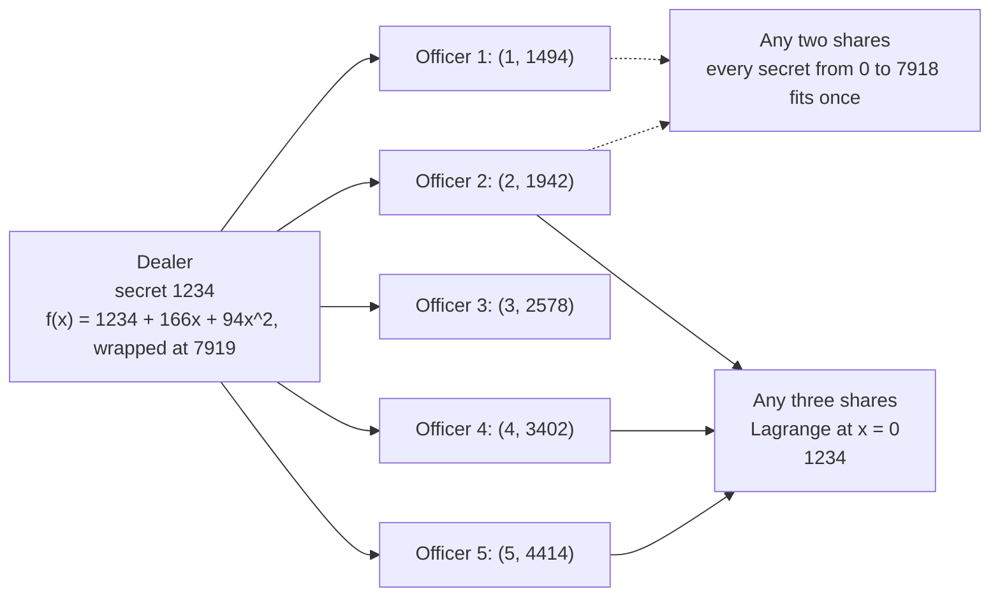
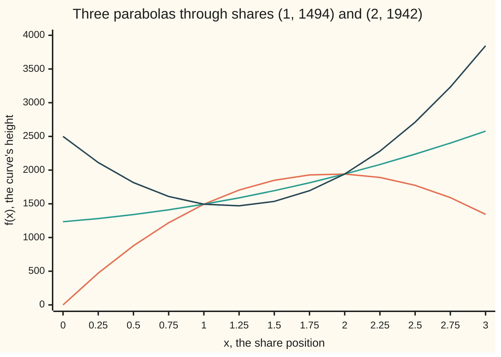

# Secret sharing: hide a number in a polynomial, and any k shares bring it back

[Syllabus](../../../SYLLABUS.md) → [Applied and computational](../README.md) → [Cryptography](../README.md#s04) → Secret sharing

---

## General Overview

A laptop's order reaches the bank under keys that the bank stores. Those stored keys are locked under one **master key**. If the master key is lost, the bank cannot open its own vault. If one employee can copy it, one employee can steal everything.

So the bank wants a rule. Five officers each hold something. Any three of them together can rebuild the master key. Any two of them learn nothing at all about it.

Copies fail this rule: each copy is the whole key. Cutting the key into pieces fails too. Lose one piece and the key is gone, and each piece already gives away part of the key.

Shamir's scheme, from 1979, hides the key as the starting height of a curve. Take a toy master key, 1234. Choose a parabola whose height at x = 0 is 1234, with its other two coefficients picked at random. Here that is $`f(x) = 1234 + 166x + 94x^2`$, with all arithmetic wrapped around a clock of 7919 hours. Each officer gets one point on the curve, called a **share**:

| Officer | 1 | 2 | 3 | 4 | 5 |
| --- | --- | --- | --- | --- | --- |
| Share $`(x, f(x))`$ | (1, 1494) | (2, 1942) | (3, 2578) | (4, 3402) | (5, 4414) |

Three points fix a parabola. Any three officers can redraw it and read its height at 0: 1234. Two points do not fix it. Through any two shares runs exactly one parabola or straight line for each of the 7919 possible starting heights. So two shares fit every secret equally well.

**Shamir's scheme hides a secret as the value at 0 of a random polynomial of degree k − 1 over a prime field and hands out its values at n other points; any k of those values fix the polynomial, and Lagrange interpolation reads the secret back, while any k − 1 of them fit exactly one polynomial for every possible secret, so they say nothing about it.**

**What kind of fact this is:** a theorem, proved on this card in Why it works. Any k shares rebuild the secret, and any k − 1 shares leave every secret exactly as likely as before.

### The picture: one key, five shares, any three



Schematic. Solid arrows: the dealer hands out shares, and officers 2, 4 and 5 rebuild the key. Dotted arrows: officers 1 and 2 alone learn nothing.

---

## The formula

Notation first, in words.

- The clock of $`p`$ hours, with $`p`$ a prime, is the **finite field** $`\mathrm{GF}(p)`$: the whole numbers 0 to $`p - 1`$, added and multiplied with wraparound at $`p`$. Every number except 0 has a **reciprocal** there, a partner that multiplies with it to give 1 ([Finite fields](../../03-Algebra/09-Rings%20and%20Fields/05-finite-fields.md)). Here $`p`$ = 7919.
- The **secret** is $`s`$, the number to protect.
- The **threshold** $`k`$ is how many shares rebuild the secret. Elsewhere on this shelf $`k`$ names a key; on this card it is the threshold.
- $`n`$ is the number of shares dealt. It is not the RSA modulus here.

Dealing the shares:

```math
f(x) = s + a_1 x + a_2 x^2 + \dots + a_{k-1} x^{k-1} \pmod p, \qquad \text{share } j = \big(x_j,\ f(x_j)\big)
```

**Read it aloud:** build a polynomial whose constant term is the secret and whose other k − 1 coefficients are random numbers on the clock, then give person j the point of the curve at position $`x_j`$.

Rebuilding from any k shares $`(x_1, y_1), \dots, (x_k, y_k)`$:

```math
s = f(0) = \sum_{j=1}^{k} y_j\, \ell_j(0), \qquad \ell_j(0) = \prod_{m \ne j} \frac{x_m}{x_m - x_j} \pmod p
```

**Read it aloud:** the secret is a weighted sum of the share values; the weight of share j multiplies one fraction for every other share, built from positions only, and each division is a multiplication by a reciprocal on the clock.

What k − 1 shares reveal. Write $`S`$ for the secret as chosen by chance, and $`s`$ for one particular value:

```math
P\big(S = s \mid \text{any } k - 1 \text{ shares}\big) = P(S = s) \quad \text{for every secret } s
```

**Read it aloud:** after seeing k − 1 shares, the odds on each possible secret are exactly the odds before.

| Symbol | Plain meaning | In our example | Push it up and the answer… |
| --- | --- | --- | --- |
| $`p`$, $`\mathrm{GF}(p)`$ | the prime clock size, and the field of the numbers 0 to $`p - 1`$ wrapped at $`p`$ | 7919, so 12.95 bits per share | more possible secrets; each share grows to $`\log_2 p`$ bits |
| $`s`$ | the secret: the polynomial's value at 0 | 1234 | — |
| $`k`$ | the threshold: how many shares rebuild the secret | 3 | more officers must meet; the degree $`k - 1`$ grows |
| $`n`$ | the number of shares dealt | 5 | more spare shares; must stay below $`p`$ |
| $`a_1, \dots, a_{k-1}`$ | the random coefficients, drawn uniformly, then destroyed | 166 and 94 | — (their randomness is what hides $`s`$) |
| $`f(x)`$ | the dealer's polynomial, of degree at most $`k - 1`$ | $`1234 + 166x + 94x^2`$ | — |
| $`x_j`$, $`y_j`$ | share j: its position, never 0, and its value $`y_j = f(x_j)`$ | (2, 1942) | — |
| $`\ell_j(0)`$ | the Lagrange weight of share j; $`m`$ runs over the other shares | 3, 7916, 1 for shares 1, 2, 3 | — |
| $`\sum`$, $`\prod`$ | add up, and multiply together, over the indices shown | — | — |
| $`1/v \bmod p`$ | the reciprocal of a nonzero number $`v`$ on the clock | 1/3 = 2640, as 3 × 2640 = 7920 = 7919 + 1 | — |
| $`S`$, $`P(\cdot)`$ | the secret as chosen by chance, and the chance of an event | the same chance for 1234 before and after two shares | — |

### When it holds

- **The clock size is prime.** Then every nonzero difference $`x_j - x_m`$ has a reciprocal. On a clock of 7920 hours, 2 has none, so Lagrange cannot start. Worse, two shares rule out 3960 of the 7920 secrets.
- **The positions are distinct and never 0.** A share at x = 0 is the secret itself. Two shares at one position are one share counted twice. So at most $`p - 1`$ shares exist.
- **The coefficients are uniform, fresh and destroyed.** The secrecy comes from the random coefficients, just as it comes from the pad on [The one-time pad](01-one-time-pad-and-perfect-secrecy.md). This card fixes 166 and 94 only so that every number can be checked.
- **Every share is honest.** The formula trusts each value. One share typed as 1943 instead of 1942 silently rebuilds 1231.
- **The dealer and the rebuilding machine are trusted.** The dealer knows the secret at the start. Whoever rebuilds it holds the whole key at the end.

---

## Why it works

### Step 0: k points pin a curve of degree k − 1, and k − 1 points leave it free at 0

Two points fix a straight line, and three points fix a parabola. Turn that around: through two points runs a parabola, or a straight line, of every starting height.

The scheme puts the secret at the one position no officer is given, x = 0. With k points the curve cannot move. With fewer, it can bend to start anywhere. Step 1 proves "cannot move", Step 2 builds the curve, and Step 3 turns "anywhere" into "every secret equally likely".

### Step 1: at most one polynomial through k points

Suppose two polynomials $`f`$ and $`g`$, each of degree at most $`k - 1`$, agree at k different positions. Their difference $`f - g`$ has degree at most $`k - 1`$ and comes out 0 at all k positions.

A polynomial of degree at most $`k - 1`$ that is not the zero polynomial has at most $`k - 1`$ roots ([Roots and factors](../../03-Algebra/02-Polynomials/05-roots-and-the-factor-theorem.md)). So $`f - g`$ is the zero polynomial, and $`f = g`$.

That root ceiling also holds with coefficients on the clock. Its proof divides by $`x - r`$ and keeps a remainder, and division with remainder works over any field ([Polynomials behave like integers](../../03-Algebra/09-Rings%20and%20Fields/03-polynomials-behave-like-integers.md)). So over GF(7919), three points still fix a parabola.

### Step 2: at least one polynomial, built by Lagrange's recipe

Step 1 says the secret is fixed. **Lagrange interpolation** computes it. For each share j, build a polynomial $`\ell_j`$ that is 1 at $`x_j`$ and 0 at every other share's position:

```math
\ell_j(x) = \prod_{m \ne j} \frac{x - x_m}{x_j - x_m}, \qquad f(x) = \sum_{j=1}^{k} y_j\, \ell_j(x)
```

**Read it aloud:** each basis polynomial has a top factor that vanishes at every other share, and a bottom that scales it to 1 at its own share; the weighted sum passes through every share.

Why the sum is right:

1. At another share's position $`x_m`$, the top factor $`x - x_m`$ is 0, so $`\ell_j(x_m) = 0`$.
2. At its own position $`x_j`$, every fraction is $`(x_j - x_m)/(x_j - x_m) = 1`$, so $`\ell_j(x_j) = 1`$.
3. So at $`x_j`$ only the j-th term of the sum survives, and it equals $`y_j`$. The sum passes through all k shares.
4. The sum has degree at most $`k - 1`$, so by Step 1 it is the dealer's $`f`$. Set x = 0 and the rebuilding formula appears: each fraction $`(0 - x_m)/(x_j - x_m)`$ is the same as $`x_m/(x_m - x_j)`$, since top and bottom both change sign.

For shares 1, 2 and 3, the weights at 0 are:

- share 1: $`(0 - 2)(0 - 3) / \big((1 - 2)(1 - 3)\big) = 6/2 = 3`$
- share 2: $`(0 - 1)(0 - 3) / \big((2 - 1)(2 - 3)\big) = 3/(-1) = -3`$, written 7916 on the clock
- share 3: $`(0 - 1)(0 - 2) / \big((3 - 1)(3 - 2)\big) = 2/2 = 1`$

So $`s = 3 \times 1494 - 3 \times 1942 + 2578 = 1234`$.

Each bottom is a difference $`x_j - x_m`$ that is not 0. Dividing by it needs a reciprocal, and only a field promises one. Lagrange interpolation over ordinary decimals, with its error when the data are not from a polynomial, is taught in wing 16. Here it is needed only on the clock, where it is exact.

### Step 3: k − 1 shares fit every secret, each exactly once

Fix any k − 1 shares and any candidate secret. Add the point (0, candidate). Now there are k points at different positions. By Steps 1 and 2, exactly one polynomial of degree at most $`k - 1`$ passes through them. So each candidate secret matches exactly one choice of the random coefficients.

On the card's shares 1 and 2:

| Candidate secret | The one polynomial that fits both shares |
| --- | --- |
| 0 | $`0 + 2017x + 7396x^2`$ |
| 1234 | $`1234 + 166x + 94x^2`$, the real one |
| 4321 | $`4321 + 7414x + 5597x^2`$ |

The dealer drew $`(a_1, a_2)`$ uniformly from all 7919² = 62,710,561 pairs. Whatever the secret, exactly one pair produces the two shares the officers hold. So the chance of seeing those two shares is 1 in 62,710,561 for every secret.

A chance of the evidence that is the same for every secret cannot move the odds. That is the Bayes's rule step on [The one-time pad](01-one-time-pad-and-perfect-secrecy.md), and it gives the secrecy formula. The random coefficients play the pad's part: fresh, uniform, used once.

The chart shows the same fact over ordinary decimals, where the eye can follow it.



Orange starts at secret 0, green at the real secret 1234, and dark blue at 2500. All three pass through 1494 at x = 1 and 1942 at x = 2. Only green goes on to 2578 at x = 3, the third share. On the clock the curves wrap around at 7919, but the count is the same: one curve for each starting height.

### Step 4: why the wrap at a prime is needed

Over ordinary whole numbers, the shares leak. Take coefficients that are 0 or more. Then shares 1 and 2 leave only 150 possible secrets, from 1046 to 1344, all even.

Two clues leak:

- **Size.** $`f(1) = s + a_1 + a_2`$, so the secret cannot exceed the share value 1494.
- **Parity.** $`f(2) - 2f(1) = -s + 2a_2`$, so $`s`$ has the parity of $`2 \times 1494 - 1942 = 1046`$: even.

The wrap at a prime removes both. Every value on the clock can be reached, so size says nothing. Doubling is undone by the reciprocal of 2, so parity says nothing. A clock of 7920 hours wraps but keeps the parity clue: there 2 has no reciprocal, and two shares rule out all 3960 odd secrets.

---

## Worked numbers, by hand

Shares 2, 4 and 5 need the clock's reciprocals, so they show the whole method.

| Step | Arithmetic | Value |
| --- | --- | --- |
| reciprocals | 2 × 3960 = 3 × 2640 = 6 × 1320 = 7920 = 7919 + 1 | 1/2 = 3960, 1/3 = 2640, 1/6 = 1320 |
| weight of share 2 | $`(4 \times 5) / \big((4 - 2)(5 - 2)\big)`$ = 20/6 = 20 × 1320 = 26,400, wrapped | 2643 |
| weight of share 4 | $`(2 \times 5) / \big((2 - 4)(5 - 4)\big)`$ = 10/(−2) = −5, wrapped | 7914 |
| weight of share 5 | $`(2 \times 4) / \big((2 - 5)(4 - 5)\big)`$ = 8/3 = 8 × 2640 = 21,120, wrapped | 5282 |
| term for share 2 | 2643 × 1942 = 5,132,706, wrapped | 1194 |
| term for share 4 | 7914 × 3402 = 26,923,428, wrapped | 6747 |
| term for share 5 | 5282 × 4414 = 23,314,748, wrapped | 1212 |
| add the terms | 1194 + 6747 + 1212 | 9153 |
| wrap once more | 9153 − 7919 | **1234** |

"Wrapped" means: subtract 7919 as many times as fit. **Shares 2, 4 and 5 rebuild 1234**, the same secret that shares 1, 2 and 3 gave. The code tries all 16 sets of three, four or five shares and gets 1234 from every one.

### What breaks if you drop a piece

| Mistake | Comes out at | What went wrong |
| --- | --- | --- |
| Ordinary whole numbers, no wrap | shares 1 and 2 leave 150 secrets, 1046 to 1344, all even | size and parity leak through |
| A clock of 7920 hours, not prime | 1/2 does not exist; shares 1 and 2 rule out 3960 of 7920 secrets | a missing reciprocal stops Lagrange and leaks parity |
| Share 2 typed as 1943 | rebuilt secret 1231; share 4 predicted 3399, but it holds 3402 | the formula trusts every share; only a spare share exposes the error |
| A share dealt at x = 0 | that officer holds 1234 | the value at 0 is the secret itself |

---

## Code, from first principles, and it actually runs

The script deals the five shares, rebuilds the secret, and tests the secrecy claim. It reaches its answers by **three independent roads**:

1. **Lagrange weights at 0**, on every set of 3, 4 or 5 shares: 16 sets.
2. **Row solving** on the same 16 sets. It solves the equations "curve at $`x_j`$ = $`y_j`$" for all the coefficients by Gaussian elimination: subtract multiples of one equation from the others until each unknown stands alone. It never computes a Lagrange weight.
3. **Exhaustive counting.** On a clock of 11 hours it deals all 1331 parabolas and records every pair of shares with its secret: each of the 13,310 cells is hit exactly once. On the real clock of 7919, it counts the polynomials that fit shares 1 and 2 for every candidate secret: exactly one each.

Reciprocals come from Euclid's algorithm run backwards (the extended Euclidean algorithm), written out. Nothing imported knows the answer.

These sizes are **insecure**. A clock of 7919 holds 12.95 bits, so a guesser could simply try every secret. Real systems protect a 256-bit key, split byte by byte in GF(256), the 256-element field built on [Finite fields](../../03-Algebra/09-Rings%20and%20Fields/05-finite-fields.md), or over one prime larger than the key.

### Python

```python
# Shamir secret sharing -- the check behind the card.  Standard library only.
# Toy sizes: a field of 7919 elements holds under 13 bits, so this is INSECURE
# as a key store.  Real systems split a 256-bit key byte by byte in GF(256).
from math import log2, floor

P = 7919                       # a prime, so the clock mod P is a field
COEF = [1234, 166, 94]         # f(x) = 1234 + 166x + 94x^2; in use 166, 94 are random
SECRET, K, N = COEF[0], 3, 5   # the secret, the threshold, the number of shares

def inv(a, p=P):               # extended Euclid: a * inv(a) = 1 mod p
    r0, r1, t0, t1 = p, a % p, 0, 1
    while r1:
        q = r0 // r1
        r0, r1, t0, t1 = r1, r0 - q * r1, t1, t0 - q * t1
    return t0 % p if r0 == 1 else None     # None: no inverse exists

def f_at(coef, x, p=P):        # Horner's rule, mod p
    y = 0
    for c in reversed(coef):
        y = (y * x + c) % p
    return y

def weights(xs, at=0, p=P):    # Lagrange weights l_j(at) = prod (at - x_m) / (x_j - x_m)
    w = []
    for j, xj in enumerate(xs):
        num = den = 1
        for m, xm in enumerate(xs):
            if m != j:
                num, den = num * (at - xm) % p, den * (xj - xm) % p
        w.append(num * inv(den, p) % p)
    return w

def lagrange(pts, at=0, p=P):  # road 1: the weighted sum of the share values
    return sum(w * y for w, (_, y) in zip(weights([x for x, _ in pts], at, p), pts)) % p

def gauss(pts, p=P):           # road 2: solve for every coefficient, row by row
    k = len(pts)
    A = [[x ** e % p for e in range(k)] + [y % p] for x, y in pts]
    for c in range(k):
        piv = next(r for r in range(c, k) if A[r][c])
        A[c], A[piv] = A[piv], A[c]
        iv = inv(A[c][c], p)
        A[c] = [v * iv % p for v in A[c]]
        for r in range(k):
            fac = A[r][c]
            if r != c and fac:
                A[r] = [(a - fac * b) % p for a, b in zip(A[r], A[c])]
    return [A[r][k] for r in range(k)]

def subsets(items, size):      # every choice of `size` items, in order
    if size == 0: return [[]]
    return [[items[i]] + rest for i in range(len(items)) for rest in subsets(items[i + 1:], size - 1)]

# ---- deal the shares ----
print(f"field GF({P}), toy size: {log2(P):.2f} bits per share, insecure; real: a 256-bit key, byte by byte in GF(256)")
shares = [(x, f_at(COEF, x)) for x in range(1, N + 1)]
print("shares:", " ".join(f"({x}, {y})" for x, y in shares))
assert [y for _, y in shares] == [1494, 1942, 2578, 3402, 4414]   # worked by hand
assert f_at(COEF, 0) == SECRET

# ---- rebuild from three shares, two ways ----
w123 = weights([1, 2, 3])
print(f"shares 1,2,3: weights {w123[0]}, {w123[1]}, {w123[2]} (3, -3, 1); secret {lagrange(shares[:3])}")
assert w123 == [3, P - 3, 1] and lagrange(shares[:3]) == SECRET
t = [shares[1], shares[3], shares[4]]
w245 = weights([2, 4, 5])
terms = [w * y % P for w, (_, y) in zip(w245, t)]
print(f"inverses mod {P}: 1/2 = {inv(2)}, 1/3 = {inv(3)}, 1/6 = {inv(6)}")
print(f"shares 2,4,5: weights {w245[0]}, {w245[1]}, {w245[2]}; terms {terms[0]} + {terms[1]} + {terms[2]} = {sum(terms)} -> secret {sum(terms) % P}")
assert 3 * inv(3) % P == 1 and sum(w245) % P == 1 and sum(terms) % P == SECRET
raw = ", ".join(f"{w * y:,}" for w, (_, y) in zip(w245, t))
print(f"by hand: 20/6 = 20 x {inv(6)} = {20 * inv(6):,}; 10/(-2) = {10 // -2}; 8/3 = 8 x {inv(3)} = {8 * inv(3):,}; products before wrapping {raw}")
ok_l = ok_g = total = 0
for size in (3, 4, 5):
    for sub in subsets(shares, size):
        total += 1
        ok_l += lagrange(sub) == SECRET
        ok_g += gauss(sub) == COEF + [0] * (size - K)
print(f"every set of 3, 4 or 5 shares: {total} sets; Lagrange gives 1234 in {ok_l}, row solving gives 1234 + 166x + 94x^2 in {ok_g}")
assert total == 16 and ok_l == 16 and ok_g == 16

# ---- two shares: every secret fits, each by exactly one polynomial ----
y1, y2 = shares[0][1], shares[1][1]
for guess in (0, 4321):
    c = gauss([(0, guess), (1, y1), (2, y2)])
    print(f"secret {guess} fits shares 1, 2 with f(x) = {c[0]} + {c[1]}x + {c[2]}x^2")
    assert f_at(c, 1) == y1 and f_at(c, 2) == y2 and c[0] == guess
for p, label in ((P, "prime 7919"), (P + 1, "7920, not prime")):
    cnt = [0] * p              # share 1 fixes a1 from a2, so count the a2 that also fit share 2
    for a2 in range(p):
        cnt[(2 * a2) % p] += 1
    per = [cnt[(y2 - 2 * y1 + s) % p] for s in range(p)]
    print(f"mod {label}: secrets fitting shares 1, 2 = {sum(1 for v in per if v)} of {p}; polynomials per secret {min(per)} to {max(per)}")
    assert (min(per), max(per)) == ((1, 1) if p == P else (0, 2))
print(f"chance of these two shares, for every secret: 1 in {P}^2 = {P * P:,}")
p = 11                         # road 3: every polynomial over GF(11), every pair of x
tally = {}
for s in range(p):
    for a1 in range(p):
        for a2 in range(p):
            for u, v in subsets([1, 2, 3, 4, 5], 2):
                key = (u, v, f_at([s, a1, a2], u, p), f_at([s, a1, a2], v, p), s)
                tally[key] = tally.get(key, 0) + 1
print(f"clock of {p}, exhaustive: {p ** 3} polynomials, 10 pairs, {len(tally)} cells, hits per cell {min(tally.values())} to {max(tally.values())}")
assert len(tally) == 10 * p ** 3 and set(tally.values()) == {1}

# ---- what breaks ----
bad = [shares[0], (2, 1943), shares[2]]
s_bad, f4 = lagrange(bad), lagrange(bad, 4)
print(f"share 2 typed as 1943: rebuilt secret {s_bad}; predicted share 4 {f4}, held {shares[3][1]}")
assert s_bad == SECRET - 3 and f4 != shares[3][1]
cands = sorted({1494 - a1 - a2 for a1 in range(1495) for a2 in range(1495 - a1)   # share 1 fixes s
                if (1494 - a1 - a2) + 2 * a1 + 4 * a2 == 1942})                    # does share 2 fit?
print(f"integers, coefficients >= 0: shares 1, 2 leave {len(cands)} secrets, {cands[0]} to {cands[-1]}, all even: {all(c % 2 == 0 for c in cands)}")
assert SECRET in cands and len(cands) == 150
print(f"mod 7920: 1/2 exists? {inv(2, P + 1) is not None}")
print("share at x = 0 hands out f(0) =", f_at(COEF, 0))

# ---- chart: curves through shares 1, 2 over ordinary numbers ----
def real_at(pts, x):           # the same Lagrange sum, in ordinary decimals
    total = 0.0
    for j, (xj, yj) in enumerate(pts):
        r = 1.0
        for m, (xm, _) in enumerate(pts):
            if m != j: r *= (x - xm) / (xj - xm)
        total += yj * r
    return total
xs = [i / 4 for i in range(13)]
for h in (0, 1234, 2500):
    ys = [floor(real_at([(0, h), (1, 1494), (2, 1942)], x) + 0.5) for x in xs]
    print(f"chart, secret {h}:", ", ".join(map(str, ys)))
    assert ys[4] == 1494 and ys[8] == 1942 and ys[0] == h
print("ALL CHECKS PASS")
```

**Ran 2026-11-23 on macOS, Python 3.14.10, standard library only. All checks passed. Output, pasted from the run:**

```
field GF(7919), toy size: 12.95 bits per share, insecure; real: a 256-bit key, byte by byte in GF(256)
shares: (1, 1494) (2, 1942) (3, 2578) (4, 3402) (5, 4414)
shares 1,2,3: weights 3, 7916, 1 (3, -3, 1); secret 1234
inverses mod 7919: 1/2 = 3960, 1/3 = 2640, 1/6 = 1320
shares 2,4,5: weights 2643, 7914, 5282; terms 1194 + 6747 + 1212 = 9153 -> secret 1234
by hand: 20/6 = 20 x 1320 = 26,400; 10/(-2) = -5; 8/3 = 8 x 2640 = 21,120; products before wrapping 5,132,706, 26,923,428, 23,314,748
every set of 3, 4 or 5 shares: 16 sets; Lagrange gives 1234 in 16, row solving gives 1234 + 166x + 94x^2 in 16
secret 0 fits shares 1, 2 with f(x) = 0 + 2017x + 7396x^2
secret 4321 fits shares 1, 2 with f(x) = 4321 + 7414x + 5597x^2
mod prime 7919: secrets fitting shares 1, 2 = 7919 of 7919; polynomials per secret 1 to 1
mod 7920, not prime: secrets fitting shares 1, 2 = 3960 of 7920; polynomials per secret 0 to 2
chance of these two shares, for every secret: 1 in 7919^2 = 62,710,561
clock of 11, exhaustive: 1331 polynomials, 10 pairs, 13310 cells, hits per cell 1 to 1
share 2 typed as 1943: rebuilt secret 1231; predicted share 4 3399, held 3402
integers, coefficients >= 0: shares 1, 2 leave 150 secrets, 1046 to 1344, all even: True
mod 7920: 1/2 exists? False
share at x = 0 hands out f(0) = 1234
chart, secret 0: 0, 472, 878, 1219, 1494, 1704, 1849, 1928, 1942, 1891, 1774, 1592, 1344
chart, secret 1234: 1234, 1281, 1341, 1411, 1494, 1588, 1695, 1812, 1942, 2083, 2237, 2401, 2578
chart, secret 2500: 2500, 2112, 1815, 1609, 1494, 1470, 1536, 1694, 1942, 2281, 2711, 3232, 3844
ALL CHECKS PASS
```

### Rust

```rust
// Shamir secret sharing -- the check behind the card.  std only, no crates.
// Toy sizes: a field of 7919 elements holds under 13 bits, so this is INSECURE
// as a key store.  Real systems split a 256-bit key byte by byte in GF(256).
use std::collections::HashMap;

const P: i64 = 7919; // a prime, so the clock mod P is a field
const COEF: [i64; 3] = [1234, 166, 94]; // f(x) = 1234 + 166x + 94x^2; in use 166, 94 are random
const SECRET: i64 = 1234; const K: usize = 3; const N: i64 = 5; // secret, threshold, share count

fn md(a: i64, p: i64) -> i64 { a.rem_euclid(p) }

fn inv(a: i64, p: i64) -> Option<i64> { // extended Euclid: a * inv(a) = 1 mod p
    let (mut r0, mut r1, mut t0, mut t1) = (p, md(a, p), 0i64, 1i64);
    while r1 != 0 {
        let q = r0 / r1;
        (r0, r1, t0, t1) = (r1, r0 - q * r1, t1, t0 - q * t1);
    }
    if r0 == 1 { Some(md(t0, p)) } else { None } // None: no inverse exists
}

fn f_at(coef: &[i64], x: i64, p: i64) -> i64 { // Horner's rule, mod p
    coef.iter().rev().fold(0, |y, &c| md(y * x + c, p))
}

fn weights(xs: &[i64], at: i64, p: i64) -> Vec<i64> { // l_j(at) = prod (at - x_m) / (x_j - x_m)
    let mut w = Vec::new();
    for (j, &xj) in xs.iter().enumerate() {
        let (mut num, mut den) = (1i64, 1i64);
        for (m, &xm) in xs.iter().enumerate() { if m != j { num = md(num * (at - xm), p); den = md(den * (xj - xm), p); } }
        w.push(md(num * inv(den, p).unwrap(), p));
    }
    w
}

fn lagrange(pts: &[(i64, i64)], at: i64, p: i64) -> i64 { // road 1: weighted sum of share values
    let xs: Vec<i64> = pts.iter().map(|q| q.0).collect();
    let w = weights(&xs, at, p);
    md(w.iter().zip(pts).map(|(wj, q)| wj * q.1).sum::<i64>(), p)
}

fn gauss(pts: &[(i64, i64)], p: i64) -> Vec<i64> { // road 2: solve for every coefficient
    let k = pts.len();
    let mut a: Vec<Vec<i64>> = pts.iter()
        .map(|&(x, y)| (0..k).map(|e| md(x.pow(e as u32), p)).chain([md(y, p)]).collect()).collect();
    for c in 0..k {
        let piv = (c..k).find(|&r| a[r][c] != 0).unwrap();
        a.swap(c, piv);
        let iv = inv(a[c][c], p).unwrap();
        a[c] = a[c].iter().map(|v| md(v * iv, p)).collect();
        for r in 0..k {
            let fac = a[r][c];
            let pc = a[c].clone();
            if r != c && fac != 0 { a[r] = a[r].iter().zip(&pc).map(|(x, y)| md(x - fac * y, p)).collect(); }
        }
    }
    (0..k).map(|r| a[r][k]).collect()
}

fn subsets<T: Clone>(items: &[T], size: usize) -> Vec<Vec<T>> { // every choice of `size` items
    if size == 0 { return vec![vec![]]; }
    let mut out = Vec::new();
    for i in 0..items.len() {
        for rest in subsets(&items[i + 1..], size - 1) { out.push([vec![items[i].clone()], rest].concat()); }
    }
    out
}

fn commas(x: i64) -> String {
    let s = x.to_string();
    s.chars().enumerate().map(|(i, ch)| if i > 0 && (s.len() - i) % 3 == 0 { format!(",{}", ch) } else { ch.to_string() }).collect()
}

fn real_at(pts: &[(f64, f64)], x: f64) -> f64 { // the same Lagrange sum, in ordinary decimals
    let mut total = 0.0;
    for (j, &(xj, yj)) in pts.iter().enumerate() {
        let mut r = 1.0;
        for (m, &(xm, _)) in pts.iter().enumerate() { if m != j { r *= (x - xm) / (xj - xm); } }
        total += yj * r;
    }
    total
}

fn main() {
    // ---- deal the shares ----
    println!("field GF({}), toy size: {:.2} bits per share, insecure; real: a 256-bit key, byte by byte in GF(256)", P, (P as f64).log2());
    let shares: Vec<(i64, i64)> = (1..=N).map(|x| (x, f_at(&COEF, x, P))).collect();
    println!("shares: {}", shares.iter().map(|(x, y)| format!("({}, {})", x, y)).collect::<Vec<_>>().join(" "));
    assert!(shares.iter().map(|q| q.1).collect::<Vec<_>>() == vec![1494, 1942, 2578, 3402, 4414]); // worked by hand
    assert!(f_at(&COEF, 0, P) == SECRET);

    // ---- rebuild from three shares, two ways ----
    let w123 = weights(&[1, 2, 3], 0, P);
    println!("shares 1,2,3: weights {}, {}, {} (3, -3, 1); secret {}", w123[0], w123[1], w123[2], lagrange(&shares[..3], 0, P));
    assert!(w123 == vec![3, P - 3, 1] && lagrange(&shares[..3], 0, P) == SECRET);
    let t = [shares[1], shares[3], shares[4]];
    let w245 = weights(&[2, 4, 5], 0, P);
    let terms: Vec<i64> = w245.iter().zip(&t).map(|(w, q)| md(w * q.1, P)).collect();
    let tsum: i64 = terms.iter().sum();
    println!("inverses mod {}: 1/2 = {}, 1/3 = {}, 1/6 = {}", P, inv(2, P).unwrap(), inv(3, P).unwrap(), inv(6, P).unwrap());
    println!("shares 2,4,5: weights {}, {}, {}; terms {} + {} + {} = {} -> secret {}", w245[0], w245[1], w245[2], terms[0], terms[1], terms[2], tsum, tsum % P);
    assert!(3 * inv(3, P).unwrap() % P == 1 && w245.iter().sum::<i64>() % P == 1 && tsum % P == SECRET);
    let raw: Vec<String> = w245.iter().zip(&t).map(|(w, q)| commas(w * q.1)).collect();
    println!("by hand: 20/6 = 20 x {} = {}; 10/(-2) = {}; 8/3 = 8 x {} = {}; products before wrapping {}", inv(6, P).unwrap(), commas(20 * inv(6, P).unwrap()), 10 / -2, inv(3, P).unwrap(), commas(8 * inv(3, P).unwrap()), raw.join(", "));
    let (mut ok_l, mut ok_g, mut total) = (0, 0, 0);
    for size in 3..=5usize {
        for sub in subsets(&shares, size) {
            total += 1;
            if lagrange(&sub, 0, P) == SECRET { ok_l += 1; }
            if gauss(&sub, P) == [COEF.to_vec(), vec![0; size - K]].concat() { ok_g += 1; }
        }
    }
    println!("every set of 3, 4 or 5 shares: {} sets; Lagrange gives 1234 in {}, row solving gives 1234 + 166x + 94x^2 in {}", total, ok_l, ok_g);
    assert!(total == 16 && ok_l == 16 && ok_g == 16);

    // ---- two shares: every secret fits, each by exactly one polynomial ----
    let (y1, y2) = (shares[0].1, shares[1].1);
    for guess in [0i64, 4321] {
        let c = gauss(&[(0, guess), (1, y1), (2, y2)], P);
        println!("secret {} fits shares 1, 2 with f(x) = {} + {}x + {}x^2", guess, c[0], c[1], c[2]);
        assert!(f_at(&c, 1, P) == y1 && f_at(&c, 2, P) == y2 && c[0] == guess);
    }
    for (p, label) in [(P, "prime 7919"), (P + 1, "7920, not prime")] {
        let mut cnt = vec![0i64; p as usize]; // share 1 fixes a1 from a2: count the a2 that also fit share 2
        for a2 in 0..p { cnt[((2 * a2) % p) as usize] += 1; }
        let per: Vec<i64> = (0..p).map(|s| cnt[md(y2 - 2 * y1 + s, p) as usize]).collect();
        let (lo, hi) = (*per.iter().min().unwrap(), *per.iter().max().unwrap());
        println!("mod {}: secrets fitting shares 1, 2 = {} of {}; polynomials per secret {} to {}", label, per.iter().filter(|&&v| v > 0).count(), p, lo, hi);
        assert!((lo, hi) == if p == P { (1, 1) } else { (0, 2) });
    }
    println!("chance of these two shares, for every secret: 1 in {}^2 = {}", P, commas(P * P));
    let p = 11i64; // road 3: every polynomial over GF(11), every pair of x
    let mut tally: HashMap<(i64, i64, i64, i64, i64), i64> = HashMap::new();
    for s in 0..p { for a1 in 0..p { for a2 in 0..p {
        for uv in subsets(&[1i64, 2, 3, 4, 5], 2) {
            let (u, v) = (uv[0], uv[1]);
            *tally.entry((u, v, f_at(&[s, a1, a2], u, p), f_at(&[s, a1, a2], v, p), s)).or_insert(0) += 1;
        }
    } } }
    let (tlo, thi) = (*tally.values().min().unwrap(), *tally.values().max().unwrap());
    println!("clock of {}, exhaustive: {} polynomials, 10 pairs, {} cells, hits per cell {} to {}", p, p * p * p, tally.len(), tlo, thi);
    assert!(tally.len() as i64 == 10 * p * p * p && tlo == 1 && thi == 1);

    // ---- what breaks ----
    let bad = [shares[0], (2, 1943), shares[2]];
    let (s_bad, f4) = (lagrange(&bad, 0, P), lagrange(&bad, 4, P));
    println!("share 2 typed as 1943: rebuilt secret {}; predicted share 4 {}, held {}", s_bad, f4, shares[3].1);
    assert!(s_bad == SECRET - 3 && f4 != shares[3].1);
    let mut cands: Vec<i64> = Vec::new();
    for a1 in 0..1495i64 { for a2 in 0..(1495 - a1) { // share 1 fixes s
        let s = 1494 - a1 - a2;
        if s + 2 * a1 + 4 * a2 == 1942 && !cands.contains(&s) { cands.push(s); } // does share 2 fit?
    } }
    let (cmin, cmax) = (*cands.iter().min().unwrap(), *cands.iter().max().unwrap());
    let even = if cands.iter().all(|c| c % 2 == 0) { "True" } else { "False" };
    println!("integers, coefficients >= 0: shares 1, 2 leave {} secrets, {} to {}, all even: {}", cands.len(), cmin, cmax, even);
    assert!(cands.contains(&SECRET) && cands.len() == 150);
    println!("mod 7920: 1/2 exists? {}", if inv(2, P + 1).is_some() { "True" } else { "False" });
    println!("share at x = 0 hands out f(0) = {}", f_at(&COEF, 0, P));

    // ---- chart: curves through shares 1, 2 over ordinary numbers ----
    let xs: Vec<f64> = (0..13).map(|i| i as f64 / 4.0).collect();
    for h in [0i64, 1234, 2500] {
        let pts = [(0.0, h as f64), (1.0, 1494.0), (2.0, 1942.0)];
        let ys: Vec<i64> = xs.iter().map(|&x| (real_at(&pts, x) + 0.5).floor() as i64).collect();
        println!("chart, secret {}: {}", h, ys.iter().map(|y| y.to_string()).collect::<Vec<_>>().join(", "));
        assert!(ys[4] == 1494 && ys[8] == 1942 && ys[0] == h);
    }
    println!("ALL CHECKS PASS");
}
```

**Ran 2026-11-23 on macOS, rustc 1.98.1, no crates. All checks passed. Output, pasted from the run:**

```
field GF(7919), toy size: 12.95 bits per share, insecure; real: a 256-bit key, byte by byte in GF(256)
shares: (1, 1494) (2, 1942) (3, 2578) (4, 3402) (5, 4414)
shares 1,2,3: weights 3, 7916, 1 (3, -3, 1); secret 1234
inverses mod 7919: 1/2 = 3960, 1/3 = 2640, 1/6 = 1320
shares 2,4,5: weights 2643, 7914, 5282; terms 1194 + 6747 + 1212 = 9153 -> secret 1234
by hand: 20/6 = 20 x 1320 = 26,400; 10/(-2) = -5; 8/3 = 8 x 2640 = 21,120; products before wrapping 5,132,706, 26,923,428, 23,314,748
every set of 3, 4 or 5 shares: 16 sets; Lagrange gives 1234 in 16, row solving gives 1234 + 166x + 94x^2 in 16
secret 0 fits shares 1, 2 with f(x) = 0 + 2017x + 7396x^2
secret 4321 fits shares 1, 2 with f(x) = 4321 + 7414x + 5597x^2
mod prime 7919: secrets fitting shares 1, 2 = 7919 of 7919; polynomials per secret 1 to 1
mod 7920, not prime: secrets fitting shares 1, 2 = 3960 of 7920; polynomials per secret 0 to 2
chance of these two shares, for every secret: 1 in 7919^2 = 62,710,561
clock of 11, exhaustive: 1331 polynomials, 10 pairs, 13310 cells, hits per cell 1 to 1
share 2 typed as 1943: rebuilt secret 1231; predicted share 4 3399, held 3402
integers, coefficients >= 0: shares 1, 2 leave 150 secrets, 1046 to 1344, all even: True
mod 7920: 1/2 exists? False
share at x = 0 hands out f(0) = 1234
chart, secret 0: 0, 472, 878, 1219, 1494, 1704, 1849, 1928, 1942, 1891, 1774, 1592, 1344
chart, secret 1234: 1234, 1281, 1341, 1411, 1494, 1588, 1695, 1812, 1942, 2083, 2237, 2401, 2578
chart, secret 2500: 2500, 2112, 1815, 1609, 1494, 1470, 1536, 1694, 1942, 2281, 2711, 3232, 3844
ALL CHECKS PASS
```

### Lean

Lean proves Steps 1, 2 and 3 of Why it works for every prime clock and every threshold k, and checks the worked numbers.

- Take two polynomials of degree at most $`k - 1`$ that agree at k distinct positions. Then they are the same polynomial.
- Take k shares of a polynomial $`f`$ of degree at most $`k - 1`$, at distinct positions that are never 0. Then the secret $`f(0)`$ is the sum of each share value times its Lagrange weight $`\ell_j(0)`$.
- Take k − 1 distinct positions that are never 0, any share values there, and any candidate secret. Then exactly one choice of the random coefficients produces those shares.
- Take $`f(x) = 1234 + 166x + 94x^2`$ on the clock of 7919 hours. Then its five shares are 1494, 1942, 2578, 3402 and 4414.
- The reciprocals 1/2 = 3960, 1/3 = 2640 and 1/6 = 1320 check. Shares 1, 2 and 3, with weights 3, 7916 and 1, rebuild 1234.
- Shares 2, 4 and 5, with weights 2643, 7914 and 5282, give terms 1194, 6747 and 1212. They rebuild 1234.
- Take shares 1 and 2. Then $`0 + 2017x + 7396x^2`$ and $`4321 + 7414x + 5597x^2`$ also pass through both.
- Share 2 typed as 1943 rebuilds 1231 from shares 1, 2 and 3.
- 7919 is prime, and 7919² = 62,710,561. On a clock of 7920 hours, 2 and 7920 share the factor 2.

Equal odds for every secret, the counts on clocks of 11 and 7920, and row solving are left to the Python and Rust checks.

```lean
-- Secret sharing: over a prime field, any k shares of a polynomial of degree below k rebuild its value at 0 by Lagrange's weights, and any k − 1 shares fit exactly one choice of coefficients for every possible secret.
import Mathlib.LinearAlgebra.Lagrange
import Mathlib.Algebra.Field.ZMod
import Mathlib.Tactic.NormNum.Prime
import Mathlib.LinearAlgebra.Vandermonde
import Mathlib.LinearAlgebra.Matrix.NonsingularInverse

open Polynomial

/-- Helper: the matrix of powers `x j ^ (i + 1)` is invertible when the positions are distinct
and never 0, since it is the diagonal of the positions times a Vandermonde matrix. -/
theorem helper_matrix_isUnit {F : Type*} [Field F] (n : ℕ) (x : Fin n → F)
    (hx : Function.Injective x) (hx0 : ∀ j, x j ≠ 0) :
    IsUnit (Matrix.of fun j (i : Fin n) => x j ^ (i.val + 1)) := by
  have hM : (Matrix.of fun j (i : Fin n) => x j ^ (i.val + 1)) =
      Matrix.diagonal x * Matrix.vandermonde x := by
    ext j i
    simp [Matrix.diagonal_mul, Matrix.vandermonde, pow_succ']
  rw [hM, Matrix.isUnit_iff_isUnit_det, Matrix.det_mul, Matrix.det_diagonal, isUnit_iff_ne_zero]
  exact mul_ne_zero (Finset.prod_ne_zero_iff.mpr fun j _ => hx0 j)
    (Matrix.det_vandermonde_ne_zero_iff.mpr hx)

#print axioms helper_matrix_isUnit

/-- Shamir's rebuilding formula. On the clock of a prime `p` hours, let `f` be the dealer's
polynomial, of degree at most `k − 1`, and let `k` officers hold the shares `(x j, f(x j))` at
distinct positions that are never 0. Then the secret `f(0)` is the weighted sum of the share
values, where the weight of share `j` is the product of `x m / (x m − x j)` over the other
shares `m`. -/
theorem shamir_secret_eq_lagrange_sum {p : ℕ} [Fact p.Prime] (k : ℕ)
    (x : Fin k → ZMod p) (hx : Function.Injective x) (hx0 : ∀ j, x j ≠ 0)
    (f : (ZMod p)[X]) (hf : f.degree < k) :
    f.eval 0 = ∑ j, f.eval (x j) * ∏ m ∈ Finset.univ.erase j, x m / (x m - x j) := by
  have hvs : Set.InjOn x (Finset.univ : Finset (Fin k)) := hx.injOn
  have hdeg : f.degree < (Finset.univ : Finset (Fin k)).card := by simpa using hf
  have h := congrArg (eval 0) (Lagrange.eq_interpolate hvs hdeg)
  rw [h]
  simp only [Lagrange.interpolate_apply, eval_finsetSum, eval_mul, eval_C, Lagrange.basis,
    eval_prod, Lagrange.basisDivisor, eval_sub, eval_X]
  refine Finset.sum_congr rfl fun j _ => ?_
  congr 1
  refine Finset.prod_congr rfl fun m _ => ?_
  rw [← neg_sub (x j) (x m), div_neg]
  ring

/-- Step 3, the secrecy claim. On the clock of a prime `p` hours, fix `k − 1` positions that are
distinct and never 0, any values `y` the officers might hold there, and any candidate secret `s`.
Exactly one choice of the random coefficients `a₁, …, a_{k−1}` makes the dealer's polynomial
`s + a₁ x + … + a_{k−1} x^{k−1}` produce those shares. So the shares are equally likely for every
secret, and they say nothing about it. -/
theorem shamir_k_sub_one_shares_fit_each_secret_once {p : ℕ} [Fact p.Prime] (k : ℕ)
    (x : Fin (k - 1) → ZMod p) (hx : Function.Injective x) (hx0 : ∀ j, x j ≠ 0)
    (y : Fin (k - 1) → ZMod p) (s : ZMod p) :
    Fintype.card {a : Fin (k - 1) → ZMod p //
      ∀ j, s + ∑ i : Fin (k - 1), a i * x j ^ (i.val + 1) = y j} = 1 := by
  set M : Matrix (Fin (k - 1)) (Fin (k - 1)) (ZMod p) :=
    Matrix.of fun j (i : Fin (k - 1)) => x j ^ (i.val + 1) with hMdef
  have hU : IsUnit M := helper_matrix_isUnit (k - 1) x hx hx0
  have key : ∀ a : Fin (k - 1) → ZMod p,
      (∀ j, s + ∑ i : Fin (k - 1), a i * x j ^ (i.val + 1) = y j) ↔
        M.mulVec a = fun j => y j - s := by
    intro a
    rw [funext_iff]
    refine forall_congr' fun j => ?_
    simp only [hMdef, Matrix.mulVec, dotProduct, Matrix.of_apply]
    rw [eq_sub_iff_add_eq, add_comm]
    simp_rw [mul_comm (x j ^ _)]
  obtain ⟨a, ha⟩ := Matrix.mulVec_surjective_iff_isUnit.mpr hU (fun j => y j - s)
  rw [Fintype.card_eq_one_iff]
  refine ⟨⟨a, (key a).mpr ha⟩, fun b => ?_⟩
  apply Subtype.ext
  exact Matrix.mulVec_injective_iff_isUnit.mpr hU (((key b.1).mp b.2).trans ha.symm)

/-- Step 1. On the clock of a prime `p` hours, two polynomials of degree at most `k − 1` that
agree at `k` distinct positions are the same polynomial. -/
theorem shamir_k_shares_fix_the_polynomial {p : ℕ} [Fact p.Prime] (k : ℕ)
    (x : Fin k → ZMod p) (hx : Function.Injective x)
    (f g : (ZMod p)[X]) (hf : f.degree < k) (hg : g.degree < k)
    (hfg : ∀ j, f.eval (x j) = g.eval (x j)) :
    f = g := by
  have hvs : Set.InjOn x (Finset.univ : Finset (Fin k)) := hx.injOn
  exact Polynomial.eq_of_degrees_lt_of_eval_index_eq _ hvs (by simpa using hf) (by simpa using hg)
    fun j _ => hfg j

-- The card's shares of f(x) = 1234 + 166x + 94x^2 on the clock of 7919 hours.
example : ((1234 + 166 * 1 + 94 * 1 ^ 2 : ℕ) : ZMod 7919) = 1494 := by decide
example : ((1234 + 166 * 2 + 94 * 2 ^ 2 : ℕ) : ZMod 7919) = 1942 := by decide
example : ((1234 + 166 * 3 + 94 * 3 ^ 2 : ℕ) : ZMod 7919) = 2578 := by decide
example : ((1234 + 166 * 4 + 94 * 4 ^ 2 : ℕ) : ZMod 7919) = 3402 := by decide
example : ((1234 + 166 * 5 + 94 * 5 ^ 2 : ℕ) : ZMod 7919) = 4414 := by decide

-- Reciprocals on the clock: 1/2 = 3960, 1/3 = 2640, 1/6 = 1320.
example : (2 * 3960 : ZMod 7919) = 1 ∧ (3 * 2640 : ZMod 7919) = 1 ∧ (6 * 1320 : ZMod 7919) = 1 := by
  decide

-- Shares 1, 2, 3 with weights 3, 7916 (that is, −3) and 1 rebuild 1234.
example : (3 * 1494 + 7916 * 1942 + 1 * 2578 : ZMod 7919) = 1234 := by decide

-- Shares 2, 4, 5: weights 20/6 = 2643, 10/(−2) = 7914, 8/3 = 5282; terms 1194, 6747, 1212; secret 1234.
example : (20 * 1320 : ZMod 7919) = 2643 ∧ (7914 : ZMod 7919) = -5 ∧ (8 * 2640 : ZMod 7919) = 5282 := by
  decide
example : (2643 * 1942 : ZMod 7919) = 1194 ∧ (7914 * 3402 : ZMod 7919) = 6747 ∧
    (5282 * 4414 : ZMod 7919) = 1212 := by
  decide
example : (2643 * 1942 + 7914 * 3402 + 5282 * 4414 : ZMod 7919) = 1234 := by decide

-- Shares 1 and 2 also fit secret 0, as 0 + 2017x + 7396x^2, and secret 4321, as 4321 + 7414x + 5597x^2.
example : (0 + 2017 * 1 + 7396 * 1 ^ 2 : ZMod 7919) = 1494 ∧ (0 + 2017 * 2 + 7396 * 2 ^ 2 : ZMod 7919) = 1942 := by
  decide
example : (4321 + 7414 * 1 + 5597 * 1 ^ 2 : ZMod 7919) = 1494 ∧
    (4321 + 7414 * 2 + 5597 * 2 ^ 2 : ZMod 7919) = 1942 := by
  decide

-- Share 2 typed as 1943 rebuilds 1231 from shares 1, 2, 3.
example : (3 * 1494 + 7916 * 1943 + 1 * 2578 : ZMod 7919) = 1231 := by decide

-- On a clock of 7920 hours, 2 has no reciprocal: 2 and 7920 share the factor 2.
example : Nat.gcd 2 7920 = 2 := by norm_num

-- 7919 is prime, and two shares give 1 chance in 7919^2 = 62,710,561.
example : Nat.Prime 7919 := by norm_num
example : 7919 ^ 2 = 62710561 := by norm_num

#print axioms shamir_secret_eq_lagrange_sum
#print axioms shamir_k_sub_one_shares_fit_each_secret_once
#print axioms shamir_k_shares_fix_the_polynomial
```

**Checked 2026-11-23 on macOS, Lean 4.36.0-rc2, Mathlib v4.36.0-rc2. Every proof is complete and uses only Lean's standard axioms. Output, pasted from the run:**

```
'helper_matrix_isUnit' depends on axioms: [propext, Classical.choice, Quot.sound]
'shamir_secret_eq_lagrange_sum' depends on axioms: [propext, Classical.choice, Quot.sound]
'shamir_k_sub_one_shares_fit_each_secret_once' depends on axioms: [propext, Classical.choice, Quot.sound]
'shamir_k_shares_fix_the_polynomial' depends on axioms: [propext, Classical.choice, Quot.sound]
```

> [!TIP]
> **Try changing**
> - Guess first: is there any secret that two shares rule out? Change `(0, 4321)` to `(0, 4321, 7918)`, adding the largest number on the clock. It fits too, with $`f(x) = 7918 + 5978x + 3436x^2`$.
> - Guess first: does the exhaustive count survive a clock that is not prime? Change `p = 11` to `p = 12`. Only 3384 cells appear, hit 2 to 12 times each instead of once, and the assert stops the run.
> - Guess first: which wrong share moves the secret least? Change the mistyped share to `(3, 2579)`, one too many on share 3. The secret comes out 1235: the error times share 3's weight, 1. The assert stops the run, because it expects 1231.
> - Guess first: can a curve through the two shares start at 5000? Change the chart heights to `(0, 1234, 2500, 5000)`. A fourth line appears, starting at 5000 and passing through 1494 and 1942 like the others.

---

## The usual mistake

> [!warning]
> **Doing the arithmetic in ordinary whole numbers.** The secret still rebuilds correctly, so tests pass and the bug stays hidden. But the secrecy proof needs the wrap at a prime. Without it, two shares cut the 7919 candidates to 150, all even, from 1046 to 1344.
>
> Smaller traps:
> - **A clock that is not prime.** On 7920 hours, 2 has no reciprocal, so Lagrange stops, and two shares rule out 3960 of the 7920 secrets.
> - **Trusting every share.** One mistyped share rebuilds 1231, with no warning. A spare share exposes it: share 4 should be 3399 on that curve but holds 3402.
> - **Dealing a share at x = 0.** That share is 1234, the secret.

---

## Where you meet it in real life

- **Key stores for servers.** Several widely used tools lock a server's master key and split the unlocking key with this scheme. A common default is this card's 5 shares with a threshold of 3.
- **Wallet backups.** A published scheme for cryptocurrency recovery phrases splits the master secret into shares, byte by byte in GF(256). A single lost or stolen share neither loses nor leaks the wallet.
- **Key ceremonies.** The backup of the key that signs the internet's root name records is held in parts by recovery key share holders, and a set number of them must meet to restore it.
- **Threshold signatures.** Here the key is never rebuilt at all. Each holder signs with its share, and the partial signatures combine into one ordinary signature of the kind on [Digital signatures](07-digital-signatures.md).
- **Error-correcting codes.** The five shares are a Reed–Solomon codeword ([Hamming and Reed-Solomon](../03-Information%20Theory/08-error-correcting-codes-hamming-and-reed-solomon.md)). With enough spare shares, a wrong share can be found and corrected, not just detected.

> **Say it back**
> Shamir's scheme puts the secret at the value at 0 of a polynomial of degree k − 1, with random coefficients and every number wrapped at a prime. Each holder gets the curve's value at one other position. Any k values fix the polynomial, because two different polynomials of that degree cannot agree at k points, and Lagrange's weighted sum reads off the value at 0. Any k − 1 values fit exactly one polynomial for every possible secret, so they leave the odds unchanged, as a one-time pad does. The prime makes every difference divisible and removes size and parity clues.

---

## What this builds on

- [The one-time pad](01-one-time-pad-and-perfect-secrecy.md): perfect secrecy, and the Bayes's rule argument that Step 3 reuses, with the random coefficients as the pad.
- [Finite fields](../../03-Algebra/09-Rings%20and%20Fields/05-finite-fields.md): the clock of a prime number of hours, where every nonzero number has a reciprocal, so Lagrange's fractions exist.
- [Roots and factors](../../03-Algebra/02-Polynomials/05-roots-and-the-factor-theorem.md): a polynomial of degree at most k − 1 has at most k − 1 roots, the fact that makes k shares decisive.
- [Polynomials behave like integers](../../03-Algebra/09-Rings%20and%20Fields/03-polynomials-behave-like-integers.md): division with remainder over any field, so the root ceiling holds on the clock too.

## Where this goes next

- [Computing on secrets](13-secure-multiparty-computation-and-homomorphic-encryption.md): shares of two secrets add share by share, so a group can compute on secrets that no one ever rebuilds.
- [One polynomial through n points](../../16-Numerical%20analysis/04-Interpolation%20and%20Approximation/02-lagrange-and-newton-interpolation.md): Lagrange interpolation over ordinary decimals, with Newton's form and the error when the data do not come from a polynomial.

The open question this card leaves: how can each holder check that its share is genuine, and how can a dishonest share be caught, without anyone learning the secret?

---

## Sources

Verified 2026-11-23: every link below resolves to the publisher's page.

- Shamir, Adi. "How to Share a Secret." *Communications of the ACM* 22, no. 11 (1979): 612–613. [doi:10.1145/359168.359176](https://doi.org/10.1145/359168.359176). The scheme on this card: a random polynomial over a prime field, shares as its values, and rebuilding by interpolation.
- Blakley, G. R. "Safeguarding Cryptographic Keys." *Proceedings of the AFIPS National Computer Conference* 48 (1979): 313–318. [doi:10.1109/MARK.1979.8817296](https://doi.org/10.1109/MARK.1979.8817296). An independent threshold scheme from the same year, built on intersecting planes instead of polynomials.
- McEliece, R. J., and D. V. Sarwate. "On Sharing Secrets and Reed-Solomon Codes." *Communications of the ACM* 24, no. 9 (1981): 583–584. [doi:10.1145/358746.358762](https://doi.org/10.1145/358746.358762). Shows that Shamir's shares form a Reed–Solomon codeword, so spare shares can find and correct wrong ones.
