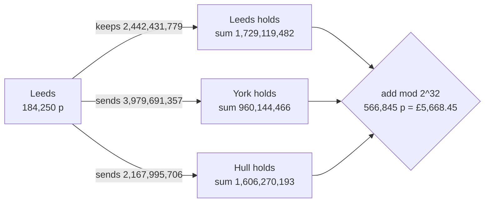
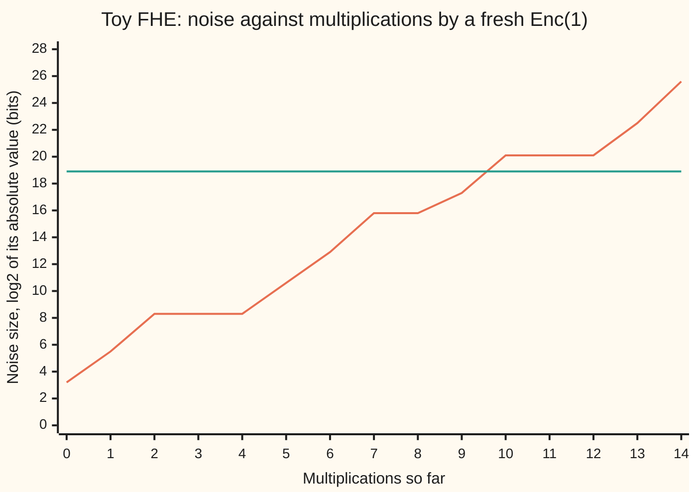

# Computing on secrets: add shares, multiply with a triple, or compute under encryption

[Syllabus](../../../SYLLABUS.md) → [Applied and computational](../README.md) → [Cryptography](../README.md#s04) → Computing on secrets

---

## General Overview

A bakery chain has three branches, in Leeds, York and Hull. Each is run by a separate franchise owner. Tonight the owners want one number: the chain's total takings for the day, to set tomorrow's flour order. No owner wants the other two to see their own till.

Leeds took £1,842.50, York £2,316.75 and Hull £1,509.20. The owners learn the total, £5,668.45, and nothing else. No one, not even a trusted accountant, ever sees a single branch's figure.

The trick is to split each secret into random-looking pieces called **shares**. Leeds turns 184,250 pence into three numbers, each up to ten digits long and each looking like pure chance, that add up to 184,250 on a clock of 2^32 (arithmetic that wraps round at 2^32). It keeps one share and gives one to each other branch. Each branch adds the three shares it holds and publishes only that sum. The three sums add to the total.

This is **secure multiparty computation** (MPC): several parties compute a function of their private inputs and learn only the output. Adding is free. Multiplying two shared numbers needs one extra ingredient, a **Beaver triple**: random shared numbers prepared in advance.

The second route is **homomorphic encryption**: encryption that lets anyone compute on ciphertexts (locked messages) without the key. Under Paillier's scheme, multiplying two ciphertexts adds the messages inside. **Fully homomorphic encryption** (FHE) can both add and multiply, at the price of a growing error called noise.

Every Paillier and FHE number below comes from toy keys, small enough to check by hand and **insecure** for that reason. Real Paillier keys use a 3072-bit n.

**Hide each secret as random shares, or inside an encryption that respects addition; sums then pass straight through the hiding, a product needs one prepared triple of shared random numbers, and the only thing anyone learns is the answer.**

**What kind of fact this is:** four theorems, proved on this card in Why it works:

- the shares add to the true total, and any two of the three shares are uniformly random whatever the input (so two owners who pool their shares learn nothing from the shares; the total, with their own two figures, still gives them the third);
- the Beaver identity gives the true product;
- Paillier decryption of a product of ciphertexts gives the sum of the messages, below n;
- the toy FHE decrypts correctly while its noise stays under half the key.

The privacy of shares needs no unproved assumption, only that owners follow the protocol and send shares over private links. Paillier's secrecy assumes that n-th powers mod n² look like random numbers (the decisional composite residuosity assumption); with a 3072-bit n the best known attack, factoring n, takes about 2^128 operations. FHE's rests on other problems. The integer scheme behind this card's toy assumes that the approximate greatest-common-divisor problem is hard: finding a secret number, the key, from many numbers that each lie close to a multiple of it. Today's practical schemes assume that learning with errors, a lattice problem, is hard. All three assumptions are unproved as of 2026-11-23.

### The picture: one evening, three sums



Schematic. Only Leeds's three shares are drawn; York and Hull split their takings the same way. Each published sum mixes one share from every branch, so it reveals no branch's figure.

---

## The formula

Notation first, in words. A secret x is split into three shares $`x_1, x_2, x_3`$: two drawn at random from 0 to M − 1, the third chosen so the three add to x, all mod M. Here M = 2^32. On this card c is the third number of a Beaver triple, not a ciphertext as on [The one-time pad](01-one-time-pad-and-perfect-secrecy.md), and d and e are two published numbers, not RSA's exponents. A ciphertext is written Enc(m, r).

**Shares.**

```math
x = x_1 + x_2 + x_3 \pmod M, \qquad \text{total} = \sum_{\text{branches}} x \;=\; \sum_{j=1}^{3} \Big(\sum_{\text{branches}} x_j\Big) \pmod M
```

**Read it aloud:** each secret is the sum of its three shares; the total is the sum of what each branch holds, added up.

**A Beaver triple.** To multiply shared x and y, use a prepared triple: shared random a and b, and shared c = ab. Publish d = x − a and e = y − b. Then

```math
x\,y = c + d\,b + e\,a + d\,e \pmod M
```

**Read it aloud:** the product is the prepared product, plus d times b's shares, plus e times a's shares, plus one public d times e.

**Paillier.** Pick primes p and q, set n = pq and g = n + 1. With a fresh random r that shares no factor with n:

```math
\mathrm{Enc}(m, r) = g^{m}\, r^{n} \bmod n^2, \qquad \mathrm{Enc}(m_1, r_1)\cdot \mathrm{Enc}(m_2, r_2) = \mathrm{Enc}(m_1 + m_2,\; r_1 r_2) \bmod n^2
```

**Read it aloud:** to encrypt, raise g to the message and multiply by r to the n; multiplying two ciphertexts gives a ciphertext of the sum.

Decryption uses λ = lcm(p − 1, q − 1), the least common multiple, the function L(u) = (u − 1)/n, and μ, the number that multiplies λ to 1 mod n:

```math
m = L\big(\mathrm{Enc}^{\lambda} \bmod n^2\big)\cdot \mu \bmod n
```

**Read it aloud:** raise the ciphertext to λ, subtract one, divide by n, and multiply by μ, all mod n.

| Symbol | Plain meaning | In our example | Push it up and the answer… |
| --- | --- | --- | --- |
| $`x, y`$ | secret inputs to a product | 120 sacks of flour (Hull); 1,840 p a sack (York) | the product grows; must stay under M |
| $`x_1, x_2, x_3`$ | the three shares of a secret | Leeds: 2,442,431,779; 3,979,691,357; 2,167,995,706 | — each looks random |
| $`M`$ | the clock the shares wrap round | 2^32 pence, a ceiling of £42,949,672.96 | totals up to M fit; above, they wrap |
| $`a, b, c`$ | a Beaver triple, c = ab mod M | by hand 100, 1,000, 100,000 | — |
| $`d, e`$ | the published differences x − a and y − b | by hand 20 and 840 | — reveal nothing when a, b are random |
| $`n = pq`$ | Paillier's public modulus, from two secret primes | 77 = 7 × 11 (real: 3072 bits) | room for larger sums; harder to factor |
| $`g`$ | the base, n + 1 | 78 | — |
| $`\mathrm{Enc}(m, r)`$ | a ciphertext of message m with fresh random r | Leeds: m = 18 (hundreds of pounds), r = 5 → 5,855 | — |
| $`\lambda, \mu, L`$ | the decryption key: lcm(p − 1, q − 1), its inverse mod n, and L(u) = (u − 1)/n | 30, 18 | — |
| $`K`$ | the FHE toy's secret odd key | 1,000,003 | more multiplications before failure |
| $`u, X`$ | a random multiplier of K, and the public multiple X = K × 4,294,967,311 that ciphertexts are reduced by | — | — |
| $`\nu`$ | noise: the small remainder inside an FHE ciphertext, 2s + m with s a small random number, so the bit is its parity | fresh Enc(1): 9 | decryption fails past K/2 |

### When it holds

- **Shares are uniform over the whole clock.** Draw them from 0 to 9,999 pence without wrapping and the share Hull holds pins Leeds's takings to between £1,740.47 and £1,940.45.
- **The answer fits under the clock.** Shares total correctly only below M; a Paillier sum only below n. A week of the toy Paillier total, 392, decrypts to 7.
- **Everyone follows the protocol.** This card's security is against owners who are curious but honest. An owner who publishes a wrong sum shifts the total and nothing notices; protocols for cheating parties add checks such as message tags or [Zero-knowledge](10-zero-knowledge-proofs-in-outline.md) proofs.
- **Every random number is fresh and used once.** A Beaver triple used twice leaks the difference of two secrets; a Paillier r of 1 leaves the message in plain view.
- **The FHE noise stays under K/2.** In the toy it passes that limit at the 10th multiplication, and decryption then gives wrong bits.

---

## Why it works

### Step 0: a random mask hides a number completely

Add a uniformly random number to a secret, on a clock, and the result is uniformly random too. Every result is equally likely, whatever the secret. That is the idea of [The one-time pad](01-one-time-pad-and-perfect-secrecy.md). Shares are masked numbers that still add up correctly.

Adding is linear: masks add along with the secrets, and they were built to cancel. Multiplying is not: the product of two masked numbers carries cross terms. A Beaver triple supplies those cross terms in advance. Paillier puts the message in an exponent, where multiplying ciphertexts adds exponents.

### Step 1: shares add up, and any two of them say nothing

**They add up.** Each share is a number mod M. The total is a double sum: over branches, then over shares. Swap the order of the two sums and each branch's published number is one column. In the run, 1,729,119,482 + 960,144,466 + 1,606,270,193, mod 2^32, is 566,845 pence: £5,668.45, matching the direct sum.

**Any clock works.** Rebuilding additive shares only adds; it never divides. So the clock need not be prime, and 2^32, the size of a computer word, is fine. Shamir's rebuild on [Secret sharing](12-shamir-secret-sharing.md) divides by differences of share positions, which is why that card needs a prime clock.

**Two shares say nothing.** Fix the secret x. The first two shares are drawn uniformly, and the third is x minus them. Any two shares, say the first and third, are made from the two random draws by a one-to-one rule: given the two shares, the draws can be recovered. So the pair takes every value equally often, for every x. Two owners pooling their shares of Leeds's figure see a uniform random pair.

The check enumerates this on a clock of 8: for each of the 8 inputs and each of the 3 pairs of positions, the 64 coin choices give all 64 value pairs once each.

What they can learn is what the output implies. Leeds knows the total and its own takings, so it infers York plus Hull: 382,595 p. That leak is in the answer, not in the protocol.

### Step 2: one product from a prepared triple

Write x = d + a and y = e + b, then multiply out:

```math
x\,y = (d + a)(e + b) = d\,e + d\,b + e\,a + a\,b = c + d\,b + e\,a + d\,e
```

Every piece is easy for the branches. They hold shares of a, b and c. Each computes its shares of x − a and y − b, and all three are added to publish d and e. Then each branch sets its share of the product to $`c_i + d\,b_i + e\,a_i`$, where $`a_i`$, $`b_i`$, $`c_i`$ are its shares of the triple, and one branch also adds the public d·e. The sum of those shares is the right-hand side.

The product here is the cost of Hull's flour order, 120 sacks, at the price York negotiated with its miller, 1,840 p a sack; neither owner wants to show the other its own figure. By hand, with x = 120 sacks, y = 1,840 p a sack and a tiny triple a = 100, b = 1,000, c = 100,000: d = 20, e = 840, and 100,000 + 20,000 + 84,000 + 16,800 = 220,800 p. That is £2,208.00, which is 120 × 1,840.

In the run the triple is random mod 2^32: a = 438,309,620 and b = 350,766,914. Publishing d = x − a reveals nothing, because a uniform a makes d uniform; the check confirms d takes all 16 values for every x on a clock of 16. The identity itself is checked for all 65,536 choices of x, y, a and b mod 16.

Where does the triple come from? Before the evening's inputs exist, a helper server deals it, or the branches make it together using homomorphic encryption or oblivious transfer (a protocol in which a receiver gets one of two messages without the sender learning which). This is the **offline phase**. The **online phase**, with real inputs, then costs only two published numbers per multiplication.

Additions and multiplications together compute any function written as a circuit of add and multiply gates. The other general method, **garbled circuits**, encrypts a circuit's truth tables instead; it is not covered here.

### Step 3: Paillier, where multiplying adds

Three facts do the work.

1. **The base turns exponents into multiples.** By the binomial theorem, $`(1 + n)^m = 1 + m n + (\text{terms with } n^2)`$. So $`g^m = 1 + m n \bmod n^2`$. Leeds's 18 gives 1 + 18 × 77 = 1,387. The check confirms this for all 77 messages.
2. **Multiplying adds.** $`g^{m_1} r_1^n \cdot g^{m_2} r_2^n = g^{m_1 + m_2} (r_1 r_2)^n`$, which is a valid ciphertext of the sum. The check confirms Dec(Enc(m1)·Enc(m2)) = m1 + m2 mod n for all 5,929 pairs.
3. **Raising to λ removes r.** Any r sharing no factor with n satisfies $`r^{n\lambda} = 1 \bmod n^2`$. What remains is $`(1 + n)^{m\lambda} = 1 + m\lambda n`$. So L returns mλ mod n, and μ, which multiplies λ to 1, returns m.

<details>
<summary>Why r to the power nλ is 1 mod n squared</summary>

The numbers mod n² that share no factor with n form a group of size n·φ(n), where φ(n) = (p − 1)(q − 1). Mod p², every such number raised to p(p − 1) is 1, by Euler's theorem. Likewise mod q² with q(q − 1).

The number nλ = pq·lcm(p − 1, q − 1) is a multiple of both p(p − 1) and q(q − 1). So $`\displaystyle r^{n\lambda}`$ is 1 mod p² and 1 mod q². By the Chinese remainder theorem it is 1 mod n².

Then $`\displaystyle \mathrm{Enc}(m, r)^{\lambda} = (1 + n)^{m\lambda}\, r^{n\lambda} = 1 + m\lambda n \pmod{n^2}`$, and L gives $`\displaystyle m\lambda \bmod n`$.

</details>

The second road is exhaustive. Every pair of a message m from 0 to 76 and an r from 1 to 76 sharing no factor with 77 gives a different ciphertext: 4,620 pairs, 4,620 ciphertexts, exactly the number of values mod 5,929 that share no factor with 77. So the encryption map is one-to-one and onto, and a lookup table built from it agrees with decryption every time.

The same 18 encrypts 60 different ways, one per r. So a guesser who encrypts 18 and compares learns nothing, unlike with textbook RSA on [RSA in full](04-rsa-in-full.md), which is homomorphic for multiplication but has no randomness.

Paillier adds encrypted numbers, and multiplies one by a known whole number by raising the ciphertext to that power. It cannot multiply two encrypted numbers.

### Step 4: fully homomorphic encryption, in outline

FHE adds and multiplies under encryption, so it can run any circuit on data it cannot read. Every known scheme does it by carrying a small error, the **noise**, that grows with each operation.

The toy here is the integer scheme of 2010 listed in Sources. The secret key is an odd number K = 1,000,003. A bit m is encrypted as

```math
\mathrm{Enc}(m) = K\,u + \nu, \qquad \nu = 2s + m \text{ with } s \text{ a small random number from } -4 \text{ to } 4
```

**Read it aloud:** a random multiple of the key, plus a small noise whose parity is the bit.

To decrypt, take the remainder mod K, move it into the range −K/2 to K/2, and read its parity. Add two ciphertexts and the noises add; their parities add mod 2, which is XOR. Multiply and the noises multiply; their parities multiply, which is AND. The multiples of K never reach the remainder. With XOR and AND, any computation on bits can be built.

The catch is size. A fresh Enc(1) here has noise 9. Adding 1,000 fresh Enc(1) gave a total noise of only 1,328. Each multiplication multiplies it, and once the noise passes K/2 = 500,001 the remainder wraps and the parity is a coin flip.



The rising line is the noise after each multiplication. The flat line is the limit, log2 of K/2 = 18.9 bits. The noise crosses it at the 10th multiplication, and the 10th, 11th and 12th decrypted bits come out 0 instead of 1. Flat steps are multiplications by a ciphertext whose noise was ±1.

Real schemes use the same idea at large sizes and add **bootstrapping**: running the decryption circuit itself under encryption, with an encrypted copy of the key, to give a fresh ciphertext with small noise. The first scheme to do this, in 2009, made computations of any length possible. Today's schemes build the noise from learning with errors, the lattice problem on [Lattices](09-lattices-and-post-quantum-cryptography.md).

---

## Worked numbers, by hand

| Step | Arithmetic | Value |
| --- | --- | --- |
| Leeds's random shares | two draws mod 2^32 | 2,442,431,779 and 3,979,691,357 |
| Leeds's third share | 184,250 minus both, mod 2^32 | 2,167,995,706 |
| each branch adds the shares it holds | Leeds, York, Hull | 1,729,119,482; 960,144,466; 1,606,270,193 |
| total | sum of the three, mod 2^32 | **566,845 p = £5,668.45** |
| Beaver, by hand | 100,000 + 20 × 1,000 + 840 × 100 + 20 × 840 | 220,800 p = £2,208.00 |
| Paillier: Leeds encrypts 18 | 1,387 × 5^77 mod 5,929 = 1,387 × 1,697 mod 5,929 | 5,855 |
| York's 23 and Hull's 15, with r = 13 and 20 | same recipe | 4,451 and 4,822 |
| multiply the three ciphertexts | 5,855 × 4,451 × 4,822 mod 5,929 | 1,305 |
| decrypt | 1,305^30 mod 5,929 = 4,852; L = (4,852 − 1)/77 = 63; 63 × 18 mod 77 | **56** |

**The shares give the exact total, £5,668.45; Paillier, run on figures rounded to hundreds of pounds, gives the sum of those rounded figures, 18 + 23 + 15 = 56 hundreds**, and in neither case did a branch's figure leave the branch unprotected.

### What breaks if you drop a piece

| Mistake | Comes out at | What went wrong |
| --- | --- | --- |
| Shares drawn from 0 to 9,999 p, no wrap | Hull's share 174,047 p puts Leeds between £1,740.47 and £1,940.45 | A small mask hides only the last few digits |
| One Beaver triple used for x = 120 and x' = 95 | d − d' = 25, the difference of two secrets | The same a cancels when two d's are compared |
| Paillier with r = 1 | Enc(18) = 1,387, and (1,387 − 1)/77 = 18 | With no random factor, the ciphertext is 1 + mn |
| A week's total, Enc(56) to the 7th | decrypts to 7, not 392 | Sums wrap mod n = 77 |
| The toy modulus 77 | split as 7 × 11 after 6 trial divisions; total 56 read without the key | The factors give λ; real n has 3072 bits |
| FHE beyond its noise budget | bit 1 decrypts as 0 at the 10th multiplication | Noise 1,157,625 passed K/2 = 500,001 |

The code prints every row.

---

## Code, from first principles, and it actually runs

The script runs all three methods on the bakery numbers and checks each one by more than one road:

- **Shares:** the protocol's total against the direct sum; privacy by listing every input and every coin on a clock of 8.
- **Beaver:** the random-triple protocol against the direct product and the by-hand triple; the identity for all 65,536 cases mod 16.
- **Paillier:** decryption against a lookup table of all 4,620 ciphertexts; the binomial identity for all 77 messages; the homomorphism for all 5,929 pairs; and an attacker's road, factoring 77, that reaches the same 56.
- **FHE:** each decrypted bit against the true XOR or AND, with the noise tracked exactly beside it.

Powers, inverses and the SplitMix64 generator (seed 2026) are written out, so both languages print the same lines. No three-argument `pow`, no `random`. All of it is **insecure**: Paillier at n = 77 and an FHE key of 1,000,003. Real Paillier uses a 3072-bit n (ISO/IEC 18033-6 standardises the scheme); real FHE uses lattice schemes with far larger keys.

### Python

```python
# Computing on secrets -- the check behind the card.  Standard library only.
# Additive shares mod 2^32, one Beaver-triple multiplication, toy Paillier (n = 77)
# and a toy integer FHE.  TOY SIZES, INSECURE: real Paillier uses n of 3072 bits
# (ISO/IEC 18033-6); real FHE uses lattice (LWE) schemes with far larger keys.
from math import gcd, log2
M, M64 = 1 << 32, (1 << 64) - 1
class SplitMix64:                         # seeded generator, same in Rust
    def __init__(self, seed): self.s = seed
    def next(self):
        self.s = (self.s + 0x9E3779B97F4A7C15) & M64
        z = self.s
        z = ((z ^ (z >> 30)) * 0xBF58476D1CE4E5B9) & M64
        z = ((z ^ (z >> 27)) * 0x94D049BB133111EB) & M64
        return z ^ (z >> 31)
def power(b, e, m):                       # square-and-multiply, written out
    out, b = 1, b % m
    while e:
        out = out * b % m if e & 1 else out
        b, e = b * b % m, e >> 1
    return out
def inverse(a, m):                        # extended Euclid: a * inverse = 1 mod m
    r0, r1, t0, t1 = m, a % m, 0, 1
    while r1:
        k = r0 // r1
        r0, r1, t0, t1 = r1, r0 - k * r1, t1, t0 - k * t1
    return t0 % m
rng = SplitMix64(2026)
def share(x, m=M):                        # three random shares that add up to x mod m
    s1, s2 = rng.next() % m, rng.next() % m
    return [s1, s2, (x - s1 - s2) % m]
def pounds(p): return f"£{p // 100:,}.{p % 100:02d}"
def yn(t): return "yes" if t else "no"

# ---- 1. the sum: three branches, takings in pence, shares mod 2^32 ----
names, takings = ["Leeds", "York", "Hull"], [184250, 231675, 150920]
sh = [share(t) for t in takings]          # sh[i][j]: share of branch i's takings, held by j
for i in range(3): print(f"{names[i]} takes {pounds(takings[i])} = {takings[i]} p; shares {sh[i]}")
held = [sum(sh[i][j] for i in range(3)) % M for j in range(3)]
total = sum(held) % M
print(f"each branch adds what it holds: {held}")
print(f"published sums added mod 2^32 = {total} p = {pounds(total)}; direct sum {sum(takings)}; "
      f"Leeds infers York + Hull = {total - takings[0]} p; ceiling 2^32 p = {pounds(M)}")
pairs = [(t, i, j, v[i], v[j]) for t in range(8) for s1 in range(8) for s2 in range(8)
         for v in [[s1, s2, (t - s1 - s2) % 8]] for i, j in [(0, 1), (0, 2), (1, 2)]]
uniform = len(pairs) == len(set(pairs)) == 8 * 3 * 64   # privacy, modulus 8, every coin
print(f"privacy, modulus 8: any two of three shares take all 64 value pairs once each, for all 8 inputs: {yn(uniform)}")
w1, w2 = rng.next() % 10000, rng.next() % 10000          # break 1: narrow shares, no wrap
leak = takings[0] - w1 - w2
print(f"break 1, shares 0..9,999 p with no wrap: Hull holds {leak} p, so Leeds took {pounds(leak)} to {pounds(leak + 19998)}")
# ---- 2. one product with a Beaver triple ----
x, y = 120, 1840                          # sacks of flour (Hull), pence per sack (York)
a0, b0, c0, d0, e0 = 100, 1000, 100 * 1000, x - 100, y - 1000   # a small triple, by hand
hand = c0 + d0 * b0 + e0 * a0 + d0 * e0
print(f"by hand: a = {a0}, b = {b0}, c = {c0}; d = {d0}, e = {e0}; c + d b + e a + d e = "
      f"{c0} + {d0 * b0} + {e0 * a0} + {d0 * e0} = {hand}")
a, b = rng.next() % M, rng.next() % M
c = a * b % M
xs, ys, as_, bs, cs = share(x), share(y), share(a), share(b), share(c)
d = sum(xs[i] - as_[i] for i in range(3)) % M            # opened in public
e = sum(ys[i] - bs[i] for i in range(3)) % M
z = [(cs[i] + d * bs[i] + e * as_[i] + (d * e if i == 0 else 0)) % M for i in range(3)]
prod_xy = sum(z) % M
print(f"triple: a = {a}, b = {b}, c = ab mod 2^32 = {c}")
print(f"opened: d = x - a = {d}, e = y - b = {e} (mod 2^32)")
print(f"product shares {z}; sum mod 2^32 = {prod_xy} p = {pounds(prod_xy)}; direct {x} * {y} = {x * y}")
ident = all((aa * bb + dd * bb + ee * aa + dd * ee) % 16 == (xx * yy) % 16
            for xx in range(16) for yy in range(16) for aa in range(16) for bb in range(16)
            for dd in [(xx - aa) % 16] for ee in [(yy - bb) % 16])
dun = all(len({(xx - aa) % 16 for aa in range(16)}) == 16 for xx in range(16))
print(f"identity mod 16, all 65536 (x, y, a, b): {yn(ident)}; d takes all 16 values for every x: {yn(dun)}")
x2, d2 = 95, (95 - a) % M                 # break 2: the same triple reused
print(f"break 2, triple reused for x' = {x2}: d - d' = {(d - d2) % M} = x - x', leaked")
# ---- 3. toy Paillier, n = 7 * 11 = 77 ----
p, q = 7, 11
n, n2, g, lam = p * q, (p * q) ** 2, p * q + 1, (p - 1) * (q - 1) // gcd(p - 1, q - 1)
L = lambda u: (u - 1) // n
mu = inverse(L(power(g, lam, n2)), n)
enc = lambda m, r: power(g, m, n2) * power(r, n, n2) % n2
dec = lambda ct: L(power(ct, lam, n2)) * mu % n
print(f"Paillier: n = {n}, n^2 = {n2}, g = {g}, lambda = {lam}, mu = {mu}; real n 3072 bits (about 2^128 work), ciphertexts {2 * 3072} bits")
ms, rs = [18, 23, 15], [5, 13, 20]        # takings in hundreds of pounds, rounded
cts = [enc(m, r) for m, r in zip(ms, rs)]
for i in range(3):
    print(f"  {names[i]}: m = {ms[i]}, r = {rs[i]}: g^m = {power(g, ms[i], n2)}, "
          f"r^n = {power(rs[i], n, n2)}, Enc = {cts[i]}, decrypts to {dec(cts[i])}")
prod = cts[0] * cts[1] % n2 * cts[2] % n2
print(f"product of ciphertexts mod n^2 = {prod}; to the lambda mod n^2 = {power(prod, lam, n2)}, "
      f"L = {L(power(prod, lam, n2))}, times mu mod n = {dec(prod)}; sum {sum(ms)}")
binom = all(power(g, m, n2) == (1 + m * n) % n2 for m in range(n))
table = {enc(m, r): m for m in range(n) for r in range(1, n) if gcd(r, n) == 1}
units = sum(1 for u in range(1, n2) if gcd(u, n2) == 1)
look = all(dec(ct) == m for ct, m in table.items())
hom = all(dec(enc(m1, 5) * enc(m2, 13) % n2) == (m1 + m2) % n for m1 in range(n) for m2 in range(n))
same = len({enc(18, r) for r in range(1, n) if gcd(r, n) == 1})
print(f"(1 + n)^m = 1 + mn mod n^2 for all 77 m: {yn(binom)}; {len(table)} (m, r) pairs give "
      f"{len(table)} distinct ciphertexts = {units} units mod n^2")
print(f"lookup agrees with decryption: {yn(look)}; Dec(Enc(m1) Enc(m2)) = m1 + m2 mod n for "
      f"all 5929 pairs: {yn(hom)}; 18 encrypts {same} ways")
c1 = enc(18, 1)                           # break 3: r = 1, no randomness
print(f"break 3, r = 1: Enc(18) = {c1}; anyone computes ({c1} - 1)/{n} = {(c1 - 1) // n}")
week = power(prod, 7, n2)                 # break 4: past n the sum wraps
print(f"break 4, a week, Enc(56)^7: decrypts to {dec(week)}, not {7 * sum(ms)}")
f = next(k for k in range(2, n) if n % k == 0)
lam2 = (f - 1) * (n // f - 1) // gcd(f - 1, n // f - 1)
crack = (power(prod, lam2, n2) - 1) // n * inverse(lam2, n) % n
print(f"break 5, trial division splits 77 = {f} * {n // f} after {f - 1} tries; total read without the key: {crack}")
# ---- 4. toy FHE over the integers: secret odd K, noise grows ----
K, U0, X = 1000003, 4294967311, 1000003 * 4294967311   # X: public multiple of K
def fenc(bit):
    nu = 2 * (rng.next() % 9 - 4) + bit   # noise: small, with the bit as its parity
    return (K * (rng.next() % U0) + nu) % X, nu
fdec = lambda ct: (ct % K - K if ct % K > K // 2 else ct % K) % 2   # centre, read parity
(e1, v1), (e2, v2) = fenc(1), fenc(0)
print(f"FHE toy: K = {K}, X = K * {U0}; Enc(1) noise {v1}, Enc(0) noise {v2}; "
      f"add -> {fdec((e1 + e2) % X)} (1 XOR 0), multiply -> {fdec(e1 * e2 % X)} (1 AND 0)")
tot, nz, par = 0, 0, 0
for _ in range(1000):
    ct, nu = fenc(1)
    tot, nz, par = (tot + ct) % X, nz + nu, par ^ 1
print(f"1000 additions of Enc(1): noise {nz}, decrypts to {fdec(tot)}, true XOR {par}")
acc, noise, bits = e1, [v1], []
while len(bits) < 14:                     # multiply by fresh Enc(1), 14 times
    ct, nu = fenc(1)
    acc = acc * ct % X
    noise.append(noise[-1] * nu)
    bits.append(fdec(acc))
first = next(k for k in range(len(noise)) if abs(noise[k]) > K // 2)
print(f"chain of multiplications by Enc(1), noise after each: {noise}")
print(f"chart, log2 |noise| after 0..14 multiplications: {[round(log2(abs(v)), 1) for v in noise]}; "
      f"limit log2(K/2) = {log2(K // 2):.1f}")
print(f"decrypted bit after each (true value 1): {bits}; noise passes K/2 = {K // 2} at multiplication {first}")
assert total == sum(takings) == 566845 and uniform                   # sum, two roads
assert leak == (takings[0] - w1 - w2) % M and leak <= takings[0] <= leak + 19998   # break 1: Hull's share by share()'s rule
assert hand == prod_xy == x * y and ident and (d - d2) % M == x - x2
assert mu * lam % n == 1 and dec(prod) == sum(ms) == 56 and binom and look and hom
assert len(table) == units == 4620 and same == 60 and (c1 - 1) // n == 18
assert dec(week) == 7 * sum(ms) % n and crack == 56 and f == p
assert fdec((e1 + e2) % X) == 1 and fdec(e1 * e2 % X) == 0 and fdec(tot) == par
assert all(bits[k - 1] == 1 for k in range(1, first)) and bits[first - 1:].count(0) > 0
print("ALL CHECKS PASS")
```

**Ran 2026-11-23 on macOS, Python 3.14.10, standard library only. All checks passed. Output, pasted from the run:**

```
Leeds takes £1,842.50 = 184250 p; shares [2442431779, 3979691357, 2167995706]
York takes £2,316.75 = 231675 p; shares [3454187662, 3584099570, 1551879035]
Hull takes £1,509.20 = 150920 p; shares [127467337, 1986288131, 2181362748]
each branch adds what it holds: [1729119482, 960144466, 1606270193]
published sums added mod 2^32 = 566845 p = £5,668.45; direct sum 566845; Leeds infers York + Hull = 382595 p; ceiling 2^32 p = £42,949,672.96
privacy, modulus 8: any two of three shares take all 64 value pairs once each, for all 8 inputs: yes
break 1, shares 0..9,999 p with no wrap: Hull holds 174047 p, so Leeds took £1,740.47 to £1,940.45
by hand: a = 100, b = 1000, c = 100000; d = 20, e = 840; c + d b + e a + d e = 100000 + 20000 + 84000 + 16800 = 220800
triple: a = 438309620, b = 350766914, c = ab mod 2^32 = 3735457512
opened: d = x - a = 3856657796, e = y - b = 3944202222 (mod 2^32)
product shares [3283059613, 2580639875, 2726455904]; sum mod 2^32 = 220800 p = £2,208.00; direct 120 * 1840 = 220800
identity mod 16, all 65536 (x, y, a, b): yes; d takes all 16 values for every x: yes
break 2, triple reused for x' = 95: d - d' = 25 = x - x', leaked
Paillier: n = 77, n^2 = 5929, g = 78, lambda = 30, mu = 18; real n 3072 bits (about 2^128 work), ciphertexts 6144 bits
  Leeds: m = 18, r = 5: g^m = 1387, r^n = 1697, Enc = 5855, decrypts to 18
  York: m = 23, r = 13: g^m = 1772, r^n = 1371, Enc = 4451, decrypts to 23
  Hull: m = 15, r = 20: g^m = 1156, r^n = 2743, Enc = 4822, decrypts to 15
product of ciphertexts mod n^2 = 1305; to the lambda mod n^2 = 4852, L = 63, times mu mod n = 56; sum 56
(1 + n)^m = 1 + mn mod n^2 for all 77 m: yes; 4620 (m, r) pairs give 4620 distinct ciphertexts = 4620 units mod n^2
lookup agrees with decryption: yes; Dec(Enc(m1) Enc(m2)) = m1 + m2 mod n for all 5929 pairs: yes; 18 encrypts 60 ways
break 3, r = 1: Enc(18) = 1387; anyone computes (1387 - 1)/77 = 18
break 4, a week, Enc(56)^7: decrypts to 7, not 392
break 5, trial division splits 77 = 7 * 11 after 6 tries; total read without the key: 56
FHE toy: K = 1000003, X = K * 4294967311; Enc(1) noise 9, Enc(0) noise 2; add -> 1 (1 XOR 0), multiply -> 0 (1 AND 0)
1000 additions of Enc(1): noise 1328, decrypts to 0, true XOR 0
chain of multiplications by Enc(1), noise after each: [9, -45, 315, -315, -315, -1575, -7875, 55125, 55125, 165375, 1157625, 1157625, 1157625, -5788125, -52093125]
chart, log2 |noise| after 0..14 multiplications: [3.2, 5.5, 8.3, 8.3, 8.3, 10.6, 12.9, 15.8, 15.8, 17.3, 20.1, 20.1, 20.1, 22.5, 25.6]; limit log2(K/2) = 18.9
decrypted bit after each (true value 1): [1, 1, 1, 1, 1, 1, 1, 1, 1, 0, 0, 0, 1, 1]; noise passes K/2 = 500001 at multiplication 10
ALL CHECKS PASS
```

### Rust

Same numbers, same labels, built with `rustc --edition 2021 -O`.

```rust
// Computing on secrets -- the same check as the Python, in Rust.  No crates.
// Additive shares mod 2^32, one Beaver-triple multiplication, toy Paillier (n = 77)
// and a toy integer FHE.  TOY SIZES, INSECURE: real Paillier uses n of 3072 bits
// (ISO/IEC 18033-6); real FHE uses lattice (LWE) schemes with far larger keys.
const M: u128 = 1 << 32;

struct SplitMix64 { s: u64 }                       // seeded generator, same in Python
impl SplitMix64 {
    fn next(&mut self) -> u128 {
        self.s = self.s.wrapping_add(0x9E3779B97F4A7C15);
        let mut z = self.s;
        z = (z ^ (z >> 30)).wrapping_mul(0xBF58476D1CE4E5B9);
        z = (z ^ (z >> 27)).wrapping_mul(0x94D049BB133111EB);
        (z ^ (z >> 31)) as u128
    }
}
fn power(b: u128, mut e: u128, m: u128) -> u128 {  // square-and-multiply, written out
    let (mut out, mut b) = (1u128, b % m);
    while e > 0 {
        if e & 1 == 1 { out = out * b % m }
        b = b * b % m;
        e >>= 1;
    }
    out
}
fn gcd(mut a: u128, mut b: u128) -> u128 { while b > 0 { let t = a % b; a = b; b = t; } a }
fn inverse(a: u128, m: u128) -> u128 {              // extended Euclid: a * inverse = 1 mod m
    let (mut r0, mut r1, mut t0, mut t1) = (m as i128, (a % m) as i128, 0i128, 1i128);
    while r1 != 0 {
        let k = r0 / r1;
        (r0, r1, t0, t1) = (r1, r0 - k * r1, t1, t0 - k * t1);
    }
    t0.rem_euclid(m as i128) as u128
}
fn share(rng: &mut SplitMix64, x: u128) -> Vec<u128> { // three random shares adding to x mod 2^32
    let (s1, s2) = (rng.next() % M, rng.next() % M);
    vec![s1, s2, (x + 2 * M - s1 - s2) % M]
}
fn pounds(p: u128) -> String {
    let (w, mut s) = ((p / 100).to_string(), String::new());
    for (i, ch) in w.chars().enumerate() {
        if i > 0 && (w.len() - i) % 3 == 0 { s.push(',') }
        s.push(ch);
    }
    format!("£{}.{:02}", s, p % 100)
}
fn yn(t: bool) -> &'static str { if t { "yes" } else { "no" } }

fn main() {
    let mut rng = SplitMix64 { s: 2026 };
    // ---- 1. the sum: three branches, takings in pence, shares mod 2^32 ----
    let names = ["Leeds", "York", "Hull"];
    let takings: [u128; 3] = [184250, 231675, 150920];
    let sh: Vec<Vec<u128>> = takings.iter().map(|&t| share(&mut rng, t)).collect();
    for i in 0..3 { println!("{} takes {} = {} p; shares {:?}", names[i], pounds(takings[i]), takings[i], sh[i]) }
    let held: Vec<u128> = (0..3).map(|j| (0..3).map(|i| sh[i][j]).sum::<u128>() % M).collect();
    let (total, direct) = (held.iter().sum::<u128>() % M, takings.iter().sum::<u128>());
    println!("each branch adds what it holds: {:?}", held);
    println!("published sums added mod 2^32 = {} p = {}; direct sum {}; Leeds infers York + Hull = {} p; ceiling 2^32 p = {}",
             total, pounds(total), direct, total - takings[0], pounds(M));
    let mut cnt = vec![0u32; 8 * 3 * 64];                // privacy, modulus 8, every coin
    for t in 0..8 { for s1 in 0..8 { for s2 in 0..8 {
        let v = [s1, s2, (t + 16 - s1 - s2) % 8];
        for (k, (i, j)) in [(0, 1), (0, 2), (1, 2)].iter().enumerate() { cnt[(t * 3 + k) * 64 + v[*i] * 8 + v[*j]] += 1 }
    } } }
    let uniform = cnt.iter().all(|&c| c == 1);
    println!("privacy, modulus 8: any two of three shares take all 64 value pairs once each, for all 8 inputs: {}", yn(uniform));
    let (w1, w2) = (rng.next() % 10000, rng.next() % 10000); let leak = takings[0] - w1 - w2;   // break 1: narrow shares, no wrap
    println!("break 1, shares 0..9,999 p with no wrap: Hull holds {} p, so Leeds took {} to {}", leak, pounds(leak), pounds(leak + 19998));
    // ---- 2. one product with a Beaver triple ----
    let (x, y) = (120u128, 1840u128);              // sacks of flour (Hull), pence per sack (York)
    let (a0, b0, c0, d0, e0) = (100u128, 1000u128, 100000u128, x - 100, y - 1000);   // a small triple, by hand
    let hand = c0 + d0 * b0 + e0 * a0 + d0 * e0;
    println!("by hand: a = {}, b = {}, c = {}; d = {}, e = {}; c + d b + e a + d e = {} + {} + {} + {} = {}",
             a0, b0, c0, d0, e0, c0, d0 * b0, e0 * a0, d0 * e0, hand);
    let (a, b) = (rng.next() % M, rng.next() % M);
    let c = a * b % M;
    let (xs, ys, as_, bs, cs) = (share(&mut rng, x), share(&mut rng, y), share(&mut rng, a), share(&mut rng, b), share(&mut rng, c));
    let d = (0..3).map(|i| xs[i] + M - as_[i]).sum::<u128>() % M;   // opened in public
    let e = (0..3).map(|i| ys[i] + M - bs[i]).sum::<u128>() % M;
    let z: Vec<u128> = (0..3).map(|i| (cs[i] + d * bs[i] + e * as_[i] + if i == 0 { d * e } else { 0 }) % M).collect();
    let prod_xy = z.iter().sum::<u128>() % M;
    println!("triple: a = {}, b = {}, c = ab mod 2^32 = {}", a, b, c);
    println!("opened: d = x - a = {}, e = y - b = {} (mod 2^32)", d, e);
    println!("product shares {:?}; sum mod 2^32 = {} p = {}; direct {} * {} = {}", z, prod_xy, pounds(prod_xy), x, y, x * y);
    let mut ident = true;
    for xx in 0..16u128 { for yy in 0..16u128 { for aa in 0..16u128 { for bb in 0..16u128 {
        let (dd, ee) = ((xx + 16 - aa) % 16, (yy + 16 - bb) % 16);
        if (aa * bb + dd * bb + ee * aa + dd * ee) % 16 != xx * yy % 16 { ident = false }
    } } } }
    let dun = (0..16u128).all(|xx| { let mut seen = [false; 16]; for aa in 0..16u128 { seen[((xx + 16 - aa) % 16) as usize] = true } seen.iter().all(|&s| s) });
    println!("identity mod 16, all 65536 (x, y, a, b): {}; d takes all 16 values for every x: {}", yn(ident), yn(dun));
    let (x2, d2) = (95u128, (95 + M - a) % M);    // break 2: the same triple reused
    println!("break 2, triple reused for x' = {}: d - d' = {} = x - x', leaked", x2, (d + M - d2) % M);
    // ---- 3. toy Paillier, n = 7 * 11 = 77 ----
    let (p, q) = (7u128, 11u128);
    let (n, n2, g, lam) = (p * q, p * q * p * q, p * q + 1, (p - 1) * (q - 1) / gcd(p - 1, q - 1));
    let l = |u: u128| (u - 1) / n;
    let mu = inverse(l(power(g, lam, n2)), n);
    let enc = |m: u128, r: u128| power(g, m, n2) * power(r, n, n2) % n2;
    let dec = |ct: u128| l(power(ct, lam, n2)) * mu % n;
    println!("Paillier: n = {}, n^2 = {}, g = {}, lambda = {}, mu = {}; real n 3072 bits (about 2^128 work), ciphertexts {} bits", n, n2, g, lam, mu, 2 * 3072);
    let (ms, rs) = ([18u128, 23, 15], [5u128, 13, 20]);   // takings in hundreds of pounds, rounded
    let cts: Vec<u128> = (0..3).map(|i| enc(ms[i], rs[i])).collect();
    for i in 0..3 {
        println!("  {}: m = {}, r = {}: g^m = {}, r^n = {}, Enc = {}, decrypts to {}", names[i], ms[i], rs[i],
                 power(g, ms[i], n2), power(rs[i], n, n2), cts[i], dec(cts[i]));
    }
    let prod = cts[0] * cts[1] % n2 * cts[2] % n2;
    let msum: u128 = ms.iter().sum();
    println!("product of ciphertexts mod n^2 = {}; to the lambda mod n^2 = {}, L = {}, times mu mod n = {}; sum {}",
             prod, power(prod, lam, n2), l(power(prod, lam, n2)), dec(prod), msum);
    let binom = (0..n).all(|m| power(g, m, n2) == (1 + m * n) % n2);
    let mut table: Vec<Option<u128>> = vec![None; n2 as usize];
    let mut pairs = 0u128;
    for m in 0..n { for r in 1..n { if gcd(r, n) == 1 { table[enc(m, r) as usize] = Some(m); pairs += 1 } } }
    let distinct = table.iter().filter(|t| t.is_some()).count() as u128;
    let units = (1..n2).filter(|&u| gcd(u, n2) == 1).count() as u128;
    let look = (0..n2).all(|ct| match table[ct as usize] { Some(m) => dec(ct) == m, None => true });
    let hom = (0..n).all(|m1| (0..n).all(|m2| dec(enc(m1, 5) * enc(m2, 13) % n2) == (m1 + m2) % n));
    let mut seen18 = vec![false; n2 as usize];
    for r in 1..n { if gcd(r, n) == 1 { seen18[enc(18, r) as usize] = true } }
    let same = seen18.iter().filter(|&&s| s).count();
    println!("(1 + n)^m = 1 + mn mod n^2 for all 77 m: {}; {} (m, r) pairs give {} distinct ciphertexts = {} units mod n^2",
             yn(binom), pairs, distinct, units);
    println!("lookup agrees with decryption: {}; Dec(Enc(m1) Enc(m2)) = m1 + m2 mod n for all 5929 pairs: {}; 18 encrypts {} ways",
             yn(look), yn(hom), same);
    let c1 = enc(18, 1);                           // break 3: r = 1, no randomness
    println!("break 3, r = 1: Enc(18) = {}; anyone computes ({} - 1)/{} = {}", c1, c1, n, (c1 - 1) / n);
    let week = power(prod, 7, n2);                 // break 4: past n the sum wraps
    println!("break 4, a week, Enc(56)^7: decrypts to {}, not {}", dec(week), 7 * msum);
    let f = (2..n).find(|k| n % k == 0).unwrap();
    let lam2 = (f - 1) * (n / f - 1) / gcd(f - 1, n / f - 1);
    let crack = (power(prod, lam2, n2) - 1) / n * inverse(lam2, n) % n;
    println!("break 5, trial division splits 77 = {} * {} after {} tries; total read without the key: {}", f, n / f, f - 1, crack);
    // ---- 4. toy FHE over the integers: secret odd K, noise grows ----
    let (kk, u0, xm) = (1000003u128, 4294967311u128, 1000003u128 * 4294967311);   // xm: public multiple of K
    let mut fenc = |bit: i128| -> (u128, i128) {
        let nu = 2 * ((rng.next() % 9) as i128 - 4) + bit;   // noise: small, with the bit as its parity
        ((kk * (rng.next() % u0) + xm).wrapping_add_signed(nu) % xm, nu)
    };
    let fdec = |ct: u128| -> i128 { let v = (ct % kk) as i128; (if v > (kk / 2) as i128 { v - kk as i128 } else { v }).rem_euclid(2) };
    let ((e1, v1), (e2, v2)) = (fenc(1), fenc(0));
    println!("FHE toy: K = {}, X = K * {}; Enc(1) noise {}, Enc(0) noise {}; add -> {} (1 XOR 0), multiply -> {} (1 AND 0)",
             kk, u0, v1, v2, fdec((e1 + e2) % xm), fdec(e1 * e2 % xm));
    let (mut tot, mut nz, mut par) = (0u128, 0i128, 0i128);
    for _ in 0..1000 { let (ct, nu) = fenc(1); tot = (tot + ct) % xm; nz += nu; par ^= 1; }
    println!("1000 additions of Enc(1): noise {}, decrypts to {}, true XOR {}", nz, fdec(tot), par);
    let (mut acc, mut noise, mut bits) = (e1, vec![v1], Vec::new());
    while bits.len() < 14 {                        // multiply by fresh Enc(1), 14 times
        let (ct, nu) = fenc(1);
        acc = acc * ct % xm;
        noise.push(noise[noise.len() - 1] * nu);
        bits.push(fdec(acc));
    }
    let first = (0..noise.len()).find(|&k| noise[k].unsigned_abs() > kk / 2).unwrap();
    let lg: Vec<String> = noise.iter().map(|v| format!("{:.1}", (v.unsigned_abs() as f64).log2())).collect();
    println!("chain of multiplications by Enc(1), noise after each: {:?}", noise);
    println!("chart, log2 |noise| after 0..14 multiplications: [{}]; limit log2(K/2) = {:.1}", lg.join(", "), ((kk / 2) as f64).log2());
    println!("decrypted bit after each (true value 1): {:?}; noise passes K/2 = {} at multiplication {}", bits, kk / 2, first);
    assert!(total == direct && direct == 566845 && uniform);              // sum, two roads
    assert!(leak == (takings[0] + 2 * M - w1 - w2) % M && leak <= takings[0] && takings[0] <= leak + 19998);   // break 1: Hull's share by share()'s rule
    assert!(hand == prod_xy && prod_xy == x * y && ident && (d + M - d2) % M == x - x2);
    assert!(mu * lam % n == 1 && dec(prod) == msum && msum == 56 && binom && look && hom);
    assert!(distinct == units && units == 4620 && pairs == 4620 && same == 60 && (c1 - 1) / n == 18);
    assert!(dec(week) == 7 * msum % n && crack == 56 && f == p);
    assert!(fdec((e1 + e2) % xm) == 1 && fdec(e1 * e2 % xm) == 0 && fdec(tot) == par);
    assert!((1..first).all(|k| bits[k - 1] == 1) && bits[first - 1..].contains(&0));
    println!("ALL CHECKS PASS");
}
```

**Ran 2026-11-23 on macOS, rustc 1.98.1, no crates. All checks passed. Output, pasted from the run:**

```
Leeds takes £1,842.50 = 184250 p; shares [2442431779, 3979691357, 2167995706]
York takes £2,316.75 = 231675 p; shares [3454187662, 3584099570, 1551879035]
Hull takes £1,509.20 = 150920 p; shares [127467337, 1986288131, 2181362748]
each branch adds what it holds: [1729119482, 960144466, 1606270193]
published sums added mod 2^32 = 566845 p = £5,668.45; direct sum 566845; Leeds infers York + Hull = 382595 p; ceiling 2^32 p = £42,949,672.96
privacy, modulus 8: any two of three shares take all 64 value pairs once each, for all 8 inputs: yes
break 1, shares 0..9,999 p with no wrap: Hull holds 174047 p, so Leeds took £1,740.47 to £1,940.45
by hand: a = 100, b = 1000, c = 100000; d = 20, e = 840; c + d b + e a + d e = 100000 + 20000 + 84000 + 16800 = 220800
triple: a = 438309620, b = 350766914, c = ab mod 2^32 = 3735457512
opened: d = x - a = 3856657796, e = y - b = 3944202222 (mod 2^32)
product shares [3283059613, 2580639875, 2726455904]; sum mod 2^32 = 220800 p = £2,208.00; direct 120 * 1840 = 220800
identity mod 16, all 65536 (x, y, a, b): yes; d takes all 16 values for every x: yes
break 2, triple reused for x' = 95: d - d' = 25 = x - x', leaked
Paillier: n = 77, n^2 = 5929, g = 78, lambda = 30, mu = 18; real n 3072 bits (about 2^128 work), ciphertexts 6144 bits
  Leeds: m = 18, r = 5: g^m = 1387, r^n = 1697, Enc = 5855, decrypts to 18
  York: m = 23, r = 13: g^m = 1772, r^n = 1371, Enc = 4451, decrypts to 23
  Hull: m = 15, r = 20: g^m = 1156, r^n = 2743, Enc = 4822, decrypts to 15
product of ciphertexts mod n^2 = 1305; to the lambda mod n^2 = 4852, L = 63, times mu mod n = 56; sum 56
(1 + n)^m = 1 + mn mod n^2 for all 77 m: yes; 4620 (m, r) pairs give 4620 distinct ciphertexts = 4620 units mod n^2
lookup agrees with decryption: yes; Dec(Enc(m1) Enc(m2)) = m1 + m2 mod n for all 5929 pairs: yes; 18 encrypts 60 ways
break 3, r = 1: Enc(18) = 1387; anyone computes (1387 - 1)/77 = 18
break 4, a week, Enc(56)^7: decrypts to 7, not 392
break 5, trial division splits 77 = 7 * 11 after 6 tries; total read without the key: 56
FHE toy: K = 1000003, X = K * 4294967311; Enc(1) noise 9, Enc(0) noise 2; add -> 1 (1 XOR 0), multiply -> 0 (1 AND 0)
1000 additions of Enc(1): noise 1328, decrypts to 0, true XOR 0
chain of multiplications by Enc(1), noise after each: [9, -45, 315, -315, -315, -1575, -7875, 55125, 55125, 165375, 1157625, 1157625, 1157625, -5788125, -52093125]
chart, log2 |noise| after 0..14 multiplications: [3.2, 5.5, 8.3, 8.3, 8.3, 10.6, 12.9, 15.8, 15.8, 17.3, 20.1, 20.1, 20.1, 22.5, 25.6]; limit log2(K/2) = 18.9
decrypted bit after each (true value 1): [1, 1, 1, 1, 1, 1, 1, 1, 1, 0, 0, 0, 1, 1]; noise passes K/2 = 500001 at multiplication 10
ALL CHECKS PASS
```

The two outputs match line for line.

### Lean

Lean proves the share and Beaver facts on any clock, Paillier's sum for any distinct primes, and the card's worked numbers.

- Suppose each branch's three shares add to its takings mod M, for any number of branches. Then the three published sums add to the true total.
- Fix a secret x, and draw its first two shares as two coins. Then any two of the three shares are a one-to-one, onto function of the coins. So with uniform coins every pair of share values is equally likely, whatever x is.
- Take any number of parties holding shares of x, y and a triple with c = ab. Then the shares $`c_i + d\,b_i + e\,a_i`$, with d·e added at one party, add to xy.
- Take any n and any m. Then $`(1 + n)^m = 1 + m n \bmod n^2`$, the binomial fact Paillier rests on.
- Take distinct primes p and q, with r1 and r2 sharing no factor with n = pq, and m1 + m2 < n. Then Enc(m1, r1)·Enc(m2, r2) mod n² decrypts to m1 + m2.
- The worked numbers: the published sums give 566,845 p, both Beaver products give 220,800 p, and toy Paillier decrypts to 56.
- The breaks: r = 1 leaves 18 readable, a week's 392 decrypts as 7, and the FHE noise 1,157,625 passes 500,001.

The toy FHE scheme, the exhaustive counts on small clocks and the Paillier lookup table are left to the Python and Rust checks.

```lean
-- Computing on secrets: Paillier's product of ciphertexts decrypts to the sum of the messages, a Beaver triple turns published differences into shares of the true product, and additive shares add to the true total while any two of three are uniformly random.
import Mathlib.Data.ZMod.Basic
import Mathlib.Data.Nat.Prime.Basic
import Mathlib.Algebra.BigOperators.Fin
import Mathlib.Tactic.NormNum.DivMod
import Mathlib.Tactic.NormNum.GCD
import Mathlib.Tactic.FinCases
import Mathlib.Tactic.Ring
import Mathlib.FieldTheory.Finite.Basic

open Finset

theorem one_add_pow_modEq (n k : ℕ) : (n + 1) ^ k ≡ 1 + k * n [MOD n ^ 2] := by
  induction k with
  | zero => simp [Nat.ModEq]
  | succ k ih =>
    have h1 : (n + 1) ^ (k + 1) ≡ (1 + k * n) * (n + 1) [MOD n ^ 2] := by
      rw [pow_succ]; exact ih.mul_right _
    refine h1.trans ?_
    have : (1 + k * n) * (n + 1) = 1 + (k + 1) * n + k * n ^ 2 := by ring
    rw [this]
    unfold Nat.ModEq
    rw [Nat.add_mul_mod_self_right]

#print axioms one_add_pow_modEq

theorem pow_modEq_one_prime_sq (p q r k : ℕ) (hp : p.Prime) (hr : Nat.Coprime r p) :
    r ^ (p * q * Nat.lcm (p - 1) k) ≡ 1 [MOD p ^ 2] := by
  have ht : r ^ Nat.totient (p ^ 2) ≡ 1 [MOD p ^ 2] :=
    Nat.ModEq.pow_totient (Nat.Coprime.pow_right 2 hr)
  rw [Nat.totient_prime_pow hp (by norm_num)] at ht
  have hd : p ^ (2 - 1) * (p - 1) ∣ p * q * Nat.lcm (p - 1) k := by
    simpa using mul_dvd_mul (dvd_mul_right p q) (Nat.dvd_lcm_left (p - 1) k)
  obtain ⟨c, hc⟩ := hd
  rw [hc, pow_mul]
  simpa using ht.pow c

#print axioms pow_modEq_one_prime_sq

/-- Paillier adds under encryption: let p and q be distinct primes, n = p q, g = n + 1,
λ = lcm(p - 1, q - 1), and μ the number that multiplies λ to 1 mod n. Encrypt m with a random r
sharing no factor with n as Enc(m, r) = g^m r^n mod n², and decrypt c as L(c^λ mod n²) μ mod n
with L(u) = (u - 1)/n. Then the product of two ciphertexts, mod n², decrypts to the sum of the
two messages, provided that sum is below n. -/
theorem paillier_product_decrypts_to_sum (p q μ m₁ m₂ r₁ r₂ : ℕ) (hp : p.Prime) (hq : q.Prime)
    (hpq : p ≠ q) (hμ : Nat.lcm (p - 1) (q - 1) * μ % (p * q) = 1)
    (hr₁ : Nat.Coprime r₁ (p * q)) (hr₂ : Nat.Coprime r₂ (p * q)) (hm : m₁ + m₂ < p * q) :
    let n := p * q
    let g := n + 1
    let lam := Nat.lcm (p - 1) (q - 1)
    let enc := fun m r : ℕ => g ^ m * r ^ n % n ^ 2
    let L := fun u : ℕ => (u - 1) / n
    let dec := fun c : ℕ => L (c ^ lam % n ^ 2) * μ % n
    dec (enc m₁ r₁ * enc m₂ r₂ % n ^ 2) = m₁ + m₂ := by
  intro n g lam enc L dec
  have hp2 := hp.two_le
  have hq2 := hq.two_le
  have hn : 2 ≤ n := by
    show 2 ≤ p * q
    nlinarith
  have hn0 : 0 < n := by omega
  set m := m₁ + m₂ with hm_def
  set r := r₁ * r₂ with hr_def
  have hr : Nat.Coprime r (p * q) := Nat.coprime_mul_iff_left.mpr ⟨hr₁, hr₂⟩
  have hC : (enc m₁ r₁ * enc m₂ r₂ % n ^ 2) ≡ (n + 1) ^ m * r ^ n [MOD n ^ 2] := by
    show (g ^ m₁ * r₁ ^ n % n ^ 2 * (g ^ m₂ * r₂ ^ n % n ^ 2)) % n ^ 2 % n ^ 2 = _
    rw [Nat.mod_mod, ← Nat.mul_mod, hm_def, hr_def, pow_add, mul_pow]
    congr 1
    ring
  have hrp : r ^ (n * lam) ≡ 1 [MOD p ^ 2] :=
    pow_modEq_one_prime_sq p q r (q - 1) hp (Nat.Coprime.coprime_mul_right_right hr)
  have hrq : r ^ (n * lam) ≡ 1 [MOD q ^ 2] := by
    have := pow_modEq_one_prime_sq q p r (p - 1) hq (Nat.Coprime.coprime_mul_left_right hr)
    show r ^ (p * q * Nat.lcm (p - 1) (q - 1)) ≡ 1 [MOD q ^ 2]
    rwa [mul_comm p q, Nat.lcm_comm]
  have hcop : Nat.Coprime (p ^ 2) (q ^ 2) :=
    Nat.Coprime.pow 2 2 ((Nat.coprime_primes hp hq).mpr hpq)
  have hrn : r ^ (n * lam) ≡ 1 [MOD n ^ 2] := by
    have := (Nat.modEq_and_modEq_iff_modEq_mul hcop).mp ⟨hrp, hrq⟩
    show r ^ (n * lam) ≡ 1 [MOD (p * q) ^ 2]
    rwa [mul_pow]
  have hpow : (enc m₁ r₁ * enc m₂ r₂ % n ^ 2) ^ lam ≡ 1 + (m * lam % n) * n [MOD n ^ 2] := by
    have h1 := hC.pow lam
    rw [mul_pow ((n + 1) ^ m) (r ^ n) lam, ← pow_mul, ← pow_mul] at h1
    have h2 := (one_add_pow_modEq n (m * lam)).mul hrn
    rw [mul_one] at h2
    refine (h1.trans h2).trans ?_
    have hdiv := Nat.div_add_mod (m * lam) n
    have : 1 + m * lam * n = 1 + (m * lam % n) * n + (m * lam / n) * n ^ 2 := by
      conv_lhs => rw [← hdiv]
      ring
    rw [this]
    unfold Nat.ModEq
    rw [Nat.add_mul_mod_self_right]
  have hlt : 1 + (m * lam % n) * n < n ^ 2 := by
    have : m * lam % n + 1 ≤ n := Nat.mod_lt _ hn0
    nlinarith
  have hkey : (enc m₁ r₁ * enc m₂ r₂ % n ^ 2) ^ lam % n ^ 2 = 1 + (m * lam % n) * n := by
    rw [hpow]
    exact Nat.mod_eq_of_lt hlt
  show L ((enc m₁ r₁ * enc m₂ r₂ % n ^ 2) ^ lam % n ^ 2) * μ % n = m
  rw [hkey]
  show (1 + (m * lam % n) * n - 1) / n * μ % n = m
  rw [Nat.add_sub_cancel_left, Nat.mul_div_cancel _ hn0, Nat.mod_mul_mod, mul_assoc,
    Nat.mul_mod, hμ, mul_one, Nat.mod_mod, Nat.mod_eq_of_lt hm]

#print axioms paillier_product_decrypts_to_sum

/-- One product from a prepared Beaver triple: the parties hold shares of x, y and of a triple
a, b, c with c = a b, all on a clock of M. They publish d = x - a and e = y - b, each party sets
its share of the product to c_i + d b_i + e a_i, and one party also adds d e. The shares then
add to x y, the true product, since x y = c + d b + e a + d e. -/
theorem beaver_triple_shares_sum_to_product {ι : Type*} [Fintype ι] [DecidableEq ι] (M : ℕ)
    (i₀ : ι) (x y a b c : ι → ZMod M) (hc : ∑ i, c i = (∑ i, a i) * (∑ i, b i)) :
    let d := ∑ i, (x i - a i)
    let e := ∑ i, (y i - b i)
    ∑ i, (c i + d * b i + e * a i + if i = i₀ then d * e else 0) = (∑ i, x i) * (∑ i, y i) := by
  intro d e
  simp only [Finset.sum_add_distrib, ← Finset.mul_sum, Finset.sum_ite_eq', Finset.mem_univ,
    ite_true, hc, d, e, Finset.sum_sub_distrib]
  ring

#print axioms beaver_triple_shares_sum_to_product

/-- Additive shares on a clock of M: if every branch splits its takings x_i into three shares
that add to x_i mod M, then the three published sums (what each share-holder adds up) add to
the true total. And for any input t, splitting it as s₁, s₂, t - s₁ - s₂ from two coins s₁, s₂
makes any two of the three shares a one-to-one, onto function of the coins: with uniform coins,
every pair of share values is equally likely, whatever t is. -/
theorem additive_shares_total_and_privacy {ι : Type*} [Fintype ι] (M : ℕ) (x : ι → ZMod M)
    (sh : ι → Fin 3 → ZMod M) (hsh : ∀ i, ∑ j, sh i j = x i) :
    ∑ j, (∑ i, sh i j) = ∑ i, x i ∧
    ∀ (t : ZMod M) (j k : Fin 3), j ≠ k →
      Function.Bijective (fun s : ZMod M × ZMod M =>
        ((![s.1, s.2, t - s.1 - s.2] : Fin 3 → ZMod M) j,
         (![s.1, s.2, t - s.1 - s.2] : Fin 3 → ZMod M) k)) := by
  refine ⟨?_, ?_⟩
  · rw [Finset.sum_comm]
    exact Finset.sum_congr rfl (fun i _ => hsh i)
  · intro t j k hjk
    rw [Function.bijective_iff_has_inverse]
    fin_cases j <;> fin_cases k <;> simp at hjk
    · exact ⟨fun u => (u.1, u.2), fun s => by simp, fun u => by simp⟩
    · exact ⟨fun u => (u.1, t - u.1 - u.2), fun s => by ext <;> simp <;> ring,
        fun u => by ext <;> simp <;> ring⟩
    · exact ⟨fun u => (u.2, u.1), fun s => by simp, fun u => by simp⟩
    · exact ⟨fun u => (t - u.1 - u.2, u.1), fun s => by ext <;> simp <;> ring,
        fun u => by ext <;> simp <;> ring⟩
    · exact ⟨fun u => (u.2, t - u.1 - u.2), fun s => by ext <;> simp <;> ring,
        fun u => by ext <;> simp <;> ring⟩
    · exact ⟨fun u => (t - u.1 - u.2, u.2), fun s => by ext <;> simp <;> ring,
        fun u => by ext <;> simp <;> ring⟩

#print axioms additive_shares_total_and_privacy

-- Leeds's three shares mod 2^32 add back to its takings, 184,250 p.
example : (2442431779 + 3979691357 + 2167995706) % 2 ^ 32 = 184250 := by norm_num
-- What Leeds, York and Hull each hold: one share from every branch, added mod 2^32.
example : (2442431779 + 3454187662 + 127467337) % 2 ^ 32 = 1729119482 := by norm_num
example : (3979691357 + 3584099570 + 1986288131) % 2 ^ 32 = 960144466 := by norm_num
example : (2167995706 + 1551879035 + 2181362748) % 2 ^ 32 = 1606270193 := by norm_num
-- The three published sums give the total, 566,845 p = £5,668.45, the direct sum.
example : (1729119482 + 960144466 + 1606270193) % 2 ^ 32 = 566845 := by norm_num
example : 184250 + 231675 + 150920 = 566845 := by norm_num
-- Leeds infers York + Hull from the total.
example : 566845 - 184250 = 382595 := by norm_num
-- Beaver by hand: a = 100, b = 1,000, c = 100,000, d = 20, e = 840 give 120 × 1,840 = 220,800.
example : 100000 + 20 * 1000 + 840 * 100 + 20 * 840 = 220800 ∧ 120 * 1840 = 220800 := by norm_num
-- The run's triple and its product shares mod 2^32.
example : 438309620 * 350766914 % 2 ^ 32 = 3735457512 := by norm_num
example : (3283059613 + 2580639875 + 2726455904) % 2 ^ 32 = 220800 := by norm_num
-- Toy Paillier, n = 77: λ = lcm(6, 10) = 30 and μ = 18 multiplies it to 1 mod 77.
example : Nat.lcm 6 10 = 30 ∧ 30 * 18 % 77 = 1 := by norm_num
-- Leeds encrypts 18 with r = 5: g^18 = 1,387, 5^77 = 1,697, Enc = 5,855.
example : 78 ^ 18 % 5929 = 1387 ∧ 5 ^ 77 % 5929 = 1697 ∧ 78 ^ 18 * 5 ^ 77 % 5929 = 5855 := by
  norm_num
-- York's 23 with r = 13 and Hull's 15 with r = 20.
example : 78 ^ 23 * 13 ^ 77 % 5929 = 4451 ∧ 78 ^ 15 * 20 ^ 77 % 5929 = 4822 := by norm_num
-- Multiply the three ciphertexts and decrypt: 1,305; 1,305^30 = 4,852; L = 63; 63 × 18 mod 77 = 56.
example : 5855 * 4451 * 4822 % 5929 = 1305 ∧ 1305 ^ 30 % 5929 = 4852 ∧
    (4852 - 1) / 77 = 63 ∧ 63 * 18 % 77 = 56 := by norm_num
-- Break 3, r = 1: Enc(18) = 1,387 and anyone reads (1,387 - 1)/77 = 18.
example : (1387 - 1) / 77 = 18 := by norm_num
-- Break 4, a week: Enc(56)^7 decrypts to 7, not 392, since 392 wraps mod 77.
example : ((1305 ^ 7 % 5929) ^ 30 % 5929 - 1) / 77 * 18 % 77 = 7 ∧ 392 % 77 = 7 := by norm_num
-- The toy FHE noise 1,157,625 after the 10th multiplication passes K/2 = 500,001.
example : 1000003 / 2 = 500001 ∧ 500001 < 1157625 := by norm_num
```

**Checked 2026-11-23 on macOS, Lean 4.36.0-rc2, Mathlib v4.36.0-rc2. Every proof is complete and uses only Lean's standard axioms. Output, pasted from the run:**

```
'one_add_pow_modEq' depends on axioms: [propext]
'pow_modEq_one_prime_sq' depends on axioms: [propext, Classical.choice, Quot.sound]
'paillier_product_decrypts_to_sum' depends on axioms: [propext, Classical.choice, Quot.sound]
'beaver_triple_shares_sum_to_product' depends on axioms: [propext, Classical.choice, Quot.sound]
'additive_shares_total_and_privacy' depends on axioms: [propext, Classical.choice, Quot.sound]
```

> [!TIP]
> **Try changing**
> - Guess first: does a different seed change the total? Set `SplitMix64(2026)` to `SplitMix64(7)`. Every share, the triple and every noise value change; the total is still 566,845 p and the product 220,800 p. The FHE noise now passes K/2 at the 8th multiplication instead of the 10th.
> - Guess first: does Leeds's ciphertext change the answer? Change Leeds's r from 5 to 6. Its ciphertext becomes 5,277 and the product of the three becomes 2,204, but 2,204 to the 30th is again 4,852, and the total still decrypts to 56.
> - Guess first: what happens to a larger sum? Set the Paillier messages to 40, 30 and 20. The product decrypts to 13, not 90, and an assert stops the run: the sum wrapped round n = 77.
> - Guess first: how much does a reused triple leak? Change x' from 95 to 60. The published difference becomes 60, again exactly x − x'.

---

## The usual mistake

> [!warning]
> **Believing the computation hides everything.** MPC and homomorphic encryption hide the inputs, not what the answer implies. Leeds learns the total and knows its own till, so it learns York plus Hull: 382,595 p. With only two branches, the total would give each owner the other's exact figure; with three, York and Hull pooling their own figures read Leeds's 184,250 p exactly. Decide first whether the output itself is safe to release; that is a question no protocol answers.
>
> Smaller traps:
> - **Small masks.** Shares from 0 to 9,999 p without wrapping put Leeds's takings between £1,740.47 and £1,940.45.
> - **Reusing a Beaver triple.** Two products with the same a publish d − d' = 25, the exact gap between two secret orders.
> - **Paillier without fresh randomness.** With r = 1, Enc(18) = 1,387 and anyone subtracts 1 and divides by 77 to read 18.
> - **Forgetting the ceiling.** A week's toy Paillier total of 392 decrypts as 7; shares wrap past £42,949,672.96.

---

## Where you meet it in real life

- **Auctions.** In 2008, Danish sugar-beet farmers traded production contracts in an auction computed by MPC, so no one, including the organisers, sees an individual farmer's bid.
- **Pay-gap studies.** Since 2015, employers in Boston have pooled salary figures by gender through MPC, so a study sees the totals and no single company's payroll.
- **Private analytics.** Browser makers and the 2020 COVID-19 exposure-notification apps used two-server sharing systems such as Prio: each phone sends one share to each server, and only totals are published.
- **Encrypted vote tallies.** Election systems such as Helios add encrypted ballots with an additively homomorphic scheme, so only the final count is decrypted.
- **Computing on encrypted data.** FHE libraries run statistics and small machine-learning models on encrypted records, far more slowly than the same work in the clear.

> **Say it back**
> Split each secret into random shares that add up to it on a clock; each party adds what it holds, and the published sums add to the total while any two shares look like pure chance. To multiply two shared numbers, publish their differences from a prepared random triple and use xy = c + db + ea + de. Paillier encrypts m as g^m r^n mod n², so multiplying ciphertexts adds the messages and decryption by λ and μ reads only the total. Fully homomorphic encryption adds and multiplies under encryption, with a noise that grows at each multiplication until bootstrapping resets it. In every case the inputs stay hidden, but the answer itself is revealed, and it may say more than intended.

---

## What this builds on

- [Secret sharing](12-shamir-secret-sharing.md): Shamir's threshold shares, made from a polynomial, which also add share by share. This card uses a simpler relative, additive sharing, where all three shares are needed and rebuilding only adds, so no prime is required; it spends its effort on computing with the shares.
- [RSA in full](04-rsa-in-full.md): the modulus n = pq, λ, inverses by Euclid's algorithm, and textbook RSA's multiplicative property, the unrandomised cousin of Paillier's additive one.
- [Lattices](09-lattices-and-post-quantum-cryptography.md): learning with errors, the noisy equations under every practical FHE scheme.
- [Zero-knowledge](10-zero-knowledge-proofs-in-outline.md): proofs that a share or ciphertext was formed honestly, which protocols against cheating parties add to this card's methods.

## Where this goes next

- [Boolean circuits](../../24-Computability%20and%20complexity/05-Algebraic%2C%20Interactive%20and%20Quantum/01-boolean-circuits-and-formulas.md): MPC and FHE both run a function as a circuit of gates, and its cost in gates and depth is their cost; FHE noise counts multiplicative depth.
- [Average-case hardness](../../24-Computability%20and%20complexity/04-Beyond%20Worst%20Case/06-average-case-and-cryptographic-hardness.md): why assumptions such as composite residuosity and learning with errors are claims about random instances, and what is and is not proved about them.
- [Interactive proofs](../../24-Computability%20and%20complexity/05-Algebraic%2C%20Interactive%20and%20Quantum/04-interactive-proofs-ip-pspace-and-the-pcp-theorem.md): the general theory behind checking that a party computed honestly.

The open question this card leaves: how close can computing on hidden data come to the cost of computing in the clear?

---

## Sources

Verified 2026-11-23: every link below resolves to the publisher's page.

- Evans, David, Vladimir Kolesnikov, and Mike Rosulek. "A Pragmatic Introduction to Secure Multi-Party Computation." *Foundations and Trends in Privacy and Security* 2, no. 2–3 (2018): 70–246. [doi:10.1561/3300000019](https://doi.org/10.1561/3300000019). The semi-honest, or honest-but-curious, model (ch. 2, sec. 2.3.2), and additive sharing with multiplication triples (ch. 3, sec. 3.4).
- Beaver, Donald. "Efficient Multiparty Protocols Using Circuit Randomization." *Advances in Cryptology, CRYPTO '91*, LNCS 576 (1992): 420–432. [doi:10.1007/3-540-46766-1_34](https://doi.org/10.1007/3-540-46766-1_34). Prepared random triples that turn a multiplication into published differences.
- Paillier, Pascal. "Public-Key Cryptosystems Based on Composite Degree Residuosity Classes." *Advances in Cryptology, EUROCRYPT '99*, LNCS 1592 (1999): 223–238. [doi:10.1007/3-540-48910-X_16](https://doi.org/10.1007/3-540-48910-X_16). The additively homomorphic scheme and its security assumption.
- Gentry, Craig. "Fully Homomorphic Encryption Using Ideal Lattices." *Proceedings of the 41st ACM Symposium on Theory of Computing* (2009): 169–178. [doi:10.1145/1536414.1536440](https://doi.org/10.1145/1536414.1536440). The first fully homomorphic scheme, and bootstrapping.
- van Dijk, Marten, Craig Gentry, Shai Halevi, and Vinod Vaikuntanathan. "Fully Homomorphic Encryption over the Integers." *Advances in Cryptology, EUROCRYPT 2010*, LNCS 6110 (2010): 24–43. [doi:10.1007/978-3-642-13190-5_2](https://doi.org/10.1007/978-3-642-13190-5_2). The integer scheme behind this card's toy, with its noise growth.
