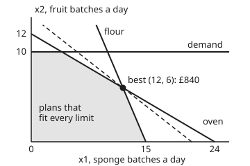

# Linear programs: a plan written as variables, one target and straight-line limits

[Syllabus](../../../SYLLABUS.md) → [Applied and computational](../README.md) → [Operations Research](../README.md#s05) → Linear programs

---

## General Overview

A bakery has 4 ovens, each free for 12 hours a day: 48 oven hours. It bakes two cake mixes in batches. A batch of sponge earns £40 of margin (price minus ingredients), takes 2 oven hours and 20 kg of flour. A batch of fruit cake earns £60, takes 4 oven hours and only 10 kg of flour. The mill delivers 300 kg of flour a day, and the shops will take at most 10 batches of fruit cake. How many batches of each should it bake?

The obvious answers are wrong. Fruit cake pays more per batch, so bake 10 fruit and fill the rest with sponge: 4 sponge, £760. Sponge pays more per oven hour, £20 against £15, so bake sponge until the flour runs out: 15 sponge, £600. The best plan is 12 sponge and 6 fruit, **£840 a day**. It uses every oven hour and every kilogram of flour, and it leaves 4 batches of fruit-cake demand unused.

A **linear program** finds that plan without guessing. Name each decision with a letter, write the margin as a sum of those letters times fixed amounts, and write every limit the same way. The allowed plans then form a region with straight edges, and the best plan sits at one of its corners. So a computer can look at corners only, never at the whole region.

**A linear program writes a decision as a few unknown amounts, one straight-line target and a list of straight-line limits; the allowed plans form a flat-sided region, and the best plan is always at a corner of it.**

**What kind of fact this is:** a modelling recipe (the straight lines are an assumption about the bakery: double the batches, double the flour) plus a theorem, "the best plan is at a corner", proved on this card for two decisions in Why it works.

### The picture: the bakery's allowed plans

<p align="center"></p>

Drawn to scale. Across the bottom is sponge batches a day, up the side fruit batches a day. The shaded region holds every plan that fits all the limits. Its five corners are (0, 0), (15, 0), (12, 6), (4, 10) and (0, 10). The steep solid line is the flour limit, the shallow one the oven limit, the flat one fruit demand. The dashed line holds every plan earning £840; it meets the shaded region at one point, the corner (12, 6).

---

## The formula

Two letters carry the plan: $x_1$ is sponge batches a day, $x_2$ fruit-cake batches a day. The bakery's whole problem, written out:

$$
\begin{aligned}
\text{maximise}\quad & 40x_1 + 60x_2 && \text{margin, pounds a day}\\
\text{subject to}\quad & 2x_1 + 4x_2 \le 48 && \text{oven hours}\\
& 20x_1 + 10x_2 \le 300 && \text{flour, kg}\\
& x_2 \le 10 && \text{fruit-cake demand}\\
& x_1 \ge 0,\ x_2 \ge 0 && \text{no negative baking}
\end{aligned}
$$

Every linear program fits one shape, called **standard form**. Stack the letters into a list $x$, the margins per batch into a list $c$, the limits' right-hand sides into a list $b$, and the amounts each batch uses into a table $A$ with one row per limit and one column per decision. Here $c = (40, 60)$, $b = (48, 300, 10)$ and $A$ is `[[2, 4], [20, 10], [0, 1]]`. Then:

$$\max_{x}\ c^{\top}x \quad\text{subject to}\quad Ax \le b,\quad x \ge 0$$

**Read it aloud:** choose the amounts $x$ that make the total margin as big as possible, while each row of resources used stays within its allowance and no amount goes negative.

$c^{\top}x$ is the sum $c_1x_1 + c_2x_2$ (the small T, "transpose", turns the list $c$ on its side so it multiplies $x$ entry by entry). $Ax \le b$ means every row at once: row 1 is the oven line, row 2 flour, row 3 demand.

A problem in another shape is rewritten into this one:

- To minimise a cost, maximise minus the cost: the best plan is the same, and its value comes back with the sign flipped.
- An "at least" limit is multiplied through by −1, which turns $\ge$ into $\le$: a contract for at least 14 sponge, $x_1 \ge 14$, becomes the row $-x_1 \le -14$, and the best plan moves to (14, 2), £680.
- An "exactly" limit is two rows, one each way: exactly 8 fruit is $x_2 \le 8$ and $-x_2 \le -8$, and the best plan is (8, 8), £800.

A solver works with equations, so each limit gets a **slack variable**: the amount left over. Write $s = b - Ax$, so $Ax + s = b$ with $s \ge 0$. At the best plan the slack is (0, 0, 4): no oven hours spare, no flour spare, 4 batches of fruit demand unused. A limit with zero slack is **tight**, and the plan sits on its line.

| Symbol | Plain meaning | In our example | Push it up and the answer… |
| --- | --- | --- | --- |
| $x_1$, $x_2$ | the decisions: sponge and fruit batches a day | 12 and 6 at the best plan | — (the solver chooses them) |
| $x$ | the plan, the list $(x_1, x_2)$ | (12, 6) | — |
| $c$ | margin per batch of each cake, £ | (40, 60) | raise sponge's £40 to £130 and the best plan jumps to all sponge, (15, 0) |
| $c^{\top}x$ | the target: total margin, £ a day | £840 | — (this is the answer) |
| $A$ | resources one batch uses: one row per limit, one column per cake | `[[2, 4], [20, 10], [0, 1]]` | a hungrier recipe shrinks the region |
| $b$ | each limit's allowance | 48 h, 300 kg, 10 batches | more flour (400 kg) lifts margin to £906.67 |
| $s$ | slack, $b - Ax$: what each limit leaves unused | (0, 0, 4) | — |
| $m$, $n$ | number of limits, number of decisions | 3 and 2 | more corners to check (Step 3) |
| $\binom{m+n}{n}$ | "m + n choose n": ways to pick $n$ tight lines out of $m + n$ | 10 | grows explosively |
| $p$, $q$, $v_1, \dots, v_k$ | plans used in the proof: two allowed plans, and the $k$ corners | $v$: the 5 corners | — |
| $t$, $\theta_i$ | mixing weights: not negative, adding to 1 | the midpoint (8, 8) takes half of each end | — |

### When it holds

- **Amounts scale in straight lines.** Twice the batches use twice the flour and earn twice the margin. A price that falls as you sell more bends the margin into a curve, and the best plan can then sit partway along an edge or inside the region, where corner-checking misses it.
- **Amounts can be split.** The answer may be 12.67 batches. If only whole batches make sense, rounding can break a limit (see What breaks); that is the job of [Corners are enough](../../15-Optimization/04-Linear%20Programming/02-corners-and-the-fundamental-theorem.md).
- **The numbers are known.** Margins, recipes and the flour delivery are taken as certain. If the mill can send less than 300 kg, the plan for 300 kg can need flour that never arrives, and the model needs a margin for error the plain program does not have.
- **There is a ceiling.** If nothing stops the margin from growing (drop both the oven and flour limits), there is no best plan: the solver reports "unbounded", not a number.
- **At least one plan fits.** Limits that contradict each other (bake at least 20 sponge with 300 kg of flour) leave no region at all, and the solver reports "infeasible".

---

## Why it works

### Step 0: on a straight line, a straight-line target has no peak in the middle

Walk from one plan to another along a straight segment. The margin changes at a steady rate, because it is a sum of fixed amounts times the letters. A steady rate has no peak in the middle: the best point of any segment is one of its two ends, or the whole segment ties. Everything else follows from that.

On the oven edge from (12, 6) to (4, 10), the midpoint (8, 8) earns £800, exactly the average of £840 and £760.

### Step 1: the allowed plans form a convex region

A region is **convex** when the straight segment between any two of its points stays inside it ([Convex functions](../../06-Calculus%20and%20analysis/07-Several%20Variables/09-convex-functions.md) uses the same idea for chords that stay on or above a bowl's graph).

Take two plans $p$ and $q$ that both fit the oven limit, and a mix of them, $t$ of $p$ and $1 - t$ of $q$ with $t$ between 0 and 1. Oven hours used by the mix are $t$ times $p$'s hours plus $1 - t$ times $q$'s hours. Each is at most 48, so the mix uses at most $48t + 48(1 - t) = 48$. The same line works for flour, demand and the two "no negative" limits. So every mix of two allowed plans is allowed, and the region has no dents.

### Step 2: every allowed plan is a mix of corners, so some corner does at least as well

Take any allowed plan $p$. Draw a straight line through $p$. Because the region is convex, bounded and closed in by straight edges, the line leaves it at two edge points, and $p$ lies between them. By Step 0, one of those two edge points earns at least as much as $p$. That edge point lies between the two corners at the ends of its edge, and by Step 0 again one of those corners earns at least as much.

So for every allowed plan there is a corner that earns at least as much. There are finitely many corners, so the best corner is the best plan. This is the corner theorem for two decisions; the general version, for any number of decisions, is proved on the card [Corners are enough](../../15-Optimization/04-Linear%20Programming/02-corners-and-the-fundamental-theorem.md).

<details>
<summary>The same argument as one inequality</summary>

Step 2 shows that $p$ is a weighted average of corners $v_1, \dots, v_k$: weights $\theta_i \ge 0$ that add to 1, with $p = \sum_i \theta_i v_i$. The target is linear, so

$$c^{\top}p = \sum_i \theta_i\, c^{\top}v_i \le \Big(\sum_i \theta_i\Big)\max_i c^{\top}v_i = \max_i c^{\top}v_i .$$

An average can never beat its largest member. That one line is the corner theorem.

</details>

### Step 3: a corner is a small system of equations

A corner is a point where $n$ limits are tight at once, two here. Making two limits tight turns two inequalities into two equations, and two equations in two unknowns is [Solving A x = b](../../03-Algebra/05-Solving%20Systems/01-matrix-equation-ax-b.md). Solve it, then keep the point only if it also fits every other limit.

The bakery has 5 limits counting the two "no negative" ones. Pairs of lines: 10. One pair, demand and $x_2 \ge 0$, is parallel and never meets, which leaves 9 candidate points. Four break a limit; for instance, the oven line meets the bottom axis at (24, 0), a plan that would need 480 kg of flour. Five fit, and those five are the corners in the picture.

That is a complete solver for small problems, and it is the solver in the code below. It does not scale. With $n$ decisions and $m$ limits the candidates number $\binom{m+n}{n}$: 10 for the bakery, 30,045,015 for 10 decisions and 20 limits, and 4,191,844,505,805,495 for 20 decisions and 40 limits. Real solvers walk from corner to better corner (the simplex method) or cut through the inside (interior-point methods). Both belong to the optimisation wing; here they are a box that takes $c$, $A$, $b$ and returns a plan.

### Step 4: a certificate proves the corner is best

How can anyone check £840 without re-solving? Multiply the oven limit by 13.33 (exactly 40/3) and the flour limit by 0.67 (exactly 2/3), then add:

$$\tfrac{40}{3}(2x_1 + 4x_2) + \tfrac{2}{3}(20x_1 + 10x_2) = 40x_1 + 60x_2 \le \tfrac{40}{3}\cdot 48 + \tfrac{2}{3}\cdot 300 = 640 + 200 = 840.$$

The left side is the margin, term by term. The weights are not negative, so the inequalities keep their direction. So no allowed plan earns more than £840, and the plan (12, 6) earns exactly that. The two weights are the **dual values** a solver prints beside its answer: £13.33 per extra oven hour, £0.67 per extra kilogram of flour. How to read such values off a solver's report, and what they are worth to a manager, is [Shadow prices](02-shadow-prices-and-sensitivity.md), worked on another branch's plan.

---

## Worked numbers, by hand

The best corner lies where the oven and flour lines cross. Make both tight and solve.

| Step | Arithmetic | Value |
| --- | --- | --- |
| oven hours | 4 ovens × 12 h | 48 h |
| oven line, tight | $2x_1 + 4x_2 = 48$, so $x_1 = 24 - 2x_2$ | — |
| put it into flour | $20(24 - 2x_2) + 10x_2 = 480 - 30x_2 = 300$ | $x_2 = 6$ |
| back into the oven line | $24 - 2 \times 6$ | $x_1 = 12$ |
| demand check | $6 \le 10$ | slack 4 batches |
| margin at (12, 6) | $40 \times 12 + 60 \times 6$ | £840 |
| the other corners | (15, 0), (4, 10), (0, 10), (0, 0) | £600, £760, £600, £0 |
| **best plan** | the largest of the five | **12 sponge, 6 fruit: £840 a day** |

The bakery should split its ovens between both cakes, running the two tight resources, oven time and flour, to zero, and leave fruit demand unfilled.

### What breaks if you drop a piece

| Mistake | Comes out at | What went wrong |
| --- | --- | --- |
| Bake the cake with the higher margin per batch first | 4 sponge, 10 fruit: £760 | Fruit cake eats oven time; the margin per batch ignores which resource runs out |
| Bake the cake with the higher margin per oven hour first | 15 sponge, 0 fruit: £600 | Sponge uses up the flour at 15 batches and leaves oven hours idle |
| Leave the flour limit out of the model | 24 sponge: "£960" | The solver is right about the wrong model: the plan needs 480 kg of flour, and 300 kg arrive |
| With 310 kg of flour, round the answer (12.67, 5.67) to the nearest whole batch | 13 sponge, 6 fruit: "£880" | The rounded plan uses 2 oven hours and 10 kg of flour that do not exist. Rounding down gives (12, 5), £780; the best whole plan is (12, 6), £840 |

The last row is the modelling assumption failing. The program assumed batches can be split, and rounding its answer does not repair that. The program's £846.67 is a ceiling that no whole-batch plan reaches.

---

## Code, from first principles, and it actually runs

Both programs build the bakery's program from the lists $c$, $A$ and $b$, then reach the best plan by **three independent roads**:

1. A corner solver: it makes every pair of limits tight, solves the two equations, keeps the points that fit, and reports status, plan, slacks and dual values, the same four things a production solver reports.
2. A grid: it checks every plan on a grid of tenths of a batch, 29,161 plans, of which 11,481 fit.
3. The certificate from Step 4: its weights must not be negative, and the cap they give must equal the grid's best.

The hand substitution from the table above is a fourth check on the corner. A far-off fence at a million batches lets the solver say "unbounded" when nothing else stops the margin, and a model with no corner that fits comes back "infeasible". The `standard form` lines run the rewrites from The formula through the same solver.

In practice the same three lists go to an open-source solver such as HiGHS, which reports the same four things. SciPy's `linprog`, which runs HiGHS, minimises, so the bakery goes in as `linprog(-c, A_ub=A, b_ub=b)`, and the margin and the dual values come back with their signs flipped; leaving out the minus sign is the "Minimise instead of maximise" trap below. The standard library has no such solver, so the scripts write their own for two decisions.

### Python

```python
# Linear programs: the check behind the card. Standard library only.
# Two cake mixes, 4 ovens, limited flour: which plan earns the most margin?
# Three roads: (1) a corner solver that makes every pair of limits tight,
# (2) a grid of every plan in tenths of a batch, (3) a certificate: weights
# on the limits that cap the margin. Every number on the card is printed.
BIG = 1e6  # a far fence: a best corner on it means the margin has no ceiling
NAMES = ["oven", "flour", "demand", "x1>=0", "x2>=0", "fence", "fence"]

def solve(c, A, b):
    rows = [(r[0], r[1], v) for r, v in zip(A, b)]
    rows += [(-1.0, 0.0, 0.0), (0.0, -1.0, 0.0), (1.0, 0.0, BIG), (0.0, 1.0, BIG)]
    cands, best = [], None
    for i in range(len(rows)):
        for j in range(i + 1, len(rows)):
            (a1, b1, r1), (a2, b2, r2) = rows[i], rows[j]
            det = a1 * b2 - a2 * b1
            if abs(det) < 1e-12:
                continue  # parallel limits never meet
            x = ((r1 * b2 - r2 * b1) / det, (a1 * r2 - a2 * r1) / det)
            ok = all(p * x[0] + q * x[1] <= r + 1e-9 for p, q, r in rows)
            val = c[0] * x[0] + c[1] * x[1]
            if j < len(A) + 2:
                cands.append((i, j, x, ok, val))
            if ok and (best is None or val > best[4] + 1e-9):
                best = (i, j, x, ok, val)
    if best is None:
        return "infeasible", None, cands
    if best[1] >= len(A) + 2:
        return "unbounded", None, cands
    return "optimal", best, cands

def f2(v): return f"{v + 0.0:.2f}"
def pt(x): return f"({f2(x[0])}, {f2(x[1])})"

c, A, b = (40.0, 60.0), [(2.0, 4.0), (20.0, 10.0), (0.0, 1.0)], [48.0, 300.0, 10.0]
print(f"model, {4 * 12} oven hours from 4 ovens x 12 h | max 40 x1 + 60 x2 | oven 2 x1 + 4 x2 <= 48 | flour 20 x1 + 10 x2 <= 300 | demand x2 <= 10")
status, best, cands = solve(c, A, b)
for i, j, x, ok, val in cands:
    print(f"corner, {NAMES[i]} + {NAMES[j]}, {pt(x)}, {'fits' if ok else 'breaks a limit'}, margin {f2(val)}")
fit = sum(1 for k in cands if k[3])
print(f"corners, {len(cands)} candidates from 5 limits, {fit} fit")
i, j, x, _, val = best
print(f"solver, status {status}, x1 {f2(x[0])}, x2 {f2(x[1])}, margin {f2(val)}")
k0, k1 = b[0] / A[0][0], A[0][1] / A[0][0]  # by hand: substitute the oven line into flour
h2 = (A[1][0] * k0 - b[1]) / (A[1][0] * k1 - A[1][1])
print(f"hand, oven: x1 = {f2(k0)} - {f2(k1)} x2; flour: {f2(A[1][0] * k0)} - {f2(A[1][0] * k1 - A[1][1])} x2 = {f2(b[1])}; x2 {f2(h2)}, x1 {f2(k0 - k1 * h2)}")
assert abs(h2 - x[1]) < 1e-9 and abs(k0 - k1 * h2 - x[0]) < 1e-9
s = [bb - (a[0] * x[0] + a[1] * x[1]) for a, bb in zip(A, b)]
print(f"slack, oven {f2(s[0])} h, flour {f2(s[1])} kg, demand {f2(s[2])} batches")
# road 2: every plan on a grid of tenths, in whole numbers so nothing rounds
feasible, gbest, garg = 0, -1, None
for u in range(0, 241):
    for v in range(0, 121):
        if 2 * u + 4 * v <= 480 and 20 * u + 10 * v <= 3000 and v <= 100:
            feasible += 1
            if 40 * u + 60 * v > gbest:
                gbest, garg = 40 * u + 60 * v, (u / 10, v / 10)
print(f"grid, {feasible} plans fit out of {241 * 121}, best {f2(gbest / 10)} at {pt(garg)}")
assert abs(gbest / 10 - val) < 1e-9 and garg == (round(x[0], 9), round(x[1], 9))
# dual values: weights on the two tight limits whose rows add up to c
(p1, q1), (p2, q2) = A[i], A[j]
det = p1 * q2 - p2 * q1
w = [0.0, 0.0, 0.0]
w[i], w[j] = (c[0] * q2 - p2 * c[1]) / det, (p1 * c[1] - q1 * c[0]) / det
print(f"dual, oven {f2(w[0])} per h, flour {f2(w[1])} per kg, demand {f2(w[2])} per batch")
# road 3: the certificate. Weights >= 0 whose rows cover c cap every plan
cap = sum(wk * bk for wk, bk in zip(w, b))
assert min(w) >= 0  # a negative weight would flip its limit's inequality
print(f"certificate, {f2(w[0])} x oven + {f2(w[1])} x flour caps margin at {f2(w[0] * b[0])} + {f2(w[1] * b[1])} = {f2(cap)}")
assert abs(cap - gbest / 10) < 1e-9
# along an edge the margin moves at a steady rate: the midpoint is the average
e1, e2 = (12.0, 6.0), (4.0, 10.0)
mid = ((e1[0] + e2[0]) / 2, (e1[1] + e2[1]) / 2)
mv = lambda p: c[0] * p[0] + c[1] * p[1]
print(f"edge, midpoint {pt(mid)} margin {f2(mv(mid))}, average of ends {f2((mv(e1) + mv(e2)) / 2)}")
assert mv(mid) < val

def fill(order):  # greedy: make as much as possible of one cake, then the other
    x, left = [0.0, 0.0], list(b)
    for k in order:
        x[k] = min(left[r] / A[r][k] for r in range(3) if A[r][k] > 0)
        left = [left[r] - A[r][k] * x[k] for r in range(3)]
    return x
g1, g2 = fill([1, 0]), fill([0, 1])
print(f"breaks, fruit first {pt(g1)} margin {f2(mv(g1))}")
print(f"breaks, best per oven hour (sponge {f2(c[0] / A[0][0])}, fruit {f2(c[1] / A[0][1])}) {pt(g2)} margin {f2(mv(g2))}")
assert mv(g1) < val and mv(g2) < val
_, nb, _ = solve(c, [A[0], A[2]], [b[0], b[2]])
print(f"breaks, no flour limit {pt(nb[2])} margin {f2(nb[4])}, needs {f2(20 * nb[2][0] + 10 * nb[2][1])} kg flour")
_, lp, _ = solve(c, A, [48.0, 310.0, 10.0])
r = (round(lp[2][0]), round(lp[2][1]))
print(f"breaks, flour 310 kg: LP {pt(lp[2])} margin {f2(lp[4])}")
print(f"breaks, rounded {r} margin {f2(mv(r))}, oven over by {f2(2 * r[0] + 4 * r[1] - 48)} h, flour over by {f2(20 * r[0] + 10 * r[1] - 310)} kg")
assert 2 * r[0] + 4 * r[1] > 48 and 20 * r[0] + 10 * r[1] > 310
wb = max(((p, q) for p in range(25) for q in range(11) if 2 * p + 4 * q <= 48 and 20 * p + 10 * q <= 310), key=mv)
dn = (int(lp[2][0]), int(lp[2][1]))
print(f"breaks, rounded down {dn} margin {f2(mv(dn))}; best whole plan {wb} margin {f2(mv(wb))}")
assert mv(dn) < mv(wb) <= lp[4]
st, mn, _ = solve((-40.0, -60.0), A, b)
print(f"trap, minimise by mistake {pt(mn[2])} margin {f2(-mn[4])}")
_, bag, _ = solve(c, A, [48.0, 12.0, 10.0])
print(f"trap, flour limit in 25 kg bags (12) beside kg per batch: margin {f2(bag[4])}")
for label, AA, bb in [("at least 14 sponge as -x1 <= -14", A + [(-1.0, 0.0)], b + [-14.0]),
                      ("exactly 8 fruit as x2 <= 8 and -x2 <= -8", A + [(0.0, 1.0), (0.0, -1.0)], b + [8.0, -8.0]),
                      ("at least 20 sponge as -x1 <= -20", A + [(-1.0, 0.0)], b + [-20.0])]:
    st, sf, _ = solve(c, AA, bb)  # standard form: "at least" flips sign, "exactly" is two rows
    print(f"standard form, {label}: status {st}" + (f", {pt(sf[2])} margin {f2(sf[4])}" if sf else ""))
assert st == "infeasible"
for label, cc, AA, bb in [("sponge margin 20", (20.0, 60.0), A, b), ("sponge margin 130", (130.0, 60.0), A, b),
                          ("flour 400 kg", c, A, [48.0, 400.0, 10.0])]:
    _, t, _ = solve(cc, AA, bb)
    print(f"try, {label}: {pt(t[2])} margin {f2(t[4])}")
st, _, _ = solve(c, [A[2]], [b[2]])
print(f"try, no oven and no flour limit: status {st}")
assert st == "unbounded"

def comb(n, k):
    out = 1
    for t in range(k):
        out = out * (n - t) // (t + 1)
    return out
assert len(cands) == comb(5, 2) - 1  # one pair is parallel: demand and x2 >= 0
print("growth, " + "; ".join(f"n {n} m {m}: {comb(n + m, n)} candidates" for n, m in [(2, 3), (10, 20), (20, 40)]))
X = lambda q: 45 + 11 * q[0]
Y = lambda q: 205 - 13 * q[1]
print("figure, corners px " + " ".join(f"{X(q):g},{Y(q):g}" for q in [(0, 0), (15, 0), (12, 6), (4, 10), (0, 10)]))
print("ALL CHECKS PASS")
```

**Ran 2026-11-11 on macOS, Python 3.14.10, standard library only. All checks passed. Output, pasted from the run:**

```
model, 48 oven hours from 4 ovens x 12 h | max 40 x1 + 60 x2 | oven 2 x1 + 4 x2 <= 48 | flour 20 x1 + 10 x2 <= 300 | demand x2 <= 10
corner, oven + flour, (12.00, 6.00), fits, margin 840.00
corner, oven + demand, (4.00, 10.00), fits, margin 760.00
corner, oven + x1>=0, (0.00, 12.00), breaks a limit, margin 720.00
corner, oven + x2>=0, (24.00, 0.00), breaks a limit, margin 960.00
corner, flour + demand, (10.00, 10.00), breaks a limit, margin 1000.00
corner, flour + x1>=0, (0.00, 30.00), breaks a limit, margin 1800.00
corner, flour + x2>=0, (15.00, 0.00), fits, margin 600.00
corner, demand + x1>=0, (0.00, 10.00), fits, margin 600.00
corner, x1>=0 + x2>=0, (0.00, 0.00), fits, margin 0.00
corners, 9 candidates from 5 limits, 5 fit
solver, status optimal, x1 12.00, x2 6.00, margin 840.00
hand, oven: x1 = 24.00 - 2.00 x2; flour: 480.00 - 30.00 x2 = 300.00; x2 6.00, x1 12.00
slack, oven 0.00 h, flour 0.00 kg, demand 4.00 batches
grid, 11481 plans fit out of 29161, best 840.00 at (12.00, 6.00)
dual, oven 13.33 per h, flour 0.67 per kg, demand 0.00 per batch
certificate, 13.33 x oven + 0.67 x flour caps margin at 640.00 + 200.00 = 840.00
edge, midpoint (8.00, 8.00) margin 800.00, average of ends 800.00
breaks, fruit first (4.00, 10.00) margin 760.00
breaks, best per oven hour (sponge 20.00, fruit 15.00) (15.00, 0.00) margin 600.00
breaks, no flour limit (24.00, 0.00) margin 960.00, needs 480.00 kg flour
breaks, flour 310 kg: LP (12.67, 5.67) margin 846.67
breaks, rounded (13, 6) margin 880.00, oven over by 2.00 h, flour over by 10.00 kg
breaks, rounded down (12, 5) margin 780.00; best whole plan (12, 6) margin 840.00
trap, minimise by mistake (0.00, 0.00) margin 0.00
trap, flour limit in 25 kg bags (12) beside kg per batch: margin 72.00
standard form, at least 14 sponge as -x1 <= -14: status optimal, (14.00, 2.00) margin 680.00
standard form, exactly 8 fruit as x2 <= 8 and -x2 <= -8: status optimal, (8.00, 8.00) margin 800.00
standard form, at least 20 sponge as -x1 <= -20: status infeasible
try, sponge margin 20: (4.00, 10.00) margin 680.00
try, sponge margin 130: (15.00, 0.00) margin 1950.00
try, flour 400 kg: (18.67, 2.67) margin 906.67
try, no oven and no flour limit: status unbounded
growth, n 2 m 3: 10 candidates; n 10 m 20: 30045015 candidates; n 20 m 40: 4191844505805495 candidates
figure, corners px 45,205 210,205 177,127 89,75 45,75
ALL CHECKS PASS
```

### Rust

```rust
// Linear programs: the check behind the card. std only, no crates.
// Two cake mixes, 4 ovens, limited flour: which plan earns the most margin?
// Three roads: (1) a corner solver that makes every pair of limits tight,
// (2) a grid of every plan in tenths of a batch, (3) a certificate: weights
// on the limits that cap the margin. Every number on the card is printed.
const BIG: f64 = 1e6; // a far fence: a best corner on it means the margin has no ceiling
const NAMES: [&str; 7] = ["oven", "flour", "demand", "x1>=0", "x2>=0", "fence", "fence"];

#[derive(Clone, Copy)]
struct Cand { i: usize, j: usize, x: (f64, f64), ok: bool, val: f64 }

fn solve(c: (f64, f64), a: &[(f64, f64)], b: &[f64]) -> (&'static str, Option<Cand>, Vec<Cand>) {
    let mut rows: Vec<(f64, f64, f64)> = a.iter().zip(b).map(|(r, v)| (r.0, r.1, *v)).collect();
    rows.extend([(-1.0, 0.0, 0.0), (0.0, -1.0, 0.0), (1.0, 0.0, BIG), (0.0, 1.0, BIG)]);
    let (mut cands, mut best): (Vec<Cand>, Option<Cand>) = (vec![], None);
    for i in 0..rows.len() {
        for j in i + 1..rows.len() {
            let ((a1, b1, r1), (a2, b2, r2)) = (rows[i], rows[j]);
            let det = a1 * b2 - a2 * b1;
            if det.abs() < 1e-12 { continue; } // parallel limits never meet
            let x = ((r1 * b2 - r2 * b1) / det, (a1 * r2 - a2 * r1) / det);
            let ok = rows.iter().all(|&(p, q, r)| p * x.0 + q * x.1 <= r + 1e-9);
            let k = Cand { i, j, x, ok, val: c.0 * x.0 + c.1 * x.1 };
            if j < a.len() + 2 { cands.push(k); }
            if ok && best.map_or(true, |bb| k.val > bb.val + 1e-9) { best = Some(k); }
        }
    }
    match best {
        None => ("infeasible", None, cands),
        Some(bb) if bb.j >= a.len() + 2 => ("unbounded", None, cands),
        Some(bb) => ("optimal", Some(bb), cands),
    }
}

fn f2(v: f64) -> String { format!("{:.2}", v + 0.0) }
fn pt(x: (f64, f64)) -> String { format!("({}, {})", f2(x.0), f2(x.1)) }
fn mv(c: (f64, f64), p: (f64, f64)) -> f64 { c.0 * p.0 + c.1 * p.1 }

fn fill(a: &[(f64, f64)], b: &[f64], order: [usize; 2]) -> (f64, f64) {
    let (mut x, mut left) = ([0.0f64; 2], b.to_vec()); // greedy: one cake first
    for k in order {
        let col = |r: usize| if k == 0 { a[r].0 } else { a[r].1 };
        x[k] = (0..3).filter(|&r| col(r) > 0.0).map(|r| left[r] / col(r)).fold(f64::INFINITY, f64::min);
        for r in 0..3 { left[r] -= col(r) * x[k]; }
    }
    (x[0], x[1])
}

fn comb(n: u128, k: u128) -> u128 { (0..k).fold(1, |o, t| o * (n - t) / (t + 1)) }

fn main() {
    let (c, a, b) = ((40.0, 60.0), vec![(2.0, 4.0), (20.0, 10.0), (0.0, 1.0)], vec![48.0, 300.0, 10.0]);
    println!("model, {} oven hours from 4 ovens x 12 h | max 40 x1 + 60 x2 | oven 2 x1 + 4 x2 <= 48 | flour 20 x1 + 10 x2 <= 300 | demand x2 <= 10", 4 * 12);
    let (status, best, cands) = solve(c, &a, &b);
    for k in &cands {
        let tag = if k.ok { "fits" } else { "breaks a limit" };
        println!("corner, {} + {}, {}, {}, margin {}", NAMES[k.i], NAMES[k.j], pt(k.x), tag, f2(k.val));
    }
    let fit = cands.iter().filter(|k| k.ok).count();
    println!("corners, {} candidates from 5 limits, {} fit", cands.len(), fit);
    let bb = best.unwrap();
    let (i, j, x, val) = (bb.i, bb.j, bb.x, bb.val);
    println!("solver, status {}, x1 {}, x2 {}, margin {}", status, f2(x.0), f2(x.1), f2(val));
    let (k0, k1) = (b[0] / a[0].0, a[0].1 / a[0].0); // by hand: substitute the oven line into flour
    let h2 = (a[1].0 * k0 - b[1]) / (a[1].0 * k1 - a[1].1);
    println!("hand, oven: x1 = {} - {} x2; flour: {} - {} x2 = {}; x2 {}, x1 {}", f2(k0), f2(k1), f2(a[1].0 * k0),
             f2(a[1].0 * k1 - a[1].1), f2(b[1]), f2(h2), f2(k0 - k1 * h2));
    assert!((h2 - x.1).abs() < 1e-9 && (k0 - k1 * h2 - x.0).abs() < 1e-9);
    let s: Vec<f64> = a.iter().zip(&b).map(|(r, v)| v - (r.0 * x.0 + r.1 * x.1)).collect();
    println!("slack, oven {} h, flour {} kg, demand {} batches", f2(s[0]), f2(s[1]), f2(s[2]));
    // road 2: every plan on a grid of tenths, in whole numbers so nothing rounds
    let (mut feasible, mut gbest, mut garg) = (0, -1i64, (0i64, 0i64));
    for u in 0..241i64 {
        for v in 0..121i64 {
            if 2 * u + 4 * v <= 480 && 20 * u + 10 * v <= 3000 && v <= 100 {
                feasible += 1;
                if 40 * u + 60 * v > gbest { gbest = 40 * u + 60 * v; garg = (u, v); }
            }
        }
    }
    let gx = (garg.0 as f64 / 10.0, garg.1 as f64 / 10.0);
    println!("grid, {} plans fit out of {}, best {} at {}", feasible, 241 * 121, f2(gbest as f64 / 10.0), pt(gx));
    assert!((gbest as f64 / 10.0 - val).abs() < 1e-9 && (gx.0 - x.0).abs() < 1e-9 && (gx.1 - x.1).abs() < 1e-9);
    // dual values: weights on the two tight limits whose rows add up to c
    let ((p1, q1), (p2, q2)) = (a[i], a[j]);
    let det = p1 * q2 - p2 * q1;
    let mut w = [0.0f64; 3];
    w[i] = (c.0 * q2 - p2 * c.1) / det;
    w[j] = (p1 * c.1 - q1 * c.0) / det;
    println!("dual, oven {} per h, flour {} per kg, demand {} per batch", f2(w[0]), f2(w[1]), f2(w[2]));
    // road 3: the certificate. Weights >= 0 whose rows cover c cap every plan
    let cap: f64 = w.iter().zip(&b).map(|(wk, bk)| wk * bk).sum();
    assert!(w.iter().all(|&v| v >= 0.0)); // a negative weight would flip its limit's inequality
    println!("certificate, {} x oven + {} x flour caps margin at {} + {} = {}", f2(w[0]), f2(w[1]), f2(w[0] * b[0]), f2(w[1] * b[1]), f2(cap));
    assert!((cap - gbest as f64 / 10.0).abs() < 1e-9);
    // along an edge the margin moves at a steady rate: the midpoint is the average
    let (e1, e2) = ((12.0, 6.0), (4.0, 10.0));
    let mid = ((e1.0 + e2.0) / 2.0, (e1.1 + e2.1) / 2.0);
    let avg = (mv(c, e1) + mv(c, e2)) / 2.0;
    println!("edge, midpoint {} margin {}, average of ends {}", pt(mid), f2(mv(c, mid)), f2(avg));
    assert!(mv(c, mid) < val);
    let (g1, g2) = (fill(&a, &b, [1, 0]), fill(&a, &b, [0, 1]));
    println!("breaks, fruit first {} margin {}", pt(g1), f2(mv(c, g1)));
    println!("breaks, best per oven hour (sponge {}, fruit {}) {} margin {}", f2(c.0 / a[0].0), f2(c.1 / a[0].1), pt(g2), f2(mv(c, g2)));
    assert!(mv(c, g1) < val && mv(c, g2) < val);
    let nb = solve(c, &[a[0], a[2]], &[b[0], b[2]]).1.unwrap();
    println!("breaks, no flour limit {} margin {}, needs {} kg flour", pt(nb.x), f2(nb.val), f2(20.0 * nb.x.0 + 10.0 * nb.x.1));
    let lp = solve(c, &a, &[48.0, 310.0, 10.0]).1.unwrap();
    let r = (lp.x.0.round() as i64, lp.x.1.round() as i64);
    let mi = |p: (i64, i64)| 40 * p.0 + 60 * p.1;
    println!("breaks, flour 310 kg: LP {} margin {}", pt(lp.x), f2(lp.val));
    println!("breaks, rounded ({}, {}) margin {}, oven over by {} h, flour over by {} kg", r.0, r.1, f2(mi(r) as f64),
             f2((2 * r.0 + 4 * r.1 - 48) as f64), f2((20 * r.0 + 10 * r.1 - 310) as f64));
    assert!(2 * r.0 + 4 * r.1 > 48 && 20 * r.0 + 10 * r.1 > 310);
    let mut wb = (0i64, 0i64);
    for p in 0..25i64 { for q in 0..11i64 {
        if 2 * p + 4 * q <= 48 && 20 * p + 10 * q <= 310 && mi((p, q)) > mi(wb) { wb = (p, q); }
    } }
    let dn = (lp.x.0 as i64, lp.x.1 as i64);
    println!("breaks, rounded down ({}, {}) margin {}; best whole plan ({}, {}) margin {}", dn.0, dn.1, f2(mi(dn) as f64), wb.0, wb.1, f2(mi(wb) as f64));
    assert!(mi(dn) < mi(wb) && mi(wb) as f64 <= lp.val);
    let mn = solve((-40.0, -60.0), &a, &b).1.unwrap();
    println!("trap, minimise by mistake {} margin {}", pt(mn.x), f2(-mn.val));
    let bag = solve(c, &a, &[48.0, 12.0, 10.0]).1.unwrap();
    println!("trap, flour limit in 25 kg bags (12) beside kg per batch: margin {}", f2(bag.val));
    let forms: [(&str, Vec<(f64, f64)>, Vec<f64>); 3] = [("at least 14 sponge as -x1 <= -14", vec![(-1.0, 0.0)], vec![-14.0]),
        ("exactly 8 fruit as x2 <= 8 and -x2 <= -8", vec![(0.0, 1.0), (0.0, -1.0)], vec![8.0, -8.0]),
        ("at least 20 sponge as -x1 <= -20", vec![(-1.0, 0.0)], vec![-20.0])];
    let mut st = "";
    for (label, ea, eb) in forms { // standard form: "at least" flips sign, "exactly" is two rows
        let (s2, sf, _) = solve(c, &[a.clone(), ea].concat(), &[b.clone(), eb].concat());
        let tail = sf.map_or(String::new(), |k| format!(", {} margin {}", pt(k.x), f2(k.val)));
        println!("standard form, {}: status {}{}", label, s2, tail);
        st = s2;
    }
    assert!(st == "infeasible");
    let tries: [(&str, (f64, f64), [f64; 3]); 3] = [("sponge margin 20", (20.0, 60.0), [48.0, 300.0, 10.0]),
        ("sponge margin 130", (130.0, 60.0), [48.0, 300.0, 10.0]), ("flour 400 kg", c, [48.0, 400.0, 10.0])];
    for (label, cc, bb) in tries {
        let t = solve(cc, &a, &bb).1.unwrap();
        println!("try, {}: {} margin {}", label, pt(t.x), f2(t.val));
    }
    st = solve(c, &[a[2]], &[b[2]]).0;
    println!("try, no oven and no flour limit: status {}", st);
    assert!(st == "unbounded");
    assert!(cands.len() as u128 == comb(5, 2) - 1); // one pair is parallel: demand and x2 >= 0
    let g: Vec<String> = [(2u128, 3u128), (10, 20), (20, 40)].iter()
        .map(|&(n, m)| format!("n {} m {}: {} candidates", n, m, comb(n + m, n))).collect();
    println!("growth, {}", g.join("; "));
    let fig: Vec<String> = [(0, 0), (15, 0), (12, 6), (4, 10), (0, 10)].iter()
        .map(|&(p, q)| format!("{},{}", 45 + 11 * p, 205 - 13 * q)).collect();
    println!("figure, corners px {}", fig.join(" "));
    println!("ALL CHECKS PASS");
}
```

**Ran 2026-11-11 on macOS, rustc 1.98.1, no crates. All checks passed. Output, pasted from the run:**

```
model, 48 oven hours from 4 ovens x 12 h | max 40 x1 + 60 x2 | oven 2 x1 + 4 x2 <= 48 | flour 20 x1 + 10 x2 <= 300 | demand x2 <= 10
corner, oven + flour, (12.00, 6.00), fits, margin 840.00
corner, oven + demand, (4.00, 10.00), fits, margin 760.00
corner, oven + x1>=0, (0.00, 12.00), breaks a limit, margin 720.00
corner, oven + x2>=0, (24.00, 0.00), breaks a limit, margin 960.00
corner, flour + demand, (10.00, 10.00), breaks a limit, margin 1000.00
corner, flour + x1>=0, (0.00, 30.00), breaks a limit, margin 1800.00
corner, flour + x2>=0, (15.00, 0.00), fits, margin 600.00
corner, demand + x1>=0, (0.00, 10.00), fits, margin 600.00
corner, x1>=0 + x2>=0, (0.00, 0.00), fits, margin 0.00
corners, 9 candidates from 5 limits, 5 fit
solver, status optimal, x1 12.00, x2 6.00, margin 840.00
hand, oven: x1 = 24.00 - 2.00 x2; flour: 480.00 - 30.00 x2 = 300.00; x2 6.00, x1 12.00
slack, oven 0.00 h, flour 0.00 kg, demand 4.00 batches
grid, 11481 plans fit out of 29161, best 840.00 at (12.00, 6.00)
dual, oven 13.33 per h, flour 0.67 per kg, demand 0.00 per batch
certificate, 13.33 x oven + 0.67 x flour caps margin at 640.00 + 200.00 = 840.00
edge, midpoint (8.00, 8.00) margin 800.00, average of ends 800.00
breaks, fruit first (4.00, 10.00) margin 760.00
breaks, best per oven hour (sponge 20.00, fruit 15.00) (15.00, 0.00) margin 600.00
breaks, no flour limit (24.00, 0.00) margin 960.00, needs 480.00 kg flour
breaks, flour 310 kg: LP (12.67, 5.67) margin 846.67
breaks, rounded (13, 6) margin 880.00, oven over by 2.00 h, flour over by 10.00 kg
breaks, rounded down (12, 5) margin 780.00; best whole plan (12, 6) margin 840.00
trap, minimise by mistake (0.00, 0.00) margin 0.00
trap, flour limit in 25 kg bags (12) beside kg per batch: margin 72.00
standard form, at least 14 sponge as -x1 <= -14: status optimal, (14.00, 2.00) margin 680.00
standard form, exactly 8 fruit as x2 <= 8 and -x2 <= -8: status optimal, (8.00, 8.00) margin 800.00
standard form, at least 20 sponge as -x1 <= -20: status infeasible
try, sponge margin 20: (4.00, 10.00) margin 680.00
try, sponge margin 130: (15.00, 0.00) margin 1950.00
try, flour 400 kg: (18.67, 2.67) margin 906.67
try, no oven and no flour limit: status unbounded
growth, n 2 m 3: 10 candidates; n 10 m 20: 30045015 candidates; n 20 m 40: 4191844505805495 candidates
figure, corners px 45,205 210,205 177,127 89,75 45,75
ALL CHECKS PASS
```

The two outputs are identical, line for line.

### Lean

Lean proves the corner theorem and the certificate for any number of decisions and limits, and checks the bakery's numbers.

- Take any linear program in standard form with at least one allowed plan and a ceiling on the target. Then some corner earns at least as much as every allowed plan.
- The allowed plans form a convex region: every mix of two allowed plans is allowed.
- Take weights on the limits, none negative, whose weighted rows add up to $c$ term by term. Then no allowed plan's target beats the allowances times their weights, added up.
- Take the bakery's plan (12, 6). Then it uses all 48 oven hours and all 300 kg of flour, leaves 4 batches of demand and earns £840.
- Take any bakery plan that fits every limit, split amounts included. Then it earns at most £840.
- The weights $\tfrac{40}{3}$ on oven and $\tfrac{2}{3}$ on flour rebuild the margin row. They cap it at 640 + 200 = 840.
- The other corners' margins, the 11,481 grid plans that fit, the numbers in What breaks and the candidate counts also check.

Searching the corners and the grid for the best plan, and showing the Try changing plans are best, are left to the Python and Rust checks.

```lean
-- Linear programs: a linear program "maximise c ⬝ x subject to A x ≤ b, x ≥ 0" with an allowed plan and a ceiling on the target has a best plan at a corner of its convex region, non-negative weights on the limits cap every plan, and the bakery's best plan is 12 sponge and 6 fruit for £840.
import Mathlib.Analysis.Convex.Extreme
import Mathlib.Analysis.Convex.Basic
import Mathlib.Data.Matrix.Mul
import Mathlib.Data.Real.Basic
import Mathlib.LinearAlgebra.Matrix.Notation
import Mathlib.Algebra.BigOperators.Fin
import Mathlib.Tactic.NormNum
import Mathlib.Tactic.NormNum.NatFactorial
import Mathlib.Tactic.Linarith
import Mathlib.LinearAlgebra.Matrix.DotProduct
import Mathlib.Topology.Algebra.Order.Field
import Mathlib.Topology.Algebra.Module.FiniteDimension

open Matrix

/-- The allowed plans of a linear program in standard form: every list of amounts `x` that keeps
each limit row within its allowance (`A x ≤ b`, entry by entry) and has no negative amount
(`x ≥ 0`). One row of `A` per limit, one column per decision. -/
def allowedPlans {m n : ℕ} (A : Matrix (Fin m) (Fin n) ℝ) (b : Fin m → ℝ) : Set (Fin n → ℝ) :=
  {x | A *ᵥ x ≤ b ∧ 0 ≤ x}

section CornerHelpers

open Filter Topology

/-- Helper: in a region cut out by finitely many limits `G k ⬝ᵥ x ≤ β k` that holds no whole
line, with a ceiling on the target, every allowed plan is matched or beaten by a corner. The
proof moves along a line inside the region until one more limit becomes tight. -/
theorem lp_helper_corner_above {n : ℕ} {ι : Type*} [Fintype ι]
    (G : ι → Fin n → ℝ) (β : ι → ℝ) (c : Fin n → ℝ)
    (hpt : ∀ d : Fin n → ℝ, (∀ k, G k ⬝ᵥ d = 0) → d = 0)
    (hceil : BddAbove ((fun x => c ⬝ᵥ x) '' {x : Fin n → ℝ | ∀ k, G k ⬝ᵥ x ≤ β k})) :
    ∀ N : ℕ, ∀ x ∈ {x : Fin n → ℝ | ∀ k, G k ⬝ᵥ x ≤ β k},
      (Finset.univ.filter (fun k => G k ⬝ᵥ x < β k)).card = N →
      ∃ v ∈ Set.extremePoints ℝ {x : Fin n → ℝ | ∀ k, G k ⬝ᵥ x ≤ β k},
        c ⬝ᵥ x ≤ c ⬝ᵥ v := by
  intro N
  induction N using Nat.strong_induction_on with
  | _ N ih =>
  intro x hx hN
  by_cases hext : x ∈ Set.extremePoints ℝ {x : Fin n → ℝ | ∀ k, G k ⬝ᵥ x ≤ β k}
  · exact ⟨x, hext, le_rfl⟩
  rw [mem_extremePoints_iff_left] at hext
  push Not at hext
  obtain ⟨y, hy, z, hz, hseg, hyx⟩ := hext hx
  obtain ⟨a, b', ha, hb, hab, hxe⟩ := hseg
  have hd0 : y - x ≠ 0 := sub_ne_zero.mpr hyx
  have htight : ∀ k, G k ⬝ᵥ x = β k → G k ⬝ᵥ (y - x) = 0 := by
    intro k hk
    have h1 : G k ⬝ᵥ y ≤ β k := hy k
    have h2 : G k ⬝ᵥ z ≤ β k := hz k
    have h3 : G k ⬝ᵥ x = a * (G k ⬝ᵥ y) + b' * (G k ⬝ᵥ z) := by
      rw [← hxe]; simp [dotProduct_add, dotProduct_smul]
    have h4 : a * β k + b' * β k = β k := by rw [← add_mul, hab, one_mul]
    have h5 : b' * (G k ⬝ᵥ z) ≤ b' * β k := mul_le_mul_of_nonneg_left h2 hb.le
    have h6 : G k ⬝ᵥ y = β k := by
      by_contra hne
      have h7 : a * (G k ⬝ᵥ y) < a * β k :=
        mul_lt_mul_of_pos_left (lt_of_le_of_ne h1 hne) ha
      linarith
    rw [dotProduct_sub, h6, hk, sub_self]
  have hex : ∃ e : Fin n → ℝ, 0 ≤ c ⬝ᵥ e ∧ (∀ k, G k ⬝ᵥ x = β k → G k ⬝ᵥ e = 0) ∧
      ∃ k, 0 < G k ⬝ᵥ e := by
    obtain ⟨k0, hk0⟩ : ∃ k, G k ⬝ᵥ (y - x) ≠ 0 := by
      by_contra h
      push Not at h
      exact hd0 (hpt _ h)
    obtain ⟨M, hM⟩ := hceil
    have unb : ∀ e : Fin n → ℝ, (∀ k, G k ⬝ᵥ e ≤ 0) → c ⬝ᵥ e ≤ 0 := by
      intro e he
      by_contra hce
      push Not at hce
      set t := (|M - c ⬝ᵥ x| + 1) / (c ⬝ᵥ e) with ht
      have ht0 : 0 ≤ t := by positivity
      have hmem : x + t • e ∈ {x : Fin n → ℝ | ∀ k, G k ⬝ᵥ x ≤ β k} := by
        intro k
        simp only [dotProduct_add, dotProduct_smul, smul_eq_mul]
        have := hx k
        have := he k
        nlinarith
      have hle := hM ⟨_, hmem, rfl⟩
      simp only [dotProduct_add, dotProduct_smul, smul_eq_mul] at hle
      have hte : t * (c ⬝ᵥ e) = |M - c ⬝ᵥ x| + 1 := div_mul_cancel₀ _ hce.ne'
      have := le_abs_self (M - c ⬝ᵥ x)
      linarith
    rcases le_total 0 (c ⬝ᵥ (y - x)) with hcd | hcd
    · by_cases hpos : ∃ k, 0 < G k ⬝ᵥ (y - x)
      · exact ⟨y - x, hcd, htight, hpos⟩
      · push Not at hpos
        have := unb _ hpos
        refine ⟨-(y - x), ?_, fun k hk => ?_, k0, ?_⟩
        · rw [dotProduct_neg]; linarith
        · rw [dotProduct_neg, htight k hk, neg_zero]
        · rw [dotProduct_neg]
          have := lt_of_le_of_ne (hpos k0) hk0
          linarith
    · by_cases hpos : ∃ k, 0 < G k ⬝ᵥ (-(y - x))
      · refine ⟨-(y - x), ?_, fun k hk => ?_, hpos⟩
        · rw [dotProduct_neg]; linarith
        · rw [dotProduct_neg, htight k hk, neg_zero]
      · push Not at hpos
        have h1 := unb _ hpos
        rw [dotProduct_neg] at h1
        refine ⟨y - x, by linarith, htight, k0, ?_⟩
        have h2 := hpos k0
        rw [dotProduct_neg] at h2
        exact lt_of_le_of_ne (by linarith) (Ne.symm hk0)
  obtain ⟨e, hce, hte, hkpos⟩ := hex
  have hS : (Finset.univ.filter (fun k => 0 < G k ⬝ᵥ e)).Nonempty := by
    obtain ⟨k, hk⟩ := hkpos
    exact ⟨k, by simp [hk]⟩
  obtain ⟨k0, hk0S, hk0min⟩ := (Finset.univ.filter (fun k => 0 < G k ⬝ᵥ e)).exists_min_image
    (fun k => (β k - G k ⬝ᵥ x) / (G k ⬝ᵥ e)) hS
  simp only [Finset.mem_filter, Finset.mem_univ, true_and] at hk0S hk0min
  set t := (β k0 - G k0 ⬝ᵥ x) / (G k0 ⬝ᵥ e) with ht
  have ht0 : 0 ≤ t := div_nonneg (by linarith [hx k0]) hk0S.le
  have hGx' : ∀ k, G k ⬝ᵥ (x + t • e) = G k ⬝ᵥ x + t * G k ⬝ᵥ e := by
    intro k
    simp [dotProduct_add, dotProduct_smul]
  have hx' : x + t • e ∈ {x : Fin n → ℝ | ∀ k, G k ⬝ᵥ x ≤ β k} := by
    intro k
    rw [hGx']
    rcases le_or_gt (G k ⬝ᵥ e) 0 with hk | hk
    · nlinarith [hx k]
    · have := hk0min k hk
      rw [le_div_iff₀ hk] at this
      linarith
  have hk0t : G k0 ⬝ᵥ (x + t • e) = β k0 := by
    rw [hGx', ht, div_mul_cancel₀ _ hk0S.ne']
    ring
  have hk0s : G k0 ⬝ᵥ x < β k0 := by
    rcases (hx k0).lt_or_eq with h | h
    · exact h
    · exact absurd (hte k0 h) hk0S.ne'
  have hsub : Finset.univ.filter (fun k => G k ⬝ᵥ (x + t • e) < β k) ⊂
      Finset.univ.filter (fun k => G k ⬝ᵥ x < β k) := by
    rw [Finset.ssubset_iff_of_subset]
    · refine ⟨k0, by simp [hk0s], ?_⟩
      rw [Finset.mem_filter]
      rintro ⟨-, h⟩
      rw [hk0t] at h
      exact lt_irrefl _ h
    · intro k
      simp only [Finset.mem_filter, Finset.mem_univ, true_and]
      intro hk
      rcases (hx k).lt_or_eq with h | h
      · exact h
      · rw [hGx', hte k h] at hk
        linarith
  obtain ⟨v, hv, hcv⟩ := ih _ (hN ▸ Finset.card_lt_card hsub) (x + t • e) hx' rfl
  refine ⟨v, hv, le_trans ?_ hcv⟩
  simp only [dotProduct_add, dotProduct_smul, smul_eq_mul]
  nlinarith

/-- Helper: a region cut out by finitely many limits has only finitely many corners, because
two corners with the same tight limits are equal. -/
theorem lp_helper_corners_finite {n : ℕ} {ι : Type*} [Fintype ι]
    (G : ι → Fin n → ℝ) (β : ι → ℝ) :
    (Set.extremePoints ℝ {x : Fin n → ℝ | ∀ k, G k ⬝ᵥ x ≤ β k}).Finite := by
  apply Set.Finite.of_finite_image (f := fun v => {k | G k ⬝ᵥ v = β k}) (Set.toFinite _)
  intro v hv w hw hvw
  simp only at hvw
  have hvP : ∀ k, G k ⬝ᵥ v ≤ β k := hv.1
  have hwP : ∀ k, G k ⬝ᵥ w ≤ β k := hw.1
  have hdt : ∀ k, G k ⬝ᵥ v = β k → G k ⬝ᵥ (w - v) = 0 := by
    intro k hk
    have hk' : k ∈ {k | G k ⬝ᵥ w = β k} := hvw ▸ hk
    simp only [Set.mem_ofPred_eq] at hk'
    rw [dotProduct_sub, hk, hk', sub_self]
  have hev : ∀ᶠ ε in 𝓝 (0 : ℝ), ∀ k, G k ⬝ᵥ (v - ε • (w - v)) ≤ β k := by
    rw [Filter.eventually_all]
    intro k
    rcases (hvP k).lt_or_eq with h | h
    · have hc : Tendsto (fun ε : ℝ => G k ⬝ᵥ v - ε * G k ⬝ᵥ (w - v)) (𝓝 0)
          (𝓝 (G k ⬝ᵥ v)) :=
        (continuous_const.sub (continuous_id.mul continuous_const)).tendsto' _ _ (by simp)
      filter_upwards [hc.eventually_lt_const h] with ε hε
      rw [dotProduct_sub, dotProduct_smul, smul_eq_mul]
      linarith
    · filter_upwards with ε
      rw [dotProduct_sub, dotProduct_smul, smul_eq_mul, hdt k h, h]
      simp
  obtain ⟨ε, hε, hεpos⟩ :=
    ((hev.filter_mono nhdsWithin_le_nhds).and (self_mem_nhdsWithin (s := Set.Ioi (0 : ℝ)))).exists
  have hεpos' : (0 : ℝ) < ε := hεpos
  have hseg : v ∈ openSegment ℝ (v - ε • (w - v)) w := by
    refine ⟨1 / (1 + ε), ε / (1 + ε), by positivity, by positivity, by field_simp, ?_⟩
    ext i
    simp only [Pi.add_apply, Pi.smul_apply, Pi.sub_apply, smul_eq_mul]
    field_simp
    ring
  exact ((mem_extremePoints.1 hv).2 _ hε _ hw.1 hseg).2.symm

/-- Helper: the corner theorem for any region cut out by finitely many limits that holds no
whole line. -/
theorem lp_helper_corner_general {n : ℕ} {ι : Type*} [Fintype ι]
    (G : ι → Fin n → ℝ) (β : ι → ℝ) (c : Fin n → ℝ)
    (hpt : ∀ d : Fin n → ℝ, (∀ k, G k ⬝ᵥ d = 0) → d = 0)
    (hfeas : {x : Fin n → ℝ | ∀ k, G k ⬝ᵥ x ≤ β k}.Nonempty)
    (hceil : BddAbove ((fun x => c ⬝ᵥ x) '' {x : Fin n → ℝ | ∀ k, G k ⬝ᵥ x ≤ β k})) :
    ∃ v ∈ Set.extremePoints ℝ {x : Fin n → ℝ | ∀ k, G k ⬝ᵥ x ≤ β k},
      ∀ p ∈ {x : Fin n → ℝ | ∀ k, G k ⬝ᵥ x ≤ β k}, c ⬝ᵥ p ≤ c ⬝ᵥ v := by
  obtain ⟨x0, hx0⟩ := hfeas
  obtain ⟨v0, hv0, -⟩ := lp_helper_corner_above G β c hpt hceil _ x0 hx0 rfl
  obtain ⟨v, hv, hmax⟩ :=
    Set.exists_max_image _ (fun x => c ⬝ᵥ x) (lp_helper_corners_finite G β) ⟨v0, hv0⟩
  refine ⟨v, hv, fun p hp => ?_⟩
  obtain ⟨w, hw, hpw⟩ := lp_helper_corner_above G β c hpt hceil _ p hp rfl
  exact hpw.trans (hmax w hw)

/-- Helper: the allowed plans written as one list of limits: the rows of `A`, and `-x j ≤ 0`
for each decision `j`. -/
theorem lp_helper_allowedPlans_eq {m n : ℕ} (A : Matrix (Fin m) (Fin n) ℝ) (b : Fin m → ℝ) :
    allowedPlans A b = {x : Fin n → ℝ | ∀ k, Sum.elim (fun i => A i)
      (fun j => -(Pi.single j 1 : Fin n → ℝ)) k ⬝ᵥ x ≤ Sum.elim b 0 k} := by
  ext x
  simp only [allowedPlans, Set.mem_ofPred_eq, Sum.forall, Sum.elim_inl, Sum.elim_inr,
    Pi.le_def, Pi.zero_apply]
  simp [mulVec, dotProduct, Pi.single_apply]

end CornerHelpers

/-- The corner theorem. Maximise the straight-line target `c ⬝ᵥ x` over the plans with
`A x ≤ b` and `x ≥ 0`, with amounts that can be split (real numbers) and known, fixed numbers
`A`, `b`, `c`. If at least one plan fits every limit, and there is a ceiling (the target is
bounded above on the allowed plans), then the best plan is at a corner: some corner (extreme
point) of the region of allowed plans earns at least as much as every allowed plan. The card
proves this for two decisions; it holds for any number `n`. -/
theorem best_plan_is_at_a_corner {m n : ℕ}
    (A : Matrix (Fin m) (Fin n) ℝ) (b : Fin m → ℝ) (c : Fin n → ℝ)
    (hfeas : (allowedPlans A b).Nonempty)
    (hceil : BddAbove ((fun x => c ⬝ᵥ x) '' allowedPlans A b)) :
    ∃ v ∈ Set.extremePoints ℝ (allowedPlans A b),
      ∀ p ∈ allowedPlans A b, c ⬝ᵥ p ≤ c ⬝ᵥ v := by
  rw [lp_helper_allowedPlans_eq] at hfeas hceil ⊢
  refine lp_helper_corner_general _ _ c ?_ hfeas hceil
  intro d hd
  funext j
  have h := hd (Sum.inr j)
  simp [dotProduct, Pi.single_apply] at h
  simpa using h

/-- The allowed plans form a convex region: a mix `t p + (1 - t) q` of two allowed plans, with
`t` between 0 and 1, is again an allowed plan. -/
theorem allowed_plans_convex {m n : ℕ} (A : Matrix (Fin m) (Fin n) ℝ) (b : Fin m → ℝ) :
    Convex ℝ (allowedPlans A b) := by
  intro x hx y hy a b' ha hb hab
  refine ⟨fun i => ?_, fun j => ?_⟩
  · have h1 := hx.1 i
    have h2 := hy.1 i
    simp only [mulVec_add, mulVec_smul, Pi.add_apply, Pi.smul_apply, smul_eq_mul]
    have h3 : a * (A *ᵥ x) i ≤ a * b i := mul_le_mul_of_nonneg_left h1 ha
    have h4 : b' * (A *ᵥ y) i ≤ b' * b i := mul_le_mul_of_nonneg_left h2 hb
    have h5 : a * b i + b' * b i = b i := by rw [← add_mul, hab, one_mul]
    linarith
  · have h1 := hx.2 j
    have h2 := hy.2 j
    simp only [Pi.add_apply, Pi.smul_apply, smul_eq_mul, Pi.zero_apply] at h1 h2 ⊢
    positivity

/-- The certificate. If non-negative weights `y` on the limits make the limit rows add up to
the target, term by term (`y A = c`), then no allowed plan earns more than the weighted
allowances: `c ⬝ᵥ x ≤ y ⬝ᵥ b` for every plan with `A x ≤ b` and `x ≥ 0`. -/
theorem weights_cap_every_plan {m n : ℕ} (A : Matrix (Fin m) (Fin n) ℝ) (b : Fin m → ℝ)
    (c : Fin n → ℝ) (y : Fin m → ℝ) (hy : 0 ≤ y) (hrows : y ᵥ* A = c)
    (x : Fin n → ℝ) (hx : x ∈ allowedPlans A b) :
    c ⬝ᵥ x ≤ y ⬝ᵥ b := by
  rw [← hrows, ← dotProduct_mulVec]
  exact dotProduct_le_dotProduct_of_nonneg_left hx.1 hy

/-! The bakery: `x₁` sponge batches, `x₂` fruit-cake batches a day.
Maximise `40 x₁ + 60 x₂` with oven `2 x₁ + 4 x₂ ≤ 48`, flour `20 x₁ + 10 x₂ ≤ 300`,
demand `x₂ ≤ 10`, and `x₁, x₂ ≥ 0`. -/

-- 4 ovens × 12 hours = 48 oven hours.
example : 4 * 12 = 48 := by norm_num
-- The best plan (12, 6) fits: oven and flour exactly used, demand slack 4; margin £840.
example : (!![(2 : ℤ), 4; 20, 10; 0, 1] *ᵥ ![12, 6]) = ![48, 300, 6] := by decide
example : ![(48 : ℤ), 300, 10] - ![48, 300, 6] = ![0, 0, 4] := by decide
example : ![(40 : ℤ), 60] ⬝ᵥ ![12, 6] = 840 := by decide
-- By hand: x₁ = 24 - 2 x₂, then 20 (24 - 2 x₂) + 10 x₂ = 480 - 30 x₂ = 300 gives x₂ = 6, x₁ = 12.
example : 480 - 30 * 6 = 300 ∧ 24 - 2 * 6 = 12 := by norm_num
-- The other four corners (15, 0), (4, 10), (0, 10), (0, 0) earn £600, £760, £600 and £0.
example : 40 * 15 + 60 * 0 = 600 ∧ 40 * 4 + 60 * 10 = 760 ∧ 40 * 0 + 60 * 10 = 600 ∧
    40 * 0 + 60 * 0 = 0 := by norm_num
-- Corners checked: (15, 0) and (4, 10) fit every limit.
example : 2 * 15 + 4 * 0 ≤ 48 ∧ 20 * 15 + 10 * 0 ≤ 300 ∧
    2 * 4 + 4 * 10 ≤ 48 ∧ 20 * 4 + 10 * 10 ≤ 300 := by norm_num
-- The oven line meets the bottom axis at (24, 0), which needs 480 kg of flour: it breaks a limit.
example : 2 * 24 + 4 * 0 = 48 ∧ 20 * 24 + 10 * 0 = 480 ∧ 480 > 300 := by norm_num
-- No allowed plan, whole or split, earns more than £840.
example : ∀ x₁ x₂ : ℝ, 0 ≤ x₁ → 0 ≤ x₂ → 2 * x₁ + 4 * x₂ ≤ 48 → 20 * x₁ + 10 * x₂ ≤ 300 →
    x₂ ≤ 10 → 40 * x₁ + 60 * x₂ ≤ 840 := by
  intro x₁ x₂ _ _ h1 h2 _
  linarith
-- The certificate: weights 40/3 on oven and 2/3 on flour rebuild the margin row and cap it at
-- 640 + 200 = 840.
example : (40 / 3 : ℚ) * 2 + 2 / 3 * 20 = 40 ∧ (40 / 3 : ℚ) * 4 + 2 / 3 * 10 = 60 := by norm_num
example : (40 / 3 : ℚ) * 48 = 640 ∧ (2 / 3 : ℚ) * 300 = 200 ∧ (640 : ℚ) + 200 = 840 := by
  norm_num
-- Step 0: the midpoint (8, 8) of the oven edge from (12, 6) to (4, 10) earns £800, the average.
example : (12 + 4) / 2 = 8 ∧ (6 + 10) / 2 = 8 ∧ 40 * 8 + 60 * 8 = 800 ∧ (840 + 760) / 2 = 800 := by
  norm_num
-- Margin per oven hour: sponge 40 / 2 = £20, fruit 60 / 4 = £15.
example : 40 / 2 = 20 ∧ 60 / 4 = 15 := by norm_num
-- Grid of tenths: 11,481 of the 29,161 plans fit.
example : ((Finset.range 241 ×ˢ Finset.range 121).filter (fun p : ℕ × ℕ =>
    2 * p.1 + 4 * p.2 ≤ 480 ∧ 20 * p.1 + 10 * p.2 ≤ 3000 ∧ p.2 ≤ 100)).card = 11481 := by
  decide +kernel
example : 241 * 121 = 29161 := by norm_num
-- Leave out flour: (24, 0) "earns" £960.
example : 40 * 24 + 60 * 0 = 960 := by norm_num
-- With 310 kg of flour the program's plan is (38/3, 17/3), margin 2540/3 (about 846.67).
example : (2 : ℚ) * (38 / 3) + 4 * (17 / 3) = 48 ∧ (20 : ℚ) * (38 / 3) + 10 * (17 / 3) = 310 ∧
    (40 : ℚ) * (38 / 3) + 60 * (17 / 3) = 2540 / 3 := by norm_num
-- Rounding to (13, 6) claims £880 but is over by 2 oven hours and 10 kg of flour.
example : 40 * 13 + 60 * 6 = 880 ∧ 2 * 13 + 4 * 6 = 48 + 2 ∧ 20 * 13 + 10 * 6 = 310 + 10 := by
  norm_num
-- Rounding down to (12, 5) earns £780; the best whole plan with 310 kg is (12, 6), £840.
example : 40 * 12 + 60 * 5 = 780 ∧ 2 * 12 + 4 * 6 ≤ 48 ∧ 20 * 12 + 10 * 6 ≤ 310 := by norm_num
example : ∀ p < 25, ∀ q < 11, 2 * p + 4 * q ≤ 48 → 20 * p + 10 * q ≤ 310 →
    40 * p + 60 * q ≤ 840 := by
  decide
-- Mixed units, flour as 12 bags: the plan (0, 6/5) "earns" £72.
example : (40 : ℚ) * 0 + 60 * (6 / 5) = 72 ∧ (20 : ℚ) * 0 + 10 * (6 / 5) = 12 := by norm_num
-- At least 14 sponge: best plan (14, 2), £680. Exactly 8 fruit: best plan (8, 8), £800.
example : 2 * 14 + 4 * 2 ≤ 48 ∧ 20 * 14 + 10 * 2 = 300 ∧ 40 * 14 + 60 * 2 = 680 := by norm_num
example : 2 * 8 + 4 * 8 = 48 ∧ 20 * 8 + 10 * 8 ≤ 300 ∧ 40 * 8 + 60 * 8 = 800 := by norm_num
-- At least 20 sponge is infeasible: it needs more than 300 kg of flour.
example : ∀ x₁ x₂ : ℝ, 20 ≤ x₁ → 0 ≤ x₂ → ¬ (20 * x₁ + 10 * x₂ ≤ 300) := by
  intro x₁ x₂ h1 h2 h3
  linarith
-- Try: sponge margin £130 gives (15, 0), £1,950; sponge margin £20 gives (4, 10), £680.
example : 130 * 15 + 60 * 0 = 1950 ∧ 20 * 4 + 60 * 10 = 680 := by norm_num
-- Try: 400 kg of flour gives (56/3, 8/3), margin 2720/3 (about 906.67).
example : (2 : ℚ) * (56 / 3) + 4 * (8 / 3) = 48 ∧ (20 : ℚ) * (56 / 3) + 10 * (8 / 3) = 400 ∧
    (40 : ℚ) * (56 / 3) + 60 * (8 / 3) = 2720 / 3 := by norm_num
-- Candidates: 5 choose 2 = 10; 30 choose 10 = 30,045,015; 60 choose 20 = 4,191,844,505,805,495.
example : Nat.choose 5 2 = 10 := by decide
example : Nat.choose 30 10 = 30045015 := by
  rw [Nat.choose_eq_descFactorial_div_factorial]; norm_num [Nat.factorial]
example : Nat.choose 60 20 = 4191844505805495 := by
  rw [Nat.choose_eq_descFactorial_div_factorial]; norm_num [Nat.factorial]

#print axioms lp_helper_corner_above
#print axioms lp_helper_corners_finite
#print axioms lp_helper_corner_general
#print axioms lp_helper_allowedPlans_eq
#print axioms best_plan_is_at_a_corner
#print axioms allowed_plans_convex
#print axioms weights_cap_every_plan
```

**Checked 2026-11-14 on macOS, Lean 4.36.0-rc2, Mathlib v4.36.0-rc2. Every proof is complete and uses only Lean's standard axioms. Output, pasted from the run:**

```
'lp_helper_corner_above' depends on axioms: [propext, Classical.choice, Quot.sound]
'lp_helper_corners_finite' depends on axioms: [propext, Classical.choice, Quot.sound]
'lp_helper_corner_general' depends on axioms: [propext, Classical.choice, Quot.sound]
'lp_helper_allowedPlans_eq' depends on axioms: [propext, Classical.choice, Quot.sound]
'best_plan_is_at_a_corner' depends on axioms: [propext, Classical.choice, Quot.sound]
'allowed_plans_convex' depends on axioms: [propext, Classical.choice, Quot.sound]
'weights_cap_every_plan' depends on axioms: [propext, Classical.choice, Quot.sound]
```

> [!TIP]
> **Try changing**
> Each answer below is already printed on a `try,` line of the run above. The checks are pinned to the base bakery, so an edited run stops with an error; for the first three edits, the solver line printed before the stop shows the new plan.
> - Guess first: raise sponge's margin from £40 to £130 a batch. Does the plan shift a little or jump? Set `c = (130.0, 60.0)`. It jumps to the next corner, 15 sponge and no fruit, £1,950. Small changes leave the plan where it is; once sponge pays enough, the dashed line tips past the flour edge and the best corner moves.
> - Guess first: cut sponge's margin to £20. Set `c = (20.0, 60.0)`. The plan jumps the other way, to (4, 10), £680.
> - Guess first: the mill sends 400 kg of flour instead of 300. Set `b = [48.0, 400.0, 10.0]`. The same two limits stay tight, so the corner slides rather than jumps: (18.67, 2.67), £906.67.
> - Guess first: delete the oven and flour rows. Only demand is left, and sponge is unlimited. The solver prints status unbounded: there is no best plan, only a missing limit.

---

## The usual mistake

> [!warning]
> **Trusting the plan when the model is missing a limit.** A solver answers the program it is given, not the bakery. Leave out the flour row and it returns 24 sponge batches and "£960" with complete confidence. The plan needs 480 kg of flour when 300 kg arrive. When a solver's plan looks too good, look first for the limit nobody wrote down.
>
> Smaller traps, each with the wrong number it produces:
> - **Rounding a split answer.** With 310 kg of flour the program says 12.67 sponge and 5.67 fruit. Rounding to 13 and 6 claims £880 but needs 2 more oven hours and 10 kg more flour than the bakery has. The best whole plan is 12 and 6, £840.
> - **Ranking cakes by one ratio.** Margin per batch says fruit first (£760); margin per oven hour says sponge first (£600). Neither ratio sees both limits at once. The program sees all of them.
> - **Mixed units.** Write the flour allowance as 12 bags of 25 kg beside recipes in kilograms, and the best plan earns £72. Every row of $A$ and $b$ must use one unit.
> - **Minimise instead of maximise.** Flip the direction and the "best" plan is to bake nothing: (0, 0), £0. Every solver has a default direction; check it.

---

## Where you meet it in real life

- **Bakeries, refineries and feed mills.** Blending problems are linear programs: choose amounts of ingredients so a mix meets every nutrient or quality limit at least cost. Animal-feed makers and oil refiners run them daily.
- **The diet problem.** In 1945 Stigler asked for the cheapest diet that meets a person's nutrient needs. He could only approximate the answer by hand; it became one of the first problems solved by the simplex method.
- **Factory planning.** Kantorovich wrote linear programs in 1939 to plan the work of plywood machines. That paper started the subject.
- **Airlines and delivery fleets.** Crew rosters, fleet assignment and van routes are linear programs at heart, usually with whole-number limits added on top (see [Integer programs](03-integer-programming-and-branch-and-bound.md)).
- **Electricity markets.** A grid operator chooses how much each power station produces so that demand is met at least cost within line limits. The dual value on the demand limit at each node becomes the local electricity price.

> **Say it back**
> A linear program writes a decision as a few unknown amounts, a target that is a sum of those amounts times fixed numbers, and limits of the same straight-line kind. The plans that fit every limit form a convex region with flat sides. A straight-line target cannot peak in the middle of a segment, so the best plan is at a corner. A corner is a few limits made tight at once, found by solving equations. For the bakery that gives 12 sponge and 6 fruit, £840 a day, and the weights £13.33 per oven hour and £0.67 per kilogram of flour prove nothing beats it.

---

## What this builds on

- [Solving A x = b](../../03-Algebra/05-Solving%20Systems/01-matrix-equation-ax-b.md): each corner is two limits made tight, a square system solved exactly as there. Parallel limits are the "no answer" case.
- [Convex functions](../../06-Calculus%20and%20analysis/07-Several%20Variables/09-convex-functions.md): mixing two points with weights $t$ and $1 - t$, and the fact that an average never beats its largest member, are the two moves in Why it works.

## Where this goes next

- [Shadow prices](02-shadow-prices-and-sensitivity.md): how to read dual values like these, and their ranges, off a solver's report, and which limit to buy more of first, worked on another branch's plan.
- [Integer programs](03-integer-programming-and-branch-and-bound.md): yes-or-no decisions, worked on a choice of depot sites; the program with fractions allowed as a ceiling, like the £846.67 here, and branch and bound, the search tree that finds the best whole plan beneath it.
- [Linear programs](../../15-Optimization/04-Linear%20Programming/01-linear-programs-and-polyhedra.md): the optimisation wing's card, which makes standard form exact, with equations and one slack per limit.
- [The simplex method](../../15-Optimization/04-Linear%20Programming/03-simplex-method.md): the real solver that walks from corner to better corner, and whose final table proves the last corner is best.
- [LP duality](../../15-Optimization/04-Linear%20Programming/04-lp-duality-and-complementary-slackness.md): duality for linear programs (LP is short for linear program). The certificate from Step 4 is proved for every linear program: when a best plan exists, the best cap equals the best margin.
- [Corners are enough](../../15-Optimization/04-Linear%20Programming/02-corners-and-the-fundamental-theorem.md): the corner theorem for any number of decisions.

This card leaves one question open: when a solver walks from corner to corner, why does it reach the best one long before it has visited the 4,191,844,505,805,495 candidates?

---

## Sources

Verified 2026-11-11: every link below resolves to the publisher's page. Each DOI was checked against its Crossref record for title and first author.

- Kantorovich, L. V. "Mathematical Methods of Organizing and Planning Production." *Management Science* 6, no. 4 (1960): 366–422. [doi:10.1287/mnsc.6.4.366](https://doi.org/10.1287/mnsc.6.4.366). The 1939 founding paper in English: production plans written as linear programs.
- Stigler, George J. "The Cost of Subsistence." *Journal of Farm Economics* 27, no. 2 (1945): 303–314. [doi:10.2307/1231810](https://doi.org/10.2307/1231810). The diet problem, the classic blending program.
- Dantzig, George B. "Linear Programming." *Operations Research* 50, no. 1 (2002): 42–47. [doi:10.1287/opre.50.1.42.17798](https://doi.org/10.1287/opre.50.1.42.17798). The inventor of the simplex method on how linear programming and the method began.
- Huangfu, Q., and J. A. J. Hall. "Parallelizing the Dual Revised Simplex Method." *Mathematical Programming Computation* 10, no. 1 (2018): 119–142. [doi:10.1007/s12532-017-0130-5](https://doi.org/10.1007/s12532-017-0130-5). The method inside the HiGHS solver, an example of the box that takes $c$, $A$, $b$.
- Vanderbei, Robert J. *Linear Programming: Foundations and Extensions*, 5th ed. Springer, 2020. [doi:10.1007/978-3-030-39415-8](https://doi.org/10.1007/978-3-030-39415-8). Standard form, slack variables and the geometry of corners, carried into the algorithms.
