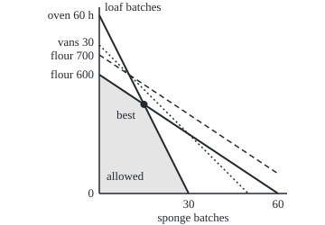
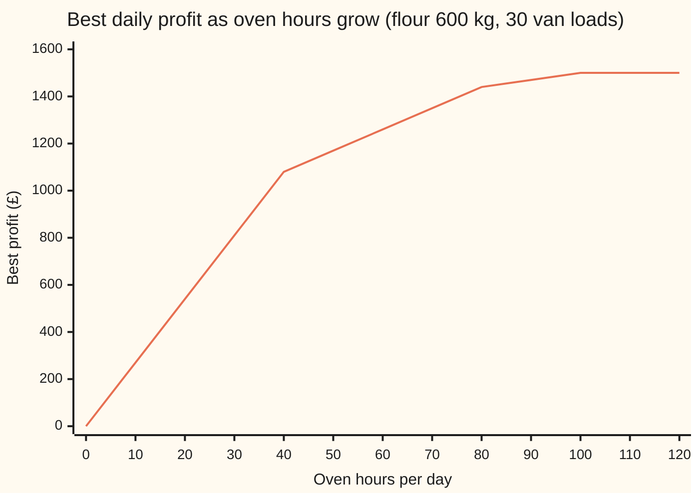

# Shadow prices: what one more oven hour is worth, straight off the solver

[Syllabus](../../../SYLLABUS.md) → [Applied and computational](../README.md) → [Operations Research](../README.md#s05) → Shadow prices

---

## General Overview

One branch of a bakery chain plans tomorrow's baking. It makes two cake mixes: a sponge, earning £30 a batch, and a loaf cake, earning £27 a batch. Its 4 ovens give 60 oven hours a day (15 hours each). A sponge batch takes 2 oven hours and 10 kg of flour; a loaf batch takes 1 oven hour and 15 kg. The mill delivers 600 kg of flour a day. Every batch fills 0.6 of a van load, and 30 vans carry 30 loads.

A solver finds the best plan: 15 sponge batches and 30 loaf batches, for £1,260 a day. Setting up and solving such a plan is the [Linear programs](01-modelling-with-linear-programs.md) card's job; its bakery is a different branch, with other recipes and limits, so its numbers and prices differ from these. Oven hours and flour run out exactly. Three van loads go unused.

The manager's next question is not "what is the plan?" but "what should we buy more of?" The same solver run answers it. Next to each limit it reports a **shadow price** (also called a **dual value**: the extra profit from one more unit of that limit). Here it reads £9.00 an oven hour, £1.20 a kilogram of flour, and £0 a van load.

It also reports a **range**: the stretch over which that price stays true. Oven hours are worth £9 each from 40 up to 80 hours a day. Flour is worth £1.20 a kilogram from 300 to 700 kg. Past the edge of a range, a different limit takes over and the price changes.

**A shadow price is the profit one more unit of a limit adds, and it stays exact only inside the range the solver reports beside it.**

**What kind of fact this is:** a theorem about linear programs, proved on this card in Why it works for a plan whose best corner has exactly as many tight limits as products; the bakery's numbers are a made-up example.

### The picture: the allowed plans and the corner that wins

<p align="center"></p>

Sponge batches run left to right; loaf batches run up. The shaded area holds every plan that fits all three limits. The best plan is the dot, where the oven line meets the flour line. The dotted van line never touches the shaded area: vans are not what stops the bakery.

The dashed line is the flour limit raised to 700 kg. Raising a limit slides its line outward, so the dot slides along the oven line, and the profit rises by the shadow price for each kilogram. At 700 kg the dashed line meets the van line on the oven line. Beyond that, extra flour moves nothing.

---

## The formula

Notation from the [Linear programs](01-modelling-with-linear-programs.md) card: the plan is $x$, the margins $c$, the limits $b$, the usage table $A$, and the problem is "maximise $c^T x$ subject to $Ax \le b$, $x \ge 0$". This card adds $y_i$, the **shadow price** of limit $i$, and for its range $P^*$ (the best profit), $t$ (how far one limit moves) and $\ell_i$, $u_i$ (the range's two ends).

$$P^*(b_i + t) = P^* + y_i\,t \quad \text{for } b_i + t \text{ between } \ell_i \text{ and } u_i, \qquad \text{where } \sum_i y_i\,a_{ij} = c_j \text{ for each product made, and } y_i = 0 \text{ for a limit with slack}$$

**Read it aloud:** move one limit by $t$ units and the best profit moves by its shadow price times $t$, as long as the limit stays inside its range; the shadow prices are the numbers that make every product's margin equal to the value of the limits it uses up.

| Symbol | Plain meaning | In our example | Push it up and the answer… |
| --- | --- | --- | --- |
| $x_j$ | batches of product $j$ in the plan: $x_1$ sponge, $x_2$ loaf | 15 and 30 | |
| $c_j$ | margin per batch of product $j$, in pounds, after normal flour costs | £30 and £27 | profit rises; the plan stays put inside its margin range |
| $a_{ij}$, $A$ | how much of limit $i$ one batch of product $j$ uses; $A$ is the whole table of them | sponge: 2 h, 10 kg, 0.6 load | that limit runs out sooner |
| $b_i$ | limit $i$: what is available per day | 60 h, 600 kg, 30 loads | profit rises by $y_i$ a unit, inside the range |
| $s_i$ | slack: the unused part of limit $i$, $b_i$ minus what the plan uses | 0, 0, 3 loads | |
| $P^*$ | the best profit the limits allow | £1,260 | |
| $y_i$ | the shadow price, or dual value, of limit $i$: pounds per unit | £9.00, £1.20, £0 | |
| $t$ | how far one limit is moved, in its own units | +1 | profit moves by $y_i t$ |
| $\ell_i,\ u_i$ | the lower and upper ends of the range where $y_i$ holds | oven 40 to 80 h; flour 300 to 700 kg | |

### When it holds

- **The model is linear.** Each batch uses the same oven time and flour however many are made. If later batches cost more gas than the first, profit curves and a single price per hour no longer exists.
- **One limit moves at a time, inside its range.** The range is computed with every other limit held fixed. Moving oven hours and flour together can push the plan past an edge neither range shows (see What breaks).
- **The best corner has exactly as many tight limits as products.** Two products, two tight limits here. At a corner where three limits are tight at once (called **degenerate**), the price for one more unit and the price for one fewer can differ, and a solver reports just one of them.
- **Quantities can be fractional.** If batches must be whole numbers, the plan is an integer program and its prices can jump; see [Integer programs](03-integer-programming-and-branch-and-bound.md).
- **The margins already include the normal cost of each limit.** The shadow price is what one more unit is worth on top of that cost, not its total worth.

---

## Why it works

### Step 0: the best plan sits on tight limits, and a small move keeps the same ones tight

The best plan of a linear program sits at a corner of the allowed region. At the bakery's corner, two limits are tight: oven hours and flour. Raise the flour limit a little and the flour line slides outward. The corner slides with it, still where the oven line meets the flour line. Nothing else changes, so the same two limits stay tight. Profit then moves in a straight line with the flour limit, and the slope of that line is the shadow price.

### Step 1: the plan moves in a straight line

At the corner, the two tight limits hold as equations:

$$2x_1 + x_2 = b_1, \qquad 10x_1 + 15x_2 = b_2.$$

Two equations in two unknowns have one answer, and that answer is a fixed combination of $b_1$ and $b_2$. Solving gives the plan per extra unit. One extra oven hour moves sponge by +0.75 batches and loaf by −0.50. One extra kilogram of flour moves sponge by −0.05 and loaf by +0.10. Both are straight-line moves.

### Step 2: profit equals the limits times their prices

Choose numbers $y_1$ and $y_2$ so that each product's margin equals the value of what it uses:

$$2y_1 + 10y_2 = 30 \ \text{(sponge)}, \qquad 1y_1 + 15y_2 = 27 \ \text{(loaf)}.$$

Now add up the profit a different way. Each sponge batch earns $2y_1 + 10y_2$ and each loaf batch $y_1 + 15y_2$, so

$$P^* = (2y_1 + 10y_2)x_1 + (y_1 + 15y_2)x_2 = y_1(2x_1 + x_2) + y_2(10x_1 + 15x_2) = y_1 b_1 + y_2 b_2.$$

The last step uses the two tight equations. So while the same limits stay tight, profit is exactly $y_1 b_1 + y_2 b_2$. One more unit of $b_2$ adds exactly $y_2$. That is the formula: the shadow price is the slope. Here, $P^* = 60 \times 9 + 600 \times 1.20 = 1{,}260$.

### Step 3: positive prices prove the plan is best

Take any plan that fits, tight or not. Its profit is $c_1 x_1 + c_2 x_2$. Replace each margin by the value of what the batch uses, as in Step 2:

$$c_1 x_1 + c_2 x_2 = y_1(2x_1 + x_2) + y_2(10x_1 + 15x_2) \le y_1 \cdot 60 + y_2 \cdot 600 = 1{,}260.$$

The "at most" holds because each bracket is at most its limit and each $y$ is zero or more. So no plan beats £1,260. Prices that are all zero or more, and cover every margin, are a certificate: they prove the plan is best without checking any other corner.

Finding such prices is itself a linear program, the **dual** (minimise $60y_1 + 600y_2 + 30y_3$ while every product's margin is covered). Its best value equals the bakery's best profit. The theory behind that equality is [LP duality](../../15-Optimization/04-Linear%20Programming/04-lp-duality-and-complementary-slackness.md), on the optimisation wing.

The calculus wing reaches the same price for curved problems: a shadow price is the [Lagrange multipliers](../../06-Calculus%20and%20analysis/07-Several%20Variables/08-lagrange-multipliers.md) card's multiplier, read off a straight-line model.

### Step 4: a limit with slack has price zero

The vans have 3 loads spare. One more van load lets the bakery do nothing it could not already do, so it adds £0. In the dual, a limit with slack gets $y_3 = 0$, and Step 3 still works. This is called **complementary slackness**: a limit either has slack or has a price, never both.

### Step 5: the range ends where the corner changes

Step 1 says the plan moves in a straight line as one limit moves. The range ends at the first thing that breaks:

- A product count reaches zero. Cutting oven hours shrinks sponge by 0.75 per hour, so sponge hits zero after 15 / 0.75 = 20 hours, at 40 hours.
- A limit with slack becomes tight. Each extra oven hour uses 0.15 more van loads. The 3 spare loads run out after 20 hours, at 80 hours.

For flour: loaf shrinks by 0.10 per kilogram cut, so it hits zero after 300 kg cut, at 300 kg. Each extra kilogram uses 0.03 more van loads, and the 3 spare loads last 100 kg, to 700 kg. Solvers call these the **allowable decrease** and **allowable increase**.

The same idea gives the range for each margin. The plan stays the best while both prices stay zero or more. Raise the sponge margin and the flour price falls; it reaches zero at a sponge margin of £54. Lower it and the oven price falls; it reaches zero at £18. Outside £18 to £54, a different corner wins.

---

## Worked numbers, by hand

| Step | Arithmetic | Value |
| --- | --- | --- |
| oven used | 2 × 15 + 1 × 30, of 60 | 60: tight |
| flour used | 10 × 15 + 15 × 30, of 600 | 600: tight |
| van loads used | 0.6 × 15 + 0.6 × 30, of 30 | 27: slack 3 |
| van price | slack, so zero | £0 |
| price equations | sponge: $2y_1 + 10y_2 = 30$; loaf: $y_1 + 15y_2 = 27$ | |
| flour price | double the loaf line: $2y_1 + 30y_2 = 54$; subtract sponge: $20y_2 = 24$ | **£1.20 a kg** |
| oven price | $y_1 = 27 - 15 \times 1.20 = 27 - 18$ | **£9.00 an hour** |
| check | 60 × 9 + 600 × 1.20 + 30 × 0 | £1,260, the best profit |
| oven range | sponge reaches 0 at −20 h; vans fill at +20 h | 40 to 80 h |
| flour range | loaf reaches 0 at −300 kg; vans fill at +100 kg | 300 to 700 kg |

One more kilogram of flour, bought at the normal price, adds £1.20 to the day's profit, and this holds for up to 100 extra kilograms.

### Reading the solver's report

Most solvers print a sensitivity report in this shape. Here it is for the bakery:

| Limit | Used | Shadow price | Limit now | Allowable increase | Allowable decrease |
| --- | --- | --- | --- | --- | --- |
| oven hours | 60 | 9.00 | 60 | 20 | 20 |
| flour (kg) | 600 | 1.20 | 600 | 100 | 300 |
| van loads | 27 | 0.00 | 30 | no limit | 3 |

| Product | Batches | Reduced cost | Margin | Allowable increase | Allowable decrease |
| --- | --- | --- | --- | --- | --- |
| sponge | 15 | 0 | 30 | 24 | 12 |
| loaf | 30 | 0 | 27 | 18 | 12 |

The **reduced cost** is how far a product's margin falls short of the value of what it uses. It is zero for every product in the plan.

### Which limit to relax first, and by how much

Two offers arrive. Overtime runs the ovens longer at £5.00 an hour on top of normal costs. A second mill sells flour at £0.80 a kg above the normal £0.50.

- Ovens: each hour is worth £9.00 and costs £5.00, so 20 hours net 20 × (9 − 5) = £80.00.
- Flour: each kilogram is worth £1.20 and costs £0.80 extra, so 100 kg net 100 × (1.20 − 0.80) = £40.00.
- Both together: the re-solved profit is £1,440, not the £1,560 the two prices promise. Take away the starting £1,260 and the cost of both purchases, and the net is £0.00.

So relax the ovens first, by exactly 20 hours. Then re-run the solver. At 80 oven hours, hour 81 adds only £3.00, less than overtime costs, so stop. One more kilogram of flour now adds £0.00, so turn the mill down. The vans have become a limit. This corner is degenerate: oven, flour and vans are all tight at (30, 20). One fewer kilogram of flour loses £1.20, so a solver may print any flour price from £0.00 to £1.20 here; re-solving, as above, settles it.

### What breaks if you drop a piece

| Mistake | Comes out at | What went wrong |
| --- | --- | --- |
| Use £1.20 for 200 extra kg of flour | predicts £1,500; true £1,380 | 200 kg passes the 100 kg allowable increase; past 700 kg the vans bind and flour is worth £0 |
| Add the oven and flour prices for both changes at once | predicts £1,560; true £1,440 | each range assumes the other limit is fixed; together they hit the van limit sooner |
| Value flour at its average, £1,260 / 600 kg | £2.10 a kg: predicts +£210 for 100 kg; true +£120 | the average spreads all profit over flour; the price is the slope at the margin |
| Value a van load at its average, £1,260 / 30 | £42.00 a load; true £0 | vans have slack, so a 31st load changes nothing |

---

## How the price moves as the oven limit grows

Shadow prices are local. Change one limit far enough and the price itself steps down. Hold flour at 600 kg and vans at 30, and give the bakery more and more oven hours:

| Oven hours | Best plan (sponge, loaf) | What stops it | One more oven hour is worth |
| --- | --- | --- | --- |
| 0 to 40 | loaf only, up to 40 batches at 40 h | ovens alone | £27.00 |
| 40 to 80 | from (0, 40) to (30, 20) | ovens and flour | £9.00 |
| 80 to 100 | from (30, 20) to (50, 0) | ovens and vans | £3.00 |
| past 100 | 50 sponge | vans alone | £0.00 |

The worth of one more oven hour, stretch by stretch:

```
0-40 h      ███████████████████████████  27.00
40-80 h     █████████                     9.00
80-100 h    ███                           3.00
past 100 h                                0.00
```



The one line is the best profit at each oven limit, re-solved from scratch. Its slope is the shadow price: steep at first, then 9 from 40 to 80 hours, then 3, then flat. The bends are the range edges. The curve only ever bends downward, so each extra hour is worth no more than the one before.

---

## Code, from first principles, and it actually runs

No solver is imported. Every linear program is solved by trying every corner: each pair of limits is solved as two equations, and the best corner that fits all limits wins. The shadow prices are reached **three independent ways**: solving the tight limits' price equations, re-solving with one unit more and one unit less of each limit, and solving the dual program by its own corners. The ranges are reached two ways: by Step 5's formula and by re-solving one unit at a time until the price changes. The margin ranges are checked by re-solving just inside and just outside each edge.

### Python

```python
# Shadow prices and sensitivity -- the check behind the card.  Standard library only.
# A bakery's daily plan: x1 batches of sponge (30 pounds margin), x2 batches of loaf
# cake (27 pounds).  Limits: oven hours, flour (kg), van loads.  No solver is imported:
# every LP here is solved by visiting every corner.  Three roads to the shadow prices:
# (1) solve the binding rows, (2) re-solve with one more unit, (3) solve the dual LP.
def gauss(M, v):                         # solve M z = v; None if M is singular
    n = len(v)
    a = [M[i][:] + [v[i]] for i in range(n)]
    for k in range(n):
        p = k
        for i in range(k + 1, n):
            if abs(a[i][k]) > abs(a[p][k]): p = i
        if abs(a[p][k]) < 1e-12: return None
        a[k], a[p] = a[p], a[k]
        for i in range(n):
            if i != k:
                f = a[i][k] / a[k][k]
                a[i] = [a[i][j] - f * a[k][j] for j in range(n + 1)]
    return [a[i][n] / a[i][i] for i in range(n)]

def best_corner(c, G, h):                # max c.z subject to G z <= h, trying every corner
    n, best, arg = len(c), None, None
    for mask in range(1 << len(G)):
        rows = [i for i in range(len(G)) if mask >> i & 1]
        if len(rows) != n: continue
        z = gauss([G[i] for i in rows], [h[i] for i in rows])
        if z is None: continue
        if any(sum(G[i][j] * z[j] for j in range(n)) > h[i] + 1e-9 for i in range(len(G))): continue
        val = sum(c[j] * z[j] for j in range(n))
        if best is None or val > best + 1e-9: best, arg = val, z
    return best, arg

NAMES = ["oven", "flour", "vans"]
A = [[2.0, 1.0], [10.0, 15.0], [0.6, 0.6]]   # oven hours, flour kg, van loads per batch
B0, C0 = [60.0, 600.0, 30.0], [30.0, 27.0]

def plan(b, c=C0):                       # the bakery LP, with x1, x2 >= 0 as two more rows
    return best_corner(c, A + [[-1.0, 0.0], [0.0, -1.0]], b + [0.0, 0.0])

def bump(i, t, b=B0):                    # the limits with limit i moved by t
    return [b[k] + (t if k == i else 0.0) for k in range(3)]

def prices(b, c=C0):                     # road 1: solve the binding rows for the prices
    P, x = plan(b, c)
    G, h = A + [[-1.0, 0.0], [0.0, -1.0]], b + [0.0, 0.0]
    bind = [i for i in range(5) if h[i] - G[i][0] * x[0] - G[i][1] * x[1] < 1e-9]
    yb = gauss([[G[i][j] for i in bind] for j in range(2)], c)   # needs exactly 2 binding rows
    return P, x, [yb[bind.index(i)] + 0.0 if i in bind else 0.0 for i in range(3)]

print("setting: 4 ovens x 15 h =", 4 * 15, "oven hours; per batch sponge 2 h, 10 kg, 0.6 van load;"
      " loaf 1 h, 15 kg, 0.6 van load; 30 vans")
P, x, y = prices(B0)
used = [A[i][0] * x[0] + A[i][1] * x[1] for i in range(3)]
print(f"plan: sponge {x[0]:.2f} batches, loaf {x[1]:.2f} batches, profit {P:.2f}")
for i in range(3):
    print(f"{NAMES[i]:5}: limit {B0[i]:7.2f}, used {used[i]:7.2f}, slack {B0[i] - used[i]:6.2f}")
bind = [i for i in range(3) if B0[i] - used[i] < 1e-9]
yb = [y[i] for i in bind]
for i in range(3):
    up, down = plan(bump(i, 1.0))[0] - P, P - plan(bump(i, -1.0))[0]       # road 2
    print(f"{NAMES[i]:5}: shadow price {y[i]:.2f}; re-solve +1 gains {up:.2f}, -1 loses {down:.2f}")
    assert abs(up - y[i]) < 1e-9 and abs(down - y[i]) < 1e-9
D, yd = best_corner([-v for v in B0], [[-A[i][j] for i in range(3)] for j in range(2)]
                    + [[-1.0 if k == i else 0.0 for k in range(3)] for i in range(3)], [-v for v in C0] + [0.0] * 3)
print(f"dual LP by its corners: prices {yd[0] + 0.0:.2f}, {yd[1] + 0.0:.2f}, {yd[2] + 0.0:.2f}; cost {-D:.2f}")  # road 3
assert all(abs(yd[i] - y[i]) < 1e-9 for i in range(3)) and abs(-D - P) < 1e-9
print(f"profit = 60 x {y[0]:.2f} + 600 x {y[1]:.2f} + 30 x {y[2]:.2f} = {sum(B0[i] * y[i] for i in range(3)):.2f}")
VAR = ["sponge", "loaf"]
rc = [C0[j] - sum(y[i] * A[i][j] for i in range(3)) for j in range(2)]   # margin minus value of what it uses
print("reduced cost: " + ", ".join(f"{VAR[j]} {round(rc[j], 9) + 0.0:.2f}" for j in range(2)))
for i in range(3):                       # ranging by formula: keep the same rows binding
    if i in bind:
        d = gauss([A[k] for k in bind], [1.0 if k == i else 0.0 for k in bind])
        moves = [(-x[j] / d[j], VAR[j] + " hits 0") for j in range(2) if abs(d[j]) > 1e-12]
        moves += [((B0[k] - used[k]) / (A[k][0] * d[0] + A[k][1] * d[1]), NAMES[k] + " binds")
                  for k in range(3) if k not in bind and abs(A[k][0] * d[0] + A[k][1] * d[1]) > 1e-12]
        lo = max(m for m in moves if m[0] < 0); hi = min(m for m in moves if m[0] > 0)
        rng = (B0[i] + lo[0], B0[i] + hi[0])
        print(f"{NAMES[i]:5}: price {y[i]:.2f} holds from {rng[0]:.2f} ({lo[1]}) to {rng[1]:.2f} ({hi[1]});"
              f" allowable increase {hi[0]:.2f}, decrease {-lo[0]:.2f}")
        print(f"{NAMES[i]:5}: each extra unit moves sponge by {d[0]:+.2f}, loaf by {d[1]:+.2f} batches, van loads by {0.6 * (d[0] + d[1]):+.2f}")
    else:
        rng = (used[i], float("inf"))
        print(f"{NAMES[i]:5}: price 0.00 holds from {used[i]:.2f} up, with no upper end; allowable decrease {B0[i] - used[i]:.2f}")
    t_up = t_dn = 0.0                    # ranging by scanning: re-solve one unit at a time
    while t_up < 3 * B0[i] and abs(plan(bump(i, t_up + 1))[0] - plan(bump(i, t_up))[0] - y[i]) < 1e-9: t_up += 1
    while abs(plan(bump(i, t_dn - 1))[0] - plan(bump(i, t_dn))[0] + y[i]) < 1e-9: t_dn -= 1
    print(f"{NAMES[i]:5}: scan agrees, price constant from {B0[i] + t_dn:.2f} to "
          + ("no end" if t_up >= 3 * B0[i] else f"{B0[i] + t_up:.2f}"))
    assert abs(B0[i] + t_dn - rng[0]) < 1e-6 and (t_up >= 3 * B0[i] or abs(B0[i] + t_up - rng[1]) < 1e-6)
for j in range(2):                       # margin ranges: the prices must stay >= 0
    dy = gauss([[A[i][k] for i in bind] for k in range(2)], [1.0 if k == j else 0.0 for k in range(2)])
    lo = max(-yb[k] / dy[k] for k in range(2) if dy[k] > 0); hi = min(-yb[k] / dy[k] for k in range(2) if dy[k] < 0)
    cl, ch = C0[j] + lo, C0[j] + hi
    print(f"{VAR[j]:6} margin: plan unchanged from {cl:.2f} to {ch:.2f} pounds; increase {hi:.2f}, decrease {-lo:.2f}")
    for cc, same in ((cl + 0.5, True), (cl - 0.5, False), (ch - 0.5, True), (ch + 0.5, False)):
        xx = plan(B0, [cc if k == j else C0[k] for k in range(2)])[1]
        assert (abs(xx[0] - x[0]) + abs(xx[1] - x[1]) < 1e-9) == same
# what breaks: prices used outside their range, added together, or replaced by averages
print(f"flour +200 kg: price predicts {P + 200 * y[1]:.2f}, re-solve gives {plan(bump(1, 200))[0]:.2f}")
both = plan([80.0, 700.0, 30.0])[0]
print(f"oven +20 and flour +100: prices predict {P + 20 * y[0] + 100 * y[1]:.2f}, re-solve gives {both:.2f}")
print(f"average flour value {P / 600:.2f} per kg predicts +{100 * P / 600:.2f} for 100 kg; true +{plan(bump(1, 100))[0] - P:.2f}")
print(f"average van value {P / 30:.2f} per load; a 31st load truly adds {plan(bump(2, 1))[0] - P:.2f}")
assert plan(bump(1, 200))[0] < P + 200 * y[1] - 1 and both < P + 20 * y[0] + 100 * y[1] - 1
print(f"flour already costs 0.50 per kg inside the margins: most to pay for an extra kg {0.50 + y[1]:.2f}")
oven_net, flour_net = 20 * (y[0] - 5.0), 100 * (y[1] - 0.80)
print(f"decision: 20 overtime hours at 5.00 net {oven_net:.2f}; 100 kg at 0.80 extra net {flour_net:.2f}; "
      f"both net {both - P - 100 - 80:.2f}")
P80 = plan([80.0, 600.0, 30.0])[0]
print(f"at 80 oven hours: profit {P80:.2f}; hour 81 adds {plan([81.0, 600.0, 30.0])[0] - P80:.2f}, "
      f"1 more kg flour adds {plan([80.0, 601.0, 30.0])[0] - P80:.2f}, 1 fewer loses {P80 - plan([80.0, 599.0, 30.0])[0]:.2f}")
pts = [plan([float(h), 600.0, 30.0])[0] for h in range(0, 121, 10)]
print("chart, profit at oven hours 0, 10, ..., 120:", ", ".join(f"{p:.0f}" for p in pts))
assert abs(pts[4] - 1080) < 1e-9 and abs(pts[8] - 1440) < 1e-9 and abs(pts[12] - pts[10]) < 1e-9
for h in (40.0, 80.0, 100.0):
    print(f"at {h:.0f} oven hours: sponge {plan([h, 600.0, 30.0])[1][0] + 0.0:.2f}, loaf {plan([h, 600.0, 30.0])[1][1] + 0.0:.2f}")
print("oven hour worth by stretch:", ", ".join(f"{lab} {(pts[k + 1] - pts[k]) / 10:.2f}"
      for lab, k in (("0-40 h", 0), ("40-80 h", 4), ("80-100 h", 8), ("past 100 h", 10))))
for label, b, c in (("flour 750", [60.0, 750.0, 30.0], C0), ("sponge margin 55", B0, [55.0, 27.0]),
                    ("vans 26", [60.0, 600.0, 26.0], C0)):
    Pt, xt, yt = prices(b, c)
    print(f"try {label}: plan {xt[0] + 0.0:.2f}, {xt[1] + 0.0:.2f}; profit {Pt:.2f}; prices {yt[0]:.2f}, {yt[1]:.2f}, {yt[2]:.2f}")
px = lambda u, v: f"({110 + 3.3 * u:.1f}, {215 - 3.3 * v:.1f})"
print("figure, 3.3 px per batch, origin (110, 215): corners", " ".join(px(*q) for q in ((0, 0), (30, 0), (15, 30), (0, 40))))
print("figure, line ends: oven", px(0, 60), px(30, 0), "flour", px(0, 40), px(60, 0),
      "flour 700", px(0, 700 / 15), px(60, 20 / 3), "vans", px(0, 50), px(50, 0))
print("ALL CHECKS PASS")
```

**Ran 2026-11-11 on macOS, Python 3.14.10, standard library only. All checks passed. Output, pasted from the run:**

```
setting: 4 ovens x 15 h = 60 oven hours; per batch sponge 2 h, 10 kg, 0.6 van load; loaf 1 h, 15 kg, 0.6 van load; 30 vans
plan: sponge 15.00 batches, loaf 30.00 batches, profit 1260.00
oven : limit   60.00, used   60.00, slack   0.00
flour: limit  600.00, used  600.00, slack   0.00
vans : limit   30.00, used   27.00, slack   3.00
oven : shadow price 9.00; re-solve +1 gains 9.00, -1 loses 9.00
flour: shadow price 1.20; re-solve +1 gains 1.20, -1 loses 1.20
vans : shadow price 0.00; re-solve +1 gains 0.00, -1 loses 0.00
dual LP by its corners: prices 9.00, 1.20, 0.00; cost 1260.00
profit = 60 x 9.00 + 600 x 1.20 + 30 x 0.00 = 1260.00
reduced cost: sponge 0.00, loaf 0.00
oven : price 9.00 holds from 40.00 (sponge hits 0) to 80.00 (vans binds); allowable increase 20.00, decrease 20.00
oven : each extra unit moves sponge by +0.75, loaf by -0.50 batches, van loads by +0.15
oven : scan agrees, price constant from 40.00 to 80.00
flour: price 1.20 holds from 300.00 (loaf hits 0) to 700.00 (vans binds); allowable increase 100.00, decrease 300.00
flour: each extra unit moves sponge by -0.05, loaf by +0.10 batches, van loads by +0.03
flour: scan agrees, price constant from 300.00 to 700.00
vans : price 0.00 holds from 27.00 up, with no upper end; allowable decrease 3.00
vans : scan agrees, price constant from 27.00 to no end
sponge margin: plan unchanged from 18.00 to 54.00 pounds; increase 24.00, decrease 12.00
loaf   margin: plan unchanged from 15.00 to 45.00 pounds; increase 18.00, decrease 12.00
flour +200 kg: price predicts 1500.00, re-solve gives 1380.00
oven +20 and flour +100: prices predict 1560.00, re-solve gives 1440.00
average flour value 2.10 per kg predicts +210.00 for 100 kg; true +120.00
average van value 42.00 per load; a 31st load truly adds 0.00
flour already costs 0.50 per kg inside the margins: most to pay for an extra kg 1.70
decision: 20 overtime hours at 5.00 net 80.00; 100 kg at 0.80 extra net 40.00; both net 0.00
at 80 oven hours: profit 1440.00; hour 81 adds 3.00, 1 more kg flour adds 0.00, 1 fewer loses 1.20
chart, profit at oven hours 0, 10, ..., 120: 0, 270, 540, 810, 1080, 1170, 1260, 1350, 1440, 1470, 1500, 1500, 1500
at 40 oven hours: sponge 0.00, loaf 40.00
at 80 oven hours: sponge 30.00, loaf 20.00
at 100 oven hours: sponge 50.00, loaf 0.00
oven hour worth by stretch: 0-40 h 27.00, 40-80 h 9.00, 80-100 h 3.00, past 100 h 0.00
try flour 750: plan 10.00, 40.00; profit 1380.00; prices 3.00, 0.00, 40.00
try sponge margin 55: plan 30.00, 0.00; profit 1650.00; prices 27.50, 0.00, 0.00
try vans 26: plan 16.67, 26.67; profit 1220.00; prices 3.00, 0.00, 40.00
figure, 3.3 px per batch, origin (110, 215): corners (110.0, 215.0) (209.0, 215.0) (159.5, 116.0) (110.0, 83.0)
figure, line ends: oven (110.0, 17.0) (209.0, 215.0) flour (110.0, 83.0) (308.0, 215.0) flour 700 (110.0, 61.0) (308.0, 193.0) vans (110.0, 50.0) (275.0, 215.0)
ALL CHECKS PASS
```

### Rust

```rust
// Shadow prices and sensitivity -- the check behind the card.  Rust std only.
// A bakery's daily plan: x1 batches of sponge (30 pounds margin), x2 batches of loaf
// cake (27 pounds).  Limits: oven hours, flour (kg), van loads.  No solver is used:
// every LP here is solved by visiting every corner.  Three roads to the shadow prices:
// (1) solve the binding rows, (2) re-solve with one more unit, (3) solve the dual LP.
fn gauss(m: &[Vec<f64>], v: &[f64]) -> Option<Vec<f64>> { // solve M z = v; None if singular
    let n = v.len();
    let mut a: Vec<Vec<f64>> = (0..n).map(|i| { let mut r = m[i].clone(); r.push(v[i]); r }).collect();
    for k in 0..n {
        let mut p = k;
        for i in k + 1..n { if a[i][k].abs() > a[p][k].abs() { p = i; } }
        if a[p][k].abs() < 1e-12 { return None; }
        a.swap(k, p);
        for i in 0..n {
            if i != k {
                let f = a[i][k] / a[k][k];
                for j in 0..=n { a[i][j] -= f * a[k][j]; }
            }
        }
    }
    Some((0..n).map(|i| a[i][n] / a[i][i]).collect())
}

fn best_corner(c: &[f64], g: &[Vec<f64>], h: &[f64]) -> (f64, Vec<f64>) { // max c.z, G z <= h
    let n = c.len();
    let mut best: Option<(f64, Vec<f64>)> = None;
    for mask in 0..(1usize << g.len()) {
        let rows: Vec<usize> = (0..g.len()).filter(|i| mask >> i & 1 == 1).collect();
        if rows.len() != n { continue; }
        let gm: Vec<Vec<f64>> = rows.iter().map(|&i| g[i].clone()).collect();
        let hv: Vec<f64> = rows.iter().map(|&i| h[i]).collect();
        let z = match gauss(&gm, &hv) { Some(z) => z, None => continue };
        if (0..g.len()).any(|i| (0..n).map(|j| g[i][j] * z[j]).sum::<f64>() > h[i] + 1e-9) { continue; }
        let val: f64 = (0..n).map(|j| c[j] * z[j]).sum();
        if best.as_ref().map_or(true, |b| val > b.0 + 1e-9) { best = Some((val, z)); }
    }
    best.unwrap()
}

const NAMES: [&str; 3] = ["oven", "flour", "vans"];
const VAR: [&str; 2] = ["sponge", "loaf"];
const A: [[f64; 2]; 3] = [[2.0, 1.0], [10.0, 15.0], [0.6, 0.6]]; // per batch
const B0: [f64; 3] = [60.0, 600.0, 30.0];
const C0: [f64; 2] = [30.0, 27.0];

fn plan_c(b: [f64; 3], c: [f64; 2]) -> (f64, Vec<f64>) { // x1, x2 >= 0 as two more rows
    let mut g: Vec<Vec<f64>> = A.iter().map(|r| r.to_vec()).collect();
    g.push(vec![-1.0, 0.0]); g.push(vec![0.0, -1.0]);
    best_corner(&c, &g, &[b[0], b[1], b[2], 0.0, 0.0])
}
fn plan(b: [f64; 3]) -> f64 { plan_c(b, C0).0 }
fn bump(i: usize, t: f64) -> [f64; 3] { let mut b = B0; b[i] += t; b }
fn prices(b: [f64; 3], c: [f64; 2]) -> (f64, Vec<f64>, Vec<f64>) { // road 1: solve binding rows
    let (p, x) = plan_c(b, c);
    let mut g: Vec<Vec<f64>> = A.iter().map(|r| r.to_vec()).collect();
    g.push(vec![-1.0, 0.0]); g.push(vec![0.0, -1.0]); let h = [b[0], b[1], b[2], 0.0, 0.0];
    let bind: Vec<usize> = (0..5).filter(|&i| h[i] - g[i][0] * x[0] - g[i][1] * x[1] < 1e-9).collect();
    let gt: Vec<Vec<f64>> = (0..2).map(|j| bind.iter().map(|&i| g[i][j]).collect()).collect();
    let yb = gauss(&gt, &c).unwrap(); // needs exactly 2 binding rows
    let y = (0..3).map(|i| bind.iter().position(|&k| k == i).map_or(0.0, |q| yb[q] + 0.0)).collect();
    (p, x, y)
}
fn px(u: f64, v: f64) -> String { format!("({:.1}, {:.1})", 110.0 + 3.3 * u, 215.0 - 3.3 * v) }

fn main() {
    println!("setting: 4 ovens x 15 h = {} oven hours; per batch sponge 2 h, 10 kg, 0.6 van load; loaf 1 h, 15 kg, 0.6 van load; 30 vans", 4 * 15);
    let (p, x, y) = prices(B0, C0);
    let used: Vec<f64> = (0..3).map(|i| A[i][0] * x[0] + A[i][1] * x[1]).collect();
    println!("plan: sponge {:.2} batches, loaf {:.2} batches, profit {:.2}", x[0], x[1], p);
    for i in 0..3 { println!("{:5}: limit {:7.2}, used {:7.2}, slack {:6.2}", NAMES[i], B0[i], used[i], B0[i] - used[i]); }
    let bind: Vec<usize> = (0..3).filter(|&i| B0[i] - used[i] < 1e-9).collect();
    let yb: Vec<f64> = bind.iter().map(|&i| y[i]).collect();
    for i in 0..3 {
        let (up, down) = (plan(bump(i, 1.0)) - p, p - plan(bump(i, -1.0))); // road 2
        println!("{:5}: shadow price {:.2}; re-solve +1 gains {:.2}, -1 loses {:.2}", NAMES[i], y[i], up, down);
        assert!((up - y[i]).abs() < 1e-9 && (down - y[i]).abs() < 1e-9);
    }
    let mut g: Vec<Vec<f64>> = (0..2).map(|j| (0..3).map(|i| -A[i][j]).collect()).collect();
    for i in 0..3 { g.push((0..3).map(|k| if k == i { -1.0 } else { 0.0 }).collect()); }
    let (d, yd) = best_corner(&[-B0[0], -B0[1], -B0[2]], &g, &[-C0[0], -C0[1], 0.0, 0.0, 0.0]);
    println!("dual LP by its corners: prices {:.2}, {:.2}, {:.2}; cost {:.2}", yd[0] + 0.0, yd[1] + 0.0, yd[2] + 0.0, -d);
    assert!((0..3).all(|i| (yd[i] - y[i]).abs() < 1e-9) && (-d - p).abs() < 1e-9); // road 3
    println!("profit = 60 x {:.2} + 600 x {:.2} + 30 x {:.2} = {:.2}", y[0], y[1], y[2],
             (0..3).map(|i| B0[i] * y[i]).sum::<f64>());
    let rc = |j: usize| ((C0[j] - (0..3).map(|i| y[i] * A[i][j]).sum::<f64>()) * 1e9).round() / 1e9 + 0.0; // margin minus value used
    println!("reduced cost: {} {:.2}, {} {:.2}", VAR[0], rc(0), VAR[1], rc(1));
    for i in 0..3 { // ranging by formula: keep the same rows binding
        let rng: (f64, f64);
        if bind.contains(&i) {
            let ab: Vec<Vec<f64>> = bind.iter().map(|&k| A[k].to_vec()).collect();
            let e: Vec<f64> = bind.iter().map(|&k| if k == i { 1.0 } else { 0.0 }).collect();
            let dd = gauss(&ab, &e).unwrap();
            let mut moves: Vec<(f64, String)> = Vec::new();
            for j in 0..2 { if dd[j].abs() > 1e-12 { moves.push((-x[j] / dd[j], format!("{} hits 0", VAR[j]))); } }
            for k in 0..3 {
                let r = A[k][0] * dd[0] + A[k][1] * dd[1];
                if !bind.contains(&k) && r.abs() > 1e-12 { moves.push(((B0[k] - used[k]) / r, format!("{} binds", NAMES[k]))); }
            }
            let (mut lo, mut hi): (Option<&(f64, String)>, Option<&(f64, String)>) = (None, None);
            for m in &moves {
                if m.0 < 0.0 && lo.map_or(true, |l| m.0 > l.0) { lo = Some(m); }
                if m.0 > 0.0 && hi.map_or(true, |h| m.0 < h.0) { hi = Some(m); }
            }
            let (lo, hi) = (lo.unwrap(), hi.unwrap());
            rng = (B0[i] + lo.0, B0[i] + hi.0);
            println!("{:5}: price {:.2} holds from {:.2} ({}) to {:.2} ({}); allowable increase {:.2}, decrease {:.2}",
                     NAMES[i], y[i], rng.0, lo.1, rng.1, hi.1, hi.0, -lo.0);
            println!("{:5}: each extra unit moves sponge by {:+.2}, loaf by {:+.2} batches, van loads by {:+.2}", NAMES[i], dd[0], dd[1], 0.6 * (dd[0] + dd[1]));
        } else {
            rng = (used[i], f64::INFINITY);
            println!("{:5}: price 0.00 holds from {:.2} up, with no upper end; allowable decrease {:.2}", NAMES[i], used[i], B0[i] - used[i]);
        }
        let (mut t_up, mut t_dn) = (0.0f64, 0.0f64); // ranging by scanning, one unit at a time
        while t_up < 3.0 * B0[i] && (plan(bump(i, t_up + 1.0)) - plan(bump(i, t_up)) - y[i]).abs() < 1e-9 { t_up += 1.0; }
        while (plan(bump(i, t_dn - 1.0)) - plan(bump(i, t_dn)) + y[i]).abs() < 1e-9 { t_dn -= 1.0; }
        let end = if t_up >= 3.0 * B0[i] { "no end".to_string() } else { format!("{:.2}", B0[i] + t_up) };
        println!("{:5}: scan agrees, price constant from {:.2} to {}", NAMES[i], B0[i] + t_dn, end);
        assert!((B0[i] + t_dn - rng.0).abs() < 1e-6 && (t_up >= 3.0 * B0[i] || (B0[i] + t_up - rng.1).abs() < 1e-6));
    }
    for j in 0..2 { // margin ranges: the prices must stay >= 0
        let ab: Vec<Vec<f64>> = bind.iter().map(|&i| A[i].to_vec()).collect();
        let at2: Vec<Vec<f64>> = (0..2).map(|k| ab.iter().map(|r| r[k]).collect()).collect();
        let dy = gauss(&at2, &[if j == 0 { 1.0 } else { 0.0 }, if j == 1 { 1.0 } else { 0.0 }]).unwrap();
        let lo = (0..2).filter(|&k| dy[k] > 0.0).map(|k| -yb[k] / dy[k]).fold(f64::NEG_INFINITY, f64::max);
        let hi = (0..2).filter(|&k| dy[k] < 0.0).map(|k| -yb[k] / dy[k]).fold(f64::INFINITY, f64::min);
        let (cl, ch) = (C0[j] + lo, C0[j] + hi);
        println!("{:6} margin: plan unchanged from {:.2} to {:.2} pounds; increase {:.2}, decrease {:.2}", VAR[j], cl, ch, hi, -lo);
        for (cc, same) in [(cl + 0.5, true), (cl - 0.5, false), (ch - 0.5, true), (ch + 0.5, false)] {
            let mut c = C0; c[j] = cc;
            let xx = plan_c(B0, c).1;
            assert!(((xx[0] - x[0]).abs() + (xx[1] - x[1]).abs() < 1e-9) == same);
        }
    }
    // what breaks: prices used outside their range, added together, or replaced by averages
    println!("flour +200 kg: price predicts {:.2}, re-solve gives {:.2}", p + 200.0 * y[1], plan(bump(1, 200.0)));
    let both = plan([80.0, 700.0, 30.0]);
    println!("oven +20 and flour +100: prices predict {:.2}, re-solve gives {:.2}", p + 20.0 * y[0] + 100.0 * y[1], both);
    println!("average flour value {:.2} per kg predicts +{:.2} for 100 kg; true +{:.2}", p / 600.0, 100.0 * p / 600.0,
             plan(bump(1, 100.0)) - p);
    println!("average van value {:.2} per load; a 31st load truly adds {:.2}", p / 30.0, plan(bump(2, 1.0)) - p);
    assert!(plan(bump(1, 200.0)) < p + 200.0 * y[1] - 1.0 && both < p + 20.0 * y[0] + 100.0 * y[1] - 1.0);
    println!("flour already costs 0.50 per kg inside the margins: most to pay for an extra kg {:.2}", 0.50 + y[1]);
    let (oven_net, flour_net) = (20.0 * (y[0] - 5.0), 100.0 * (y[1] - 0.80));
    println!("decision: 20 overtime hours at 5.00 net {:.2}; 100 kg at 0.80 extra net {:.2}; both net {:.2}",
             oven_net, flour_net, both - p - 100.0 - 80.0);
    let p80 = plan([80.0, 600.0, 30.0]);
    println!("at 80 oven hours: profit {:.2}; hour 81 adds {:.2}, 1 more kg flour adds {:.2}, 1 fewer loses {:.2}", p80,
             plan([81.0, 600.0, 30.0]) - p80, plan([80.0, 601.0, 30.0]) - p80, p80 - plan([80.0, 599.0, 30.0]));
    let pts: Vec<f64> = (0..13).map(|k| plan([10.0 * k as f64, 600.0, 30.0])).collect();
    let s: Vec<String> = pts.iter().map(|v| format!("{:.0}", v)).collect();
    println!("chart, profit at oven hours 0, 10, ..., 120: {}", s.join(", "));
    assert!((pts[4] - 1080.0).abs() < 1e-9 && (pts[8] - 1440.0).abs() < 1e-9 && (pts[12] - pts[10]).abs() < 1e-9);
    for h in [40.0, 80.0, 100.0] {
        let xh = plan_c([h, 600.0, 30.0], C0).1;
        println!("at {:.0} oven hours: sponge {:.2}, loaf {:.2}", h, xh[0] + 0.0, xh[1] + 0.0);
    }
    let st: Vec<String> = [("0-40 h", 0), ("40-80 h", 4), ("80-100 h", 8), ("past 100 h", 10)].iter()
        .map(|&(lab, k)| format!("{} {:.2}", lab, (pts[k + 1] - pts[k]) / 10.0)).collect();
    println!("oven hour worth by stretch: {}", st.join(", "));
    for (label, b, c) in [("flour 750", [60.0, 750.0, 30.0], C0), ("sponge margin 55", B0, [55.0, 27.0]),
                          ("vans 26", [60.0, 600.0, 26.0], C0)] {
        let (pt, xt, yt) = prices(b, c);
        println!("try {}: plan {:.2}, {:.2}; profit {:.2}; prices {:.2}, {:.2}, {:.2}", label, xt[0] + 0.0, xt[1] + 0.0, pt, yt[0], yt[1], yt[2]);
    }
    let corners: Vec<String> = [(0.0, 0.0), (30.0, 0.0), (15.0, 30.0), (0.0, 40.0)].iter().map(|&(u, v)| px(u, v)).collect();
    println!("figure, 3.3 px per batch, origin (110, 215): corners {}", corners.join(" "));
    println!("figure, line ends: oven {} {} flour {} {} flour 700 {} {} vans {} {}", px(0.0, 60.0), px(30.0, 0.0),
             px(0.0, 40.0), px(60.0, 0.0), px(0.0, 700.0 / 15.0), px(60.0, 20.0 / 3.0), px(0.0, 50.0), px(50.0, 0.0));
    println!("ALL CHECKS PASS");
}
```

**Ran 2026-11-11 on macOS, rustc 1.98.1, no crates. All checks passed. Output, pasted from the run:**

```
setting: 4 ovens x 15 h = 60 oven hours; per batch sponge 2 h, 10 kg, 0.6 van load; loaf 1 h, 15 kg, 0.6 van load; 30 vans
plan: sponge 15.00 batches, loaf 30.00 batches, profit 1260.00
oven : limit   60.00, used   60.00, slack   0.00
flour: limit  600.00, used  600.00, slack   0.00
vans : limit   30.00, used   27.00, slack   3.00
oven : shadow price 9.00; re-solve +1 gains 9.00, -1 loses 9.00
flour: shadow price 1.20; re-solve +1 gains 1.20, -1 loses 1.20
vans : shadow price 0.00; re-solve +1 gains 0.00, -1 loses 0.00
dual LP by its corners: prices 9.00, 1.20, 0.00; cost 1260.00
profit = 60 x 9.00 + 600 x 1.20 + 30 x 0.00 = 1260.00
reduced cost: sponge 0.00, loaf 0.00
oven : price 9.00 holds from 40.00 (sponge hits 0) to 80.00 (vans binds); allowable increase 20.00, decrease 20.00
oven : each extra unit moves sponge by +0.75, loaf by -0.50 batches, van loads by +0.15
oven : scan agrees, price constant from 40.00 to 80.00
flour: price 1.20 holds from 300.00 (loaf hits 0) to 700.00 (vans binds); allowable increase 100.00, decrease 300.00
flour: each extra unit moves sponge by -0.05, loaf by +0.10 batches, van loads by +0.03
flour: scan agrees, price constant from 300.00 to 700.00
vans : price 0.00 holds from 27.00 up, with no upper end; allowable decrease 3.00
vans : scan agrees, price constant from 27.00 to no end
sponge margin: plan unchanged from 18.00 to 54.00 pounds; increase 24.00, decrease 12.00
loaf   margin: plan unchanged from 15.00 to 45.00 pounds; increase 18.00, decrease 12.00
flour +200 kg: price predicts 1500.00, re-solve gives 1380.00
oven +20 and flour +100: prices predict 1560.00, re-solve gives 1440.00
average flour value 2.10 per kg predicts +210.00 for 100 kg; true +120.00
average van value 42.00 per load; a 31st load truly adds 0.00
flour already costs 0.50 per kg inside the margins: most to pay for an extra kg 1.70
decision: 20 overtime hours at 5.00 net 80.00; 100 kg at 0.80 extra net 40.00; both net 0.00
at 80 oven hours: profit 1440.00; hour 81 adds 3.00, 1 more kg flour adds 0.00, 1 fewer loses 1.20
chart, profit at oven hours 0, 10, ..., 120: 0, 270, 540, 810, 1080, 1170, 1260, 1350, 1440, 1470, 1500, 1500, 1500
at 40 oven hours: sponge 0.00, loaf 40.00
at 80 oven hours: sponge 30.00, loaf 20.00
at 100 oven hours: sponge 50.00, loaf 0.00
oven hour worth by stretch: 0-40 h 27.00, 40-80 h 9.00, 80-100 h 3.00, past 100 h 0.00
try flour 750: plan 10.00, 40.00; profit 1380.00; prices 3.00, 0.00, 40.00
try sponge margin 55: plan 30.00, 0.00; profit 1650.00; prices 27.50, 0.00, 0.00
try vans 26: plan 16.67, 26.67; profit 1220.00; prices 3.00, 0.00, 40.00
figure, 3.3 px per batch, origin (110, 215): corners (110.0, 215.0) (209.0, 215.0) (159.5, 116.0) (110.0, 83.0)
figure, line ends: oven (110.0, 17.0) (209.0, 215.0) flour (110.0, 83.0) (308.0, 215.0) flour 700 (110.0, 61.0) (308.0, 193.0) vans (110.0, 50.0) (275.0, 215.0)
ALL CHECKS PASS
```

### Lean

Lean proves the formula for every linear program whose best corner has exactly as many tight limits as products, and checks the bakery's numbers.

- Suppose the best corner makes every product, has exactly as many tight limits as products, and leaves every other limit slack. Then moving only $b_i$ by $t$, inside its range, makes the best profit $P^* + y_i\,t$.
- Take any corner with exactly as many tight limits as products. Then its profit equals the limits times their shadow prices, as in Step 2.
- Take prices that are all zero or more and cover every margin. Then no plan that fits earns more than the limits times those prices.
- The bakery's plan, prices, ranges, margin ranges, overtime decision, What breaks figures and three points of the profit chart also check.

Solving the bakery's programs corner by corner, the re-solves, the dual and the figure are left to the Python and Rust checks.

```lean
-- Shadow prices: at a best corner of a linear program with exactly as many tight limits as products, moving one limit inside its range changes the best profit by that limit's shadow price times the move.
import Mathlib
import Mathlib.LinearAlgebra.Matrix.NonsingularInverse
import Mathlib.Data.Real.Basic
import Mathlib.Order.Bounds.Basic
import Mathlib.Tactic.NormNum

open Matrix


variable {m n : ℕ}

/-- A plan `x` fits the limits `b`: no product count is negative, and the plan uses at most
`b k` of each limit `k`, where `A k j` is how much of limit `k` one batch of product `j` uses. -/
def Fits (A : Matrix (Fin m) (Fin n) ℝ) (b : Fin m → ℝ) (x : Fin n → ℝ) : Prop :=
  0 ≤ x ∧ A *ᵥ x ≤ b

/-- Every profit `c ⬝ᵥ x` that some plan fitting the limits `b` earns. -/
def profits (A : Matrix (Fin m) (Fin n) ℝ) (b : Fin m → ℝ) (c : Fin n → ℝ) : Set ℝ :=
  (fun x => c ⬝ᵥ x) '' {x | Fits A b x}

/-- The corner where the tight limits `σ 0, …, σ (n-1)` all hold as equations:
the plan solving `A_σ x = b_σ`. -/
noncomputable def corner (A : Matrix (Fin m) (Fin n) ℝ) (σ : Fin n → Fin m) (b : Fin m → ℝ) :
    Fin n → ℝ :=
  (A.submatrix σ id)⁻¹ *ᵥ (b ∘ σ)

/-- The shadow prices: on the tight limits they solve `A_σᵀ y_σ = c` (each product's margin equals
the value of the limits it uses), and every limit with slack gets price zero. -/
noncomputable def shadowPrices (A : Matrix (Fin m) (Fin n) ℝ) (σ : Fin n → Fin m) (c : Fin n → ℝ) :
    Fin m → ℝ :=
  Function.extend σ (((A.submatrix σ id)ᵀ)⁻¹ *ᵥ c) 0

/-- Limit `i` moved to the value `s` (every other limit held fixed) is inside its range:
the corner made by the same tight limits still fits, so no product count has gone negative
and no limit with slack has been overrun. -/
def InRange (A : Matrix (Fin m) (Fin n) ℝ) (σ : Fin n → Fin m) (b : Fin m → ℝ) (i : Fin m)
    (s : ℝ) : Prop :=
  Fits A (Function.update b i s) (corner A σ (Function.update b i s))

theorem extend_dotProduct_eq (σ : Fin n → Fin m) (hσ : Function.Injective σ) (z : Fin n → ℝ)
    (w : Fin m → ℝ) : Function.extend σ z 0 ⬝ᵥ w = z ⬝ᵥ (w ∘ σ) := by
  have h : ∀ k, Function.extend σ z 0 k * w k =
      Function.extend σ (fun l => z l * w (σ l)) 0 k := by
    intro k
    by_cases hk : ∃ l, σ l = k
    · obtain ⟨l, rfl⟩ := hk
      simp [hσ.extend_apply]
    · simp [Function.extend_apply' _ _ _ hk]
  simp only [dotProduct, h]
  exact Finset.sum_extend_zero_of_injective _ hσ (by simp)

theorem corner_profit_aux (A : Matrix (Fin m) (Fin n) ℝ) (b : Fin m → ℝ)
    (c : Fin n → ℝ) (σ : Fin n → Fin m) (hσ : Function.Injective σ)
    (_hA : IsUnit (A.submatrix σ id).det) :
    c ⬝ᵥ corner A σ b = shadowPrices A σ c ⬝ᵥ b := by
  rw [shadowPrices, extend_dotProduct_eq σ hσ, corner, dotProduct_mulVec, ← mulVec_transpose,
    transpose_nonsing_inv]

theorem prices_certify_aux (A : Matrix (Fin m) (Fin n) ℝ) (b : Fin m → ℝ) (c : Fin n → ℝ)
    (y : Fin m → ℝ) (hy : 0 ≤ y) (hcover : c ≤ Aᵀ *ᵥ y) (x : Fin n → ℝ) (hx : Fits A b x) :
    c ⬝ᵥ x ≤ y ⬝ᵥ b := by
  calc c ⬝ᵥ x ≤ (Aᵀ *ᵥ y) ⬝ᵥ x := dotProduct_le_dotProduct_of_nonneg_right hcover hx.1
    _ = y ⬝ᵥ (A *ᵥ x) := by rw [mulVec_transpose, dotProduct_mulVec]
    _ ≤ y ⬝ᵥ b := dotProduct_le_dotProduct_of_nonneg_left hx.2 hy

theorem shadowPrices_cover (A : Matrix (Fin m) (Fin n) ℝ) (c : Fin n → ℝ) (σ : Fin n → Fin m)
    (hσ : Function.Injective σ) (hA : IsUnit (A.submatrix σ id).det) :
    Aᵀ *ᵥ shadowPrices A σ c = c := by
  ext j
  rw [mulVec_transpose]
  change shadowPrices A σ c ⬝ᵥ (fun k => A k j) = c j
  rw [shadowPrices, extend_dotProduct_eq σ hσ]
  change ((((A.submatrix σ id)ᵀ)⁻¹ *ᵥ c) ᵥ* (A.submatrix σ id)) j = c j
  rw [← mulVec_transpose, mulVec_mulVec, mul_nonsing_inv _ (by rwa [det_transpose]),
    one_mulVec]

theorem corner_add_smul (A : Matrix (Fin m) (Fin n) ℝ) (σ : Fin n → Fin m) (b e : Fin m → ℝ)
    (t : ℝ) : corner A σ (b + t • e) = corner A σ b + t • corner A σ e := by
  unfold corner
  rw [show (b + t • e) ∘ σ = b ∘ σ + t • (e ∘ σ) from rfl, mulVec_add, mulVec_smul]

theorem mulVec_corner_tight (A : Matrix (Fin m) (Fin n) ℝ) (σ : Fin n → Fin m)
    (hA : IsUnit (A.submatrix σ id).det) (b : Fin m → ℝ) (l : Fin n) :
    (A *ᵥ corner A σ b) (σ l) = b (σ l) := by
  change (A.submatrix σ id *ᵥ corner A σ b) l = b (σ l)
  rw [corner, mulVec_mulVec, mul_nonsing_inv _ hA, one_mulVec]
  rfl

theorem shadowPrices_nonneg (A : Matrix (Fin m) (Fin n) ℝ) (b : Fin m → ℝ)
    (c : Fin n → ℝ) (σ : Fin n → Fin m) (hσ : Function.Injective σ)
    (hA : IsUnit (A.submatrix σ id).det)
    (hmade : ∀ j, 0 < corner A σ b j)
    (hslack : ∀ k, k ∉ Set.range σ → (A *ᵥ corner A σ b) k < b k)
    (hbest : IsGreatest (profits A b c) (c ⬝ᵥ corner A σ b)) :
    0 ≤ shadowPrices A σ c := by
  intro k
  by_cases hk : ∃ j, σ j = k
  swap
  · simp [shadowPrices, Function.extend_apply' _ _ _ hk]
  obtain ⟨j, rfl⟩ := hk
  by_contra hneg
  rw [not_le, Pi.zero_apply] at hneg
  set e : Fin m → ℝ := Pi.single (σ j) (-1) with he
  set d := corner A σ e
  set x0 := corner A σ b
  have hcont : ∀ (u v : ℝ), Filter.Tendsto (fun t : ℝ => u + t * v) (nhds 0) (nhds u) := by
    intro u v
    have hc : Continuous fun t : ℝ => u + t * v := by fun_prop
    simpa using hc.tendsto 0
  have h1 : ∀ᶠ t in nhdsWithin (0 : ℝ) (Set.Ioi 0), ∀ l, 0 < x0 l + t * d l := by
    apply Filter.eventually_all.2
    intro l
    exact nhdsWithin_le_nhds ((hcont _ _).eventually_const_lt (hmade l))
  have h2 : ∀ᶠ t in nhdsWithin (0 : ℝ) (Set.Ioi 0), ∀ k, k ∉ Set.range σ →
      (A *ᵥ x0) k + t * (A *ᵥ d) k < b k := by
    apply Filter.eventually_all.2
    intro k
    by_cases hk : k ∈ Set.range σ
    · exact Filter.Eventually.of_forall fun _ h => absurd hk h
    · exact Filter.Eventually.mono
        (nhdsWithin_le_nhds ((hcont _ _).eventually_lt_const (hslack k hk))) fun _ h _ => h
  obtain ⟨t, ⟨ht1, ht2⟩, ht⟩ := ((h1.and h2).and eventually_mem_nhdsWithin).exists
  have ht0 : (0 : ℝ) < t := ht
  have hx : corner A σ (b + t • e) = x0 + t • d := corner_add_smul A σ b e t
  have hfit : Fits A b (corner A σ (b + t • e)) := by
    constructor
    · intro l
      rw [hx]
      simpa using (ht1 l).le
    · intro k
      by_cases hk : k ∈ Set.range σ
      · obtain ⟨l, rfl⟩ := hk
        rw [mulVec_corner_tight A σ hA]
        have : e (σ l) ≤ 0 := by
          rw [he]
          by_cases hl : σ l = σ j
          · rw [hl]; simp
          · simp [hl]
        simp only [Pi.add_apply, Pi.smul_apply, smul_eq_mul]
        nlinarith
      · rw [hx, mulVec_add, mulVec_smul]
        simpa using (ht2 k hk).le
  have hle := hbest.2 ⟨_, hfit, rfl⟩
  simp only at hle
  rw [corner_profit_aux A _ c σ hσ hA,
    corner_profit_aux A _ c σ hσ hA, dotProduct_add, dotProduct_smul, he,
    dotProduct_single] at hle
  simp only [smul_eq_mul] at hle
  nlinarith

theorem dotProduct_update (y b : Fin m → ℝ) (i : Fin m) (s : ℝ) :
    y ⬝ᵥ Function.update b i s = y ⬝ᵥ b + y i * (s - b i) := by
  have : Function.update b i s = b + Pi.single i (s - b i) := by
    funext k
    by_cases hk : k = i
    · subst hk; simp
    · simp [hk]
  rw [this, dotProduct_add, dotProduct_single]

/-- The card's main claim. Take a linear program "maximise `c ⬝ᵥ x` subject to `A x ≤ b`,
`x ≥ 0`" with real (fractional) quantities. Suppose its best plan is the corner where the
limits `σ` are tight, and that corner has exactly as many tight limits as products: those `n`
limits are tight, every product is made, and every other limit has slack. Move one limit `i`
to a new value `s`, holding the others fixed, staying inside its range. Then the best profit
is the old best profit plus the shadow price of limit `i` times the move `s - b i`. -/
theorem best_profit_moves_by_shadow_price (A : Matrix (Fin m) (Fin n) ℝ) (b : Fin m → ℝ)
    (c : Fin n → ℝ) (σ : Fin n → Fin m) (hσ : Function.Injective σ)
    (hA : IsUnit (A.submatrix σ id).det)
    (hmade : ∀ j, 0 < corner A σ b j)
    (hslack : ∀ k, k ∉ Set.range σ → (A *ᵥ corner A σ b) k < b k)
    (hbest : IsGreatest (profits A b c) (c ⬝ᵥ corner A σ b))
    (i : Fin m) (s : ℝ) (hs : InRange A σ b i s) :
    IsGreatest (profits A (Function.update b i s) c)
      (c ⬝ᵥ corner A σ b + shadowPrices A σ c i * (s - b i)) := by
  have hy := shadowPrices_nonneg A b c σ hσ hA hmade hslack hbest
  have hcov := shadowPrices_cover A c σ hσ hA
  rw [corner_profit_aux A b c σ hσ hA, ← dotProduct_update]
  constructor
  · exact ⟨_, hs, corner_profit_aux A _ c σ hσ hA⟩
  · rintro p ⟨x, hx, rfl⟩
    exact prices_certify_aux A _ c _ hy hcov.ge x hx

/-- Step 2: at the corner made by the tight limits, the profit equals the limits times
their shadow prices, `c ⬝ᵥ x = y ⬝ᵥ b` (for the bakery, 60 × 9 + 600 × 1.20 + 30 × 0 = 1,260). -/
theorem corner_profit_eq_limits_times_prices (A : Matrix (Fin m) (Fin n) ℝ) (b : Fin m → ℝ)
    (c : Fin n → ℝ) (σ : Fin n → Fin m) (hσ : Function.Injective σ)
    (hA : IsUnit (A.submatrix σ id).det) :
    c ⬝ᵥ corner A σ b = shadowPrices A σ c ⬝ᵥ b := by
  exact corner_profit_aux A b c σ hσ hA

/-- Step 3: prices that are all zero or more and cover every product's margin are a
certificate. No plan that fits the limits earns more than the limits times the prices. -/
theorem prices_certify_best (A : Matrix (Fin m) (Fin n) ℝ) (b : Fin m → ℝ) (c : Fin n → ℝ)
    (y : Fin m → ℝ) (hy : 0 ≤ y) (hcover : c ≤ Aᵀ *ᵥ y) (x : Fin n → ℝ) (hx : Fits A b x) :
    c ⬝ᵥ x ≤ y ⬝ᵥ b := by
  exact prices_certify_aux A b c y hy hcover x hx


-- The bakery: 15 sponge and 30 loaf batches use all 60 oven hours and all 600 kg of flour.
example : 2 * 15 + 1 * 30 = 60 ∧ 10 * 15 + 15 * 30 = 600 := by decide

-- Van loads: 0.6 × 15 + 0.6 × 30 = 27 of 30, so 3 loads spare.
example : (3 / 5 : ℚ) * 15 + 3 / 5 * 30 = 27 ∧ (30 : ℚ) - 27 = 3 := by norm_num

-- The best profit: 30 × 15 + 27 × 30 = 1,260.
example : 30 * 15 + 27 * 30 = 1260 := by decide

-- The price equations hold at £9.00 an oven hour and £1.20 a kilogram of flour.
example : (2 : ℚ) * 9 + 10 * (6 / 5) = 30 ∧ (1 : ℚ) * 9 + 15 * (6 / 5) = 27 := by norm_num

-- Profit equals limits times prices: 60 × 9 + 600 × 1.20 + 30 × 0 = 1,260.
example : (60 : ℚ) * 9 + 600 * (6 / 5) + 30 * 0 = 1260 := by norm_num

-- Oven range: one more hour moves sponge by +0.75 and loaf by -0.50. Sponge reaches 0 at
-- 20 hours fewer (40 h); the 3 spare van loads run out at 20 hours more (80 h).
example : (2 : ℚ) * (3 / 4) + 1 * (-1 / 2) = 1 ∧ (10 : ℚ) * (3 / 4) + 15 * (-1 / 2) = 0 ∧
    (15 : ℚ) + 3 / 4 * (-20) = 0 ∧ (3 / 5 : ℚ) * ((15 + 3 / 4 * 20) + (30 - 1 / 2 * 20)) = 30 := by
  norm_num

-- Flour range: one more kg moves sponge by -0.05 and loaf by +0.10. Loaf reaches 0 at
-- 300 kg fewer (300 kg); the vans fill at 100 kg more (700 kg).
example : (2 : ℚ) * (-1 / 20) + 1 * (1 / 10) = 0 ∧ (10 : ℚ) * (-1 / 20) + 15 * (1 / 10) = 1 ∧
    (30 : ℚ) + 1 / 10 * (-300) = 0 ∧
    (3 / 5 : ℚ) * ((15 - 1 / 20 * 100) + (30 + 1 / 10 * 100)) = 30 := by
  norm_num

-- Margin range for sponge: at £54 the flour price is 0 (oven £27), at £18 the oven price is 0
-- (flour £1.80); loaf's £27 margin is still covered exactly at both ends.
example : (2 : ℚ) * 27 + 10 * 0 = 54 ∧ (1 : ℚ) * 27 + 15 * 0 = 27 ∧
    (2 : ℚ) * 0 + 10 * (9 / 5) = 18 ∧ (1 : ℚ) * 0 + 15 * (9 / 5) = 27 := by
  norm_num

-- What breaks: 200 extra kg at £1.20 predicts 1,500, but the re-solved plan (10, 40) earns 1,380.
example : (1260 : ℚ) + 200 * (6 / 5) = 1500 ∧ 30 * 10 + 27 * 40 = 1380 := by norm_num

-- Both changes together: the prices predict 1,560; the re-solved plan (30, 20) earns 1,440,
-- and after paying 20 × 5 for overtime and 100 × 0.80 for flour the net is 0.
example : (1260 : ℚ) + 20 * 9 + 100 * (6 / 5) = 1560 ∧ (30 : ℚ) * 30 + 27 * 20 = 1440 ∧
    (1440 : ℚ) - 1260 - 20 * 5 - 100 * (4 / 5) = 0 := by norm_num

-- Overtime nets 20 × (9 - 5) = 80; extra flour nets 100 × (1.20 - 0.80) = 40.
example : (20 : ℚ) * (9 - 5) = 80 ∧ (100 : ℚ) * (6 / 5 - 4 / 5) = 40 := by norm_num

-- Averages mislead: £1,260 / 600 kg = £2.10 a kg predicts +210 for 100 kg; the true gain is
-- 100 × 1.20 = 120. A van load's average is £1,260 / 30 = £42.
example : (1260 : ℚ) / 600 = 21 / 10 ∧ (100 : ℚ) * (21 / 10) = 210 ∧ (100 : ℚ) * (6 / 5) = 120 ∧
    (1260 : ℚ) / 30 = 42 := by norm_num

-- The most to pay for one more kilogram: 0.50 + 1.20 = 1.70.
example : (1 / 2 : ℚ) + 6 / 5 = 17 / 10 := by norm_num

-- The oven-hour chart: 1,080 at 40 h (loaf only), 1,440 at 80 h, 1,500 at 100 h (sponge only).
example : 27 * 40 = 1080 ∧ 30 * 30 + 27 * 20 = 1440 ∧ 30 * 50 = 1500 := by decide

#print axioms best_profit_moves_by_shadow_price
#print axioms corner_profit_eq_limits_times_prices
#print axioms prices_certify_best
#print axioms extend_dotProduct_eq
#print axioms corner_profit_aux
#print axioms prices_certify_aux
#print axioms shadowPrices_cover
#print axioms corner_add_smul
#print axioms mulVec_corner_tight
#print axioms shadowPrices_nonneg
#print axioms dotProduct_update
```

**Checked 2026-11-14 on macOS, Lean 4.36.0-rc2, Mathlib v4.36.0-rc2. Every proof is complete and uses only Lean's standard axioms. Output, pasted from the run:**

```
'best_profit_moves_by_shadow_price' depends on axioms: [propext, Classical.choice, Quot.sound]
'corner_profit_eq_limits_times_prices' depends on axioms: [propext, Classical.choice, Quot.sound]
'prices_certify_best' depends on axioms: [propext, Classical.choice, Quot.sound]
'extend_dotProduct_eq' depends on axioms: [propext, Classical.choice, Quot.sound]
'corner_profit_aux' depends on axioms: [propext, Classical.choice, Quot.sound]
'prices_certify_aux' depends on axioms: [propext, Classical.choice, Quot.sound]
'shadowPrices_cover' depends on axioms: [propext, Classical.choice, Quot.sound]
'corner_add_smul' depends on axioms: [propext, Classical.choice, Quot.sound]
'mulVec_corner_tight' depends on axioms: [propext, Classical.choice, Quot.sound]
'shadowPrices_nonneg' depends on axioms: [propext, Classical.choice, Quot.sound]
'dotProduct_update' depends on axioms: [propext, Classical.choice, Quot.sound]
```

> [!TIP]
> **Try changing**
> The `try` lines of the run above already print these answers. The checks are pinned to the base plan, so an edit to `B0` or `C0` stops the run with an error.
> - Guess first: what is flour worth if the mill sends 750 kg? Change the flour entry of `B0` from 600 to 750. The plan becomes 10 sponge and 40 loaf for £1,380. Flour drops to £0.00, ovens to £3.00, and a van load is suddenly worth £40.00.
> - Guess first: what if the sponge margin rises to £55, just past its £54 edge? Change the first entry of `C0` from 30 to 55. The plan jumps to 30 sponge and no loaf, profit £1,650. Oven hours are now worth £27.50 and flour £0.00.
> - Guess first: what if the vans can carry only 26 loads? Change the van entry of `B0` from 30 to 26. Vans become tight and flour goes slack. The plan is 16.67 sponge and 26.67 loaf, profit £1,220, with an oven hour worth £3.00 and a van load £40.00.

---

## The usual mistake

> [!warning]
> **Using a shadow price outside its range.** The price is a slope, and the slope only holds until a new limit becomes tight. At the bakery, 200 extra kilograms of flour at £1.20 each predict a profit of £1,500. Re-solving gives £1,380, because past 700 kg the vans are full and flour is worth nothing. Always read the allowable increase and decrease beside the price.
>
> Smaller traps:
> - **Adding prices for changes made together.** Oven +20 hours and flour +100 kg each sit inside their own range, but together the prices predict £1,560 and the truth is £1,440.
> - **Treating the price as the total worth.** The margins already pay £0.50 a kg for flour. The shadow price is on top of that, so the most to pay for one more kilogram is 0.50 + 1.20 = £1.70, not £1.20.
> - **Using averages.** £1,260 over 600 kg is £2.10 a kg. It predicts +£210 for 100 extra kilograms; the true gain is +£120.
> - **Paying for a limit with slack.** Vans have 3 loads spare. A 31st load adds £0, whatever the average of £42.00 a load suggests.

---

## Where you meet it in real life

- **Bakeries, breweries and factories.** Planners read the shadow price of each machine and ingredient to decide where overtime or extra stock pays, then re-solve after each move.
- **Oil refineries.** Refinery planning models report a price for each crude oil and each unit's capacity; those prices set the most a refinery should bid for an extra cargo.
- **Electricity grids.** The price a grid operator charges at each node (a point where power enters or leaves the network) is the shadow price of meeting one more megawatt-hour of demand there, read straight off a dispatch optimisation.
- **Airline crew and fleet planning.** The price of one more aircraft or crew base shows which resource to add first.

> **Say it back**
> A solver that finds the best plan also prices every limit. The shadow price is how much profit one more unit of a limit adds. It comes from the tight limits: the prices make each product's margin equal the value of what it uses, so profit equals limits times prices. A limit with slack is worth nothing. Each price holds only inside its range; past the edge, a new limit takes over and you must re-solve.

---

## What this builds on

- [Linear programs](01-modelling-with-linear-programs.md): the model this card reads: variables, one target, straight-line limits, slack, and why the best plan sits at a corner.
- [Lagrange multipliers](../../06-Calculus%20and%20analysis/07-Several%20Variables/08-lagrange-multipliers.md): the same price for a curved problem with one rule; a shadow price is that multiplier for a linear one.

## Where this goes next

- [Integer programs](03-integer-programming-and-branch-and-bound.md): when batches or depots must be whole numbers, the relaxed program's prices still guide the search, but they no longer price a limit exactly.
- Shadow prices (planned): the optimisation wing's treatment, with prices for curved and many-limit problems.
- [LP duality](../../15-Optimization/04-Linear%20Programming/04-lp-duality-and-complementary-slackness.md): the dual program as a theorem: why its best value always equals the original's, and how the simplex method (the standard solver, which walks from corner to better corner) finds both at once.

This card leaves open what to do when the limits themselves are uncertain, so that the prices one plan relies on may not be the ones that turn up.

---

## Sources

Verified 2026-11-11: every link below resolves to the publisher's page, except the last, which resolves to MIT's course page that hosts the book.

- Kantorovich, L. V. "Mathematical Methods of Organizing and Planning Production." *Management Science* 6, no. 4 (1960): 366–422. [doi:10.1287/mnsc.6.4.366](https://doi.org/10.1287/mnsc.6.4.366). The translated 1939 monograph that first attached prices to production limits.
- Wendell, Richard E. "The Tolerance Approach to Sensitivity Analysis in Linear Programming." *Management Science* 31, no. 5 (1985): 564–578. [doi:10.1287/mnsc.31.5.564](https://doi.org/10.1287/mnsc.31.5.564). How far several limits can move together while the prices stay valid.
- Vanderbei, Robert J. *Linear Programming: Foundations and Extensions*, 5th ed. Springer, 2020. [doi:10.1007/978-3-030-39415-8](https://doi.org/10.1007/978-3-030-39415-8). Duality, complementary slackness and sensitivity analysis in full.
- Bradley, Stephen P., Arnoldo C. Hax, and Thomas L. Magnanti. *Applied Mathematical Programming*. Addison-Wesley, 1977. [Chapter 3, Sensitivity Analysis](https://web.mit.edu/15.053/www/AMP.htm). Reading shadow prices, reduced costs and ranges from a solver's final tableau.
