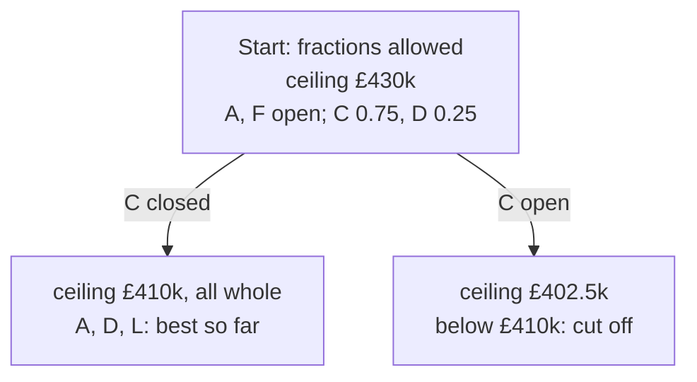

# Integer programs: yes-or-no decisions, and the search tree that settles them

[Syllabus](../../../SYLLABUS.md) → [Applied and computational](../README.md) → [Operations Research](../README.md#s05) → Integer programs

---

## General Overview

A bakery chain runs 30 delivery vans out of one warehouse, so vans bound for the far side of town burn hours before their first drop. The chain wants 3 small depots nearer the shops. There are 12 candidate sites, A to L, each with a yearly lease and an estimated yearly saving in van miles and driver hours. The board allows £200k a year in leases. Which 3 sites?

There are 220 ways to pick 3 sites from 12, and 109 fit the budget. Checking all 109 finds the winner: sites A, D and L, saving **£410k a year**. With hundreds of sites and dozens of depots to place, the count of choices outruns any computer, so a solver needs to rule out most choices without looking at them.

The trick is to pretend for a moment that a site can be partly leased. With fractions allowed, the problem becomes a linear program, which is quick to solve, and its best answer is a ceiling: no real plan can save more. Here the ceiling is £430k. One plan that reaches it leases all of A and F, three quarters of C and a quarter of D. That plan is nonsense, but it points at the hard question: C, yes or no? Split the problem in two. With C closed, the pretend answer comes out whole: A, D and L, £410k. With C open, the best pretend answer is only £402.5k, below the £410k already in hand, so no plan with C can win. Three small problems solved, and the best plan is proved best.

**Write each yes-or-no decision as a variable that must be 0 or 1, solve the easier version that allows fractions to get a ceiling, and split on a fractional variable until every branch is either whole or provably no better than the best plan found.**

**What kind of fact this is:** a method, carrying two theorems proved on this card in Why it works (the fractional answer is a ceiling, and the search ends on a plan nothing beats). That each site's saving adds up independently of the others is a model: an assumption about the bakery, not a law.

### The picture: the search tree for the depot choice



Schematic. Each box is one fractional problem. Both branches start with their parent's £430k ceiling, so the tie goes to the first listed, C closed, which is opened first. Three boxes stand in for 220 choices.

---

## The formula

Each candidate site gets a letter $x_i$ that can only be 0 or 1: 1 means lease site $i$, 0 means pass. A variable restricted to 0 or 1 is a **binary variable**. A sum of them counts the yeses, and a sum of them times prices adds up the price of whatever was chosen.

The sites' figures are synthetic (invented for this card), in £k a year:

| Site | A | B | C | D | E | F | G | H | I | J | K | L |
| --- | ---: | ---: | ---: | ---: | ---: | ---: | ---: | ---: | ---: | ---: | ---: | ---: |
| Lease $a_i$ | 60 | 40 | 110 | 70 | 60 | 40 | 60 | 50 | 90 | 60 | 110 | 70 |
| Saving $s_i$ | 145 | 40 | 240 | 140 | 115 | 70 | 70 | 80 | 125 | 115 | 110 | 125 |

The whole decision, written as an **integer program** (a linear program whose variables must be whole numbers):

$$z_{IP} = \max \sum_{i=1}^{n} s_i x_i \quad\text{subject to}\quad \sum_{i=1}^{n} x_i = p,\qquad \sum_{i=1}^{n} a_i x_i \le b,\qquad x_i \in \{0, 1\}$$

**Read it aloud:** choose a yes or no for every site to make the total saving as large as possible, with exactly $p$ yeses and the yeses' leases adding to at most the budget.

The $\sum$ sign means "add up over every site $i$ from 1 to $n$". In the shape of [Linear programs](01-modelling-with-linear-programs.md), the savings $s_i$ play the part of $c$. The budget is one row of $Ax \le b$, with 200 as its entry of $b$. The exact count is two rows, at most 3 and at least 3, the way that card writes "exactly". Once fractions are allowed (below), each $x_i \le 1$ is one more row.

Now drop the hardest rule. Replace "$x_i$ is 0 or 1" with "$x_i$ is anywhere from 0 to 1". The result is the **LP relaxation** (LP: linear program; relaxation: the same problem with a rule loosened). Its best value is written $z_{LP}$. [Approximation](../02-Randomised%20and%20Approximate%20Algorithms/06-approximation-algorithms.md) already rounds such a relaxation for vertex cover; this card branches on it instead. Two facts carry the card:

$$z_{LP} \ge z_{IP}, \qquad \text{gap} = \frac{z_{LP} - z_{IP}}{z_{IP}}$$

**Read it aloud:** the relaxed best is never below the true best, and the **integrality gap** is how far above it sits, as a share of the true best. Here $(430 - 410)/410$ is 4.88%.

| Symbol | Plain meaning | In our example | Push it up and the answer… |
| --- | --- | --- | --- |
| $n$ | candidate sites | 12 | more choices; the search usually grows |
| $p$ | depots to open, exactly | 3 | — |
| $i$ | which site, 1 to $n$ (letters A to L) | C is site 3 | — |
| $x_i$ | the decision for site $i$: 1 lease it, 0 pass | $x_A = 1$, $x_C = 0$ in the best plan | — (the solver chooses it) |
| $s_i$ | site $i$'s yearly saving, £k | $s_C = 240$ | that site is more likely chosen |
| $a_i$ | site $i$'s yearly lease, £k | $a_C = 110$ | that site is less likely chosen |
| $b$ | the lease budget, £k a year | 200 | best saving rises: 455 at 210 |
| $z_{IP}$ | best saving with whole decisions | £410k (A, D, L) | — (this is the answer) |
| $z_{LP}$ | best saving with fractions allowed: the ceiling | £430k | — |
| gap | the integrality gap: $z_{LP} - z_{IP}$, also as a share of $z_{IP}$; fixed by the problem, whatever the search does | £20k, 4.88% | the search has more to rule out |
| $y_1$, $y_2$ | dual values: prices on the count and the budget, £k per depot and £k per £k of lease (Step 1) | −35 and 2.5 | — |
| $x_{AD}$ | a binary for "both A and D open" (below) | 0 in the overlap model's best plan, C, F, H | — |

### Writing rules with binary variables

Yes-or-no variables turn business rules into straight-line limits:

- **Count:** $\sum x_i = 3$ opens exactly 3 depots.
- **Either-or:** $x_A + x_D \le 1$ forbids leasing both.
- **If-then:** $x_B \le x_C$ allows B only if C is open.
- **Both:** a new binary $x_{AD}$ with $x_{AD} \ge x_A + x_D - 1$ is forced to 1 when A and D are both open. Subtracting $50x_{AD}$ from the saving charges a £50k overlap only then. So a product of two decisions, which is not a straight-line expression, is replaced by straight-line limits.

### When it holds

- **Savings add up.** The model scores a plan as the sum of its sites' savings, which assumes each depot serves its own patch. If A and D share shops and the pair saves £50k less than the sum, the plan A, D, L really saves £360k, and the true best becomes C, F, H at £390k. The fix is the $x_{AD}$ rule above.
- **The decisions are whole.** A lease cannot be three-quarters signed. If decisions could be split (hours of rented space, say), the relaxed £430k is the answer and there is no gap.
- **The ceiling is exact.** A ceiling that comes out too low, from a sloppy solve or a loose tolerance, can cut off the branch that held the best plan.
- **The figures are known.** Savings are estimates; a small error in one can change the winner, so rerun with the figures moved.
- **The problem is small enough.** No method is known that solves every integer program quickly ([The travelling salesman](../../04-Combinatorics%20and%20graphs/11-Tours%20-%20Euler%20and%20Hamilton/04-travelling-salesman-in-outline.md) is one); the search can double with each extra site. Tight relaxations keep real trees small, not any guarantee.

---

## Why it works

### Step 0: loosening a rule can only raise the best

Every whole plan is also a fractional plan: a 0 or a 1 is a number between 0 and 1. So the relaxed problem chooses from a larger set, and the best of a larger set is at least as good. That is $z_{LP} \ge z_{IP}$, and it holds inside any branch too: a fractional answer is a cheap ceiling on what any whole plan in that branch can save.

### Step 1: the relaxation is solved by checking corners

With fractions allowed, the problem is a linear program, and its best plan sits at a corner of the allowed region ([Linear programs](01-modelling-with-linear-programs.md) proves this). A corner of a region in 12 unknowns is a point where 12 independent limits hold with equality. Only two limits here are not of the form "$x_i = 0$" or "$x_i = 1$": the count and the budget. So at any corner at least 10 sites sit at exactly 0 or 1.

That makes the corners easy to list. Choose which sites sit at 1. If they already make 3, that is a whole plan. Otherwise two more sites share what is left, and the count and the budget give two equations in their two shares. One fractional site alone is impossible: the count would be a whole number plus a fraction, not 3. The code checks 1,226 candidate corners and finds a best one at A and F open, C at 0.75, D at 0.25: leases $60 + 82.5 + 17.5 + 40 = 200$, savings $145 + 180 + 35 + 70 = 430$. Two more corners tie at £430k, with E or J sharing the split with C instead of D (E and J have the same figures); C is split in all three.

A second road to the same ceiling, with no search at all: put a price $y_1$ on each depot and a price $y_2$ (not negative) on each £k of lease. For any plan that obeys the rules,

$$\sum_i s_i x_i = \sum_i (s_i - y_1 - y_2 a_i)\,x_i + y_1\sum_i x_i + y_2\sum_i a_i x_i \le \sum_i \max(0,\ s_i - y_1 - y_2 a_i) + 3y_1 + 200y_2.$$

Each $x_i$ is at most 1, the count is 3 and the leases are at most 200, which gives the inequality. Choose the prices that make C and D break even, $s_i - y_1 - y_2 a_i = 0$ for both: $y_2 = (240 - 140)/(110 - 70) = 2.5$ and $y_1 = 240 - 2.5 \times 110 = -35$. Only A and F have something left over, 30 and 5. The bound is $-105 + 500 + 30 + 5 = 430$, the same ceiling. These prices are the dual values of [Shadow prices](02-shadow-prices-and-sensitivity.md): $y_2 = 2.5$ says each extra £1k of lease budget lifts the ceiling by £2.5k. The negative $y_1$ says that, at the margin, requiring more depots on the same budget would lower the ceiling.

### Step 2: splitting on a fraction loses no whole plan

Site C sits at 0.75. Every whole plan has C at 0 or at 1, so two branches, "C closed" and "C open", hold every whole plan between them. Neither holds the fractional answer, so each branch's relaxation answers differently, and the best whole plan is the better of the two branches' best. The search branches on the site whose share is nearest one half (C and D tie at a quarter from whole; C comes first).

### Step 3: three ways a branch closes

- **Its relaxed answer is whole.** Then it is the best plan in that branch. With C closed, the corners give A, D and L at £410k: the best plan so far, called the **incumbent**.
- **Its ceiling is no higher than the incumbent.** By Step 0, no plan in it can beat what is in hand, so it is cut off unopened. With C open, the ceiling is £402.5k (C and F open, A and B at a half each), below £410k.
- **No plan fits.** With C and A both open, £170k of leases leaves too little for any third site.

### Step 4: why it stops, and why the answer is the best

Each split fixes one more site, so no path is longer than 12 splits, and the tree is finite. Every whole plan ends either in a branch that was searched or in one cut off for a reason that proves it no better. So the incumbent at the end beats or ties every whole plan.

While the search runs, a solver reports a second number, the **solver's gap** (also called the optimality gap): the distance from the incumbent up to the highest ceiling still open. After the C-closed branch, the incumbent is £410k and the C-open branch still carries its parent's £430k: the solver's gap is £20k, 4.88%. It equals the integrality gap here only because the incumbent is already the best plan and the open ceiling is the root's. Once the C-open branch shows a ceiling of £402.5k, the highest ceiling left is the incumbent itself, and the solver's gap is 0. That zero is the proof of optimality. The integrality gap does not move: £430k against £410k is a fact about the problem, whatever the search does.

<details>
<summary>The order of the search matters for speed, not for the answer</summary>

Opening the highest ceiling first ("best-first") solved 3 relaxations. Diving instead ("depth-first", "open" before "closed") solved 5: C open at £402.5k, A open (no plan fits), A closed (C, F, H, whole, £390k), and only then C closed at £410k. Both end at A, D, L. On large trees diving usually reaches a whole plan early and uses less memory, though here best-first happened to reach one first; best-first proves optimality in fewer steps. Solvers mix the two.

</details>

---

## Worked numbers, by hand

The 12 sites, the 3 depots and the £200k budget, searched best-first.

| Step | Arithmetic | Value |
| --- | --- | --- |
| Count the choices | 220 ways to pick 3 of 12; 109 fit the budget | 109 to check by brute force |
| Relax: ceiling | leases $60 + 82.5 + 17.5 + 40 = 200$; savings $145 + 180 + 35 + 70$ | £430k |
| Price check on the ceiling | $3 \times (-35) + 200 \times 2.5 + 30 + 5 = -105 + 500 + 30 + 5$ | £430k |
| Branch on C, closed | A, D, L: leases $60 + 70 + 70 = 200$; savings $145 + 140 + 125$ | £410k, whole: incumbent |
| Branch on C, open | C, F, A half, B half: leases $110 + 40 + 30 + 20 = 200$; savings $240 + 70 + 72.5 + 20$ | £402.5k, below £410k: cut off |
| Integrality gap | $430 - 410 = 20$; $20 / 410$ | £20k, 4.88% |
| **Best plan** | A, D, L, proved by 3 relaxations | **£410k a year** |

So the chain should lease A, D and L. No other choice of 3 sites within £200k saves more, and the proof took 3 small problems instead of 109 checks.

### What breaks if you drop a piece

| Mistake | Comes out at | What went wrong |
| --- | --- | --- |
| Round the fractional plan to nearest | A, C, F: leases £210k, "saving" £455k | breaks the £200k budget; the plan is not allowed |
| Round every fraction down | A, F: 2 depots, £215k | breaks the count; one depot short |
| Quote the relaxed answer as the saving | £430k | promises £20k a year that no plan delivers |
| Pick sites by best saving per £ of lease | A, C: £385k, leases £170k | greed spends on C, then no site fits what is left: 2 depots |
| Ignore that A and D share shops (£50k) | A, D, L "£410k", really £360k | savings do not add; the true best is C, F, H at £390k |

---

## Code, from first principles, and it actually runs

Both programs solve the same depot choice three independent ways. Road 1 solves each relaxation by listing every corner, as in Step 1. Road 2 builds the price certificate of Step 1 and confirms the same £430k ceiling with no search. Road 3 checks all 220 choices of 3 sites by brute force and compares the winner with branch and bound run in two orders, counting the relaxations each one solves. The program then reruns every mistake in the table above and three other budgets.

### Python

```python
# Integer programs and branch and bound -- the check behind the card.  Standard library only.
# Choose 3 depot sites out of 12 to save the most van costs inside a lease budget.
NAMES = "ABCDEFGHIJKL"
LEASE = [60, 40, 110, 70, 60, 40, 60, 50, 90, 60, 110, 70]           # a_i, £k a year (synthetic)
SAVE = [145, 40, 240, 140, 115, 70, 70, 80, 125, 115, 110, 125]      # s_i, £k a year (synthetic)
N, P, EPS = 12, 3, 1e-9

def relax(fix, budget=200):
    """Best fractional plan, by checking every corner. fix maps a site to 0 or 1."""
    free = [i for i in range(N) if i not in fix]
    ones = [i for i in fix if fix[i] == 1]
    best, corners = None, 0
    for mask in range(1 << len(free)):                    # which free sites sit at 1
        on = [free[k] for k in range(len(free)) if mask >> k & 1]
        r = P - len(ones) - len(on)                       # depots still to place
        if r < 0:
            continue
        rest = [i for i in free if i not in on]
        left = budget - sum(LEASE[i] for i in ones + on)
        base = sum(SAVE[i] for i in ones + on)
        pts = [[]] if r == 0 and left >= 0 else []
        for u in range(len(rest)):                        # two sites share the last r depots
            for w in range(u + 1, len(rest)):
                i, j = rest[u], rest[w]
                if r > 0 and LEASE[i] != LEASE[j]:
                    xi = (left - LEASE[j] * r) / (LEASE[i] - LEASE[j])
                    if -EPS < xi < 1 + EPS and -EPS < r - xi < 1 + EPS:
                        pts.append([(i, xi), (j, r - xi)])
        for pt in pts:
            corners += 1
            v = base + sum(SAVE[i] * x for i, x in pt)
            if best is None or v > best[0] + EPS:
                best = (v, {i: 1.0 for i in ones + on} | {i: x for i, x in pt if x > EPS})
    return best[0] if best else None, best[1] if best else None, corners

def frac(x):                                              # most fractional site, or None
    f = [i for i in sorted(x) if EPS < x[i] < 1 - EPS]
    return max(f, key=lambda i: min(x[i], 1 - x[i])) if f else None

def show(x):
    return " ".join(f"{NAMES[i]}={x[i]:g}" for i in sorted(x))

def search(order, log):
    """Branch and bound. order 'best' opens the highest bound first; 'depth' dives, open-the-site first."""
    open_, inc, lps = [({}, float("inf"))], (-1.0, None), 0
    while open_:
        k = max(range(len(open_)), key=lambda t: open_[t][1]) if order == "best" else len(open_) - 1
        fix, _ = open_.pop(k)
        v, x, _ = relax(fix); lps += 1
        tag = " ".join(f"{NAMES[i]}={fix[i]}" for i in fix) or "root"
        if v is None:
            log.append(f"{order:<5} {tag:<8} no plan fits: pruned"); continue
        if v <= inc[0] + EPS:
            log.append(f"{order:<5} {tag:<8} bound {v:.1f} <= best {inc[0]:.0f}: pruned"); continue
        i = frac(x)
        if i is None:
            inc = (v, x); log.append(f"{order:<5} {tag:<8} bound {v:.1f} all whole: new best {show(x)}"); continue
        log.append(f"{order:<5} {tag:<8} bound {v:.1f} {show(x)} -> branch on {NAMES[i]}")
        open_ += [(fix | {i: 0}, v), (fix | {i: 1}, v)]
    return inc, lps

def brute(budget=200, pair_loss=0):
    best, fits = (-1, ""), 0
    for i in range(N):
        for j in range(i + 1, N):
            for k in range(j + 1, N):
                if LEASE[i] + LEASE[j] + LEASE[k] <= budget:
                    fits += 1
                    v = SAVE[i] + SAVE[j] + SAVE[k] - pair_loss * (i == 0 and j == 3)
                    best = max(best, (v, NAMES[i] + NAMES[j] + NAMES[k]))
    return best, fits

def terms(x, row):
    return " + ".join(f"{row[i] * x[i]:g}" for i in sorted(x)) + f" = {sum(row[i] * x[i] for i in x):g}"

print("site  ", " ".join(f"{c:>3}" for c in NAMES))
print("lease ", " ".join(f"{a:>3}" for a in LEASE))
print("saving", " ".join(f"{s:>3}" for s in SAVE))
# ---- road 1: the relaxation, every corner checked ----
z_lp, x_lp, corners = relax({})
print(f"relaxation: {corners} corners checked, best {z_lp:.1f} at {show(x_lp)}")
for tag, fix in (("root", {}), ("C=0", {2: 0}), ("C=1", {2: 1})):
    x = relax(fix)[1]
    print(f"{tag:<4} lease {terms(x, LEASE)}; saving {terms(x, SAVE)}")
# ---- road 2: a price certificate, y1 per depot and y2 per £k of lease (weak duality) ----
c, d = [i for i in sorted(x_lp) if EPS < x_lp[i] < 1 - EPS]        # the two split sites
y2 = (SAVE[c] - SAVE[d]) / (LEASE[c] - LEASE[d]); y1 = SAVE[c] - y2 * LEASE[c]
extra = [(i, SAVE[i] - y1 - y2 * LEASE[i]) for i in range(N) if SAVE[i] - y1 - y2 * LEASE[i] > EPS]
cert = P * y1 + 200 * y2 + sum(e for _, e in extra)
left = " ".join(f"{NAMES[i]} {e:g}" for i, e in extra)
print(f"price certificate: y1 = {y1:g}, y2 = {y2:g}; 3*y1 = {P * y1:g}, 200*y2 = {200 * y2:g}, leftovers {left}; bound {cert:.1f}")
# ---- road 3: every triple, against two search orders ----
(z_ip, trio), fits = brute()
log = []
(z_bb, x_bb), lps = search("best", log)
(z_df, x_df), lps_df = search("depth", log)
for line in log:
    print(line)
print(f"relaxations solved: best-first {lps}, depth-first {lps_df}")
print(f"brute force: {fits} of {N * (N - 1) * (N - 2) // 6} triples fit the budget, best {trio} = {z_ip}")
gap = z_lp - z_ip
print(f"integrality gap: {z_lp:.0f} - {z_ip} = {gap:.0f}, {100 * gap / z_ip:.2f}% of the integer best")
# ---- what breaks ----
near = [i for i in sorted(x_lp) if x_lp[i] >= 0.5]
down = [i for i in sorted(x_lp) if x_lp[i] > 1 - EPS]
print("round to nearest:", "".join(NAMES[i] for i in near), "lease", sum(LEASE[i] for i in near),
      "save", sum(SAVE[i] for i in near))
print("round down:", "".join(NAMES[i] for i in down), "depots", len(down), "save", sum(SAVE[i] for i in down))
greedy, spent = [], 0
for i in sorted(range(N), key=lambda i: -SAVE[i] / LEASE[i]):
    if len(greedy) < P and spent + LEASE[i] <= 200:
        greedy.append(i); spent += LEASE[i]
print("greedy by saving per £:", "".join(NAMES[i] for i in greedy), "lease", spent,
      "save", sum(SAVE[i] for i in greedy))
(z_ov, trio_ov), _ = brute(pair_loss=50)
print(f"A and D overlap (-50): ADL really {z_ip - 50}, true best {trio_ov} = {z_ov}")
# ---- try changing ----
for bud in (190, 210, 240):
    (zb, tb), _ = brute(bud)
    print(f"budget {bud}: relaxation {relax({}, bud)[0]:.1f}, integer best {tb} = {zb}")

assert y2 >= 0                                   # a negative budget price gives no ceiling
assert abs(z_lp - cert) < 1e-9                   # corners and prices agree on the bound
assert z_ip == z_bb == z_df                      # tree search meets brute force
assert z_lp >= z_ip and gap > 0                  # relaxation bounds the integer best from above
assert sum(LEASE[i] for i in near) > 200 and len(down) < P   # both roundings break a rule
assert lps < fits                                # the tree solved fewer problems than brute force checked
print("ALL CHECKS PASS")
```

**Ran 2026-11-11 on macOS, Python 3.14.10, standard library only. All checks passed. Output, pasted from the run:**

```
site     A   B   C   D   E   F   G   H   I   J   K   L
lease   60  40 110  70  60  40  60  50  90  60 110  70
saving 145  40 240 140 115  70  70  80 125 115 110 125
relaxation: 1226 corners checked, best 430.0 at A=1 C=0.75 D=0.25 F=1
root lease 60 + 82.5 + 17.5 + 40 = 200; saving 145 + 180 + 35 + 70 = 430
C=0  lease 60 + 70 + 70 = 200; saving 145 + 140 + 125 = 410
C=1  lease 30 + 20 + 110 + 40 = 200; saving 72.5 + 20 + 240 + 70 = 402.5
price certificate: y1 = -35, y2 = 2.5; 3*y1 = -105, 200*y2 = 500, leftovers A 30 F 5; bound 430.0
best  root     bound 430.0 A=1 C=0.75 D=0.25 F=1 -> branch on C
best  C=0      bound 410.0 all whole: new best A=1 D=1 L=1
best  C=1      bound 402.5 <= best 410: pruned
depth root     bound 430.0 A=1 C=0.75 D=0.25 F=1 -> branch on C
depth C=1      bound 402.5 A=0.5 B=0.5 C=1 F=1 -> branch on A
depth C=1 A=1  no plan fits: pruned
depth C=1 A=0  bound 390.0 all whole: new best C=1 F=1 H=1
depth C=0      bound 410.0 all whole: new best A=1 D=1 L=1
relaxations solved: best-first 3, depth-first 5
brute force: 109 of 220 triples fit the budget, best ADL = 410
integrality gap: 430 - 410 = 20, 4.88% of the integer best
round to nearest: ACF lease 210 save 455
round down: AF depots 2 save 215
greedy by saving per £: AC lease 170 save 385
A and D overlap (-50): ADL really 360, true best CFH = 390
budget 190: relaxation 405.0, integer best ADJ = 400
budget 210: relaxation 455.0, integer best ACF = 455
budget 240: relaxation 525.0, integer best ACD = 525
ALL CHECKS PASS
```

### Rust

```rust
// Integer programs and branch and bound -- the check behind the card.  std only, no crates.
// Choose 3 depot sites out of 12 to save the most van costs inside a lease budget.
const NAMES: &[u8] = b"ABCDEFGHIJKL";
const LEASE: [f64; 12] = [60., 40., 110., 70., 60., 40., 60., 50., 90., 60., 110., 70.]; // a_i, £k a year (synthetic)
const SAVE: [f64; 12] = [145., 40., 240., 140., 115., 70., 70., 80., 125., 115., 110., 125.]; // s_i, £k a year (synthetic)
const N: usize = 12; const P: usize = 3; const EPS: f64 = 1e-9;
type Plan = Vec<(usize, f64)>; // (site, share open), ascending by site

// Best fractional plan, by checking every corner. fix[i] is -1 (free), 0 or 1.
fn relax(fix: &[i32; N], budget: f64) -> (Option<(f64, Plan)>, usize) {
    let free: Vec<usize> = (0..N).filter(|&i| fix[i] < 0).collect();
    let ones: Vec<usize> = (0..N).filter(|&i| fix[i] == 1).collect();
    let (mut best, mut corners): (Option<(f64, Plan)>, usize) = (None, 0);
    for mask in 0u32..(1u32 << free.len()) {
        let on: Vec<usize> = (0..free.len()).filter(|&k| mask >> k & 1 == 1).map(|k| free[k]).collect();
        if ones.len() + on.len() > P { continue; }
        let r = (P - ones.len() - on.len()) as f64; // depots still to place
        let rest: Vec<usize> = free.iter().cloned().filter(|i| !on.contains(i)).collect();
        let both: Vec<usize> = ones.iter().chain(on.iter()).cloned().collect();
        let left = budget - both.iter().map(|&i| LEASE[i]).sum::<f64>();
        let base: f64 = both.iter().map(|&i| SAVE[i]).sum();
        let mut pts: Vec<Plan> = if r == 0.0 && left >= 0.0 { vec![vec![]] } else { vec![] };
        for u in 0..rest.len() {
            for w in u + 1..rest.len() { // two sites share the last r depots
                let (i, j) = (rest[u], rest[w]);
                if r > 0.0 && LEASE[i] != LEASE[j] {
                    let xi = (left - LEASE[j] * r) / (LEASE[i] - LEASE[j]);
                    if -EPS < xi && xi < 1.0 + EPS && -EPS < r - xi && r - xi < 1.0 + EPS {
                        pts.push(vec![(i, xi), (j, r - xi)]);
                    }
                }
            }
        }
        for pt in pts {
            corners += 1;
            let v = base + pt.iter().map(|&(i, x)| SAVE[i] * x).sum::<f64>();
            if best.as_ref().map_or(true, |b| v > b.0 + EPS) {
                let mut x: Plan = both.iter().map(|&i| (i, 1.0)).collect();
                x.extend(pt.iter().cloned().filter(|p| p.1 > EPS));
                x.sort_by_key(|p| p.0);
                best = Some((v, x));
            }
        }
    }
    (best, corners)
}

fn frac(x: &Plan) -> Option<usize> { // most fractional site, or None
    let mut pick: Option<(usize, f64)> = None;
    for &(i, v) in x {
        let d = v.min(1.0 - v);
        if v > EPS && v < 1.0 - EPS && pick.map_or(true, |p| d > p.1) { pick = Some((i, d)); }
    }
    pick.map(|p| p.0)
}

fn show(x: &Plan) -> String {
    x.iter().map(|&(i, v)| format!("{}={}", NAMES[i] as char, v)).collect::<Vec<_>>().join(" ")
}

// Branch and bound. "best" opens the highest bound first; "depth" dives, open-the-site first.
fn search(order: &str, log: &mut Vec<String>) -> ((f64, Plan), usize) {
    let mut open: Vec<(Vec<(usize, i32)>, f64)> = vec![(vec![], f64::INFINITY)];
    let (mut inc, mut lps): ((f64, Plan), usize) = ((-1.0, vec![]), 0);
    while !open.is_empty() {
        let mut k = if order == "best" { 0 } else { open.len() - 1 };
        if order == "best" { for t in 1..open.len() { if open[t].1 > open[k].1 { k = t; } } }
        let (path, _) = open.remove(k);
        let mut fix = [-1i32; N]; for &(i, b) in &path { fix[i] = b; }
        let (res, _) = relax(&fix, 200.0); lps += 1;
        let tag: Vec<String> = path.iter().map(|&(i, b)| format!("{}={}", NAMES[i] as char, b)).collect();
        let tag = if tag.is_empty() { "root".to_string() } else { tag.join(" ") };
        let Some((v, x)) = res else { log.push(format!("{:<5} {:<8} no plan fits: pruned", order, tag)); continue };
        if v <= inc.0 + EPS { log.push(format!("{:<5} {:<8} bound {:.1} <= best {:.0}: pruned", order, tag, v, inc.0)); continue; }
        match frac(&x) {
            None => { log.push(format!("{:<5} {:<8} bound {:.1} all whole: new best {}", order, tag, v, show(&x))); inc = (v, x); }
            Some(i) => {
                log.push(format!("{:<5} {:<8} bound {:.1} {} -> branch on {}", order, tag, v, show(&x), NAMES[i] as char));
                for b in [0, 1] { let mut p = path.clone(); p.push((i, b)); open.push((p, v)); }
            }
        }
    }
    (inc, lps)
}

fn brute(budget: f64, pair_loss: f64) -> ((f64, String), usize) {
    let (mut best, mut fits) = ((-1.0, String::new()), 0);
    for i in 0..N {
        for j in i + 1..N {
            for k in j + 1..N {
                if LEASE[i] + LEASE[j] + LEASE[k] <= budget {
                    fits += 1;
                    let pen = if i == 0 && j == 3 { pair_loss } else { 0.0 };
                    let v = SAVE[i] + SAVE[j] + SAVE[k] - pen;
                    let name: String = [i, j, k].iter().map(|&t| NAMES[t] as char).collect();
                    if v > best.0 || (v == best.0 && name > best.1) { best = (v, name); }
                }
            }
        }
    }
    (best, fits)
}

fn names(v: &[usize]) -> String { v.iter().map(|&i| NAMES[i] as char).collect() }
fn terms(x: &Plan, row: &[f64; 12]) -> String {
    let t: Vec<String> = x.iter().map(|&(i, v)| format!("{}", row[i] * v)).collect();
    format!("{} = {}", t.join(" + "), x.iter().map(|&(i, v)| row[i] * v).sum::<f64>())
}

fn main() {
    println!("site   {}", NAMES.iter().map(|&c| format!("{:>3}", c as char)).collect::<Vec<_>>().join(" "));
    println!("lease  {}", LEASE.iter().map(|a| format!("{:>3}", a)).collect::<Vec<_>>().join(" "));
    println!("saving {}", SAVE.iter().map(|a| format!("{:>3}", a)).collect::<Vec<_>>().join(" "));
    // ---- road 1: the relaxation, every corner checked ----
    let (root, corners) = relax(&[-1; N], 200.0);
    let (z_lp, x_lp) = root.unwrap();
    println!("relaxation: {} corners checked, best {:.1} at {}", corners, z_lp, show(&x_lp));
    for (tag, site, b) in [("root", 0, -1), ("C=0", 2, 0), ("C=1", 2, 1)] {
        let mut fix = [-1; N]; fix[site] = b;
        let x = relax(&fix, 200.0).0.unwrap().1;
        println!("{:<4} lease {}; saving {}", tag, terms(&x, &LEASE), terms(&x, &SAVE));
    }
    // ---- road 2: a price certificate, y1 per depot and y2 per £k of lease (weak duality) ----
    let split: Vec<usize> = x_lp.iter().filter(|p| p.1 > EPS && p.1 < 1.0 - EPS).map(|p| p.0).collect();
    let (c, d) = (split[0], split[1]); // the two split sites
    let y2 = (SAVE[c] - SAVE[d]) / (LEASE[c] - LEASE[d]);
    let y1 = SAVE[c] - y2 * LEASE[c];
    let extra: Vec<(usize, f64)> = (0..N).map(|i| (i, SAVE[i] - y1 - y2 * LEASE[i])).filter(|p| p.1 > EPS).collect();
    let cert = P as f64 * y1 + 200.0 * y2 + extra.iter().map(|p| p.1).sum::<f64>();
    let left: Vec<String> = extra.iter().map(|&(i, e)| format!("{} {}", NAMES[i] as char, e)).collect();
    println!("price certificate: y1 = {}, y2 = {}; 3*y1 = {}, 200*y2 = {}, leftovers {}; bound {:.1}",
             y1, y2, P as f64 * y1, 200.0 * y2, left.join(" "), cert);
    // ---- road 3: every triple, against two search orders ----
    let ((z_ip, trio), fits) = brute(200.0, 0.0);
    let mut log = vec![];
    let ((z_bb, _), lps) = search("best", &mut log);
    let ((z_df, _), lps_df) = search("depth", &mut log);
    for line in &log { println!("{}", line); }
    println!("relaxations solved: best-first {}, depth-first {}", lps, lps_df);
    println!("brute force: {} of {} triples fit the budget, best {} = {}", fits, N * (N - 1) * (N - 2) / 6, trio, z_ip);
    let gap = z_lp - z_ip;
    println!("integrality gap: {:.0} - {} = {:.0}, {:.2}% of the integer best", z_lp, z_ip, gap, 100.0 * gap / z_ip);
    // ---- what breaks ----
    let near: Vec<usize> = x_lp.iter().filter(|p| p.1 >= 0.5).map(|p| p.0).collect();
    let down: Vec<usize> = x_lp.iter().filter(|p| p.1 > 1.0 - EPS).map(|p| p.0).collect();
    let sum = |v: &[usize], a: &[f64; 12]| v.iter().map(|&i| a[i]).sum::<f64>();
    println!("round to nearest: {} lease {} save {}", names(&near), sum(&near, &LEASE), sum(&near, &SAVE));
    println!("round down: {} depots {} save {}", names(&down), down.len(), sum(&down, &SAVE));
    let mut order: Vec<usize> = (0..N).collect();
    order.sort_by(|&a, &b| (SAVE[b] / LEASE[b]).partial_cmp(&(SAVE[a] / LEASE[a])).unwrap());
    let (mut greedy, mut spent) = (vec![], 0.0);
    for i in order {
        if greedy.len() < P && spent + LEASE[i] <= 200.0 { greedy.push(i); spent += LEASE[i]; }
    }
    println!("greedy by saving per £: {} lease {} save {}", names(&greedy), spent, sum(&greedy, &SAVE));
    let ((z_ov, trio_ov), _) = brute(200.0, 50.0);
    println!("A and D overlap (-50): ADL really {}, true best {} = {}", z_ip - 50.0, trio_ov, z_ov);
    // ---- try changing ----
    for bud in [190.0, 210.0, 240.0] {
        let ((zb, tb), _) = brute(bud, 0.0);
        println!("budget {}: relaxation {:.1}, integer best {} = {}", bud, relax(&[-1; N], bud).0.unwrap().0, tb, zb);
    }
    assert!(y2 >= 0.0); // a negative budget price gives no ceiling
    assert!((z_lp - cert).abs() < 1e-9); // corners and prices agree on the bound
    assert!(z_ip == z_bb && z_bb == z_df); // tree search meets brute force
    assert!(z_lp >= z_ip && gap > 0.0); // relaxation bounds the integer best from above
    assert!(sum(&near, &LEASE) > 200.0 && down.len() < P); // both roundings break a rule
    assert!(lps < fits); // the tree solved fewer problems than brute force checked
    println!("ALL CHECKS PASS");
}
```

**Ran 2026-11-11 on macOS, rustc 1.98.1, no crates. All checks passed. Output, pasted from the run:**

```
site     A   B   C   D   E   F   G   H   I   J   K   L
lease   60  40 110  70  60  40  60  50  90  60 110  70
saving 145  40 240 140 115  70  70  80 125 115 110 125
relaxation: 1226 corners checked, best 430.0 at A=1 C=0.75 D=0.25 F=1
root lease 60 + 82.5 + 17.5 + 40 = 200; saving 145 + 180 + 35 + 70 = 430
C=0  lease 60 + 70 + 70 = 200; saving 145 + 140 + 125 = 410
C=1  lease 30 + 20 + 110 + 40 = 200; saving 72.5 + 20 + 240 + 70 = 402.5
price certificate: y1 = -35, y2 = 2.5; 3*y1 = -105, 200*y2 = 500, leftovers A 30 F 5; bound 430.0
best  root     bound 430.0 A=1 C=0.75 D=0.25 F=1 -> branch on C
best  C=0      bound 410.0 all whole: new best A=1 D=1 L=1
best  C=1      bound 402.5 <= best 410: pruned
depth root     bound 430.0 A=1 C=0.75 D=0.25 F=1 -> branch on C
depth C=1      bound 402.5 A=0.5 B=0.5 C=1 F=1 -> branch on A
depth C=1 A=1  no plan fits: pruned
depth C=1 A=0  bound 390.0 all whole: new best C=1 F=1 H=1
depth C=0      bound 410.0 all whole: new best A=1 D=1 L=1
relaxations solved: best-first 3, depth-first 5
brute force: 109 of 220 triples fit the budget, best ADL = 410
integrality gap: 430 - 410 = 20, 4.88% of the integer best
round to nearest: ACF lease 210 save 455
round down: AF depots 2 save 215
greedy by saving per £: AC lease 170 save 385
A and D overlap (-50): ADL really 360, true best CFH = 390
budget 190: relaxation 405.0, integer best ADJ = 400
budget 210: relaxation 455.0, integer best ACF = 455
budget 240: relaxation 525.0, integer best ACD = 525
ALL CHECKS PASS
```

The two outputs are identical, line for line.

> [!TIP]
> **Try changing**
> - Guess first: raise the budget to £210k. What happens to the integrality gap? The `budget 210` line: ceiling £455k and best whole plan A, C, F at £455k. The gap is 0; the rounded plan that broke the budget is now allowed and best.
> - Guess first: cut the budget to £190k. The `budget 190` line: ceiling £405k, best whole plan A, D, J at £400k, tied with A, D, E (sites E and J have the same figures). The ceiling fell from £430k to £405k: £10k of budget times the price $y_2 = 2.5$.
> - Guess first: a budget of £240k. Ceiling and best whole plan agree at A, C, D, £525k. A loose budget often leaves no gap at all.
> - Guess first: make the cut-off careless. In `search`, change `inc[0] + EPS` to `inc[0] + 30`. The depth-first run finds C, F, H at £390k, then cuts off the C-closed branch (£410k is within 30 of 390) and stops at the wrong plan. The assert that compares the search with brute force fails.

---

## The usual mistake

> [!warning]
> **Rounding the relaxed answer and calling it the plan.** The fractional plan is a ceiling, not a draft. Rounding C's 0.75 up and D's 0.25 down gives A, C, F: leases £210k against a £200k budget. The best plan, A, D, L, does not contain C at all, the site the relaxation liked most. Rounding cannot find it; only the search can.
>
> Smaller traps:
> - **Promising the ceiling.** £430k is what fractions could save. Reported to the board as the expected saving, it overstates by £20k a year.
> - **Mixing up the two gaps.** The integrality gap, 4.88%, compares the ceiling with the true best and never changes. The solver's gap compares the incumbent with the highest open ceiling and falls as the search runs: 4.88% after the C-closed branch, 0 once C-open is cut off. Reading the 4.88% as the error in A, D, L is wrong: that plan is the best, an error of 0.
> - **Assuming savings add.** If A and D share shops, the "£410k" plan saves £360k, and C, F, H at £390k is better. Model the overlap with a pair variable, or the solver optimises the wrong sum.
> - **Choosing by value for money.** Best saving per £ of lease picks A and C, £385k, then cannot place a third depot. Greedy rules ignore the count and the leftover budget together.

---

## Where you meet it in real life

- **Depot and warehouse siting.** Delivery firms and ambulance services choose sites with this model, usually costing every shop-to-depot pairing rather than a fixed saving per site.
- **Cutting stock.** A paper mill cuts large rolls into ordered widths. Each cutting pattern is used a whole number of times; the relaxation says how few rolls could possibly do.
- **Crew scheduling.** Airlines choose which sequences of flights each crew works, yes or no, so every flight gets exactly one crew: millions of binary variables, searched by branch and bound.
- **Capital budgeting.** A council or a firm picks projects yes or no within a budget: this card's model without the count.
- **Solver logs.** Integer-programming solvers print the incumbent, the best ceiling and the solver's gap as they run. "Gap 1%" means the plan in hand is provably within 1% of the best.

> **Say it back**
> An integer program writes each yes-or-no decision as a variable that must be 0 or 1. Allowing fractions turns it into a linear program, whose answer is a ceiling on any real plan: £430k against a true best of £410k for the depots, an integrality gap of 4.88%. Branch and bound splits on a fractional variable, solves each half, keeps the best whole plan found, and cuts off any branch whose ceiling cannot beat it. Here 3 relaxations proved that A, D and L win, where brute force checked 109 plans. Rounding the fractional answer is not a substitute: it broke the budget.

---

## What this builds on

- [Linear programs](01-modelling-with-linear-programs.md): the model shape, and the theorem that the best plan sits at a corner. Every node of the search tree is one of these.
- [Shadow prices](02-shadow-prices-and-sensitivity.md): the dual values. The price certificate in Step 1 is a pair of them, and $y_2 = 2.5$ is the budget's shadow price in the relaxation.
- [The travelling salesman](../../04-Combinatorics%20and%20graphs/11-Tours%20-%20Euler%20and%20Hamilton/04-travelling-salesman-in-outline.md): a yes-or-no problem with too many answers to list, and no known fast method. Branch and bound is how large tours are solved exactly in practice.
- [Approximation](../02-Randomised%20and%20Approximate%20Algorithms/06-approximation-algorithms.md): rounds a relaxation for vertex cover and proves the result at most twice the best. Here rounding breaks a rule, so the card searches instead.

## Where this goes next

- [Scheduling](04-scheduling-and-the-critical-path.md): the next card. Jobs, their order and the critical path; deciding which of two jobs goes first on one oven is itself a yes-or-no variable.
- Integer programs (planned): the optimisation wing's full treatment, adding cutting planes, extra limits that slice off fractional corners before branching.
- [Yes-or-no variables](../../15-Optimization/05-Integer%20and%20Combinatorial%20Optimisation/02-modelling-with-binary-variables-big-m-and-indicators.md): the modelling tricks above in full, including limits that a binary switches on and off.
- [Branch and bound](../../15-Optimization/05-Integer%20and%20Combinatorial%20Optimisation/03-branch-and-bound.md): branching and node rules, and why the tree can grow exponentially in the worst case.

This card leaves open why some integer programs have tiny gaps and solve in seconds, while others of the same size have large gaps and resist every solver.

---

## Sources

Verified 2026-11-11: every link below resolves to the publisher's page.

- Land, A. H., and A. G. Doig. "An Automatic Method of Solving Discrete Programming Problems." *Econometrica* 28, no. 3 (1960): 497–520. [doi:10.2307/1910129](https://doi.org/10.2307/1910129). The first branch and bound method for integer programs, built on linear-programming ceilings.
- Little, John D. C., Katta G. Murty, Dura W. Sweeney, and Caroline Karel. "An Algorithm for the Traveling Salesman Problem." *Operations Research* 11, no. 6 (1963): 972–989. [doi:10.1287/opre.11.6.972](https://doi.org/10.1287/opre.11.6.972). Named the method "branch and bound" and showed it on tours.
- Dakin, R. J. "A Tree-Search Algorithm for Mixed Integer Programming Problems." *The Computer Journal* 8, no. 3 (1965): 250–255. [doi:10.1093/comjnl/8.3.250](https://doi.org/10.1093/comjnl/8.3.250). The two-way split on a fractional variable used in Step 2.
- Dantzig, George B. "Discrete-Variable Extremum Problems." *Operations Research* 5, no. 2 (1957): 266–288. [doi:10.1287/opre.5.2.266](https://doi.org/10.1287/opre.5.2.266). Early yes-or-no models and their fractional relaxations, including the budget-limited choice of items.
- Wolsey, Laurence A. *Integer Programming*, 2nd ed. Wiley, 2020. [Publisher page](https://www.wiley.com/en-us/Integer+Programming%2C+2nd+Edition-p-9781119606536). The standard text: formulations, relaxations, the integrality gap and branch and bound.
