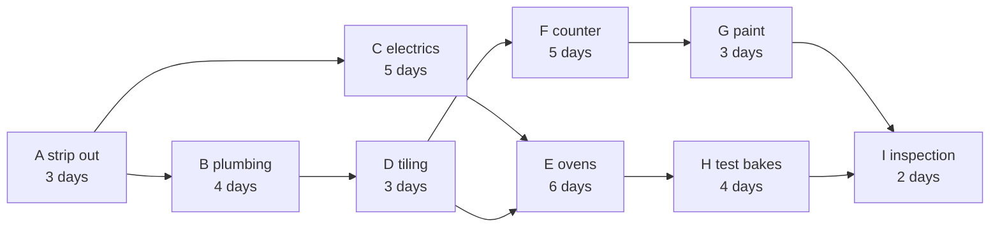
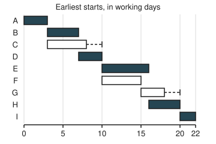

# Scheduling: the critical path, the float, and rules that beat a gut feeling

[Syllabus](../../../SYLLABUS.md) → [Applied and computational](../README.md) → [Operations Research](../README.md#s05) → Scheduling

---

## General Overview

A bakery chain with 4 ovens, 30 delivery vans and one warehouse is opening a new shop. Before it can sell a loaf, nine jobs must be done: strip out the old shop, plumbing, three-phase electrics (the heavy-duty supply big ovens need), floor tiling, fitting two ovens, the counter and shelving, paint and signage, test bakes, and a hygiene inspection. Added end to end, they come to 35 working days.

Yet the shop can open after 22 working days. Many jobs run side by side: the electricians work while the plumbers work. Some cannot: tiles go down after the drains, and the ovens go in on a tiled floor with power. The owner wants three answers: the earliest opening day, which jobs set it, and which can slip, by how much.

The answer is 22 working days, set by a chain of six jobs: strip-out, plumbing, tiling, ovens, test bakes, inspection. That chain is the **critical path**: a day lost on any of its jobs is a day lost on opening. The other three jobs have 2 days of **float** (slack: how far a job can slip before the opening moves).

Opening morning brings a smaller problem: one oven, five batches, five vans. Shortest bake first gives the smallest average wait; earliest van first, the smallest worst lateness. Both beat the gut feeling of baking the biggest batch first.

**A project can finish no sooner than its longest chain of must-come-first jobs; one sweep forward finds that chain and every earliest start, one sweep back finds every latest start, and the gap between the two is each job's float.**

**What kind of fact this is:** a method with theorems inside it. The two sweeps give the earliest possible finish when durations are fixed and crews unlimited. The two oven rules are each best for their own target. All three are proved on this card in Why it works. The durations themselves are estimates, so the 22 is a model's answer, not a law.

### The picture: nine jobs and their arrows



Each arrow reads "must finish before". The critical path is A → B → D → E → H → I.

---

## The formula

Notation first, in words. Each job is a dot and each "must finish first" rule an arrow, written $i \to j$. That makes a directed graph. Because no job can wait on itself, it has no loop.

So its jobs can be listed with every arrow pointing forward: a topological order. Kahn's peeling finds one: repeatedly take a job that has no arrow in from a job not yet taken ([Directed graphs](../../04-Combinatorics%20and%20graphs/09-Graphs%20-%20Dots%20and%20Lines/06-directed-graphs-and-topological-order.md)). Job $j$ takes $p_j$ working days, its **processing time**. Times count working days from handover: a start of 3 means the job begins once 3 days are done.

**The forward pass.** Take the jobs in topological order. Write $ES_j$ and $EF_j$ for job $j$'s earliest start and earliest finish. A job with no arrow in starts at 0; every other job starts when its slowest predecessor finishes:

$$ES_j = \max_{i \to j}\,\bigl(ES_i + p_i\bigr), \qquad EF_j = ES_j + p_j, \qquad T = \max_j EF_j$$

**Read it aloud:** a job starts as soon as the last thing it waits on is done, and the project ends when the last job ends.

$T$ is the **makespan**: the finish time of the whole project, here 22.

**The backward pass.** Write $LS_j$ and $LF_j$ for the latest start and latest finish that still keep $T$. Take the jobs in reverse order. A job with no arrow out may finish at $T$; any other must finish by the moment its first successor must start:

$$LF_j = \min_{j \to k}\,LS_k, \qquad LS_j = LF_j - p_j$$

**Read it aloud:** a job may finish as late as the first moment something after it must begin.

**The float.** Two kinds, both in days:

$$TF_j = LS_j - ES_j, \qquad FF_j = \min_{j \to k} ES_k \;-\; EF_j$$

Total float $TF_j$ is how far job $j$ can slip before the opening moves. Free float $FF_j$ is how far it can slip before any next job's earliest start moves; a job with no arrow out uses $T$ in place of the minimum. The critical path is the chain of jobs with $TF_j = 0$.

**One oven.** Five batches wait at 5:00 for one oven. In a chosen order, batch $j$ comes out at its **completion time** $C_j$. Its van leaves at the **due time** $d_j$, so its **lateness** is $L_j = C_j - d_j$, negative when early. Two rules, each best at one target:

$$\text{SPT (shortest processing time first) makes } \textstyle\sum_j C_j \text{ as small as possible}$$

$$\text{EDD (earliest due date first) makes } L_{\max} = \max_j L_j \text{ as small as possible}$$

**Read it aloud:** bake the quickest batch first to cut the average wait; bake for the earliest van first to cut the worst lateness.

| Symbol | Plain meaning | In our example | Push it up and the answer… |
| --- | --- | --- | --- |
| $i \to j$, $j \to k$ | an arrow: the first job must finish before the second starts | D → E: tiles before ovens | more arrows, fewer jobs side by side, $T$ can only rise |
| $p_j$ | processing time: how long job $j$ takes | ovens 6 days; croissants 25 minutes | on the critical path, $T$ rises day for day |
| $ES_j$, $EF_j$ | earliest start, earliest finish | ovens 10 and 16 | — |
| $LS_j$, $LF_j$ | latest start and finish that keep $T$ | electrics 5 and 10 | — |
| $TF_j$ | total float: slip allowed before $T$ moves | electrics 2 | more room to juggle crews |
| $FF_j$ | free float: slip allowed before any next job moves | counter 0, paint 2 | — |
| $T$ | makespan: when the whole project ends | 22 working days | the opening day moves |
| $n$ | how many batches wait for the oven | 5, so 120 possible orders | orders grow as $n$ factorial |
| $C_j$, $\sum_j C_j$ | completion time: when batch $j$ leaves the oven; their total, which divided by $n$ is the mean wait | sourdough 120, total 425, under SPT | — |
| $d_j$ | due time: when batch $j$'s van leaves | sourdough 90 minutes | the batch can wait longer |
| $L_j$, $L_{\max}$ | lateness $C_j - d_j$, and the worst of them | worst 30 under SPT, 0 under EDD | — |
| $a$, $b$, $s$ | two neighbouring batches in an order, and the minute the first of them starts | used in the swap proofs | — |

Times on the oven are minutes after 5:00.

### When it holds

- **Durations are fixed.** They are estimates. If each of the nine jobs can run a day short, on time or a day long, equally likely, the mean finish is 22.11 days. Only 58.0% of cases open by day 22. Program Evaluation and Review Technique (PERT) gives every job a spread for this reason.
- **Crews are unlimited.** The passes let any two jobs without an arrow between them run at once. If one crew does both plumbing and electrics, the best it can do is 24 days. Sharing limited crews turns the problem into an integer program, an optimization whose unknowns (here the start days) must be whole numbers ([Integer programs](03-integer-programming-and-branch-and-bound.md)).
- **The arrows have no loop.** A loop of "must come first" rules has no earliest start at all: Kahn's peeling jams and the forward pass never begins.
- **On the oven, every batch is ready at 5:00 and none is interrupted.** If batches arrive through the morning, neither rule is guaranteed best.

---

## Why it works

### Step 0: waiting is a maximum, so the finish is a longest chain

A job cannot start until *all* its predecessors are done, so it waits for the slowest: that is the max in the forward pass. Chase that max backwards. The ovens wait on tiling, which waits on plumbing, which waits on the strip-out. Every earliest start is the length of some chain of jobs done one after another. The project's finish is the length of the longest such chain from start to end.

Three chains run from the strip-out to the inspection: A B D E H I at 22 days, A B D F G I at 20, and A C E H I at 20. The longest, 22, is the makespan.

### Step 1: the forward pass finds that chain, and nothing beats it

Taking jobs in topological order means every predecessor of $j$ already has its earliest start when $j$ is reached. So $ES_j$ is the length of the longest chain ending just before $j$.

Two facts make $T$ the best possible finish. Starting every job at $ES_j$ breaks no arrow, so $T$ can be reached. And the jobs on the longest chain must run one after another, so no schedule finishes sooner. A finish that can be reached and cannot be beaten is the optimum.

<details>
<summary>Detailed proof: the forward pass gives the longest chain</summary>

Claim: $ES_j$ equals the largest total of $p_i$ over chains of jobs ending in an arrow into $j$, and 0 if nothing points at $j$.

Induction along the topological order. A job with no arrow in gets 0, and no chain ends just before it. For any other job $j$, a chain ending just before $j$ ends with some predecessor $i$. Its length is (a chain ending just before $i$) plus $p_i$. By induction the longest chain ending just before $i$ is $ES_i$, so the longest chain through $i$ into $j$ is $ES_i + p_i$. The best over all predecessors is the max in the forward pass.

Feasibility: if $i \to j$ then $ES_j \ge ES_i + p_i$, so $i$ finishes before $j$ starts. Lower bound: in any valid schedule the jobs on a chain start one after another, so the last ends no earlier than the chain's length. Hence $T$ is the shortest finish of any valid schedule.

</details>

### Step 2: the backward pass is the same idea with time reversed

Reverse every arrow and run the clock back from $T$. The same argument shows $T - LS_j$ is the longest chain from the start of $j$ to the end of the project. So $LS_j$ is the latest $j$ can start while still leaving room for everything after it.

### Step 3: float is the gap to the longest chain

Put the two passes together:

$$TF_j = LS_j - ES_j = T - \bigl(\text{longest chain ending just before } j\bigr) - \bigl(\text{longest chain from } j \text{ on}\bigr)$$

The two brackets join into the longest chain *through* $j$. So $TF_j = T$ minus the longest chain through job $j$. Electrics lie only on A C E H I, 20 days long, so their float is 22 − 20 = 2. A job has zero float exactly when it lies on a longest chain: that is why the critical path and the zero-float jobs are the same thing.

### Step 4: total float belongs to a chain, free float to a job

The counter F and the paint G both have 2 days of total float, but they lie on one chain, A B D F G I, 20 days long. The 2 spare days belong to the chain. If the counter uses them, paint starts 2 days later and has none left. Slip the counter alone by 2 and the shop still opens on day 22; slip both by 2 and it opens on day 24.

Free float tells them apart. The counter's free float is 0: any slip pushes the paint. The paint's free float is 2: it can slip without touching anything.

### Step 5: one oven, shortest bake first

On one oven the makespan is fixed: the five batches take 180 minutes in any order. What the order changes is who waits.

Take two neighbours in the order, $a$ then $b$, starting together at minute $s$. Everything else stays put. With $a$ first they come out at $s + p_a$ and $s + p_a + p_b$; with $b$ first, at $s + p_b$ and $s + p_a + p_b$. The swap changes the total by $p_b - p_a$.

So if a longer batch sits just before a shorter one, swapping them lowers the total. Keep swapping until no longer batch precedes a shorter one: that order is SPT, and no order has a smaller total.

There is a second way to see it. Each bake time is counted once for every batch still waiting while it bakes, itself included. The first batch's time is waited on by all five, the last by one. So put the smallest times where they are counted most: $15 \times 5 + 25 \times 4 + 30 \times 3 + 50 \times 2 + 60 \times 1 = 425$.

### Step 6: one oven, earliest van first

Now take neighbours $a$ then $b$ where $a$'s van leaves later, $d_a > d_b$. Swap them. Batch $b$ now comes out earlier, so its lateness falls. Batch $a$ comes out at $s + p_a + p_b$, exactly when $b$ used to. Its lateness, $s + p_a + p_b - d_a$, is below $b$'s old lateness $s + p_a + p_b - d_b$, because $d_a > d_b$.

So the worse of the pair never gets worse, and nothing outside the pair moves. Swap until the vans are in order of departure: that is EDD, and its worst lateness is as small as any order's.

The two rules answer different questions. SPT's total of 425 minutes is the least possible, but it sends the sourdough out 30 minutes after its van. EDD gets every van away on time, at a total of 505.

---

## Worked numbers, by hand

| Step | Arithmetic | Value |
| --- | --- | --- |
| forward, A | nothing points in | ES 0, EF 3 |
| forward, B and C | wait for A | ES 3; EF 7 and 8 |
| forward, D | waits for B | ES 7, EF 10 |
| forward, E | waits for C (8) and D (10): the larger | ES 10, EF 16 |
| forward, F then G | D ends 10; F ends 15 | ES 10 and 15; EF 15 and 18 |
| forward, H | waits for E | ES 16, EF 20 |
| forward, I | waits for G (18) and H (20): the larger | ES 20, EF 22 |
| makespan | the latest EF | **T = 22** |
| backward, I | LF = T | LF 22, LS 20 |
| backward, H and G | both feed I, LS 20 | LF 20; LS 16 and 17 |
| backward, F and E | F feeds G (17), E feeds H (16) | LS 12 and 10 |
| backward, D | feeds E (10) and F (12): the smaller | LF 10, LS 7 |
| backward, C | feeds E | LF 10, LS 5 |
| total float | LS − ES: C 5 − 3, F 12 − 10, G 17 − 15 | **2, 2, 2**; the other six 0 |
| free float | C: 10 − 8; F: 15 − 15; G: 20 − 18 | 2, 0, 2 |
| oven, SPT | done at 15, 40, 70, 120, 180 | total **425**, mean 85, worst late 30 |
| oven, EDD | done at 25, 75, 105, 120, 180 | total 505, mean 101, worst late **0** |
| oven, biggest first | done at 60, 110, 140, 165, 180 | total 655, worst late 105, 4 vans missed |

The shop opens after 22 working days if strip-out, plumbing, tiling, ovens, test bakes and inspection each run to time. Electrics, counter and paint can absorb 2 days, the counter and paint only between them.

### The picture: the 22 days to scale

<p align="center"></p>

Each bar starts at the job's earliest start, drawn to scale at 13 units a day. Filled bars are the critical path. The dashed tails are free float: electrics may run to day 10, paint to day 20. The counter's 2 days of total float are the same 2 days as the paint's tail.

### What breaks if you drop a piece

| Mistake | Comes out at | What went wrong |
| --- | --- | --- |
| Adding every job end to end | 35 days, not 22 | it ignores jobs running side by side |
| Spending the counter's float and the paint's float | 24 days | float belongs to the chain A B D F G I, not to each job |
| One crew for plumbing and electrics, plan unchanged | 24 days, or 27 with electrics first | the passes assume unlimited crews |
| Promising day 22 when each job can run a day either way | mean 22.11, on time 58.0%, worst 28 | the finish is a maximum over chains, and maxima drift late |
| Shortest bake first when vans have deadlines | sourdough 30 minutes late | SPT minimises the total wait, not the worst lateness |

The code prints all five.

---

## Code, from first principles, and it actually runs

Nothing is imported. Three roads reach the float:

1. the two passes in Kahn's order;
2. every chain from first job to last, with float as $T$ minus the longest chain through each job;
3. a slip test that lengthens each job a day at a time and re-runs the forward pass until the opening moves.

Road two shares no arithmetic with the passes; road three shares only the forward pass. The wobble line runs all 19,683 ways the nine jobs can each run a day short, on time or a day long. The oven rules meet a brute force over all 120 orders, and SPT's total meets the "once per batch still waiting" sum. The `try,` lines run the experiments in the box below.

### Python

```python
# Scheduling and the critical path -- the check behind the card.  Nothing is imported.
# Fitting out a new bakery: 9 jobs, durations p in working days, and arrows i -> j
# meaning "i must finish before j starts".  Then one oven, five batches, two rules.
JOBS = "ABCDEFGHI"
NAME = {"A": "strip out the old shop", "B": "plumbing and drains", "C": "three-phase electrics",
        "D": "floor tiling", "E": "fit the two ovens", "F": "counter and shelving",
        "G": "paint and signage", "H": "test bakes", "I": "hygiene inspection"}
P = {"A": 3, "B": 4, "C": 5, "D": 3, "E": 6, "F": 5, "G": 3, "H": 4, "I": 2}
ARCS = [("A", "B"), ("A", "C"), ("B", "D"), ("C", "E"), ("D", "E"),
        ("D", "F"), ("F", "G"), ("E", "H"), ("G", "I"), ("H", "I")]

def topo(arcs):                      # Kahn's peeling, lowest letter first
    ins, order = {j: sum(v == j for _, v in arcs) for j in JOBS}, []
    while len(order) < len(JOBS):
        j = min(x for x in JOBS if x not in order and ins[x] == 0)
        order.append(j)
        for u, v in arcs:
            if u == j: ins[v] -= 1
    return order

def passes(p, arcs):                 # road one: forward pass, then backward pass
    order, es, lf = topo(arcs), {}, {}
    for j in order: es[j] = max([es[i] + p[i] for i, k in arcs if k == j], default=0)
    t = max(es[j] + p[j] for j in JOBS)
    for j in reversed(order): lf[j] = min([lf[k] - p[k] for i, k in arcs if i == j], default=t)
    return order, es, lf, t

def chains(arcs):                    # road two: every chain of arrows, first job to last
    out = []
    def walk(path):
        nxt = [k for i, k in arcs if i == path[-1]]
        if not nxt: out.append(path)
        for k in nxt: walk(path + k)
    for j in JOBS:
        if all(k != j for _, k in arcs): walk(j)
    return out

def orders(items):                   # every order of the items, generated here
    if not items: yield ()
    for i, x in enumerate(items):
        for rest in orders(items[:i] + items[i + 1:]): yield (x,) + rest

order, ES, LF, T = passes(P, ARCS)
EF = {j: ES[j] + P[j] for j in JOBS}
LS = {j: LF[j] - P[j] for j in JOBS}
TF = {j: LS[j] - ES[j] for j in JOBS}
FF = {j: min([ES[k] for i, k in ARCS if i == j], default=T) - EF[j] for j in JOBS}
zero = [j for j in order if TF[j] == 0]
print(f"bakery fit-out: {len(JOBS)} jobs, {len(ARCS)} arrows, {sum(P.values())} working days of work in all")
print(f"Kahn order for the passes: {' '.join(order)}")
print("job  name                     p  ES  EF  LS  LF  TF  FF")
for j in JOBS:
    print(f"{j}    {NAME[j]:<24}{P[j]:>2}{ES[j]:>4}{EF[j]:>4}{LS[j]:>4}{LF[j]:>4}{TF[j]:>4}{FF[j]:>4}")
ch = chains(ARCS)
crit = [c for c in ch if sum(P[j] for j in c) == T][0]
print(f"makespan T = {T} working days; zero-float jobs {' '.join(zero)}")
for c in ch: print(f"road two, chain {' '.join(c)}: {' + '.join(str(P[j]) for j in c)} = {sum(P[j] for j in c)}")
through = {j: T - max(sum(P[x] for x in c) for c in ch if j in c) for j in JOBS}
print("road two, float = T - longest chain through the job: " + " ".join(f"{j}{through[j]}" for j in JOBS))
slip = {j: max(k for k in range(10) if passes({**P, j: P[j] + k}, ARCS)[3] == T) for j in JOBS}
print("road three, days each job can slip before T moves:   " + " ".join(f"{j}{slip[j]}" for j in JOBS))
both = passes({**P, "F": P["F"] + 2, "G": P["G"] + 2}, ARCS)[3]
crew = [passes(P, ARCS + [arc])[3] for arc in [("B", "C"), ("C", "B")]]
print(f"slip F by 2 alone: T = {passes({**P, 'F': 7}, ARCS)[3]}; slip F by 2 and G by 2: T = {both}")
print(f"mistake, every job end to end: {sum(P.values())} days, not {T}")
print(f"mistake, one crew for B and C: plumbing first T = {crew[0]}, electrics first T = {crew[1]}")
def wobble(p, lo):                   # every job runs p + lo, p + lo + 1 or p + lo + 2 days, all 3^9 ways
    tot, hit, alone, worst, n = 0, 0, 0, 0, 0
    for w in range(3 ** len(JOBS)):
        q, es = {}, {}
        for j in JOBS: q[j], w = p[j] + w % 3 + lo, w // 3
        for j in order: es[j] = max([es[i] + q[i] for i, k in ARCS if k == j], default=0)
        t = max(es[j] + q[j] for j in JOBS)
        tot, hit, worst, n = tot + t, hit + (t <= T), max(worst, t), n + 1
        alone += sum(q[j] for j in crit) <= T
    return tot, hit, alone, worst, n
tot, hit, alone, worst, n = wobble(P, -1)
print(f"wobble, every job p-1, p or p+1 days, all {n} cases: mean finish {tot / n:.2f} days, "
      f"on time (<= {T}) in {100 * hit / n:.1f}%, worst {worst}")
print(f"wobble, the critical path alone: mean {sum(P[j] for j in crit)} days, on time in {100 * alone / n:.1f}%")
BATCH = {"croissants": (25, 60), "sourdough": (50, 90), "baguettes": (30, 105),
         "muffins": (15, 150), "birthday cake": (60, 180)}   # bake minutes, van leaves (min after 5:00)
def score(seq, batch=BATCH):         # completions C, total completion, worst lateness, late count
    c, now = [], 0
    for b in seq: now += batch[b][0]; c.append(now)
    late = [c[i] - batch[b][1] for i, b in enumerate(seq)]
    return c, sum(c), max(late), sum(x > 0 for x in late)
def rule(key):                       # repeatedly take the batch with the smallest key
    left, out = list(BATCH), []
    while left:
        b = min(left, key=key); left.remove(b); out.append(b)
    return out
spt, edd = rule(lambda b: BATCH[b][0]), rule(lambda b: BATCH[b][1])
gut = rule(lambda b: -BATCH[b][0])
print(f"one oven, {len(BATCH)} batches, {sum(v[0] for v in BATCH.values())} minutes of baking in any order")
print("bake minutes / van leaves, minutes after 5:00: " + ", ".join(f"{b} {v[0]}/{v[1]}" for b, v in BATCH.items()))
for lab, seq in [("SPT, shortest bake first", spt), ("EDD, earliest van first", edd), ("gut, biggest batch first", gut)]:
    c, s, lmax, nl = score(seq)
    print(f"{lab}: {', '.join(seq)}")
    print(f"  done at {c}; total {s}, mean {s / len(c):.0f} min; worst lateness {lmax} min; late batches {nl}")
wt = [BATCH[b][0] * (len(spt) - i) for i, b in enumerate(spt)]   # each bake, times batches still waiting
print("SPT total, each bake counted once per batch still waiting: "
      + " + ".join(f"{BATCH[b][0]}x{len(spt) - i}" for i, b in enumerate(spt)) + f" = {sum(wt)}")
allo = [score(s) + (s,) for s in orders(tuple(BATCH))]
best_s = min(a[1] for a in allo)
best_l = min(a[2] for a in allo)
print(f"brute force, all {len(allo)} orders: least total {best_s}, orders reaching it "
      f"{sum(a[1] == best_s for a in allo)}; least worst lateness {best_l}, orders reaching it "
      f"{sum(a[2] == best_l for a in allo)}")
p7, b120, c7, ov = {**P, "C": 7}, {**BATCH, "sourdough": (50, 120)}, wobble({**P, "C": 7}, -1), wobble(P, 0)
print(f"try, C = 7: T = {passes(p7, ARCS)[3]}, chains at T {sum(sum(p7[j] for j in c) == T for c in ch)}; "
      f"wobble mean {c7[0] / c7[4]:.2f}, on time in {100 * c7[1] / c7[4]:.1f}%")
print(f"try, E = 3: T = {passes({**P, 'E': 3}, ARCS)[3]}")
print(f"try, jobs only overrun, p, p+1 or p+2 days: mean finish {ov[0] / ov[4]:.2f}, on time in {100 * ov[1] / ov[4]:.1f}%")
print(f"try, sourdough van at 120: SPT worst lateness {score(spt, b120)[2]} min; orders with every van on time "
      f"{sum(score(s, b120)[2] <= 0 for s in orders(tuple(BATCH)))} of {len(allo)}")
x = {j: 40 + 13 * ES[j] for j in JOBS}
print("figure, x = 40 + 13 per day, row y = 34 + 20 per job; bar starts and ends: "
      + " ".join(f"{j}{x[j]}-{x[j] + 13 * P[j]}" for j in JOBS) + f"; float tails end C{40 + 13 * LF['C']} "
      f"G{40 + 13 * LF['G']}; day {T} at x {40 + 13 * T}")
assert T == 22 and max(sum(P[j] for j in c) for c in ch) == T          # pass against chains
assert TF == through == slip and zero == list("ABDEHI")                 # three roads to float
assert FF["F"] == 0 and TF["F"] == 2 and both == 24 and crew == [24, 27]
assert score(spt)[1] == best_s == sum(wt) and score(edd)[2] == best_l == 0 and score(spt)[2] == 30
assert tot / n > T and hit < alone < n                                    # merging costs time
print("ALL CHECKS PASS")
```

**Ran 2026-11-11 on macOS, Python 3.14.10, standard library only. All checks passed. Output, pasted from the run:**

```
bakery fit-out: 9 jobs, 10 arrows, 35 working days of work in all
Kahn order for the passes: A B C D E F G H I
job  name                     p  ES  EF  LS  LF  TF  FF
A    strip out the old shop   3   0   3   0   3   0   0
B    plumbing and drains      4   3   7   3   7   0   0
C    three-phase electrics    5   3   8   5  10   2   2
D    floor tiling             3   7  10   7  10   0   0
E    fit the two ovens        6  10  16  10  16   0   0
F    counter and shelving     5  10  15  12  17   2   0
G    paint and signage        3  15  18  17  20   2   2
H    test bakes               4  16  20  16  20   0   0
I    hygiene inspection       2  20  22  20  22   0   0
makespan T = 22 working days; zero-float jobs A B D E H I
road two, chain A B D E H I: 3 + 4 + 3 + 6 + 4 + 2 = 22
road two, chain A B D F G I: 3 + 4 + 3 + 5 + 3 + 2 = 20
road two, chain A C E H I: 3 + 5 + 6 + 4 + 2 = 20
road two, float = T - longest chain through the job: A0 B0 C2 D0 E0 F2 G2 H0 I0
road three, days each job can slip before T moves:   A0 B0 C2 D0 E0 F2 G2 H0 I0
slip F by 2 alone: T = 22; slip F by 2 and G by 2: T = 24
mistake, every job end to end: 35 days, not 22
mistake, one crew for B and C: plumbing first T = 24, electrics first T = 27
wobble, every job p-1, p or p+1 days, all 19683 cases: mean finish 22.11 days, on time (<= 22) in 58.0%, worst 28
wobble, the critical path alone: mean 22 days, on time in 59.7%
one oven, 5 batches, 180 minutes of baking in any order
bake minutes / van leaves, minutes after 5:00: croissants 25/60, sourdough 50/90, baguettes 30/105, muffins 15/150, birthday cake 60/180
SPT, shortest bake first: muffins, croissants, baguettes, sourdough, birthday cake
  done at [15, 40, 70, 120, 180]; total 425, mean 85 min; worst lateness 30 min; late batches 1
EDD, earliest van first: croissants, sourdough, baguettes, muffins, birthday cake
  done at [25, 75, 105, 120, 180]; total 505, mean 101 min; worst lateness 0 min; late batches 0
gut, biggest batch first: birthday cake, sourdough, baguettes, croissants, muffins
  done at [60, 110, 140, 165, 180]; total 655, mean 131 min; worst lateness 105 min; late batches 4
SPT total, each bake counted once per batch still waiting: 15x5 + 25x4 + 30x3 + 50x2 + 60x1 = 425
brute force, all 120 orders: least total 425, orders reaching it 1; least worst lateness 0, orders reaching it 1
try, C = 7: T = 22, chains at T 2; wobble mean 22.60, on time in 47.7%
try, E = 3: T = 20
try, jobs only overrun, p, p+1 or p+2 days: mean finish 28.07, on time in 0.1%
try, sourdough van at 120: SPT worst lateness 0 min; orders with every van on time 7 of 120
figure, x = 40 + 13 per day, row y = 34 + 20 per job; bar starts and ends: A40-79 B79-131 C79-144 D131-170 E170-248 F170-235 G235-274 H248-300 I300-326; float tails end C170 G300; day 22 at x 326
ALL CHECKS PASS
```

### Rust

Same numbers, same labels, built with `rustc --edition 2021 -O`.

```rust
// Scheduling and the critical path -- the same check as the Python, in Rust.  No crates.
// Fitting out a new bakery: 9 jobs, durations p in working days, and arrows i -> j
// meaning "i must finish before j starts".  Then one oven, five batches, two rules.
const JOBS: [char; 9] = ['A', 'B', 'C', 'D', 'E', 'F', 'G', 'H', 'I'];
const NAME: [&str; 9] = ["strip out the old shop", "plumbing and drains", "three-phase electrics",
    "floor tiling", "fit the two ovens", "counter and shelving", "paint and signage", "test bakes",
    "hygiene inspection"];
const P: [i64; 9] = [3, 4, 5, 3, 6, 5, 3, 4, 2];
const ARCS: [(usize, usize); 10] = [(0, 1), (0, 2), (1, 3), (2, 4), (3, 4), (3, 5), (5, 6), (4, 7), (6, 8), (7, 8)];
const N: usize = 9;

fn topo(arcs: &[(usize, usize)]) -> Vec<usize> {   // Kahn's peeling, lowest letter first
    let mut ins: Vec<usize> = (0..N).map(|j| arcs.iter().filter(|a| a.1 == j).count()).collect();
    let mut order: Vec<usize> = Vec::new();
    while order.len() < N {
        let j = (0..N).find(|x| !order.contains(x) && ins[*x] == 0).unwrap();
        order.push(j);
        for &(u, v) in arcs { if u == j { ins[v] -= 1 } }
    }
    order
}
// road one: forward pass, then backward pass
fn passes(p: &[i64], arcs: &[(usize, usize)]) -> (Vec<usize>, Vec<i64>, Vec<i64>, i64) {
    let order = topo(arcs);
    let (mut es, mut lf) = (vec![0i64; N], vec![0i64; N]);
    for &j in &order { es[j] = arcs.iter().filter(|a| a.1 == j).map(|a| es[a.0] + p[a.0]).max().unwrap_or(0) }
    let t = (0..N).map(|j| es[j] + p[j]).max().unwrap();
    for &j in order.iter().rev() { lf[j] = arcs.iter().filter(|a| a.0 == j).map(|a| lf[a.1] - p[a.1]).min().unwrap_or(t) }
    (order, es, lf, t)
}
fn finish(p: &[i64], arcs: &[(usize, usize)]) -> i64 { passes(p, arcs).3 }
fn walk(path: Vec<usize>, arcs: &[(usize, usize)], out: &mut Vec<Vec<usize>>) {   // road two: every chain
    let nxt: Vec<usize> = arcs.iter().filter(|a| a.0 == *path.last().unwrap()).map(|a| a.1).collect();
    if nxt.is_empty() { out.push(path.clone()) }
    for k in nxt { let mut q = path.clone(); q.push(k); walk(q, arcs, out) }
}
fn orders(items: &mut Vec<usize>, cur: &mut Vec<usize>, out: &mut Vec<Vec<usize>>) {   // every order
    if items.is_empty() { out.push(cur.clone()) }
    for i in 0..items.len() {
        let x = items.remove(i); cur.push(x); orders(items, cur, out); cur.pop(); items.insert(i, x);
    }
}
// every job runs p + lo, p + lo + 1 or p + lo + 2 days, all 3^9 ways: (total, on time, path alone on time, worst, cases)
fn wobble(p: &[i64; N], lo: i64, order: &[usize], crit: &[usize], t: i64) -> (i64, i64, i64, i64, i64) {
    let (mut tot, mut hit, mut alone, mut worst, mut n) = (0i64, 0i64, 0i64, 0i64, 0i64);
    for w0 in 0..3i64.pow(N as u32) {
        let (mut w, mut q, mut e) = (w0, [0i64; N], [0i64; N]);
        for j in 0..N { q[j] = p[j] + w % 3 + lo; w /= 3 }
        for &j in order { e[j] = ARCS.iter().filter(|a| a.1 == j).map(|a| e[a.0] + q[a.0]).max().unwrap_or(0) }
        let tt = (0..N).map(|j| e[j] + q[j]).max().unwrap();
        tot += tt; hit += (tt <= t) as i64; worst = worst.max(tt); n += 1;
        alone += (crit.iter().map(|&j| q[j]).sum::<i64>() <= t) as i64;
    }
    (tot, hit, alone, worst, n)
}
fn letters(js: &[usize], sep: &str) -> String { js.iter().map(|&j| JOBS[j].to_string()).collect::<Vec<_>>().join(sep) }
fn sums(js: &[usize]) -> String { js.iter().map(|&j| P[j].to_string()).collect::<Vec<_>>().join(" + ") }
fn tagged(v: &[i64]) -> String { (0..N).map(|j| format!("{}{}", JOBS[j], v[j])).collect::<Vec<_>>().join(" ") }
const BN: [&str; 5] = ["croissants", "sourdough", "baguettes", "muffins", "birthday cake"];
const BP: [i64; 5] = [25, 50, 30, 15, 60];      // bake minutes
const BD: [i64; 5] = [60, 90, 105, 150, 180];   // van leaves, minutes after 5:00
fn score(seq: &[usize], bd: &[i64; 5]) -> (Vec<i64>, i64, i64, usize) {   // completions, total, worst lateness, late count
    let (mut c, mut now) = (Vec::new(), 0i64);
    for &b in seq { now += BP[b]; c.push(now) }
    let late: Vec<i64> = seq.iter().enumerate().map(|(i, &b)| c[i] - bd[b]).collect();
    let s = c.iter().sum();
    (c, s, *late.iter().max().unwrap(), late.iter().filter(|&&x| x > 0).count())
}
fn rule(key: &dyn Fn(usize) -> i64) -> Vec<usize> {   // repeatedly take the batch with the smallest key
    let (mut left, mut out): (Vec<usize>, Vec<usize>) = ((0..5).collect(), Vec::new());
    while !left.is_empty() {
        let mut bi = 0;
        for i in 1..left.len() { if key(left[i]) < key(left[bi]) { bi = i } }
        out.push(left.remove(bi));
    }
    out
}
fn main() {
    let (order, es, lf, t) = passes(&P, &ARCS);
    let ef: Vec<i64> = (0..N).map(|j| es[j] + P[j]).collect();
    let ls: Vec<i64> = (0..N).map(|j| lf[j] - P[j]).collect();
    let tf: Vec<i64> = (0..N).map(|j| ls[j] - es[j]).collect();
    let ff: Vec<i64> = (0..N).map(|j| ARCS.iter().filter(|a| a.0 == j).map(|a| es[a.1]).min().unwrap_or(t) - ef[j]).collect();
    let zero: Vec<usize> = order.iter().copied().filter(|&j| tf[j] == 0).collect();
    let total: i64 = P.iter().sum();
    println!("bakery fit-out: {} jobs, {} arrows, {} working days of work in all", N, ARCS.len(), total);
    println!("Kahn order for the passes: {}", letters(&order, " "));
    println!("job  name                     p  ES  EF  LS  LF  TF  FF");
    for j in 0..N {
        println!("{}    {:<24}{:>2}{:>4}{:>4}{:>4}{:>4}{:>4}{:>4}", JOBS[j], NAME[j], P[j], es[j], ef[j], ls[j], lf[j], tf[j], ff[j]);
    }
    let mut ch: Vec<Vec<usize>> = Vec::new();
    for j in 0..N { if ARCS.iter().all(|a| a.1 != j) { walk(vec![j], &ARCS, &mut ch) } }
    let len = |c: &Vec<usize>| -> i64 { c.iter().map(|&j| P[j]).sum() };
    let crit = ch.iter().find(|c| len(c) == t).unwrap().clone();
    let crit_len = len(&crit);
    println!("makespan T = {} working days; zero-float jobs {}", t, letters(&zero, " "));
    for c in &ch { println!("road two, chain {}: {} = {}", letters(c, " "), sums(c), len(c)) }
    let through: Vec<i64> = (0..N).map(|j| t - ch.iter().filter(|c| c.contains(&j)).map(|c| len(c)).max().unwrap()).collect();
    println!("road two, float = T - longest chain through the job: {}", tagged(&through));
    let slip: Vec<i64> = (0..N).map(|j| (0..10).filter(|&k| { let mut q = P; q[j] += k; finish(&q, &ARCS) == t }).max().unwrap()).collect();
    println!("road three, days each job can slip before T moves:   {}", tagged(&slip));
    let mut q2 = P; q2[5] += 2; let alone_f = finish(&q2, &ARCS); q2[6] += 2; let both = finish(&q2, &ARCS);
    let crew: Vec<i64> = [(1usize, 2usize), (2, 1)].iter().map(|&arc| { let mut a = ARCS.to_vec(); a.push(arc); finish(&P, &a) }).collect();
    println!("slip F by 2 alone: T = {}; slip F by 2 and G by 2: T = {}", alone_f, both);
    println!("mistake, every job end to end: {} days, not {}", total, t);
    println!("mistake, one crew for B and C: plumbing first T = {}, electrics first T = {}", crew[0], crew[1]);
    let (tot, hit, alone, worst, n) = wobble(&P, -1, &order, &crit, t);   // wobble -1, 0, +1
    println!("wobble, every job p-1, p or p+1 days, all {} cases: mean finish {:.2} days, on time (<= {}) in {:.1}%, worst {}",
             n, tot as f64 / n as f64, t, 100.0 * hit as f64 / n as f64, worst);
    println!("wobble, the critical path alone: mean {} days, on time in {:.1}%", crit_len, 100.0 * alone as f64 / n as f64);
    let spt = rule(&|b| BP[b]); let edd = rule(&|b| BD[b]); let gut = rule(&|b| -BP[b]);
    println!("one oven, 5 batches, {} minutes of baking in any order", BP.iter().sum::<i64>());
    println!("bake minutes / van leaves, minutes after 5:00: {}", (0..5).map(|b| format!("{} {}/{}", BN[b], BP[b], BD[b])).collect::<Vec<_>>().join(", "));
    for (lab, seq) in [("SPT, shortest bake first", &spt), ("EDD, earliest van first", &edd), ("gut, biggest batch first", &gut)] {
        let (c, s, lmax, nl) = score(seq, &BD);
        println!("{}: {}", lab, seq.iter().map(|&b| BN[b]).collect::<Vec<_>>().join(", "));
        println!("  done at {:?}; total {}, mean {:.0} min; worst lateness {} min; late batches {}", c, s, s as f64 / 5.0, lmax, nl);
    }
    let wt: i64 = spt.iter().enumerate().map(|(i, &b)| BP[b] * (5 - i as i64)).sum();   // bake x batches waiting
    println!("SPT total, each bake counted once per batch still waiting: {} = {}",
             spt.iter().enumerate().map(|(i, &b)| format!("{}x{}", BP[b], 5 - i)).collect::<Vec<_>>().join(" + "), wt);
    let mut allo: Vec<Vec<usize>> = Vec::new();
    orders(&mut (0..5).collect(), &mut Vec::new(), &mut allo);
    let sc: Vec<(Vec<i64>, i64, i64, usize)> = allo.iter().map(|s| score(s, &BD)).collect();
    let best_s = sc.iter().map(|a| a.1).min().unwrap();
    let best_l = sc.iter().map(|a| a.2).min().unwrap();
    println!("brute force, all {} orders: least total {}, orders reaching it {}; least worst lateness {}, orders reaching it {}",
             allo.len(), best_s, sc.iter().filter(|a| a.1 == best_s).count(), best_l, sc.iter().filter(|a| a.2 == best_l).count());
    let (mut p7, mut p3, mut bd120) = (P, P, BD); p7[2] = 7; p3[4] = 3; bd120[1] = 120;
    let (c7, ov) = (wobble(&p7, -1, &order, &crit, t), wobble(&P, 0, &order, &crit, t));
    println!("try, C = 7: T = {}, chains at T {}; wobble mean {:.2}, on time in {:.1}%", finish(&p7, &ARCS),
             ch.iter().filter(|c| c.iter().map(|&j| p7[j]).sum::<i64>() == t).count(), c7.0 as f64 / c7.4 as f64, 100.0 * c7.1 as f64 / c7.4 as f64);
    println!("try, E = 3: T = {}", finish(&p3, &ARCS));
    println!("try, jobs only overrun, p, p+1 or p+2 days: mean finish {:.2}, on time in {:.1}%", ov.0 as f64 / ov.4 as f64, 100.0 * ov.1 as f64 / ov.4 as f64);
    println!("try, sourdough van at 120: SPT worst lateness {} min; orders with every van on time {} of {}",
             score(&spt, &bd120).2, allo.iter().filter(|s| score(s, &bd120).2 <= 0).count(), allo.len());
    let x: Vec<i64> = (0..N).map(|j| 40 + 13 * es[j]).collect();
    println!("figure, x = 40 + 13 per day, row y = 34 + 20 per job; bar starts and ends: {}; float tails end C{} G{}; day {} at x {}",
             (0..N).map(|j| format!("{}{}-{}", JOBS[j], x[j], x[j] + 13 * P[j])).collect::<Vec<_>>().join(" "),
             40 + 13 * lf[2], 40 + 13 * lf[6], t, 40 + 13 * t);
    assert!(t == 22 && ch.iter().map(|c| len(c)).max().unwrap() == t);       // pass against chains
    assert!(tf == through && through == slip && zero == vec![0, 1, 3, 4, 7, 8]); // three roads to float
    assert!(ff[5] == 0 && tf[5] == 2 && both == 24 && crew == vec![24, 27]);
    assert!(score(&spt, &BD).1 == best_s && best_s == wt && score(&edd, &BD).2 == best_l && best_l == 0 && score(&spt, &BD).2 == 30);
    assert!(tot as f64 / n as f64 > t as f64 && hit < alone && alone < n);      // merging costs time
    println!("ALL CHECKS PASS");
}
```

**Ran 2026-11-11 on macOS, rustc 1.98.1, no crates. All checks passed. Output, pasted from the run:**

```
bakery fit-out: 9 jobs, 10 arrows, 35 working days of work in all
Kahn order for the passes: A B C D E F G H I
job  name                     p  ES  EF  LS  LF  TF  FF
A    strip out the old shop   3   0   3   0   3   0   0
B    plumbing and drains      4   3   7   3   7   0   0
C    three-phase electrics    5   3   8   5  10   2   2
D    floor tiling             3   7  10   7  10   0   0
E    fit the two ovens        6  10  16  10  16   0   0
F    counter and shelving     5  10  15  12  17   2   0
G    paint and signage        3  15  18  17  20   2   2
H    test bakes               4  16  20  16  20   0   0
I    hygiene inspection       2  20  22  20  22   0   0
makespan T = 22 working days; zero-float jobs A B D E H I
road two, chain A B D E H I: 3 + 4 + 3 + 6 + 4 + 2 = 22
road two, chain A B D F G I: 3 + 4 + 3 + 5 + 3 + 2 = 20
road two, chain A C E H I: 3 + 5 + 6 + 4 + 2 = 20
road two, float = T - longest chain through the job: A0 B0 C2 D0 E0 F2 G2 H0 I0
road three, days each job can slip before T moves:   A0 B0 C2 D0 E0 F2 G2 H0 I0
slip F by 2 alone: T = 22; slip F by 2 and G by 2: T = 24
mistake, every job end to end: 35 days, not 22
mistake, one crew for B and C: plumbing first T = 24, electrics first T = 27
wobble, every job p-1, p or p+1 days, all 19683 cases: mean finish 22.11 days, on time (<= 22) in 58.0%, worst 28
wobble, the critical path alone: mean 22 days, on time in 59.7%
one oven, 5 batches, 180 minutes of baking in any order
bake minutes / van leaves, minutes after 5:00: croissants 25/60, sourdough 50/90, baguettes 30/105, muffins 15/150, birthday cake 60/180
SPT, shortest bake first: muffins, croissants, baguettes, sourdough, birthday cake
  done at [15, 40, 70, 120, 180]; total 425, mean 85 min; worst lateness 30 min; late batches 1
EDD, earliest van first: croissants, sourdough, baguettes, muffins, birthday cake
  done at [25, 75, 105, 120, 180]; total 505, mean 101 min; worst lateness 0 min; late batches 0
gut, biggest batch first: birthday cake, sourdough, baguettes, croissants, muffins
  done at [60, 110, 140, 165, 180]; total 655, mean 131 min; worst lateness 105 min; late batches 4
SPT total, each bake counted once per batch still waiting: 15x5 + 25x4 + 30x3 + 50x2 + 60x1 = 425
brute force, all 120 orders: least total 425, orders reaching it 1; least worst lateness 0, orders reaching it 1
try, C = 7: T = 22, chains at T 2; wobble mean 22.60, on time in 47.7%
try, E = 3: T = 20
try, jobs only overrun, p, p+1 or p+2 days: mean finish 28.07, on time in 0.1%
try, sourdough van at 120: SPT worst lateness 0 min; orders with every van on time 7 of 120
figure, x = 40 + 13 per day, row y = 34 + 20 per job; bar starts and ends: A40-79 B79-131 C79-144 D131-170 E170-248 F170-235 G235-274 H248-300 I300-326; float tails end C170 G300; day 22 at x 326
ALL CHECKS PASS
```

The two outputs match line for line.

### Lean

Lean proves the two passes and both oven rules for any project and any batches, and checks the card's numbers.

- Take any project with fixed whole-day durations, unlimited crews and no loop of arrows. Then the longest chain is the earliest finish any schedule can reach: $T$.
- Take any job $j$. Then $ES_j$ is the earliest start any schedule allows, and the longest chain ending just before $j$.
- Take any job $j$. Then $LS_j$ is its latest start that still finishes by $T$.
- Take the same job. Then $T - LS_j$ is the longest chain from $j$ on.
- Take any job $j$. Then $TF_j$ is $T$ minus the longest chain through $j$. So zero float means $j$ lies on a longest chain.
- Take one oven, whole-minute bake times, every batch ready at 5:00 and none interrupted. Then SPT's total $\sum_j C_j$ is no larger than any other order's.
- Take the same oven. Then EDD's worst lateness $L_{\max}$ is no larger than any other order's.
- The fit-out's earliest and latest starts keep every arrow and end by day 22. Its three chains run 22, 20 and 20 days.
- The floats check: 2 days for electrics, counter and paint. Slip counter and paint by 2, and A B D F G I runs 24 days.
- The oven numbers check too: SPT 425 with 30 late, EDD 505 with 0 late, biggest first 655 with 105 late.

Kahn's peeling, the slip test, the one-crew case, the wobble and the 120-order brute force are left to the Python and Rust checks.

```lean
-- Scheduling: with fixed whole-day durations, unlimited crews and no loop of arrows, the earliest finish equals the longest chain, each job's earliest and latest starts are longest chains before and after it, its float is the finish minus the longest chain through it, and on one oven shortest-bake-first and earliest-van-first are each best for their own target.
import Mathlib.Logic.Relation
import Mathlib.Order.Bounds.Basic
import Mathlib.Order.Interval.Finset.Fin
import Mathlib.Algebra.Order.BigOperators.Group.Finset
import Mathlib.Data.Fintype.Perm
import Mathlib.Data.Fin.VecNotation
import Mathlib.Tactic.NormNum
import Mathlib.Algebra.Order.Rearrangement
import Mathlib.Data.Fintype.Card
import Mathlib.Order.ConditionallyCompleteLattice.Basic
import Mathlib.Order.Lattice.Nat
import Mathlib.Algebra.BigOperators.Group.Finset.Basic

open Finset

/-! ### The project

Jobs are the elements of a finite type `α`. Job `j` takes `p j` whole working days.
`prec i j` is an arrow `i → j`: job `i` must finish before job `j` starts.
A schedule gives each job a start day `s j`, counted in working days from handover.
It is valid when every arrow is kept, `s i + p i ≤ s j`; crews are unlimited, so
nothing else limits it. A chain is a list of jobs joined one after another by arrows
(`List.IsChain prec`); its length is the total of its jobs' days. -/

/-- A valid schedule: every arrow `i → j` has job `i` finished by the day job `j` starts. -/
def ValidSchedule {α : Type*} (p : α → ℕ) (prec : α → α → Prop) (s : α → ℕ) : Prop :=
  ∀ i j, prec i j → s i + p i ≤ s j

/-- Under an acyclic precedence relation, a chain never repeats a job. -/
theorem cpm_chain_nodup {α : Type*} (prec : α → α → Prop)
    (hacyclic : ∀ i, ¬ Relation.TransGen prec i i) {c : List α} (hc : c.IsChain prec) :
    c.Nodup := by
  have h1 : c.IsChain (Relation.TransGen prec) := hc.imp fun _ _ h => Relation.TransGen.single h
  have h2 := List.isChain_iff_pairwise.1 h1
  exact h2.imp fun {a b} h hab => by subst hab; exact hacyclic a h

/-- Every chain is at most the total of all durations. -/
theorem cpm_chain_sum_le {α : Type*} [Fintype α] (p : α → ℕ) (prec : α → α → Prop)
    (hacyclic : ∀ i, ¬ Relation.TransGen prec i i) {c : List α} (hc : c.IsChain prec) :
    (c.map p).sum ≤ ∑ j, p j := by
  classical
  rw [← List.sum_toFinset p (cpm_chain_nodup prec hacyclic hc)]
  exact Finset.sum_le_sum_of_subset (Finset.subset_univ _)

/-- In a valid schedule finishing by `F`, a chain starting at `j` fits between `s j` and `F`. -/
theorem cpm_tail_le {α : Type*} (p : α → ℕ) (prec : α → α → Prop) {s : α → ℕ}
    (hs : ValidSchedule p prec s) {F : ℕ} (hF : ∀ k, s k + p k ≤ F) :
    ∀ (c : List α) (j : α), (j :: c).IsChain prec → s j + ((j :: c).map p).sum ≤ F := by
  intro c
  induction c with
  | nil => intro j _; simpa using hF j
  | cons x c ih =>
    intro j hc
    rw [List.isChain_cons_cons] at hc
    have h1 := hs _ _ hc.1
    have h2 := ih x hc.2
    simp only [List.map_cons, List.sum_cons] at h2 ⊢
    omega

/-- In a valid schedule, a chain `x :: c` followed by `j` fits between `s x` and `s j`. -/
theorem cpm_head_le {α : Type*} (p : α → ℕ) (prec : α → α → Prop) {s : α → ℕ}
    (hs : ValidSchedule p prec s) :
    ∀ (c : List α) (x j : α), ((x :: c) ++ [j]).IsChain prec →
      s x + ((x :: c).map p).sum ≤ s j := by
  intro c
  induction c with
  | nil =>
    intro x j hc
    simp only [List.cons_append, List.nil_append, List.isChain_cons_cons,
      List.isChain_singleton, and_true] at hc
    simpa using hs _ _ hc
  | cons y c ih =>
    intro x j hc
    rw [List.cons_append, List.cons_append, List.isChain_cons_cons, ← List.cons_append] at hc
    have h1 := hs _ _ hc.1
    have h2 := ih y j hc.2
    simp only [List.map_cons, List.sum_cons] at h2 ⊢
    omega

/-- In a valid schedule, a chain ending just before `j` fits before `s j`. -/
theorem cpm_before_le {α : Type*} (p : α → ℕ) (prec : α → α → Prop) {s : α → ℕ}
    (hs : ValidSchedule p prec s) (c : List α) (j : α) (hc : (c ++ [j]).IsChain prec) :
    (c.map p).sum ≤ s j := by
  cases c with
  | nil => simp
  | cons x c =>
    have := cpm_head_le p prec hs c x j hc
    omega

/-- Joining a chain ending just before `j` to a chain starting at `j`. -/
theorem cpm_join {α : Type*} (prec : α → α → Prop) {c1 c2 : List α} {j : α}
    (h1 : (c1 ++ [j]).IsChain prec) (h2 : (j :: c2).IsChain prec) :
    (c1 ++ j :: c2).IsChain prec := by
  rw [List.isChain_append] at h1 ⊢
  exact ⟨h1.1, h2, by simpa using h1.2.2⟩

/-- Splitting a chain at a job `j` on it. -/
theorem cpm_split {α : Type*} (prec : α → α → Prop) {c1 c2 : List α} {j : α}
    (h : (c1 ++ j :: c2).IsChain prec) :
    (c1 ++ [j]).IsChain prec ∧ (j :: c2).IsChain prec := by
  rw [List.isChain_append] at h
  refine ⟨?_, h.2.1⟩
  rw [List.isChain_append]
  exact ⟨h.1, List.isChain_singleton j, by simpa using h.2.2⟩

/-- A nonempty set of naturals with an upper bound has a greatest element. -/
theorem cpm_exists_greatest {S : Set ℕ} (hne : S.Nonempty) (B : ℕ) (hB : ∀ x ∈ S, x ≤ B) :
    ∃ T, IsGreatest S T :=
  ⟨sSup S, Nat.sSup_mem hne ⟨B, hB⟩, fun _ hx => le_csSup ⟨B, hB⟩ hx⟩

#print axioms cpm_chain_nodup
#print axioms cpm_chain_sum_le
#print axioms cpm_tail_le
#print axioms cpm_head_le
#print axioms cpm_before_le
#print axioms cpm_join
#print axioms cpm_split
#print axioms cpm_exists_greatest

/-- The critical-path method. For any project whose arrows have no loop, there is one
number `T`, the makespan, that is both the longest chain of must-come-first jobs and the
earliest day any valid schedule can finish. For every job `j`:
* the forward pass: its earliest start `ES` in any valid schedule is the longest chain
  ending just before `j`;
* the backward pass: its latest start `LS` in a valid schedule that still finishes by `T`
  leaves exactly the longest chain from `j` on, so `T - LS` is that chain's length;
* the float: `LS - ES` is `T` minus the longest chain through `j`. So a job has zero float
  exactly when it lies on a longest chain, the critical path. -/
theorem critical_path_makespan_and_float {α : Type*} [Fintype α]
    (p : α → ℕ) (prec : α → α → Prop) (hacyclic : ∀ i, ¬ Relation.TransGen prec i i) :
    ∃ T : ℕ,
      IsGreatest {L | ∃ c : List α, c.IsChain prec ∧ L = (c.map p).sum} T ∧
      IsLeast {F | ∃ s : α → ℕ, ValidSchedule p prec s ∧ ∀ k, s k + p k ≤ F} T ∧
      ∀ j : α, ∃ ES LS : ℕ,
        IsLeast {t | ∃ s : α → ℕ, ValidSchedule p prec s ∧ s j = t} ES ∧
        IsGreatest {L | ∃ c : List α, (c ++ [j]).IsChain prec ∧ L = (c.map p).sum} ES ∧
        IsGreatest {t | ∃ s : α → ℕ, ValidSchedule p prec s ∧ (∀ k, s k + p k ≤ T) ∧ s j = t} LS ∧
        IsGreatest {L | ∃ c : List α, (j :: c).IsChain prec ∧ L = ((j :: c).map p).sum} (T - LS) ∧
        IsGreatest {L | ∃ c : List α, c.IsChain prec ∧ j ∈ c ∧ L = (c.map p).sum}
          (T - (LS - ES)) := by
  classical
  have hsum : ∀ {c : List α}, c.IsChain prec → (c.map p).sum ≤ ∑ j, p j :=
    fun hc => cpm_chain_sum_le p prec hacyclic hc
  obtain ⟨T, hT⟩ := cpm_exists_greatest
    (S := {L | ∃ c : List α, c.IsChain prec ∧ L = (c.map p).sum})
    ⟨0, [], List.isChain_nil, rfl⟩ (∑ j, p j) (by rintro _ ⟨c, hc, rfl⟩; exact hsum hc)
  have hE' : ∀ j, ∃ e, IsGreatest
      {L | ∃ c : List α, (c ++ [j]).IsChain prec ∧ L = (c.map p).sum} e := by
    intro j
    refine cpm_exists_greatest ⟨0, [], by simp, rfl⟩ (∑ j, p j) ?_
    rintro _ ⟨c, hc, rfl⟩
    have := hsum hc
    simp only [List.map_append, List.sum_append] at this
    omega
  choose E hE using hE'
  have hQ' : ∀ j, ∃ q, IsGreatest
      {L | ∃ c : List α, (j :: c).IsChain prec ∧ L = ((j :: c).map p).sum} q := by
    intro j
    refine cpm_exists_greatest ⟨p j, [], List.isChain_singleton j, by simp⟩ (∑ j, p j) ?_
    rintro _ ⟨c, hc, rfl⟩
    exact hsum hc
  choose Q hQ using hQ'
  have hQT : ∀ k, Q k ≤ T := by
    intro k
    obtain ⟨c, hc, he⟩ := (hQ k).1
    exact hT.2 ⟨k :: c, hc, he⟩
  have hpQ : ∀ k, p k ≤ Q k := by
    intro k
    have := (hQ k).2 ⟨[], List.isChain_singleton k, rfl⟩
    simpa using this
  have hEQ : ∀ j, E j + Q j ≤ T := by
    intro j
    obtain ⟨c1, hc1, he1⟩ := (hE j).1
    obtain ⟨c2, hc2, he2⟩ := (hQ j).1
    have := hT.2 ⟨c1 ++ j :: c2, cpm_join prec hc1 hc2, rfl⟩
    simp only [List.map_append, List.sum_append] at this
    omega
  -- The earliest-start schedule.
  have hEvalid : ValidSchedule p prec E := by
    intro i k hik
    obtain ⟨c, hc, he⟩ := (hE i).1
    have hch : ((c ++ [i]) ++ [k]).IsChain prec := by
      have := cpm_join prec hc (c2 := [k]) (List.isChain_cons_cons.2 ⟨hik, List.isChain_singleton k⟩)
      simpa using this
    have := (hE k).2 ⟨c ++ [i], hch, rfl⟩
    simp only [List.map_append, List.sum_append, List.map_cons, List.map_nil, List.sum_cons,
      List.sum_nil] at this
    omega
  have hEfin : ∀ k, E k + p k ≤ T := by
    intro k
    obtain ⟨c, hc, he⟩ := (hE k).1
    have := hT.2 ⟨c ++ [k], hc, rfl⟩
    simp only [List.map_append, List.sum_append, List.map_cons, List.map_nil, List.sum_cons,
      List.sum_nil] at this
    omega
  -- The latest-start schedule.
  have hLvalid : ValidSchedule p prec (fun k => T - Q k) := by
    intro i k hik
    obtain ⟨c, hc, he⟩ := (hQ k).1
    have := (hQ i).2 ⟨k :: c, List.isChain_cons_cons.2 ⟨hik, hc⟩, rfl⟩
    simp only [List.map_cons, List.sum_cons] at this he
    have := hQT i
    show T - Q i + p i ≤ T - Q k
    omega
  have hLfin : ∀ k, T - Q k + p k ≤ T := by
    intro k
    have := hpQ k
    have := hQT k
    omega
  refine ⟨T, hT, ⟨⟨E, hEvalid, hEfin⟩, ?_⟩, ?_⟩
  · rintro F ⟨s, hs, hF⟩
    obtain ⟨c, hc, rfl⟩ := hT.1
    cases c with
    | nil => simp
    | cons j c =>
      have := cpm_tail_le p prec hs hF c j hc
      omega
  intro j
  refine ⟨E j, T - Q j, ⟨⟨E, hEvalid, rfl⟩, ?_⟩, hE j, ⟨⟨fun k => T - Q k, hLvalid, hLfin, rfl⟩, ?_⟩,
    ?_, ?_⟩
  · rintro t ⟨s, hs, rfl⟩
    obtain ⟨c, hc, he⟩ := (hE j).1
    rw [he]
    exact cpm_before_le p prec hs c j hc
  · rintro t ⟨s, hs, hF, rfl⟩
    obtain ⟨c, hc, he⟩ := (hQ j).1
    have := cpm_tail_le p prec hs hF c j hc
    omega
  · rw [show T - (T - Q j) = Q j by have := hQT j; omega]
    exact hQ j
  · rw [show T - (T - Q j - E j) = E j + Q j by have := hEQ j; omega]
    obtain ⟨c1, hc1, he1⟩ := (hE j).1
    obtain ⟨c2, hc2, he2⟩ := (hQ j).1
    refine ⟨⟨c1 ++ j :: c2, cpm_join prec hc1 hc2, by simp, ?_⟩, ?_⟩
    · simp only [List.map_append, List.sum_append]
      omega
    · rintro _ ⟨c, hc, hj, rfl⟩
      obtain ⟨l1, l2, rfl⟩ := List.append_of_mem hj
      obtain ⟨h1, h2⟩ := cpm_split prec hc
      have a := (hE j).2 ⟨l1, h1, rfl⟩
      have b := (hQ j).2 ⟨l2, h2, rfl⟩
      simp only [List.map_append, List.sum_append]
      omega

/-! ### One oven

`n` batches are all ready at minute 0 and each bakes without interruption; batch `b`
takes `p b` minutes and its van leaves at minute `d b`. An order is a permutation
`σ : Equiv.Perm (Fin n)`: position `k` bakes batch `σ k`. The batch in position `k`
comes out at the total bake time of positions `0` to `k`. -/

/-- The completion time of the batch in position `k` of the order `σ`. -/
def completion {n : ℕ} (p : Fin n → ℕ) (σ : Equiv.Perm (Fin n)) (k : Fin n) : ℕ :=
  ∑ i ∈ Iic k, p (σ i)

/-- The total of completion times counts each position's bake once per later-or-equal position. -/
theorem completion_sum_eq {n : ℕ} (p : Fin n → ℕ) (σ : Equiv.Perm (Fin n)) :
    ∑ k, completion p σ k = ∑ i, (univ.filter (fun k => i ≤ k)).card • p (σ i) := by
  unfold completion
  have h : ∀ k : Fin n, Iic k = univ.filter (fun i => i ≤ k) := by
    intro k; ext; simp
  simp_rw [h, Finset.sum_filter]
  rw [Finset.sum_comm]
  refine Finset.sum_congr rfl fun i _ => ?_
  rw [← Finset.sum_filter, Finset.sum_const]

#print axioms completion_sum_eq

/-- Shortest processing time first (SPT): an order whose bake times never go down from one
position to the next has a total of completion times no larger than any other order's. -/
theorem shortest_bake_first_minimises_total_wait {n : ℕ} (p : Fin n → ℕ)
    (σ : Equiv.Perm (Fin n)) (hσ : Monotone (p ∘ σ)) (τ : Equiv.Perm (Fin n)) :
    ∑ k, completion p σ k ≤ ∑ k, completion p τ k := by
  rw [completion_sum_eq, completion_sum_eq]
  have hw : Antitone (fun i : Fin n => (univ.filter (fun k => i ≤ k)).card) := by
    intro i j hij
    apply Finset.card_le_card
    intro k hk
    simp only [Finset.mem_filter, Finset.mem_univ, true_and] at hk ⊢
    exact le_trans hij hk
  have hv := hw.antivary hσ
  have := hv.sum_smul_le_sum_smul_comp_perm (σ := τ.trans σ.symm)
  simpa using this

/-- Earliest due date first (EDD): an order whose van times never go down from one position
to the next has worst lateness no larger than any other order's. Put as bounds: any bound
`L` on every lateness `C - d` in another order `τ` also bounds every lateness in `σ`. -/
theorem earliest_van_first_minimises_worst_lateness {n : ℕ} (p d : Fin n → ℕ)
    (σ : Equiv.Perm (Fin n)) (hσ : Monotone (d ∘ σ)) (τ : Equiv.Perm (Fin n)) (L : ℤ)
    (hτ : ∀ k, (completion p τ k : ℤ) - d (τ k) ≤ L) :
    ∀ k, (completion p σ k : ℤ) - d (σ k) ≤ L := by
  intro k
  obtain ⟨i, hi, hmax⟩ := Finset.exists_max_image (Iic k) (fun i => τ.symm (σ i)) ⟨k, by simp⟩
  have hsub : (Iic k).image σ ⊆ (Iic (τ.symm (σ i))).image τ := by
    intro b hb
    simp only [Finset.mem_image, Finset.mem_Iic] at hb ⊢
    obtain ⟨i', hi', rfl⟩ := hb
    exact ⟨τ.symm (σ i'), hmax i' (by simpa using hi'), by simp⟩
  have hC : completion p σ k ≤ completion p τ (τ.symm (σ i)) := by
    unfold completion
    rw [← Finset.sum_image (f := p) (g := σ) (fun x _ y _ h => σ.injective h),
      ← Finset.sum_image (f := p) (g := τ) (fun x _ y _ h => τ.injective h)]
    exact Finset.sum_le_sum_of_subset hsub
  have hd : d (σ i) ≤ d (σ k) := hσ (by simpa using hi)
  have h := hτ (τ.symm (σ i))
  rw [Equiv.apply_symm_apply] at h
  omega

/-! ### The card's bakery fit-out

Jobs A to I are `0` to `8`: strip out, plumbing, electrics, tiling, ovens, counter,
paint, test bakes, inspection. -/

def shopDays : Fin 9 → ℕ := ![3, 4, 5, 3, 6, 5, 3, 4, 2]

def shopArcs : List (Fin 9 × Fin 9) :=
  [(0, 1), (0, 2), (1, 3), (2, 4), (3, 4), (3, 5), (5, 6), (4, 7), (6, 8), (7, 8)]

def shopArc (i j : Fin 9) : Prop := (i, j) ∈ shopArcs

instance : DecidableRel shopArc := fun i j => inferInstanceAs (Decidable ((i, j) ∈ shopArcs))

-- Earliest and latest starts from the two passes.
def shopES : Fin 9 → ℕ := ![0, 3, 3, 7, 10, 10, 15, 16, 20]
def shopLS : Fin 9 → ℕ := ![0, 3, 5, 7, 10, 12, 17, 16, 20]

-- The letters A to I are already a topological order: every arrow points forward, so no loop.
example : ∀ i j, shopArc i j → i < j := by decide
-- Every job end to end: 35 days.
example : ∑ j, shopDays j = 35 := by decide
-- Starting every job at its earliest start keeps every arrow and finishes by day 22.
example : ValidSchedule shopDays shopArc shopES := by unfold ValidSchedule; decide
example : ∀ j, shopES j + shopDays j ≤ 22 := by decide
-- The latest starts also keep every arrow and finish by day 22.
example : ValidSchedule shopDays shopArc shopLS := by unfold ValidSchedule; decide
example : ∀ j, shopLS j + shopDays j ≤ 22 := by decide
-- Total float LS - ES: electrics, counter and paint 2 days, the other six 0.
example : (fun j => shopLS j - shopES j) = ![0, 0, 2, 0, 0, 2, 2, 0, 0] := by decide
-- The three chains from strip-out to inspection: 22, 20 and 20 days.
example : [0, 1, 3, 4, 7, 8].IsChain shopArc ∧ (([0, 1, 3, 4, 7, 8] : List (Fin 9)).map shopDays).sum = 22 := by
  decide
example : [0, 1, 3, 5, 6, 8].IsChain shopArc ∧ (([0, 1, 3, 5, 6, 8] : List (Fin 9)).map shopDays).sum = 20 := by
  decide
example : [0, 2, 4, 7, 8].IsChain shopArc ∧ (([0, 2, 4, 7, 8] : List (Fin 9)).map shopDays).sum = 20 := by
  decide
-- Forward pass at the ovens: the longest chain before E is A B D, 10 days.
example : ([0, 1, 3] ++ [4] : List (Fin 9)).IsChain shopArc ∧
    (([0, 1, 3] : List (Fin 9)).map shopDays).sum = 10 := by decide
-- Free float: electrics 10 - 8 = 2, counter 15 - 15 = 0, paint 20 - 18 = 2.
example : shopES 4 - (shopES 2 + shopDays 2) = 2 ∧ shopES 6 - (shopES 5 + shopDays 5) = 0 ∧
    shopES 8 - (shopES 6 + shopDays 6) = 2 := by decide
-- Slip the counter by 2 alone: still a valid schedule finishing by day 22.
example : ValidSchedule (Function.update shopDays 5 7) shopArc ![0, 3, 3, 7, 10, 10, 17, 16, 20] ∧
    ∀ j, (![0, 3, 3, 7, 10, 10, 17, 16, 20] : Fin 9 → ℕ) j + Function.update shopDays 5 7 j ≤ 22 := by
  unfold ValidSchedule; decide
-- Slip both counter and paint by 2: the chain A B D F G I becomes 24 days.
example : (([0, 1, 3, 5, 6, 8] : List (Fin 9)).map
    (Function.update (Function.update shopDays 5 7) 6 5)).sum = 24 := by decide

/-! ### The card's oven

Batches `0` to `4`: croissants, sourdough, baguettes, muffins, birthday cake.
Minutes after 5:00. -/

def bake : Fin 5 → ℕ := ![25, 50, 30, 15, 60]
def van : Fin 5 → ℕ := ![60, 90, 105, 150, 180]

-- SPT: muffins, croissants, baguettes, sourdough, birthday cake.
def sptOrder : Equiv.Perm (Fin 5) := ⟨![3, 0, 2, 1, 4], ![1, 3, 2, 0, 4], by decide, by decide⟩
-- EDD: croissants, sourdough, baguettes, muffins, birthday cake.
def eddOrder : Equiv.Perm (Fin 5) := Equiv.refl _
-- Gut feeling, biggest first: birthday cake, sourdough, baguettes, croissants, muffins.
def gutOrder : Equiv.Perm (Fin 5) := ⟨![4, 1, 2, 0, 3], ![3, 1, 2, 4, 0], by decide, by decide⟩

-- 180 minutes of baking in any order.
example : ∑ b, bake b = 180 := by decide
-- SPT really is shortest first, and EDD earliest van first.
example : ∀ a b : Fin 5, a ≤ b → bake (sptOrder a) ≤ bake (sptOrder b) := by decide
example : ∀ a b : Fin 5, a ≤ b → van (eddOrder a) ≤ van (eddOrder b) := by decide
-- SPT: done at 15, 40, 70, 120, 180; total 425; worst lateness 30 (the sourdough).
example : completion bake sptOrder = ![15, 40, 70, 120, 180] := by decide
example : ∑ k, completion bake sptOrder k = 425 := by decide
example : (∀ k, (completion bake sptOrder k : ℤ) - van (sptOrder k) ≤ 30) ∧
    (completion bake sptOrder 3 : ℤ) - van (sptOrder 3) = 30 := by decide
-- EDD: done at 25, 75, 105, 120, 180; total 505; worst lateness 0.
example : completion bake eddOrder = ![25, 75, 105, 120, 180] := by decide
example : ∑ k, completion bake eddOrder k = 505 := by decide
example : (∀ k, (completion bake eddOrder k : ℤ) - van (eddOrder k) ≤ 0) ∧
    (completion bake eddOrder 2 : ℤ) - van (eddOrder 2) = 0 := by decide
-- Gut: done at 60, 110, 140, 165, 180; total 655; worst lateness 105; 4 vans missed.
example : completion bake gutOrder = ![60, 110, 140, 165, 180] := by decide
example : ∑ k, completion bake gutOrder k = 655 := by decide
example : (∀ k, (completion bake gutOrder k : ℤ) - van (gutOrder k) ≤ 105) ∧
    (completion bake gutOrder 3 : ℤ) - van (gutOrder 3) = 105 := by decide
example : (univ.filter fun k => van (gutOrder k) < completion bake gutOrder k).card = 4 := by decide
-- SPT's total as each bake counted once per batch still waiting.
example : 15 * 5 + 25 * 4 + 30 * 3 + 50 * 2 + 60 * 1 = 425 := by norm_num
-- Sourdough van moved to 120: SPT's worst lateness becomes 0.
example : ∀ k, (completion bake sptOrder k : ℤ) - (Function.update van 1 120) (sptOrder k) ≤ 0 := by
  decide

#print axioms critical_path_makespan_and_float
#print axioms shortest_bake_first_minimises_total_wait
#print axioms earliest_van_first_minimises_worst_lateness
```

**Checked 2026-11-14 on macOS, Lean 4.36.0-rc2, Mathlib v4.36.0-rc2. Every proof is complete and uses only Lean's standard axioms. Output, pasted from the run:**

```
'cpm_chain_nodup' depends on axioms: [propext, Classical.choice, Quot.sound]
'cpm_chain_sum_le' depends on axioms: [propext, Classical.choice, Quot.sound]
'cpm_tail_le' depends on axioms: [propext, Quot.sound]
'cpm_head_le' depends on axioms: [propext, Quot.sound]
'cpm_before_le' depends on axioms: [propext, Quot.sound]
'cpm_join' depends on axioms: [propext, Classical.choice, Quot.sound]
'cpm_split' depends on axioms: [propext, Classical.choice, Quot.sound]
'cpm_exists_greatest' depends on axioms: [propext, Classical.choice, Quot.sound]
'completion_sum_eq' depends on axioms: [propext, Classical.choice, Quot.sound]
'critical_path_makespan_and_float' depends on axioms: [propext, Classical.choice, Quot.sound]
'shortest_bake_first_minimises_total_wait' depends on axioms: [propext, Classical.choice, Quot.sound]
'earliest_van_first_minimises_worst_lateness' depends on axioms: [propext, Classical.choice, Quot.sound]
```

> [!TIP]
> **Try changing**
> Guess first, then read the matching `try,` line of the run above. To make an edit yourself, note that the asserts are pinned to this fit-out, so expect one to stop the program.
> - **Use up the electrics' float.** Set `"C": 7`. The opening stays at day 22, but A C E H I is now a second critical chain. With the one-day wobble, the mean finish rises to 22.60 and only 47.7% of cases open on time. The float assert stops it.
> - **Rush the ovens.** Set `"E": 3`, saving 3 days. The opening moves only to day 20: the chain A B D F G I takes over as critical. The makespan assert stops it.
> - **Give the sourdough a later van.** Set its due time to 120. SPT's worst lateness falls to 0, and 7 of the 120 orders now get every van away on time. The last oven assert stops it.
> - **Let jobs only overrun.** Change `wobble(P, -1)` to `wobble(P, 0)`, so each job runs on time, 1 or 2 days long. The mean finish is 28.07 and only 0.1% of cases open by day 22; the asserts still pass.

---

## The usual mistake

> [!warning]
> **Reading day 22 as the opening date.** It is the opening date only if every critical job runs exactly to estimate. Let each job run a day short, on time or a day long, equally likely. Then the average finish is 22.11, not 22, only 58.0% of cases open on time, and the worst is day 28.
>
> The finish waits for the slowest chain: an overrun on any chain can push it, but finishing early helps only on the chain that is longest. The closer the other chains are to critical, the worse this gets.
>
> - **Spending float twice.** The counter's 2 days and the paint's 2 days are one 2 days: use both and the shop opens on day 24.
> - **Forgetting the crews.** One crew for plumbing and electrics makes 24 days, or 27 in the wrong order.
> - **Rushing a critical job past its margin.** Cutting the ovens by 3 days saves only 2: the counter-and-paint chain takes over.
> - **SPT when deadlines matter.** Least total wait, 425 minutes, but the sourdough misses its van by 30.

---

## Where you meet it in real life

- **Building and fit-out.** A contractor's programme is this network with hundreds of jobs; the critical path shows where an overtime weekend actually brings the handover forward.
- **Large engineering programmes.** PERT came out of a US Navy missile programme in the late 1950s, and the critical path method out of plant-maintenance planning in the chemical industry at the same time.
- **Software builds.** A build tool runs independent steps in parallel, so the wall-clock time is the longest chain of dependent steps, not the sum of all of them.
- **Kitchens, print shops and machine shops.** Shortest job first keeps the queue moving when every customer waits equally; earliest due date first protects promised collection times.

> **Say it back**
> A project is a set of jobs with "must finish first" arrows between them. The forward pass takes each job as soon as its slowest predecessor is done, and the finish it reaches is the longest chain of jobs, which no schedule can beat. The backward pass gives the latest start that keeps that finish, and the gap between latest and earliest is the float; the zero-float jobs are the critical path. Float belongs to a chain, and the plan assumes fixed durations and unlimited crews. On one oven, shortest bake first gives the least total wait, and earliest van first gives the smallest worst lateness.

---

## What this builds on

- [Integer programs](03-integer-programming-and-branch-and-bound.md): the model a schedule becomes once crews are limited, with whole-number start days and "one job at a time" constraints.
- [Directed graphs](../../04-Combinatorics%20and%20graphs/09-Graphs%20-%20Dots%20and%20Lines/06-directed-graphs-and-topological-order.md): the topological order by Kahn's peeling that both passes run in, and why a loop of arrows has none.

## Where this goes next

- [The assignment problem](05-assignment-and-the-hungarian-algorithm.md): deciding which crew or machine takes which job, at least total cost.

This card gives every job its own crew; how to share a few crews among the nine jobs with the least delay is the resource-constrained schedule, an integer program.

---

## Sources

Verified 2026-11-11: every link below resolves to the publisher's page.

- Kelley, James E., and Morgan R. Walker. "Critical-path planning and scheduling." *Papers presented at the Eastern Joint IRE-AIEE-ACM Computer Conference* (1959). [doi:10.1145/1460299.1460318](https://doi.org/10.1145/1460299.1460318). The critical path method, with earliest and latest starts.
- Kelley, James E. "Critical-Path Planning and Scheduling: Mathematical Basis." *Operations Research* 9, no. 3 (1961). [doi:10.1287/opre.9.3.296](https://doi.org/10.1287/opre.9.3.296). The longest-path view and the linear-programming basis behind it.
- Malcolm, D. G., J. H. Roseboom, C. E. Clark, and W. Fazar. "Application of a Technique for Research and Development Program Evaluation." *Operations Research* 7, no. 5 (1959). [doi:10.1287/opre.7.5.646](https://doi.org/10.1287/opre.7.5.646). PERT: durations with a spread.
- Smith, Wayne E. "Various optimizers for single-stage production." *Naval Research Logistics Quarterly* 3 (1956). [doi:10.1002/nav.3800030106](https://doi.org/10.1002/nav.3800030106). The swap argument behind shortest processing time first.
- Pinedo, Michael L. *Scheduling: Theory, Algorithms, and Systems*, 6th ed. Springer, 2022. [Publisher page](https://link.springer.com/book/10.1007/978-3-031-05921-6). Single-machine rules, including earliest due date for the worst lateness.
