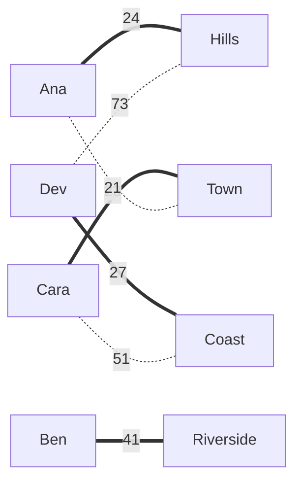
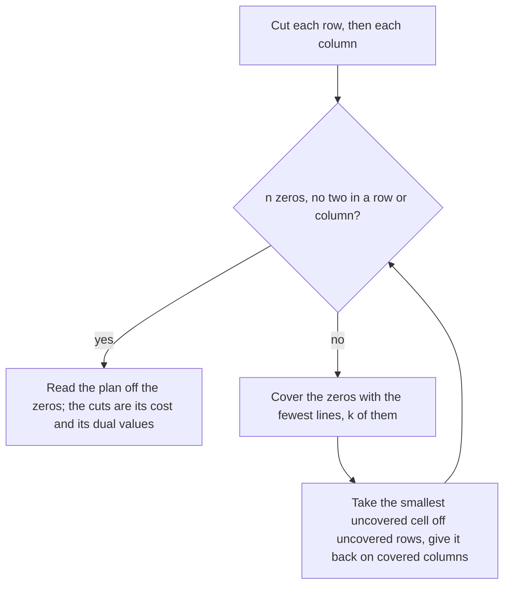

# The assignment problem: pairing people to jobs at least total cost

[Syllabus](../../../SYLLABUS.md) → [Applied and computational](../README.md) → [Operations Research](../README.md#s05) → The assignment problem

---

## General Overview

A bakery chain loads its vans at one warehouse. This morning four drivers, Ana, Ben, Cara and Dev, must cover four delivery rounds: Riverside, Hills, Coast and Town. Each driver lives somewhere different, so the miles a driver puts on the van depend on which round they get. The dispatcher has the table below and wants one round per driver with the fewest miles in total.

| Miles | Riverside | Hills | Coast | Town |
| --- | ---: | ---: | ---: | ---: |
| Ana | 70 | 24 | 62 | 21 |
| Ben | 41 | 66 | 47 | 24 |
| Cara | 45 | 64 | 51 | 23 |
| Dev | 27 | 73 | 27 | 34 |

The obvious move goes wrong. Town is the shortest round for Ana, Ben and Cara alike. If each driver in turn takes the nearest round still free, Ana takes Town, Ben Riverside, Cara Coast, and Dev is left with Hills at 73 miles: 186 in all. The best plan is 115 miles: Ana on Hills, Ben on Riverside, Cara on Town, Dev on Coast. Same drivers, same rounds, 71 fewer miles every day.

Four drivers allow only 24 different plans, running from 115 to 221 miles, so trying them all is easy. With the chain's 30 vans there are 265252859812191058636308480000000 plans, and trying them all is out. The **Hungarian method** finds the best plan without trying them. It rewrites the table until the best plan can be read off it, and it hands back a short **receipt**: numbers anyone can check that prove no plan is cheaper.

**Taking the same number off a whole row or a whole column changes every plan's total by that same number, so the table can be cut down until the best plan sits on zeros, and the amounts taken off add up to its cost and prove nothing beats it.**

**What kind of fact this is:** a method with a theorem behind it. That the method's answer is the cheapest, and that the cheapest total equals the best receipt, are proved on this card in Why it works, leaning on Kőnig's theorem from the combinatorics wing. The method's speed for large tables is quoted from its source, not proved.

### The picture: the grab against the best plan



Drivers on the left, rounds on the right, miles on each line. Thick lines are the best plan, 115 miles. Dotted lines are where the grab differs; it keeps Ben on Riverside. The grab's cheap 21 on Town pushes Dev onto the 73-mile Hills round.

---

## The formula

The table is the **cost matrix**: $c_{ij}$ is the miles if driver $i$ takes round $j$, with $n = 4$ drivers and 4 rounds. Write it as a **program** (a target to make as small as possible, under rules) with a yes-or-no switch $x_{ij}$, 1 if driver $i$ takes round $j$ and 0 if not:

$$\min \sum_{i=1}^{n}\sum_{j=1}^{n} c_{ij}\,x_{ij} \quad\text{such that}\quad \sum_{j} x_{ij} = 1 \text{ for each driver},\quad \sum_{i} x_{ij} = 1 \text{ for each round},\quad x_{ij} \in \{0, 1\}$$

**Read it aloud:** switch on exactly one cell in every row and every column, and make the switched-on miles as small as possible.

The same thing as a **matching** (pairs with no one used twice, here driver to round): a plan is a pairing $\sigma$ that gives driver $i$ the round $\sigma(i)$, every round used once.

$$\text{best} = \min_{\sigma} \sum_{i=1}^{n} c_{i\,\sigma(i)}$$

**Read it aloud:** over all pairings of drivers to rounds, the smallest total of the chosen cells.

The receipt is two lists of numbers, the **dual values** of the program (one number per rule, as on [Shadow prices](02-shadow-prices-and-sensitivity.md)): $u_i$ for each driver and $v_j$ for each round, chosen so that no cell is beaten, $u_i + v_j \le c_{ij}$. From here on the card calls them dual values. The theorem the method proves, Egerváry's from 1931, says the best dual values meet the best plan exactly:

$$\min_{\sigma} \sum_{i=1}^{n} c_{i\,\sigma(i)} \;=\; \max\Big\{ \sum_{i} u_i + \sum_{j} v_j \;:\; u_i + v_j \le c_{ij} \text{ for every driver } i \text{ and round } j \Big\}$$

**Read it aloud:** the fewest total miles equals the most you can hand out to drivers and rounds without any cell's miles being exceeded.

For the bakery: $u = (21, 41, 40, 27)$, $v = (0, 3, 0, -17)$, total 115. A negative $v_j$ is allowed; the dual values only need the sum and the cell rule.

| Symbol | Plain meaning | In our example | Push it up and the answer… |
| --- | --- | --- | --- |
| $n$ | how many drivers, and how many rounds | 4 | plans grow as $n!$: 24 here, the long number above at 30 |
| $i$, $j$ | a driver (a row), a round (a column) | Ana is $i = 1$, Town is $j = 4$ | — |
| $c_{ij}$ | miles if driver $i$ takes round $j$ | Ana on Town: 21 | the best total rises by at most that much |
| $x_{ij}$ | the switch: 1 if driver $i$ takes round $j$, else 0 | 1 for Ana on Hills | — |
| $\sigma$ | a pairing; $\sigma(i)$ is driver $i$'s round | Ana→Hills, Ben→Riverside, Cara→Town, Dev→Coast | — |
| $u_i$ | driver $i$'s dual value: what came off row $i$ | 21, 41, 40, 27 | the dual-value total rises, until a cell would be beaten |
| $v_j$ | round $j$'s dual value: what came off column $j$ | 0, 3, 0, −17 | the same |
| $k$ | the fewest rows and columns that together cover every zero | 3 | at $k = n$ the method stops |
| $r$, $s$ | how many of the $k$ lines are rows, and how many are columns | 2 rows (Ana, Dev), 1 column (Town) | — |
| $\delta$ | the smallest cell no line covers, used to move the zeros | 17 | the bound jumps by $\delta(n - k)$ |

Here $\delta$ ("delta") is only that step size; on the randomised shelf the same letter is a failure probability.

### When it holds

- **As many drivers as rounds.** With four drivers and five rounds, add a made-up driver whose every cell is 0; whichever round they get is the one left undone. Without the padding there is no square table, and the row-and-column cuts do not apply.
- **Costs add up.** The total is the sum of the chosen cells. If two drivers sharing a van saved miles together, a pair's cost would depend on another pair, and that problem (quadratic assignment) is far harder.
- **One round each.** If a driver may take two rounds, copy their row and pad the table square again, or move to the transportation problem, where supplies and demands are counts.
- **A ban is a huge cost, never a zero.** Typed as 0, a ban on Dev driving Hills makes the method send Dev to Hills: 113 miles, a plan that breaks the ban and looks cheaper than the true best. Typed as 1000, the answer is 115 with the ban kept.
- **Whole-number costs, for the stopping proof below.** Each round of the method then raises the bound by at least 1. Fractions in miles can be scaled to whole numbers first.

---

## Why it works

### Step 0: every plan uses each row once and each column once

A plan takes exactly one cell from every row. So if 21 miles comes off every cell in Ana's row, every plan's total drops by exactly 21. The order of the plans does not change; the best stays best. Columns are the same.

So the table can be cut down freely, row by row and column by column, without moving the answer. Cut until no cell is negative and the best plan's cells are all 0. Then that plan costs 0 on the cut table, and nothing can cost less than 0. The cuts, added up, are its real cost.

### Step 1: cut each row, then each column

Take each row's smallest cell off that row: 21, 24, 23 and 27, total 95. Then each column's smallest remaining cell off that column: 0, 3, 0 and 0. Every cell is still 0 or more, so every plan costs at least the total taken off: 98 miles. That is the first **bound** (a floor under every plan).

| Cut | Riverside | Hills | Coast | Town |
| --- | ---: | ---: | ---: | ---: |
| Ana | 49 | 0 | 41 | 0 |
| Ben | 17 | 39 | 23 | 0 |
| Cara | 22 | 38 | 28 | 0 |
| Dev | 0 | 43 | 0 | 7 |

### Step 2: look for a plan made of zeros

A plan of zeros is four zero cells, no two in a row or a column. Treat each zero as a line joining its driver to its round; then this is a **perfect matching**, every driver paired, and the alternating-path search of [Matchings](../../04-Combinatorics%20and%20graphs/13-Matchings%20and%20Flows/01-matchings-and-augmenting-paths.md) finds the largest one.

Here it finds only three: Ana-Hills, Ben-Town, Dev-Riverside. Ben and Cara both have their only zero at Town. Two drivers, one round between them: that is the shortfall of [Hall's theorem](../../04-Combinatorics%20and%20graphs/13-Matchings%20and%20Flows/02-halls-marriage-theorem.md), and it is why no zero plan exists yet.

### Step 3: cover the zeros with the fewest lines

[Konig's theorem](../../04-Combinatorics%20and%20graphs/13-Matchings%20and%20Flows/03-konigs-theorem-and-vertex-cover.md) says the fewest rows and columns that together cover every zero equals the most zeros with no two sharing a row or column. Here that is $k = 3$: row Ana, row Dev and column Town. The alternating walks that found the matching also name these lines: start from the unpaired driver, Cara, and follow zeros and pairings. The rows the walk reaches (Ben, Cara) stay uncovered; the columns it reaches (Town) are covered; every other row is covered.

### Step 4: move the zeros, and the bound goes up

Let $\delta$ be the smallest uncovered cell: Ben's Riverside, 17. Take 17 off each uncovered row (Ben and Cara), then give 17 back to each covered column (Town). Cell by cell:

- uncovered row, uncovered column: down 17. None goes below 0, since 17 was the smallest there. Ben's Riverside becomes a new zero.
- uncovered row, covered column: down 17 and up 17, so unchanged.
- covered row, covered column: up 17 (Ana's Town, Dev's Town).
- covered row, uncovered column: untouched.

| Moved | Riverside | Hills | Coast | Town |
| --- | ---: | ---: | ---: | ---: |
| Ana | 49 | 0 | 41 | 17 |
| Ben | 0 | 22 | 6 | 0 |
| Cara | 5 | 21 | 11 | 0 |
| Dev | 0 | 43 | 0 | 24 |

Say $r$ rows and $s$ columns are covered, so $r + s = k$; here $r = 2$ (Ana, Dev) and $s = 1$ (Town). The total taken off rose by 17 for each of the $n - r$ uncovered rows and fell by 17 for each of the $s$ covered columns:

$$\delta\,(n - r) - \delta\,s \;=\; \delta\,(n - k) \;=\; 17 \times (4 - 3) \;=\; 17$$

Because $k < n$, the bound rises: from 98 to 115.



The loop of the method. Each pass through the lower box raises the bound by $\delta(n - k)$.

### Step 5: four zeros, and the dual values

The moved table has four zeros with no two sharing a row or column: Ana-Hills, Ben-Riverside, Cara-Town, Dev-Coast. On the real table that is $24 + 41 + 23 + 27 = 115$ miles, exactly the bound. The amounts taken off each row and column are the dual values: $u = (21, 41, 40, 27)$ and $v = (0, 3, 0, -17)$.

Why the dual values prove it. Every cell left is $c_{ij} - u_i - v_j \ge 0$, so $u_i + v_j \le c_{ij}$. Take any plan $\sigma$ and add its cells:

$$\sum_{i} c_{i\,\sigma(i)} \;\ge\; \sum_{i} \big(u_i + v_{\sigma(i)}\big) \;=\; \sum_i u_i + \sum_j v_j \;=\; 115$$

The middle step holds because $\sigma$ uses every round exactly once, so each $v_j$ appears exactly once. No plan costs less than 115, and one costs exactly 115. Checking it needs no search: one comparison per cell.

This is the theorem in The formula. Any set of dual values totals at most any plan (the line above), and the method ends with a plan and dual values of equal total, so the smallest plan equals the largest dual-value total.

<details>
<summary>Detailed proof: the method never loses ground, and it stops</summary>

**No cell goes negative.** Only cells in an uncovered row and an uncovered column go down, and they go down by the smallest of themselves.

**The zero matching survives.** Kőnig's cover from the alternating walk takes exactly one end of every matched zero, so no matched zero sits where a row and a column are both covered, the only cells that go up. The next search starts with at least as many independent zeros.

**It stops.** With whole-number costs every cell stays a whole number, so $\delta \ge 1$ and each pass raises the bound by at least $n - k \ge 1$. The bound never passes the cheapest plan (Step 5's inequality), so there are at most (cheapest − first bound) passes. Here one pass did it: 115 − 98 = 17, in one jump of 17.

**How fast.** That count depends on the miles, not just on $n$. Munkres showed in 1957 that a careful order of steps needs a number of operations bounded by a polynomial in $n$; Edmonds and Karp's shortest-path form needs at most about $n^3$ cell looks. The code's third road is that form and counts its looks; the $n^3$ ceiling is quoted from the source, not proved here.

</details>

---

## Worked numbers, by hand

| Step | Arithmetic | Value |
| --- | --- | --- |
| row cuts | 21 + 24 + 23 + 27 | 95 |
| column cut | Hills: Ana's 24 − 21 is the column's smallest | 3 |
| first bound | 95 + 3 | 98 |
| independent zeros | Ana-Hills, Ben-Town, Dev-Riverside; Cara's only zero is Town too | 3 |
| fewest covering lines, $k$ | row Ana, row Dev, column Town | 3 |
| smallest uncovered, $\delta$ | Ben's Riverside, 41 − 24 | 17 |
| new bound | 98 + 17 × (4 − 3) | 115 |
| the zero plan | Ana-Hills 24 + Ben-Riverside 41 + Cara-Town 23 + Dev-Coast 27 | **115 miles** |

The dispatcher sends Ana to Hills, Ben to Riverside, Cara to Town and Dev to Coast, and the dual values show no other plan of the 24 does better.

### What breaks if you drop a piece

| Mistake | Comes out at | What went wrong |
| --- | --- | --- |
| Each driver in turn takes the nearest free round | 186 | Ana's 21 on Town forces Dev onto Hills at 73: 71 miles wasted |
| Each driver's nearest round, clashes ignored | 95 | Ana, Ben and Cara all on Town: not a plan, only a floor |
| Stop at the bound after the cuts | 98 | the zeros held only 3 independent cells; no plan costs 98 |
| A ban typed as 0 | 113 | the method sent Dev to the banned Hills; typed as 1000 the answer is 115 |

---

## Code, from first principles, and it actually runs

Nothing is imported. Road one is the Hungarian method exactly as above: the cuts, a zero matching grown by alternating paths, Kőnig's cover read off the walk, with an assert that it uses exactly as many lines as there are matched zeros, and the move by $\delta$, with an assert that no cell goes negative; it prints the cut and moved tables and the dual values, on the lines marked receipt. Road two tries all 24 plans. Road three is a different method, shortest augmenting paths with running dual values, which counts every cell it looks at. On synthetic tables (miles 10 to 99 from SplitMix64, a small seeded generator written out in both languages), the methods are compared with each other and, at $8 \times 8$, with an exact search over all 256 sets of rounds. The asserts check the method against brute force, the dual values against the plan, every number of the walkthrough in Why it works (bounds 95 and 98, $k = 3$ lines, one move of 17, then 115, and the dual values), and the mistakes against their stated values.

### Python

```python
# The assignment problem -- the check behind the card.  Nothing is imported.  Four bakery drivers,
# four rounds; a cell is that driver's miles on that round.  Road one: the Hungarian method, with
# its receipt.  Road two: every pairing tried.  Road three: a faster method that counts its steps.
DRIVERS, ROUNDS = ["Ana", "Ben", "Cara", "Dev"], ["Riverside", "Hills", "Coast", "Town"]
C = [[70, 24, 62, 21],
     [41, 66, 47, 24],
     [45, 64, 51, 23],
     [27, 73, 27, 34]]
BIG = 1000                                         # stands for "not allowed" in a cost table

def orders(n):                                     # every way to give n drivers n different rounds
    if n == 0: return [[]]
    return [o[:k] + [n - 1] + o[k:] for o in orders(n - 1) for k in range(n)]

def zero_matching(A):                              # most zeros with no two in a row or column
    n, mate = len(A), [-1] * len(A)                # mate[j]: the row holding column j, or -1
    def grow(i, seen):                             # one augmenting path out of row i
        for j in range(n):
            if A[i][j] == 0 and j not in seen:
                seen.add(j)
                if mate[j] < 0 or grow(mate[j], seen):
                    mate[j] = i; return True
        return False
    for i in range(n): grow(i, set())
    return mate

def hungarian(C, log=None):                        # ROAD ONE: the method as done by hand
    n = len(C)
    u = [min(r) for r in C]                        # take each row's smallest number off its row
    v = [min(C[i][j] - u[i] for i in range(n)) for j in range(n)]   # then each column's
    A = [[C[i][j] - u[i] - v[j] for j in range(n)] for i in range(n)]
    if log is not None: log += [("rows", u[:], sum(u)), ("columns", v[:], sum(u) + sum(v), A)]
    while True:
        mate = zero_matching(A)
        if min(mate) >= 0: break                   # n zeros, no two sharing a row or column
        zr = {i for i in range(n) if i not in mate}  # Konig: alternating walks from free rows
        zc, grew = set(), True
        while grew:
            grew = False
            for i in list(zr):
                for j in range(n):
                    if A[i][j] == 0 and j not in zc:
                        zc.add(j); zr.add(mate[j]); grew = True
        lines = (n - len(zr)) + len(zc)            # rows outside the walk, columns inside it
        assert lines == n - mate.count(-1)         # Konig: as many lines as matched zeros
        d = min(A[i][j] for i in zr for j in range(n) if j not in zc)
        for i in zr: u[i] += d                     # take d off every uncovered row ...
        for j in zc: v[j] -= d                     # ... and give it back on every covered column
        A = [[C[i][j] - u[i] - v[j] for j in range(n)] for i in range(n)]
        assert min(min(r) for r in A) >= 0         # no cell may go below zero
        if log is not None: log.append(("adjust", lines, d, sum(u) + sum(v), A))
    pick = [mate.index(i) for i in range(n)]       # driver i takes the column it holds
    return pick, u, v

def fast(C):                                       # ROAD THREE: shortest augmenting paths, O(n^3)
    n, INF, ops = len(C), 10 ** 9, 0
    u, v, p, way = [0] * (n + 1), [0] * (n + 1), [0] * (n + 1), [0] * (n + 1)
    for i in range(1, n + 1):
        p[0], j0, minv, used = i, 0, [INF] * (n + 1), [False] * (n + 1)
        while True:
            used[j0], i0, d, j1 = True, p[j0], INF, 0
            for j in range(1, n + 1):
                if not used[j]:
                    ops += 1                       # one cell looked at: the counted operation
                    cur = C[i0 - 1][j - 1] - u[i0] - v[j]
                    if cur < minv[j]: minv[j], way[j] = cur, j0
                    if minv[j] < d: d, j1 = minv[j], j
            for j in range(n + 1):
                if used[j]: u[p[j]] += d; v[j] -= d
                else: minv[j] -= d
            j0 = j1
            if p[j0] == 0: break
        while j0:
            j1 = way[j0]; p[j0] = p[j1]; j0 = j1
    return sum(C[p[j] - 1][j - 1] for j in range(1, n + 1)), ops

def subsets(C):                                    # exact check at n = 8: best cost per set of rounds used
    n, best = len(C), [0] + [10 ** 9] * ((1 << len(C)) - 1)
    for m in range(1, 1 << n):
        i = bin(m).count("1") - 1                  # driver i takes one of the rounds in m
        best[m] = min(best[m & ~(1 << j)] + C[i][j] for j in range(n) if m >> j & 1)
    return best[-1]
def splitmix(seed, n):                             # synthetic miles 10..99 from SplitMix64
    M, s, out = (1 << 64) - 1, seed, []
    for _ in range(n * n):
        s = (s + 0x9E3779B97F4A7C15) & M
        z = ((s ^ (s >> 30)) * 0xBF58476D1CE4E5B9) & M
        z = ((z ^ (z >> 27)) * 0x94D049BB133111EB) & M
        out.append(10 + (z ^ (z >> 31)) % 90)
    return [out[r * n:(r + 1) * n] for r in range(n)]
cost = lambda C, o: sum(C[i][o[i]] for i in range(len(C)))
name = lambda o: ", ".join(f"{DRIVERS[i]}-{ROUNDS[j]} {C[i][j]}" for i, j in enumerate(o))
def show(title, T):
    print(title.ljust(6) + "".join(r.rjust(10) for r in ROUNDS))
    for d, row in zip(DRIVERS, T): print(d.ljust(6) + "".join(str(x).rjust(10) for x in row))
show("miles", C)
log = []
pick, u, v = hungarian(C, log)
print(f"row minimums {log[0][1]}, total {log[0][2]}")
print(f"column minimums after that {log[1][1]}, bound {log[1][2]}")
show("cut", log[1][3])
for _, lines, d, bound, A in log[2:]:
    print(f"zeros covered by {lines} lines, smallest uncovered {d}, bound rises {d} x (4 - {lines}) to {bound}")
    show("moved", A)
print(f"road one, Hungarian method: {name(pick)}; total {cost(C, pick)} miles")
print(f"receipt: driver numbers u = {u}, round numbers v = {v}, sum {sum(u) + sum(v)}")
slack = [C[i][j] - u[i] - v[j] for i in range(4) for j in range(4)]
print(f"receipt: smallest u + v gap below a cell = {min(slack)}; cells with no gap = {slack.count(0)}")
all4 = [cost(C, o) for o in orders(4)]
best4 = [o for o in orders(4) if cost(C, o) == min(all4)]
print(f"road two, all {len(all4)} pairings: fewest {min(all4)} miles, most {max(all4)}, pairings at the fewest {len(best4)}")
taken, greedy = set(), 0                           # mistake: each driver in turn grabs the nearest free round
for i in range(4):
    j = min((j for j in range(4) if j not in taken), key=lambda j: C[i][j])
    taken.add(j); greedy += C[i][j]
ban = [r[:] for r in C]; ban[3][1] = 0             # Dev may not drive Hills, typed in as 0
ok = [r[:] for r in C]; ok[3][1] = BIG             # ... and typed in correctly as a huge number
pz, po = hungarian(ban)[0], hungarian(ok)[0]
print(f"mistakes: driver-by-driver grab {greedy} ({greedy - min(all4)} more); each driver's nearest round {log[0][2]}; stop at the bound {log[1][2]}")
print(f"ban typed as 0: {cost(ban, pz)} miles, Dev on {ROUNDS[pz[3]]}; typed as {BIG}: {cost(C, po)} miles, Dev on {ROUNDS[po[3]]}")
f, _ = fast(C)
print(f"road three, shortest augmenting paths: {f} miles")
s8 = splitmix(2026, 8)
h8, d8 = cost(s8, hungarian(s8)[0]), subsets(s8)
print(f"synthetic 8 x 8, seed 2026: Hungarian {h8}, best over all {1 << 8} round sets {d8}, fast {fast(s8)[0]}")
for n in (10, 20, 30):
    s = splitmix(2026 + n, n)
    (fc, ops), hc = fast(s), cost(s, hungarian(s)[0])
    print(f"synthetic {n} x {n}: Hungarian {hc}, fast {fc}, cells looked at {ops} <= n^3 = {n ** 3}")
    assert fc == hc and ops <= n ** 3              # the two methods agree; the n^3 ceiling holds
fact = 1
for k in range(2, 31): fact *= k
print(f"pairings to try by brute force for 30 vans: 30! = {fact}")
assert cost(C, pick) == min(all4) == 115 and best4 == [pick]          # method meets brute force
assert min(slack) == 0 and sum(u) + sum(v) == cost(C, pick)          # receipt: feasible and tight
assert f == 115 and cost(C, po) == min(cost(ok, o) for o in orders(4))
assert h8 == d8 and greedy == 186 and cost(ban, pz) == 113 and pz[3] == 1    # the 0 sends Dev to Hills
assert [e[2] for e in log[:2]] == [95, 98] and [e[1:4] for e in log[2:]] == [(3, 17, 115)]   # the walkthrough
assert u == [21, 41, 40, 27] and v == [0, 3, 0, -17]                  # the receipt on the card
print("ALL CHECKS PASS")
```

**Ran 2026-11-11 on macOS, Python 3.14.10, standard library only. All checks passed. Output, pasted from the run:**

```
miles  Riverside     Hills     Coast      Town
Ana           70        24        62        21
Ben           41        66        47        24
Cara          45        64        51        23
Dev           27        73        27        34
row minimums [21, 24, 23, 27], total 95
column minimums after that [0, 3, 0, 0], bound 98
cut    Riverside     Hills     Coast      Town
Ana           49         0        41         0
Ben           17        39        23         0
Cara          22        38        28         0
Dev            0        43         0         7
zeros covered by 3 lines, smallest uncovered 17, bound rises 17 x (4 - 3) to 115
moved  Riverside     Hills     Coast      Town
Ana           49         0        41        17
Ben            0        22         6         0
Cara           5        21        11         0
Dev            0        43         0        24
road one, Hungarian method: Ana-Hills 24, Ben-Riverside 41, Cara-Town 23, Dev-Coast 27; total 115 miles
receipt: driver numbers u = [21, 41, 40, 27], round numbers v = [0, 3, 0, -17], sum 115
receipt: smallest u + v gap below a cell = 0; cells with no gap = 6
road two, all 24 pairings: fewest 115 miles, most 221, pairings at the fewest 1
mistakes: driver-by-driver grab 186 (71 more); each driver's nearest round 95; stop at the bound 98
ban typed as 0: 113 miles, Dev on Hills; typed as 1000: 115 miles, Dev on Coast
road three, shortest augmenting paths: 115 miles
synthetic 8 x 8, seed 2026: Hungarian 128, best over all 256 round sets 128, fast 128
synthetic 10 x 10: Hungarian 200, fast 200, cells looked at 202 <= n^3 = 1000
synthetic 20 x 20: Hungarian 364, fast 364, cells looked at 1164 <= n^3 = 8000
synthetic 30 x 30: Hungarian 430, fast 430, cells looked at 2801 <= n^3 = 27000
pairings to try by brute force for 30 vans: 30! = 265252859812191058636308480000000
ALL CHECKS PASS
```

### Rust

Built with `rustc --edition 2021 -O`.

```rust
// The assignment problem -- the same check as the Python, in Rust.  No crates.  Four bakery drivers,
// four rounds; a cell is that driver's miles on that round.  Road one: the Hungarian method, with
// its receipt.  Road two: every pairing tried.  Road three: a faster method that counts its steps.
const DRIVERS: [&str; 4] = ["Ana", "Ben", "Cara", "Dev"];
const ROUNDS: [&str; 4] = ["Riverside", "Hills", "Coast", "Town"];
const BIG: i64 = 1000;                                 // stands for "not allowed" in a cost table
type T = Vec<Vec<i64>>;

fn orders(n: usize) -> Vec<Vec<usize>> {               // every way to give n drivers n different rounds
    if n == 0 { return vec![vec![]]; }
    let mut out = vec![];
    for o in orders(n - 1) { for k in 0..n { let mut x = o.clone(); x.insert(k, n - 1); out.push(x); } }
    out
}
fn grow(a: &T, i: usize, seen: &mut Vec<bool>, mate: &mut Vec<i64>) -> bool {   // one augmenting path
    for j in 0..a.len() {
        if a[i][j] == 0 && !seen[j] {
            seen[j] = true;
            if mate[j] < 0 || grow(a, mate[j] as usize, seen, mate) { mate[j] = i as i64; return true; }
        }
    }
    false
}
fn zero_matching(a: &T) -> Vec<i64> {                  // most zeros with no two in a row or column
    let n = a.len(); let mut mate = vec![-1i64; n];
    for i in 0..n { let mut seen = vec![false; n]; grow(a, i, &mut seen, &mut mate); }
    mate
}
fn reduced(c: &T, u: &[i64], v: &[i64]) -> T {
    (0..c.len()).map(|i| (0..c.len()).map(|j| c[i][j] - u[i] - v[j]).collect()).collect()
}
// ROAD ONE: the method as done by hand; also returns the log of bounds and adjustments
fn hungarian(c: &T) -> (Vec<usize>, Vec<i64>, Vec<i64>, Vec<i64>, Vec<i64>, T, Vec<(usize, i64, i64, T)>) {
    let n = c.len();
    let mut u: Vec<i64> = c.iter().map(|r| *r.iter().min().unwrap()).collect();
    let mut v: Vec<i64> = (0..n).map(|j| (0..n).map(|i| c[i][j] - u[i]).min().unwrap()).collect();
    let (u0, v0) = (u.clone(), v.clone());
    let mut a = reduced(c, &u, &v); let cut = a.clone(); let mut log = vec![];
    let mate = loop {
        let mate = zero_matching(&a);
        if *mate.iter().min().unwrap() >= 0 { break mate; }
        let mut zr: Vec<bool> = (0..n).map(|i| !mate.contains(&(i as i64))).collect();
        let mut zc = vec![false; n]; let mut grew = true;
        while grew {
            grew = false;
            for i in 0..n { if !zr[i] { continue; }
                for j in 0..n { if a[i][j] == 0 && !zc[j] { zc[j] = true; zr[mate[j] as usize] = true; grew = true; } } }
        }
        let lines = zr.iter().filter(|&&x| !x).count() + zc.iter().filter(|&&x| x).count();
        assert_eq!(lines, mate.iter().filter(|&&m| m >= 0).count());   // Konig: as many lines as matched zeros
        let mut d = i64::MAX;
        for i in 0..n { for j in 0..n { if zr[i] && !zc[j] { d = d.min(a[i][j]); } } }
        for i in 0..n { if zr[i] { u[i] += d; } }
        for j in 0..n { if zc[j] { v[j] -= d; } }
        a = reduced(c, &u, &v);
        assert!(a.iter().flatten().all(|&x| x >= 0)); // no cell may go below zero
        log.push((lines, d, u.iter().sum::<i64>() + v.iter().sum::<i64>(), a.clone()));
    };
    let mut pick = vec![0; n];
    for j in 0..n { pick[mate[j] as usize] = j; }
    (pick, u, v, u0, v0, cut, log)
}
fn fast(c: &T) -> (i64, u64) {                         // ROAD THREE: shortest augmenting paths, O(n^3)
    let n = c.len(); let inf = 1_000_000_000i64; let mut ops = 0u64;
    let (mut u, mut v, mut p, mut way) = (vec![0i64; n + 1], vec![0i64; n + 1], vec![0usize; n + 1], vec![0usize; n + 1]);
    for i in 1..=n {
        p[0] = i; let mut j0 = 0; let mut minv = vec![inf; n + 1]; let mut used = vec![false; n + 1];
        loop {
            used[j0] = true; let i0 = p[j0]; let mut d = inf; let mut j1 = 0;
            for j in 1..=n {
                if !used[j] {
                    ops += 1;                          // one cell looked at: the counted operation
                    let cur = c[i0 - 1][j - 1] - u[i0] - v[j];
                    if cur < minv[j] { minv[j] = cur; way[j] = j0; }
                    if minv[j] < d { d = minv[j]; j1 = j; }
                }
            }
            for j in 0..=n { if used[j] { u[p[j]] += d; v[j] -= d; } else { minv[j] -= d; } }
            j0 = j1;
            if p[j0] == 0 { break; }
        }
        while j0 != 0 { let j1 = way[j0]; p[j0] = p[j1]; j0 = j1; }
    }
    ((1..=n).map(|j| c[p[j] - 1][j - 1]).sum(), ops)
}
fn subsets(c: &T) -> i64 {                             // exact check at n = 8: best cost per set of rounds used
    let n = c.len(); let mut best = vec![1_000_000_000i64; 1 << n]; best[0] = 0;
    for m in 1..(1usize << n) {
        let i = m.count_ones() as usize - 1;           // driver i takes one of the rounds in m
        for j in 0..n { if m >> j & 1 == 1 { best[m] = best[m].min(best[m & !(1 << j)] + c[i][j]); } }
    }
    best[(1 << n) - 1]
}
fn splitmix(seed: u64, n: usize) -> T {                // synthetic miles 10..99 from SplitMix64
    let mut s = seed; let mut out = vec![];
    for _ in 0..n * n {
        s = s.wrapping_add(0x9E3779B97F4A7C15);
        let mut z = (s ^ (s >> 30)).wrapping_mul(0xBF58476D1CE4E5B9);
        z = (z ^ (z >> 27)).wrapping_mul(0x94D049BB133111EB);
        out.push(10 + ((z ^ (z >> 31)) % 90) as i64);
    }
    out.chunks(n).map(|r| r.to_vec()).collect()
}
fn cost(c: &T, o: &[usize]) -> i64 { (0..c.len()).map(|i| c[i][o[i]]).sum() }
fn name(c: &T, o: &[usize]) -> String {
    o.iter().enumerate().map(|(i, &j)| format!("{}-{} {}", DRIVERS[i], ROUNDS[j], c[i][j])).collect::<Vec<_>>().join(", ")
}
fn show(title: &str, t: &T) {
    println!("{:<6}{}", title, ROUNDS.iter().map(|r| format!("{:>10}", r)).collect::<String>());
    for (d, row) in DRIVERS.iter().zip(t) { println!("{:<6}{}", d, row.iter().map(|x| format!("{:>10}", x)).collect::<String>()); }
}
fn main() {
    let c: T = vec![vec![70, 24, 62, 21], vec![41, 66, 47, 24], vec![45, 64, 51, 23], vec![27, 73, 27, 34]];
    show("miles", &c);
    let (pick, u, v, u0, v0, cut, log) = hungarian(&c);
    let rows: i64 = u0.iter().sum(); let bound = rows + v0.iter().sum::<i64>();
    println!("row minimums {:?}, total {}", u0, rows);
    println!("column minimums after that {:?}, bound {}", v0, bound);
    show("cut", &cut);
    for (lines, d, b, a) in &log {
        println!("zeros covered by {} lines, smallest uncovered {}, bound rises {} x (4 - {}) to {}", lines, d, d, lines, b);
        show("moved", a);
    }
    println!("road one, Hungarian method: {}; total {} miles", name(&c, &pick), cost(&c, &pick));
    let total: i64 = u.iter().sum::<i64>() + v.iter().sum::<i64>();
    println!("receipt: driver numbers u = {:?}, round numbers v = {:?}, sum {}", u, v, total);
    let slack: Vec<i64> = (0..16).map(|k| c[k / 4][k % 4] - u[k / 4] - v[k % 4]).collect();
    let tight = slack.iter().filter(|&&s| s == 0).count(); let smin = *slack.iter().min().unwrap();
    println!("receipt: smallest u + v gap below a cell = {}; cells with no gap = {}", smin, tight);
    let all: Vec<Vec<usize>> = orders(4);
    let costs: Vec<i64> = all.iter().map(|o| cost(&c, o)).collect();
    let (lo, hi) = (*costs.iter().min().unwrap(), *costs.iter().max().unwrap());
    let best: Vec<&Vec<usize>> = all.iter().filter(|o| cost(&c, o) == lo).collect();
    println!("road two, all {} pairings: fewest {} miles, most {}, pairings at the fewest {}", all.len(), lo, hi, best.len());
    let mut taken = [false; 4]; let mut greedy = 0;     // mistake: each driver in turn grabs the nearest free round
    for i in 0..4 {
        let j = (0..4).filter(|&j| !taken[j]).min_by_key(|&j| c[i][j]).unwrap();
        taken[j] = true; greedy += c[i][j];
    }
    let mut ban = c.clone(); ban[3][1] = 0;            // Dev may not drive Hills, typed in as 0
    let mut ok = c.clone(); ok[3][1] = BIG;            // ... and typed in correctly as a huge number
    let pz = hungarian(&ban).0; let po = hungarian(&ok).0;
    println!("mistakes: driver-by-driver grab {} ({} more); each driver's nearest round {}; stop at the bound {}", greedy, greedy - lo, rows, bound);
    println!("ban typed as 0: {} miles, Dev on {}; typed as {}: {} miles, Dev on {}", cost(&ban, &pz), ROUNDS[pz[3]], BIG, cost(&c, &po), ROUNDS[po[3]]);
    let f = fast(&c).0;
    println!("road three, shortest augmenting paths: {} miles", f);
    let s8 = splitmix(2026, 8);
    let (h8, d8) = (cost(&s8, &hungarian(&s8).0), subsets(&s8));
    println!("synthetic 8 x 8, seed 2026: Hungarian {}, best over all {} round sets {}, fast {}", h8, 1 << 8, d8, fast(&s8).0);
    for n in [10usize, 20, 30] {
        let s = splitmix(2026 + n as u64, n);
        let (fc, ops) = fast(&s); let hc = cost(&s, &hungarian(&s).0);
        println!("synthetic {} x {}: Hungarian {}, fast {}, cells looked at {} <= n^3 = {}", n, n, hc, fc, ops, n * n * n);
        assert!(fc == hc && ops <= (n * n * n) as u64);   // the two methods agree; the n^3 ceiling holds
    }
    let fact: u128 = (2..=30u128).product();
    println!("pairings to try by brute force for 30 vans: 30! = {}", fact);
    let ok_best = all.iter().map(|o| cost(&ok, o)).min().unwrap();
    assert!(cost(&c, &pick) == lo && lo == 115 && best.len() == 1 && *best[0] == pick);   // method meets brute force
    assert!(smin == 0 && total == cost(&c, &pick));    // receipt: feasible and tight
    assert!(f == 115 && cost(&c, &po) == ok_best);
    assert!(h8 == d8 && greedy == 186 && cost(&ban, &pz) == 113 && pz[3] == 1);   // the 0 sends Dev to Hills
    let walk: Vec<(usize, i64, i64)> = log.iter().map(|e| (e.0, e.1, e.2)).collect();
    assert!(rows == 95 && bound == 98 && walk == vec![(3, 17, 115)]);   // the walkthrough
    assert!(u == vec![21, 41, 40, 27] && v == vec![0, 3, 0, -17]);     // the receipt on the card
    println!("ALL CHECKS PASS");
}
```

**Ran 2026-11-11 on macOS, rustc 1.98.1, no crates. All checks passed. Output, pasted from the run:**

```
miles  Riverside     Hills     Coast      Town
Ana           70        24        62        21
Ben           41        66        47        24
Cara          45        64        51        23
Dev           27        73        27        34
row minimums [21, 24, 23, 27], total 95
column minimums after that [0, 3, 0, 0], bound 98
cut    Riverside     Hills     Coast      Town
Ana           49         0        41         0
Ben           17        39        23         0
Cara          22        38        28         0
Dev            0        43         0         7
zeros covered by 3 lines, smallest uncovered 17, bound rises 17 x (4 - 3) to 115
moved  Riverside     Hills     Coast      Town
Ana           49         0        41        17
Ben            0        22         6         0
Cara           5        21        11         0
Dev            0        43         0        24
road one, Hungarian method: Ana-Hills 24, Ben-Riverside 41, Cara-Town 23, Dev-Coast 27; total 115 miles
receipt: driver numbers u = [21, 41, 40, 27], round numbers v = [0, 3, 0, -17], sum 115
receipt: smallest u + v gap below a cell = 0; cells with no gap = 6
road two, all 24 pairings: fewest 115 miles, most 221, pairings at the fewest 1
mistakes: driver-by-driver grab 186 (71 more); each driver's nearest round 95; stop at the bound 98
ban typed as 0: 113 miles, Dev on Hills; typed as 1000: 115 miles, Dev on Coast
road three, shortest augmenting paths: 115 miles
synthetic 8 x 8, seed 2026: Hungarian 128, best over all 256 round sets 128, fast 128
synthetic 10 x 10: Hungarian 200, fast 200, cells looked at 202 <= n^3 = 1000
synthetic 20 x 20: Hungarian 364, fast 364, cells looked at 1164 <= n^3 = 8000
synthetic 30 x 30: Hungarian 430, fast 430, cells looked at 2801 <= n^3 = 27000
pairings to try by brute force for 30 vans: 30! = 265252859812191058636308480000000
ALL CHECKS PASS
```

The two outputs match line for line. The cell counts are for these synthetic tables, a run count, not a worst case: 2801 looks at $30 \times 30$, against a ceiling of 27000.

> [!TIP]
> **Try changing**
> Guess first, then make the edit and run. The answers below come from those edited runs, not from the output above. The asserts are pinned to the bakery's numbers, so when the answer moves, one stops the program just after the new answer prints.
> - **A diversion on Cara's Town round:** set `C[2][3]` (Rust: `c[2][3]`) to 40. Who moves? Ben takes Town and Cara takes Riverside: 120 miles, after one move of 5.
> - **Ana's Hills round gets longer:** set `C[0][1]` to 60. Does Ana leave Hills? No. The plan stays, at 151 miles, but the method needs two moves, of 2 and then 15.
> - **Dev's Coast round gets longer:** set `C[3][2]` to 60. The cuts alone now leave four independent zeros and no move is needed: 121 miles, Ben on Coast and Dev on Riverside.
> - **Another synthetic seed:** in the loop, replace `2026 + n` with `7`. At $30 \times 30$ both methods agree on 439 miles, after 2171 cell looks. No assert is pinned to it, so it runs to the end.

---

## The usual mistake

> [!warning]
> **Taking the cheapest cell first.** It feels efficient to hand out the smallest numbers first, but a cheap cell can block a whole row elsewhere. Ana's 21 on Town is the smallest number in the table, and taking it costs 71 miles over the day: 186 against 115. The method never commits to a cell until the zeros form a complete plan.
>
> - **Reading the row cuts as the answer.** 95 is a floor, not a plan: three drivers would share Town.
> - **Stopping at the first bound.** After the column cuts the floor is 98, but no plan sits on the zeros; the move by 17 is what reaches 115.
> - **Typing a ban as zero.** A blank cell read as 0 becomes the most attractive cell in its row: the method returns 113 miles with Dev on the banned Hills. A ban is a huge number, here 1000, giving 115.
> - **Covering the zeros with more lines than needed.** Use the fewest, $k$. With $n$ lines and no zero plan yet, that pass raises the bound by $\delta \times (n - n) = 0$, so the stopping proof no longer applies.

---

## Where you meet it in real life

- **Ride and delivery dispatch.** A batch of free cars and waiting riders can be paired by pickup minutes, an assignment table solved again for each batch.
- **Tracking moving objects.** A radar or camera sees several objects each sweep and must say which new dot is which old one; pairing them by distance is an assignment problem, and the Hungarian method is a standard tool for it.
- **Medley relays.** A coach picks which of four swimmers swims each of four strokes to make the team's total time smallest: a 4 by 4 table, as here.
- **Rosters.** Nurses to shifts, examiners to exam rooms, ovens to batches: wherever each person or machine takes one job and the costs add up.

> **Say it back**
> The assignment problem pairs each driver with one round to make the total miles smallest. Taking a number off a whole row or column shifts every plan's total by that number, so the table can be cut down without changing the answer. Cut until the best plan sits on zeros; when the zeros do not yet form a plan, Kőnig's fewest covering lines say where to move them, and the floor rises. The bakery's floor goes 95, 98, 115, and the plan Ana-Hills, Ben-Riverside, Cara-Town, Dev-Coast costs 115. The cuts are the dual values, a receipt: no plan can cost less than their total.

---

## What this builds on

- [Scheduling](04-scheduling-and-the-critical-path.md): decides when jobs run and in what order; this card decides who runs them.
- [Graph algorithms as code](../01-Algorithms%20and%20Growth/09-graph-algorithms-in-practice.md): the practical versions of augmenting-path search, including Hopcroft–Karp for large matchings.
- [Matchings](../../04-Combinatorics%20and%20graphs/13-Matchings%20and%20Flows/01-matchings-and-augmenting-paths.md): augmenting paths and Berge's theorem, which grow the zero matching in Step 2.
- [Hall's theorem](../../04-Combinatorics%20and%20graphs/13-Matchings%20and%20Flows/02-halls-marriage-theorem.md): the shortfall that blocks a zero plan, here Ben and Cara sharing one zero.
- [Konig's theorem](../../04-Combinatorics%20and%20graphs/13-Matchings%20and%20Flows/03-konigs-theorem-and-vertex-cover.md): the fewest covering lines equal the most independent zeros, which tells the method where to move.

## Where this goes next

- [Shadow prices](02-shadow-prices-and-sensitivity.md): why the program's switches can be relaxed to any fraction from 0 to 1 and the answer still comes out whole, so $u$, $v$ are the dual values of a [Linear programs](01-modelling-with-linear-programs.md) model, its [Shadow prices](02-shadow-prices-and-sensitivity.md).
- [Integer programs](03-integer-programming-and-branch-and-bound.md): the assignment problem beside the transportation, shortest-path and flow models it belongs to.

Left open: when a driver can take several rounds and rounds need several drivers, the table becomes a flow of counts, and the same cuts and dual values have to work on a network.

---

## Sources

Verified 2026-11-11: every link below resolves to the publisher's page.

- Kuhn, H. W. "The Hungarian method for the assignment problem." *Naval Research Logistics Quarterly* 2 (1955): 83–97. [doi:10.1002/nav.3800020109](https://doi.org/10.1002/nav.3800020109). The method, named for the 1931 work of Kőnig and Egerváry it builds on.
- Munkres, J. "Algorithms for the Assignment and Transportation Problems." *Journal of the Society for Industrial and Applied Mathematics* 5, no. 1 (1957): 32–38. [doi:10.1137/0105003](https://doi.org/10.1137/0105003). The covering-lines version used here, and the proof that it ends in polynomial time.
- Edmonds, J., and R. M. Karp. "Theoretical Improvements in Algorithmic Efficiency for Network Flow Problems." *Journal of the ACM* 19, no. 2 (1972): 248–264. [doi:10.1145/321694.321699](https://doi.org/10.1145/321694.321699). Shortest augmenting paths with running dual values, the $n^3$ form behind the code's third road.
- Burkard, R., M. Dell'Amico and S. Martello. *Assignment Problems*, revised reprint. SIAM, 2012. [doi:10.1137/1.9781611972238](https://doi.org/10.1137/1.9781611972238). The standard reference: the program, the dual values, the methods and their costs.
