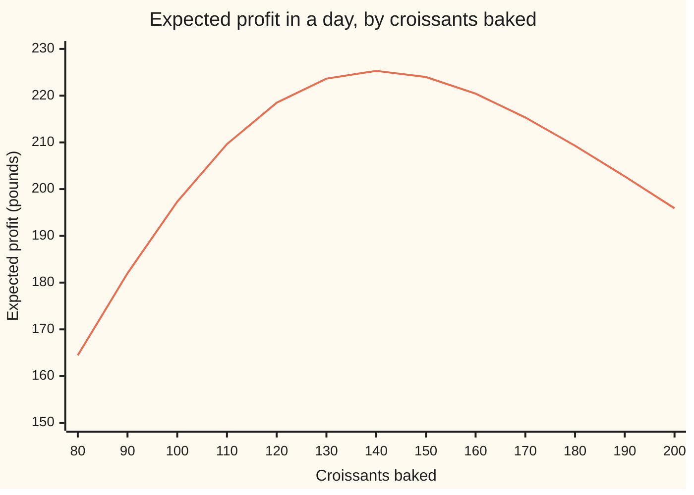
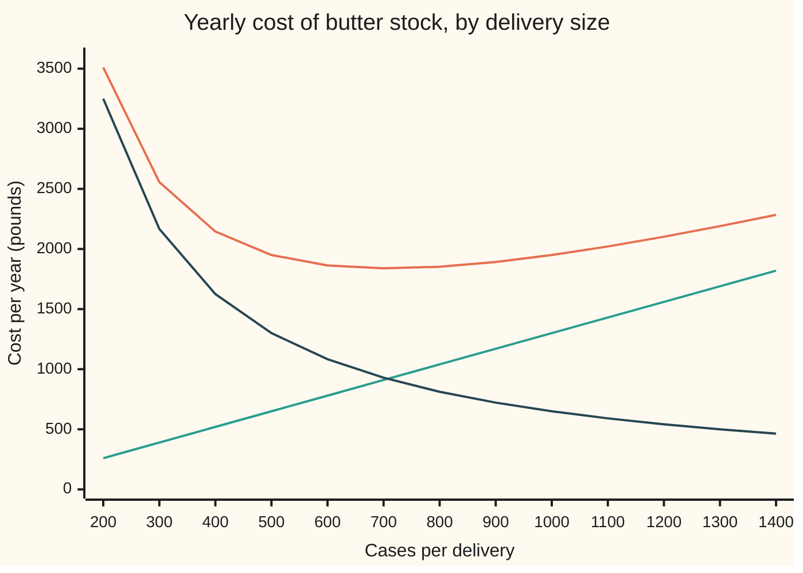

# Stock: the order size that balances holding against ordering, and the one-shot order

[Syllabus](../../../SYLLABUS.md) → [Applied and computational](../README.md) → [Operations Research](../README.md#s05) → Stock

---

## General Overview

A bakery shop bakes its croissants at five in the morning, for one day only. Each sells for £2.80 and costs £0.70 to make. Whatever is left at closing is thrown away. Sales tomorrow are uncertain: they average 120, with a typical day-to-day spread of 30. How many should go in the oven?

Baking the average, 120, sounds safe. It isn't the best choice. A croissant the shop didn't bake, when a customer wanted one, loses £2.10 of profit. A croissant baked and not sold loses £0.70. Running out is three times as costly as wasting, so the shop should bake past the average: **140**. Its expected profit is £225.31 a day, against £218.49 for baking 120.

The chain's one warehouse has the opposite kind of problem. Butter for the croissants keeps for weeks, so the question is not "how much for one day" but "how big should each delivery be". Big deliveries mean few delivery fees but many cases sitting in the cold room. Small deliveries mean the reverse.

The best delivery is **707 cases**, one every 7.07 weeks. And because a delivery takes two weeks to arrive, the warehouse reorders when its stock falls to **247 cases**: enough to cover the wait in 95% of cycles. A cycle is the time from one delivery to the next.

**Stock is a trade between two costs: for a steady flow, order the amount at which the yearly cost of ordering equals the yearly cost of holding; for a one-shot order, keep adding units until the chance the last one sells drops to the leftover cost's share of the two costs.**

**What kind of fact this is:** two models. Steady, known demand for the butter and a known demand curve for the croissants are assumptions, not laws. Inside each model, the best order is a theorem, proved on this card in Why it works.

### The picture: expected profit against the number baked



One line: the expected profit for each batch size, with demand averaging 120 and spreading 30. It peaks at 140, not at the average of 120. Baking too few falls off steeply, because each missing croissant costs £2.10. Baking too many falls off gently, because each spare costs £0.70.

---

## The formula

This card introduces four letters, used across the shelf: the **demand rate** $D$ (units used per year), the **order cost** $K$ (the fixed cost of one delivery, whatever its size), the **holding cost** $h$ (the cost of keeping one unit in stock for a year) and the **order size** $Q$.

The economic order quantity (EOQ), the best delivery size for steady demand:

$$Q^* = \sqrt{\frac{2KD}{h}}$$

The reorder point, the stock level that triggers the next order:

$$R = \mu_L + z\,\sigma_L, \qquad z = \Phi^{-1}(\alpha)$$

The one-shot order is called the newsvendor model, after newspaper sellers, who stock each day's paper once.

The critical fractile, which fixes the one-shot order $Q^*$ for the croissants:

$$F(Q^*) = \frac{c_u}{c_u + c_o}$$

**Read it aloud:** order the square root of twice the order cost times the yearly demand, over the holding cost; reorder when stock falls to the demand you expect during the wait plus $z$ spreads of it; and for a one-shot order, stock up until the chance demand stays at or below your stock equals the missed-sale cost's share of both costs.

| Symbol | Plain meaning | In our example | Push it up and the answer… |
| --- | --- | --- | --- |
| $D$ | demand rate: cases of butter used per year | 5,200 (100 a week for 52 weeks) | $Q^*$ rises, with the square root |
| $K$ | order cost: the fixed cost of one delivery | £125 | $Q^*$ rises: fewer, bigger deliveries |
| $h$ | holding cost: keeping one case for a year (cold room, money tied up) | £2.60 | $Q^*$ falls: smaller, more frequent deliveries |
| $Q$, $Q^*$ | order size; the best order size | $Q^*$ = 707.1 cases of butter; 140.23 croissants | — |
| $C(Q)$ | yearly cost of ordering plus holding, for order size $Q$ | £1,838.48 at $Q^*$ | — |
| $t_L$ | lead time: weeks from placing an order to its arrival | 2 weeks | $R$ rises |
| $\mu_L$, $\sigma_L$, $\sigma_{\text{week}}$ | mean and spread (standard deviation) of the demand during the lead time; the spread of one week's demand | 200 and 28.28 cases; 20 cases a week | $R$ rises |
| $\alpha$, $z$ | service level: the chance a cycle has no stock-out; $z = \Phi^{-1}(\alpha)$, its normal quantile | 0.95; $z$ = 1.645 | $R$ rises, faster as $\alpha$ nears 1 |
| $s$, $R$ | safety stock $z\sigma_L$; reorder point $\mu_L + s$ | 46.52; 246.52, so order at 247 cases | — |
| $p$, $c$, $v$ | croissant price; cost to bake one; value of a leftover | £2.80; £0.70; £0 | — |
| $c_u$, $c_o$ | underage cost $p - c$: profit lost per missed sale; overage cost $c - v$: money lost per leftover | £2.10; £0.70 | $c_u$ up: bake more. $c_o$ up: bake fewer |
| $\mu$, $\sigma$, $F$, $\Phi$, $\varphi$, $G$, $u$ | croissant demand's mean and spread; $F(x)$, the chance demand is at most $x$; $\Phi$ and $\varphi$, the standard bell curve's area to the left and height; $G(z) = \varphi(z) - z(1 - \Phi(z))$, the standard normal loss function: the expected shortfall past $z$, in spreads; $u$, a standard bell-curve draw | 120 and 30; $G(1.645)$ = 0.0209 | — |

### When it holds

- **Demand is steady and known (EOQ).** If butter use swings with the seasons, one fixed $Q^*$ is wrong for most of the year. Each season needs its own order size.
- **Each delivery costs the same $K$, and holding cost grows in proportion to stock and time.** A bulk discount on large orders breaks the smooth cost curve. Each price band then has to be costed separately and compared.
- **Weeks of demand are independent, and lead-time demand is close to a bell curve (reorder point).** If a busy week tends to follow a busy week, the true $\sigma_L$ is bigger than $\sigma_{\text{week}}\sqrt{t_L}$, and stock-outs come more often than the promised 5%.
- **One selling period, leftovers worth $v$, and the demand curve $F$ is right (newsvendor).** If the shop's demand has two humps, 80 on a quiet day and 160 on a market day, a bell curve fitted to it (mean 120, spread 40) says bake 147. The true best is 160: an expected £224.00 a day against £214.90.
- **A missed sale is lost, not delayed.** If customers wait for the next batch instead, $c_u$ becomes the cost of making them wait, and the waiting line is a job for [Queues](07-queueing-theory-and-littles-law.md).

---

## Why it works

### Step 0: every stock decision is two costs pulling in opposite directions

More stock means fewer deliveries, or fewer missed sales. It also means more money sitting on shelves, or more waste. The best amount sits where adding one more unit stops paying for itself. Each result below is that one idea, worked out for a different situation.

### Step 1: write the yearly cost of an order size

A delivery of $Q$ cases arrives. Stock then falls steadily to zero, the next delivery arrives, and the pattern repeats: a sawtooth. Stock runs from $Q$ down to 0 in a straight line, so on average $Q/2$ cases are in the cold room. Holding them costs $hQ/2$ a year.

The warehouse needs $D$ cases a year, $Q$ at a time, so it places $D/Q$ orders a year. Ordering costs $KD/Q$ a year. The total is

$$C(Q) = \frac{KD}{Q} + \frac{hQ}{2}.$$

The first term falls as $Q$ grows; the second rises. The chart shows both for the butter.



Top line: the total $C(Q)$. Rising straight line: holding, $hQ/2$. Falling curve: ordering, $KD/Q$. The total bottoms out near 700 cases, where the other two lines cross.

### Step 2: find the bottom with the derivative

The [Optimisation](../../06-Calculus%20and%20analysis/03-What%20Derivatives%20Tell%20You/03-monotonicity-and-optimisation.md) card's test says a best value sits where the slope changes sign. The slope of the cost is

$$C'(Q) = -\frac{KD}{Q^2} + \frac{h}{2}.$$

For small $Q$ the first term wins and the slope is negative: bigger deliveries save money. For large $Q$ the slope is positive. It is zero at exactly one point:

$$\frac{KD}{Q^2} = \frac{h}{2} \quad\Longrightarrow\quad Q^* = \sqrt{\frac{2KD}{h}}.$$

Multiply both sides of $KD/Q^2 = h/2$ by $Q$ and it reads $KD/Q^* = hQ^*/2$. **At the best order size, the yearly ordering cost equals the yearly holding cost.** For the butter, each is £919.24.

The bottom is very flat. Divide $C(Q)$ by $C(Q^*) = \sqrt{2KDh}$ and it becomes $\tfrac12(Q/Q^* + Q^*/Q)$. An order 20% too big costs only 1.67% extra; one 20% too small costs 2.50% extra. So $Q^*$ can be rounded to whatever a truck or pallet holds without real loss.

### Step 3: the reorder point covers the wait

Butter takes $t_L$ = 2 weeks to arrive. The warehouse must order while it still has enough to last the wait. On average the wait uses 200 cases. But a week's use varies, with a spread of 20 cases around its 100. EOQ used only the average rate, 100 a week; the reorder point and its safety stock absorb the week-to-week spread.

How much does two weeks' use spread? Not 40. The variance is the spread squared. For independent weeks, **variances add, spreads don't**: the variance is $20^2 + 20^2 = 800$, so the spread is $\sqrt{800}$ = 28.28 cases. In general $\sigma_L = \sigma_{\text{week}}\sqrt{t_L}$.

Now pick a service level: the chance a cycle gets through the wait without running out. At $\alpha$ = 0.95, the [Normal quantiles](../../09-Probability%20and%20statistics/04-Continuous%20Distributions/05-normal-quantile.md) card gives $z = \Phi^{-1}(0.95)$ = 1.645. Reorder at $R = 200 + 1.645 \times 28.28$ = 246.52, so at 247 cases. The extra 46.52 over the average is the **safety stock**: stock held only to absorb bad weeks.

### Step 4: a stock-out is not the same as a missed case

The service level counts cycles: 5% of them run short. But a short cycle is usually short by only a little. The expected shortfall past the reorder point is $\sigma_L\,G(z)$ = 0.5909 cases per cycle, out of 707.1 delivered. So the **fill rate**, the share of all demand served from the shelf, is $1 - 0.5909/707.1$ = 0.99916.

With 7.35 cycles a year, a stock-out comes about once every 2.72 years. Say which number is promised: "95% of cycles" and "99.9% of cases" describe the same warehouse.

### Step 5: the one-shot order and the critical fractile

The croissants are different. There is no next delivery: what isn't sold by closing is lost. So think about the last croissant in the batch, the $Q$th one.

- It sells if demand is more than $Q$. That has chance $1 - F(Q)$, and earns $c_u$ = £2.10 that would otherwise be missed.
- It is left over if demand is at most $Q$. That has chance $F(Q)$, and loses $c_o$ = £0.70.

Baking it is worth $(1 - F(Q))\,c_u - F(Q)\,c_o$ on average. That is positive while $F(Q) < c_u/(c_u + c_o)$. As $Q$ grows, $F(Q)$ only rises, so the gain is positive at first and then turns negative. Stop at the crossing:

$$F(Q^*) = \frac{c_u}{c_u + c_o} = \frac{2.10}{2.80} = 0.75.$$

This ratio is the **critical fractile**. For bell-curve demand, $Q^* = \mu + \sigma\,\Phi^{-1}(0.75) = 120 + 30 \times 0.6745$ = 140.23. At that point both sides of the trade are worth 0.5250 pounds: the last croissant is exactly break-even.

<details>
<summary>Why expected sales are $\mu - \sigma G(z)$</summary>

Sales are demand minus the shortfall: $\min(\text{demand}, Q) = \text{demand} - \max(\text{demand} - Q, 0)$. Write demand as $\mu + \sigma u$, where $u$ follows the standard bell curve, and let $z = (Q - \mu)/\sigma$. The expected shortfall is

$$\sigma\int_z^\infty (u - z)\,\varphi(u)\,du = \sigma\left(\varphi(z) - z\,(1 - \Phi(z))\right) = \sigma\,G(z),$$

because $\int_z^\infty u\,\varphi(u)\,du = \varphi(z)$: the height $\varphi$ has slope $-u\varphi(u)$. So expected sales are $\mu - \sigma G(z)$. The same $G$ gave the butter's shortfall per cycle in Step 4.

</details>

---

## Worked numbers, by hand

| Step | Arithmetic | Value |
| --- | --- | --- |
| butter: $2KD$ | $2 \times 125 \times 5{,}200$ | 1,300,000 |
| divide by $h$ | $1{,}300{,}000 / 2.60$ | 500,000 |
| $Q^*$ | $\sqrt{500{,}000}$ | 707.1 cases |
| holding $= $ ordering | $2.60 \times 707.1/2$ and $125 \times 5{,}200/707.1$ | £919.24 each |
| deliveries | $5{,}200/707.1$ | 7.35 a year, every 7.07 weeks |
| lead-time spread | $\sqrt{20^2 + 20^2} = \sqrt{800}$ | 28.28 cases |
| reorder point | $200 + 1.645 \times 28.28$ | 246.52, order at 247 |
| croissants: fractile | $2.10/(2.10 + 0.70)$ | 0.75 |
| $Q^*$ | $120 + 0.6745 \times 30 = 120 + 20.23$ | 140.23, bake 140 |
| expected sold at 140 | $120 - 30 \times G(20/30) = 120 - 30 \times 0.1511$ | 115.47 (24.53 left, 4.53 sales missed) |
| expected profit | $2.80 \times 115.47 - 0.70 \times 140 = 323.31 - 98.00$ | **£225.31 a day** |

Baking 140 croissants, the shop expects 24.53 to go to waste and still beats baking the average by £6.82 a day.

### What breaks if you drop a piece

| Mistake | Comes out at | What went wrong |
| --- | --- | --- |
| Drop the 2: $\sqrt{KD/h}$ | 500 cases, £1,950.00 a year | 6.07% too costly. Small, because the cost curve is flat near its bottom |
| Holding cost per week, demand per year | 5,099 cases, £6,756.20 a year | Holding looks 52 times cheaper than it is. Units must match |
| One week's spread for a two-week wait | safety stock 32.90; stock-outs in 12.24% of cycles | The spread grows with $\sqrt{t_L}$; the promised 5% is broken |
| Bake the average | 120 croissants, £218.49 a day | £6.82 a day lost: missing costs three times wasting |
| Fractile upside down, $c_o/(c_u + c_o)$ = 0.25 | 99.77 croissants, £196.98 a day | Bakes for the cheap mistake instead of the dear one |
| Bell curve on two-humped demand | 147 croissants, £214.90 (best: 160, £224.00) | The model's demand curve is wrong, so its quantile is too |

Every number in this table is printed by both checks.

---

## Code, from first principles, and it actually runs

The script works through the butter and the croissants and takes at least two roads to each answer. The EOQ formula meets a scan of every whole order size from 1 to 3,000. The reorder point's formula meets a simulation of 200,000 cycles, each built from two random weeks of demand, which also checks that the spreads combine as $\sqrt{t_L}$. The critical fractile meets a scan of 0 to 250 croissants scored by Simpson's rule (adding up thin slices under the demand curve, with no $G$), and a simulation of 200,000 days.

The bell-curve area comes from its power series, the quantile from repeated halving, and random numbers from SplitMix64 with seed 2026 turned into bell-curve draws by the Box–Muller formula. All data are synthetic.

### Python

```python
# Stock: EOQ, reorder point and the newsvendor -- the check behind the card.
# Standard library only.  The normal curve is built from its series, the quantile
# by bisection, random numbers by SplitMix64 (seed 2026).  Every number on the card is printed.
from math import sqrt, exp, log, cos, pi, ceil

def phi(x): return exp(-0.5 * x * x) / sqrt(2.0 * pi)            # bell-curve height
def Phi(x):                                                      # area left of x, by series
    if x < -8.0: return 0.0
    if x > 8.0: return 1.0
    term, total, n = x, x, 0
    while abs(term) > 1e-17 * abs(total):
        n += 1
        term = term * x * x / (2 * n + 1)
        total += term
    return 0.5 + phi(x) * total
def quantile(p):                                                 # z with Phi(z) = p, by halving
    lo, hi = -8.0, 8.0
    for _ in range(200):
        mid = 0.5 * (lo + hi)
        if Phi(mid) < p: lo = mid
        else: hi = mid
    return 0.5 * (lo + hi)
def G(z): return phi(z) - z * (1.0 - Phi(z))                     # expected shortfall past z, in spreads

state = 2026
def rand():                                                      # SplitMix64, a uniform in (0, 1)
    global state
    state = (state + 0x9E3779B97F4A7C15) & 0xFFFFFFFFFFFFFFFF
    z = state
    z = ((z ^ (z >> 30)) * 0xBF58476D1CE4E5B9) & 0xFFFFFFFFFFFFFFFF
    z = ((z ^ (z >> 27)) * 0x94D049BB133111EB) & 0xFFFFFFFFFFFFFFFF
    return ((z ^ (z >> 31)) >> 11) / 9007199254740992.0 + 1.0 / 18014398509481984.0
def normal(): return sqrt(-2.0 * log(rand())) * cos(2.0 * pi * rand())   # Box-Muller

# ---- 1. EOQ: butter for the croissants, at the warehouse ----
D, K, h = 5200.0, 125.0, 2.60            # cases a year; pounds per delivery; pounds per case per year
def C(Q): return K * D / Q + h * Q / 2.0
Qs = sqrt(2.0 * K * D / h)
best = min(range(1, 3001), key=C)        # road 2: try every whole order size
print(f"EOQ inputs: D {D:.0f} cases/yr (100/week, 52 weeks), K {K:.2f}, h {h:.2f}")
print(f"Q* {Qs:.4f}  C(Q*) {C(Qs):.4f}  holding {h*Qs/2:.4f}  ordering {K*D/Qs:.4f}")
print(f"orders/yr {D/Qs:.4f}  weeks between {52*Qs/D:.4f}  scan best {best}  C({best}) {C(best):.4f}")
print(f"hand: 2KD {2*K*D:.0f}  2KD/h {2*K*D/h:.0f}")
assert best == 707 and abs(C(best) - C(Qs)) < 0.01
assert abs(h * Qs / 2 - K * D / Qs) < 1e-9
for r in (1.2, 0.8):
    print(f"  Q = Q* x {r:.1f} = {r*Qs:.1f}: C {C(r*Qs):.2f}, extra {100*(C(r*Qs)/C(Qs)-1):.2f}%")
print(f"wrong: drop the 2 -> Q {sqrt(K*D/h):.1f}, C {C(sqrt(K*D/h)):.2f}, extra {100*(C(sqrt(K*D/h))/C(Qs)-1):.2f}%")
Qw = sqrt(2.0 * K * D / (h / 52.0))
print(f"wrong: h per week with D per year -> Q {Qw:.1f}, true cost {C(Qw):.2f}")
print("chart Q:", " ".join(f"{q}" for q in range(200, 1401, 100)))
print("chart holding:", " ".join(f"{h*q/2:.0f}" for q in range(200, 1401, 100)))
print("chart ordering:", " ".join(f"{K*D/q:.0f}" for q in range(200, 1401, 100)))
print("chart total:", " ".join(f"{C(q):.0f}" for q in range(200, 1401, 100)))

# ---- 2. Reorder point and safety stock ----
dw, sw, tL, alpha = 100.0, 20.0, 2, 0.95  # weekly mean, weekly spread, lead time in weeks, service level
muL, sL = dw * tL, sw * sqrt(tL)
z = quantile(alpha)
print(f"reorder inputs: {dw:.0f}/week, spread {sw:.0f}/week, lead time {tL} weeks, service level {alpha:.2f}")
s = z * sL
R = muL + s
short = sL * G(z)
print(f"hand: lead-time variance {sw*sw*tL:.0f}  G(z) {G(z):.4f}")
print(f"lead-time demand mean {muL:.0f} spread {sL:.4f}  z {z:.4f}  safety {s:.4f}  R {R:.4f} (order at {ceil(R)})")
print(f"stock-out chance {1-Phi(z):.4f}  short/cycle {short:.4f}  fill rate {1-short/Qs:.5f}  "
      f"stock-outs/yr {(1-Phi(z))*D/Qs:.4f} (one per {Qs/D/(1-Phi(z)):.2f} yr)")
assert abs(z - 1.6448536270) < 1e-9 and abs(Phi(z) - alpha) < 1e-12
n, outs, tot, sq, s1 = 200000, 0, 0.0, 0.0, 0.0
for _ in range(n):
    d = (dw + sw * normal()) + (dw + sw * normal())   # two separate weeks, added
    s1 += d; sq += d * d
    if d > R: outs += 1; tot += d - R
sd_sim = sqrt(sq / n - (s1 / n) ** 2)
print(f"sim {n} cycles: spread {sd_sim:.4f}  stock-out {outs/n:.4f}  short/cycle {tot/n:.4f}")
assert abs(outs / n - 0.05) < 3 * sqrt(0.05 * 0.95 / n)
assert abs(sd_sim - sL) < 0.2 and abs(tot / n - short) < 0.03
s1w = z * sw
print(f"wrong: one week's spread -> safety {s1w:.4f}, true stock-out {1-Phi(s1w/sL):.4f}")

# ---- 3. Newsvendor: croissants for tomorrow ----
p, c, v, mu, sg = 2.80, 0.70, 0.0, 120.0, 30.0
cu, co = p - c, c - v
f = cu / (cu + co)
print(f"newsvendor inputs: price {p:.2f} cost {c:.2f} leftover value {v:.2f} demand mean {mu:.0f} spread {sg:.0f}")
Qn = mu + sg * quantile(f)
def prof(Q, m=mu, sd=sg):                         # expected profit, from G
    zq = (Q - m) / sd
    sold = m - sd * G(zq)
    return p * sold + v * (Q - sold) - c * Q, sold
def prof_int(Q, n=2000):                          # road 2: Simpson over the demand curve, no G
    a, b = mu - 8 * sg, mu + 8 * sg
    hh = (b - a) / n
    def g(x): return (p * min(x, Q) + v * max(Q - x, 0.0) - c * Q) * phi((x - mu) / sg) / sg
    t = g(a) + g(b) + sum((4 if i % 2 else 2) * g(a + i * hh) for i in range(1, n))
    return t * hh / 3
bestn = max(range(0, 251), key=prof_int)
pr, sold = prof(140.0)
print(f"cu {cu:.2f} co {co:.2f} ratio {cu/co:.2f} fractile {f:.4f} z {quantile(f):.4f} Q* {Qn:.4f}  scan best {bestn}")
print(f"Q=140: profit {pr:.4f} (Simpson {prof_int(140.0):.4f})  sold {sold:.4f}  "
      f"left {140-sold:.4f}  lost sales {mu-sold:.4f}")
print(f"marginal at Q*: P(D>Q)*cu {(1-Phi((Qn-mu)/sg))*cu:.4f}  P(D<=Q)*co {Phi((Qn-mu)/sg)*co:.4f}")
print(f"hand: z*spread {sg*quantile(f):.4f}  G {G((140-mu)/sg):.4f}  revenue {p*sold:.4f}  baking {c*140:.2f}")
assert bestn == 140 and abs(prof_int(140.0) - pr) < 1e-6
sims = []
for _ in range(n):
    d = mu + sg * normal()
    sims.append(p * min(d, 140.0) + v * max(140.0 - d, 0.0) - c * 140.0)
m = sum(sims) / n
se = sqrt(sum((x - m) ** 2 for x in sims) / (n - 1) / n)
print(f"sim {n} days at Q=140: profit {m:.4f}  standard error {se:.4f}")
assert abs(m - pr) < 4 * se
print(f"wrong: bake the average 120 -> profit {prof(120.0)[0]:.4f}, gap {pr-prof(120.0)[0]:.4f}/day")
Qf = mu + sg * quantile(co / (cu + co))
print(f"wrong: fractile flipped to {co/(cu+co):.4f} -> Q {Qf:.4f}, profit {prof(Qf)[0]:.4f}")
def two(Q): return 0.5 * (p * min(80, Q) - c * Q) + 0.5 * (p * min(160, Q) - c * Q)
Qb = round(mu + 40.0 * quantile(f))
best2 = max(range(0, 251), key=two)
print(f"two-humped demand (80 or 160): bell-curve fit (mean 120, spread 40) Q {Qb} profit {two(Qb):.2f}; "
      f"true best Q {best2} profit {two(best2):.2f}")
assert best2 == 160 and Qb == 147
print("chart Q:", " ".join(f"{q}" for q in range(80, 201, 10)))
print("chart profit:", " ".join(f"{prof(float(q))[0]:.2f}" for q in range(80, 201, 10)))

# ---- try changing ----
v2 = 0.35
print(f"try: leftovers sold at {v2:.2f} -> fractile {cu/(cu+c-v2):.4f}, Q {mu+sg*quantile(cu/(cu+c-v2)):.4f}")
print(f"try: spread 15 -> Q {mu+15*quantile(f):.4f};  K 250 -> Q* {sqrt(2*250*D/h):.4f}")
print(f"try: service 0.99 -> z {quantile(0.99):.4f}, R {muL+quantile(0.99)*sL:.4f}")
print("ALL CHECKS PASS")
```

**Ran 2026-11-11 on macOS, Python 3.14.10, standard library only. All checks passed. Output, pasted from the run:**

```
EOQ inputs: D 5200 cases/yr (100/week, 52 weeks), K 125.00, h 2.60
Q* 707.1068  C(Q*) 1838.4776  holding 919.2388  ordering 919.2388
orders/yr 7.3539  weeks between 7.0711  scan best 707  C(707) 1838.4777
hand: 2KD 1300000  2KD/h 500000
  Q = Q* x 1.2 = 848.5: C 1869.12, extra 1.67%
  Q = Q* x 0.8 = 565.7: C 1884.44, extra 2.50%
wrong: drop the 2 -> Q 500.0, C 1950.00, extra 6.07%
wrong: h per week with D per year -> Q 5099.0, true cost 6756.20
chart Q: 200 300 400 500 600 700 800 900 1000 1100 1200 1300 1400
chart holding: 260 390 520 650 780 910 1040 1170 1300 1430 1560 1690 1820
chart ordering: 3250 2167 1625 1300 1083 929 812 722 650 591 542 500 464
chart total: 3510 2557 2145 1950 1863 1839 1852 1892 1950 2021 2102 2190 2284
reorder inputs: 100/week, spread 20/week, lead time 2 weeks, service level 0.95
hand: lead-time variance 800  G(z) 0.0209
lead-time demand mean 200 spread 28.2843  z 1.6449  safety 46.5235  R 246.5235 (order at 247)
stock-out chance 0.0500  short/cycle 0.5909  fill rate 0.99916  stock-outs/yr 0.3677 (one per 2.72 yr)
sim 200000 cycles: spread 28.2921  stock-out 0.0503  short/cycle 0.5982
wrong: one week's spread -> safety 32.8971, true stock-out 0.1224
newsvendor inputs: price 2.80 cost 0.70 leftover value 0.00 demand mean 120 spread 30
cu 2.10 co 0.70 ratio 3.00 fractile 0.7500 z 0.6745 Q* 140.2347  scan best 140
Q=140: profit 225.3059 (Simpson 225.3060)  sold 115.4664  left 24.5336  lost sales 4.5336
marginal at Q*: P(D>Q)*cu 0.5250  P(D<=Q)*co 0.5250
hand: z*spread 20.2347  G 0.1511  revenue 323.3059  baking 98.00
sim 200000 days at Q=140: profit 225.3993  standard error 0.1482
wrong: bake the average 120 -> profit 218.4888, gap 6.8171/day
wrong: fractile flipped to 0.2500 -> Q 99.7653, profit 196.9782
two-humped demand (80 or 160): bell-curve fit (mean 120, spread 40) Q 147 profit 214.90; true best Q 160 profit 224.00
chart Q: 80 90 100 110 120 130 140 150 160 170 180 190 200
chart profit: 164.44 182.00 197.31 209.64 218.49 223.64 225.31 224.00 220.44 215.33 209.29 202.72 195.90
try: leftovers sold at 0.35 -> fractile 0.8571, Q 152.0271
try: spread 15 -> Q 130.1173;  K 250 -> Q* 1000.0000
try: service 0.99 -> z 2.3263, R 265.7991
ALL CHECKS PASS
```

### Rust

```rust
// Stock: EOQ, reorder point and the newsvendor -- the check behind the card.
// std only.  The normal curve is built from its series, the quantile by bisection,
// random numbers by SplitMix64 (seed 2026).  Every number on the card is printed.
use std::f64::consts::PI;

fn phi(x: f64) -> f64 { (-0.5 * x * x).exp() / (2.0 * PI).sqrt() }   // bell-curve height
fn big_phi(x: f64) -> f64 {                                          // area left of x, by series
    if x < -8.0 { return 0.0; }
    if x > 8.0 { return 1.0; }
    let (mut term, mut total, mut n) = (x, x, 0.0);
    while term.abs() > 1e-17 * total.abs() {
        n += 1.0;
        term = term * x * x / (2.0 * n + 1.0);
        total += term;
    }
    0.5 + phi(x) * total
}
fn quantile(p: f64) -> f64 {                                         // z with Phi(z) = p, by halving
    let (mut lo, mut hi) = (-8.0, 8.0);
    for _ in 0..200 {
        let mid = 0.5 * (lo + hi);
        if big_phi(mid) < p { lo = mid; } else { hi = mid; }
    }
    0.5 * (lo + hi)
}
fn g_loss(z: f64) -> f64 { phi(z) - z * (1.0 - big_phi(z)) }        // expected shortfall past z, in spreads

struct Rng(u64);
impl Rng {
    fn rand(&mut self) -> f64 {                                      // SplitMix64, a uniform in (0, 1)
        self.0 = self.0.wrapping_add(0x9E3779B97F4A7C15);
        let mut z = self.0;
        z = (z ^ (z >> 30)).wrapping_mul(0xBF58476D1CE4E5B9);
        z = (z ^ (z >> 27)).wrapping_mul(0x94D049BB133111EB);
        ((z ^ (z >> 31)) >> 11) as f64 / 9007199254740992.0 + 1.0 / 18014398509481984.0
    }
    fn normal(&mut self) -> f64 {                                    // Box-Muller
        let u = self.rand();
        let w = self.rand();
        (-2.0 * u.ln()).sqrt() * (2.0 * PI * w).cos()
    }
}

fn main() {
    let mut rng = Rng(2026);
    // ---- 1. EOQ: butter for the croissants, at the warehouse ----
    let (d, k, h) = (5200.0_f64, 125.0_f64, 2.60_f64);
    let cost = |q: f64| k * d / q + h * q / 2.0;
    let qs = (2.0 * k * d / h).sqrt();
    let mut best = 1;                                                // road 2: try every whole order size
    for q in 1..=3000 { if cost(q as f64) < cost(best as f64) { best = q; } }
    println!("EOQ inputs: D {:.0} cases/yr (100/week, 52 weeks), K {:.2}, h {:.2}", d, k, h);
    println!("Q* {:.4}  C(Q*) {:.4}  holding {:.4}  ordering {:.4}", qs, cost(qs), h * qs / 2.0, k * d / qs);
    println!("orders/yr {:.4}  weeks between {:.4}  scan best {}  C({}) {:.4}", d / qs, 52.0 * qs / d, best, best, cost(best as f64));
    println!("hand: 2KD {:.0}  2KD/h {:.0}", 2.0 * k * d, 2.0 * k * d / h);
    assert!(best == 707 && (cost(best as f64) - cost(qs)).abs() < 0.01);
    assert!((h * qs / 2.0 - k * d / qs).abs() < 1e-9);
    for r in [1.2, 0.8] {
        println!("  Q = Q* x {:.1} = {:.1}: C {:.2}, extra {:.2}%", r, r * qs, cost(r * qs), 100.0 * (cost(r * qs) / cost(qs) - 1.0));
    }
    let q2 = (k * d / h).sqrt();
    println!("wrong: drop the 2 -> Q {:.1}, C {:.2}, extra {:.2}%", q2, cost(q2), 100.0 * (cost(q2) / cost(qs) - 1.0));
    let qw = (2.0 * k * d / (h / 52.0)).sqrt();
    println!("wrong: h per week with D per year -> Q {:.1}, true cost {:.2}", qw, cost(qw));
    let qq: Vec<f64> = (2..=14).map(|i| 100.0 * i as f64).collect();
    let row = |f: &dyn Fn(f64) -> String| qq.iter().map(|&q| f(q)).collect::<Vec<_>>().join(" ");
    println!("chart Q: {}", row(&|q| format!("{}", q as i64)));
    println!("chart holding: {}", row(&|q| format!("{:.0}", h * q / 2.0)));
    println!("chart ordering: {}", row(&|q| format!("{:.0}", k * d / q)));
    println!("chart total: {}", row(&|q| format!("{:.0}", cost(q))));

    // ---- 2. Reorder point and safety stock ----
    let (dw, sw, tl, alpha) = (100.0_f64, 20.0_f64, 2, 0.95_f64);
    let (mul, sl) = (dw * tl as f64, sw * (tl as f64).sqrt());
    let z = quantile(alpha);
    println!("reorder inputs: {:.0}/week, spread {:.0}/week, lead time {} weeks, service level {:.2}", dw, sw, tl, alpha);
    let s = z * sl;
    let r = mul + s;
    let short = sl * g_loss(z);
    println!("hand: lead-time variance {:.0}  G(z) {:.4}", sw * sw * tl as f64, g_loss(z));
    println!("lead-time demand mean {:.0} spread {:.4}  z {:.4}  safety {:.4}  R {:.4} (order at {})", mul, sl, z, s, r, r.ceil() as i64);
    println!("stock-out chance {:.4}  short/cycle {:.4}  fill rate {:.5}  stock-outs/yr {:.4} (one per {:.2} yr)",
             1.0 - big_phi(z), short, 1.0 - short / qs, (1.0 - big_phi(z)) * d / qs, qs / d / (1.0 - big_phi(z)));
    assert!((z - 1.6448536270).abs() < 1e-9 && (big_phi(z) - alpha).abs() < 1e-12);
    let n = 200000;
    let (mut outs, mut tot, mut sq, mut s1) = (0, 0.0, 0.0, 0.0);
    for _ in 0..n {
        let a = dw + sw * rng.normal();                             // two separate weeks, added
        let dd = a + (dw + sw * rng.normal());
        s1 += dd; sq += dd * dd;
        if dd > r { outs += 1; tot += dd - r; }
    }
    let nf = n as f64;
    let sd_sim = (sq / nf - (s1 / nf).powi(2)).sqrt();
    println!("sim {} cycles: spread {:.4}  stock-out {:.4}  short/cycle {:.4}", n, sd_sim, outs as f64 / nf, tot / nf);
    assert!((outs as f64 / nf - 0.05).abs() < 3.0 * (0.05 * 0.95 / nf).sqrt());
    assert!((sd_sim - sl).abs() < 0.2 && (tot / nf - short).abs() < 0.03);
    let s1w = z * sw;
    println!("wrong: one week's spread -> safety {:.4}, true stock-out {:.4}", s1w, 1.0 - big_phi(s1w / sl));

    // ---- 3. Newsvendor: croissants for tomorrow ----
    let (p, c, v, mu, sg) = (2.80_f64, 0.70_f64, 0.0_f64, 120.0_f64, 30.0_f64);
    let (cu, co) = (p - c, c - v);
    let f = cu / (cu + co);
    println!("newsvendor inputs: price {:.2} cost {:.2} leftover value {:.2} demand mean {:.0} spread {:.0}", p, c, v, mu, sg);
    let qn = mu + sg * quantile(f);
    let prof = |q: f64| -> (f64, f64) {                              // expected profit, from G
        let sold = mu - sg * g_loss((q - mu) / sg);
        (p * sold + v * (q - sold) - c * q, sold)
    };
    let prof_int = |q: f64| -> f64 {                                 // road 2: Simpson over the demand curve, no G
        let (a, b, m) = (mu - 8.0 * sg, mu + 8.0 * sg, 2000);
        let hh = (b - a) / m as f64;
        let g = |x: f64| (p * x.min(q) + v * (q - x).max(0.0) - c * q) * phi((x - mu) / sg) / sg;
        let mut t = g(a) + g(b);
        for i in 1..m { t += (if i % 2 == 1 { 4.0 } else { 2.0 }) * g(a + i as f64 * hh); }
        t * hh / 3.0
    };
    let mut bestn = 0;
    for q in 0..=250 { if prof_int(q as f64) > prof_int(bestn as f64) { bestn = q; } }
    let (pr, sold) = prof(140.0);
    println!("cu {:.2} co {:.2} ratio {:.2} fractile {:.4} z {:.4} Q* {:.4}  scan best {}", cu, co, cu / co, f, quantile(f), qn, bestn);
    println!("Q=140: profit {:.4} (Simpson {:.4})  sold {:.4}  left {:.4}  lost sales {:.4}",
             pr, prof_int(140.0), sold, 140.0 - sold, mu - sold);
    let zn = (qn - mu) / sg;
    println!("marginal at Q*: P(D>Q)*cu {:.4}  P(D<=Q)*co {:.4}", (1.0 - big_phi(zn)) * cu, big_phi(zn) * co);
    println!("hand: z*spread {:.4}  G {:.4}  revenue {:.4}  baking {:.2}", sg * quantile(f), g_loss((140.0 - mu) / sg), p * sold, c * 140.0);
    assert!(bestn == 140 && (prof_int(140.0) - pr).abs() < 1e-6);
    let mut sims = Vec::with_capacity(n);
    for _ in 0..n {
        let dd = mu + sg * rng.normal();
        sims.push(p * dd.min(140.0) + v * (140.0 - dd).max(0.0) - c * 140.0);
    }
    let m = sims.iter().sum::<f64>() / nf;
    let se = (sims.iter().map(|x| (x - m).powi(2)).sum::<f64>() / (nf - 1.0) / nf).sqrt();
    println!("sim {} days at Q=140: profit {:.4}  standard error {:.4}", n, m, se);
    assert!((m - pr).abs() < 4.0 * se);
    println!("wrong: bake the average 120 -> profit {:.4}, gap {:.4}/day", prof(120.0).0, pr - prof(120.0).0);
    let qf = mu + sg * quantile(co / (cu + co));
    println!("wrong: fractile flipped to {:.4} -> Q {:.4}, profit {:.4}", co / (cu + co), qf, prof(qf).0);
    let two = |q: f64| 0.5 * (p * q.min(80.0) - c * q) + 0.5 * (p * q.min(160.0) - c * q);
    let qb = (mu + 40.0 * quantile(f)).round();
    let mut best2 = 0;
    for q in 0..=250 { if two(q as f64) > two(best2 as f64) { best2 = q; } }
    println!("two-humped demand (80 or 160): bell-curve fit (mean 120, spread 40) Q {} profit {:.2}; true best Q {} profit {:.2}",
             qb as i64, two(qb), best2, two(best2 as f64));
    assert!(best2 == 160 && qb == 147.0);
    let qn2: Vec<i64> = (8..=20).map(|i| 10 * i).collect();
    println!("chart Q: {}", qn2.iter().map(|q| q.to_string()).collect::<Vec<_>>().join(" "));
    println!("chart profit: {}", qn2.iter().map(|&q| format!("{:.2}", prof(q as f64).0)).collect::<Vec<_>>().join(" "));

    // ---- try changing ----
    let v2 = 0.35;
    println!("try: leftovers sold at {:.2} -> fractile {:.4}, Q {:.4}", v2, cu / (cu + c - v2), mu + sg * quantile(cu / (cu + c - v2)));
    println!("try: spread 15 -> Q {:.4};  K 250 -> Q* {:.4}", mu + 15.0 * quantile(f), (2.0 * 250.0 * d / h).sqrt());
    println!("try: service 0.99 -> z {:.4}, R {:.4}", quantile(0.99), mul + quantile(0.99) * sl);
    println!("ALL CHECKS PASS");
}
```

**Ran 2026-11-11 on macOS, rustc 1.98.1, no crates. All checks passed. Output, pasted from the run:**

```
EOQ inputs: D 5200 cases/yr (100/week, 52 weeks), K 125.00, h 2.60
Q* 707.1068  C(Q*) 1838.4776  holding 919.2388  ordering 919.2388
orders/yr 7.3539  weeks between 7.0711  scan best 707  C(707) 1838.4777
hand: 2KD 1300000  2KD/h 500000
  Q = Q* x 1.2 = 848.5: C 1869.12, extra 1.67%
  Q = Q* x 0.8 = 565.7: C 1884.44, extra 2.50%
wrong: drop the 2 -> Q 500.0, C 1950.00, extra 6.07%
wrong: h per week with D per year -> Q 5099.0, true cost 6756.20
chart Q: 200 300 400 500 600 700 800 900 1000 1100 1200 1300 1400
chart holding: 260 390 520 650 780 910 1040 1170 1300 1430 1560 1690 1820
chart ordering: 3250 2167 1625 1300 1083 929 812 722 650 591 542 500 464
chart total: 3510 2557 2145 1950 1863 1839 1852 1892 1950 2021 2102 2190 2284
reorder inputs: 100/week, spread 20/week, lead time 2 weeks, service level 0.95
hand: lead-time variance 800  G(z) 0.0209
lead-time demand mean 200 spread 28.2843  z 1.6449  safety 46.5235  R 246.5235 (order at 247)
stock-out chance 0.0500  short/cycle 0.5909  fill rate 0.99916  stock-outs/yr 0.3677 (one per 2.72 yr)
sim 200000 cycles: spread 28.2921  stock-out 0.0503  short/cycle 0.5982
wrong: one week's spread -> safety 32.8971, true stock-out 0.1224
newsvendor inputs: price 2.80 cost 0.70 leftover value 0.00 demand mean 120 spread 30
cu 2.10 co 0.70 ratio 3.00 fractile 0.7500 z 0.6745 Q* 140.2347  scan best 140
Q=140: profit 225.3059 (Simpson 225.3060)  sold 115.4664  left 24.5336  lost sales 4.5336
marginal at Q*: P(D>Q)*cu 0.5250  P(D<=Q)*co 0.5250
hand: z*spread 20.2347  G 0.1511  revenue 323.3059  baking 98.00
sim 200000 days at Q=140: profit 225.3993  standard error 0.1482
wrong: bake the average 120 -> profit 218.4888, gap 6.8171/day
wrong: fractile flipped to 0.2500 -> Q 99.7653, profit 196.9782
two-humped demand (80 or 160): bell-curve fit (mean 120, spread 40) Q 147 profit 214.90; true best Q 160 profit 224.00
chart Q: 80 90 100 110 120 130 140 150 160 170 180 190 200
chart profit: 164.44 182.00 197.31 209.64 218.49 223.64 225.31 224.00 220.44 215.33 209.29 202.72 195.90
try: leftovers sold at 0.35 -> fractile 0.8571, Q 152.0271
try: spread 15 -> Q 130.1173;  K 250 -> Q* 1000.0000
try: service 0.99 -> z 2.3263, R 265.7991
ALL CHECKS PASS
```

### Lean

Lean proves the EOQ and the critical fractile for any positive $K$, $D$, $h$ and any demand curve, and checks the worked numbers.

- Take positive $K$, $D$ and $h$. Then $Q^* = \sqrt{2KD/h}$ gives the lowest $C(Q)$, and every other positive $Q$ costs strictly more.
- Take positive $K$, $D$ and $h$. Then ordering cost $KD/Q^*$ equals holding cost $hQ^*/2$, and $C(Q^*) = \sqrt{2KDh}$.
- Take any positive order size $Q$. Then $C(Q) = C(Q^*)\,(Q/Q^* + Q^*/Q)/2$, the flat bottom of Step 2.
- Take $v < p$, any demand with a finite mean, and $Q^*$ with $F(Q^*) = c_u/(c_u + c_o)$. Then no batch $Q$ has higher expected profit than $Q^*$.
- For the butter, $2KD$ = 1,300,000 and $2KD/h$ = 500,000, so $Q^*$ is between 707 and 708.
- Two independent weeks with spread 20 give variance 800. The croissants' fractile is 0.75, the flipped one 0.25, and baking 140 costs £98.

The reorder point, the bell-curve quantiles, $G$ and the simulations are left to the Python and Rust checks.

```lean
-- Stock: the order size √(2KD/h) is the one cheapest yearly order size, where ordering cost equals holding cost, and a one-shot order whose demand curve reaches (p - c)/((p - c) + (c - v)) maximizes expected profit.
import Mathlib.Analysis.SpecialFunctions.Pow.Real
import Mathlib.Probability.CDF
import Mathlib.MeasureTheory.Integral.Bochner.Basic

open MeasureTheory ProbabilityTheory

/-- Economic order quantity: with order cost `K > 0`, demand rate `D > 0` and holding cost
`h > 0`, the yearly cost `C(Q) = K D / Q + h Q / 2` of order size `Q > 0` is smallest at
`Q* = √(2 K D / h)`, and no other positive order size does as well. -/
theorem eoq_minimizes_yearly_cost (K D h : ℝ) (hK : 0 < K) (hD : 0 < D) (hh : 0 < h) :
    let C : ℝ → ℝ := fun Q => K * D / Q + h * Q / 2
    let Qstar : ℝ := Real.sqrt (2 * K * D / h)
    0 < Qstar ∧ ∀ Q : ℝ, 0 < Q → C Qstar ≤ C Q ∧ (C Q = C Qstar → Q = Qstar) := by
  intro C Qstar
  have hpos : 0 < 2 * K * D / h := by positivity
  have hs : 0 < Qstar := Real.sqrt_pos.mpr hpos
  have hsq : Qstar ^ 2 = 2 * K * D / h := Real.sq_sqrt hpos.le
  have hKD : K * D = h * Qstar ^ 2 / 2 := by
    rw [hsq]; field_simp
  have hdiff : ∀ Q : ℝ, 0 < Q → C Q - C Qstar = h * (Q - Qstar) ^ 2 / (2 * Q) := by
    intro Q hQ
    simp only [C]
    rw [hKD]
    field_simp
    ring
  refine ⟨hs, fun Q hQ => ⟨?_, fun hEq => ?_⟩⟩
  · have := hdiff Q hQ
    have : 0 ≤ h * (Q - Qstar) ^ 2 / (2 * Q) := by positivity
    linarith
  · have h0 := hdiff Q hQ
    rw [hEq, sub_self] at h0
    have h1 : h * (Q - Qstar) ^ 2 = 0 := by
      field_simp at h0
      linarith
    have h2 : (Q - Qstar) ^ 2 = 0 := by
      rcases mul_eq_zero.mp h1 with h3 | h3
      · exact absurd h3 hh.ne'
      · exact h3
    have := pow_eq_zero_iff (n := 2) (by norm_num) |>.mp h2
    linarith

/-- At the best order size the yearly ordering cost `K D / Q*` equals the yearly holding cost
`h Q* / 2`, the minimum yearly cost is `√(2 K D h)`, and any order size `Q` costs
`C(Q*) · (Q / Q* + Q* / Q) / 2` (the flat bottom of the cost curve). -/
theorem eoq_ordering_equals_holding (K D h : ℝ) (hK : 0 < K) (hD : 0 < D) (hh : 0 < h) :
    let C : ℝ → ℝ := fun Q => K * D / Q + h * Q / 2
    let Qstar : ℝ := Real.sqrt (2 * K * D / h)
    K * D / Qstar = h * Qstar / 2 ∧ C Qstar = Real.sqrt (2 * K * D * h) ∧
      ∀ Q : ℝ, 0 < Q → C Q = C Qstar * ((Q / Qstar + Qstar / Q) / 2) := by
  intro C Qstar
  have hpos : 0 < 2 * K * D / h := by positivity
  have hs : 0 < Qstar := Real.sqrt_pos.mpr hpos
  have hsq : Qstar ^ 2 = 2 * K * D / h := Real.sq_sqrt hpos.le
  have hKD : K * D = h * Qstar ^ 2 / 2 := by
    rw [hsq]; field_simp
  have hCs : C Qstar = h * Qstar := by
    simp only [C]
    rw [hKD]
    field_simp
    ring
  refine ⟨?_, ?_, ?_⟩
  · rw [hKD]; field_simp
  · rw [hCs]
    have : 2 * K * D * h = (h * Qstar) ^ 2 := by
      rw [mul_pow, hsq]; field_simp
    rw [this, Real.sqrt_sq (by positivity)]
  · intro Q hQ
    rw [hCs]
    simp only [C]
    rw [hKD]
    field_simp
    ring

/-- Newsvendor critical fractile: for a one-shot order with price `p`, unit cost `c` and
leftover value `v < p`, and any demand distribution `μ` with a finite mean, an order `Q*` at
which the chance demand is at most `Q*` equals `c_u / (c_u + c_o)`, with `c_u = p - c` and
`c_o = c - v`, gives expected profit `p · min(demand, Q) + v · (leftovers) - c · Q` at least as
large as any other order size `Q`. -/
theorem newsvendor_critical_fractile (μ : Measure ℝ) [IsProbabilityMeasure μ]
    (hμ : Integrable id μ) (p c v : ℝ) (hvp : v < p) (Qstar : ℝ)
    (hF : cdf μ Qstar = (p - c) / ((p - c) + (c - v))) (Q : ℝ) :
    ∫ d, (p * min d Q + v * max (Q - d) 0 - c * Q) ∂μ ≤
      ∫ d, (p * min d Qstar + v * max (Qstar - d) 0 - c * Qstar) ∂μ := by
  have hpv : 0 < p - v := by linarith
  have hden : (p - c) + (c - v) = p - v := by ring
  rw [hden] at hF
  have hFc : (p - v) * cdf μ Qstar = p - c := by
    rw [hF]; field_simp
  have hint : ∀ Q' : ℝ, Integrable (fun d : ℝ => max (Q' - d) 0) μ := by
    intro Q'
    have h1 : Integrable (fun d : ℝ => Q' - d) μ := (integrable_const Q').sub hμ
    exact h1.sup (integrable_const (0 : ℝ))
  have key : ∀ Q' : ℝ, ∫ d, (p * min d Q' + v * max (Q' - d) 0 - c * Q') ∂μ
      = (p - c) * Q' - (p - v) * ∫ d, max (Q' - d) 0 ∂μ := by
    intro Q'
    have hpt : ∀ d : ℝ, p * min d Q' + v * max (Q' - d) 0 - c * Q'
        = (p - c) * Q' - (p - v) * max (Q' - d) 0 := by
      intro d
      have : min d Q' = Q' - max (Q' - d) 0 := by
        rcases le_total d Q' with hd | hd
        · rw [min_eq_left hd, max_eq_left (by linarith)]; ring
        · rw [min_eq_right hd, max_eq_right (by linarith)]; ring
      rw [this]; ring
    simp_rw [hpt]
    rw [integral_sub (integrable_const _) ((hint Q').const_mul (p - v)), integral_const,
      integral_const_mul]
    simp
  rw [key Q, key Qstar]
  have hmeas : MeasurableSet (Set.Iic Qstar) := measurableSet_Iic
  have hind : Integrable (fun d : ℝ => (Set.Iic Qstar).indicator (fun _ => (1 : ℝ)) d) μ :=
    (integrable_const (1 : ℝ)).indicator hmeas
  have hmono : ∫ d, (max (Qstar - d) 0 + (Q - Qstar) * (Set.Iic Qstar).indicator (fun _ => (1 : ℝ)) d) ∂μ
      ≤ ∫ d, max (Q - d) 0 ∂μ := by
    apply integral_mono ((hint Qstar).add (hind.const_mul (Q - Qstar))) (hint Q)
    intro d
    by_cases hd : d ≤ Qstar
    · simp only [Pi.add_apply, Set.indicator, Set.mem_Iic, hd, ite_true, mul_one]
      rw [max_eq_left (by linarith : (0:ℝ) ≤ Qstar - d)]
      have := le_max_left (Q - d) 0
      linarith
    · simp only [Pi.add_apply, Set.indicator, Set.mem_Iic, hd, ite_false, mul_zero, add_zero]
      rw [max_eq_right (by linarith : Qstar - d ≤ 0)]
      exact le_max_right _ _
  rw [integral_add (hint Qstar) (hind.const_mul (Q - Qstar)), integral_const_mul,
    integral_indicator_const _ hmeas] at hmono
  rw [cdf_eq_real] at hFc
  simp only [smul_eq_mul, mul_one] at hmono
  have h1 := mul_le_mul_of_nonneg_left hmono hpv.le
  have h2 : (p - v) * ((Q - Qstar) * μ.real (Set.Iic Qstar)) = (p - c) * (Q - Qstar) := by
    rw [← hFc]; ring
  nlinarith [h1, h2]

-- Butter: D = 100 cases a week for 52 weeks.
example : (100 : ℕ) * 52 = 5200 := by norm_num
-- 2KD = 2 · 125 · 5200 = 1,300,000, and 2KD/h with h = £2.60 = 13/5 is 500,000.
example : (2 : ℚ) * 125 * 5200 = 1300000 := by norm_num
example : (2 : ℚ) * 125 * 5200 / (13 / 5) = 500000 := by norm_num
-- Q* = √500,000 lies between 707 and 708, so the best whole delivery is about 707 cases.
example : 707 ^ 2 ≤ 500000 ∧ 500000 < 708 ^ 2 := by norm_num
-- Two independent weeks with spread 20: variance 20² + 20² = 800.
example : (20 : ℕ) ^ 2 + 20 ^ 2 = 800 := by norm_num
-- Croissants: c_u = 2.80 - 0.70 = 2.10, c_o = 0.70 - 0, fractile 3/4.
example : ((14 / 5 : ℚ) - 7 / 10) / (((14 / 5 : ℚ) - 7 / 10) + (7 / 10 - 0)) = 3 / 4 := by norm_num
-- The flipped fractile c_o / (c_u + c_o) is 1/4.
example : ((7 / 10 : ℚ) - 0) / (((14 / 5 : ℚ) - 7 / 10) + (7 / 10 - 0)) = 1 / 4 := by norm_num
-- Baking cost of 140 croissants at £0.70: £98.
example : (7 / 10 : ℚ) * 140 = 98 := by norm_num

#print axioms eoq_minimizes_yearly_cost
#print axioms eoq_ordering_equals_holding
#print axioms newsvendor_critical_fractile
```

**Checked 2026-11-14 on macOS, Lean 4.36.0-rc2, Mathlib v4.36.0-rc2. Every proof is complete and uses only Lean's standard axioms. Output, pasted from the run:**

```
'eoq_minimizes_yearly_cost' depends on axioms: [propext, Classical.choice, Quot.sound]
'eoq_ordering_equals_holding' depends on axioms: [propext, Classical.choice, Quot.sound]
'newsvendor_critical_fractile' depends on axioms: [propext, Classical.choice, Quot.sound]
```

> [!TIP]
> **Try changing**
> The asserts are pinned to the shop's numbers, so each edit below stops the run at an assert; the new answer prints just before it. The `try:` lines at the end of the output show the same answers without editing.
> - Guess first: a charity shop will take leftover croissants for £0.35 each. More or fewer? Set `v = 0.35`. The overage cost halves, the fractile rises to 0.8571 and the batch grows to 152.03: bake 152.
> - Guess first: the delivery fee doubles to £250. Does the best delivery double? Set `K = 250`. $Q^*$ = 1,000 cases: it grows by $\sqrt2$, not 2.
> - Guess first: the warehouse promises 99% of cycles instead of 95%. Set `alpha = 0.99`. Now $z$ = 2.3263 and the reorder point climbs from 246.52 to 265.80.
> - Guess first: demand becomes steadier, spread 15 instead of 30. Set `sg = 15`. The batch shrinks to 130.12: less spread means less cover above the average.

---

## The usual mistake

> [!warning]
> **Stocking the average.** The average is the best order only when running out and having too much cost the same, a fractile of 0.5. For the croissants, running out costs three times as much, so the fractile is 0.75. Baking 120 instead of 140 drops expected profit from £225.31 to £218.49 a day.
>
> Four smaller traps:
> - **Adding spreads over the lead time.** Spreads of independent weeks combine as a square root; variances add. Using one week's spread for a two-week wait leaves a safety stock of 32.90 and stock-outs in 12.24% of cycles, not 5%.
> - **Mixed time units.** $D$ per year with $h$ per week gives 5,099 cases instead of 707.1. Put every cost and rate on the same clock.
> - **Mixing up the service level and the fill rate.** 0.95 of cycles without a stock-out is not 95% of cases served. Here the fill rate is 0.99916.
> - **Treating $Q^*$ as precise.** The cost curve is flat near its bottom: a delivery 20% too large costs 1.67% more. Round to what the truck carries. Spend the effort on getting $D$, $K$ and $h$ right instead.

---

## Where you meet it in real life

- **Supermarket bakeries and sandwich shelves.** Each morning's batch is a newsvendor decision, set from the margin and the waste cost.
- **Newspapers and magazines.** The one-shot model takes its name from them. Unsold copies come back for little or nothing.
- **Airline seats and hotel rooms.** Overbooking is the same trade: booking too few leaves a seat empty when someone fails to show, booking too many means paying a bumped passenger, and the booking limit sits at the critical fractile of no-shows.
- **Clothing bought for one season.** One order placed months ahead, with leftovers sold off cheaply at the end: the critical fractile with a salvage value.
- **Warehouse and pharmacy stock systems.** "Order when it falls below the minimum" is a reorder point. Ordering a fixed amount each time is the EOQ, often rounded to a pallet.

> **Say it back**
> Stock trades two costs against each other. For steady demand, the best order size makes the yearly ordering cost equal the yearly holding cost, which gives $Q^* = \sqrt{2KD/h}$; for the butter, 707 cases. Because a delivery takes time, you reorder at the expected demand during the wait plus a safety stock of $z$ spreads, with spreads growing as the square root of the wait. For a one-shot order, keep adding units while the last one is more likely to sell than not, weighted by what each mistake costs: stop where the demand curve reaches $c_u/(c_u + c_o)$. For the croissants that is 140, not the average 120.

---

## What this builds on

- [Normal quantiles](../../09-Probability%20and%20statistics/04-Continuous%20Distributions/05-normal-quantile.md): turns a chance into a cutoff. It gives $z$ = 1.645 for the reorder point and 0.6745 for the croissants, and the code finds both by the same halving search.
- [Optimisation](../../06-Calculus%20and%20analysis/03-What%20Derivatives%20Tell%20You/03-monotonicity-and-optimisation.md): a best value sits where the slope changes sign. Step 2 uses it to find the bottom of the yearly cost.

## Where this goes next

- [Deciding under uncertainty](08-decision-theory-and-the-value-of-information.md): the newsvendor is one case of choosing the action with the best expected payoff. That card asks what a perfect forecast of tomorrow's demand would be worth.
- [The check script](../08-Scientific%20Computing%20Practice/07-writing-a-check-script.md): how scripts like the one above are built so that editing any number on the card makes them fail.

This card assumes the demand curve is known; when it has to be learned from a few weeks of sales, how much should the batch hedge against its own guess?

---

## Sources

Verified 2026-11-11: every link below resolves to the publisher's page.

- Harris, Ford W. "How Many Parts to Make at Once." *Factory, The Magazine of Management* (1913); reprinted in *Operations Research* 38, no. 6 (1990): 947–950. [doi:10.1287/opre.38.6.947](https://doi.org/10.1287/opre.38.6.947). The original square-root order size, with the holding-against-ordering trade.
- Arrow, Kenneth J., Theodore Harris, and Jacob Marschak. "Optimal Inventory Policy." *Econometrica* 19, no. 3 (1951): 250–272. [doi:10.2307/1906813](https://doi.org/10.2307/1906813). The one-period model with uncertain demand and the marginal argument behind the critical fractile.
- Qin, Yan, Ruoxuan Wang, Asoo J. Vakharia, Yuwen Chen, and Michelle M. H. Seref. "The newsvendor problem: Review and directions for future research." *European Journal of Operational Research* 213, no. 2 (2011): 361–374. [doi:10.1016/j.ejor.2010.11.024](https://doi.org/10.1016/j.ejor.2010.11.024). A survey of the one-shot model, its history and its extensions.
- Silver, Edward A., David F. Pyke, and Douglas J. Thomas. *Inventory and Production Management in Supply Chains*, 4th ed. CRC Press, 2017. [Publisher page](https://www.routledge.com/Inventory-and-Production-Management-in-Supply-Chains/Silver-Pyke-Thomas/p/book/9781466558618). The standard treatment of reorder points, safety stock, cycle service level and fill rate.
