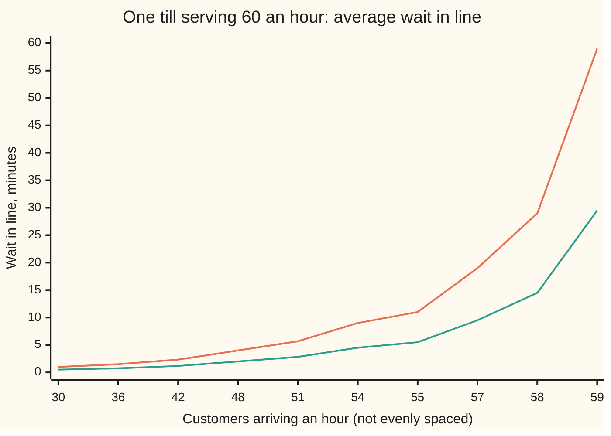

# Queues: Little's law, M/M/1, and why ninety percent busy feels broken

[Syllabus](../../../SYLLABUS.md) → [Applied and computational](../README.md) → [Operations Research](../README.md#s05) → Queues

---

## General Overview

A bakery shop has one till. At the lunchtime peak, 55 customers an hour walk in. The person on the till can serve 60 an hour, so one sale takes a minute on average. The till is busy 92 percent of the time and stands idle about 5 minutes in each hour.

On paper the shop keeps up. In practice the average customer stands in line for **11 minutes** to be served for 1. Add one more customer an hour and the wait goes to 14 minutes. At 59 an hour it is close to an hour. Open a second till and the wait falls to about a quarter of a minute.

The owner wants three numbers: how long people wait, how many stand in the shop, and what a second till buys. This card computes them. It also proves Little's law, the one rule that links "how many are inside" to "how long each stays" for any system that keeps up, from a shop to a fleet of delivery vans.

**The wait in a queue grows like busy over idle, ρ/(1 − ρ), so the last few percent of utilisation cost more than all the rest; and in any system that keeps up, the average number inside equals the arrival rate times the average time spent inside.**

**What kind of fact this is:** Little's law is a theorem, proved on this card in Why it works, for any stable system. The M/M/1 and M/M/c formulas are theorems about a model: random arrivals and random service times. That model fits real tills well enough to plan with, not exactly, and When it holds says where it fails.

### The picture: the wait against the arrival rate



Orange: random service times (M/M/1, defined below). Green: every sale takes exactly one minute; the wait is half as long but bends the same way. Half busy (30 an hour) costs a 1-minute wait. The last 5 customers an hour, from 54 to 59, take the wait from 9 minutes to 59.

---

## The formula

The wing 11 card on [Continuous-time chains](../../11-Stochastic%20processes%20and%20calculus/04-Poisson%20and%20Jump%20Processes/05-continuous-time-markov-chains-and-queues.md) already derives the one-till queue: the chance of $n$ people in the shop is $(1 - \rho)\rho^n$, the average number is $L = \rho/(1 - \rho)$, and the average time inside is $W = L/\lambda$. This card adds the wait in line alone, many tills, and Little's law in general.

New notation, in words first. M/M/c names a queue: arrivals at random (the first M, for memoryless), random service times (the second M), and $c$ servers sharing one line. $L_q$ is the average number standing in line, not counting anyone at a till, and $W_q$ is the average time spent in line before service starts.

**Little's law**, for any stable system:

$$L = \lambda\,W.$$

**Read it aloud:** the average number inside equals the rate at which people arrive times the average time each one stays.

**One till, M/M/1**, with the load $\rho = \lambda/\mu$ below 1:

$$W_q = \frac{1}{\mu}\cdot\frac{\rho}{1 - \rho} = \frac{\rho}{\mu - \lambda}, \qquad L_q = \lambda\,W_q = \frac{\rho^2}{1 - \rho}.$$

**Read it aloud:** the wait in line is one service time, multiplied by busy over idle.

**$c$ tills, M/M/c**, with $a = \lambda/\mu$ and $\rho = a/c$ below 1. The chance an arrival has to wait at all is the Erlang C formula:

$$P_{\text{wait}} = \frac{\dfrac{a^c}{c!}\,\dfrac{1}{1 - \rho}}{\displaystyle\sum_{k=0}^{c-1}\frac{a^k}{k!} + \frac{a^c}{c!}\,\frac{1}{1 - \rho}}, \qquad W_q = \frac{P_{\text{wait}}}{c\mu - \lambda}.$$

**Read it aloud:** the chance that every till is busy when you walk in, divided by the rate at which the tills, all working, out-run the arrivals.

| Symbol | Plain meaning | In our example | Push it up and the answer… |
| --- | --- | --- | --- |
| $\lambda$ | arrival rate, customers per hour | 55 | every wait rises, and fast near capacity |
| $\mu$ | service rate of one till while busy; one sale takes $1/\mu$ hours | 60 (1 minute a sale) | every wait falls |
| $\rho$ | utilisation: the share of time each till is busy, $\lambda/(c\mu)$ | 0.9167 | the wait grows like $\rho/(1 - \rho)$; at 1 or above the line never settles |
| $c$ | number of tills sharing one line | 1, then 2 | the wait collapses |
| $a$ | offered load, $\lambda/\mu$: the work arriving, counted in tills' worth | 0.9167 | more tills needed |
| $L$, $W$ | average number in the shop, in line or at a till; average time in the shop, line plus service | 11; 12 minutes | — |
| $L_q$, $W_q$ | average number in line, not yet at a till; average time in line before service starts | 10.083; 11 minutes | — |
| $P_{\text{wait}}$, $k$ | chance an arriving customer finds every till busy; $k$ counts tills in the Erlang C sum | 0.9167 with one till, 0.2881 with two | — |
| $\pi_n$ | long-run share of time with $n$ people in the shop | empty 0.0833 of the time | — |
| $N(t)$, $T$ | number in the shop at time $t$; the length of a stretch of time watched | — | — |
| $A_i$, $D_i$, $W_i$, $n(T)$, $\varepsilon$, $\delta$ | in the proof: customer $i$'s arrival time, leaving time and stay; arrivals by time $T$; two small fixed fractions | — | — |

### When it holds

- **Stability: arrivals slower than service, $\lambda < c\mu$.** If not, there is no average to compute. At 62 an hour on one 60-an-hour till the formula gives $L = -31.0$, which is nonsense; the simulated shop holds about 33 people after 8 hours and is still filling.
- **Random arrivals.** M/M/c assumes arrivals form a [Poisson process](../../11-Stochastic%20processes%20and%20calculus/04-Poisson%20and%20Jump%20Processes/01-poisson-process.md): many people deciding independently. Booked appointments arrive more evenly and wait less. A coach party arrives in a lump and waits more.
- **Random service times.** If every sale takes exactly one minute, the wait halves: 5.50 minutes, not 11 (the Pollaczek–Khinchine formula for one server, in Kleinrock, Sources). Kingman's approximation extends this: the wait scales with how variable the arrival gaps and service times are, and always keeps the factor $\rho/(1 - \rho)$.
- **Steady rates and enough time.** The formulas are long-run averages. Opened empty at 55 an hour, the simulated shop holds about 10 people on average after 8 hours (9.9 over 400 simulated days), still short of 11. A lunch rush that lasts one hour never reaches the long-run figure.
- **Little's law needs only stability.** It holds whatever the arrival pattern, service times, number of tills or order of service, as long as long-run averages exist.

---

## Why it works

### Step 0: idle time is the only thing that drains a queue

A till serving 60 an hour against 55 arrivals has a spare rate of $\mu - \lambda$ = 5 customers an hour. That spare rate is all that clears a backlog. Five extra customers, one burst from a bus, take an hour of spare capacity to clear, and in that hour more bursts arrive. A minute of idle time, once lost while the shop is empty, can never be spent later. So the queue depends on the gap between capacity and demand, not on capacity alone. As the gap shrinks to nothing, the wait grows without limit.

### Step 1: Little's law, by counting one area two ways

Watch the shop for a long stretch of $T$ hours and draw $N(t)$, the number of people inside, against time. Each customer adds 1 to the height from the moment they arrive to the moment they leave. So the area under the graph is a stack of strips, one per customer, each as long as that customer's time inside.

Count the area two ways:

- By time: area $= T \times$ (average height) $= T\,L$.
- By customer: area $=$ (number of customers) $\times$ (average stay) $= \lambda T \times W$.

Set them equal and divide by $T$: $L = \lambda W$. Nothing about the arrival pattern, the service times or the order of service was used. The only gap is at the edges: people already inside at the start, or still inside at the end, have strips cut off. In a stable system that cut-off grows more slowly than $T$, so it vanishes once divided by a long $T$.

<details>
<summary>Detailed proof: Little's law on one long run</summary>

Number customers in order of arrival. Customer $i$ arrives at $A_i$ and leaves at $D_i \ge A_i$; their stay is $W_i = D_i - A_i$. Start with an empty system at time 0. Let $n(T)$ count arrivals by time $T$. Suppose the two long-run averages exist and are finite: $n(T)/T \to \lambda$, and $\frac{1}{n}\sum_{i \le n} W_i \to W$.

The area $\int_0^T N(t)\,dt$ contains every whole strip that ends by $T$, and is at most the total of all strips that start by $T$:

$$\sum_{i:\,D_i \le T} W_i \;\le\; \int_0^T N(t)\,dt \;\le\; \sum_{i \le n(T)} W_i.$$

Divide by $T$. The right side is $\frac{n(T)}{T}\cdot\frac{1}{n(T)}\sum_{i \le n(T)} W_i \to \lambda W$.

For the left side: because the average stay converges, $W_i/i \to 0$ (subtract the averages for $i$ and $i - 1$). So for large $i$, customer $i$ leaves by $A_i + \varepsilon i$ for any small fixed $\varepsilon$. Choose $\varepsilon$ below $\delta/\lambda$; then every customer who arrived by $T(1 - \delta)$ for a small $\delta$ has left by $T$, once $T$ is large. The left side is therefore at least $\frac{1}{T}\sum_{i \le n(T(1 - \delta))} W_i \to (1 - \delta)\,\lambda W$. Let $\delta$ shrink: both sides tend to $\lambda W$, so $L = \lambda W$. This is the sample-path proof of Stidham (1974); Little's original 1961 proof assumed more.

</details>

### Step 2: Little's law, applied three ways to one shop

The law holds for any "system" you draw a box around, so draw three boxes:

- **The whole shop:** $L = \lambda W$. With $L$ = 11, $W$ = 11/55 hours = 12 minutes.
- **The till alone:** at most one person is inside, so the average number inside is the share of time busy. Each stays one service time, $1/\mu$. So busy share $= \lambda/\mu = \rho$. Utilisation is Little's law.
- **The line alone:** $L_q = \lambda W_q$. The shop holds the line plus the till, so $L_q = L - \rho$ = 11 − 0.9167 = 10.083, and $W_q = L_q/\lambda$ = 11 minutes.

### Step 3: the same wait from an arriving customer's view

Random arrivals see the shop as it is on average over time; this is "Poisson arrivals see time averages", from the wing 11 card. So a new customer finds $L$ = 11 people ahead on average. With exponential service, the sale in progress has, on average, a full minute left, whatever time it has already taken. So the wait is 11 sales of one minute each:

$$W_q = \frac{L}{\mu} = \frac{1}{\mu}\cdot\frac{\rho}{1 - \rho} = 11 \text{ minutes}.$$

Two different arguments, one number. The ratio $\rho/(1 - \rho)$ is the whole story of the chart above: busy time over idle time. At 50 percent busy it is 1; at 80 percent, 4; at 92 percent, 11; at 98 percent (59 an hour), 59. Near the top every step costs more than the last: one more customer an hour, from 55 to 56, adds 3 minutes.

### Step 4: many tills, by cutting the line

Number the states by people in the shop, as on the wing 11 card, and cut between $n$ and $n + 1$. Upward crossings happen at the arrival rate $\lambda$. Downward crossings happen at the rate of all busy tills: with $n + 1$ people inside, $\min(n + 1, c)$ tills are busy. Balancing the crossings,

$$\lambda\,\pi_n = \min(n + 1,\, c)\,\mu\,\pi_{n+1}.$$

Below $c$ this gives $\pi_n = \pi_0\,a^n/n!$. From $c$ upward every till is busy, the ratio is fixed at $\rho$, and $\pi_n = \pi_c\,\rho^{n - c}$: a geometric tail. Its total is $\pi_c/(1 - \rho)$, which is $P_{\text{wait}}$. Fixing $\pi_0$ so all shares add to 1 gives the Erlang C formula.

Given that a customer must wait, the line ahead is geometric with ratio $\rho$ and averages $\rho/(1 - \rho)$ people; so overall $L_q = P_{\text{wait}}\,\rho/(1 - \rho)$. Little's law on the line turns that into time: $W_q = L_q/\lambda = P_{\text{wait}}/(c\mu - \lambda)$. With $c$ = 1, $P_{\text{wait}} = \rho$ and this is the M/M/1 formula again.

### Step 5: why one shared line beats separate lines

Two tills sharing one line keep both busy whenever two or more people are present. Two separate lines can leave one till idle while the other has a queue. Idle time is the drain from Step 0, and separate lines waste some of it. That is the case for the single snaking line in banks and post offices.

---

## Worked numbers, by hand

One till, 55 an hour, 60 an hour when busy.

| Step | Arithmetic | Value |
| --- | --- | --- |
| utilisation $\rho$ | 55 / 60 | 0.9167 |
| idle time | 60 × (1 − 0.9167) minutes | 5 minutes an hour |
| spare rate | 60 − 55 | 5 an hour |
| in the shop, $L$ | 0.9167 / 0.0833 | 11 |
| in line, $L_q$ | 11 − 0.9167 | 10.083 |
| time in shop, $W$ | 11 / 55 hours | 12 minutes |
| wait from the arrival's view, $L/\mu$ | 11 people × 1 minute | 11 minutes |
| time in line, $W_q$ | 10.083 / 55 hours | **11 minutes** |

The average customer stands in line 11 minutes for a 1-minute sale. One more customer an hour, 56, makes it (56/60) / (60 − 56) hours = 14 minutes.

Two tills, one line, 55 an hour:

| Step | Arithmetic | Value |
| --- | --- | --- |
| offered load $a$, utilisation $\rho$ | 55/60; 0.9167 / 2 | 0.9167; 0.4583 |
| top of Erlang C | 0.9167² / 2 × 1 / (1 − 0.4583) | 0.7756 |
| bottom | 1 + 0.9167 + 0.7756 | 2.6923 |
| $P_{\text{wait}}$ | 0.7756 / 2.6923 | 0.2881 |
| in line, $L_q$ | 0.2881 × 0.4583 / (1 − 0.4583) | 0.244 people |
| $W_q$ | 0.2881 / (120 − 55) hours | **0.27 minutes**, 16 seconds |

The second till cuts the wait from 11 minutes to about 16 seconds, because it turns the spare rate from 5 an hour into 65. It does not need to be busy to earn its keep: it is busy less than half the time.

Doubling the whole shop is different. Two tills facing 110 an hour are each 92 percent busy again, 9.645 people stand in line, and the wait is 5.26 minutes: about half of 11, because a shared line wastes less idle time, but nowhere near 16 seconds.

### What breaks if you drop a piece

| Mistake | Comes out at | What went wrong |
| --- | --- | --- |
| Use the formula when arrivals beat service: 62 an hour on one till | $L = -31.0$ | The formula needs $\rho < 1$. The simulated shop, opened empty, holds about 9.5 people after one hour and about 33 after eight, and keeps climbing. |
| Assume random service times when every sale takes exactly 1 minute | 11.00 minutes (right: 5.50) | Half of this wait comes from variable service times; the simulation gives 5.59. |
| Two tills, but each with its own line, customers splitting at random | 0.85 minutes (one shared line: 0.27) | A till with an empty line sits idle while the other line waits. |
| Expect the long-run figure at the end of the first shift | 11 in the shop | Opened empty, the simulated shop averages about 10 after 8 hours: near capacity, the long run takes hours to arrive. |

---

## Code, from first principles, and it actually runs

The code reaches each answer by independent roads. The one-till wait comes from the closed form, from the cut equations solved state by state over 6,000 states, and from the arrival's view $L/\mu$. Erlang C meets the same cut equations for two tills. Then a seeded simulation (SplitMix64, seed 20261111) runs a million customers through each of three shops, random service, fixed service and two tills, and compares each average wait with its formula within four batch standard errors (the spread of the averages over 20 batches of customers, a measure of simulation noise). For the one-till shops it also checks Little's law directly: it sweeps through arrivals and departures in time order, measures the area under $N(t)$, and compares the time-average with $\lambda \times W$ measured customer by customer. Last, it runs 400 eight-hour days at 55 and at 62 an hour, to show one line settling and the other filling.

### Python

```python
# Queues and Little's law -- the check behind the card.  Standard library only;
# nothing imported holds the answer.  One till: 55 customers an hour arrive, the
# till serves 60 an hour when busy.  Time is in hours, waits printed in minutes.
# Roads: closed forms (M/M/1, Erlang C, fixed service time); the cut equations
# solved state by state; the arrival's-eye view (wait = L / mu); and seeded
# simulations (SplitMix64) with batch standard errors, where Little's law is
# checked by sweeping the count of people in the shop over time.
from math import log, sqrt, factorial
LAM, MU, SEED, MASK = 55.0, 60.0, 20261111, (1 << 64) - 1
class SplitMix64:
    def __init__(self, seed): self.s = seed & MASK
    def uniform(self):
        self.s = (self.s + 0x9E3779B97F4A7C15) & MASK
        z = self.s
        z = ((z ^ (z >> 30)) * 0xBF58476D1CE4E5B9) & MASK
        z = ((z ^ (z >> 27)) * 0x94D049BB133111EB) & MASK
        return ((z ^ (z >> 31)) >> 11) / 9007199254740992.0
    def expo(self, rate): return -log(1.0 - self.uniform()) / rate
def erlang_c(lam, mu, c):          # closed form: (chance of waiting, Wq in hours)
    a = lam / mu
    top = a ** c / factorial(c) / (1.0 - a / c)
    pw = top / (sum(a ** k / factorial(k) for k in range(c)) + top)
    return pw, pw / (c * mu - lam)
def cuts(lam, mu, c, nmax=6000):    # lam * p[n] = min(n+1, c) * mu * p[n+1], then normalise
    p = [1.0]
    for n in range(nmax): p.append(p[-1] * lam / (min(n + 1, c) * mu))
    s = sum(p)
    p = [x / s for x in p]
    L = sum(n * x for n, x in enumerate(p))
    Lq = sum((n - c) * p[n] for n in range(c, len(p)))
    return p, L, Lq
def simulate(lam, mu, c, n, rng, fixed=False, batches=20):
    free, t, arr, dep, means, acc = [0.0] * c, 0.0, [], [], [], 0.0
    for i in range(n):
        t += rng.expo(lam)
        s = 1.0 / mu if fixed else rng.expo(mu)
        k = min(range(c), key=lambda j: free[j])   # first till to come free, first come first served
        start = max(t, free[k])
        free[k] = start + s
        arr.append(t); dep.append(start + s); acc += start - t
        if (i + 1) % (n // batches) == 0: means.append(acc / (n // batches)); acc = 0.0
    m = sum(means) / batches
    se = sqrt(sum((x - m) ** 2 for x in means) / (batches - 1) / batches)
    return m, se, arr, dep
def sweep(arr, dep):                # time-average of the number in the shop, counted event by event
    T, i, j, num, last, area = arr[-1], 0, 0, 0, 0.0, 0.0
    while i < len(arr) or (j < len(dep) and dep[j] <= T):
        if i < len(arr) and arr[i] <= dep[j]: tm, step = arr[i], 1; i += 1
        else: tm, step = dep[j], -1; j += 1
        area += num * (tm - last); num += step; last = tm
    return area / T, len(arr) / T, sum(d - a for a, d in zip(arr, dep)) / len(arr)
mins = lambda h: 60.0 * h
rho = LAM / MU
L, W, Wq = rho / (1 - rho), 1.0 / (MU - LAM), rho / (MU - LAM)
p1, L1, Lq1 = cuts(LAM, MU, 1)
print(f"one till: busy {rho:.4f}, idle {mins(1 - rho):.1f} min an hour, spare rate {MU - LAM:.0f} an hour")
print(f"formula: L {L:.3f}, Lq {rho * rho / (1 - rho):.3f}, W {mins(W):.2f} min, Wq {mins(Wq):.2f} min, service {mins(1 / MU):.2f} min")
print(f"cut equations: P(empty) {p1[0]:.4f}, L {L1:.3f}, Lq {Lq1:.3f}, Wq = Lq/lam {mins(Lq1 / LAM):.2f} min")
print(f"arrival's view: Wq = L/mu {mins(L / MU):.2f} min; server alone: lam x service = {LAM / MU:.4f}")
assert abs(L1 - L) < 1e-9 and abs(Lq1 / LAM - Wq) < 1e-12 and abs(L / MU - Wq) < 1e-12
assert abs(p1[0] - (1 - rho)) < 1e-12 and abs(L1 - Lq1 - rho) < 1e-9   # Little on the till itself
print("figure, arrivals an hour, Wq M/M/1 min, Wq fixed service min")
for lam in [30, 36, 42, 48, 51, 54, 55, 57, 58, 59]:
    r = lam / MU
    print(f"figure, {lam}, {mins(r / (MU - lam)):.2f}, {mins(r / (2 * (MU - lam))):.2f}")
print("Wq at 50, 55, 56 an hour: " + ", ".join(f"{mins(x / MU / (MU - x)):.2f}" for x in (50, 55, 56)) + " min")
rows = [(f"one till, {LAM:.0f} an hour", LAM, 1), (f"two tills, {LAM:.0f} an hour", LAM, 2),
        (f"two tills, {2 * LAM:.0f} an hour", 2 * LAM, 2)]
for name, lam, c in rows:
    pw, wq = erlang_c(lam, MU, c)
    p, Lc, Lq = cuts(lam, MU, c)
    pw2 = sum(p[c:])
    print(f"{name}: each till busy {lam / (c * MU):.4f}, P(wait) {pw:.4f} (cuts {pw2:.4f}), Wq {mins(wq):.2f} min (cuts {mins(Lq / lam):.2f}), Lq {lam * wq:.3f}")
    assert abs(pw - pw2) < 1e-9 and abs(wq - Lq / lam) < 1e-12
split_wq = (LAM / 2 / MU) / (MU - LAM / 2)
print(f"two tills, separate lines, {LAM / 2:.1f} an hour each: Wq {mins(split_wq):.2f} min")
a, top = LAM / MU, (LAM / MU) ** 2 / 2 / (1 - LAM / MU / 2)
print(f"Erlang C by hand, two tills at {LAM:.0f}: top {top:.4f}, bottom {1 + a + top:.4f}, spare rate {2 * MU - LAM:.0f} an hour, "
      f"Wq {60 * mins(erlang_c(LAM, MU, 2)[1]):.0f} seconds")
rng = SplitMix64(SEED)
N = 1_000_000
for name, lam, c, fixed, want in [(f"M/M/1 at {LAM:.0f}", LAM, 1, False, Wq),
                                  (f"fixed {mins(1 / MU):.2f}-minute service at {LAM:.0f}", LAM, 1, True, Wq / 2),
                                  (f"M/M/2 at {2 * LAM:.0f}", 2 * LAM, 2, False, erlang_c(2 * LAM, MU, 2)[1])]:
    m, se, arr, dep = simulate(lam, MU, c, N, rng, fixed)
    print(f"simulated {name}: Wq {mins(m):.2f} min, s.e. {mins(se):.2f}, formula {mins(want):.2f}")
    assert abs(m - want) < 4 * se
    if c == 1:
        Ls, lam_hat, W_hat = sweep(arr, dep)
        print(f"  Little: L by sweep {Ls:.3f}; lam x W = {lam_hat:.3f} x {mins(W_hat):.2f} min = {lam_hat * W_hat:.3f}")
        assert abs(Ls - lam_hat * W_hat) < 0.01 * Ls
print(f"plugging 62 an hour into rho/(1 - rho): L = {(62 / MU) / (1 - 62 / MU):.1f}")
days, ends = 400, {55.0: [0.0] * 9, 62.0: [0.0] * 9}
for lam in ends:
    for _ in range(days):
        t, free, arr, dep = 0.0, 0.0, [], []
        while True:
            t += rng.expo(lam)
            if t > 8.0: break
            free = max(t, free) + rng.expo(MU)
            arr.append(t); dep.append(free)
        for a, d in zip(arr, dep):
            for h in range(1, 9):
                if a <= h < d: ends[lam][h] += 1.0 / days
    print(f"from empty, mean in shop at hours 1..8, {lam:.0f} an hour: " + " ".join(f"{x:.1f}" for x in ends[lam][1:]))
assert ends[62.0][8] > ends[62.0][4] + 4 and ends[62.0][8] > ends[55.0][8] + 8 and ends[55.0][8] < L
print(f"30 vans, 2.5-hour loop: Little gives {30 / 2.5:.0f} departures an hour")
pw3, wq3 = erlang_c(LAM, MU, 3)                       # the Try changing box, without editing
print(f"try: LAM 58 -> Wq {mins(58 / MU / (MU - 58)):.2f} min; MU 66 -> Wq {mins(LAM / 66 / (66 - LAM)):.2f} min, "
      f"and 62 an hour has long-run L {(62 / 66) / (1 - 62 / 66):.1f}")
print(f"try: three tills at {LAM:.0f} -> P(wait) {pw3:.4f}, Wq {mins(wq3):.2f} min ({60 * mins(wq3):.1f} seconds)")
print("ALL CHECKS PASS")
```

**Ran 2026-11-11 on macOS, Python 3.14.10, standard library only. All checks passed. Output, pasted from the run:**

```
one till: busy 0.9167, idle 5.0 min an hour, spare rate 5 an hour
formula: L 11.000, Lq 10.083, W 12.00 min, Wq 11.00 min, service 1.00 min
cut equations: P(empty) 0.0833, L 11.000, Lq 10.083, Wq = Lq/lam 11.00 min
arrival's view: Wq = L/mu 11.00 min; server alone: lam x service = 0.9167
figure, arrivals an hour, Wq M/M/1 min, Wq fixed service min
figure, 30, 1.00, 0.50
figure, 36, 1.50, 0.75
figure, 42, 2.33, 1.17
figure, 48, 4.00, 2.00
figure, 51, 5.67, 2.83
figure, 54, 9.00, 4.50
figure, 55, 11.00, 5.50
figure, 57, 19.00, 9.50
figure, 58, 29.00, 14.50
figure, 59, 59.00, 29.50
Wq at 50, 55, 56 an hour: 5.00, 11.00, 14.00 min
one till, 55 an hour: each till busy 0.9167, P(wait) 0.9167 (cuts 0.9167), Wq 11.00 min (cuts 11.00), Lq 10.083
two tills, 55 an hour: each till busy 0.4583, P(wait) 0.2881 (cuts 0.2881), Wq 0.27 min (cuts 0.27), Lq 0.244
two tills, 110 an hour: each till busy 0.9167, P(wait) 0.8768 (cuts 0.8768), Wq 5.26 min (cuts 5.26), Lq 9.645
two tills, separate lines, 27.5 an hour each: Wq 0.85 min
Erlang C by hand, two tills at 55: top 0.7756, bottom 2.6923, spare rate 65 an hour, Wq 16 seconds
simulated M/M/1 at 55: Wq 10.89 min, s.e. 0.29, formula 11.00
  Little: L by sweep 10.884; lam x W = 54.928 x 11.89 min = 10.884
simulated fixed 1.00-minute service at 55: Wq 5.59 min, s.e. 0.09, formula 5.50
  Little: L by sweep 6.058; lam x W = 55.129 x 6.59 min = 6.058
simulated M/M/2 at 110: Wq 5.30 min, s.e. 0.15, formula 5.26
plugging 62 an hour into rho/(1 - rho): L = -31.0
from empty, mean in shop at hours 1..8, 55 an hour: 5.9 7.4 8.3 8.1 8.6 9.0 9.6 9.9
from empty, mean in shop at hours 1..8, 62 an hour: 9.5 14.0 17.9 21.7 25.2 28.6 31.0 33.0
30 vans, 2.5-hour loop: Little gives 12 departures an hour
try: LAM 58 -> Wq 29.00 min; MU 66 -> Wq 4.55 min, and 62 an hour has long-run L 15.5
try: three tills at 55 -> P(wait) 0.0733, Wq 0.04 min (2.1 seconds)
ALL CHECKS PASS
```

### Rust

```rust
// Queues and Little's law -- the check behind the card.  std only, no crates.
// One till: 55 customers an hour arrive, the till serves 60 an hour when busy.
// Time is in hours, waits printed in minutes.  Roads: closed forms (M/M/1,
// Erlang C, fixed service time); the cut equations solved state by state; the
// arrival's-eye view (wait = L / mu); and seeded simulations (SplitMix64) with
// batch standard errors, where Little's law is checked by sweeping the count
// of people in the shop over time.
const LAM: f64 = 55.0;
const MU: f64 = 60.0;
const SEED: u64 = 20261111;

struct SplitMix64 { s: u64 }
impl SplitMix64 {
    fn uniform(&mut self) -> f64 {
        self.s = self.s.wrapping_add(0x9E3779B97F4A7C15);
        let mut z = self.s;
        z = (z ^ (z >> 30)).wrapping_mul(0xBF58476D1CE4E5B9);
        z = (z ^ (z >> 27)).wrapping_mul(0x94D049BB133111EB);
        ((z ^ (z >> 31)) >> 11) as f64 / 9007199254740992.0
    }
    fn expo(&mut self, rate: f64) -> f64 { -(1.0 - self.uniform()).ln() / rate }
}

fn fact(k: usize) -> f64 { (1..=k).fold(1.0, |acc, i| acc * i as f64) }

// closed form: (chance of waiting, Wq in hours)
fn erlang_c(lam: f64, mu: f64, c: usize) -> (f64, f64) {
    let a = lam / mu;
    let top = a.powf(c as f64) / fact(c) / (1.0 - a / c as f64);
    let mut below = 0.0;
    for k in 0..c { below += a.powf(k as f64) / fact(k); }
    let pw = top / (below + top);
    (pw, pw / (c as f64 * mu - lam))
}

// lam * p[n] = min(n+1, c) * mu * p[n+1], then normalise; returns (p, L, Lq)
fn cuts(lam: f64, mu: f64, c: usize) -> (Vec<f64>, f64, f64) {
    let mut p = vec![1.0];
    for n in 0..6000 { let last = p[n]; p.push(last * lam / ((n + 1).min(c) as f64 * mu)); }
    let s: f64 = p.iter().sum();
    let p: Vec<f64> = p.iter().map(|x| x / s).collect();
    let mut l = 0.0;
    for (n, x) in p.iter().enumerate() { l += n as f64 * x; }
    let mut lq = 0.0;
    for n in c..p.len() { lq += (n - c) as f64 * p[n]; }
    (p, l, lq)
}

fn simulate(lam: f64, mu: f64, c: usize, n: usize, rng: &mut SplitMix64, fixed: bool)
    -> (f64, f64, Vec<f64>, Vec<f64>) {
    let batches = 20;
    let (mut free, mut t, mut arr, mut dep, mut means, mut acc) = (vec![0.0; c], 0.0, vec![], vec![], vec![], 0.0);
    for i in 0..n {
        t += rng.expo(lam);
        let s = if fixed { 1.0 / mu } else { rng.expo(mu) };
        let mut k = 0;
        for j in 1..c { if free[j] < free[k] { k = j; } }   // first till to come free
        let start = t.max(free[k]);
        free[k] = start + s;
        arr.push(t); dep.push(start + s); acc += start - t;
        if (i + 1) % (n / batches) == 0 { means.push(acc / (n / batches) as f64); acc = 0.0; }
    }
    let m = means.iter().sum::<f64>() / batches as f64;
    let mut v = 0.0;
    for x in &means { v += (x - m) * (x - m); }
    let se = (v / (batches - 1) as f64 / batches as f64).sqrt();
    (m, se, arr, dep)
}

// time-average of the number in the shop, counted event by event; returns (L, lam_hat, W_hat)
fn sweep(arr: &[f64], dep: &[f64]) -> (f64, f64, f64) {
    let t_end = arr[arr.len() - 1];
    let (mut i, mut j, mut num, mut last, mut area) = (0, 0, 0i64, 0.0, 0.0);
    while i < arr.len() || (j < dep.len() && dep[j] <= t_end) {
        let (tm, step);
        if i < arr.len() && arr[i] <= dep[j] { tm = arr[i]; step = 1; i += 1; } else { tm = dep[j]; step = -1; j += 1; }
        area += num as f64 * (tm - last); num += step; last = tm;
    }
    let mut w = 0.0;
    for (a, d) in arr.iter().zip(dep) { w += d - a; }
    (area / t_end, arr.len() as f64 / t_end, w / arr.len() as f64)
}

fn mins(h: f64) -> f64 { 60.0 * h }

fn main() {
    let rho = LAM / MU;
    let (l, wq) = (rho / (1.0 - rho), rho / (MU - LAM));
    let w = 1.0 / (MU - LAM);
    let (p1, l1, lq1) = cuts(LAM, MU, 1);
    println!("one till: busy {:.4}, idle {:.1} min an hour, spare rate {:.0} an hour", rho, mins(1.0 - rho), MU - LAM);
    println!("formula: L {:.3}, Lq {:.3}, W {:.2} min, Wq {:.2} min, service {:.2} min", l, rho * rho / (1.0 - rho), mins(w), mins(wq), mins(1.0 / MU));
    println!("cut equations: P(empty) {:.4}, L {:.3}, Lq {:.3}, Wq = Lq/lam {:.2} min", p1[0], l1, lq1, mins(lq1 / LAM));
    println!("arrival's view: Wq = L/mu {:.2} min; server alone: lam x service = {:.4}", mins(l / MU), LAM / MU);
    assert!((l1 - l).abs() < 1e-9 && (lq1 / LAM - wq).abs() < 1e-12 && (l / MU - wq).abs() < 1e-12);
    assert!((p1[0] - (1.0 - rho)).abs() < 1e-12 && (l1 - lq1 - rho).abs() < 1e-9); // Little on the till itself
    println!("figure, arrivals an hour, Wq M/M/1 min, Wq fixed service min");
    for lam in [30.0, 36.0, 42.0, 48.0, 51.0, 54.0, 55.0, 57.0, 58.0, 59.0] {
        let r = lam / MU;
        println!("figure, {}, {:.2}, {:.2}", lam, mins(r / (MU - lam)), mins(r / (2.0 * (MU - lam))));
    }
    let loads: Vec<String> = [50.0, 55.0, 56.0].iter().map(|x: &f64| format!("{:.2}", mins(x / MU / (MU - x)))).collect();
    println!("Wq at 50, 55, 56 an hour: {} min", loads.join(", "));
    let rows = [(format!("one till, {:.0} an hour", LAM), LAM, 1), (format!("two tills, {:.0} an hour", LAM), LAM, 2),
                (format!("two tills, {:.0} an hour", 2.0 * LAM), 2.0 * LAM, 2)];
    for (name, lam, c) in rows {
        let (pw, wqc) = erlang_c(lam, MU, c);
        let (p, _lc, lq) = cuts(lam, MU, c);
        let pw2: f64 = p[c..].iter().sum();
        println!("{}: each till busy {:.4}, P(wait) {:.4} (cuts {:.4}), Wq {:.2} min (cuts {:.2}), Lq {:.3}",
                 name, lam / (c as f64 * MU), pw, pw2, mins(wqc), mins(lq / lam), lam * wqc);
        assert!((pw - pw2).abs() < 1e-9 && (wqc - lq / lam).abs() < 1e-12);
    }
    let split_wq = (LAM / 2.0 / MU) / (MU - LAM / 2.0);
    println!("two tills, separate lines, {:.1} an hour each: Wq {:.2} min", LAM / 2.0, mins(split_wq));
    let (a, top) = (LAM / MU, (LAM / MU).powf(2.0) / 2.0 / (1.0 - LAM / MU / 2.0));
    println!("Erlang C by hand, two tills at {:.0}: top {:.4}, bottom {:.4}, spare rate {:.0} an hour, Wq {:.0} seconds",
             LAM, top, 1.0 + a + top, 2.0 * MU - LAM, 60.0 * mins(erlang_c(LAM, MU, 2).1));
    let mut rng = SplitMix64 { s: SEED };
    let n = 1_000_000;
    let runs = [(format!("M/M/1 at {:.0}", LAM), LAM, 1, false, wq),
                (format!("fixed {:.2}-minute service at {:.0}", mins(1.0 / MU), LAM), LAM, 1, true, wq / 2.0),
                (format!("M/M/2 at {:.0}", 2.0 * LAM), 2.0 * LAM, 2, false, erlang_c(2.0 * LAM, MU, 2).1)];
    for (name, lam, c, fixed, want) in runs {
        let (m, se, arr, dep) = simulate(lam, MU, c, n, &mut rng, fixed);
        println!("simulated {}: Wq {:.2} min, s.e. {:.2}, formula {:.2}", name, mins(m), mins(se), mins(want));
        assert!((m - want).abs() < 4.0 * se);
        if c == 1 {
            let (ls, lam_hat, w_hat) = sweep(&arr, &dep);
            println!("  Little: L by sweep {:.3}; lam x W = {:.3} x {:.2} min = {:.3}", ls, lam_hat, mins(w_hat), lam_hat * w_hat);
            assert!((ls - lam_hat * w_hat).abs() < 0.01 * ls);
        }
    }
    println!("plugging 62 an hour into rho/(1 - rho): L = {:.1}", (62.0 / MU) / (1.0 - 62.0 / MU));
    let days = 400;
    let mut ends = [[0.0f64; 9]; 2];
    for (idx, lam) in [55.0f64, 62.0].iter().enumerate() {
        for _ in 0..days {
            let (mut t, mut free, mut arr, mut dep) = (0.0, 0.0f64, vec![], vec![]);
            loop {
                t += rng.expo(*lam);
                if t > 8.0 { break; }
                free = t.max(free) + rng.expo(MU);
                arr.push(t); dep.push(free);
            }
            for (a, d) in arr.iter().zip(&dep) {
                for h in 1..9 {
                    let hf = h as f64;
                    if *a <= hf && hf < *d { ends[idx][h] += 1.0 / days as f64; }
                }
            }
        }
        let row: Vec<String> = ends[idx][1..].iter().map(|x| format!("{:.1}", x)).collect();
        println!("from empty, mean in shop at hours 1..8, {:.0} an hour: {}", lam, row.join(" "));
    }
    assert!(ends[1][8] > ends[1][4] + 4.0 && ends[1][8] > ends[0][8] + 8.0 && ends[0][8] < l);
    println!("30 vans, 2.5-hour loop: Little gives {:.0} departures an hour", 30.0 / 2.5);
    let (pw3, wq3) = erlang_c(LAM, MU, 3);                // the Try changing box, without editing
    println!("try: LAM 58 -> Wq {:.2} min; MU 66 -> Wq {:.2} min, and 62 an hour has long-run L {:.1}",
             mins(58.0 / MU / (MU - 58.0)), mins(LAM / 66.0 / (66.0 - LAM)), (62.0 / 66.0) / (1.0 - 62.0 / 66.0));
    println!("try: three tills at {:.0} -> P(wait) {:.4}, Wq {:.2} min ({:.1} seconds)", LAM, pw3, mins(wq3), 60.0 * mins(wq3));
    println!("ALL CHECKS PASS");
}
```

**Ran 2026-11-11 on macOS, rustc 1.98.1, no crates. All checks passed. Output, pasted from the run:**

```
one till: busy 0.9167, idle 5.0 min an hour, spare rate 5 an hour
formula: L 11.000, Lq 10.083, W 12.00 min, Wq 11.00 min, service 1.00 min
cut equations: P(empty) 0.0833, L 11.000, Lq 10.083, Wq = Lq/lam 11.00 min
arrival's view: Wq = L/mu 11.00 min; server alone: lam x service = 0.9167
figure, arrivals an hour, Wq M/M/1 min, Wq fixed service min
figure, 30, 1.00, 0.50
figure, 36, 1.50, 0.75
figure, 42, 2.33, 1.17
figure, 48, 4.00, 2.00
figure, 51, 5.67, 2.83
figure, 54, 9.00, 4.50
figure, 55, 11.00, 5.50
figure, 57, 19.00, 9.50
figure, 58, 29.00, 14.50
figure, 59, 59.00, 29.50
Wq at 50, 55, 56 an hour: 5.00, 11.00, 14.00 min
one till, 55 an hour: each till busy 0.9167, P(wait) 0.9167 (cuts 0.9167), Wq 11.00 min (cuts 11.00), Lq 10.083
two tills, 55 an hour: each till busy 0.4583, P(wait) 0.2881 (cuts 0.2881), Wq 0.27 min (cuts 0.27), Lq 0.244
two tills, 110 an hour: each till busy 0.9167, P(wait) 0.8768 (cuts 0.8768), Wq 5.26 min (cuts 5.26), Lq 9.645
two tills, separate lines, 27.5 an hour each: Wq 0.85 min
Erlang C by hand, two tills at 55: top 0.7756, bottom 2.6923, spare rate 65 an hour, Wq 16 seconds
simulated M/M/1 at 55: Wq 10.89 min, s.e. 0.29, formula 11.00
  Little: L by sweep 10.884; lam x W = 54.928 x 11.89 min = 10.884
simulated fixed 1.00-minute service at 55: Wq 5.59 min, s.e. 0.09, formula 5.50
  Little: L by sweep 6.058; lam x W = 55.129 x 6.59 min = 6.058
simulated M/M/2 at 110: Wq 5.30 min, s.e. 0.15, formula 5.26
plugging 62 an hour into rho/(1 - rho): L = -31.0
from empty, mean in shop at hours 1..8, 55 an hour: 5.9 7.4 8.3 8.1 8.6 9.0 9.6 9.9
from empty, mean in shop at hours 1..8, 62 an hour: 9.5 14.0 17.9 21.7 25.2 28.6 31.0 33.0
30 vans, 2.5-hour loop: Little gives 12 departures an hour
try: LAM 58 -> Wq 29.00 min; MU 66 -> Wq 4.55 min, and 62 an hour has long-run L 15.5
try: three tills at 55 -> P(wait) 0.0733, Wq 0.04 min (2.1 seconds)
ALL CHECKS PASS
```

The two outputs match line for line.

> [!TIP]
> **Try changing**
> Guess first, then run it. The `try:` lines at the end of the output print each formula answer below without editing; the simulated figures come from runs with the edit made.
> - **Push the till harder.** Set `LAM` to `58.0`. Guess first: three more customers an hour. The wait goes from 11 to 29 minutes; in the edited run the simulation, now noisier, gives 29.86 with a standard error of 2.58, and every check still passes.
> - **Make the till 10 percent faster.** Set `MU` to `66.0`. Guess first: the wait falls by more than 10 percent. It falls from 11 to 4.55 minutes. Then the last assert stops the run: at 66 an hour the 62-an-hour shop is stable. It still fills (about 12 people in the shop at hour 8 in the edited run, heading for a long-run 15.5) but no longer runs away, so the claim that it grows without bound is false.
> - **Open a third till.** Add `("three tills, 55 an hour", LAM, 3)` to `rows`. Guess first: the wait in line falls to 0.04 minutes, 2.1 seconds, and only 0.0733 of customers wait at all.
> - **Pretend fixed service is random.** In the list of simulated shops, change `Wq / 2` to `Wq`. The simulation still gives about 5.6 minutes, and the assert stops the run: the formula for random service is wrong for this shop.

---

## The usual mistake

> [!warning]
> **Reading 92 percent busy as 8 percent slack.** Utilisation says how much of the till's time is used, not how long people wait. The wait is one service time times $\rho/(1 - \rho)$: 11 minutes at 92 percent, 1 minute at 50 percent. Pushing a till from 80 to 92 percent busy looks like a small gain in efficiency and nearly triples the wait, from 4 to 11 minutes.
>
> - **Mixing up the wait in line and the time in the shop.** $W_q$ is 11 minutes; $W$ is 12, because it adds the sale. Little's law pairs $L$ with $W$ and $L_q$ with $W_q$, never across.
> - **Averaging the load over the day.** A shop at 55 an hour on average may run at 62 for the lunch hour. For that hour the line grows, and the daily average hides it.
> - **Planning two tills as two separate shops.** With separate lines the wait is 0.85 minutes; with one shared line it is 0.27.
> - **Trusting random-service formulas for a fixed-length job.** A machine that always takes one minute has half the M/M/1 wait: 5.50 minutes, not 11.

---

## Where you meet it in real life

- **Shops, banks and call centres.** Staffing rotas are set with Erlang C: pick the smallest number of staff for which the wait meets a target. It began with telephone exchanges in Copenhagen around 1917.
- **A delivery fleet.** The bakery chain runs 30 vans, and a round trip from the warehouse takes 2.5 hours on average. Little's law, read backwards, gives the warehouse 12 van departures an hour, with no model of traffic at all.
- **Computer servers.** A web server at 90 percent load answers slowly for the same reason the till does. Engineers keep spare capacity on purpose.
- **Factories and software teams.** Work in progress equals throughput times lead time. To finish each job sooner at the same throughput, start fewer jobs at once.
- **Hospitals.** Emergency departments run near capacity, and their waits behave like the right end of the chart.

> **Say it back**
> A queue is drained only by spare capacity, the gap between how fast a till can serve and how fast people arrive. The wait in line is one service time times busy over idle, so at 92 percent busy one till gives an 11-minute wait for a 1-minute sale. A second till sharing the line cuts that to about 16 seconds. Little's law, $L = \lambda W$, links the number inside to the time each spends there, for any system that keeps up. It follows from counting one area two ways.

---

## What this builds on

- [Continuous-time chains](../../11-Stochastic%20processes%20and%20calculus/04-Poisson%20and%20Jump%20Processes/05-continuous-time-markov-chains-and-queues.md): the one-till queue as a chain on the number in the system, its law $(1 - \rho)\rho^n$, and the cut argument reused here for many tills.
- [Poisson process](../../11-Stochastic%20processes%20and%20calculus/04-Poisson%20and%20Jump%20Processes/01-poisson-process.md): arrivals from many independent people, with exponential gaps; the "random arrivals" this card assumes.
- [Poisson](../../09-Probability%20and%20statistics/03-Discrete%20Distributions/04-poisson.md): the count of arrivals in an hour, whose mean is the arrival rate $\lambda$.

## Where this goes next

- [The check script](../08-Scientific%20Computing%20Practice/07-writing-a-check-script.md): how a script like the one above is built so that it fails when a number is edited, including why simulated values get a tolerance of a few standard errors.

The question this card leaves open is how to choose the number of tills when a till costs money and a lost or waiting customer costs money too.

---

## Sources

Verified 2026-11-11: every link below resolves to the publisher's page.

- Little, John D. C. "A Proof for the Queuing Formula: L = λW." *Operations Research* 9, no. 3 (1961): 383–387. [doi:10.1287/opre.9.3.383](https://doi.org/10.1287/opre.9.3.383). The first proof of the law.
- Stidham, Shaler. "A Last Word on L = λW." *Operations Research* 22, no. 2 (1974): 417–421. [doi:10.1287/opre.22.2.417](https://doi.org/10.1287/opre.22.2.417). The sample-path proof used in the fold above, with no assumptions about randomness.
- Little, John D. C. "Little's Law as Viewed on Its 50th Anniversary." *Operations Research* 59, no. 3 (2011): 536–549. [doi:10.1287/opre.1110.0940](https://doi.org/10.1287/opre.1110.0940). The law's history and its use in factories, services and computing.
- Kingman, J. F. C. "The Single Server Queue in Heavy Traffic." *Mathematical Proceedings of the Cambridge Philosophical Society* 57, no. 4 (1961): 902–904. [doi:10.1017/S0305004100036094](https://doi.org/10.1017/S0305004100036094). Why waits near full load scale like $1/(1 - \rho)$ for general arrivals and services.
- Kleinrock, Leonard. *Queueing Systems, Volume 1: Theory*. Wiley, 1975. [Publisher page](https://www.wiley.com/en-us/Queueing+Systems%2C+Volume+1%3A+Theory-p-9780471491101). M/M/1 and M/M/c (Erlang C) in Chapter 3; the M/G/1 queue and the fixed-service-time wait in Chapter 5.
