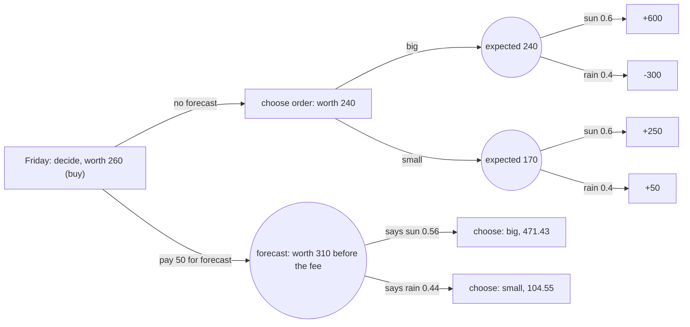
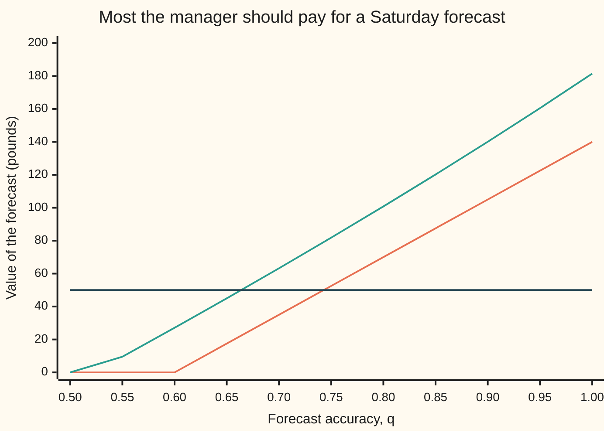

# Deciding under uncertainty: expected utility, and what a perfect forecast is worth

[Syllabus](../../../SYLLABUS.md) → [Applied and computational](../README.md) → [Operations Research](../README.md#s05) → Deciding under uncertainty

---

## General Overview

The bakery chain on this shelf (4 ovens, 30 delivery vans, one warehouse) also runs a stall at a Saturday town market. Every Friday afternoon the stall's manager must tell the ovens how much to bake: a **big order** or a **small order**. The dough goes in overnight, so the choice is made before anyone knows Saturday's weather.

The weather decides the takings. From past Saturdays, the manager's figures are these. A big order makes **£600** profit on a sunny day and **loses £300** on a rainy one, when most of it is thrown away. A small order makes **£250** in sun and **£50** in rain. The chance of sun, from the season's record, is **0.6**.

A forecasting service offers a Saturday forecast for the market's town, delivered on Friday morning, for **£50**. Its record: it calls sun right 80% of the time and rain right 80% of the time. Should the manager pay?

Draw the choice as a **decision tree**: a diagram where the manager's choices and the weather's chances branch in the order they happen. Each point where the manager chooses is a decision node, each point where the weather happens is a chance node, and the profits sit at the ends of the branches, the leaves.

Read the tree from the leaves back (this is called folding back) and the best plan is the big order, worth £240 a Saturday on average. Knowing the weather first would lift that to £380, so no forecast is worth more than **£140**. The real, 80% forecast is worth **£70**, so at £50 it pays.

A manager with only £1,000 of spare cash may mind a £300 loss more than the average admits. Choosing by **expected utility**, an average of scores for final wealth, turns them to the small order and changes what the forecast is worth to them.

**Information is worth exactly what it adds to the best decision: put the chance node before the decision node in the tree, fold the tree back again, and the gain in the folded-back value is the most the information is worth.**

**What kind of fact this is:** a method for choosing, built on a model (fixed payoffs and known chances); inside it, two theorems proved on this card in Why it works: a perfect forecast's value equals the expected regret of the best plan made without it, and any forecast's value lies between zero and that.

### The picture: the tree, folded back

The tree is schematic: branch lengths mean nothing. Circles are chances; rectangles are the manager's choices or, at the far right, profits. Each node carries its folded-back value in pounds.



Read it right to left: each chance box averages what follows it, and each choice box takes the better branch. With the forecast, the manager orders big after "sun" and small after "rain". At the root the fee comes off the forecast branch: 310 − 50 = 260 beats 240, so the manager buys.

---

## The formula

Notation first, in words.

- An **action** $a$ is one of the orders.
- The **state** $s$ is Saturday's weather, sun or rain; a capital $S$ means the weather not yet known.
- $x(a, s)$ is the profit of action $a$ in state $s$.
- $E[\,\cdot\,]$ is an expectation: weight each outcome by its chance and add.
- "$\max_a$" means "the largest over the actions".
- A **message** $m$ is what the forecast says.
- $\sum_m$ means "add up over the messages", and $\sum_s$ means "add up over the states".

$$\text{EVPI} \;=\; E\Big[\max_a x(a, S)\Big] \;-\; \max_a E\big[x(a, S)\big]$$

**Read it aloud:** the expected value of perfect information is the average of the best profit in each kind of weather, minus the best average profit you can get by committing first.

For a real forecast, Bayes' rule turns each message into new chances $P(s \mid m)$, and the same fold-back gives the **expected value of sample information**:

$$\text{EVSI} \;=\; \sum_m P(m)\,\max_a \sum_s P(s \mid m)\, x(a, s) \;-\; \max_a E\big[x(a, S)\big]$$

**Read it aloud:** for each thing the forecast might say, take the best order given that message, average over the messages, and subtract the best plan without the forecast.

A manager who ranks by expected utility, with score $u$ and spare cash $W_0$, would pay a fee $c$ up to the value that makes the forecast break even in score:

$$\sum_m P(m)\,\max_a \sum_s P(s \mid m)\, u\big(W_0 + x(a, s) - c\big) \;=\; \max_a E\big[u(W_0 + x(a, S))\big]$$

**Read it aloud:** the fair price of the forecast is the fee that leaves the manager's best expected score with the forecast equal to the best expected score without it.

| Symbol | Plain meaning | In our example | Push it up and the answer… |
| --- | --- | --- | --- |
| $a$, $a_0$ | an action: one of the orders; $a_0$ is the best plan without information | big or small; $a_0$ = big | — |
| $s$, $S$ | the state of the world: one weather; $S$ is the weather not yet known | sun or rain | — |
| $P(s)$, $P(s \mid m)$, $P(m)$ | chance of a state before, and after, reading message $m$; chance of the message | 0.6 sun; 0.8571 sun after "says sun"; 0.56 for "says sun" | more sun favours the big order |
| $x(a, s)$ | profit of action $a$ in state $s$, pounds | big: 600 or −300; small: 250 or 50 | — |
| $E[\,\cdot\,]$, $\max_a$ | expectation: chance-weighted average; the largest over the actions | big averages £240; the best plan £240 | — |
| $m$ | the forecast's message | "says sun" or "says rain" | — |
| $q$ | the forecast's accuracy: chance its message matches the weather | 0.8 | EVSI rises, once $q$ passes 0.6 |
| EVPI | expected value of perfect information: the most any forecast is worth | £140 | — |
| EVSI | expected value of sample information: what this forecast is worth | £70 | buy when it beats the fee |
| $u$ | utility: a score for final wealth, here the natural log | $\ln(W_0 + \text{profit})$ | — |
| $W_0$ | the manager's spare cash before Saturday | £1,000 | the manager acts more like a money-averager |
| $c$ | the fee paid for the forecast; $c^*$ the most the manager would pay | £50; $c^*$ £100.80 for the cautious manager | — |

### When it holds

- **Payoffs are known for each action and state.** If the £600 is really "somewhere between £400 and £800", the tree needs more branches; a single number hides that spread and the value of learning it.
- **Chances are known and agreed.** The 0.6 comes from a season's record. If it is a guess, the EVPI moves with the guess: at 0.3 it is £105, not £140.
- **The forecast's errors are what its record says.** The 80% must hold for this town and this season. A forecast that is right 80% of the time overall but worse on market days is worth less than £70.
- **Information arrives before the choice and does not change the weather.** A forecast delivered Saturday noon is worth nothing to a Friday order, however accurate.
- **Ranking by expected money assumes the manager does not mind spread.** If they do, rank by expected utility instead; then the value of information is a price found by solving, not a difference of averages (Step 4).

---

## Why it works

### Step 0: information is worth what it changes

A forecast does not change the weather. It changes only the order. If the manager would place the same order whatever the forecast said, the forecast is worth nothing, however accurate it sounds. Everything below is bookkeeping of that one fact.

### Step 1: draw the tree in time order, then fold it back

A decision tree lists events in the order they happen. Friday: the manager chooses (a decision node, drawn as a rectangle). Saturday: the weather happens (a chance node, drawn round). The leaves carry the profits.

To solve it, start at the leaves and work left. At a chance node, replace the branches by their chance-weighted average. At a decision node, keep the best branch. This is called **folding back** the tree.

- Big order: 0.6 × 600 + 0.4 × (−300) = 360 − 120 = **£240**.
- Small order: 0.6 × 250 + 0.4 × 50 = 150 + 20 = **£170**.
- Decision: big, worth £240 a Saturday on average.

Each decision node takes the Bayes action of [Credible intervals and decisions](../../09-Probability%20and%20statistics/10-Bayesian%20Inference/05-credible-intervals-and-decisions.md): the action with the best average under the current chances. The tree adds the bookkeeping for choices made in stages.

### Step 2: perfect information swaps the order of choice and chance

Suppose a perfect forecaster announced Saturday's weather on Friday. The tree changes in one way: the weather's chance node now comes first, and the manager chooses after it. Folding back the new tree:

- If sun: the big order, £600.
- If rain: the small order, £50.
- Before the announcement: 0.6 × 600 + 0.4 × 50 = **£380**.

The plan without the forecast was worth £240. The difference, **£140**, is the EVPI: the expected value of perfect information. No real forecast can be worth more, because no real forecast does better than knowing.

The swap can only help. In each weather, the best order is at least as good as the big order is there: £600 against £600 in sun, £50 against −£300 in rain. Averaging those inequalities gives "average of the best ≥ best average", which is the formula's two terms in order. So EVPI is never negative.

The same subtraction has a second reading. Write $a_0$ for the plan without information, the big order. Subtract inside the average instead of outside:

$$\text{EVPI} = E\big[\max_a x(a, S) - x(a_0, S)\big]$$

The bracket is the **regret** (also called opportunity loss): how much better the manager could have done had they known. In sun the regret of a big order is £0. In rain it is £50 − (−£300) = £350. On average: 0.4 × 350 = **£140**, the same number by a different road. A perfect forecast is worth exactly the regret it removes.

### Step 3: a real forecast, through Bayes' rule

A real forecast is sometimes wrong. Its record (80% right in either weather) must be turned round into what the manager needs: the chance of sun *given* what it said. That is [Bayes' rule](../../09-Probability%20and%20statistics/01-Chance%20and%20Events/06-bayes-rule.md), and [Bayesian updating](../../09-Probability%20and%20statistics/10-Bayesian%20Inference/01-priors-posteriors-and-updating.md) is the habit of doing it for each piece of evidence.

Count 1,000 Saturdays. 600 are sunny, and the forecast calls 480 of them right and 120 wrong. 400 are rainy, and it calls 320 right and 80 wrong. So:

- It says "sun" on 480 + 80 = 560 Saturdays, chance 0.56. Of those, 480 are sunny: chance of sun 480 / 560 = 0.8571.
- It says "rain" on 120 + 320 = 440 Saturdays, chance 0.44. Of those, 120 are sunny: chance of sun 120 / 440 = 0.2727.

Now fold back each branch with its new chances.

- After "sun": big averages (480 × 600 − 80 × 300) / 560 = £471.43; small £221.43. Order big.
- After "rain": big averages −£54.55; small £104.55. Order small.
- Before the forecast arrives: 0.56 × 471.43 + 0.44 × 104.55 = **£310**.

The forecast lifts the plan from £240 to £310: its EVSI is **£70**. At a £50 fee the manager comes out £20 a Saturday ahead.

Two bounds hold for every forecast, and they follow from the tree.

- **EVSI is at least zero:** the manager can always ignore the message and place the big order, which gets back the £240.
- **EVSI is at most EVPI:** after any message, the best average is at most the average of the best order in each weather, and averaging over the messages gives at most £380.

So any forecast of this weather is worth between £0 and £140.

<details>
<summary>The value of a forecast of any accuracy, from the tree</summary>

Let the forecast be right with chance $q$ in either weather, with $q$ at least 0.5. Folding back each message, and multiplying through by the message's chance:

- After "sun", big gives $0.6q \times 600 - 0.4(1-q) \times 300 = 480q - 120$; small gives $0.6q \times 250 + 0.4(1-q) \times 50 = 130q + 20$. Big wins whenever $q \ge 0.4$, so always here.
- After "rain", big gives $0.6(1-q) \times 600 - 0.4q \times 300 = 360 - 480q$; small gives $150 - 130q$. Big wins while $q \le 0.6$.

For $q \le 0.6$ the manager orders big whatever the message, the total is $(480q - 120) + (360 - 480q) = 240$, and the forecast is worth £0. For $q > 0.6$ the total is $(480q - 120) + (150 - 130q) = 350q + 30$, so

$$\text{EVSI}(q) = 350q - 210, \qquad q > 0.6.$$

At $q = 0.8$ that is £70; at $q = 1$ it is £140, the EVPI. The check confirms the closed form at eleven accuracies.

</details>

### Step 4: expected utility, and a price instead of a difference

[Expected utility](../../12-Financial%20mathematics/36-Returns%20and%20Utility/02-expected-utility-and-risk-aversion.md) ranks choices by the chance-weighted average of a score $u$ for final wealth, and turns a score back into pounds as a **certainty equivalent**: the sure amount that scores the same. A score that bends down, such as the logarithm, makes a gamble worth less than its average. That card derives this; here it is used.

Take a manager with £1,000 of spare cash and the log score, $u = \ln(1{,}000 + \text{profit})$:

- Big order: 0.6 × ln 1,600 + 0.4 × ln 700. Its certainty equivalent is **£149.51**.
- Small order: 0.6 × ln 1,250 + 0.4 × ln 1,050. Its certainty equivalent is **£165.79**.

The cautious manager places the small order. A £300 loss is a large bite out of £1,000, and the log score weighs that bite more heavily than the £600 gain.

What would this manager pay for the forecast? Not a difference of averages: score points are not pounds, and paying the fee lowers the cash that every outcome is scored from. The price is the fee $c^*$ at which buying the forecast and not buying it score the same, the third formula above.

Nothing solves it in closed form, so the check finds it by **bisection**: start with a fee range of £0 to £500, test the middle, keep the half where the answer must lie, and repeat a hundred times.

- Perfect forecast: worth **£181.46** to the cautious manager, against £140 in average money.
- The 80% forecast: worth **£100.80**, against £70.

Here caution raises the price, because the forecast removes exactly the risk the manager was avoiding: with it, they can bake big on the Saturdays that will be sunny. That is a feature of these payoffs, not a law. With other payoffs a cautious buyer can value the same information below its average-money worth. Setting the score to plain money, $u(w) = w$, the same bisection returns £140 and £70, which is one of the checks.

### The chart: what a forecast of each accuracy is worth

Both lines come from the checks, at accuracies from 0.50 to 1.00 in steps of 0.05. The flat line is the £50 fee.



- **Lower line, two straight pieces:** the value in average money, the EVSI. It is flat at zero up to 0.6, because until then no message is strong enough to switch the order from big.
- **Upper, curved line:** the cautious manager's price $c^*$. It stays at zero up to an accuracy of 0.5227, where a "sun" message first becomes strong enough to tip this manager from their usual small order to big.
- **Flat line:** the £50 fee.

In average money the forecast earns its fee only above an accuracy of 0.7429.

---

## Worked numbers, by hand

The stall: chance of sun 0.6; big order £600 or −£300; small order £250 or £50; forecast 80% right, fee £50.

| Step | Arithmetic | Value |
| --- | --- | --- |
| big order, average | 0.6 × 600 + 0.4 × (−300) | £240.00 |
| small order, average | 0.6 × 250 + 0.4 × 50 | £170.00 |
| plan without forecast | larger of the two | big, £240.00 |
| plan with perfect forecast | 0.6 × 600 + 0.4 × 50 | £380.00 |
| EVPI | 380 − 240 | £140.00 |
| EVPI as regret | 0.4 × (50 − (−300)) | £140.00 |
| chance it says "sun" | (480 + 80) / 1,000 | 0.5600 |
| chance of sun after "sun" | 480 / 560 | 0.8571 |
| chance of sun after "rain" | 120 / 440 | 0.2727 |
| after "sun": big against small | 471.43 against 221.43 | big |
| after "rain": big against small | −54.55 against 104.55 | small |
| plan with forecast | 0.56 × 471.43 + 0.44 × 104.55 | £310.00 |
| EVSI | 310 − 240 | £70.00 |
| **decision** | 70 > 50 | **buy the forecast, then order big after "sun", small after "rain"** |

At £50 the forecast leaves the manager £20 a Saturday better off on average. A cautious manager with £1,000 of cash would pay up to £100.80 for it.

### What breaks if you drop a piece

| Mistake | Comes out at | What went wrong |
| --- | --- | --- |
| Value the forecast as the best case minus the plan's average | £360.00 | The sunny £600 happens with or without a forecast; information is worth only the change in the decision |
| Measure against the small order instead of the best plan | £210.00 | The baseline must be the best plan without information, £240, not a worse one |
| Value an 80% forecast at 80% of perfect | £112.00 | Value is not proportional to accuracy: it is £0 up to 0.6, then $350q - 210$ |
| Use a forecast of accuracy 0.6 | £0.00 | The modelling assumption that a message can change the order fails: it never does, so the forecast is worthless at any fee |
| Rank by average money for the cautious manager | gives up £16.29 | Big is their worse order: certainty equivalent £149.51 against £165.79 |

Every number in that table is printed by both checks.

---

## Code, from first principles, and it actually runs

The script folds back the stall's tree and prices both forecasts, by five independent roads.

1. Road 1 folds back the tree using Bayes' rule for each message.
2. Road 2 computes the EVPI a second way, as the expected regret of the big order.
3. Road 3 counts 1,000 whole Saturdays and tries every rule from message to action (four rules), taking the best total.
4. Road 4 simulates 200,000 Saturdays with SplitMix64 (a small random-number generator written out in both languages, seed 20261111).
5. Road 5 runs the bisection with a plain-money score, which must return the EVPI and EVSI exactly.

A closed form, $350q - 210$, checks the accuracy chart point by point, and a second closed form checks where the cautious price leaves zero. Everything is printed, and Python and Rust print the same lines.

### Python

```python
# Deciding under uncertainty: the market-stall order and the price of a forecast.
# Roads: fold back the tree; expected regret; every message-to-action rule counted on
# 1,000 whole Saturdays; a seeded simulation; bisection on the price of the forecast.
from math import log, exp

P_SUN = 0.6                                       # chance Saturday is sunny
ACTS = [("big", 600, -300), ("small", 250, 50)]   # profit in pounds: (name, sun, rain)
W0 = 1000.0                                       # manager's cash buffer, pounds
Q = 0.8                                           # forecast accuracy
FEE = 50.0                                        # what the forecast costs

def best(p_sun, u=lambda x: x):                   # fold back one chance node per action
    vals = [(p_sun * u(s) + (1 - p_sun) * u(r), n) for n, s, r in ACTS]
    return max(vals)

def messages(q):                                  # Bayes' rule: (P(message), P(sun | message))
    out = []
    for p_s, p_r in [(P_SUN * q, (1 - P_SUN) * (1 - q)), (P_SUN * (1 - q), (1 - P_SUN) * q)]:
        out.append((p_s + p_r, p_s / (p_s + p_r)))
    return out

def with_forecast(q, u=lambda x: x):              # expected score when the forecast is read first
    return sum(pm * best(ps, u)[0] for pm, ps in messages(q))

def price(q, u):                                  # largest fee the manager would pay, by bisection
    target = best(P_SUN, u)[0]
    lo, hi = 0.0, 500.0
    for _ in range(100):
        mid = (lo + hi) / 2
        if with_forecast(q, lambda x: u(x - mid)) > target:
            lo = mid
        else:
            hi = mid
    return lo

money = lambda x: x
logu = lambda x: log(W0 + x)
ce = lambda v: exp(v) - W0                        # certainty equivalent from a log score

print(f"Saturday stall: chance of sun {P_SUN}, manager's cash buffer {W0:.0f}")
print("action   sun   rain   expected   certainty equivalent (log)")
for n, s, r in ACTS:
    em = P_SUN * s + (1 - P_SUN) * r
    cu = ce(P_SUN * logu(s) + (1 - P_SUN) * logu(r))
    print(f"{n:<6} {s:>5} {r:>6} {em:>10.2f} {cu:>10.2f}")
v0, a0 = best(P_SUN)
u0, b0 = best(P_SUN, logu)
print(f"choice by expected money: {a0}; by expected utility: {b0}")

# Perfect information: learn the weather, then choose.
sun_best = max(s for _, s, _ in ACTS)
rain_best = max(r for _, _, r in ACTS)
v_perfect = P_SUN * sun_best + (1 - P_SUN) * rain_best
evpi = v_perfect - v0
print(f"perfect forecast: sun -> big, rain -> small, expected {v_perfect:.2f}")
print(f"EVPI = {v_perfect:.2f} - {v0:.2f} = {evpi:.2f}")
chosen = [a for a in ACTS if a[0] == a0][0]
regret = P_SUN * (sun_best - chosen[1]) + (1 - P_SUN) * (rain_best - chosen[2])
print(f"EVPI as expected regret of {a0}: {regret:.2f} (regret in rain {rain_best - chosen[2]:.2f})")
assert abs(evpi - regret) < 1e-9 and abs(evpi - 140) < 1e-9

# The 80% forecast, through Bayes' rule.
(pm_s, ps_s), (pm_r, ps_r) = messages(Q)
print(f"{Q:.0%} forecast: P(says sun) {pm_s:.4f}, P(sun | says sun) {ps_s:.4f}, P(sun | says rain) {ps_r:.4f}")
for label, ps in [("says sun", ps_s), ("says rain", ps_r)]:
    vals = "  ".join(f"{n} {ps * s + (1 - ps) * r:.2f}" for n, s, r in ACTS)
    print(f"  {label}: {vals} -> {best(ps)[1]}")
v_q = with_forecast(Q)
evsi = v_q - v0
print(f"expected with forecast {v_q:.2f}, worth {evsi:.2f}; fee {FEE:.2f} -> {'buy' if evsi > FEE else 'skip'}, ahead {evsi - FEE:.2f}")
print(f"Friday decision: no forecast {v0:.2f}, forecast after fee {v_q - FEE:.2f}; worth {max(v0, v_q - FEE):.2f}")

# Road 3: 1,000 Saturdays in whole numbers, every rule from message to action.
n_ss, n_sr = 480, 120                             # sunny days: forecast said sun / rain
n_rs, n_rr = 80, 320                              # rainy days: forecast said sun / rain
print(f"1000 Saturdays: sunny says sun {n_ss}, says rain {n_sr}; rainy says sun {n_rs}, says rain {n_rr}")
rules = []
for an, asun, arain in ACTS:                      # action after "says sun"
    for bn, bsun, brain in ACTS:                  # action after "says rain"
        tot = n_ss * asun + n_rs * arain + n_sr * bsun + n_rr * brain
        rules.append((tot, f"{an}/{bn}"))
print("1000 Saturdays, total profit per rule: " + "  ".join(f"{r} {t}" for t, r in rules))
assert max(rules)[0] == round(1000 * v_q) and max(rules)[1] == "big/small"

# Road 4: simulation, SplitMix64.
state = 20261111
def unif():
    global state
    state = (state + 0x9E3779B97F4A7C15) & 0xFFFFFFFFFFFFFFFF
    z = state
    z = ((z ^ (z >> 30)) * 0xBF58476D1CE4E5B9) & 0xFFFFFFFFFFFFFFFF
    z = ((z ^ (z >> 27)) * 0x94D049BB133111EB) & 0xFFFFFFFFFFFFFFFF
    return ((z ^ (z >> 31)) >> 11) / 9007199254740992.0
N = 200000
tb = tp = tf = 0
for _ in range(N):
    sun = unif() < P_SUN
    says_sun = sun if unif() < Q else not sun
    tb += 600 if sun else -300
    tp += 600 if sun else 50
    tf += (600 if sun else -300) if says_sun else (250 if sun else 50)
print(f"simulated {N} Saturdays: always big {tb / N:.2f}, perfect {tp / N:.2f}, forecast {tf / N:.2f}")
assert abs(tb / N - v0) < 5 and abs(tp / N - v_perfect) < 5 and abs(tf / N - v_q) < 5

# Prices by bisection: straight utility must give back EVPI and the forecast's worth.
assert abs(price(1.0, money) - evpi) < 1e-6 and abs(price(Q, money) - evsi) < 1e-6
c_perfect, c_q = price(1.0, logu), price(Q, logu)
print(f"cautious manager (log): no forecast {ce(u0):.2f}; perfect worth {c_perfect:.2f}; {Q:.0%} worth {c_q:.2f}")
assert c_perfect > evpi and c_q > evsi            # here, minding risk raises the price
ce_q = ce(with_forecast(Q, logu))                 # the shortcut: subtract certainty equivalents, fee ignored
print(f"shortcut, difference of certainty equivalents: {ce_q:.2f} - {ce(u0):.2f} = {ce_q - ce(u0):.2f}, not {c_q:.2f}")

print("accuracy  money value  cautious price")
qs = [0.5 + 0.05 * i for i in range(11)]
for q in qs:
    vm = round(with_forecast(q) - v0, 9) + 0.0      # no "-0.00" at the tie
    assert abs(vm - max(0.0, 350 * q - 210)) < 1e-9   # closed form from the tree
    print(f"{q:.2f} {vm:>12.2f} {price(q, logu):>15.2f}")

print(f"money value passes the fee at accuracy {(FEE + 210) / 350:.4f}")
d_s, d_r = logu(600) - logu(250), logu(50) - logu(-300)  # log-score edge of big in sun, of small in rain
p_tip = d_r / (d_s + d_r)                         # chance of sun at which the cautious manager switches to big
q_tip = (1 - P_SUN) * p_tip / (P_SUN * (1 - p_tip) + (1 - P_SUN) * p_tip)  # accuracy where "says sun" gives p_tip
print(f"cautious price leaves zero at accuracy {q_tip:.4f}, where P(sun | says sun) reaches {p_tip:.4f}")
assert price(q_tip - 1e-3, logu) < 1e-9 < price(q_tip + 1e-3, logu)  # bisection agrees with the switch point
ce_big = ce(P_SUN * logu(600) + (1 - P_SUN) * logu(-300))
assert abs(ce_big - ((W0 + 600) ** 0.6 * (W0 - 300) ** 0.4 - W0)) < 1e-9  # log score: geometric mean
v_small = P_SUN * 250 + (1 - P_SUN) * 50
print(f"what breaks: best case minus average {sun_best - v0:.2f}; wrong baseline {v_perfect - v_small:.2f}; "
      f"{Q:.0%} of perfect {Q * evpi:.2f}; cautious manager on big loses {ce(u0) - ce_big:.2f}")
wet = 0.3                                         # a wetter season, for "When it holds"
wet_plan = max(wet * s + (1 - wet) * r for _, s, r in ACTS)
wet_evpi = wet * sun_best + (1 - wet) * rain_best - wet_plan
print(f"wetter season, sun {wet}: best plan {wet_plan:.2f}, EVPI {wet_evpi:.2f}")
assert abs(wet_evpi - wet * (sun_best - 250)) < 1e-9  # regret of the small order: sun only
print("ALL CHECKS PASS")
```

**Ran 2026-11-11 on macOS, Python 3.14.10, standard library only. All checks passed. Output, pasted from the run:**

```
Saturday stall: chance of sun 0.6, manager's cash buffer 1000
action   sun   rain   expected   certainty equivalent (log)
big      600   -300     240.00     149.51
small    250     50     170.00     165.79
choice by expected money: big; by expected utility: small
perfect forecast: sun -> big, rain -> small, expected 380.00
EVPI = 380.00 - 240.00 = 140.00
EVPI as expected regret of big: 140.00 (regret in rain 350.00)
80% forecast: P(says sun) 0.5600, P(sun | says sun) 0.8571, P(sun | says rain) 0.2727
  says sun: big 471.43  small 221.43 -> big
  says rain: big -54.55  small 104.55 -> small
expected with forecast 310.00, worth 70.00; fee 50.00 -> buy, ahead 20.00
Friday decision: no forecast 240.00, forecast after fee 260.00; worth 260.00
1000 Saturdays: sunny says sun 480, says rain 120; rainy says sun 80, says rain 320
1000 Saturdays, total profit per rule: big/big 240000  big/small 310000  small/big 100000  small/small 170000
simulated 200000 Saturdays: always big 240.90, perfect 380.55, forecast 310.65
cautious manager (log): no forecast 165.79; perfect worth 181.46; 80% worth 100.80
shortcut, difference of certainty equivalents: 270.56 - 165.79 = 104.77, not 100.80
accuracy  money value  cautious price
0.50         0.00            0.00
0.55         0.00            9.50
0.60         0.00           27.09
0.65        17.50           44.99
0.70        35.00           63.23
0.75        52.50           81.82
0.80        70.00          100.80
0.85        87.50          120.20
0.90       105.00          140.08
0.95       122.50          160.48
1.00       140.00          181.46
money value passes the fee at accuracy 0.7429
cautious price leaves zero at accuracy 0.5227, where P(sun | says sun) reaches 0.6216
what breaks: best case minus average 360.00; wrong baseline 210.00; 80% of perfect 112.00; cautious manager on big loses 16.29
wetter season, sun 0.3: best plan 110.00, EVPI 105.00
ALL CHECKS PASS
```

### Rust

```rust
// Deciding under uncertainty: the market-stall order and the price of a forecast.
// Roads: fold back the tree; expected regret; every message-to-action rule counted on
// 1,000 whole Saturdays; a seeded simulation; bisection on the price of the forecast.
const P_SUN: f64 = 0.6; // chance Saturday is sunny
const ACTS: [(&str, f64, f64); 2] = [("big", 600.0, -300.0), ("small", 250.0, 50.0)]; // (name, sun, rain)
const W0: f64 = 1000.0; // manager's cash buffer, pounds
const Q: f64 = 0.8; // forecast accuracy
const FEE: f64 = 50.0; // what the forecast costs

// Fold back one chance node per action; ties keep the later action, as Python's max does.
fn best(p_sun: f64, u: &dyn Fn(f64) -> f64) -> (f64, &'static str) {
    let mut out = (f64::NEG_INFINITY, "");
    for &(n, s, r) in ACTS.iter() {
        let v = p_sun * u(s) + (1.0 - p_sun) * u(r);
        if v > out.0 || (v == out.0 && n > out.1) { out = (v, n); }
    }
    out
}

fn messages(q: f64) -> [(f64, f64); 2] { // Bayes' rule: (P(message), P(sun | message))
    let pairs = [(P_SUN * q, (1.0 - P_SUN) * (1.0 - q)), (P_SUN * (1.0 - q), (1.0 - P_SUN) * q)];
    let mut out = [(0.0, 0.0); 2];
    for (i, &(ps, pr)) in pairs.iter().enumerate() { out[i] = (ps + pr, ps / (ps + pr)); }
    out
}

fn with_forecast(q: f64, u: &dyn Fn(f64) -> f64) -> f64 {
    messages(q).iter().map(|&(pm, ps)| pm * best(ps, u).0).sum()
}

fn price(q: f64, u: &dyn Fn(f64) -> f64) -> f64 { // largest fee the manager would pay
    let target = best(P_SUN, u).0;
    let (mut lo, mut hi) = (0.0, 500.0);
    for _ in 0..100 {
        let mid = (lo + hi) / 2.0;
        if with_forecast(q, &|x: f64| u(x - mid)) > target { lo = mid; } else { hi = mid; }
    }
    lo
}

fn money(x: f64) -> f64 { x }
fn logu(x: f64) -> f64 { (W0 + x).ln() }
fn ce(v: f64) -> f64 { v.exp() - W0 } // certainty equivalent from a log score

struct Rng(u64);
impl Rng {
    fn unif(&mut self) -> f64 { // SplitMix64
        self.0 = self.0.wrapping_add(0x9E3779B97F4A7C15);
        let mut z = self.0;
        z = (z ^ (z >> 30)).wrapping_mul(0xBF58476D1CE4E5B9);
        z = (z ^ (z >> 27)).wrapping_mul(0x94D049BB133111EB);
        ((z ^ (z >> 31)) >> 11) as f64 / 9007199254740992.0
    }
}

fn main() {
    println!("Saturday stall: chance of sun {}, manager's cash buffer {:.0}", P_SUN, W0);
    println!("action   sun   rain   expected   certainty equivalent (log)");
    for &(n, s, r) in ACTS.iter() {
        let em = P_SUN * s + (1.0 - P_SUN) * r;
        let cu = ce(P_SUN * logu(s) + (1.0 - P_SUN) * logu(r));
        println!("{:<6} {:>5} {:>6} {:>10.2} {:>10.2}", n, s, r, em, cu);
    }
    let (v0, a0) = best(P_SUN, &money);
    let (u0, b0) = best(P_SUN, &logu);
    println!("choice by expected money: {}; by expected utility: {}", a0, b0);

    // Perfect information: learn the weather, then choose.
    let sun_best = ACTS.iter().map(|a| a.1).fold(f64::MIN, f64::max);
    let rain_best = ACTS.iter().map(|a| a.2).fold(f64::MIN, f64::max);
    let v_perfect = P_SUN * sun_best + (1.0 - P_SUN) * rain_best;
    let evpi = v_perfect - v0;
    println!("perfect forecast: sun -> big, rain -> small, expected {:.2}", v_perfect);
    println!("EVPI = {:.2} - {:.2} = {:.2}", v_perfect, v0, evpi);
    let chosen = ACTS.iter().find(|a| a.0 == a0).unwrap();
    let regret = P_SUN * (sun_best - chosen.1) + (1.0 - P_SUN) * (rain_best - chosen.2);
    println!("EVPI as expected regret of {}: {:.2} (regret in rain {:.2})", a0, regret, rain_best - chosen.2);
    assert!((evpi - regret).abs() < 1e-9 && (evpi - 140.0).abs() < 1e-9);

    // The 80% forecast, through Bayes' rule.
    let m = messages(Q);
    println!("{:.0}% forecast: P(says sun) {:.4}, P(sun | says sun) {:.4}, P(sun | says rain) {:.4}",
             Q * 100.0, m[0].0, m[0].1, m[1].1);
    for (label, ps) in [("says sun", m[0].1), ("says rain", m[1].1)] {
        let vals: Vec<String> = ACTS.iter().map(|&(n, s, r)| format!("{} {:.2}", n, ps * s + (1.0 - ps) * r)).collect();
        println!("  {}: {} -> {}", label, vals.join("  "), best(ps, &money).1);
    }
    let v_q = with_forecast(Q, &money);
    let evsi = v_q - v0;
    println!("expected with forecast {:.2}, worth {:.2}; fee {:.2} -> {}, ahead {:.2}", v_q, evsi, FEE,
             if evsi > FEE { "buy" } else { "skip" }, evsi - FEE);
    println!("Friday decision: no forecast {:.2}, forecast after fee {:.2}; worth {:.2}", v0, v_q - FEE, v0.max(v_q - FEE));

    // Road 3: 1,000 Saturdays in whole numbers, every rule from message to action.
    let (n_ss, n_sr, n_rs, n_rr) = (480i64, 120i64, 80i64, 320i64);
    println!("1000 Saturdays: sunny says sun {}, says rain {}; rainy says sun {}, says rain {}", n_ss, n_sr, n_rs, n_rr);
    let mut rules: Vec<(i64, String)> = Vec::new();
    for &(an, asun, arain) in ACTS.iter() {
        for &(bn, bsun, brain) in ACTS.iter() {
            let tot = n_ss * asun as i64 + n_rs * arain as i64 + n_sr * bsun as i64 + n_rr * brain as i64;
            rules.push((tot, format!("{}/{}", an, bn)));
        }
    }
    let line: Vec<String> = rules.iter().map(|(t, r)| format!("{} {}", r, t)).collect();
    println!("1000 Saturdays, total profit per rule: {}", line.join("  "));
    let top = rules.iter().fold(&rules[0], |a, b| if b.0 > a.0 { b } else { a });
    assert!(top.0 == (1000.0 * v_q).round() as i64 && top.1 == "big/small");

    // Road 4: simulation, SplitMix64.
    let mut rng = Rng(20261111);
    let n = 200000;
    let (mut tb, mut tp, mut tf) = (0i64, 0i64, 0i64);
    for _ in 0..n {
        let sun = rng.unif() < P_SUN;
        let says_sun = if rng.unif() < Q { sun } else { !sun };
        tb += if sun { 600 } else { -300 };
        tp += if sun { 600 } else { 50 };
        tf += if says_sun { if sun { 600 } else { -300 } } else { if sun { 250 } else { 50 } };
    }
    let nf = n as f64;
    println!("simulated {} Saturdays: always big {:.2}, perfect {:.2}, forecast {:.2}",
             n, tb as f64 / nf, tp as f64 / nf, tf as f64 / nf);
    assert!((tb as f64 / nf - v0).abs() < 5.0 && (tp as f64 / nf - v_perfect).abs() < 5.0
            && (tf as f64 / nf - v_q).abs() < 5.0);

    // Prices by bisection: straight utility must give back EVPI and the forecast's worth.
    assert!((price(1.0, &money) - evpi).abs() < 1e-6 && (price(Q, &money) - evsi).abs() < 1e-6);
    let (c_perfect, c_q) = (price(1.0, &logu), price(Q, &logu));
    println!("cautious manager (log): no forecast {:.2}; perfect worth {:.2}; {:.0}% worth {:.2}",
             ce(u0), c_perfect, Q * 100.0, c_q);
    assert!(c_perfect > evpi && c_q > evsi); // here, minding risk raises the price
    let ce_q = ce(with_forecast(Q, &logu)); // the shortcut: subtract certainty equivalents, fee ignored
    println!("shortcut, difference of certainty equivalents: {:.2} - {:.2} = {:.2}, not {:.2}", ce_q, ce(u0), ce_q - ce(u0), c_q);

    println!("accuracy  money value  cautious price");
    for i in 0..11 {
        let q = 0.5 + 0.05 * i as f64;
        let vm = ((with_forecast(q, &money) - v0) * 1e9).round() / 1e9 + 0.0;
        assert!((vm - (350.0 * q - 210.0).max(0.0)).abs() < 1e-9); // closed form from the tree
        println!("{:.2} {:>12.2} {:>15.2}", q, vm, price(q, &logu));
    }

    println!("money value passes the fee at accuracy {:.4}", (FEE + 210.0) / 350.0);
    let (d_s, d_r) = (logu(600.0) - logu(250.0), logu(50.0) - logu(-300.0)); // log-score edge of big in sun, of small in rain
    let p_tip = d_r / (d_s + d_r); // chance of sun at which the cautious manager switches to big
    let q_tip = (1.0 - P_SUN) * p_tip / (P_SUN * (1.0 - p_tip) + (1.0 - P_SUN) * p_tip); // accuracy where "says sun" gives p_tip
    println!("cautious price leaves zero at accuracy {:.4}, where P(sun | says sun) reaches {:.4}", q_tip, p_tip);
    assert!(price(q_tip - 1e-3, &logu) < 1e-9 && price(q_tip + 1e-3, &logu) > 1e-9); // bisection agrees with the switch point
    let ce_big = ce(P_SUN * logu(600.0) + (1.0 - P_SUN) * logu(-300.0));
    assert!((ce_big - ((W0 + 600.0).powf(0.6) * (W0 - 300.0).powf(0.4) - W0)).abs() < 1e-9); // geometric mean
    let v_small = P_SUN * 250.0 + (1.0 - P_SUN) * 50.0;
    println!("what breaks: best case minus average {:.2}; wrong baseline {:.2}; {:.0}% of perfect {:.2}; cautious manager on big loses {:.2}",
             sun_best - v0, v_perfect - v_small, Q * 100.0, Q * evpi, ce(u0) - ce_big);
    let wet = 0.3; // a wetter season, for "When it holds"
    let wet_plan = ACTS.iter().map(|a| wet * a.1 + (1.0 - wet) * a.2).fold(f64::MIN, f64::max);
    let wet_evpi = wet * sun_best + (1.0 - wet) * rain_best - wet_plan;
    println!("wetter season, sun {}: best plan {:.2}, EVPI {:.2}", wet, wet_plan, wet_evpi);
    assert!((wet_evpi - wet * (sun_best - 250.0)).abs() < 1e-9); // regret of the small order: sun only
    println!("ALL CHECKS PASS");
}
```

**Ran 2026-11-11 on macOS, rustc 1.98.1, no crates. All checks passed. Output, pasted from the run:**

```
Saturday stall: chance of sun 0.6, manager's cash buffer 1000
action   sun   rain   expected   certainty equivalent (log)
big      600   -300     240.00     149.51
small    250     50     170.00     165.79
choice by expected money: big; by expected utility: small
perfect forecast: sun -> big, rain -> small, expected 380.00
EVPI = 380.00 - 240.00 = 140.00
EVPI as expected regret of big: 140.00 (regret in rain 350.00)
80% forecast: P(says sun) 0.5600, P(sun | says sun) 0.8571, P(sun | says rain) 0.2727
  says sun: big 471.43  small 221.43 -> big
  says rain: big -54.55  small 104.55 -> small
expected with forecast 310.00, worth 70.00; fee 50.00 -> buy, ahead 20.00
Friday decision: no forecast 240.00, forecast after fee 260.00; worth 260.00
1000 Saturdays: sunny says sun 480, says rain 120; rainy says sun 80, says rain 320
1000 Saturdays, total profit per rule: big/big 240000  big/small 310000  small/big 100000  small/small 170000
simulated 200000 Saturdays: always big 240.90, perfect 380.55, forecast 310.65
cautious manager (log): no forecast 165.79; perfect worth 181.46; 80% worth 100.80
shortcut, difference of certainty equivalents: 270.56 - 165.79 = 104.77, not 100.80
accuracy  money value  cautious price
0.50         0.00            0.00
0.55         0.00            9.50
0.60         0.00           27.09
0.65        17.50           44.99
0.70        35.00           63.23
0.75        52.50           81.82
0.80        70.00          100.80
0.85        87.50          120.20
0.90       105.00          140.08
0.95       122.50          160.48
1.00       140.00          181.46
money value passes the fee at accuracy 0.7429
cautious price leaves zero at accuracy 0.5227, where P(sun | says sun) reaches 0.6216
what breaks: best case minus average 360.00; wrong baseline 210.00; 80% of perfect 112.00; cautious manager on big loses 16.29
wetter season, sun 0.3: best plan 110.00, EVPI 105.00
ALL CHECKS PASS
```

The two outputs match line for line. The simulated averages, £240.90, £380.55 and £310.65, each sit within £1 of the exact £240, £380 and £310.

### Lean

Lean proves the card's two theorems for any finite set of actions, states and messages, and the stall's exact numbers.

- Take any states with known chances, any profits, and a forecast with a known chance of each message in each state. Then EVSI is at least zero and at most EVPI.
- Suppose the action $a_0$ has the best average profit. Then EVPI equals the expected regret of $a_0$, $E[\max_a x(a, S) - x(a_0, S)]$.
- For the stall, a perfect forecast is worth exactly £140.
- Take a forecast right with chance $q$ in either weather, with $q$ from 0.5 to 1. Then the stall's EVSI is exactly $\max(0, 350q - 210)$ pounds.
- The hand sums check: £240 and £170 for the two orders, £380 with a perfect forecast, and the regret's £140.
- The 1,000-Saturday counts check: 560 and 440 messages, totals of £240,000 and £310,000, an EVSI of £70, and £20 ahead after the fee.

The Python and Rust checks cover the rest: the chances after each message, the simulation, the cautious manager's expected utility and the bisection prices.

```lean
-- Deciding under uncertainty: a perfect forecast is worth the expected regret of the best plan, every forecast is worth between zero and that, and the market stall's numbers come out exactly.
import Mathlib.Algebra.BigOperators.Group.Finset.Basic
import Mathlib.Algebra.Order.BigOperators.Group.Finset
import Mathlib.Data.Real.Basic
import Mathlib.Data.Fintype.Basic
import Mathlib.Order.Fin.Basic
import Mathlib.Tactic

open Finset

namespace DecisionTheory

variable {A S M : Type*} [Fintype A] [Nonempty A] [Fintype S] [Fintype M]

/-- The best plan without information: the largest expected profit `max_a E[x(a, S)]`,
for prior chances `p` on the states and profits `x a s`. -/
noncomputable def bestPlan (p : S → ℝ) (x : A → S → ℝ) : ℝ :=
  univ.sup' univ_nonempty (fun a => ∑ s, p s * x a s)

/-- The plan with a perfect forecast: `E[max_a x(a, S)]`. -/
noncomputable def withPerfect (p : S → ℝ) (x : A → S → ℝ) : ℝ :=
  ∑ s, p s * univ.sup' univ_nonempty (fun a => x a s)

/-- Expected value of perfect information: `E[max_a x(a, S)] - max_a E[x(a, S)]`. -/
noncomputable def evpi (p : S → ℝ) (x : A → S → ℝ) : ℝ :=
  withPerfect p x - bestPlan p x

/-- Chance `P(m)` that the forecast says `m`, when `L s m` is the chance it says `m` in state `s`. -/
def msgProb (p : S → ℝ) (L : S → M → ℝ) (m : M) : ℝ :=
  ∑ s, p s * L s m

/-- Bayes' rule: the chance `P(s | m)` of state `s` after the forecast says `m`. -/
noncomputable def postProb (p : S → ℝ) (L : S → M → ℝ) (m : M) (s : S) : ℝ :=
  p s * L s m / msgProb p L m

/-- The plan with the forecast: `∑_m P(m) max_a ∑_s P(s | m) x(a, s)`. -/
noncomputable def withForecast (p : S → ℝ) (L : S → M → ℝ) (x : A → S → ℝ) : ℝ :=
  ∑ m, msgProb p L m * univ.sup' univ_nonempty (fun a => ∑ s, postProb p L m s * x a s)

/-- Expected value of sample information:
`∑_m P(m) max_a ∑_s P(s | m) x(a, s) - max_a E[x(a, S)]`. -/
noncomputable def evsi (p : S → ℝ) (L : S → M → ℝ) (x : A → S → ℝ) : ℝ :=
  withForecast p L x - bestPlan p x

lemma mul_sup'_eq_aux {ι : Type*} (t : Finset ι) (h : t.Nonempty) (f : ι → ℝ) (c : ℝ)
    (hc : 0 ≤ c) : c * t.sup' h f = t.sup' h (fun i => c * f i) := by
  obtain ⟨i, hi, he⟩ := exists_mem_eq_sup' h f
  apply le_antisymm
  · rw [he]; exact le_sup' (fun i => c * f i) hi
  · exact sup'_le _ _ fun j hj => mul_le_mul_of_nonneg_left (le_sup' f hj) hc

lemma msgProb_mul_postProb (p : S → ℝ) (hp : ∀ s, 0 ≤ p s) (L : S → M → ℝ)
    (hL : ∀ s m, 0 ≤ L s m) (m : M) (s : S) :
    msgProb p L m * postProb p L m s = p s * L s m := by
  by_cases h : msgProb p L m = 0
  · have h2 : p s * L s m = 0 :=
      (Finset.sum_eq_zero_iff_of_nonneg (fun i _ => mul_nonneg (hp i) (hL i m))).1 h s
        (mem_univ s)
    rw [h, h2, zero_mul]
  · unfold postProb
    field_simp

lemma withForecast_eq_aux (p : S → ℝ) (hp : ∀ s, 0 ≤ p s) (L : S → M → ℝ)
    (hL : ∀ s m, 0 ≤ L s m) (x : A → S → ℝ) :
    withForecast p L x = ∑ m, univ.sup' univ_nonempty (fun a => ∑ s, p s * L s m * x a s) := by
  unfold withForecast
  refine sum_congr rfl fun m _ => ?_
  rw [mul_sup'_eq_aux _ _ _ (msgProb p L m) (sum_nonneg fun s _ => mul_nonneg (hp s) (hL s m))]
  congr 1
  funext a
  rw [mul_sum]
  refine sum_congr rfl fun s _ => ?_
  rw [← mul_assoc, msgProb_mul_postProb p hp L hL]

lemma sup'_bool_aux (h : (univ : Finset Bool).Nonempty) (f : Bool → ℝ) :
    univ.sup' h f = max (f true) (f false) := by
  apply le_antisymm
  · exact sup'_le _ _ fun b _ => by cases b <;> simp
  · exact max_le (le_sup' f (mem_univ _)) (le_sup' f (mem_univ _))

#print axioms mul_sup'_eq_aux
#print axioms msgProb_mul_postProb
#print axioms withForecast_eq_aux
#print axioms sup'_bool_aux

/-- Any forecast's value lies between zero and the value of a perfect forecast:
with known chances on the states, known profits for each action and state, and a forecast whose
chance of each message in each state is known, `0 ≤ EVSI ≤ EVPI`. -/
theorem evsi_nonneg_and_le_evpi (p : S → ℝ) (hp : ∀ s, 0 ≤ p s) (hp1 : ∑ s, p s = 1)
    (L : S → M → ℝ) (hL : ∀ s m, 0 ≤ L s m) (hL1 : ∀ s, ∑ m, L s m = 1)
    (x : A → S → ℝ) :
    0 ≤ evsi p L x ∧ evsi p L x ≤ evpi p x := by
  constructor
  · unfold evsi bestPlan
    rw [sub_nonneg, withForecast_eq_aux p hp L hL]
    obtain ⟨a, _, ha⟩ := exists_mem_eq_sup' univ_nonempty (fun a => ∑ s, p s * x a s)
    rw [ha]
    calc ∑ s, p s * x a s = ∑ s, ∑ m, p s * L s m * x a s := by
          refine sum_congr rfl fun s _ => ?_
          rw [← sum_mul, ← mul_sum, hL1, mul_one]
      _ = ∑ m, ∑ s, p s * L s m * x a s := sum_comm
      _ ≤ _ := sum_le_sum fun m _ =>
          le_sup' (fun a => ∑ s, p s * L s m * x a s) (mem_univ a)
  · unfold evsi evpi withPerfect
    rw [sub_le_sub_iff_right, withForecast_eq_aux p hp L hL]
    calc ∑ m, univ.sup' univ_nonempty (fun a => ∑ s, p s * L s m * x a s)
        ≤ ∑ m, ∑ s, p s * L s m * univ.sup' univ_nonempty (fun a => x a s) :=
          sum_le_sum fun m _ => sup'_le _ _ fun a _ => sum_le_sum fun s _ =>
            mul_le_mul_of_nonneg_left (le_sup' (fun a => x a s) (mem_univ a))
              (mul_nonneg (hp s) (hL s m))
      _ = ∑ s, ∑ m, p s * L s m * univ.sup' univ_nonempty (fun a => x a s) := sum_comm
      _ = _ := sum_congr rfl fun s _ => by rw [← sum_mul, ← mul_sum, hL1, mul_one]

/-- A perfect forecast's value equals the expected regret of the best plan made without it:
if `a₀` has the largest expected profit, then
`EVPI = E[max_a x(a, S) - x(a₀, S)]`. -/
theorem evpi_eq_expected_regret (p : S → ℝ) (hp : ∀ s, 0 ≤ p s) (hp1 : ∑ s, p s = 1)
    (x : A → S → ℝ) (a₀ : A) (ha₀ : ∀ a, ∑ s, p s * x a s ≤ ∑ s, p s * x a₀ s) :
    evpi p x = ∑ s, p s * (univ.sup' univ_nonempty (fun a => x a s) - x a₀ s) := by
  have hb : bestPlan p x = ∑ s, p s * x a₀ s :=
    le_antisymm (sup'_le _ _ fun a _ => ha₀ a) (le_sup' (fun a => ∑ s, p s * x a s) (mem_univ a₀))
  unfold evpi withPerfect
  rw [hb]
  simp only [mul_sub, sum_sub_distrib]

/-! The market stall. States: `true` = sun, `false` = rain. Actions: `true` = big order,
`false` = small order. Messages: `true` = "says sun", `false` = "says rain". -/

/-- Chance of sun 0.6. -/
noncomputable def stallPrior (s : Bool) : ℝ := if s then 3 / 5 else 2 / 5

/-- Big order: £600 in sun, −£300 in rain. Small order: £250 in sun, £50 in rain. -/
def stallProfit (a s : Bool) : ℝ :=
  if a then (if s then 600 else -300) else (if s then 250 else 50)

/-- A forecast right with chance `q` in either weather. -/
def stallForecast (q : ℝ) (s m : Bool) : ℝ := if m = s then q else 1 - q

/-- The stall: a perfect forecast is worth £140, and a forecast of accuracy `q` between 0.5 and 1
is worth `max 0 (350q - 210)` pounds: nothing up to 0.6, and £70 at 0.8. -/
theorem stall_evpi_and_evsi (q : ℝ) (hq : 1 / 2 ≤ q) (hq1 : q ≤ 1) :
    evpi stallPrior stallProfit = 140 ∧
      evsi stallPrior (stallForecast q) stallProfit = max 0 (350 * q - 210) := by
  have hp : ∀ s, 0 ≤ stallPrior s := fun s => by cases s <;> norm_num [stallPrior]
  have hL : ∀ s m, 0 ≤ stallForecast q s m := fun s m => by
    unfold stallForecast; split_ifs <;> linarith
  constructor
  · unfold evpi withPerfect bestPlan
    simp only [Fintype.sum_bool, sup'_bool_aux, stallPrior, stallProfit]
    norm_num
  · unfold evsi bestPlan
    rw [withForecast_eq_aux _ hp _ hL]
    simp only [Fintype.sum_bool, sup'_bool_aux, stallPrior, stallProfit, stallForecast]
    simp only [ite_true, Bool.false_eq_true, ite_false, reduceCtorEq]
    simp only [max_def]
    split_ifs <;> linarith


-- Folding back the tree without a forecast: big £240, small £170.
example : (3 / 5 : ℚ) * 600 + 2 / 5 * (-300) = 240 := by norm_num
example : (3 / 5 : ℚ) * 250 + 2 / 5 * 50 = 170 := by norm_num
-- Perfect forecast: £380, so EVPI = £140, and the regret of big in rain gives the same £140.
example : (3 / 5 : ℚ) * 600 + 2 / 5 * 50 = 380 := by norm_num
example : (380 : ℚ) - 240 = 140 := by norm_num
example : (2 / 5 : ℚ) * (50 - (-300)) = 140 := by norm_num
-- 1,000 Saturdays: the forecast says "sun" on 560 and "rain" on 440.
example : 480 + 80 = 560 ∧ 120 + 320 = 440 := by decide
-- Total profit over 1,000 Saturdays: always big £240,000; big after "sun", small after "rain" £310,000.
example : (600 * 600 - 400 * 300 : ℤ) = 240000 := by norm_num
example : (480 * 600 - 80 * 300 + 120 * 250 + 320 * 50 : ℤ) = 310000 := by norm_num
-- EVSI = 310 − 240 = £70 = 350 × 0.8 − 210, and at a £50 fee the manager is £20 ahead.
example : (310 : ℚ) - 240 = 70 ∧ 350 * (4 / 5 : ℚ) - 210 = 70 ∧ (70 : ℚ) - 50 = 20 := by norm_num

#print axioms evsi_nonneg_and_le_evpi
#print axioms evpi_eq_expected_regret
#print axioms stall_evpi_and_evsi

end DecisionTheory
```

**Checked 2026-11-14 on macOS, Lean 4.36.0-rc2, Mathlib v4.36.0-rc2. Every proof is complete and uses only Lean's standard axioms. Output, pasted from the run:**

```
'DecisionTheory.mul_sup'_eq_aux' depends on axioms: [propext, Classical.choice, Quot.sound]
'DecisionTheory.msgProb_mul_postProb' depends on axioms: [propext, Classical.choice, Quot.sound]
'DecisionTheory.withForecast_eq_aux' depends on axioms: [propext, Classical.choice, Quot.sound]
'DecisionTheory.sup'_bool_aux' depends on axioms: [propext, Classical.choice, Quot.sound]
'DecisionTheory.evsi_nonneg_and_le_evpi' depends on axioms: [propext, Classical.choice, Quot.sound]
'DecisionTheory.evpi_eq_expected_regret' depends on axioms: [propext, Classical.choice, Quot.sound]
'DecisionTheory.stall_evpi_and_evsi' depends on axioms: [propext, Classical.choice, Quot.sound]
```

> [!TIP]
> **Try changing**
> Guess first, then run it. An assert is a line that stops the program when a number comes out wrong.
> - **Guess first: raise the fee to £80.** Set `FEE = 80.0`. The forecast is still worth £70, so the line ends "skip"; every assert passes.
> - **Guess first: what is a 60% forecast worth?** Set `Q = 0.6`. Its worth prints as −0.00, zero up to rounding, and the line ends "skip". Then the whole-Saturday assert stops the program, because its counts are pinned to the 80% forecast.
> - **Guess first: make the manager rich.** Set `W0 = 100000.0`. The cautious manager now orders big, their perfect-forecast price falls to £140.61, and the 80% forecast's to £70.51: with a large cushion, the log score acts almost like plain money. The switch-point assert then stops the program, because this manager no longer starts from the small order.
> - **Guess first: a wetter season.** Set `P_SUN = 0.3`. The best plan without information becomes the small order at £110, and the EVPI falls to £105. The first assert, pinned to £140, stops the program.

---

## The usual mistake

> [!warning]
> **Valuing information by how good the news could be.** "If the forecast says sun I make £600" is true, but the manager makes £600 on sunny days without any forecast. Best case minus the plan's average gives £360, more than twice the £140 a perfect forecast can be worth. Information pays only on the Saturdays where it changes the order: here, the rainy ones, where it turns a £300 loss into a £50 profit.
>
> - **Measuring against the wrong plan.** The baseline is the best plan without information. Against the small order, the perfect forecast seems worth £210.
> - **Scaling value with accuracy.** An 80% forecast is not worth 80% of £140, which is £112. It is worth £70, and a 60% forecast is worth £0.
> - **Buying a forecast that cannot change the decision.** At 60% accuracy, paying £50 for it loses the full £50 a Saturday.
> - **Subtracting averages of scores for a cautious buyer.** Score points are not pounds, and the fee comes out of every outcome. Solve for the fee, as in Step 4: £100.80 for the 80% forecast, not the £104.77 that subtracting certainty equivalents gives.

---

## Where you meet it in real life

- **Farms and frost.** A grower decides whether to pay for frost protection tonight. Studies of forecast value use this same fold-back: what acting on the forecast saves over the best plan made from the climate record alone.
- **Oil and gas exploration.** Before drilling a well, a company can pay for a seismic survey. The survey is worth its price only if some result would stop the drilling; the tree and Bayes' rule put a number on that.
- **Medical tests.** A test is worth ordering when some result would change the treatment. A test whose every outcome leads to the same treatment adds cost and nothing else.
- **Market research.** A trial run or survey before a product launch is a forecast with an accuracy and a fee, valued the same way against launching now or not at all.

> **Say it back**
> Draw the decision as a tree in time order, then fold it back: average at each chance, take the best at each choice. Without a forecast the stall's best plan is the big order, worth £240 a Saturday. Knowing the weather first lifts that to £380, so no forecast is worth more than £140, the expected regret it removes. The 80% forecast, run through Bayes' rule, is worth £70, and a forecast that never changes the order is worth nothing. A cautious manager ranks by expected utility instead, and then the value is the fee that makes buying break even in score: £100.80 here.

---

## What this builds on

- [Stock](06-inventory-models-eoq-and-newsvendor.md): how much to order against uncertain demand; this card shrinks that to two orders and asks what learning the demand first is worth.
- [Bayes' rule](../../09-Probability%20and%20statistics/01-Chance%20and%20Events/06-bayes-rule.md): turns the forecast's record into the chance of sun given its message.
- [Bayesian updating](../../09-Probability%20and%20statistics/10-Bayesian%20Inference/01-priors-posteriors-and-updating.md): prior chances, evidence, and the posterior that combines them.
- [Expected utility](../../12-Financial%20mathematics/36-Returns%20and%20Utility/02-expected-utility-and-risk-aversion.md): the score for wealth, certainty equivalents and risk aversion used in Step 4.
- [Credible intervals and decisions](../../09-Probability%20and%20statistics/10-Bayesian%20Inference/05-credible-intervals-and-decisions.md): choosing the action with the best average under a posterior, the rule each decision node applies.

## Where this goes next

- [Nash equilibrium](09-game-theory-and-nash-equilibrium.md): the weather does not care what the manager orders; a rival stall does, and choosing against a player who chooses back needs a different idea.

This card leaves open how to plan when the decisions repeat, Saturday after Saturday, and each week's sales teach something about next week's demand.

---

## Sources

Verified 2026-11-11: every link below resolves to the publisher's page.

- Howard, Ronald A. "Information Value Theory." *IEEE Transactions on Systems Science and Cybernetics* 2, no. 1 (1966): 22–26. [doi:10.1109/TSSC.1966.300074](https://doi.org/10.1109/TSSC.1966.300074). The value of perfect information as the difference between deciding after and before the uncertainty is resolved.
- von Neumann, John, and Oskar Morgenstern. *Theory of Games and Economic Behavior*, 60th anniversary edition. Princeton University Press, 2007. [doi:10.1515/9781400829460](https://doi.org/10.1515/9781400829460). The axioms behind ranking choices by expected utility.
- Murphy, Allan H. "The Value of Climatological, Categorical and Probabilistic Forecasts in the Cost-Loss Ratio Situation." *Monthly Weather Review* 105, no. 7 (1977): 803–816. [doi:10.1175/1520-0493(1977)105<0803:TVOCCA>2.0.CO;2](https://doi.org/10.1175/1520-0493(1977)105%3C0803:TVOCCA%3E2.0.CO;2). A weather forecast valued by the decisions it changes, against acting on the climate record alone.
- Katz, Richard W., and Allan H. Murphy, eds. *Economic Value of Weather and Climate Forecasts*. Cambridge University Press, 1997. [doi:10.1017/CBO9780511608278](https://doi.org/10.1017/CBO9780511608278). The economic benefit of existing weather and climate forecasts and of improving them, from hours to seasons ahead.
