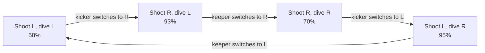
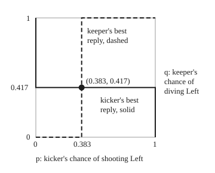

# Nash equilibrium: nobody gains by moving alone, in pure or mixed strategies

[Syllabus](../../../SYLLABUS.md) → [Applied and computational](../README.md) → [Operations Research](../README.md#s05) → Nash equilibrium

---

## General Overview

A penalty kick in professional football. The ball arrives too fast for the goalkeeper to wait and see where it goes, so kicker and keeper choose at the same moment: Left or Right, both named from the kicker's side.

How often the kick goes in depends on the pair of choices. This card uses round numbers of the size measured in the professional game, and treats them as illustrative:

| | Keeper dives Left | Keeper dives Right |
| --- | --- | --- |
| **Kicker shoots Left** | 58% | 95% |
| **Kicker shoots Right** | 93% | 70% |

Guess right and the keeper saves a lot of kicks. Guess wrong and almost every kick scores. No fixed plan survives. If the kicker always shoots Right, the keeper always dives Right and the kicker scores 70%. If the keeper always dives Right, the kicker switches to Left and scores 95%. Every plain choice invites a punishment.

The way out is to be unpredictable in exactly the right amount. The kicker shoots Left 38.33% of the time, and the keeper dives Left 41.67% of the time. At those rates neither side can do better by changing on its own, and the kick scores 79.58% of the time. The kicker's rate is not chosen to suit the kicker: it is the rate that leaves the keeper with nothing to gain from either dive.

**A Nash equilibrium is a choice for every player such that no single player can do better by changing their own choice while the others keep theirs; when no plain choice works, the players randomise, each at the rate that leaves the other with no reason to prefer one option.**

**What kind of fact this is:** a definition. The 2 by 2 formula for the mixed equilibrium is a theorem, proved on this card in Why it works. That every finite game has at least one equilibrium is Nash's theorem, stated here and proved in his 1950 paper (see Sources).

### The picture: best replies chase each other round the table



Each arrow is one player switching alone to do better against the other's current choice. The arrows go round forever: no cell is a resting place, so there is no equilibrium in plain choices.

---

## The formula

Notation first, in words. A **strategy** $s_i$ is what player $i$ does: a plain choice such as "shoot Left" (a **pure strategy**), or a rule for picking one at random with stated chances (a **mixed strategy**). $s_{-i}$ is everyone else's strategy, read "s minus i". $u_i$ is player $i$'s payoff: what they get, averaged over any randomness. A star marks the equilibrium choice.

$$u_i(s_i^*,\, s_{-i}^*) \;\ge\; u_i(s_i,\, s_{-i}^*) \quad \text{for every player } i \text{ and every strategy } s_i$$

**Read it aloud:** with everyone else holding their equilibrium choice fixed, nothing player $i$ could switch to pays more than their own equilibrium choice.

For a 2 by 2 game with no equilibrium in plain choices, write the kicker's scoring chances as $a$, $b$ (shoot Left; keeper Left, Right) and $c$, $d$ (shoot Right; keeper Left, Right). Let $p$ be the kicker's chance of shooting Left and $q$ the keeper's chance of diving Left. Then

$$p^* = \frac{c - d}{b + c - a - d}, \qquad q^* = \frac{b - d}{b + c - a - d}, \qquad V = \frac{bc - ad}{b + c - a - d}$$

**Read it aloud:** the kicker's Left chance is how much a Right shot loses when the keeper switches from Left to Right, the keeper's Left chance is how much a Left shot beats a Right shot when the keeper dives Right, each divided by the same total, and $V$ is the scoring rate both sides then live with.

| Symbol | Plain meaning | In our example | Push it up and the answer… |
| --- | --- | --- | --- |
| $i$ | which player | kicker or keeper | — |
| $s_i$ | player $i$'s strategy: a plain choice or a random mix | "shoot Left 38.33% of the time" | — |
| $s_{-i}$ | everyone else's strategy | the keeper's mix, from the kicker's view | — |
| $u_i$ | player $i$'s payoff, averaged over the randomness | the kicker's chance of scoring | — |
| $s^*$ | the equilibrium: one strategy per player | (38.33% Left, 41.67% Left) | — |
| $a$ | scoring chance, shoot Left, keeper Left | 58% | both lean Left more: the keeper guards it, the kicker uses it |
| $b$ | scoring chance, shoot Left, keeper Right | 95% | the keeper dives Left more; the kicker shoots Left less |
| $c$ | scoring chance, shoot Right, keeper Left | 93% | the kicker shoots Left more; the keeper dives Left less |
| $d$ | scoring chance, shoot Right, keeper Right | 70% | both lean Left less |
| $p$, $p^*$ | kicker's chance of shooting Left; its equilibrium value | 23/60 = 0.3833 | — |
| $q$, $q^*$ | keeper's chance of diving Left; its equilibrium value | 25/60 = 0.4167 | — |
| $V$ | the **value**: scoring chance at the equilibrium | 79.58% | — |

### When it holds

- **Each player wants only their own payoff, and both know the table.** A kicker who has the numbers wrong mixes at the wrong rate, and a keeper who knows better can exploit it (the 50-50 kicker below drops to 75.50%).
- **The randomness is real.** A kicker who alternates Left, Right, Left is predictable, and a predictable mix is a pure strategy in disguise: the keeper reads the pattern and wins every guess.
- **Choices are made at the same time, or in secret.** If the keeper could watch the ball before diving, the game would be a different one, with a different answer.
- **No equilibrium in plain choices.** The formula assumes the best replies cycle. If one option is better whatever the other side does, the formula still returns numbers, but they are wrong: a chance below 0 or a mix nobody should play. Search the cells first.
- **Payoffs are numbers you are content to average.** A mix is judged by its expected payoff, so payoffs must be chances, or utilities in the sense of [Deciding under uncertainty](08-decision-theory-and-the-value-of-information.md), not raw sums whose spread matters to the player.

---

## Why it works

### Step 0: you only mix if you don't care

Suppose the keeper mixes, and against that mix shooting Right scores more often than shooting Left. Then the kicker should shoot Right every time: any weight on Left throws scoring chances away. So a kicker who is happy to mix must find both sides equally good against the keeper's mix.

That turns the problem round. The kicker's equilibrium mix is not set by the kicker's own preferences. It is set by the need to leave the *keeper* indifferent between diving Left and Right. If the keeper preferred one dive, the keeper would stop mixing, and the kicker's mix would be exploited.

### Step 1: best replies, cell by cell, find the pure equilibria

A **best reply** is the choice that does best against a fixed choice by the other side. Fix each column and mark the kicker's better row. Fix each row and mark the keeper's better column (lower scoring chance, since the keeper wants the kick to miss). A cell marked by both is a **pure equilibrium**: neither player gains by switching alone.

In the penalty, against a Left dive the kicker prefers Right (93% against 58%). Against a Right dive the kicker prefers Left (95% against 70%). The keeper wants to match: against a Left shot, dive Left (58%); against a Right shot, dive Right (70%). No cell is marked twice. The arrows in the picture above run in a circle.

Now a game where a cell is marked twice. Our bakery chain and a rival sell loaves in one town. Each sets a High or Low price for the day. The profits, in pounds a day, are synthetic round numbers:

| | Rival High | Rival Low |
| --- | --- | --- |
| **We go High** | £1,200, £1,200 | £700, £1,500 |
| **We go Low** | £1,500, £700 | £900, £900 |

Each cell lists our profit first. If the rival goes High, we prefer Low (£1,500 against £1,200). If the rival goes Low, we still prefer Low (£900 against £700). The rival faces the same table. Both mark (Low, Low), the only pure equilibrium. Both would make more at (High, High), £1,200 each, but that cell is not stable: from there, either bakery gains £300 by cutting its price alone. This is the shape called the **prisoner's dilemma**. An equilibrium is a resting place, not the best outcome for the group.

### Step 2: a mix pays the weighted average

Let the keeper dive Left with chance $q$. Shooting Left then scores with chance $58q + 95(1 - q)$: each outcome weighted by how often it happens, which is an expectation ([Expectation](../../09-Probability%20and%20statistics/02-Random%20Variables/02-expectation.md)). Shooting Right scores $93q + 70(1 - q)$.

Both are straight lines in $q$. At $q = 0$, Left scores 95% and Right 70%. At $q = 1$, Left scores 58% and Right 93%. They cross once, somewhere between. Below the crossing the kicker should shoot Left every time; above it, Right every time. Only at the crossing is any mix a best reply.

The same holds one level up. A kicker who shoots Left with chance $p$ scores $p$ times the Left line plus $1 - p$ times the Right line. A weighted average of two numbers can never beat the larger one. So no mix ever beats the better plain choice, and to test an equilibrium it is enough to test the plain deviations.

### Step 3: solve the two indifference equations

The keeper's $q^*$ is the crossing of the kicker's two lines:

$$q a + (1 - q) b = q c + (1 - q) d \;\Longrightarrow\; q^* = \frac{b - d}{b + c - a - d}.$$

The kicker's $p^*$ is the crossing of the keeper's two lines. A Left dive lets in $pa + (1-p)c$; a Right dive, $pb + (1-p)d$:

$$p a + (1 - p) c = p b + (1 - p) d \;\Longrightarrow\; p^* = \frac{c - d}{b + c - a - d}.$$

Put $q^*$ back into either of the kicker's lines and the common height is $V = (bc - ad)/(b + c - a - d)$.

<details>
<summary>The algebra, line by line</summary>

Kicker indifferent: $qa + b - qb = qc + d - qd$. Gather the $q$ terms: $q(a - b - c + d) = d - b$. Multiply top and bottom by $-1$: $q^* = (b - d)/(b + c - a - d)$.

Keeper indifferent: $pa + c - pc = pb + d - pd$, so $p(a - c - b + d) = d - c$, and $p^* = (c - d)/(b + c - a - d)$.

The value: Left at $q^*$ scores $b + q^*(a - b)$. Over the common denominator this is $\big(b(b + c - a - d) + (b - d)(a - b)\big)/(b + c - a - d)$. Expand the top: $b^2 + bc - ab - bd + ab - b^2 - ad + bd = bc - ad$.

When the best replies cycle as in the picture ($a < c$ and $d < b$ for the kicker, $a < b$ and $d < c$ for the keeper), the denominator is positive and both $p^*$ and $q^*$ lie strictly between 0 and 1. The converse fails: with $b = 60$ (Try changing, below) the denominator is still positive, yet Right dominates for the kicker and the formula's $q^*$ is negative. A positive denominator is no test for a missing pure equilibrium; search the cells.

</details>

### Step 4: check that nobody gains alone

At $q^*$ the kicker's two lines meet, so every $p$, pure or mixed, scores exactly $V$. Nothing beats $p^*$, so $p^*$ is a best reply. At $p^*$ the keeper's two lines meet, so every dive concedes exactly $V$, and $q^*$ is a best reply too. The pair meets the definition: a Nash equilibrium.

The figure plots both best replies. The kicker's (solid) jumps from "always Left" to "always Right" as $q$ crosses 0.417. The keeper's (dashed) jumps from "always Right" to "always Left" as $p$ crosses 0.383. A Nash equilibrium is a point on both lines at once, and they meet only once. So this equilibrium is the only one.

<p align="center"></p>

The square is to scale: 0 to 1 on each side, the crossing at (0.383, 0.417).

### Step 5: what is proved elsewhere

Nash proved in 1950 that every game with finitely many players and plain choices has at least one equilibrium once mixes are allowed. His proof uses a fixed-point theorem and is not repeated here. The penalty shows why mixes are needed: without them, this game has none.

In a game like the penalty, where one side's gain is the other's loss (a **zero-sum** game), a second fact holds. The best scoring chance the kicker can guarantee, whatever the keeper does, equals the lowest the keeper can hold the kicker to, whatever the kicker does. Both are 79.58%, and the code finds them by brute force. That this always happens is the minimax theorem, the subject of [Linear programs](01-modelling-with-linear-programs.md).

---

## Worked numbers, by hand

| Step | Arithmetic | Value |
| --- | --- | --- |
| kicker's best reply to a Left dive | 93% against 58% | Right |
| kicker's best reply to a Right dive | 95% against 70% | Left |
| pure equilibria | no cell is a best reply for both | none |
| denominator, $b + c - a - d$ | 95 + 93 − 58 − 70 | 60 |
| kicker's Left chance, $p^*$ | (93 − 70) / 60 = 23/60 | 0.3833 |
| kicker's Right chance, $1 - p^*$ | 1 − 0.3833 | 0.6167 |
| keeper's Left chance, $q^*$ | (95 − 70) / 60 = 25/60 | 0.4167 |
| top of $V$, $bc - ad$ | 95 × 93 − 58 × 70 = 8,835 − 4,060 | 4,775 |
| **scoring chance, $V$** | 4,775 / 60 | **79.58%** |
| check: kicker shoots Left against $q^*$ | 0.4167 × 58 + 0.5833 × 95 | 79.58% |
| check: kicker shoots Right against $q^*$ | 0.4167 × 93 + 0.5833 × 70 | 79.58% |

Played this way, about 4 kicks in 5 score, and neither the kicker nor the keeper can push that number their way by changing only their own habit.

### What breaks if you drop a piece

| Mistake | Comes out at | What went wrong |
| --- | --- | --- |
| Kicker shoots 50-50 | 75.50% scored | A Left dive lets in 75.50%, a Right dive 82.50%, so the keeper always dives Left |
| Kicker uses the keeper's number, Left 0.4167 | 78.42% scored | The mix must make the *keeper* indifferent; 0.4167 is the keeper's rate, the one that makes the kicker indifferent |
| Kicker always picks the better single side, Right | 70% scored | A plain choice is read and blocked; mixing is worth 9.58 points |
| Keeper dives 50-50 | 81.50% scored | The kicker always shoots Right; the keeper gives away 1.92 points |
| Bakeries treat (High, High) as stable | one bakery gains £300 by cutting alone | The best joint outcome is not an equilibrium |

The code prints every one.

---

## Code, from first principles, and it actually runs

Nothing is imported. The script reads the penalty table, marks best replies cell by cell, and searches every cell for a pure equilibrium, in the penalty and in the bakery price war. It then reaches the mixed equilibrium by three independent roads. Road one is the formula. Road two is brute force: every kicker mix in steps of 1/600, each scored by the keeper's best reply to it, and the same for the keeper, all in whole numbers. Road three is **fictitious play**: for 100,000 rounds each side best-replies to how often the other has chosen Left so far, and the running frequencies drift towards the equilibrium. It also prints the corner points of the figure.

### Python

```python
# Nash equilibrium -- the check behind the card.  Nothing is imported.
# Game 1: a penalty kick.  Kicker and goalkeeper each pick Left or Right (both
# named from the kicker's side).  Entries are the kicker's chance of scoring, in
# percent: illustrative round numbers of the size measured in professional
# football.  The goalkeeper wants the opposite, so this is a zero-sum game.
# Game 2: two bakeries set a loaf price, High or Low; synthetic profits in pounds.
# Roads to the mixed equilibrium: (1) the indifference formula, (2) a brute-force
# grid over every mix in steps of 1/600, (3) fictitious play, 100,000 rounds.
A, B, C, D = 58, 95, 93, 70          # kick L/dive L, kick L/dive R, kick R/dive L, kick R/dive R
SIDES = ("L", "R")
PEN = {("L", "L"): A, ("L", "R"): B, ("R", "L"): C, ("R", "R"): D}

def pure_equilibria(rows, cols, pay_row, pay_col):
    """Every cell where neither player gains by switching alone."""
    found = []
    for r in rows:
        for c in cols:
            row_ok = all(pay_row(r, c) >= pay_row(r2, c) for r2 in rows)
            col_ok = all(pay_col(r, c) >= pay_col(r, c2) for c2 in cols)
            if row_ok and col_ok:
                found.append((r, c))
    return found

# best responses in the penalty, cell by cell
for g in SIDES:
    best = "L" if PEN[("L", g)] >= PEN[("R", g)] else "R"
    print(f"goalkeeper dives {g}: kicker's best reply is {best} ({PEN[(best, g)]}% against {PEN[('R' if best == 'L' else 'L', g)]}%)")
for k in SIDES:
    best = "L" if PEN[(k, "L")] <= PEN[(k, "R")] else "R"
    print(f"kicker shoots {k}: goalkeeper's best reply is {best} (lets in {PEN[(k, best)]}%)")
pen_pure = pure_equilibria(SIDES, SIDES, lambda r, c: PEN[(r, c)], lambda r, c: -PEN[(r, c)])
print(f"penalty, pure equilibria: {pen_pure if pen_pure else 'none'}")

# road 1: the indifference formula
den = B + C - A - D
p_star = (C - D) / den               # kicker's chance of shooting Left
q_star = (B - D) / den               # goalkeeper's chance of diving Left
value = (B * C - A * D) / den        # scoring chance at the equilibrium, percent
print(f"denominator b + c - a - d = {den}; bc - ad = {B * C} - {A * D} = {B * C - A * D}")
print(f"road 1, formula: kicker Left p* = {C - D}/{den} = {p_star:.4f}; keeper Left q* = {B - D}/{den} = {q_star:.4f}; scoring {value:.4f}%")
kick_L = q_star * A + (1 - q_star) * B
kick_R = q_star * C + (1 - q_star) * D
dive_L = p_star * A + (1 - p_star) * C
dive_R = p_star * B + (1 - p_star) * D
print(f"1 - q* = {1 - q_star:.4f}; 1 - p* = {1 - p_star:.4f}")
print(f"against q*, kicker scores {kick_L:.4f}% going L and {kick_R:.4f}% going R")
print(f"against p*, keeper lets in {dive_L:.4f}% diving L and {dive_R:.4f}% diving R")

# road 2: brute force over every mix k/600 (integers, so no rounding)
N = 600
def kicker_floor(k):                 # kicker mixes k/600 on L; keeper picks the worse side for him
    return min(A * k + C * (N - k), B * k + D * (N - k))
def keeper_ceiling(j):               # keeper mixes j/600 on L; kicker picks the better side
    return max(A * j + B * (N - j), C * j + D * (N - j))
k_best = j_best = 0
for i in range(N + 1):               # keep the first best, as the Rust does
    if kicker_floor(i) > kicker_floor(k_best):
        k_best = i
    if keeper_ceiling(i) < keeper_ceiling(j_best):
        j_best = i
print(f"road 2, grid: kicker's best guaranteed mix {k_best}/600 = {k_best / N:.4f}, scoring at least {kicker_floor(k_best) / N:.4f}%")
print(f"road 2, grid: keeper's best mix {j_best}/600 = {j_best / N:.4f}, conceding at most {keeper_ceiling(j_best) / N:.4f}%")

# road 3: fictitious play -- each round, each side best-replies to the other's past frequencies
kL = kR = gL = gR = 0
ROUNDS = 100000
for t in range(ROUNDS):
    k_move = "L" if A * gL + B * gR >= C * gL + D * gR else "R"
    g_move = "L" if A * kL + C * kR <= B * kL + D * kR else "R"
    kL, kR = kL + (k_move == "L"), kR + (k_move == "R")
    gL, gR = gL + (g_move == "L"), gR + (g_move == "R")
print(f"road 3, fictitious play over {ROUNDS} rounds: kicker Left {kL / ROUNDS:.4f}, keeper Left {gL / ROUNDS:.4f}")
print(f"road 3 misses the formula by {abs(kL / ROUNDS - p_star):.4f} and {abs(gL / ROUNDS - q_star):.4f}")

# what breaks
def keeper_reply_score(p):           # the keeper sees the kicker's mix and dives to the side letting in less
    return min(p * A + (1 - p) * C, p * B + (1 - p) * D)
def kicker_reply_score(q):
    return max(q * A + (1 - q) * B, q * C + (1 - q) * D)
half = keeper_reply_score(0.5)
swapped = keeper_reply_score(q_star)
pure_best = max(min(A, B), min(C, D))
keeper_half = kicker_reply_score(0.5)
print(f"mistake, kicker goes 50-50: keeper lets in {0.5 * A + 0.5 * C:.4f}% diving L, {0.5 * B + 0.5 * D:.4f}% diving R; scoring {half:.4f}%")
print(f"mistake, kicker uses the keeper's number {q_star:.4f}: scoring {swapped:.4f}%")
print(f"mistake, kicker always picks one side: best is always R, scoring {pure_best}%")
print(f"mistake, keeper goes 50-50: kicker always shoots R, scoring {keeper_half:.4f}%")
print(f"mixing beats one side by {value - pure_best:.4f} points; the 50-50 keeper gives away {keeper_half - value:.4f}")

# game 2: the bakery price war (row = our bakery, column = the rival), profits in pounds a day
P = ("High", "Low")
OURS = {("High", "High"): 1200, ("High", "Low"): 700, ("Low", "High"): 1500, ("Low", "Low"): 900}
THEIRS = {(r, c): OURS[(c, r)] for r in P for c in P}
bake_pure = pure_equilibria(P, P, lambda r, c: OURS[(r, c)], lambda r, c: THEIRS[(r, c)])
for c in P:
    best = "High" if OURS[("High", c)] >= OURS[("Low", c)] else "Low"
    other = "Low" if best == "High" else "High"
    print(f"rival prices {c}: our best reply is {best} ({OURS[(best, c)]} against {OURS[(other, c)]})")
print(f"bakeries, pure equilibria: {', '.join(f'({r}, {c})' for r, c in bake_pure)}")
print(f"at (Low, Low) each makes {OURS[('Low', 'Low')]}; at (High, High) each would make {OURS[('High', 'High')]}")
print(f"from (High, High), our bakery gains {OURS[('Low', 'High')] - OURS[('High', 'High')]} by cutting alone")

# the figure: best-reply lines in a 200 by 200 square, origin at (60, 230)
fx, fy = 60 + 200 * p_star, 230 - 200 * q_star
print(f"figure, crossing at ({fx:.1f}, {fy:.1f}); kicker's jump at y = {fy:.1f}; keeper's jump at x = {fx:.1f}")

assert pen_pure == [] and bake_pure == [("Low", "Low")]          # exhaustive cell search
assert k_best * den == (C - D) * N and j_best * den == (B - D) * N      # grid meets formula
assert abs(kicker_floor(k_best) / N - value) < 1e-9 and abs(keeper_ceiling(j_best) / N - value) < 1e-9
assert abs(kick_L - kick_R) < 1e-9 and abs(dive_L - dive_R) < 1e-9   # indifference holds
assert abs(kL / ROUNDS - p_star) < 0.01 and abs(gL / ROUNDS - q_star) < 0.01
assert half < value and swapped < value and pure_best < value and keeper_half > value
print("ALL CHECKS PASS")
```

**Ran 2026-11-11 on macOS, Python 3.14.10, standard library only. All checks passed. Output, pasted from the run:**

```
goalkeeper dives L: kicker's best reply is R (93% against 58%)
goalkeeper dives R: kicker's best reply is L (95% against 70%)
kicker shoots L: goalkeeper's best reply is L (lets in 58%)
kicker shoots R: goalkeeper's best reply is R (lets in 70%)
penalty, pure equilibria: none
denominator b + c - a - d = 60; bc - ad = 8835 - 4060 = 4775
road 1, formula: kicker Left p* = 23/60 = 0.3833; keeper Left q* = 25/60 = 0.4167; scoring 79.5833%
1 - q* = 0.5833; 1 - p* = 0.6167
against q*, kicker scores 79.5833% going L and 79.5833% going R
against p*, keeper lets in 79.5833% diving L and 79.5833% diving R
road 2, grid: kicker's best guaranteed mix 230/600 = 0.3833, scoring at least 79.5833%
road 2, grid: keeper's best mix 250/600 = 0.4167, conceding at most 79.5833%
road 3, fictitious play over 100000 rounds: kicker Left 0.3812, keeper Left 0.4171
road 3 misses the formula by 0.0021 and 0.0004
mistake, kicker goes 50-50: keeper lets in 75.5000% diving L, 82.5000% diving R; scoring 75.5000%
mistake, kicker uses the keeper's number 0.4167: scoring 78.4167%
mistake, kicker always picks one side: best is always R, scoring 70%
mistake, keeper goes 50-50: kicker always shoots R, scoring 81.5000%
mixing beats one side by 9.5833 points; the 50-50 keeper gives away 1.9167
rival prices High: our best reply is Low (1500 against 1200)
rival prices Low: our best reply is Low (900 against 700)
bakeries, pure equilibria: (Low, Low)
at (Low, Low) each makes 900; at (High, High) each would make 1200
from (High, High), our bakery gains 300 by cutting alone
figure, crossing at (136.7, 146.7); kicker's jump at y = 146.7; keeper's jump at x = 136.7
ALL CHECKS PASS
```

### Rust

Same numbers, same labels, built with `rustc --edition 2021 -O`.

```rust
// Nash equilibrium -- the same check as the Python, in Rust.  No crates.
// Game 1: a penalty kick.  Kicker and goalkeeper each pick Left or Right (both
// named from the kicker's side).  Entries are the kicker's chance of scoring, in
// percent: illustrative round numbers of the size measured in professional
// football.  The goalkeeper wants the opposite, so this is a zero-sum game.
// Game 2: two bakeries set a loaf price, High or Low; synthetic profits in pounds.
// Roads to the mixed equilibrium: (1) the indifference formula, (2) a brute-force
// grid over every mix in steps of 1/600, (3) fictitious play, 100,000 rounds.
const A: i64 = 58; // kick L, dive L
const B: i64 = 95; // kick L, dive R
const C: i64 = 93; // kick R, dive L
const D: i64 = 70; // kick R, dive R
const N: i64 = 600;

fn pen(k: usize, g: usize) -> i64 { [[A, B], [C, D]][k][g] }

/// Every cell where neither player gains by switching alone.
fn pure_equilibria(names: [&'static str; 2], row: &dyn Fn(usize, usize) -> i64,
                   col: &dyn Fn(usize, usize) -> i64) -> Vec<(&'static str, &'static str)> {
    let mut found = Vec::new();
    for r in 0..2 {
        for c in 0..2 {
            let row_ok = (0..2).all(|r2| row(r, c) >= row(r2, c));
            let col_ok = (0..2).all(|c2| col(r, c) >= col(r, c2));
            if row_ok && col_ok { found.push((names[r], names[c])) }
        }
    }
    found
}

fn kicker_floor(k: i64) -> i64 { (A * k + C * (N - k)).min(B * k + D * (N - k)) }
fn keeper_ceiling(j: i64) -> i64 { (A * j + B * (N - j)).max(C * j + D * (N - j)) }
fn keeper_reply_score(p: f64) -> f64 {
    (p * A as f64 + (1.0 - p) * C as f64).min(p * B as f64 + (1.0 - p) * D as f64)
}
fn kicker_reply_score(q: f64) -> f64 {
    (q * A as f64 + (1.0 - q) * B as f64).max(q * C as f64 + (1.0 - q) * D as f64)
}

fn main() {
    let s = ["L", "R"];
    // best responses in the penalty, cell by cell
    for g in 0..2 {
        let best = if pen(0, g) >= pen(1, g) { 0 } else { 1 };
        println!("goalkeeper dives {}: kicker's best reply is {} ({}% against {}%)", s[g], s[best], pen(best, g), pen(1 - best, g));
    }
    for k in 0..2 {
        let best = if pen(k, 0) <= pen(k, 1) { 0 } else { 1 };
        println!("kicker shoots {}: goalkeeper's best reply is {} (lets in {}%)", s[k], s[best], pen(k, best));
    }
    let pen_pure = pure_equilibria(s, &|r, c| pen(r, c), &|r, c| -pen(r, c));
    println!("penalty, pure equilibria: {}", if pen_pure.is_empty() { "none".to_string() } else { format!("{:?}", pen_pure) });

    // road 1: the indifference formula
    let den = B + C - A - D;
    let p_star = (C - D) as f64 / den as f64;
    let q_star = (B - D) as f64 / den as f64;
    let value = (B * C - A * D) as f64 / den as f64;
    println!("denominator b + c - a - d = {}; bc - ad = {} - {} = {}", den, B * C, A * D, B * C - A * D);
    println!("road 1, formula: kicker Left p* = {}/{} = {:.4}; keeper Left q* = {}/{} = {:.4}; scoring {:.4}%", C - D, den, p_star, B - D, den, q_star, value);
    let (af, bf, cf, df) = (A as f64, B as f64, C as f64, D as f64);
    let kick_l = q_star * af + (1.0 - q_star) * bf;
    let kick_r = q_star * cf + (1.0 - q_star) * df;
    let dive_l = p_star * af + (1.0 - p_star) * cf;
    let dive_r = p_star * bf + (1.0 - p_star) * df;
    println!("1 - q* = {:.4}; 1 - p* = {:.4}", 1.0 - q_star, 1.0 - p_star);
    println!("against q*, kicker scores {:.4}% going L and {:.4}% going R", kick_l, kick_r);
    println!("against p*, keeper lets in {:.4}% diving L and {:.4}% diving R", dive_l, dive_r);

    // road 2: brute force over every mix k/600 (integers, so no rounding)
    let (mut k_best, mut j_best) = (0, 0);
    for i in 0..=N {
        if kicker_floor(i) > kicker_floor(k_best) { k_best = i }
        if keeper_ceiling(i) < keeper_ceiling(j_best) { j_best = i }
    }
    println!("road 2, grid: kicker's best guaranteed mix {}/600 = {:.4}, scoring at least {:.4}%", k_best, k_best as f64 / N as f64, kicker_floor(k_best) as f64 / N as f64);
    println!("road 2, grid: keeper's best mix {}/600 = {:.4}, conceding at most {:.4}%", j_best, j_best as f64 / N as f64, keeper_ceiling(j_best) as f64 / N as f64);

    // road 3: fictitious play -- each round, each side best-replies to the other's past frequencies
    let (mut kl, mut kr, mut gl, mut gr) = (0i64, 0i64, 0i64, 0i64);
    let rounds = 100000i64;
    for _ in 0..rounds {
        let k_left = A * gl + B * gr >= C * gl + D * gr;
        let g_left = A * kl + C * kr <= B * kl + D * kr;
        if k_left { kl += 1 } else { kr += 1 }
        if g_left { gl += 1 } else { gr += 1 }
    }
    let (fk, fg) = (kl as f64 / rounds as f64, gl as f64 / rounds as f64);
    println!("road 3, fictitious play over {} rounds: kicker Left {:.4}, keeper Left {:.4}", rounds, fk, fg);
    println!("road 3 misses the formula by {:.4} and {:.4}", (fk - p_star).abs(), (fg - q_star).abs());

    // what breaks
    let half = keeper_reply_score(0.5);
    let swapped = keeper_reply_score(q_star);
    let pure_best = A.min(B).max(C.min(D));
    let keeper_half = kicker_reply_score(0.5);
    println!("mistake, kicker goes 50-50: keeper lets in {:.4}% diving L, {:.4}% diving R; scoring {:.4}%", 0.5 * af + 0.5 * cf, 0.5 * bf + 0.5 * df, half);
    println!("mistake, kicker uses the keeper's number {:.4}: scoring {:.4}%", q_star, swapped);
    println!("mistake, kicker always picks one side: best is always R, scoring {}%", pure_best);
    println!("mistake, keeper goes 50-50: kicker always shoots R, scoring {:.4}%", keeper_half);
    println!("mixing beats one side by {:.4} points; the 50-50 keeper gives away {:.4}", value - pure_best as f64, keeper_half - value);

    // game 2: the bakery price war (row = our bakery, column = the rival), profits in pounds a day
    let ours = [[1200, 700], [1500, 900]]; // [our price][their price], High = 0, Low = 1
    let bake_pure = pure_equilibria(["High", "Low"], &|r, c| ours[r][c], &|r, c| ours[c][r]);
    let p = ["High", "Low"];
    for c in 0..2 {
        let best = if ours[0][c] >= ours[1][c] { 0 } else { 1 };
        println!("rival prices {}: our best reply is {} ({} against {})", p[c], p[best], ours[best][c], ours[1 - best][c]);
    }
    let shown: Vec<String> = bake_pure.iter().map(|(r, c)| format!("({}, {})", r, c)).collect();
    println!("bakeries, pure equilibria: {}", shown.join(", "));
    println!("at (Low, Low) each makes {}; at (High, High) each would make {}", ours[1][1], ours[0][0]);
    println!("from (High, High), our bakery gains {} by cutting alone", ours[1][0] - ours[0][0]);

    // the figure: best-reply lines in a 200 by 200 square, origin at (60, 230)
    let (fx, fy) = (60.0 + 200.0 * p_star, 230.0 - 200.0 * q_star);
    println!("figure, crossing at ({:.1}, {:.1}); kicker's jump at y = {:.1}; keeper's jump at x = {:.1}", fx, fy, fy, fx);

    assert!(pen_pure.is_empty() && bake_pure == vec![("Low", "Low")]); // exhaustive cell search
    assert!(k_best * den == (C - D) * N && j_best * den == (B - D) * N); // grid meets formula
    assert!((kicker_floor(k_best) as f64 / N as f64 - value).abs() < 1e-9 && (keeper_ceiling(j_best) as f64 / N as f64 - value).abs() < 1e-9);
    assert!((kick_l - kick_r).abs() < 1e-9 && (dive_l - dive_r).abs() < 1e-9); // indifference holds
    assert!((kl as f64 / rounds as f64 - p_star).abs() < 0.01 && (gl as f64 / rounds as f64 - q_star).abs() < 0.01);
    assert!(half < value && swapped < value && (pure_best as f64) < value && keeper_half > value);
    println!("ALL CHECKS PASS");
}
```

**Ran 2026-11-11 on macOS, rustc 1.98.1, no crates. All checks passed. Output, pasted from the run:**

```
goalkeeper dives L: kicker's best reply is R (93% against 58%)
goalkeeper dives R: kicker's best reply is L (95% against 70%)
kicker shoots L: goalkeeper's best reply is L (lets in 58%)
kicker shoots R: goalkeeper's best reply is R (lets in 70%)
penalty, pure equilibria: none
denominator b + c - a - d = 60; bc - ad = 8835 - 4060 = 4775
road 1, formula: kicker Left p* = 23/60 = 0.3833; keeper Left q* = 25/60 = 0.4167; scoring 79.5833%
1 - q* = 0.5833; 1 - p* = 0.6167
against q*, kicker scores 79.5833% going L and 79.5833% going R
against p*, keeper lets in 79.5833% diving L and 79.5833% diving R
road 2, grid: kicker's best guaranteed mix 230/600 = 0.3833, scoring at least 79.5833%
road 2, grid: keeper's best mix 250/600 = 0.4167, conceding at most 79.5833%
road 3, fictitious play over 100000 rounds: kicker Left 0.3812, keeper Left 0.4171
road 3 misses the formula by 0.0021 and 0.0004
mistake, kicker goes 50-50: keeper lets in 75.5000% diving L, 82.5000% diving R; scoring 75.5000%
mistake, kicker uses the keeper's number 0.4167: scoring 78.4167%
mistake, kicker always picks one side: best is always R, scoring 70%
mistake, keeper goes 50-50: kicker always shoots R, scoring 81.5000%
mixing beats one side by 9.5833 points; the 50-50 keeper gives away 1.9167
rival prices High: our best reply is Low (1500 against 1200)
rival prices Low: our best reply is Low (900 against 700)
bakeries, pure equilibria: (Low, Low)
at (Low, Low) each makes 900; at (High, High) each would make 1200
from (High, High), our bakery gains 300 by cutting alone
figure, crossing at (136.7, 146.7); kicker's jump at y = 146.7; keeper's jump at x = 136.7
ALL CHECKS PASS
```

The two outputs match line for line. Fictitious play misses the formula by 0.0021 and 0.0004: it creeps towards the equilibrium rather than landing on it, which is why its assert allows 0.01.

> [!TIP]
> **Try changing**
> Guess first, then run it. The asserts are pinned to this table, so expect some to stop the program.
> - **The kicker gets better at Right.** Guess first: does the kicker shoot Right more? Set `D = 75`. Yes: the kicker's Left shots fall to 18/55 = 0.3273. The keeper adjusts too, guarding Right more: Left dives fall to 20/55 = 0.3636. Scoring rises to 81.5455%. The 1/600 grid no longer lands on 18/55, so the second assert stops it.
> - **Starve fictitious play.** Guess first: is 1,000 rounds enough? Set `ROUNDS = 1000`. The keeper's frequency reads 0.4420 against 0.4167, and the fictitious-play assert stops it.
> - **Give the kicker a dominant side.** Guess first: what does the formula say? Set `B = 60`. Now Right is better whatever the keeper does, and the cell search finds the pure equilibrium (R, R) at 70%. The formula still returns $p^* = 0.92$ and $q^* = -0.40$, which is nonsense. Search the cells first.
> - **Make the price war vicious.** Guess first: what if both cutting is ruinous? Set the (Low, Low) profit to 600. Against a Low rival we now prefer High (£700 against £600), and the search finds two pure equilibria, (High, Low) and (Low, High): one bakery cuts, the other holds.

---

## The usual mistake

> [!warning]
> **Choosing your mix to suit yourself.** It feels natural for the kicker to work out which side suits the kicker and lean that way. But a mixed equilibrium is set by the other side's payoffs. The kicker's 0.3833 is the rate that leaves the keeper indifferent between dives. Plug in the number that makes the kicker indifferent, 0.4167, and the keeper always dives Left, cutting scoring from 79.58% to 78.42%.
>
> - **Splitting 50-50 because it feels random.** Random is not enough; the rate matters. At 50-50 the keeper always dives Left and scoring falls to 75.50%.
> - **Taking the best joint outcome for the equilibrium.** The bakeries would both make £1,200 at (High, High), but either one gains £300 by cutting alone. The equilibrium is (Low, Low) at £900 each.
> - **Using the 2 by 2 formula without searching the cells.** With a dominant side ($b = 60$) it returns a chance of −0.40. Look for pure equilibria first.
> - **Reading indifference as "anything goes".** At the equilibrium the kicker scores 79.58% whichever side is chosen, but only because the keeper is mixing at 0.4167. Drift from 0.3833 and the keeper can stop mixing and punish it.

---

## Where you meet it in real life

- **Penalty kicks.** A study of professional penalties found scoring rates statistically equal across the kicker's sides and the keeper's dives, and choices with no pattern from one kick to the next: the two marks of equilibrium play.
- **Price wars.** Firms that each cut price to win share, ending where none would have chosen together, are the bakery table at scale.
- **Inspections and patrols.** A tax office or a ticket inspector cannot check everyone, and a fixed schedule is learned and dodged. Random checks at the rate that makes cheating not worth it are a mixed strategy.
- **Sealed bids.** Each bidder chooses a bid knowing others are doing the same, and a sensible way to bid is an equilibrium of that game: the subject of [Auctions](10-auctions-and-mechanism-design.md).

> **Say it back**
> A Nash equilibrium is a choice for every player such that nobody gains by changing only their own. Find pure ones by marking each player's best reply in every row and column; a cell marked twice is an equilibrium. When the marks cycle, as in a penalty kick, the players randomise, and each one's rate is the rate that leaves the other indifferent. For the penalty that is Left 38.33% for the kicker and 41.67% for the keeper, and the kick scores 79.58% of the time. An equilibrium is stable, not best for everyone: two bakeries end at £900 each when £1,200 each was on the table.

---

## What this builds on

- [Deciding under uncertainty](08-decision-theory-and-the-value-of-information.md): one decision-maker choosing against chance. Here the "chance" is another player who chooses back.
- [Expectation](../../09-Probability%20and%20statistics/02-Random%20Variables/02-expectation.md): a mixed strategy's payoff is a weighted sum, and the averages are linear in the mix.

## Where this goes next

- [Auctions](10-auctions-and-mechanism-design.md): equilibrium bidding, and how a seller designs the rules so that the equilibrium is the outcome they want.
- [Linear programs](01-modelling-with-linear-programs.md): the minimax theorem, which proves that in every zero-sum game the kicker's best guarantee equals the keeper's best hold, as the grid found at 79.58%.

The card leaves open which equilibrium players reach when a game has several, as the vicious price war does.

---

## Sources

Verified 2026-11-11: every link below resolves to the publisher's page.

- Nash, John F. "Equilibrium points in n-person games." *Proceedings of the National Academy of Sciences* 36 (1950): 48–49. [doi:10.1073/pnas.36.1.48](https://doi.org/10.1073/pnas.36.1.48). The definition and the existence theorem, in two pages.
- Palacios-Huerta, Ignacio. "Professionals Play Minimax." *Review of Economic Studies* 70 (2003): 395–415. [doi:10.1111/1467-937X.00249](https://doi.org/10.1111/1467-937X.00249). Tests equilibrium play on professional penalty kicks: equal scoring rates across choices, and no serial pattern.
- Robinson, Julia. "An Iterative Method of Solving a Game." *Annals of Mathematics* 54 (1951): 296–301. [doi:10.2307/1969530](https://doi.org/10.2307/1969530). Proves that fictitious play converges in zero-sum games, the third road in the code.
- Maschler, Michael, Eilon Solan and Shmuel Zamir. *Game Theory*, 2nd ed. Cambridge University Press, 2020. [doi:10.1017/9781108636049](https://doi.org/10.1017/9781108636049). Strategic-form games, best replies, mixed strategies and the indifference principle, with full proofs.
