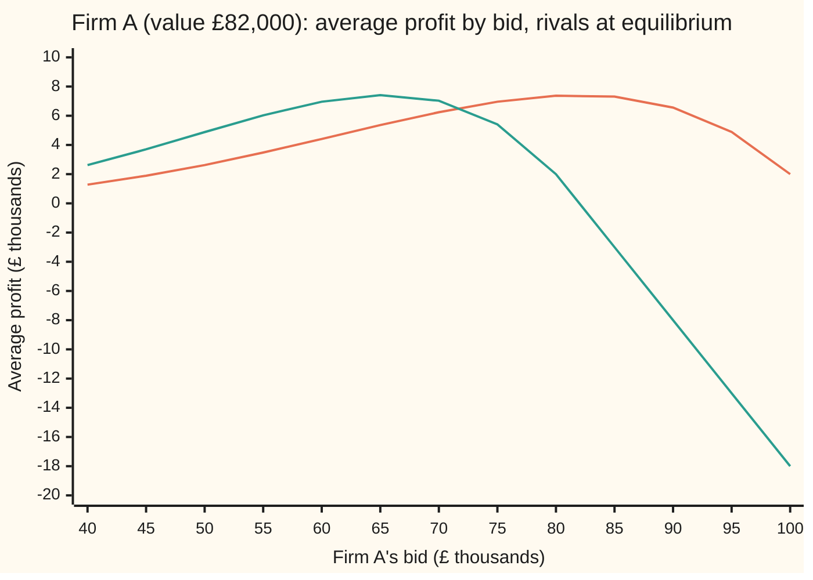

# Auctions: why a second-price rule makes honesty the best policy

[Syllabus](../../../SYLLABUS.md) → [Applied and computational](../README.md) → [Operations Research](../README.md#s05) → Auctions

---

## General Overview

The bakery chain, with its 4 ovens, 30 vans and one warehouse, is opening a new region and will not run vans there. It sells one delivery contract instead: three years as the region's only delivery firm, keeping the delivery fees. Five courier firms, A to E, each post one sealed bid: the most they will pay the chain for the contract.

Each firm has its own **value**: the profit it expects from the contract, which only it knows. Firm A values it at £82,000, B at £71,000, C at £64,000, D at £55,000 and E at £40,000. The chain wants two things. The firm that values the contract most should get it. And the chain wants a good price. The trouble is that nobody has to bid their value.

Under the familiar **first-price** rule (the highest bid wins and pays its own bid), bidding your value is pointless: if you win, you pay everything the contract is worth to you, and your profit is zero. So every firm bids under its value, and has to guess by how much.

Under the **second-price** rule, called the **Vickrey auction**, the highest bid still wins, but the winner pays the *second-highest* bid. Then a firm's best bid is exactly its value, whatever the others do.

On this card's numbers, A wins either way. It pays £71,000 under the second-price rule and £65,600 under the first-price rule, when every firm shades its bid to 0.8 of its value.

Prices on any one day differ. Averaged over every way the five values could fall, both rules raise exactly the same money for the chain: £66,667.

**When the winner pays the second-highest bid, your bid only decides whether you win, never what you pay, so bidding your true value is the best policy; and any auction that gives the contract to the highest value raises the same average revenue.**

**What kind of fact this is:** two theorems, both proved on this card in Why it works. The first (honesty is best under the second-price rule) needs only that each firm knows its own value. The second (revenue equivalence) needs a model: values drawn independently from one known spread, here evenly between £0 and £100,000. That spread is an assumption made for the example, and the values it produces are synthetic.

### The picture: the day's values and the day's first-price bids

```
firm   value, and the first-price bid at 0.8 x value (each mark is £2,500)
 A     value  █████████████████████████████████  £82,000
       bid    ██████████████████████████         £65,600   wins, pays £65,600
 B     value  ████████████████████████████       £71,000   sets A's second-price payment
       bid    ███████████████████████            £56,800
 C     value  ██████████████████████████         £64,000
       bid    ████████████████████               £51,200
 D     value  ██████████████████████             £55,000
       bid    ██████████████████                 £44,000
 E     value  ████████████████                   £40,000
       bid    █████████████                      £32,000
```

Under the second-price rule every firm bids its value, so the value bars are the bids. A wins and pays B's £71,000. Under the first-price rule every bar shrinks to 0.8 of its length. A still wins, and pays its own £65,600.

---

## The formula

Notation first, in words. There are $n$ bidders; here $n = 5$ firms (on this wing $n$ is usually an input size; on this card it counts bidders). Firm $i$ has value $v_i$ and bids $b_i$. $c$ is the highest competing bid: the best bid among firm $i$'s rivals. Money is in thousands of pounds.

The second-price rule, and the profit it gives firm $i$:

$$\text{firm } i \text{ wins if } b_i > c, \text{ pays } c, \text{ and makes profit } u_i = v_i - c; \text{ otherwise } u_i = 0$$

**Read it aloud:** the highest bid wins, the winner pays the best rival bid, and the winner's profit is its value minus that price.

The price $c$ does not contain $b_i$. That single fact is the whole proof of honesty, in Why it works.

Revenue equivalence needs a formula for what a bidder pays on average. Let $F(v)$ be the chance that one firm's value is at most $v$. With values spread evenly between 0 and $\bar V$ = 100, $F(v) = v/100$. Let $P(v)$ be the chance that a firm with value $v$ wins. If the highest value always wins, that is the chance all $n - 1$ rivals have lower values:

$$P(v) = F(v)^{\,n-1}, \qquad m(v) = v\,P(v) - \int_0^v P(x)\,dx$$

**Read it aloud:** a firm with value $v$ pays, on average, its value times its chance of winning, minus the area under the win-chance curve up to its value.

That right-hand side contains only $P$, the rule for who wins. Nothing about *how* the auction charges appears in it. So every auction that hands the contract to the highest value charges each value the same on average, and raises the same average revenue $R$:

$$R = n \times \text{average of } m(v) = \text{average second-highest value} = \frac{n-1}{n+1}\,\bar V = \frac{4}{6} \times 100 = 66.67$$

In the first-price auction with these values, each firm bids $b = \tfrac{n-1}{n}\,v = 0.8\,v$, derived in Step 2.

| Symbol | Plain meaning | In our example | Push it up and the answer… |
| --- | --- | --- | --- |
| $n$, $k$ | the number of bidders; $k$ is a rank among their values, counted from the smallest | 5 firms; the second-highest is $k = 4$ | revenue rises, bids shade less |
| $v$, $v_i$ | a firm's value: the most the contract is worth to it | A: 82 (£82,000) | the firm wins more often |
| $b$, $b_i$ | a firm's sealed bid | A: 82 second-price, 65.6 first-price | wins more often, and in first-price pays more |
| $c$ | the highest competing bid | 71, firm B's bid, facing A | the second-price winner pays more |
| $u_i$ | a firm's profit: value minus price if it wins, else 0 | A: 11 second-price | — |
| $\bar V$ | the top of the spread of values | 100 (£100,000) | every price scales with it |
| $F(v)$ | the chance one firm's value is at most $v$ | $F(82) = 0.82$ | — |
| $P(v)$ | the chance value $v$ is the highest of $n$ | $P(82) = 0.82^4 = 0.4521$ | — |
| $x$ | a value between 0 and $v$, the variable inside the area | — | — |
| $U(v)$ | the average profit of a firm with value $v$ | $U(82) = 7.41$ (£7,415) | — |
| $m(v)$ | the average payment of a firm with value $v$ | $m(82) = 29.66$ | — |
| $R$ | the seller's average revenue | 66.67 (£66,667) | — |

### When it holds

- **Private values.** Honesty is best only when each firm's value is its own business. If the contract is worth the same unknown amount to everyone (a **common value**, such as oil under a field), a bid also hints at what others know. Winning then means you were the most optimistic, which is bad news about the value: the **winner's curse**. Truthful bidding of your estimate then overpays.
- **One item, and bidders who cannot team up.** Two firms who agree that one bids low can cut the second price. The Vickrey rule stops a lone firm from gaining by lying; it does not stop a ring.
- **Independent values from one known spread, for revenue equivalence.** If firm A is known to be strong and E weak, the first-price auction can hand the contract to the wrong firm and the two rules no longer raise the same amount.
- **Risk-neutral bidders, for revenue equivalence.** A firm that prefers a sure profit to a gamble with the same average shades less in a first-price auction. With square-root utility (the last row of What breaks), the first-price auction raises £74,074, not £66,667. The second-price rule is unaffected: honesty stays best.
- **The same rule for who wins, and nothing paid by a firm with value 0.** A reserve price (no sale below £50,000) keeps the second condition (a firm with value 0 pays nothing) but changes the first (the rule for who wins): $P(v)$ drops to 0 below the reserve, so revenue moves from £66,667 to £67,188. A first-price auction with the same reserve raises the same £67,188; the simulation finds £67,221.

---

## Why it works

### Step 0: under the second-price rule, your bid is a switch, not a price

In the first-price auction your bid does two jobs. It decides whether you win, and it sets what you pay. Those jobs pull against each other: a higher bid wins more often but leaves less profit. Under the second-price rule, the bid does only the first job. The price is $c$, the best rival bid, which you cannot touch. So the only question your bid answers is: "do I want the contract at price $c$?" You do exactly when $c$ is below your value. Bidding your value answers that question correctly for every possible $c$.

### Step 1: honesty is never beaten under the second-price rule

Take firm A, value 82. Compare bidding 82 with bidding anything else, $b$.

- **Overbid, $b > 82$.** This changes the outcome only when $c$ falls between 82 and $b$. Then the overbid wins and pays $c$, more than the contract is worth: a loss. Firm E shows it on the day: value 40, it bids 90 to be sure of winning, wins, pays A's 82 and loses £42,000.
- **Underbid, $b < 82$.** This changes the outcome only when $c$ falls between $b$ and 82. Then the underbid loses a contract that would have paid a profit of $82 - c$. On the day, A shading to 65.6 loses to B's 71 and gives up £11,000.
- **Anywhere else**, the two bids win or lose together and pay the same $c$.

So the truthful bid's profit is at least as large as any other bid's, for every rival bid. In game-theory terms, truth is a **weakly dominant strategy**: a best reply to every possible behaviour of the others, not only to an equilibrium ([Nash equilibrium](09-game-theory-and-nash-equilibrium.md)). A rule with this property is called **strategy-proof** or **incentive compatible**: telling the truth is in each player's own interest. The proof used nothing about how values are spread. The code checks it on a grid: 80,802 combinations of value, bid and rival bid, and the truthful bid is never beaten.

### Step 2: first-price bidders shade, by exactly one part in $n$

Now the first-price rule. Suppose every rival bids 0.8 of its value. Rival values are spread evenly up to 100, so rival bids are spread evenly up to 80. A bid of $b$ beats one rival with chance $b/80$, and beats all four with chance $(b/80)^4$. Firm A's average profit from bidding $b$ is

$$(82 - b)\left(\frac{b}{80}\right)^4.$$

The first bracket is the margin; it falls as $b$ rises. The second is the win chance; it rises with $b$. The best bid balances them. Take the slope with respect to $b$ and set it to zero: $b^3\,(4 \times 82 - 5b) = 0$, so $b = \tfrac45 \times 82 = 65.6$.

The same algebra for any value $v$ gives $b = 0.8\,v$. So if rivals bid 0.8 of their values, each firm's best reply is to bid 0.8 of its own value as well: bidding $0.8\,v$ is a Nash equilibrium. With $n$ bidders the same calculation gives $(n-1)/n$: each extra rival forces bids closer to values.

A grid search over every bid from 0 to 100 in steps of 0.01 lands on 65.60, and A's average profit there is £7,415.

### Step 3: the win chance fixes the payment, whatever the rule

This is the step that makes revenue equivalence true. Take any auction in which, at equilibrium, the highest value wins. A firm with value $v$ wins with chance $P(v)$ and pays $m(v)$ on average, so its average profit is $U(v) = v\,P(v) - m(v)$.

The firm could always copy the bidding of a slightly lower value, $x$. It would then win with chance $P(x)$ and pay $m(x)$. In equilibrium it chooses not to, so its own strategy is at least as good. Now raise $v$ a little, by $dv$. A firm that kept its old bidding would gain $P(v)\,dv$: same win chance, same payment, and each win now worth $dv$ more. Choosing a better bid on top changes profit by much less than $dv$, because the old bid was already best. So profit rises at rate $P(v)$:

$$U(v) = \int_0^v P(x)\,dx, \quad\text{since a firm with value 0 never profits.}$$

Put this back into $U(v) = v\,P(v) - m(v)$ and out comes the formula for $m(v)$. Two auctions with the same $P$ have the same $U$ and the same $m$.

<details>
<summary>Detailed proof: the two-sided squeeze</summary>

A firm with value $v$ could bid as if its value were $x$. Equilibrium says this does not pay:

$$v\,P(v) - m(v) \ \ge\ v\,P(x) - m(x).$$

Write $U(x) = x\,P(x) - m(x)$. Then the inequality reads $U(v) \ge U(x) + (v - x)\,P(x)$. Swap the roles of $v$ and $x$ to get $U(x) \ge U(v) + (x - v)\,P(v)$. Together, for $x < v$:

$$(v - x)\,P(x) \ \le\ U(v) - U(x) \ \le\ (v - x)\,P(v).$$

Divide by $v - x$ and let $x$ approach $v$. When $P$ is continuous, both bounds approach $P(v)$, so the slope of $U$ at $v$ is $P(v)$. With $U(0) = 0$, adding up the slopes gives $U(v) = \int_0^v P(x)\,dx$, and $m(v) = v\,P(v) - U(v)$.

</details>

For firm A, $P(82) = 0.82^4 = 0.4521$. The area under $x^4/100^4$ from 0 to 82 is $82^5/(5 \times 100^4) = 7.4148$. So A's average profit is £7,415 under *any* such rule, and its average payment is $82 \times 0.4521 - 7.4148 = 29.66$. The code reaches 29.66 twice: as A's first-price bid 65.6 times its win chance, and as an integral of the best rival bid, when it is below 82, under the second-price rule.

### The picture: firm A's average profit against its bid



Orange: the second-price rule, rivals bidding their values. It peaks at A's value, 82. Green: the first-price rule, rivals bidding 0.8 of their values. It peaks at 65.6, falls in a straight line past 80, where A wins for certain, and goes negative past 82, where A pays more than the contract is worth. The two peaks sit at different bids but at the same height, £7,415. That equal height is Step 3 seen in one firm.

### Step 4: add up over the five firms

The seller's average revenue is $n$ times the average of $m(v)$ over values. With $P(v) = (v/100)^4$, $m(v) = 0.8\,v^5/100^4$, and averaging $v^5$ over values spread evenly up to 100 gives $100^5/6$. So

$$R = 5 \times 0.8 \times \frac{100}{6} = 66.67.$$

The order-statistics road agrees. The k-th smallest of $n$ values spread evenly up to 1 averages $k/(n+1)$ of the range ([Order statistics](../../09-Probability%20and%20statistics/05-Transformations%20and%20Joint%20Laws/08-order-statistics-and-extremes.md)). The second-price auction collects the second-highest, rank 4 of 5: $4/6 \times 100 = 66.67$. The first-price auction collects 0.8 of the highest, rank 5 of 5: $0.8 \times 5/6 \times 100 = 66.67$.

An **all-pay auction**, where every firm pays its bid win or lose, also gives the contract to the highest value. There each firm bids $m(v)$ itself, and a simulation of 200,000 synthetic auctions finds average revenue £66,706, within one standard error (the typical size of a simulated average's random error) of £66,667.

---

## Worked numbers, by hand

The day's values, in £ thousands: A 82, B 71, C 64, D 55, E 40. Values for the averages are spread evenly from 0 to 100.

| Step | Arithmetic | Value |
| --- | --- | --- |
| second-price: everyone bids their value | highest bid A 82, next B 71 | A wins |
| second-price price and profit | A pays 71; profit 82 − 71 | £71,000; £11,000 |
| first-price shading factor | $(n-1)/n = 4/5$ | 0.8 |
| first-price bids | 0.8 × 82, 71, 64, 55, 40 | 65.6, 56.8, 51.2, 44.0, 32.0 |
| first-price price and profit | A pays 65.6; profit 82 − 65.6 | £65,600; £16,400 |
| A's win chance | $0.82^4$ | 0.4521 |
| A's average profit, any rule | $82^5 / (5 \times 100^4)$ | £7,415 |
| A's average payment, any rule | 82 × 0.4521 − 7.4148 | £29,659 |
| average revenue, second-price | $4/6 \times 100$ | 66.67 |
| average revenue, first-price | $0.8 \times 5/6 \times 100$ | 66.67 |
| **average revenue, either rule** | | **£66,667** |

On this particular day the second-price rule earned the chain more: £71,000 against £65,600. On another day it earns less. Over many contracts the two rules earn the same, but the first-price revenue swings less: a standard deviation of £11,274 against £17,806 in the simulation.

### What breaks if you drop a piece

| Mistake | Comes out at | What went wrong |
| --- | --- | --- |
| Seller treats first-price bids as values | expects £83,333; gets £66,667 | Bidders shade. The highest value averages 83.33, but nobody bids it |
| Firm A bids its value in a first-price auction | average profit £0, not £7,415 | Winning at your value pays exactly your value |
| Firm A shades to 65.6 in the second-price auction | loses to B's 71; profit £0, not £11,000 | Shading only ever loses contracts you wanted |
| Firm E (value 40) bids 90 to be sure | wins, pays 82; profit −£42,000 | Overbidding only ever wins contracts at a loss |
| Bidders are risk-averse (square-root utility) | first-price revenue £74,074, not £66,667 | Revenue equivalence assumed risk-neutral bidders: A now bids 72.89 |

The last row is a hypothesis failing, not an arithmetic slip. A firm with square-root utility values a sure £1 of profit more than a gamble with the same average. It gives up margin for a safer win, so its best bid rises to $4/4.5$ of its value: 72.89 for A. The second-price auction does not move, since honesty was best whatever the firm's attitude to risk.

---

## Code, from first principles, and it actually runs

The scripts reach the revenue and the bidding rules by three independent roads. Road 1 is the closed forms: the shading factor $(n-1)/n$, the revenue $(n-1)/(n+1)$ of the top value, and the envelope formula for $m(v)$ (the payment formula from Step 3).

Road 2 is exhaustive: it checks honesty on every point of a 0.5-step grid of bids and rival bids, finds each rule's best bid by grid search, and integrates payments and revenue by Simpson's rule (a strip sum fitting a parabola across each pair of strips).

Road 3 simulates 200,000 synthetic auctions of five values drawn by SplitMix64 (a short written-out random-number recipe), seed 20261111, and quotes standard errors. Nothing imported knows the answer: no random module, no sorting; the top two values are found by one pass. A simulated mean may miss its target by up to four standard errors.

### Python

```python
# Auctions and mechanism design -- the check behind the card.  Standard library only.
# Money in thousands of pounds.  Five firms; each value spread evenly between 0 and 100.
from math import sqrt

N, TOP = 5, 100.0
DAY = [("A", 82.0), ("B", 71.0), ("C", 64.0), ("D", 55.0), ("E", 40.0)]
BETA = (N - 1) / N                                    # first-price shading factor, derived on the card

def top_two(xs):                                      # largest and second largest, no sorting
    a = b = -1.0
    for x in xs:
        if x > a: a, b = x, a
        elif x > b: b = x
    return a, b

def simpson(f, a, b, n=2000):
    h = (b - a) / n
    s = f(a) + f(b) + sum((4 if i % 2 else 2) * f(a + i * h) for i in range(1, n))
    return s * h / 3

def P(v):       return (v / TOP) ** (N - 1)           # chance a value v is the highest of five
def m(v, r=0.0):                                      # expected payment, any auction (envelope)
    return v * P(v) - simpson(P, r, v, 200) if v >= r else 0.0

# ---- the day: five sealed bids ----
vals = [v for _, v in DAY]
hi, second = top_two(vals)
fp_hi, fp_second = top_two([BETA * v for v in vals])
print("day, values:      " + "  ".join(f"{k} {v:.0f}" for k, v in DAY))
print("day, first-price bids at 0.8 v: " + "  ".join(f"{k} {BETA * v:.1f}" for k, v in DAY))
print(f"day, Vickrey: A wins, pays {second:.2f}, profit {hi - second:.2f}")
print(f"day, first-price: A wins, pays {fp_hi:.2f}, profit {hi - fp_hi:.2f}")

# ---- road 1: closed forms ----
rev_v = (N - 1) / (N + 1) * TOP                       # average second-highest of five: k/(n+1)
rev_f = BETA * N / (N + 1) * TOP                      # 0.8 times the average highest
U82 = 82.0 ** N / (N * TOP ** (N - 1))                # area under P from 0 to 82
print(f"road 1, Vickrey revenue (n-1)/(n+1) x 100   {rev_v:.4f}")
print(f"road 1, first-price revenue 0.8 x n/(n+1) x 100 {rev_f:.4f}")
print(f"road 1, firm A: win chance P(82) {P(82):.4f}, profit U(82) {U82:.4f}, payment m(82) {82 * P(82) - U82:.4f}")

# ---- road 2: exhaustive grids and integrals ----
grid = [0.5 * i for i in range(201)]
def vick(v, b, c): return v - c if b > c else 0.0    # c: the highest rival bid
gap = min(vick(v, v, c) - vick(v, b, c) for v in (82.0, 60.0) for b in grid for c in grid)
print(f"road 2, Vickrey: truth minus best other bid, worst case over {2 * len(grid) ** 2} cases {gap:.4f}")
def vick_exp(v, b):                                   # rivals truthful: pay their highest when below b
    c = min(b, TOP)
    return simpson(lambda y: (v - y) * (N - 1) * y ** (N - 2) / TOP ** (N - 1), 0.0, c, 400)
def fp_exp(v, b, beta=BETA, rho=1.0):                 # rivals bid beta x value; rho < 1 is risk aversion
    w = min(b / (beta * TOP), 1.0) ** (N - 1)
    return (v - b) ** rho * w if b < v else (v - b) * w
fine = [0.01 * i for i in range(10001)]
best_v = max(grid, key=lambda b: vick_exp(82.0, b))
best_f = max(fine, key=lambda b: fp_exp(82.0, b))
print(f"road 2, firm A best bid: Vickrey {best_v:.2f} (profit {vick_exp(82.0, best_v):.4f}), "
      f"first-price {best_f:.2f} (profit {fp_exp(82.0, best_f):.4f})")
pay_v = simpson(lambda y: y * (N - 1) * y ** (N - 2) / TOP ** (N - 1), 0.0, 82.0)
print(f"road 2, firm A expected payment: Vickrey {pay_v:.4f}, first-price {best_f * P(best_f / BETA):.4f}")
rev_env = N * simpson(lambda v: m(v), 0.0, TOP, 400) / TOP
rev_os = simpson(lambda y: y * N * (N - 1) * (y / TOP) ** (N - 2) * (1 - y / TOP) / TOP, 0.0, TOP)
print(f"road 2, revenue: envelope integral {rev_env:.4f}, second-highest integral {rev_os:.4f}")
bids = [40 + 5 * i for i in range(13)]
print("chart, bid      " + " ".join(f"{b:6.0f}" for b in bids))
print("chart, Vickrey  " + " ".join(f"{vick_exp(82.0, b):6.2f}" for b in bids))
print("chart, first    " + " ".join(f"{fp_exp(82.0, b):6.2f}" for b in bids))

# ---- road 3: simulation, SplitMix64 seed 20261111 ----
state = 20261111
def unif():
    global state
    state = (state + 0x9E3779B97F4A7C15) & 0xFFFFFFFFFFFFFFFF
    z = state
    z = ((z ^ (z >> 30)) * 0xBF58476D1CE4E5B9) & 0xFFFFFFFFFFFFFFFF
    z = ((z ^ (z >> 27)) * 0x94D049BB133111EB) & 0xFFFFFFFFFFFFFFFF
    return ((z ^ (z >> 31)) >> 11) * 2.0 ** -53
M = 200000
print(f"road 3, {M} synthetic auctions of {N} values, SplitMix64 seed {state}")
acc = {"Vickrey": [0.0, 0.0], "first-price": [0.0, 0.0], "all-pay": [0.0, 0.0],
       "Vickrey, reserve 50": [0.0, 0.0], "first-price, reserve 50": [0.0, 0.0]}  # bid v - (v^5 - 50^5) / (5 v^4)
for _ in range(M):
    vs = [TOP * unif() for _ in range(N)]
    h, s = top_two(vs)
    allpay = sum(BETA * v ** N / TOP ** (N - 1) for v in vs)   # each bids m(v) = 0.8 v^5 / 100^4
    for k, x in (("Vickrey", s), ("first-price", BETA * h), ("all-pay", allpay),
                 ("Vickrey, reserve 50", max(s, 50.0) if h >= 50.0 else 0.0),
                 ("first-price, reserve 50", h - (h ** N - 50.0 ** N) / (N * h ** (N - 1)) if h >= 50.0 else 0.0)):
        acc[k][0] += x; acc[k][1] += x * x
sim = {}
for k, (s1, s2) in acc.items():
    mean = s1 / M; sd = sqrt(s2 / M - mean * mean); sim[k] = (mean, sd / sqrt(M))
    print(f"road 3, {k:<23} mean {mean:8.4f}  sd {sd:7.4f}  standard error {sd / sqrt(M):.4f}")

# ---- what breaks, and the try-changing box ----
rho, beta_r = 0.5, (N - 1) / (N - 1 + 0.5)
best_r = max(fine, key=lambda b: fp_exp(82.0, b, beta_r, rho))
print(f"break, seller reads first-price bids as values: expects {N / (N + 1) * TOP:.4f}")
print(f"break, A bids its value 82 in first-price: profit {fp_exp(82.0, 82.0):.4f}")
print(f"break, A shades to 65.6 in Vickrey today: {'wins' if 65.6 > 71 else 'loses'}, profit {vick(82.0, 65.6, 71.0):.2f}")
print(f"break, E (value 40) bids 90 in Vickrey today: profit {vick(40.0, 90.0, 82.0):.2f}")
print(f"break, risk-averse (square-root) first-price: A bids {best_r:.2f}, revenue {beta_r * N / (N + 1) * TOP:.4f}")
rev_res = N * simpson(lambda v: m(v, 50.0), 50.0, TOP, 400) / TOP
print(f"try, reserve 50: envelope revenue {rev_res:.4f}")
for n in (2, 10):
    print(f"try, {n} firms: shading {(n - 1) / n:.2f}, revenue {(n - 1) / (n + 1) * TOP:.4f}")
# two identical contracts, one each at most: VCG = what each winner's presence costs the others
def best_total(skip):
    xs = [v for k, v in DAY if k != skip]
    return max(xs[i] + xs[j] for i in range(len(xs)) for j in range(i + 1, len(xs)))
for k, v in DAY[:2]:
    print(f"VCG, two contracts: {k} pays {best_total(k) - (best_total('') - v):.2f}")

assert gap >= 0.0,                                     "truth is never beaten in Vickrey"
assert best_v == 82.0 and abs(best_f - 65.6) < 0.011,  "grid best responses: 82 and 0.8 x 82"
assert abs(vick_exp(82.0, best_v) - U82) < 1e-6 and abs(fp_exp(82.0, best_f) - U82) < 1e-3, "envelope profit"
assert abs(pay_v - (82 * P(82) - U82)) < 1e-6,         "Vickrey payment by integral vs envelope m(v)"
assert abs(rev_env - rev_v) < 1e-6 and abs(rev_os - rev_v) < 1e-6, "revenue equivalence, two integrals"
assert all(abs(sim[k][0] - rev_v) < 4 * sim[k][1] for k in ("Vickrey", "first-price", "all-pay"))
assert all(abs(sim[k][0] - rev_res) < 4 * sim[k][1] for k in ("Vickrey, reserve 50", "first-price, reserve 50"))
assert abs(best_r - 82.0 * beta_r) < 0.011,            "risk-averse best response 4v/4.5"
print("ALL CHECKS PASS")
```

**Ran 2026-11-11 on macOS, Python 3.14.10, standard library only. All checks passed. Output, pasted from the run:**

```
day, values:      A 82  B 71  C 64  D 55  E 40
day, first-price bids at 0.8 v: A 65.6  B 56.8  C 51.2  D 44.0  E 32.0
day, Vickrey: A wins, pays 71.00, profit 11.00
day, first-price: A wins, pays 65.60, profit 16.40
road 1, Vickrey revenue (n-1)/(n+1) x 100   66.6667
road 1, first-price revenue 0.8 x n/(n+1) x 100 66.6667
road 1, firm A: win chance P(82) 0.4521, profit U(82) 7.4148, payment m(82) 29.6592
road 2, Vickrey: truth minus best other bid, worst case over 80802 cases 0.0000
road 2, firm A best bid: Vickrey 82.00 (profit 7.4148), first-price 65.60 (profit 7.4148)
road 2, firm A expected payment: Vickrey 29.6592, first-price 29.6592
road 2, revenue: envelope integral 66.6667, second-highest integral 66.6667
chart, bid          40     45     50     55     60     65     70     75     80     85     90     95    100
chart, Vickrey    1.28   1.89   2.62   3.48   4.41   5.36   6.24   6.96   7.37   7.31   6.56   4.89   2.00
chart, first      2.62   3.70   4.88   6.03   6.96   7.41   7.03   5.41   2.00  -3.00  -8.00 -13.00 -18.00
road 3, 200000 synthetic auctions of 5 values, SplitMix64 seed 20261111
road 3, Vickrey                 mean  66.6647  sd 17.8063  standard error 0.0398
road 3, first-price             mean  66.6724  sd 11.2741  standard error 0.0252
road 3, all-pay                 mean  66.7059  sd 45.0188  standard error 0.1007
road 3, Vickrey, reserve 50     mean  67.2064  sd 18.4019  standard error 0.0411
road 3, first-price, reserve 50 mean  67.2209  sd 14.5376  standard error 0.0325
break, seller reads first-price bids as values: expects 83.3333
break, A bids its value 82 in first-price: profit 0.0000
break, A shades to 65.6 in Vickrey today: loses, profit 0.00
break, E (value 40) bids 90 in Vickrey today: profit -42.00
break, risk-averse (square-root) first-price: A bids 72.89, revenue 74.0741
try, reserve 50: envelope revenue 67.1875
try, 2 firms: shading 0.50, revenue 33.3333
try, 10 firms: shading 0.90, revenue 81.8182
VCG, two contracts: A pays 64.00
VCG, two contracts: B pays 64.00
ALL CHECKS PASS
```

### Rust

```rust
// Auctions and mechanism design -- the check behind the card.  std only, no crates.
// Money in thousands of pounds.  Five firms; each value spread evenly between 0 and 100.
const N: usize = 5;
const TOP: f64 = 100.0;
const DAY: [(&str, f64); 5] = [("A", 82.0), ("B", 71.0), ("C", 64.0), ("D", 55.0), ("E", 40.0)];
const BETA: f64 = (N as f64 - 1.0) / N as f64; // first-price shading factor, derived on the card

fn top_two(xs: &[f64]) -> (f64, f64) { // largest and second largest, no sorting
    let (mut a, mut b) = (-1.0, -1.0);
    for &x in xs {
        if x > a { b = a; a = x; } else if x > b { b = x; }
    }
    (a, b)
}

fn simpson(f: &dyn Fn(f64) -> f64, a: f64, b: f64, n: usize) -> f64 {
    let h = (b - a) / n as f64;
    let mut inner = 0.0;
    for i in 1..n { inner += (if i % 2 == 1 { 4.0 } else { 2.0 }) * f(a + i as f64 * h); }
    (f(a) + f(b) + inner) * h / 3.0
}

fn p(v: f64) -> f64 { (v / TOP).powf(N as f64 - 1.0) } // chance a value v is the highest of five
fn m(v: f64, r: f64) -> f64 { // expected payment, any auction (envelope)
    if v >= r { v * p(v) - simpson(&p, r, v, 200) } else { 0.0 }
}
fn vick(v: f64, b: f64, c: f64) -> f64 { if b > c { v - c } else { 0.0 } } // c: highest rival bid
fn vick_exp(v: f64, b: f64) -> f64 { // rivals truthful: pay their highest when below b
    let c = b.min(TOP);
    simpson(&|y: f64| (v - y) * (N as f64 - 1.0) * y.powf(N as f64 - 2.0) / TOP.powf(N as f64 - 1.0), 0.0, c, 400)
}
fn fp_exp(v: f64, b: f64, beta: f64, rho: f64) -> f64 { // rivals bid beta x value; rho < 1 is risk aversion
    let w = (b / (beta * TOP)).min(1.0).powf(N as f64 - 1.0);
    if b < v { (v - b).powf(rho) * w } else { (v - b) * w }
}
fn argmax(xs: &[f64], f: &dyn Fn(f64) -> f64) -> f64 {
    let (mut best, mut fb) = (xs[0], f(xs[0]));
    for &x in &xs[1..] { let y = f(x); if y > fb { best = x; fb = y; } }
    best
}
fn best_total(skip: &str) -> f64 {
    let xs: Vec<f64> = DAY.iter().filter(|(k, _)| *k != skip).map(|&(_, v)| v).collect();
    let mut best = f64::MIN;
    for i in 0..xs.len() { for j in i + 1..xs.len() { best = best.max(xs[i] + xs[j]); } }
    best
}

struct SplitMix(u64);
impl SplitMix {
    fn unif(&mut self) -> f64 {
        self.0 = self.0.wrapping_add(0x9E3779B97F4A7C15);
        let mut z = self.0;
        z = (z ^ (z >> 30)).wrapping_mul(0xBF58476D1CE4E5B9);
        z = (z ^ (z >> 27)).wrapping_mul(0x94D049BB133111EB);
        ((z ^ (z >> 31)) >> 11) as f64 * 2f64.powi(-53)
    }
}

fn main() {
    let nf = N as f64;
    // ---- the day: five sealed bids ----
    let vals: Vec<f64> = DAY.iter().map(|&(_, v)| v).collect();
    let (hi, second) = top_two(&vals);
    let (fp_hi, _) = top_two(&vals.iter().map(|v| BETA * v).collect::<Vec<f64>>());
    println!("day, values:      {}", DAY.iter().map(|(k, v)| format!("{} {:.0}", k, v)).collect::<Vec<_>>().join("  "));
    println!("day, first-price bids at 0.8 v: {}", DAY.iter().map(|(k, v)| format!("{} {:.1}", k, BETA * v)).collect::<Vec<_>>().join("  "));
    println!("day, Vickrey: A wins, pays {:.2}, profit {:.2}", second, hi - second);
    println!("day, first-price: A wins, pays {:.2}, profit {:.2}", fp_hi, hi - fp_hi);

    // ---- road 1: closed forms ----
    let rev_v = (nf - 1.0) / (nf + 1.0) * TOP; // average second-highest of five: k/(n+1)
    let rev_f = BETA * nf / (nf + 1.0) * TOP; // 0.8 times the average highest
    let u82 = 82f64.powf(nf) / (nf * TOP.powf(nf - 1.0)); // area under P from 0 to 82
    println!("road 1, Vickrey revenue (n-1)/(n+1) x 100   {:.4}", rev_v);
    println!("road 1, first-price revenue 0.8 x n/(n+1) x 100 {:.4}", rev_f);
    println!("road 1, firm A: win chance P(82) {:.4}, profit U(82) {:.4}, payment m(82) {:.4}", p(82.0), u82, 82.0 * p(82.0) - u82);

    // ---- road 2: exhaustive grids and integrals ----
    let grid: Vec<f64> = (0..201).map(|i| 0.5 * i as f64).collect();
    let mut gap = f64::MAX;
    for &v in &[82.0, 60.0] { for &b in &grid { for &c in &grid { gap = gap.min(vick(v, v, c) - vick(v, b, c)); } } }
    println!("road 2, Vickrey: truth minus best other bid, worst case over {} cases {:.4}", 2 * grid.len() * grid.len(), gap);
    let fine: Vec<f64> = (0..10001).map(|i| 0.01 * i as f64).collect();
    let best_v = argmax(&grid, &|b| vick_exp(82.0, b));
    let best_f = argmax(&fine, &|b| fp_exp(82.0, b, BETA, 1.0));
    println!("road 2, firm A best bid: Vickrey {:.2} (profit {:.4}), first-price {:.2} (profit {:.4})",
             best_v, vick_exp(82.0, best_v), best_f, fp_exp(82.0, best_f, BETA, 1.0));
    let pay_v = simpson(&|y: f64| y * (nf - 1.0) * y.powf(nf - 2.0) / TOP.powf(nf - 1.0), 0.0, 82.0, 2000);
    println!("road 2, firm A expected payment: Vickrey {:.4}, first-price {:.4}", pay_v, best_f * p(best_f / BETA));
    let rev_env = nf * simpson(&|v| m(v, 0.0), 0.0, TOP, 400) / TOP;
    let rev_os = simpson(&|y: f64| y * nf * (nf - 1.0) * (y / TOP).powf(nf - 2.0) * (1.0 - y / TOP) / TOP, 0.0, TOP, 2000);
    println!("road 2, revenue: envelope integral {:.4}, second-highest integral {:.4}", rev_env, rev_os);
    let bids: Vec<f64> = (0..13).map(|i| 40.0 + 5.0 * i as f64).collect();
    println!("chart, bid      {}", bids.iter().map(|b| format!("{:6.0}", b)).collect::<Vec<_>>().join(" "));
    println!("chart, Vickrey  {}", bids.iter().map(|&b| format!("{:6.2}", vick_exp(82.0, b))).collect::<Vec<_>>().join(" "));
    println!("chart, first    {}", bids.iter().map(|&b| format!("{:6.2}", fp_exp(82.0, b, BETA, 1.0))).collect::<Vec<_>>().join(" "));

    // ---- road 3: simulation, SplitMix64 seed 20261111 ----
    let mut rng = SplitMix(20261111);
    let mm = 200000;
    println!("road 3, {} synthetic auctions of {} values, SplitMix64 seed {}", mm, N, rng.0);
    let names = ["Vickrey", "first-price", "all-pay", "Vickrey, reserve 50", "first-price, reserve 50"];
    let mut acc = [[0.0f64; 2]; 5];
    for _ in 0..mm {
        let vs: Vec<f64> = (0..N).map(|_| TOP * rng.unif()).collect();
        let (h, s) = top_two(&vs);
        let mut allpay = 0.0; // each bids m(v) = 0.8 v^5 / 100^4
        for &v in &vs { allpay += BETA * v.powf(nf) / TOP.powf(nf - 1.0); }
        let fp_res = if h >= 50.0 { h - (h.powf(nf) - 50f64.powf(nf)) / (nf * h.powf(nf - 1.0)) } else { 0.0 }; // bid v - (v^5 - 50^5) / (5 v^4)
        let xs = [s, BETA * h, allpay, if h >= 50.0 { s.max(50.0) } else { 0.0 }, fp_res];
        for k in 0..5 { acc[k][0] += xs[k]; acc[k][1] += xs[k] * xs[k]; }
    }
    let mut sim = [(0.0f64, 0.0f64); 5];
    for k in 0..5 {
        let mean = acc[k][0] / mm as f64;
        let sd = (acc[k][1] / mm as f64 - mean * mean).sqrt();
        sim[k] = (mean, sd / (mm as f64).sqrt());
        println!("road 3, {:<23} mean {:8.4}  sd {:7.4}  standard error {:.4}", names[k], mean, sd, sim[k].1);
    }

    // ---- what breaks, and the try-changing box ----
    let (rho, beta_r) = (0.5, (nf - 1.0) / (nf - 1.0 + 0.5));
    let best_r = argmax(&fine, &|b| fp_exp(82.0, b, beta_r, rho));
    println!("break, seller reads first-price bids as values: expects {:.4}", nf / (nf + 1.0) * TOP);
    println!("break, A bids its value 82 in first-price: profit {:.4}", fp_exp(82.0, 82.0, BETA, 1.0));
    println!("break, A shades to 65.6 in Vickrey today: {}, profit {:.2}", if 65.6 > 71.0 { "wins" } else { "loses" }, vick(82.0, 65.6, 71.0));
    println!("break, E (value 40) bids 90 in Vickrey today: profit {:.2}", vick(40.0, 90.0, 82.0));
    println!("break, risk-averse (square-root) first-price: A bids {:.2}, revenue {:.4}", best_r, beta_r * nf / (nf + 1.0) * TOP);
    let rev_res = nf * simpson(&|v| m(v, 50.0), 50.0, TOP, 400) / TOP;
    println!("try, reserve 50: envelope revenue {:.4}", rev_res);
    for &n in &[2.0f64, 10.0] {
        println!("try, {} firms: shading {:.2}, revenue {:.4}", n, (n - 1.0) / n, (n - 1.0) / (n + 1.0) * TOP);
    }
    // two identical contracts, one each at most: VCG = what each winner's presence costs the others
    for &(k, v) in &DAY[..2] {
        println!("VCG, two contracts: {} pays {:.2}", k, best_total(k) - (best_total("") - v));
    }

    assert!(gap >= 0.0, "truth is never beaten in Vickrey");
    assert!(best_v == 82.0 && (best_f - 65.6).abs() < 0.011, "grid best responses: 82 and 0.8 x 82");
    assert!((vick_exp(82.0, best_v) - u82).abs() < 1e-6 && (fp_exp(82.0, best_f, BETA, 1.0) - u82).abs() < 1e-3, "envelope profit");
    assert!((pay_v - (82.0 * p(82.0) - u82)).abs() < 1e-6, "Vickrey payment by integral vs envelope m(v)");
    assert!((rev_env - rev_v).abs() < 1e-6 && (rev_os - rev_v).abs() < 1e-6, "revenue equivalence, two integrals");
    assert!((0..3).all(|k| (sim[k].0 - rev_v).abs() < 4.0 * sim[k].1), "simulated revenues");
    assert!((3..5).all(|k| (sim[k].0 - rev_res).abs() < 4.0 * sim[k].1), "reserve price, both rules simulated vs envelope");
    assert!((best_r - 82.0 * beta_r).abs() < 0.011, "risk-averse best response 4v/4.5");
    println!("ALL CHECKS PASS");
}
```

**Ran 2026-11-11 on macOS, rustc 1.98.1, no crates. All checks passed. Output, pasted from the run:**

```
day, values:      A 82  B 71  C 64  D 55  E 40
day, first-price bids at 0.8 v: A 65.6  B 56.8  C 51.2  D 44.0  E 32.0
day, Vickrey: A wins, pays 71.00, profit 11.00
day, first-price: A wins, pays 65.60, profit 16.40
road 1, Vickrey revenue (n-1)/(n+1) x 100   66.6667
road 1, first-price revenue 0.8 x n/(n+1) x 100 66.6667
road 1, firm A: win chance P(82) 0.4521, profit U(82) 7.4148, payment m(82) 29.6592
road 2, Vickrey: truth minus best other bid, worst case over 80802 cases 0.0000
road 2, firm A best bid: Vickrey 82.00 (profit 7.4148), first-price 65.60 (profit 7.4148)
road 2, firm A expected payment: Vickrey 29.6592, first-price 29.6592
road 2, revenue: envelope integral 66.6667, second-highest integral 66.6667
chart, bid          40     45     50     55     60     65     70     75     80     85     90     95    100
chart, Vickrey    1.28   1.89   2.62   3.48   4.41   5.36   6.24   6.96   7.37   7.31   6.56   4.89   2.00
chart, first      2.62   3.70   4.88   6.03   6.96   7.41   7.03   5.41   2.00  -3.00  -8.00 -13.00 -18.00
road 3, 200000 synthetic auctions of 5 values, SplitMix64 seed 20261111
road 3, Vickrey                 mean  66.6647  sd 17.8063  standard error 0.0398
road 3, first-price             mean  66.6724  sd 11.2741  standard error 0.0252
road 3, all-pay                 mean  66.7059  sd 45.0188  standard error 0.1007
road 3, Vickrey, reserve 50     mean  67.2064  sd 18.4019  standard error 0.0411
road 3, first-price, reserve 50 mean  67.2209  sd 14.5376  standard error 0.0325
break, seller reads first-price bids as values: expects 83.3333
break, A bids its value 82 in first-price: profit 0.0000
break, A shades to 65.6 in Vickrey today: loses, profit 0.00
break, E (value 40) bids 90 in Vickrey today: profit -42.00
break, risk-averse (square-root) first-price: A bids 72.89, revenue 74.0741
try, reserve 50: envelope revenue 67.1875
try, 2 firms: shading 0.50, revenue 33.3333
try, 10 firms: shading 0.90, revenue 81.8182
VCG, two contracts: A pays 64.00
VCG, two contracts: B pays 64.00
ALL CHECKS PASS
```

### Lean

Lean proves Steps 1, 2 and 3 for any number of firms and any values, and checks the day's numbers.

- Under the second-price rule, bidding your value earns at least as much profit as any other bid, for every rival bid $c$.
- Take $n \ge 2$ firms, values spread evenly up to $\bar V$, and rivals bidding $(n-1)/n$ of their values. Then for a firm with value $v$, no bid earns a higher average profit than $\tfrac{n-1}{n}\,v$.
- Take any auction where $P$ is continuous, a firm with value 0 pays nothing, and no firm gains by copying another value's bidding. Then $m(v) = v\,P(v) - \int_0^v P(x)\,dx$ for every value $v$ up to $\bar V$.
- On the day, A makes £11,000 under the second-price rule and £16,400 under the first-price rule.
- Shading to 65.6 earns A £0 under the second-price rule, and E's bid of 90 loses £42,000.
- The first-price bids are 65.6, 56.8, 51.2, 44.0 and 32.0.
- A's average payment is the same from the envelope formula and from its first-price bid times its win chance.
- With five firms, both rules' revenue formulas give 66.67.

Averaging payments into revenue, the risk-averse and reserve-price cases, and the simulations are left to the Python and Rust checks.

```lean
-- Auctions: under the second-price rule bidding your true value is never beaten, first-price bidders best shade to (n-1)/n of their value, and an auction's average payments are fixed by who wins.
import Mathlib.MeasureTheory.Integral.IntervalIntegral.FundThmCalculus
import Mathlib.Analysis.SpecialFunctions.Pow.Real

/-- Helper: `t^m (m + 1 - m t) ≤ 1` for `t ≥ 0` (weighted AM-GM in polynomial form). -/
lemma auction_aux_pow_ineq (m : ℕ) (t : ℝ) (ht : 0 ≤ t) :
    t ^ m * ((m : ℝ) + 1 - m * t) ≤ 1 := by
  induction m with
  | zero => simp
  | succ m ih =>
    have h1 : (1 - t) * (t ^ (m + 1) - 1) ≤ 0 := by
      rcases le_total t 1 with h | h
      · have : t ^ (m + 1) ≤ 1 := pow_le_one₀ ht h
        nlinarith
      · have : 1 ≤ t ^ (m + 1) := one_le_pow₀ h
        nlinarith
    have h2 : t * (t ^ m * ((m : ℝ) + 1 - m * t)) ≤ t := by
      calc _ ≤ t * 1 := mul_le_mul_of_nonneg_left ih ht
        _ = t := mul_one t
    push_cast
    have e : t ^ (m + 1) * ((m : ℝ) + 1 + 1 - (m + 1) * t)
        = t * (t ^ m * ((m : ℝ) + 1 - m * t)) + t ^ (m + 1) * (1 - t) := by ring
    rw [e]
    nlinarith

/-- Helper: with incentive compatibility, the utility `y ↦ y * P y - m y` has derivative `P x`
within `[0, V]` at every `x ∈ [0, V]`. -/
lemma auction_aux_hasDerivWithinAt (V : ℝ) (P m : ℝ → ℝ)
    (hP : ContinuousOn P (Set.Icc 0 V))
    (hIC : ∀ v ∈ Set.Icc 0 V, ∀ x ∈ Set.Icc 0 V, v * P x - m x ≤ v * P v - m v) :
    ∀ x ∈ Set.Icc 0 V, HasDerivWithinAt (fun y => y * P y - m y) (P x) (Set.Icc 0 V) x := by
  intro x hx
  rw [hasDerivWithinAt_iff_isLittleO]
  have hT : Filter.Tendsto (fun y => P y - P x) (nhdsWithin x (Set.Icc 0 V)) (nhds 0) := by
    have := (hP x hx).tendsto.sub_const (P x)
    simpa using this
  have hsmall : (fun y => (y - x) * (P y - P x)) =o[nhdsWithin x (Set.Icc 0 V)]
      (fun y => y - x) := by
    have h1 := (Asymptotics.isBigO_refl (fun y : ℝ => y - x) (nhdsWithin x (Set.Icc 0 V))).mul_isLittleO
      ((Asymptotics.isLittleO_one_iff ℝ).mpr hT)
    simpa using h1
  refine Asymptotics.IsBigO.trans_isLittleO ?_ hsmall
  refine Asymptotics.IsBigO.of_bound 1 ?_
  filter_upwards [self_mem_nhdsWithin] with y hy
  have a1 := hIC y hy x hx
  have a2 := hIC x hx y hy
  simp only [smul_eq_mul, Real.norm_eq_abs, one_mul]
  rw [abs_le]
  have hb : 0 ≤ y * P y - m y - (x * P x - m x) - (y - x) * P x := by linarith
  have hc : y * P y - m y - (x * P x - m x) - (y - x) * P x ≤ (y - x) * (P y - P x) := by
    nlinarith
  constructor
  · have := neg_abs_le ((y - x) * (P y - P x))
    have := abs_nonneg ((y - x) * (P y - P x))
    linarith
  · exact hc.trans (le_abs_self _)

/-- Second-price (Vickrey) rule: a firm with value `v` that bids `b` wins when `b` beats the best
rival bid `c`, pays `c`, and makes profit `v - c`; otherwise its profit is 0. Bidding exactly its
value `v` gives at least as much profit as any other bid `b`, whatever the rival bid `c` is:
honesty is a weakly dominant strategy. -/
theorem second_price_truthful_bid_weakly_dominant (v b c : ℝ) :
    (if b > c then v - c else 0) ≤ (if v > c then v - c else 0) := by
  split_ifs <;> linarith

/-- First-price rule with `n` bidders whose values are spread evenly between 0 and `V`:
if every rival bids `(n-1)/n` of its value, rival bids are spread evenly up to `(n-1)/n · V`, so a
bid `b ≥ 0` beats all `n - 1` rivals with chance `min (b / ((n-1)/n · V)) 1 ^ (n-1)` and earns
`v - b` when it wins. A firm with value `v` then does best by bidding `(n-1)/n · v` as well:
no other bid gives a higher average profit, so shading by one part in `n` is a Nash equilibrium. -/
theorem first_price_best_reply_shades_bid (n : ℕ) (hn : 2 ≤ n) (V v : ℝ) (hV : 0 < V)
    (hv0 : 0 ≤ v) (hvV : v ≤ V) (b : ℝ) (hb : 0 ≤ b) :
    (v - b) * (min (b / (((n - 1) / n : ℝ) * V)) 1) ^ (n - 1) ≤
      (v - ((n - 1) / n : ℝ) * v) *
        (min ((((n - 1) / n : ℝ) * v) / (((n - 1) / n : ℝ) * V)) 1) ^ (n - 1) := by
  obtain ⟨m, rfl⟩ : ∃ m, n = m + 1 := ⟨n - 1, by omega⟩
  have hm1 : 1 ≤ m := by omega
  simp only [Nat.add_sub_cancel]
  have hk : (((m + 1 : ℕ) : ℝ) - 1) / ((m + 1 : ℕ) : ℝ) = (m : ℝ) / (m + 1) := by
    push_cast; ring
  rw [hk]
  set k : ℝ := (m : ℝ) / (m + 1) with hkdef
  have hmpos : (0 : ℝ) < m := by exact_mod_cast hm1
  have hk0 : 0 < k := by positivity
  have hkV : 0 < k * V := mul_pos hk0 hV
  have hR : min (k * v / (k * V)) 1 = v / V := by
    rw [mul_div_mul_left _ _ hk0.ne']
    exact min_eq_left ((div_le_one hV).mpr hvV)
  rw [hR]
  have key : ∀ b', 0 ≤ b' → (v - b') * (b' / (k * V)) ^ m ≤ (v - k * v) * (v / V) ^ m := by
    intro b' hb'
    rcases hv0.eq_or_lt with h | h
    · subst h
      have hX : 0 ≤ (b' / (k * V)) ^ m := by positivity
      simp only [mul_zero, sub_zero, zero_div, zero_sub]
      rw [zero_pow (by omega), mul_zero]
      nlinarith [mul_nonneg hb' hX]
    · set t := b' / (k * v) with htdef
      have ht : 0 ≤ t := by positivity
      have hkv : 0 < k * v := mul_pos hk0 h
      have hb'eq : b' = k * v * t := by rw [htdef]; field_simp
      have haux := auction_aux_pow_ineq m t ht
      rw [hb'eq]
      have e1 : (v - k * v * t) * (k * v * t / (k * V)) ^ m
          = v * (1 - k * t) * t ^ m * (v / V) ^ m := by
        rw [show k * v * t / (k * V) = t * (v / V) by field_simp]
        rw [mul_pow]; ring
      rw [e1]
      have h3 : (1 - k * t) * t ^ m ≤ 1 - k := by
        have e2 : (1 - k * t) * t ^ m = t ^ m * ((m : ℝ) + 1 - m * t) / (m + 1) := by
          rw [hkdef]; field_simp
        have e3 : 1 - k = 1 / ((m : ℝ) + 1) := by
          rw [hkdef]; field_simp; ring
        rw [e2, e3]
        exact div_le_div_of_nonneg_right haux (by positivity)
      calc v * (1 - k * t) * t ^ m * (v / V) ^ m = (v * (v / V) ^ m) * ((1 - k * t) * t ^ m) := by
            ring
        _ ≤ (v * (v / V) ^ m) * (1 - k) := mul_le_mul_of_nonneg_left h3 (by positivity)
        _ = (v - k * v) * (v / V) ^ m := by ring
  rcases le_or_gt b (k * V) with hbk | hbk
  · have hmin : min (b / (k * V)) 1 = b / (k * V) := min_eq_left ((div_le_one hkV).mpr hbk)
    rw [hmin]
    exact key b hb
  · have hmin : min (b / (k * V)) 1 = 1 := min_eq_right ((one_le_div hkV).mpr hbk.le)
    rw [hmin, one_pow, mul_one]
    have := key (k * V) hkV.le
    rw [div_self hkV.ne', one_pow, mul_one] at this
    linarith

/-- Revenue equivalence, Step 3 of the card: take any auction where a firm with value `v` in
`[0, V]` wins with chance `P v` (continuous) and pays `m v` on average, a firm with value 0 pays
nothing, and no firm gains by bidding as if its value were some other `x`. Then the average payment
is fixed by the win chance alone: `m v = v · P v - ∫₀^v P`. So two auctions with the same rule for
who wins charge every value the same on average and raise the same average revenue. -/
theorem payment_fixed_by_win_chance (V : ℝ) (P m : ℝ → ℝ)
    (hP : ContinuousOn P (Set.Icc 0 V)) (hm0 : m 0 = 0)
    (hIC : ∀ v ∈ Set.Icc 0 V, ∀ x ∈ Set.Icc 0 V, v * P x - m x ≤ v * P v - m v) :
    ∀ v ∈ Set.Icc 0 V, m v = v * P v - ∫ x in (0 : ℝ)..v, P x := by
  intro v hv
  have hder := auction_aux_hasDerivWithinAt V P m hP hIC
  have hsub : Set.Icc 0 v ⊆ Set.Icc 0 V := Set.Icc_subset_Icc le_rfl hv.2
  have hcont : ContinuousOn (fun y => y * P y - m y) (Set.Icc 0 v) := fun x hx =>
    (hder x (hsub hx)).continuousWithinAt.mono hsub
  have hint : IntervalIntegrable P MeasureTheory.volume 0 v :=
    (hP.mono hsub).intervalIntegrable_of_Icc hv.1
  have hftc := intervalIntegral.integral_eq_sub_of_hasDerivAt_of_le hv.1 hcont
    (fun x hx => (hder x ⟨hx.1.le, hx.2.le.trans hv.2⟩).hasDerivAt
      (Icc_mem_nhds hx.1 (hx.2.trans_le hv.2))) hint
  rw [hftc]
  simp only [hm0]
  ring

-- The day, in pounds. Second-price: A (value 82,000) bids its value, B's 71,000 is the best
-- rival bid, so A pays 71,000 and makes 11,000.
example : (if (82000 : ℤ) > 71000 then (82000 : ℤ) - 71000 else 0) = 11000 := by decide
-- A shades to 65,600 in the second-price auction: it loses to B's 71,000 and makes 0.
example : (if (65600 : ℤ) > 71000 then (82000 : ℤ) - 71000 else 0) = 0 := by decide
-- E (value 40,000) bids 90,000 against A's 82,000: it wins, pays 82,000 and loses 42,000.
example : (if (90000 : ℤ) > 82000 then (40000 : ℤ) - 82000 else 0) = -42000 := by decide
-- First-price bids at (n-1)/n = 4/5 of value, for the five firms.
example : (4 * 82000 / 5, 4 * 71000 / 5, 4 * 64000 / 5, 4 * 55000 / 5, 4 * 40000 / 5)
    = (65600, 56800, 51200, 44000, 32000) := by decide
-- First-price: A wins with 65,600 and makes 82,000 - 65,600 = 16,400.
example : (82000 : ℤ) - 65600 = 16400 := by decide
-- Firm A's average payment (in thousands), from the envelope formula and from its first-price bid
-- 0.8 × 82 times its win chance (65.6 / 80)^4: the same number.
example : (82 : ℚ) * (82 / 100) ^ 4 - 82 ^ 5 / (5 * 100 ^ 4)
    = (4 / 5 * 82) * ((4 / 5 * 82) / 80) ^ 4 := by norm_num
-- Average revenue with 5 firms and values up to 100 (thousands): second-price (n-1)/(n+1) × 100
-- and first-price (n-1)/n × n/(n+1) × 100 are both 200/3, about 66.67.
example : ((5 : ℚ) - 1) / (5 + 1) * 100 = 200 / 3 := by norm_num
example : ((5 : ℚ) - 1) / 5 * (5 / (5 + 1)) * 100 = 200 / 3 := by norm_num

#print axioms auction_aux_pow_ineq
#print axioms auction_aux_hasDerivWithinAt
#print axioms second_price_truthful_bid_weakly_dominant
#print axioms first_price_best_reply_shades_bid
#print axioms payment_fixed_by_win_chance
```

**Checked 2026-11-14 on macOS, Lean 4.36.0-rc2, Mathlib v4.36.0-rc2. Every proof is complete and uses only Lean's standard axioms. Output, pasted from the run:**

```
'auction_aux_pow_ineq' depends on axioms: [propext, Classical.choice, Quot.sound]
'auction_aux_hasDerivWithinAt' depends on axioms: [propext, Classical.choice, Quot.sound]
'second_price_truthful_bid_weakly_dominant' depends on axioms: [propext, Classical.choice, Quot.sound]
'first_price_best_reply_shades_bid' depends on axioms: [propext, Classical.choice, Quot.sound]
'payment_fixed_by_win_chance' depends on axioms: [propext, Classical.choice, Quot.sound]
```

> [!TIP]
> **Try changing**
> - **Guess first: is a higher minimum price always better?** The `reserve 50` lines sell only at £50,000 or more, and raise £67,188 on average by the envelope formula (the simulations find £67,206 and £67,221). In the `rev_res` line, change both `50.0` to `60.0`. The envelope revenue prints 66.6667: a £60,000 reserve raises **exactly what no reserve does**: its higher prices are cancelled by more unsold contracts. The reserve assert then stops the program, since the simulations still use £50,000.
> - **Guess first: what happens with only two firms?** Set `N = 2` at the top. A bids 41.00, half its value, and road 1's revenue drops to **£33,333**, as the `try, 2 firms` line says. The grid best-response assert then stops the program, because it is pinned to five firms.
> - **Guess first: and with ten firms?** Set `N = 10`. A bids 73.80, 0.9 of its value, and revenue rises to **£81,818**. The same assert stops the program.
> - **Guess first: two identical contracts, each firm wanting one.** The `VCG` lines run the general rule below: each winner pays what its presence costs the others. A and B win, and each pays £64,000, C's bid: the highest losing bid. Set C's value in `DAY` to `70.0`: each now pays **£70,000**, still the highest losing bid, and every assert passes.

---

## The usual mistake

> [!warning]
> **Thinking the first-price auction must earn more, because the winner pays its own bid instead of someone else's.** It does not. Bidders know the rule and shade. With five firms, bids fall to 0.8 of values, and the seller's average take is £66,667 under both rules, not the £83,333 the bids would suggest if they were values. The charging rule changes how firms bid, not what the seller earns.
>
> Smaller traps:
> - **Shading in a second-price auction "to be safe".** It is never safer. On the day, A shading to 65.6 loses to B's 71 and gives up £11,000 profit.
> - **Overbidding in a second-price auction to make sure of winning.** You win exactly the cases where the price is above your value. E bidding 90 on a £40,000 value loses £42,000.
> - **Reading revenue equivalence as "same money every day".** It is an average. On the day the rules raised £71,000 and £65,600, and the second-price revenue swings more: standard deviation £17,806 against £11,274.
> - **Applying it outside its hypotheses.** Risk-averse bidders push first-price revenue to £74,074; unequal bidders, common values and rings all break it.

---

## Where you meet it in real life

- **Online auction sites.** "Proxy bidding" raises your bid automatically, one step at a time, up to a ceiling you set. The winner ends up paying about one step above the second-highest ceiling: a Vickrey auction in disguise. The best ceiling is your true value.
- **Open ascending auctions.** In an art or wine sale the price climbs until the second-to-last bidder drops out. With private values that is the second-highest value, so it matches the second-price rule.
- **Government bond sales.** A treasury sells many identical bonds. A *uniform-price* auction charges every winner one market-clearing price; a *discriminatory* one charges each its own bid. They are many-unit cousins of this card's two rules, though when one bidder wants several units, the uniform price no longer makes honesty best.
- **Public contracts.** A council buying bus routes or road repairs runs a *reverse* auction: lowest price wins. The second-price version pays the winner the second-lowest bid, and honesty is best again.
- **Matching schemes.** Junior doctors placed by the proposing algorithm of [Stable matching](../../04-Combinatorics%20and%20graphs/13-Matchings%20and%20Flows/04-stable-matching-gale-shapley.md) cannot gain by misreporting their rankings: the same strategy-proof property, proved for the proposing side.
- **Many items at once: the VCG rule.** The Vickrey–Clarke–Groves rule (VCG) generalises the second-price auction to any number of items and any public decision. Each winner pays the loss its presence imposes on everyone else. Telling the truth stays a dominant strategy. With two contracts, A and B each pay £64,000.

> **Say it back**
> In a sealed-bid auction each firm knows what the prize is worth to it, and the rule decides what it pays. Under the second-price rule a bid only switches winning on or off at a price set by the best rival, so bidding your true value is best whatever the others do. Under the first-price rule firms shade, to 0.8 of their values when five firms bid, values spread evenly. A firm's average payment is fixed by its chance of winning, so any auction that gives the prize to the highest value raises the same average revenue: £66,667 here. That equality needs independent private values, risk-neutral firms and the same rule for who wins.

---

## What this builds on

- [Nash equilibrium](09-game-theory-and-nash-equilibrium.md): the first-price bids of 0.8 times value are a Nash equilibrium, each a best reply to the others. The second-price auction goes further: truth is best against any behaviour.
- [Order statistics](../../09-Probability%20and%20statistics/05-Transformations%20and%20Joint%20Laws/08-order-statistics-and-extremes.md): the k-th of $n$ evenly spread values averages $k/(n+1)$ of the range, which gives both auctions' revenue in one line.
- [Stable matching](../../04-Combinatorics%20and%20graphs/13-Matchings%20and%20Flows/04-stable-matching-gale-shapley.md): the proposing algorithm; that its proposers cannot gain by lying about their rankings is Roth's 1982 result (Sources).

## Where this goes next

Related cards, earlier on this shelf:

- [The assignment problem](05-assignment-and-the-hungarian-algorithm.md): many contracts and many firms, each firm wanting one. The VCG prices for that case come from the assignment problem's optimal matching, and there are auction-style algorithms that solve it by letting firms bid for contracts.
- [Shadow prices](02-shadow-prices-and-sensitivity.md): when items are sold through a linear program, the dual values act as prices for them, the same role the second-highest bid plays here.

The question this card leaves open is which auction earns the seller the most when firms are unequal or values are shared, where revenue equivalence no longer holds.

---

## Sources

Verified 2026-11-11: every link below resolves to the publisher's page.

- Vickrey, William. "Counterspeculation, Auctions, and Competitive Sealed Tenders." *The Journal of Finance* 16, no. 1 (1961): 8–37. [doi:10.1111/j.1540-6261.1961.tb02789.x](https://doi.org/10.1111/j.1540-6261.1961.tb02789.x). The second-price rule, the proof that honesty is best, and the first statement that the two rules raise equal revenue in the even-spread case.
- Myerson, Roger B. "Optimal Auction Design." *Mathematics of Operations Research* 6, no. 1 (1981): 58–73. [doi:10.1287/moor.6.1.58](https://doi.org/10.1287/moor.6.1.58). The general revenue-equivalence argument through the win chance, as in Step 3, and the revenue-maximising reserve price.
- Clarke, Edward H. "Multipart Pricing of Public Goods." *Public Choice* 11 (1971): 17–33. [doi:10.1007/BF01726210](https://doi.org/10.1007/BF01726210). The "pay the harm you cause others" rule that the VCG mechanism is named for.
- Roth, Alvin E. "The Economics of Matching: Stability and Incentives." *Mathematics of Operations Research* 7, no. 4 (1982): 617–628. [doi:10.1287/moor.7.4.617](https://doi.org/10.1287/moor.7.4.617). Proves the proposing side of a stable matching cannot gain by lying.
- Krishna, Vijay. *Auction Theory*, 2nd ed. Academic Press, 2009. [Publisher page](https://shop.elsevier.com/books/auction-theory/krishna/978-0-12-374507-1). The standard textbook route: first-price equilibrium bids, revenue equivalence, risk aversion and the winner's curse.
