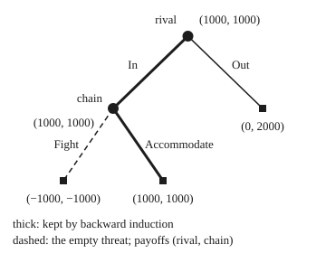

# Games in turns: draw the tree, solve from the leaves, and ignore empty threats

[Syllabus](../../../SYLLABUS.md) → [Applied and computational](../README.md) → [Operations Research](../README.md#s05) → Games in turns

---

## General Overview

The bakery chain on this shelf (4 ovens, 30 delivery vans, one warehouse) has a busy shop on a high street. A rival bakery is looking at the empty unit next door. The rival moves first: it opens there (**In**) or stays away (**Out**). If it opens, the chain moves second: it starts a price war (**Fight**) or lives with the rival (**Accommodate**). This two-move game is the **entry game**, the standard first example of a game played in turns.

Profit on that street, in pounds a month, as synthetic round numbers, rival first:

| Outcome | Rival | Chain |
| --- | ---: | ---: |
| Rival stays Out | 0 | 2,000 |
| Rival In, chain Fights | −1,000 | −1,000 |
| Rival In, chain Accommodates | 1,000 | 1,000 |

The chain's manager has a plan: warn the rival that opening means a price war. If the rival believes it, the rival stays out and the chain keeps £2,000 a month.

But look at the moment the warning is meant for. The rival has signed the lease. A price war now costs the chain £1,000 a month; peace earns it £1,000. A chain that thinks at that moment accommodates. The threat is **empty**: its maker would not carry it out. A rival who sees this opens the shop.

The tool that sees it is a **game tree**: a diagram of who moves when, ending in payoffs. Solve it from the end: settle the last decision first, then the one before it, knowing how the last will go. That is **backward induction**. Here it gives In, then Accommodate: £1,000 a month each.

The payoff table of the same game, read as in [Nash equilibrium](09-game-theory-and-nash-equilibrium.md), finds two equilibria: (In, Accommodate) and (Out, Fight). The second rests on the empty threat. **Subgame perfection** is the test that removes it.

**Draw a game played in turns as a tree, settle each last decision first and replace it by its result, and repeat back to the start: the plan this builds is subgame perfect, a best choice at every point of the game, reached or not, so no threat its maker would not carry out survives.**

**What kind of fact this is:** a definition (subgame perfection) and a method (backward induction). That backward induction on a finite tree returns a subgame-perfect equilibrium, the only one when no player is ever indifferent, is a theorem proved on this card in Why it works. That real people play this way is a model, and the centipede and ultimatum games below show where it fails.

### The picture: the entry game, solved from the leaves

<p align="center"></p>

Schematic: branch lengths mean nothing. Dots are decisions, squares are endings, payoffs read (rival, chain). The number beside each dot is what that point is worth once the game below it is solved. The dashed branch is the empty threat.

---

## The formula

Notation first, in words.

- A **node** $`h`$ is a point of the tree. At a **decision node** one player chooses; at a **leaf** the game ends and the payoffs are paid.
- $`P(h)`$ is the player who moves at $`h`$, and $`C(h)`$ are its **children**: the nodes one move later.
- $`u(h)`$ lists the payoffs at a leaf, one per player. $`u_R`$ is the rival's entry and $`u_C`$ the chain's.
- $`V(h)`$, the **value** of $`h`$, lists the payoffs the game ends with if play starts at $`h`$ and everyone chooses well from there. $`V_i(h)`$ is player $`i`$'s entry.
- $`c^*(h)`$ is the child chosen at $`h`$. The formula writes it with argmax, short for "the argument that gives the maximum": the child whose value is largest for the mover.
- A **strategy** is a complete plan: a move at every decision node the player owns, including nodes that are never reached. A **strategy profile** $`s`$ is one strategy per player.
- A **subgame** is the part of the tree that starts at one decision node, with everything below it.

Backward induction is one rule, applied from the leaves up:

```math
V(h) = u(h) \text{ at a leaf}, \qquad V(h) = V\big(c^*(h)\big) \text{ where } c^*(h) = \mathrm{argmax}_{c \in C(h)}\, V_{P(h)}(c) \text{ elsewhere}
```

**Read it aloud:** a leaf is worth its payoffs; any other node is worth what its best child is worth, where "best" is judged by the player who moves there.

The test it passes is subgame perfection:

```math
s \text{ is subgame perfect} \iff \text{for every decision node } h, \text{ the part of } s \text{ inside the subgame at } h \text{ is a Nash equilibrium of that subgame}
```

**Read it aloud:** a plan is subgame perfect when, wherever the game might stand, nobody could gain by changing their own moves from there on.

A threat can work without being carried out, if it is believed. The rival stays out when the chance $`q`$ it puts on a fight is at least $`q^*`$:

```math
q^* = \frac{u_R(\text{In, Accommodate}) - u_R(\text{Out})}{u_R(\text{In, Accommodate}) - u_R(\text{In, Fight})} = \frac{1000 - 0}{1000 - (-1000)} = 0.5
```

**Read it aloud:** the rival stays out only if it thinks a price war at least half likely: the gain from opening in peace, divided by the drop from peace to war.

| Symbol | Plain meaning | In our example | Push it up and the answer… |
| --- | --- | --- | --- |
| $`h`$ | a node: a point in the tree | the chain's node, after In | — |
| $`P(h)`$ | the player who moves at $`h`$ | the chain | — |
| $`C(h)`$; $`c`$ | the children of $`h`$, one move later; one of them | the Fight and Accommodate leaves | more children, more to compare at $`h`$ |
| $`u(h)`$; $`u_R`$, $`u_C`$ | payoffs at a leaf; the rival's and the chain's | (−1,000, −1,000) after a fight | raise $`u_C`$ after Fight above 1,000 and the threat turns credible |
| $`V(h)`$, $`V_i(h)`$ | value: the payoffs reached if everyone chooses well from $`h`$; $`V_i`$ is player $`i`$'s entry | $`V`$ of the chain's node = (1,000, 1,000) | — |
| $`c^*(h)`$ | the child chosen at $`h`$ | Accommodate | — |
| $`s`$ | a strategy profile: one complete plan per player | (In; Accommodate) | — |
| $`q`$ | the chance the rival puts on a fight after In | at 0.40, opening is worth £200 a month on average | above $`q^*`$ the rival stays out |
| $`q^*`$ | the belief the threat needs | 0.5 | the threat must be believed more strongly to keep the rival out |

### When it holds

- **Every player sees every earlier move** (perfect information). If the chain had to set prices before learning whether the rival opened, the moves would be simultaneous and the [Nash equilibrium](09-game-theory-and-nash-equilibrium.md) table would be the whole story.
- **The tree is finite.** Backward induction needs last decisions to start from. With no last town, a chain facing rivals forever can make fighting pay through its reputation, and the answer changes.
- **Payoffs are known, and everyone knows that everyone reasons this way.** Real people often do not. In the centipede game below, backward induction says take £4 at once, though passing to the end would pay the first player £64.
- **Nobody is indifferent at a node.** With a tie there can be several subgame-perfect plans. In the ultimatum game below, a responder offered nothing is indifferent, and the answer depends on how the tie breaks.
- **Promises bind only if they are in the tree.** A commitment, such as a contract penalty, is a move that changes later payoffs. Drawn in, it can make a threat credible; left out, it is talk.

---

## Why it works

### Step 0: every node starts a smaller game

Stand at the chain's node. The rival has opened, and that point with the branches below it is a game of its own, a subgame. A sensible plan for the whole game must stay sensible in every subgame, because the players might end up in any of them.

### Step 1: a Nash equilibrium only checks the path that is played

A strategy is a complete plan, so the chain's strategy "Fight" says what it would do after In, even if In never happens. Write the game as a table of complete plans:

| | Chain plans Fight | Chain plans Accommodate |
| --- | --- | --- |
| **Rival In** | −1,000, −1,000 | 1,000, 1,000 |
| **Rival Out** | 0, 2,000 | 0, 2,000 |

Mark best replies as on the [Nash equilibrium](09-game-theory-and-nash-equilibrium.md) card. (In, Accommodate) passes: the rival would lose £1,000 by staying out, the chain £2,000 by fighting. (Out, Fight) passes too. Against a chain that plans to fight, staying out (0) beats opening (−1,000). Against a rival that stays out, planning to fight costs the chain nothing: the fight is never carried out.

That is the gap: the Nash test checks only the path actually played, so a plan off that path need not be one its maker would carry out.

### Step 2: backward induction settles the last decision first

Start at the deepest decision node, the chain's. Fight gives the chain −1,000, Accommodate gives 1,000, so it accommodates. Replace that node by its result: after In, the payoffs will be (1,000, 1,000).

Now the rival's node has two plain endings. In gives the rival 1,000, Out gives 0, so it opens. The plan is (In; Accommodate), worth (1,000, 1,000). Each node is visited once: 5 nodes, 5 visits.

This is [Dynamic programming](../01-Algorithms%20and%20Growth/07-dynamic-programming.md) on a tree: each subgame is solved once and stored as its node's value. It is also the folding back of [Deciding under uncertainty](08-decision-theory-and-the-value-of-information.md), except that the next node belongs to another player, not to chance.

### Step 3: the result is subgame perfect

The proof climbs the tree a level at a time. Assume every child's subgame is already in equilibrium. Then a mover who switches to another child $`c`$ gets at most $`V(c)`$, which is no more than the child picked, and nobody else can gain inside a child's subgame.

<details>
<summary>The proof, written out by induction on the height of the subgame</summary>

Call the height of a node the longest number of moves from it to a leaf. Claim: for every decision node $`h`$, the backward-induction plan restricted to the subgame at $`h`$ is a Nash equilibrium of that subgame, and it ends at $`V(h)`$.

Height 1: every child of $`h`$ is a leaf. Only the mover $`P(h)`$ has a move, and $`c^*(h)`$ gives them the largest payoff among the leaves. No change helps them, and nobody else moves.

Height $`k + 1`$, assuming the claim for heights up to $`k`$. Every child $`c`$ of $`h`$ has height at most $`k`$, so the plan inside each child's subgame is an equilibrium ending at $`V(c)`$, and play from $`h`$ ends at $`V(c^*(h))`$.

Take any player $`i`$ and any change to $`i`$'s own moves inside the subgame at $`h`$.

If $`i`$ is not the mover, or is the mover but keeps the move $`c^*(h)`$, play still enters $`c^*(h)`$. Inside it the plan is an equilibrium, so $`i`$ ends with at most $`V_i(c^*(h))`$.

If $`i`$ is the mover and switches to a child $`c`$, play enters $`c`$. Inside $`c`$ the plan is an equilibrium, so whatever $`i`$ changes there, $`i`$ ends with at most $`V_i(c)`$. And $`c^*(h)`$ was chosen as the child with the largest $`V_i`$:

$`\displaystyle V_i(c) \le V_i\big(c^*(h)\big) = V_i(h)`$

No change helps anyone, so the plan is an equilibrium of the subgame at $`h`$. The root is a decision node, so the plan is a Nash equilibrium of every subgame: subgame perfect.

</details>

A side result: every finite game with perfect information has an equilibrium in plain choices, with no randomising needed. Backward induction builds one.

### Step 4: with no ties, it is the only one

The same climb proves uniqueness. At a deepest decision node, any subgame-perfect plan must take the best leaf, and with no tie there is exactly one. Above it, the mover must take the best child, given values already forced. So every node's move is forced, and the plan is unique.

The table has no such filter. With two towns (two rivals in turn, the chain answering each), there are 256 strategy profiles. The code tests every one: 64 are Nash equilibria, and exactly 1 is subgame perfect, the one backward induction finds.

### Step 5: credible and empty threats

A threat is **credible** when carrying it out is the threatener's best move at the node where it applies. Fight is not: −1,000 against 1,000. The threat could still work through belief: the rival stays out if it thinks a fight at least $`q^* = 0.5`$ likely. At a belief of 0.40, opening is worth £200 a month on average; at 0.60, it costs £200. A rival who reasons backward puts the chance at 0.

There is a way to make the threat credible: change the chain's own payoffs before the rival decides. Suppose the chain signs a supply contract with a penalty of £2,500 a month if it lets a rival trade next door unchallenged. Accommodating now pays the chain 1,000 − 2,500 = −1,500, worse than fighting at −1,000. The chain would fight, so the rival stays out, and the chain earns £2,000 instead of £1,000. Making its own option worse is worth £1,000 a month to it.

The penalty must be large enough to flip the chain's choice. At £1,500 accommodating still pays −500, better than −1,000, so the chain accommodates anyway and is £1,500 a month worse off than with no contract.

### Step 6: the tree is far smaller than the table

Backward induction visits each node once. The table lists every complete plan, and plans multiply. With three towns the tree has 53 nodes, 26 decision nodes and 27 leaves, and backward induction makes 53 visits. With 26 two-way choices the table has $`2^{26}`$ = 67,108,864 strategy profiles.

In every town the rival opens and the chain accommodates: £3,000 for the chain, £1,000 per rival. The reason is the last town. Whatever happened before, a fight there costs the chain £2,000 and nothing comes after to repay it, so all 9 chain nodes in town 3 accommodate. Town 2 is then the last town that matters, and so on back.

This is the **chain-store paradox**. If every rival believed "this chain always fights", all would stay out and the chain would earn £6,000. Fighting in town 1 to build that reputation earns it £1,000 in total, since rivals who reason backward open anyway. Yet real chains do fight entrants. That clash is the paradox: in a finite tree with full rationality, reputation has no room.

The 9 town-3 nodes are copies of one question with one answer, so a memo keyed on the town would solve it once: the overlapping subproblems of [Dynamic programming](../01-Algorithms%20and%20Growth/07-dynamic-programming.md).

---

## Worked numbers, by hand

| Step | Arithmetic | Value |
| --- | --- | --- |
| chain's node: Fight against Accommodate | −1,000 against 1,000, for the chain | Accommodate |
| value of the chain's node | the Accommodate leaf | (1,000, 1,000) |
| rival's node: In against Out | 1,000 against 0, for the rival | In |
| **subgame-perfect plan** | (In; Accommodate) | **£1,000 a month each** |
| Nash equilibria in the table | best replies marked, 4 profiles | (In, Accommodate), (Out, Fight) |
| belief the threat needs | (1,000 − 0) / (1,000 + 1,000) | 0.5 |
| with a £2,500 penalty | Accommodate pays 1,000 − 2,500 = −1,500 < −1,000 | Fight is credible; rival Out |
| value of that commitment | 2,000 − 1,000 | £1,000 a month |
| three towns | 53 nodes visited against $`2^{26}`$ profiles | chain £3,000, each rival £1,000 |

The rival should open: the price war is a warning the chain would regret carrying out, and both bakeries then earn £1,000 a month on that street.

### What breaks if you drop a piece

| Mistake | Comes out at | What went wrong |
| --- | --- | --- |
| Rival trusts the (Out, Fight) equilibrium | rival earns 0, giving up £1,000 a month | It passes the Nash test only because the fight is never carried out |
| Chain carries out the threat after In | chain earns −1,000, losing £2,000 a month | At its own node, fighting is the worse move |
| Chain fights in town 1 to build a reputation | chain earns £1,000 over three towns, not £3,000 | Rivals reasoning back from town 3 open anyway |
| Centipede: backward induction trusted as a forecast | take at move 1: (£4, £1), though passing to the end pays (£64, £16) | Assumes each player is sure the other reasons backward |
| Ultimatum over £10: the same | offer 10p, proposer keeps £9.90 | Real responders turn down offers they find unfair |

The code prints every row.

The last two rows are warnings about the model, not slips of arithmetic.

- In the **centipede game** two players take turns to take the larger share of a pot or pass, and each pass doubles the pot. At the last move taking beats passing, so the move before takes too, and so on back to a take at the first move.
- In the **ultimatum game** one player proposes a split of £10 and the other accepts or rejects; rejection leaves both with nothing. Any positive offer beats nothing, so the proposer offers 10p. In experiments, many low offers are turned down and many proposers offer far more.

---

## Code, from first principles, and it actually runs

Nothing is imported. The script stores a game tree as a flat list of nodes and takes three independent roads. Road one is backward induction, counting the nodes it visits. Road two builds every strategy profile, tests each for Nash equilibrium (no player gains by changing any of their own moves), and tests the survivors at every decision node for subgame perfection; it shares no code with road one beyond the tree. Road three finds the belief threshold by the formula and by a grid over beliefs in steps of 1/100, in whole numbers. The same solver then handles the commitment contract, two and three towns, the centipede game and the ultimatum game, and prints the figure's node positions.

### Python

```python
# Games in turns -- the check behind the card.  Nothing is imported.  A rival bakery
# goes In next to one of the chain's shops or stays Out; after In the chain will Fight
# (price war) or Accommodate.  Synthetic pounds a month, (rival, chain): Out (0, 2000),
# Fight (-1000, -1000), Accommodate (1000, 1000).  Roads: (1) backward induction; (2)
# every profile tested for Nash and subgame perfection; (3) a threat's belief threshold.
OUT, FIGHT, ACC = (0, 2000), (-1000, -1000), (1000, 1000)

def chain_store(towns, acc_chain=ACC[1]):    # flat tree of (player, payoffs, kids); leaf: -1
    nodes = []                                # players 0..towns-1 are rivals, `towns` the chain
    def build(k, pay):
        i = len(nodes)
        nodes.append(None)
        if k == towns:
            nodes[i] = (-1, tuple(pay), [])
            return i
        def add(rival, chain):                 # town k's payoffs go to rival k and the chain
            return build(k + 1, [v + (rival if n == k else chain if n == towns else 0) for n, v in enumerate(pay)])
        c = len(nodes)
        nodes.append(None)
        nodes[c] = (towns, None, [add(*FIGHT), add(ACC[0], acc_chain)])
        nodes[i] = (k, None, [c, add(*OUT)])
        return i
    build(0, [0] * (towns + 1))
    return nodes

def solve(nodes, i, plan, visits):            # road 1: backward induction
    visits[0] += 1
    player, pay, kids = nodes[i]
    if player < 0:
        return pay
    values = [solve(nodes, c, plan, visits) for c in kids]
    plan[i] = max(range(len(kids)), key=lambda j: (values[j][player], -j))   # ties: first child
    return values[plan[i]]

def run(nodes):
    plan, visits = [0] * len(nodes), [0]
    return plan, solve(nodes, 0, plan, visits), visits[0]

def play(nodes, i, prof):                     # follow a profile down to a leaf
    while nodes[i][0] >= 0:
        i = nodes[i][2][prof[i]]
    return nodes[i][1]

def stable(nodes, h, prof, owners):           # nobody gains by changing own moves, from h
    for p, own in owners.items():
        base = play(nodes, h, prof)[p]
        for bits in range(2 ** len(own)):
            alt = list(prof)
            for b, n in enumerate(own):
                alt[n] = bits >> b & 1
            if play(nodes, h, alt)[p] > base:
                return False
    return True

def exhaustive(nodes):                        # road 2: every profile, tested
    dec = [i for i, n in enumerate(nodes) if n[0] >= 0]
    owners = {}
    for i in dec:
        owners.setdefault(nodes[i][0], []).append(i)
    ne, spe = [], []
    for bits in range(2 ** len(dec)):
        prof = [0] * len(nodes)
        for b, n in enumerate(dec):
            prof[n] = bits >> b & 1
        if stable(nodes, 0, prof, owners):
            ne.append(prof)
            if all(stable(nodes, h, prof, owners) for h in dec):
                spe.append(prof)
    return dec, ne, spe

def layout(nodes, i, depth, xs, pos):         # figure: leaves 110 apart, parents centred
    if nodes[i][0] < 0:
        x = 70 + 110 * len(xs)
        xs.append(x)
    else:
        x = sum(layout(nodes, c, depth + 1, xs, pos)[0] for c in nodes[i][2]) / 2
    pos[i] = (x, 40 + 80 * depth)
    return pos[i]

fmt = lambda p: "(" + ", ".join(str(v) for v in p) + ")"
MOVES = [("In", "Out"), ("Fight", "Accommodate")]
g = chain_store(1)
plan, spe_pay, visits = run(g)
print(f"entry game: {len(g)} nodes, payoffs listed (rival, chain)")
print(f"chain's node: Fight gives the chain {FIGHT[1]}, Accommodate {ACC[1]} -> {MOVES[1][plan[1]]}")
print(f"rival's node: In gives the rival {ACC[0]}, Out {OUT[0]} -> {MOVES[0][plan[0]]}")
print(f"road 1, backward induction: rival {MOVES[0][plan[0]]}, chain {MOVES[1][plan[1]]}, payoffs {fmt(spe_pay)}, nodes visited {visits}")
dec, ne, spe = exhaustive(g)
name = lambda p: f"rival {MOVES[0][p[0]]} / chain {MOVES[1][p[1]]} {fmt(play(g, 0, p))}"
print(f"road 2, all {2 ** len(dec)} profiles, Nash equilibria: " + "; ".join(name(p) for p in ne))
print(f"road 2, subgame perfect: " + "; ".join(name(p) for p in spe) + f"; matches road 1: {'yes' if spe == [plan] else 'no'}")
q_formula = (ACC[0] - OUT[0]) / (ACC[0] - FIGHT[0])
j = 0
while j * FIGHT[0] + (100 - j) * ACC[0] > 100 * OUT[0]:
    j += 1
print(f"road 3, belief in a fight that keeps the rival out: formula {ACC[0] - OUT[0]}/{ACC[0] - FIGHT[0]} = {q_formula:.2f}; grid {j}/100 = {j / 100:.2f}")
print(f"rival's expected gain from In if a fight is believed 0.40 likely: {(40 * FIGHT[0] + 60 * ACC[0]) // 100}; 0.60 likely: {(60 * FIGHT[0] + 40 * ACC[0]) // 100}")
com = [(pen, run(chain_store(1, ACC[1] - pen))) for pen in (2500, 1500)]
for pen, (cplan, cpay, _) in com:
    print(f"commitment, penalty {pen}: Accommodate pays the chain {ACC[1]} - {pen} = {ACC[1] - pen}; chain {MOVES[1][cplan[1]]}, "
          f"rival {MOVES[0][cplan[0]]}, payoffs {fmt(cpay)}; worth {cpay[1] - spe_pay[1]} a month to the chain")
g2 = chain_store(2)
plan2 = run(g2)[0]
dec2, ne2, spe2 = exhaustive(g2)
same2 = len(spe2) == 1 and all(spe2[0][i] == plan2[i] for i in dec2)
print(f"two towns: {2 ** len(dec2)} profiles, {len(ne2)} Nash equilibria, {len(spe2)} subgame perfect; matches road 1: {'yes' if same2 else 'no'}")
g3 = chain_store(3)
plan3, pay3, visits3 = run(g3)
d3 = sum(1 for n in g3 if n[0] >= 0)
print(f"three towns: backward induction visits {visits3} nodes ({d3} decisions, {visits3 - d3} leaves); the table has 2^{d3} = {2 ** d3} profiles")
last = [i for i, n in enumerate(g3) if n[0] == 3 and g3[n[2][0]][0] < 0]
print(f"three towns, payoffs {fmt(pay3)}; town-3 chain nodes {len(last)}, accommodating at {sum(plan3[i] for i in last)}")
scared = [1 if n[0] in (0, 1, 2) else 0 for n in g3]          # every rival Out, chain Fight
early = plan3[:1] + [0] + plan3[2:]                            # chain fights in town 1 only
print(f"if every rival believed 'always fight': chain {play(g3, 0, scared)[3]}; fighting in town 1, then accommodating: chain {play(g3, 0, early)[3]}")
TAKES, END = [(4, 1), (2, 8), (16, 4), (8, 32)], (64, 16)
cen = []
for m, pay in enumerate(TAKES):
    cen += [(m % 2, None, [2 * m + 1, 2 * m + 2]), (-1, pay, [])]
cen.append((-1, END, []))
cplan2, cval, _ = run(cen)
print(f"centipede: backward induction takes at move {cplan2[0] + 1} with {fmt(cval)}; passing to the end pays {fmt(END)}")
ult = [(0, None, [])]                                          # offers 0..100 tenpences of 1000p
for o in range(101):
    ult[0][2].append(len(ult))
    ult += [(1, None, [len(ult) + 1, len(ult) + 2]), (-1, (0, 0), []), (-1, (100 - o, o), [])]
uplan, uval, _ = run(ult)
print(f"ultimatum over £10 (1000p) in 10p steps: offer {10 * uplan[0]}p, proposer keeps {10 * uval[0]}p ({len(ult)} nodes)")
print(f"mistakes: rival trusting (Out, Fight) gives up {spe_pay[0] - OUT[0]}; chain carrying out the threat loses {ACC[1] - FIGHT[1]}; "
      f"one reputation fight costs {pay3[3] - play(g3, 0, early)[3]}")
pos = {}
layout(g, 0, 0, [], pos)
print("figure, " + ", ".join(f"{k} ({pos[i][0]:.1f}, {pos[i][1]})" for k, i in
      [("rival", 0), ("chain", 1), ("fight", 2), ("accommodate", 3), ("out", 4)]))
assert spe == [plan] and plan[0] == 0 and plan[1] == 1          # road 2 agrees with road 1
assert len(ne) == 2 and play(g, 0, ne[0]) == OUT                 # the empty-threat equilibrium
assert j / 100 == q_formula                                      # road 3: grid meets formula
assert same2 and pay3[3] == 3 * ACC[1] and visits3 == len(g3) == 53
assert com[0][1][1] == OUT and cval == TAKES[0] and uplan[0] == 1
print("ALL CHECKS PASS")
```

**Ran 2026-11-23 on macOS, Python 3.14.10, standard library only. All checks passed. Output, pasted from the run:**

```
entry game: 5 nodes, payoffs listed (rival, chain)
chain's node: Fight gives the chain -1000, Accommodate 1000 -> Accommodate
rival's node: In gives the rival 1000, Out 0 -> In
road 1, backward induction: rival In, chain Accommodate, payoffs (1000, 1000), nodes visited 5
road 2, all 4 profiles, Nash equilibria: rival Out / chain Fight (0, 2000); rival In / chain Accommodate (1000, 1000)
road 2, subgame perfect: rival In / chain Accommodate (1000, 1000); matches road 1: yes
road 3, belief in a fight that keeps the rival out: formula 1000/2000 = 0.50; grid 50/100 = 0.50
rival's expected gain from In if a fight is believed 0.40 likely: 200; 0.60 likely: -200
commitment, penalty 2500: Accommodate pays the chain 1000 - 2500 = -1500; chain Fight, rival Out, payoffs (0, 2000); worth 1000 a month to the chain
commitment, penalty 1500: Accommodate pays the chain 1000 - 1500 = -500; chain Accommodate, rival In, payoffs (1000, -500); worth -1500 a month to the chain
two towns: 256 profiles, 64 Nash equilibria, 1 subgame perfect; matches road 1: yes
three towns: backward induction visits 53 nodes (26 decisions, 27 leaves); the table has 2^26 = 67108864 profiles
three towns, payoffs (1000, 1000, 1000, 3000); town-3 chain nodes 9, accommodating at 9
if every rival believed 'always fight': chain 6000; fighting in town 1, then accommodating: chain 1000
centipede: backward induction takes at move 1 with (4, 1); passing to the end pays (64, 16)
ultimatum over £10 (1000p) in 10p steps: offer 10p, proposer keeps 990p (304 nodes)
mistakes: rival trusting (Out, Fight) gives up 1000; chain carrying out the threat loses 2000; one reputation fight costs 2000
figure, rival (207.5, 40), chain (125.0, 120), fight (70.0, 200), accommodate (180.0, 200), out (290.0, 120)
ALL CHECKS PASS
```

### Rust

Same numbers, same labels, built with `rustc --edition 2021 -O`.

```rust
// Games in turns -- the same check as the Python, in Rust.  No crates.  A rival bakery
// goes In next to one of the chain's shops or stays Out; after In the chain will Fight
// (price war) or Accommodate.  Synthetic pounds a month, (rival, chain): Out (0, 2000),
// Fight (-1000, -1000), Accommodate (1000, 1000).  Roads: (1) backward induction; (2)
// every profile tested for Nash and subgame perfection; (3) a threat's belief threshold.
const OUT: (i64, i64) = (0, 2000);
const FIGHT: (i64, i64) = (-1000, -1000);
const ACC: (i64, i64) = (1000, 1000);
const MOVES: [[&str; 2]; 2] = [["In", "Out"], ["Fight", "Accommodate"]];

struct Node { player: i64, pay: Vec<i64>, kids: Vec<usize> }   // a leaf has player -1
fn leaf(pay: Vec<i64>) -> Node { Node { player: -1, pay, kids: vec![] } }

fn build(nodes: &mut Vec<Node>, towns: usize, acc_chain: i64, k: usize, pay: Vec<i64>) -> usize {
    let i = nodes.len();
    nodes.push(leaf(vec![]));
    if k == towns { nodes[i] = leaf(pay); return i; }
    let c = nodes.len();
    nodes.push(leaf(vec![]));
    let add = |nodes: &mut Vec<Node>, rival: i64, chain: i64| {   // town k's payoffs
        let mut p = pay.clone();
        p[k] += rival;
        p[towns] += chain;
        build(nodes, towns, acc_chain, k + 1, p)
    };
    let f = add(nodes, FIGHT.0, FIGHT.1);
    let a = add(nodes, ACC.0, acc_chain);
    let o = add(nodes, OUT.0, OUT.1);
    nodes[c] = Node { player: towns as i64, pay: vec![], kids: vec![f, a] };
    nodes[i] = Node { player: k as i64, pay: vec![], kids: vec![c, o] };
    i
}
fn chain_store(towns: usize, acc_chain: i64) -> Vec<Node> {      // players 0..towns-1 rivals
    let mut nodes = Vec::new();
    build(&mut nodes, towns, acc_chain, 0, vec![0; towns + 1]);
    nodes
}
fn solve(nodes: &[Node], i: usize, plan: &mut Vec<usize>, visits: &mut usize) -> Vec<i64> {
    *visits += 1;                                                 // road 1: backward induction
    let n = &nodes[i];
    if n.player < 0 { return n.pay.clone(); }
    let values: Vec<Vec<i64>> = n.kids.iter().map(|&c| solve(nodes, c, plan, visits)).collect();
    let p = n.player as usize;
    let mut best = 0;
    for j in 1..values.len() { if values[j][p] > values[best][p] { best = j; } }  // ties: first
    plan[i] = best;
    values[best].clone()
}
fn run(nodes: &[Node]) -> (Vec<usize>, Vec<i64>, usize) {
    let (mut plan, mut visits) = (vec![0; nodes.len()], 0);
    let v = solve(nodes, 0, &mut plan, &mut visits);
    (plan, v, visits)
}
fn play(nodes: &[Node], mut i: usize, prof: &[usize]) -> Vec<i64> {
    while nodes[i].player >= 0 { i = nodes[i].kids[prof[i]]; }
    nodes[i].pay.clone()
}
fn stable(nodes: &[Node], h: usize, prof: &[usize], owners: &[(usize, Vec<usize>)]) -> bool {
    for (p, own) in owners {                                      // nobody gains alone, from h
        let base = play(nodes, h, prof)[*p];
        for bits in 0..(1usize << own.len()) {
            let mut alt = prof.to_vec();
            for (b, &n) in own.iter().enumerate() { alt[n] = bits >> b & 1; }
            if play(nodes, h, &alt)[*p] > base { return false; }
        }
    }
    true
}
fn exhaustive(nodes: &[Node]) -> (Vec<usize>, Vec<Vec<usize>>, Vec<Vec<usize>>) {   // road 2
    let dec: Vec<usize> = (0..nodes.len()).filter(|&i| nodes[i].player >= 0).collect();
    let mut owners: Vec<(usize, Vec<usize>)> = Vec::new();
    for &i in &dec {
        let p = nodes[i].player as usize;
        match owners.iter_mut().find(|o| o.0 == p) { Some(o) => o.1.push(i), None => owners.push((p, vec![i])) }
    }
    let (mut ne, mut spe) = (Vec::new(), Vec::new());
    for bits in 0..(1usize << dec.len()) {
        let mut prof = vec![0; nodes.len()];
        for (b, &n) in dec.iter().enumerate() { prof[n] = bits >> b & 1; }
        if stable(nodes, 0, &prof, &owners) {
            if dec.iter().all(|&h| stable(nodes, h, &prof, &owners)) { spe.push(prof.clone()); }
            ne.push(prof);
        }
    }
    (dec, ne, spe)
}
fn layout(nodes: &[Node], i: usize, depth: i64, xs: &mut Vec<f64>, pos: &mut Vec<(f64, i64)>) -> f64 {
    let x = if nodes[i].player < 0 {
        let x = 70.0 + 110.0 * xs.len() as f64;
        xs.push(x);
        x
    } else {
        nodes[i].kids.iter().map(|&c| layout(nodes, c, depth + 1, xs, pos)).sum::<f64>() / 2.0
    };
    pos[i] = (x, 40 + 80 * depth);
    x
}
fn fmt(p: &[i64]) -> String { format!("({})", p.iter().map(|v| v.to_string()).collect::<Vec<_>>().join(", ")) }
fn yn(b: bool) -> &'static str { if b { "yes" } else { "no" } }

fn main() {
    let g = chain_store(1, ACC.1);
    let (plan, spe_pay, visits) = run(&g);
    println!("entry game: {} nodes, payoffs listed (rival, chain)", g.len());
    println!("chain's node: Fight gives the chain {}, Accommodate {} -> {}", FIGHT.1, ACC.1, MOVES[1][plan[1]]);
    println!("rival's node: In gives the rival {}, Out {} -> {}", ACC.0, OUT.0, MOVES[0][plan[0]]);
    println!("road 1, backward induction: rival {}, chain {}, payoffs {}, nodes visited {}", MOVES[0][plan[0]], MOVES[1][plan[1]], fmt(&spe_pay), visits);
    let (dec, ne, spe) = exhaustive(&g);
    let name = |p: &Vec<usize>| format!("rival {} / chain {} {}", MOVES[0][p[0]], MOVES[1][p[1]], fmt(&play(&g, 0, p)));
    println!("road 2, all {} profiles, Nash equilibria: {}", 1usize << dec.len(), ne.iter().map(|p| name(p)).collect::<Vec<_>>().join("; "));
    println!("road 2, subgame perfect: {}; matches road 1: {}", spe.iter().map(|p| name(p)).collect::<Vec<_>>().join("; "), yn(spe == vec![plan.clone()]));
    let q_formula = (ACC.0 - OUT.0) as f64 / (ACC.0 - FIGHT.0) as f64;
    let mut j = 0i64;
    while j * FIGHT.0 + (100 - j) * ACC.0 > 100 * OUT.0 { j += 1; }
    println!("road 3, belief in a fight that keeps the rival out: formula {}/{} = {:.2}; grid {}/100 = {:.2}", ACC.0 - OUT.0, ACC.0 - FIGHT.0, q_formula, j, j as f64 / 100.0);
    println!("rival's expected gain from In if a fight is believed 0.40 likely: {}; 0.60 likely: {}", (40 * FIGHT.0 + 60 * ACC.0) / 100, (60 * FIGHT.0 + 40 * ACC.0) / 100);
    let com: Vec<(i64, (Vec<usize>, Vec<i64>, usize))> = [2500, 1500].iter().map(|&pen| (pen, run(&chain_store(1, ACC.1 - pen)))).collect();
    for (pen, (cplan, cpay, _)) in &com {
        println!("commitment, penalty {}: Accommodate pays the chain {} - {} = {}; chain {}, rival {}, payoffs {}; worth {} a month to the chain",
                 pen, ACC.1, pen, ACC.1 - pen, MOVES[1][cplan[1]], MOVES[0][cplan[0]], fmt(cpay), cpay[1] - spe_pay[1]);
    }
    let g2 = chain_store(2, ACC.1);
    let plan2 = run(&g2).0;
    let (dec2, ne2, spe2) = exhaustive(&g2);
    let same2 = spe2.len() == 1 && dec2.iter().all(|&i| spe2[0][i] == plan2[i]);
    println!("two towns: {} profiles, {} Nash equilibria, {} subgame perfect; matches road 1: {}", 1usize << dec2.len(), ne2.len(), spe2.len(), yn(same2));
    let g3 = chain_store(3, ACC.1);
    let (plan3, pay3, visits3) = run(&g3);
    let d3 = g3.iter().filter(|n| n.player >= 0).count();
    println!("three towns: backward induction visits {} nodes ({} decisions, {} leaves); the table has 2^{} = {} profiles", visits3, d3, visits3 - d3, d3, 1u64 << d3);
    let last: Vec<usize> = (0..g3.len()).filter(|&i| g3[i].player == 3 && g3[g3[i].kids[0]].player < 0).collect();
    println!("three towns, payoffs {}; town-3 chain nodes {}, accommodating at {}", fmt(&pay3), last.len(), last.iter().map(|&i| plan3[i]).sum::<usize>());
    let scared: Vec<usize> = g3.iter().map(|n| if (0..3).contains(&n.player) { 1 } else { 0 }).collect();
    let mut early = plan3.clone();
    early[1] = 0;                                                 // chain fights in town 1 only
    let early_chain = play(&g3, 0, &early)[3];
    println!("if every rival believed 'always fight': chain {}; fighting in town 1, then accommodating: chain {}", play(&g3, 0, &scared)[3], early_chain);
    let takes = [[4i64, 1], [2, 8], [16, 4], [8, 32]];
    let end = vec![64i64, 16];
    let mut cen = Vec::new();
    for (m, pay) in takes.iter().enumerate() {
        cen.push(Node { player: (m % 2) as i64, pay: vec![], kids: vec![2 * m + 1, 2 * m + 2] });
        cen.push(leaf(pay.to_vec()));
    }
    cen.push(leaf(end.clone()));
    let (cplan2, cval, _) = run(&cen);
    println!("centipede: backward induction takes at move {} with {}; passing to the end pays {}", cplan2[0] + 1, fmt(&cval), fmt(&end));
    let mut ult = vec![Node { player: 0, pay: vec![], kids: vec![] }];   // offers 0..100 tenpences
    for o in 0..=100i64 {
        let n = ult.len();
        ult[0].kids.push(n);
        ult.push(Node { player: 1, pay: vec![], kids: vec![n + 1, n + 2] });
        ult.push(leaf(vec![0, 0]));
        ult.push(leaf(vec![100 - o, o]));
    }
    let (uplan, uval, _) = run(&ult);
    println!("ultimatum over £10 (1000p) in 10p steps: offer {}p, proposer keeps {}p ({} nodes)", 10 * uplan[0], 10 * uval[0], ult.len());
    println!("mistakes: rival trusting (Out, Fight) gives up {}; chain carrying out the threat loses {}; one reputation fight costs {}", spe_pay[0] - OUT.0, ACC.1 - FIGHT.1, pay3[3] - early_chain);
    let mut pos = vec![(0.0, 0i64); g.len()];
    layout(&g, 0, 0, &mut Vec::new(), &mut pos);
    let keys = [("rival", 0), ("chain", 1), ("fight", 2), ("accommodate", 3), ("out", 4)];
    println!("figure, {}", keys.iter().map(|(k, i)| format!("{} ({:.1}, {})", k, pos[*i].0, pos[*i].1)).collect::<Vec<_>>().join(", "));
    assert!(spe == vec![plan.clone()] && plan[0] == 0 && plan[1] == 1);   // road 2 agrees with road 1
    assert!(ne.len() == 2 && play(&g, 0, &ne[0]) == vec![OUT.0, OUT.1]);    // the empty-threat equilibrium
    assert!(j as f64 / 100.0 == q_formula);                                  // road 3: grid meets formula
    assert!(same2 && pay3[3] == 3 * ACC.1 && visits3 == g3.len() && g3.len() == 53);
    assert!(com[0].1 .1 == vec![OUT.0, OUT.1] && cval == takes[0].to_vec() && uplan[0] == 1);
    println!("ALL CHECKS PASS");
}
```

**Ran 2026-11-23 on macOS, rustc 1.98.1, no crates. All checks passed. Output, pasted from the run:**

```
entry game: 5 nodes, payoffs listed (rival, chain)
chain's node: Fight gives the chain -1000, Accommodate 1000 -> Accommodate
rival's node: In gives the rival 1000, Out 0 -> In
road 1, backward induction: rival In, chain Accommodate, payoffs (1000, 1000), nodes visited 5
road 2, all 4 profiles, Nash equilibria: rival Out / chain Fight (0, 2000); rival In / chain Accommodate (1000, 1000)
road 2, subgame perfect: rival In / chain Accommodate (1000, 1000); matches road 1: yes
road 3, belief in a fight that keeps the rival out: formula 1000/2000 = 0.50; grid 50/100 = 0.50
rival's expected gain from In if a fight is believed 0.40 likely: 200; 0.60 likely: -200
commitment, penalty 2500: Accommodate pays the chain 1000 - 2500 = -1500; chain Fight, rival Out, payoffs (0, 2000); worth 1000 a month to the chain
commitment, penalty 1500: Accommodate pays the chain 1000 - 1500 = -500; chain Accommodate, rival In, payoffs (1000, -500); worth -1500 a month to the chain
two towns: 256 profiles, 64 Nash equilibria, 1 subgame perfect; matches road 1: yes
three towns: backward induction visits 53 nodes (26 decisions, 27 leaves); the table has 2^26 = 67108864 profiles
three towns, payoffs (1000, 1000, 1000, 3000); town-3 chain nodes 9, accommodating at 9
if every rival believed 'always fight': chain 6000; fighting in town 1, then accommodating: chain 1000
centipede: backward induction takes at move 1 with (4, 1); passing to the end pays (64, 16)
ultimatum over £10 (1000p) in 10p steps: offer 10p, proposer keeps 990p (304 nodes)
mistakes: rival trusting (Out, Fight) gives up 1000; chain carrying out the threat loses 2000; one reputation fight costs 2000
figure, rival (207.5, 40), chain (125.0, 120), fight (70.0, 200), accommodate (180.0, 200), out (290.0, 120)
ALL CHECKS PASS
```

The two outputs match line for line.

### Lean

Lean proves Steps 3 and 4 for every finite tree with perfect information, any number of players and moves, and checks the card's worked numbers.

- Take any finite game tree. Then backward induction builds at least one complete plan, and every plan it builds, whatever the tie-break, is subgame perfect.
- Take any finite game tree in which no mover is ever indifferent. Then every subgame-perfect plan makes the backward-induction move at every decision node, reached or not.
- In the entry game, (Out; Fight) is a Nash equilibrium but not subgame perfect, and (In; Accommodate) is what backward induction builds.
- Backward induction gives (1,000, 1,000) in the entry game, (0, 2,000) with a £2,500 penalty, and (1,000, −500) with £1,500.
- Take the entry game's payoffs. Then $`q^* = 0.5`$; at a belief of 0.40 opening is worth £200 a month, and at 0.60 it costs £200.
- With three towns the tree has 53 nodes and 26 decision nodes. Backward induction gives the chain £3,000 and each rival £1,000.
- In the centipede game backward induction takes at move 1, at (£4, £1). In the ultimatum game over £10 the proposer offers 10p and keeps £9.90.

Listing all Nash equilibria, the two-town table of 256 profiles, the visit counts and the figure are left to the Python and Rust checks.

```lean
-- Games in turns: on a finite game tree with perfect information, backward induction builds a plan that is subgame perfect, it is the only subgame-perfect plan when nobody is ever indifferent, and in the entry game the empty-threat plan (Out, Fight) is a Nash equilibrium that is not subgame perfect.
import Mathlib.Data.Fintype.Basic
import Mathlib.Data.Fin.VecNotation
import Mathlib.Algebra.Order.Field.Rat
import Mathlib.Tactic.NormNum
import Mathlib.Tactic.FinCases

/-! A finite game played in turns, with perfect information, as a tree. A leaf pays each player
`i : ι` the amount `u i`. A decision node is owned by one player `p`, who sees every earlier move
and picks one of its `n + 1` children (at least one). The tree is an inductive type, so it is
finite: every path from the root reaches a leaf.

A node is named by its path from the root: the list of child numbers taken to reach it. A
strategy profile `σ` is a complete plan: for every node, the child number chosen there, including
nodes that are never reached. A number past the last child means the last child. -/

universe u v

inductive GameTree (ι : Type u) (R : Type v) : Type (max u v) where
  | leaf (u : ι → R) : GameTree ι R
  | node (p : ι) (n : ℕ) (kids : Fin (n + 1) → GameTree ι R) : GameTree ι R

namespace GameTree

variable {ι : Type u} {R : Type v}

/-- A strategy profile: at the node with path `q`, choose child number `σ q`. -/
abbrev Profile := List ℕ → ℕ

/-- The child actually taken when the plan says `k` at a node with `n + 1` children. -/
def pick (n k : ℕ) : Fin (n + 1) := ⟨min k n, Nat.lt_succ_of_le (Nat.min_le_right k n)⟩

/-- The plan seen from the node with path `q`: paths are measured from that node. -/
def shift (σ : Profile) (q : List ℕ) : Profile := fun r => σ (q ++ r)

/-- The payoffs reached when everyone follows the profile `σ` from the root. -/
def outcome : GameTree ι R → Profile → ι → R
  | leaf u, _ => u
  | node _ n kids, σ => outcome (kids (pick n (σ []))) (shift σ [(pick n (σ [])).val])

/-- The subgame starting at the node with path `q`, if that path is in the tree. -/
def subgame : GameTree ι R → List ℕ → Option (GameTree ι R)
  | t, [] => some t
  | leaf _, _ :: _ => none
  | node _ n kids, k :: q => if h : k < n + 1 then subgame (kids ⟨k, h⟩) q else none

/-- A decision node, as opposed to a leaf. -/
def IsDecision : GameTree ι R → Prop
  | leaf _ => False
  | node _ _ _ => True

/-- `σ'` is a change by player `i` alone: it differs from `σ` only at decision nodes of `t`
that `i` owns. -/
def IsDeviation (t : GameTree ι R) (i : ι) (σ σ' : Profile) : Prop :=
  ∀ q, σ' q ≠ σ q → ∃ n kids, t.subgame q = some (node i n kids)

/-- Nash equilibrium: no player gains by changing any of their own moves. -/
def IsNash [Preorder R] (t : GameTree ι R) (σ : Profile) : Prop :=
  ∀ (i : ι) (σ' : Profile), IsDeviation t i σ σ' → t.outcome σ' i ≤ t.outcome σ i

/-- Subgame perfect: for every decision node `h`, the part of `σ` inside the subgame at `h` is a
Nash equilibrium of that subgame. -/
def IsSubgamePerfect [Preorder R] (t : GameTree ι R) (σ : Profile) : Prop :=
  ∀ (q : List ℕ) (s : GameTree ι R), t.subgame q = some s → s.IsDecision →
    IsNash s (shift σ q)

/-- `σ` is a result of backward induction: at every decision node `h` of the tree, the child it
picks, `c*(h)`, has the largest value `V_{P(h)}(c)` for the mover among all children, where the
value `V(c)` of a child is the payoff vector reached by playing `σ` from that child. This is the
card's rule `V(h) = V(c*(h))` with `c*(h) = argmax_{c ∈ C(h)} V_{P(h)}(c)`, with any tie-break. -/
def FollowsBackwardInduction [Preorder R] (t : GameTree ι R) (σ : Profile) : Prop :=
  ∀ (q : List ℕ) (p : ι) (n : ℕ) (kids : Fin (n + 1) → GameTree ι R),
    t.subgame q = some (node p n kids) →
    ∀ c : Fin (n + 1), (kids c).outcome (shift σ (q ++ [c.val])) p ≤
      (kids (pick n (σ q))).outcome (shift σ (q ++ [(pick n (σ q)).val])) p

/-- The first child whose value is largest for player `p` (ties go to the first child). -/
def bestChild [LinearOrder R] (p : ι) : (n : ℕ) → (Fin (n + 1) → ι → R) → Fin (n + 1)
  | 0, _ => 0
  | n + 1, v =>
    let c := bestChild p n (fun j => v j.castSucc)
    if v c.castSucc p < v (Fin.last (n + 1)) p then Fin.last (n + 1) else c.castSucc

/-- The backward-induction value `V(h)`: a leaf is worth its payoffs; any other node is worth
what its best child is worth, judged by the mover (ties to the first child). -/
def biValue [LinearOrder R] : GameTree ι R → ι → R
  | leaf u => u
  | node p n kids =>
    let vs := fun c => biValue (kids c)
    vs (bestChild p n vs)

/-- Nobody is indifferent at a node: at every decision node the mover's values of the
different children are all different. -/
def NoTies [LinearOrder R] (t : GameTree ι R) : Prop :=
  ∀ (q : List ℕ) (p : ι) (n : ℕ) (kids : Fin (n + 1) → GameTree ι R),
    t.subgame q = some (node p n kids) →
    Function.Injective (fun c : Fin (n + 1) => biValue (kids c) p)

/-- Number of nodes, and number of decision nodes. -/
def size : GameTree ι R → ℕ
  | leaf _ => 1
  | node _ _ kids => 1 + (List.ofFn fun c => size (kids c)).sum

def decisions : GameTree ι R → ℕ
  | leaf _ => 0
  | node _ _ kids => 1 + (List.ofFn fun c => decisions (kids c)).sum

/-! Helper lemmas for the proofs below. -/

theorem shift_shift (σ : Profile) (a b : List ℕ) : shift (shift σ a) b = shift σ (a ++ b) := by
  funext r; simp [shift, List.append_assoc]

#print axioms shift_shift

theorem pick_val (n : ℕ) (c : Fin (n + 1)) : pick n c.val = c := by
  apply Fin.ext; simp [pick]; omega

#print axioms pick_val

theorem subgame_append (t s : GameTree ι R) (q r : List ℕ) (h : t.subgame q = some s) :
    t.subgame (q ++ r) = s.subgame r := by
  induction q generalizing t with
  | nil => simp [subgame] at h; subst h; simp
  | cons k q ih =>
    cases t with
    | leaf u => simp [subgame] at h
    | node p n kids =>
      simp only [subgame] at h
      split_ifs at h with hk
      simp only [List.cons_append, subgame, hk, ↓reduceDIte]
      exact ih _ h

#print axioms subgame_append

theorem subgame_kid (p : ι) (n : ℕ) (kids : Fin (n + 1) → GameTree ι R) (c : Fin (n + 1)) :
    (node p n kids).subgame [c.val] = some (kids c) := by
  simp [subgame, c.isLt]

#print axioms subgame_kid

theorem follows_sub [Preorder R] {t s : GameTree ι R} {σ : Profile} {q : List ℕ}
    (h : FollowsBackwardInduction t σ) (hs : t.subgame q = some s) :
    FollowsBackwardInduction s (shift σ q) := by
  intro r p n kids hr c
  have := h (q ++ r) p n kids (by rw [subgame_append t s q r hs, hr]) c
  simp only [shift_shift, List.append_assoc] at this ⊢
  exact this

#print axioms follows_sub

theorem dev_sub {t s : GameTree ι R} {i : ι} {σ σ' : Profile} {q : List ℕ}
    (h : IsDeviation t i σ σ') (hs : t.subgame q = some s) :
    IsDeviation s i (shift σ q) (shift σ' q) := by
  intro r hr
  obtain ⟨n, kids, hk⟩ := h (q ++ r) hr
  exact ⟨n, kids, by rw [← subgame_append t s q r hs, hk]⟩

#print axioms dev_sub

theorem spe_sub [Preorder R] {t s : GameTree ι R} {σ : Profile} {q : List ℕ}
    (h : IsSubgamePerfect t σ) (hs : t.subgame q = some s) :
    IsSubgamePerfect s (shift σ q) := by
  intro r x hr hx
  have := h (q ++ r) x (by rw [subgame_append t s q r hs, hr]) hx
  rw [shift_shift]
  exact this

#print axioms spe_sub

theorem noTies_sub [LinearOrder R] {t s : GameTree ι R} {q : List ℕ}
    (h : NoTies t) (hs : t.subgame q = some s) : NoTies s := by
  intro r p n kids hr
  exact h (q ++ r) p n kids (by rw [subgame_append t s q r hs, hr])

#print axioms noTies_sub

theorem bestChild_max [LinearOrder R] (p : ι) :
    ∀ (n : ℕ) (v : Fin (n + 1) → ι → R) (c : Fin (n + 1)), v c p ≤ v (bestChild p n v) p := by
  intro n
  induction n with
  | zero =>
    intro v c
    have hc : c = bestChild p 0 v :=
      Fin.ext (by have := c.isLt; have := (bestChild p 0 v).isLt; omega)
    rw [hc]
  | succ n ih =>
    intro v c
    simp only [bestChild]
    split_ifs with hlt
    · refine Fin.lastCases le_rfl (fun j => ?_) c
      exact (ih (fun j => v j.castSucc) j).trans hlt.le
    · refine Fin.lastCases (not_lt.mp hlt) (fun j => ?_) c
      exact ih (fun j => v j.castSucc) j

#print axioms bestChild_max

theorem nash_of_follows [Preorder R] (t : GameTree ι R) :
    ∀ σ, FollowsBackwardInduction t σ → IsNash t σ := by
  induction t with
  | leaf u => intro σ _ i σ' _; simp [outcome]
  | node p n kids ih =>
    intro σ h i σ' hd
    simp only [outcome]
    by_cases hp : p = i
    · subst hp
      calc (kids (pick n (σ' []))).outcome (shift σ' [(pick n (σ' [])).val]) p
          ≤ (kids (pick n (σ' []))).outcome (shift σ [(pick n (σ' [])).val]) p :=
            ih _ _ (follows_sub h (subgame_kid p n kids _)) p _
              (dev_sub hd (subgame_kid p n kids _))
        _ ≤ _ := h [] p n kids rfl _
    · have h0 : σ' [] = σ [] := by
        by_contra hne
        obtain ⟨m, ks, hm⟩ := hd [] hne
        simp only [subgame, Option.some.injEq, node.injEq] at hm
        exact hp hm.1
      rw [h0]
      exact ih _ _ (follows_sub h (subgame_kid p n kids _)) i _
        (dev_sub hd (subgame_kid p n kids _))

#print axioms nash_of_follows

/-- The plan built by backward induction: at a decision node, the first best child. -/
def biPlan [LinearOrder R] (t : GameTree ι R) : Profile := fun q =>
  match t.subgame q with
  | some (node p n kids) => (bestChild p n fun c => biValue (kids c)).val
  | _ => 0

theorem biPlan_at [LinearOrder R] {t : GameTree ι R} {q : List ℕ} {p : ι} {n : ℕ}
    {kids : Fin (n + 1) → GameTree ι R} (hq : t.subgame q = some (node p n kids)) :
    biPlan t q = (bestChild p n fun c => biValue (kids c)).val := by
  simp [biPlan, hq]

#print axioms biPlan_at

theorem biPlan_outcome [LinearOrder R] (t : GameTree ι R) :
    ∀ (s : GameTree ι R) (q : List ℕ), t.subgame q = some s →
      s.outcome (shift (biPlan t) q) = biValue s := by
  intro s
  induction s with
  | leaf u => intro q _; simp [outcome, biValue]
  | node p n kids ih =>
    intro q hq
    have hσ : shift (biPlan t) q [] = (bestChild p n fun c => biValue (kids c)).val := by
      simp only [shift, List.append_nil]; exact biPlan_at hq
    simp only [outcome, biValue, hσ, pick_val, shift_shift]
    exact ih _ _ (by rw [subgame_append t _ q _ hq, subgame_kid])

#print axioms biPlan_outcome

theorem biPlan_follows [LinearOrder R] (t : GameTree ι R) :
    FollowsBackwardInduction t (biPlan t) := by
  intro q p n kids hq c
  rw [biPlan_at hq, pick_val]
  have hk : ∀ d : Fin (n + 1), t.subgame (q ++ [d.val]) = some (kids d) := by
    intro d; rw [subgame_append t _ q _ hq, subgame_kid]
  rw [biPlan_outcome t _ _ (hk c), biPlan_outcome t _ _ (hk _)]
  exact bestChild_max p n (fun d => biValue (kids d)) c

#print axioms biPlan_follows

theorem eq_bestChild [LinearOrder R] {p : ι} {n : ℕ} {kids : Fin (n + 1) → GameTree ι R}
    (hinj : Function.Injective (fun c : Fin (n + 1) => biValue (kids c) p)) (c : Fin (n + 1))
    (hc : ∀ d, biValue (kids d) p ≤ biValue (kids c) p) :
    c = bestChild p n (fun d => biValue (kids d)) :=
  hinj (le_antisymm (bestChild_max p n (fun d => biValue (kids d)) c) (hc _))

#print axioms eq_bestChild

theorem root_of_follows [LinearOrder R] {p : ι} {n : ℕ} {kids : Fin (n + 1) → GameTree ι R}
    {τ : Profile} (hties : NoTies (node p n kids))
    (hτ : FollowsBackwardInduction (node p n kids) τ)
    (hkids : ∀ d : Fin (n + 1), (kids d).outcome (shift τ [d.val]) = biValue (kids d)) :
    pick n (τ []) = bestChild p n (fun d => biValue (kids d)) := by
  apply eq_bestChild (hties [] p n kids rfl)
  intro d
  have := hτ [] p n kids rfl d
  simp only [List.nil_append, hkids] at this
  exact this

#print axioms root_of_follows

theorem outcome_of_follows [LinearOrder R] (s : GameTree ι R) :
    ∀ τ, NoTies s → FollowsBackwardInduction s τ → s.outcome τ = biValue s := by
  induction s with
  | leaf u => intro τ _ _; simp [outcome, biValue]
  | node p n kids ih =>
    intro τ hties hτ
    have hkids : ∀ d : Fin (n + 1), (kids d).outcome (shift τ [d.val]) = biValue (kids d) :=
      fun d => ih d _ (noTies_sub hties (subgame_kid p n kids d))
        (follows_sub hτ (subgame_kid p n kids d))
    simp only [outcome, biValue, hkids, root_of_follows hties hτ hkids]

#print axioms outcome_of_follows

theorem root_of_spe [LinearOrder R] {p : ι} {n : ℕ} {kids : Fin (n + 1) → GameTree ι R}
    {σ : Profile} (hties : NoTies (node p n kids))
    (hσ : IsSubgamePerfect (node p n kids) σ)
    (hkids : ∀ d : Fin (n + 1), (kids d).outcome (shift σ [d.val]) = biValue (kids d)) :
    pick n (σ []) = bestChild p n (fun d => biValue (kids d)) := by
  apply eq_bestChild (hties [] p n kids rfl)
  intro d
  have hnash := hσ [] (node p n kids) rfl trivial
  have hshift : shift σ [] = σ := by funext r; simp [shift]
  rw [hshift] at hnash
  let σ' : Profile := fun r => if r = [] then d.val else σ r
  have hdev : IsDeviation (node p n kids) p σ σ' := by
    intro r hr
    by_cases h0 : r = []
    · subst h0; exact ⟨n, kids, rfl⟩
    · exact absurd (by simp [σ', h0]) hr
  have := hnash p σ' hdev
  have h1 : σ' [] = d.val := by simp [σ']
  have h2 : shift σ' [d.val] = shift σ [d.val] := by funext r; simp [shift, σ']
  simp only [outcome, h1, pick_val, h2, hkids] at this
  exact this

#print axioms root_of_spe

theorem outcome_of_spe [LinearOrder R] (s : GameTree ι R) :
    ∀ σ, NoTies s → IsSubgamePerfect s σ → s.outcome σ = biValue s := by
  induction s with
  | leaf u => intro σ _ _; simp [outcome, biValue]
  | node p n kids ih =>
    intro σ hties hσ
    have hkids : ∀ d : Fin (n + 1), (kids d).outcome (shift σ [d.val]) = biValue (kids d) :=
      fun d => ih d _ (noTies_sub hties (subgame_kid p n kids d))
        (spe_sub hσ (subgame_kid p n kids d))
    simp only [outcome, biValue, hkids, root_of_spe hties hσ hkids]

#print axioms outcome_of_spe

/-- **Backward induction gives a subgame-perfect plan.** On any finite game tree with perfect
information, settling each last decision first and repeating back to the root builds at least one
complete plan, and every plan built this way (whatever the tie-break) is subgame perfect: at every
decision node, reached or not, nobody gains by changing their own moves from there on. -/
theorem backward_induction_is_subgame_perfect [LinearOrder R] (t : GameTree ι R) :
    (∃ σ : Profile, FollowsBackwardInduction t σ) ∧
      ∀ σ : Profile, FollowsBackwardInduction t σ → IsSubgamePerfect t σ := by
  refine ⟨⟨biPlan t, biPlan_follows t⟩, ?_⟩
  intro σ h q s hs _
  exact nash_of_follows s _ (follows_sub h hs)

/-- **With no ties, it is the only one.** If nobody is ever indifferent at a node, every
subgame-perfect plan chooses, at every decision node of the tree, the same move as the plan built
by backward induction. -/
theorem subgame_perfect_plan_unique_without_ties [LinearOrder R] (t : GameTree ι R)
    (hties : NoTies t) (σ τ : Profile) (hσ : IsSubgamePerfect t σ)
    (hτ : FollowsBackwardInduction t τ) :
    ∀ (q : List ℕ) (p : ι) (n : ℕ) (kids : Fin (n + 1) → GameTree ι R),
      t.subgame q = some (node p n kids) → pick n (σ q) = pick n (τ q) := by
  intro q p n kids hq
  have hts := noTies_sub hties hq
  have hσs := spe_sub hσ hq
  have hτs := follows_sub hτ hq
  have hσ' := root_of_spe hts hσs fun d =>
    outcome_of_spe _ _ (noTies_sub hts (subgame_kid p n kids d))
      (spe_sub hσs (subgame_kid p n kids d))
  have hτ' := root_of_follows hts hτs fun d =>
    outcome_of_follows _ _ (noTies_sub hts (subgame_kid p n kids d))
      (follows_sub hτs (subgame_kid p n kids d))
  simp only [shift, List.append_nil] at hσ' hτ'
  rw [hσ', hτ']

/-! The entry game, in pounds a month, players `0` = rival and `1` = chain. At the root the
rival picks child `0` = In or `1` = Out; after In the chain picks `0` = Fight or
`1` = Accommodate. -/

/-- The entry game: Out (0, 2000), In-Fight (−1000, −1000), In-Accommodate (1000, 1000). -/
def entryGame : GameTree (Fin 2) ℤ :=
  node 0 1 ![node 1 1 ![leaf ![-1000, -1000], leaf ![1000, 1000]], leaf ![0, 2000]]

/-- The plan (Out; Fight): the rival stays out, the chain would fight after In. -/
def outFight : Profile := fun q => if q = [] then 1 else 0

/-- The plan (In; Accommodate). -/
def inAccommodate : Profile := fun q => if q = [] then 0 else 1

/-- **Fighting is an empty threat.** In the entry game, (Out; Fight) is a Nash equilibrium but
it is not subgame perfect, while (In; Accommodate) is what backward induction builds. -/
theorem entry_game_fight_is_empty_threat :
    IsNash entryGame outFight ∧ ¬ IsSubgamePerfect entryGame outFight ∧
      FollowsBackwardInduction entryGame inAccommodate := by
  refine ⟨?_, ?_, ?_⟩
  · intro i σ' hd
    have fix : ∀ q, (∀ n kids, entryGame.subgame q ≠ some (node i n kids)) →
        σ' q = outFight q := by
      intro q hq
      by_contra h
      obtain ⟨n, kids, hk⟩ := hd q h
      exact hq n kids hk
    fin_cases i
    · have h0 : σ' [0] = 0 := fix [0] (by intro n kids h; simp [entryGame, subgame] at h)
      simp only [entryGame, outcome]
      generalize pick 1 (σ' []) = c
      fin_cases c
      · simp [shift, h0, pick, outcome, outFight]
      · simp [outcome, pick, outFight]
    · have h0 : σ' [] = 1 := fix [] (by intro n kids h; simp [entryGame, subgame] at h)
      simp [entryGame, outcome, h0, pick, outFight]
  · intro h
    let σ' : Profile := fun r => if r = [] then 1 else 0
    have hdev : IsDeviation (node 1 1 ![leaf ![-1000, -1000], leaf ![1000, 1000]]) 1
        (shift outFight [0]) σ' := by
      intro r hr
      by_cases h0 : r = []
      · subst h0; exact ⟨1, _, rfl⟩
      · exact absurd (by simp [σ', h0, shift, outFight]) hr
    have := h [0] _ rfl trivial 1 σ' hdev
    exact absurd this (by decide)
  · intro q p n kids hq c
    rcases q with _ | ⟨_ | _ | a, _ | ⟨_ | _ | b, _ | ⟨d, r⟩⟩⟩
    all_goals simp [entryGame, subgame] at hq
    all_goals obtain ⟨rfl, rfl, rfl⟩ := hq
    all_goals fin_cases c <;> decide

/-- The chain-store game with `towns` towns: rival `k` (player `k`) decides on town `k` in
turn, the chain (player `towns`) answers each entry, and an accommodated entry pays the chain
`accChain`. `chainStoreFrom towns accChain r pay` is the part with `r` towns left to play and
`pay` already earned. -/
def chainStoreFrom (towns : ℕ) (accChain : ℤ) :
    ℕ → (Fin (towns + 1) → ℤ) → GameTree (Fin (towns + 1)) ℤ
  | 0, pay => leaf pay
  | r + 1, pay =>
    let k : Fin (towns + 1) := ⟨towns - (r + 1), by omega⟩
    let add := fun (rv cv : ℤ) => chainStoreFrom towns accChain r
      (fun j => pay j + (if j = k then rv else 0) + (if j = Fin.last towns then cv else 0))
    node k 1 ![node (Fin.last towns) 1 ![add (-1000) (-1000), add 1000 accChain], add 0 2000]

def chainStore (towns : ℕ) (accChain : ℤ) : GameTree (Fin (towns + 1)) ℤ :=
  chainStoreFrom towns accChain towns 0

/-- The centipede game: take at move 1, 2, 3, 4 pays (4, 1), (2, 8), (16, 4), (8, 32);
passing to the end pays (64, 16). Child `0` takes, child `1` passes. -/
def centipede : GameTree (Fin 2) ℤ :=
  node 0 1 ![leaf ![4, 1], node 1 1 ![leaf ![2, 8], node 0 1 ![leaf ![16, 4],
    node 1 1 ![leaf ![8, 32], leaf ![64, 16]]]]]

/-- The ultimatum game over £10 = 1000p in 10p steps: the proposer offers `10 o` pence,
`o = 0, …, 100`; the responder rejects (child `0`, both get 0) or accepts (child `1`). -/
def ultimatum : GameTree (Fin 2) ℤ :=
  node 0 100 fun o => node 1 1 ![leaf ![0, 0], leaf ![1000 - 10 * (o.val : ℤ), 10 * (o.val : ℤ)]]

end GameTree

open GameTree

/-! The card's worked numbers. -/

-- Entry game: the chain accommodates, the rival opens, both earn 1000; 5 nodes.
example : bestChild 1 1 ![![-1000, -1000], ![1000, 1000]] = 1 := by decide
example : biValue entryGame = ![1000, 1000] := by decide
example : entryGame.outcome inAccommodate = ![1000, 1000] := by decide
example : entryGame.outcome outFight = ![0, 2000] := by decide
example : entryGame.size = 5 := by decide

-- The entry game is the one-town chain-store game.
example : biValue (chainStore 1 1000) = ![1000, 1000] := by decide

-- Belief a threat needs: (1000 − 0) / (1000 − (−1000)) = 1/2; at 2/5 opening gains 200, at 3/5 loses 200.
example : ((1000 : ℚ) - 0) / (1000 - (-1000)) = 1 / 2 := by norm_num
example : (3 / 5 : ℚ) * 1000 + 2 / 5 * (-1000) = 200 := by norm_num
example : (2 / 5 : ℚ) * 1000 + 3 / 5 * (-1000) = -200 := by norm_num

-- Commitment: a 2500 penalty makes Fight credible (rival Out, chain 2000); 1500 does not.
example : biValue (chainStore 1 (1000 - 2500)) = ![0, 2000] := by decide
example : biValue (chainStore 1 (1000 - 1500)) = ![1000, -500] := by decide

-- Three towns: 53 nodes, 26 decisions, 2^26 profiles; everyone opens, the chain earns 3000.
example : (chainStore 3 1000).size = 53 := by decide
example : (chainStore 3 1000).decisions = 26 := by decide
example : (2 : ℕ) ^ 26 = 67108864 := by norm_num
example : biValue (chainStore 3 1000) = ![1000, 1000, 1000, 3000] := by decide

-- Centipede: backward induction takes at move 1 with (4, 1); passing to the end pays (64, 16).
example : biValue centipede = ![4, 1] := by decide
example : bestChild 0 1 (fun c => biValue (![leaf ![4, 1], centipede] c)) = 0 := by decide
example : centipede.outcome (fun _ => 1) = ![64, 16] := by decide

-- Ultimatum over 1000p: the proposer offers 10p and keeps 990p; 304 nodes.
set_option maxRecDepth 20000 in
example : biValue ultimatum = ![990, 10] := by decide
example : ultimatum.size = 304 := by decide

#print axioms backward_induction_is_subgame_perfect
#print axioms subgame_perfect_plan_unique_without_ties
#print axioms entry_game_fight_is_empty_threat
```

**Checked 2026-11-23 on macOS, Lean 4.36.0-rc2, Mathlib v4.36.0-rc2. Every proof is complete and uses only Lean's standard axioms. Output, pasted from the run:**

```
'GameTree.shift_shift' depends on axioms: [propext, Quot.sound]
'GameTree.pick_val' depends on axioms: [propext, Quot.sound]
'GameTree.subgame_append' depends on axioms: [propext]
'GameTree.subgame_kid' depends on axioms: [propext]
'GameTree.follows_sub' depends on axioms: [propext, Quot.sound]
'GameTree.dev_sub' depends on axioms: [propext]
'GameTree.spe_sub' depends on axioms: [propext, Quot.sound]
'GameTree.noTies_sub' depends on axioms: [propext]
'GameTree.bestChild_max' depends on axioms: [propext, Quot.sound]
'GameTree.nash_of_follows' depends on axioms: [propext, Classical.choice, Quot.sound]
'GameTree.biPlan_at' depends on axioms: [propext]
'GameTree.biPlan_outcome' depends on axioms: [propext, Quot.sound]
'GameTree.biPlan_follows' depends on axioms: [propext, Quot.sound]
'GameTree.eq_bestChild' depends on axioms: [propext, Quot.sound]
'GameTree.root_of_follows' depends on axioms: [propext, Quot.sound]
'GameTree.outcome_of_follows' depends on axioms: [propext, Quot.sound]
'GameTree.root_of_spe' depends on axioms: [propext, Quot.sound]
'GameTree.outcome_of_spe' depends on axioms: [propext, Quot.sound]
'GameTree.backward_induction_is_subgame_perfect' depends on axioms: [propext, Classical.choice, Quot.sound]
'GameTree.subgame_perfect_plan_unique_without_ties' depends on axioms: [propext, Quot.sound]
'GameTree.entry_game_fight_is_empty_threat' depends on axioms: [propext, Classical.choice, Quot.sound]
```

> [!TIP]
> **Try changing**
> Guess first, then run it. The asserts are pinned to the card's game, so some changes stop the program.
> - **Make the price war pay.** Set the chain's Fight payoff to 1500: `FIGHT = (-1000, 1500)`. Guess first: who moves how? The chain now fights, so the rival stays Out, and the payoffs are (0, 2000). Only one Nash equilibrium is left, and it is subgame perfect. The first assert stops the run, since it expects In.
> - **A penalty right at the edge.** In the line that builds `com`, change `2500` to `2000`. Guess first: does the threat turn credible? Accommodating now pays the chain −1000, exactly what fighting pays. The solver breaks ties toward the first child listed, Fight, so the rival stays Out and every assert passes. A chain that broke the tie the other way would let the rival in: a commitment that only just ties is fragile.
> - **A costlier war for the rival.** Set the rival's Fight payoff to −3000: `FIGHT = (-3000, -1000)`. Guess first: what belief does the threat need now? Formula and grid both give 0.25, and every assert still passes, because backward induction is unchanged: the chain still accommodates.
> - **Break the tie the other way.** In the ultimatum loop, list the Accept leaf before the Reject leaf. Guess first: a responder offered nothing now accepts, so the proposer offers 0p and keeps all 1000p. The last assert stops the run.

---

## The usual mistake

> [!warning]
> **Believing a threat because it would work if believed.** "Open and we start a price war" would keep the rival out, and the table even lists (Out, Fight) as an equilibrium. But once the rival has opened, the war costs the chain £2,000 a month against peace. Ask what the threatener would do at the node where the threat applies; if the answer is "not that", the threat is empty.
>
> - **Taking every equilibrium of the table as a forecast.** With two towns the table has 64 Nash equilibria; only 1 survives subgame perfection.
> - **Reasoning forward from the first move.** A rival who just looks at the worst case after In (−1,000) stays out and gives up £1,000 a month. Solve the last decision first.
> - **Trusting reputation in a game with a known last round.** Fighting in town 1 leaves the chain with £1,000 over three towns, not £3,000: the last town unravels the rest.
> - **A commitment that falls short.** A £1,500 penalty does not flip the chain's choice; it accommodates anyway and is £1,500 a month worse off.

---

## Where you meet it in real life

- **Market entry.** Competition authorities ask whether a firm's price cut against a newcomer is a credible response or predatory pricing (selling below cost to drive a rival out). The entry game is the starting model.
- **Commitments.** Spare capacity already built, or a contract that makes backing down expensive, changes later payoffs and can make a price war the best move after entry, as the £2,500 penalty does here.
- **Game-playing programs.** Chess and draughts programs search the game tree backward from positions a few moves ahead, the same rule with an estimated value at the cut-off.
- **Bargaining.** Wage talks and strike threats are trees whose last moves decide which warnings matter; the ultimatum results show that fairness enters real payoffs.

> **Say it back**
> A game played in turns is a tree: decision nodes for each player, leaves with payoffs. Backward induction settles each last decision first, replaces it by its result, and works back to the start. The plan it builds is subgame perfect: a best choice at every node, including nodes never reached. A threat counts only if carrying it out is the threatener's best move when the time comes. For the bakery, the price war fails that test, so the rival opens and both earn £1,000 a month, though the table also lists (Out, Fight).

---

## What this builds on

- [Nash equilibrium](09-game-theory-and-nash-equilibrium.md): the equilibrium test this card applies to every subgame, and the payoff table that lets the empty threat through.
- [Deciding under uncertainty](08-decision-theory-and-the-value-of-information.md): folding back a decision tree from the leaves, with chance where this card has a second player.
- [Dynamic programming](../01-Algorithms%20and%20Growth/07-dynamic-programming.md): solving each smaller copy of a problem once and storing the answer, which is backward induction on a tree.

## Where this goes next

- [Sharing a joint cost](12-cooperative-games-shapley-value-and-core.md): games where players can sign binding agreements, and the question becomes how to share what they make together.
- [Backward induction](../../15-Optimization/07-Dynamic%20Programming%20and%20Learning/01-finite-horizon-dynamic-programming-and-backward-induction.md): the same last-decision-first rule for one decision-maker over many stages, written as a recursion on states.
- [Saddle points](../../15-Optimization/03-Constrained%20Optimisation/06-saddle-points-and-minimax.md): when one player's gain is the other's loss, the equilibrium is a saddle point and the value is minimax.

Left open: when players cannot see every earlier move, the tree has fewer subgames, and subgame perfection alone may no longer remove an empty threat.

---

## Sources

Verified 2026-11-23: every link below resolves to the publisher's page.

- Selten, Reinhard. "Reexamination of the perfectness concept for equilibrium points in extensive games." *International Journal of Game Theory* 4 (1975): 25–55. [doi:10.1007/BF01766400](https://doi.org/10.1007/BF01766400). Restates subgame perfection, shows why it is not enough when some moves are hidden, and adds a stricter test.
- Selten, Reinhard. "The chain store paradox." *Theory and Decision* 9 (1978): 127–159. [doi:10.1007/BF00131770](https://doi.org/10.1007/BF00131770). The entry game repeated over a finite run of towns, and the clash between backward induction and reputation.
- Rosenthal, Robert W. "Games of perfect information, predatory pricing and the chain-store paradox." *Journal of Economic Theory* 25 (1981): 92–100. [doi:10.1016/0022-0531(81)90018-1](https://doi.org/10.1016/0022-0531(81)90018-1). Questions backward induction as a forecast; the source of the centipede game.
- Güth, Werner, Rolf Schmittberger and Bernd Schwarze. "An experimental analysis of ultimatum bargaining." *Journal of Economic Behavior and Organization* 3 (1982): 367–388. [doi:10.1016/0167-2681(82)90011-7](https://doi.org/10.1016/0167-2681(82)90011-7). The ultimatum experiments: offers well above the minimum, and low offers rejected.
- Maschler, Michael, Eilon Solan and Shmuel Zamir. *Game Theory*, 2nd ed. Cambridge University Press, 2020. [doi:10.1017/9781108636049](https://doi.org/10.1017/9781108636049). Extensive-form games, strategies as complete plans, backward induction and subgame perfection, with full proofs.
