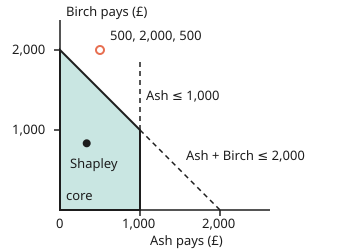

# Sharing a joint cost: the Shapley value and the core

[Syllabus](../../../SYLLABUS.md) → [Applied and computational](../README.md) → [Operations Research](../README.md#s05) → Sharing a joint cost

---

## General Overview

Three bakeries on one high street, Ash, Birch and Cedar, want to share one deck oven. Each bakes at a different scale. On its own, Ash would buy an oven costing £1,000, Birch one costing £2,000 and Cedar one costing £3,000. They would bake in turns, at different hours of the night, so one oven sized for the biggest batch, Cedar's £3,000 oven, serves all three. Together they save £3,000 against the £6,000 of three separate ovens.

The argument is over the bill. Ash only needs a £1,000 oven. An even split, £1,000 each, gives Ash no saving at all. Any rule must answer two questions:

- **Is it fair?** Does each bakery pay for what it adds to the cost?
- **Is it stable?** Could some group do better by walking out and buying its own oven?

The **Shapley value** answers the first. Line the bakeries up in some order and charge each one the extra cost it adds when it joins those ahead of it. Different orders give different bills, so average over every order. Ash pays **£333.33**, Birch **£833.33** and Cedar **£1,833.33**, exactly £3,000 in total.

The **core** answers the second. It is the set of bills that cover the cost and charge no group more than that group would pay on its own. The Shapley bill passes: no bakery and no pair can do better alone. The code checks every group directly, and again with a small linear program.

**The Shapley value charges each player its extra cost averaged over every order in which the players could arrive; the core is the set of bills that no group could beat by going alone; when joining a bigger group never adds more cost, as with a shared oven, the Shapley bill lies in the core.**

**What kind of fact this is:** two definitions (the Shapley value and the core) and three theorems. The shares add up to the whole bill, the "airport" shortcut gives the same shares, and the Shapley bill lies in the core when costs are concave: all three are proved on this card in Why it works. That the Shapley value is the only rule with its four fairness properties is Shapley's 1953 theorem, stated here and proved in his paper (see Sources).

### The picture: the bills no group would walk away from

<p align="center"></p>

Drawn to scale. Across is Ash's payment, up is Birch's, and Cedar pays whatever is left of £3,000. The shaded region is the core. Its right edge is the limit "Ash pays at most £1,000". Its sloping edge is "Ash and Birch together pay at most £2,000", the price of their own oven. Its bottom edge, Birch paying nothing, is the limit "Ash and Cedar together pay at most £3,000", and its left edge, Ash paying nothing, is "Birch and Cedar together pay at most £3,000". The filled dot is the Shapley bill. The open dot is the bill (£500, £2,000, £500): no bakery alone objects to it, but Ash and Birch together pay £2,500, so they leave.

---

## The formula

A **cooperative game** (a game where players can make binding deals) is a list of players and a cost for every group. Call the set of all bakeries $`N`$ and their number $`n`$, here 3. Any group of them is a **coalition** $`S`$, and $`|S|`$ is how many bakeries it holds. The **cost function** $`c(S)`$ is what coalition $`S`$ would pay on its own. Here it is the price of the biggest oven its members need: $`c(\{\text{Ash}, \text{Birch}\}) = 2000`$ and $`c(N) = 3000`$. An empty group pays nothing.

Line the bakeries up in one of the $`n!`$ possible orders ($`n! = 1 \times 2 \times \dots \times n`$, here 6). For bakery $`i`$, let $`P_i`$ be the bakeries ahead of it. Its **extra cost** in that order is $`c(P_i \cup \{i\}) - c(P_i)\,`$: what the bill grows by when $`i`$ joins. Its **Shapley share** $`\varphi_i`$ (phi i) is that extra cost averaged over every order:

```math
\varphi_i = \frac{1}{n!} \sum_{\text{orders}} \big[ c(P_i \cup \{i\}) - c(P_i) \big] = \sum_{S \subseteq N \setminus \{i\}} \frac{|S|!\,(n - |S| - 1)!}{n!} \big[ c(S \cup \{i\}) - c(S) \big]
```

**Read it aloud:** bakery $`i`$'s share is the extra cost it adds to the bakeries already there, averaged over every order of arrival; equivalently, a sum over every group $`S`$ that $`i`$ could join, each weighted by the fraction of orders in which exactly that group is ahead of $`i`$.

A bill $`x = (x_{\text{Ash}}, x_{\text{Birch}}, x_{\text{Cedar}})`$ charges each bakery an amount $`x_i`$. Write $`x(S)`$ for the total it charges the members of $`S`$. The bill is in the **core** when

```math
x(N) = c(N) \quad\text{and}\quad x(S) \le c(S) \ \text{ for every coalition } S
```

**Read it aloud:** the bill covers the whole cost exactly, and no group of bakeries is charged more than its own oven would cost.

When each player's need is one number on a single scale, as oven size is here, there is a shortcut. Sort the stand-alone costs from smallest up, $`d_1 \le d_2 \le \dots \le d_n`$, with $`d_0 = 0`$. Then the bakery with the $`k`$-th smallest need pays

```math
\varphi_{(k)} = \sum_{j=1}^{k} \frac{d_j - d_{j-1}}{n - j + 1}
```

**Read it aloud:** split each step up in oven size equally among every bakery that needs that step. This is the **airport rule**, first written for runways shared by small and large aircraft.

| Symbol | Plain meaning | In our example | Push it up and the answer… |
| --- | --- | --- | --- |
| $`N`$ | all the players | Ash, Birch, Cedar | — |
| $`n`$ | how many players | 3 | no share rises; shares on the steps the newcomer also needs fall |
| $`S`$, $`\lvert S\rvert`$ | a coalition (any group of players) and its size | $`\{\text{Ash}, \text{Birch}\}`$, size 2 | — |
| $`c(S)`$ | the cost function: what group $`S`$ pays on its own | £2,000 for Ash and Birch; $`c(N)`$ = £3,000 | raise $`c(N)`$ and every share that uses the top step rises |
| $`i`$ | one player | Birch | — |
| $`P_i`$ | the players ahead of $`i`$ in an order | Ash, in the order A-B-C | — |
| $`n!`$ | the number of orders | 6 | — |
| $`\varphi_i`$ | player $`i`$'s Shapley share | Ash £333.33, Birch £833.33, Cedar £1,833.33 | — (this is the answer) |
| $`x_i`$ | the amount a proposed bill charges player $`i`$ | (£500, £2,000, £500) in the bad split | — |
| $`x(S)`$ | the total a bill charges group $`S`$ | £2,500 for Ash and Birch in the bad split | above $`c(S)`$, group $`S`$ walks out |
| $`d_k`$, $`d_j`$ | the $`k`$-th (or $`j`$-th) smallest stand-alone cost, $`d_0 = 0`$ | £1,000, £2,000, £3,000 | raise $`d_3`$ and only Cedar pays more |
| $`\varphi_{(k)}`$ | the share of the player with the $`k`$-th smallest need | $`\varphi_{(2)}`$ = Birch's £833.33 | — |

### When it holds

- **The cost of every group is known.** The Shapley value needs $`c(S)`$ for all $`2^n`$ groups. A guessed group cost gives guessed shares. Here a group pays only for its biggest member's oven because the bakeries use it one at a time, like aircraft on one runway. If two had to bake at the same hour, the oven would be sized for both batches, and the group costs would change.
- **Deals bind and money moves freely.** If the bakeries cannot sign or cannot pay each other, the game is a different one.
- **Joining a bigger group never adds more cost.** This is **concavity**: for groups $`S`$ inside $`T`$ and a player $`i`$ outside $`T`$, $`c(S \cup \{i\}) - c(S) \ge c(T \cup \{i\}) - c(T)`$. A shared oven has it. Without it the core can be empty, and the Shapley bill then makes some pair walk out (the "twins" oven below).
- **All orders count equally.** If one bakery really did commit first, a single order may be the fairer story, and the shares change.
- **For the airport rule only: needs lie on one scale.** Each bakery's need must be "an oven at least this big". With two kinds of need, say oven size and opening hours, use the full formula.

---

## Why it works

### Step 0: an order turns sharing into a queue

No one owns a joint saving, so it is hard to split. An order fixes that. The first bakery in pays its own oven, and each later one pays only the upgrade it forces. That bill covers the cost exactly, but it depends on who came first, which is an accident. Averaging over every order removes the accident and keeps "pay for what you add".

### Step 1: every order's bill adds up to the whole cost

In any order, the extra costs telescope (each term cancels part of the next). For the order A-B-C (Ash, then Birch, then Cedar):

```math
\big[c(\{A\}) - 0\big] + \big[c(\{A,B\}) - c(\{A\})\big] + \big[c(N) - c(\{A,B\})\big] = c(N)
```

Here that is £1,000 + £1,000 + £1,000 = £3,000. Every one of the 6 orders adds up to £3,000. An average of bills that each add to £3,000 also adds to £3,000. So the Shapley shares always cover the bill exactly. This property is called **efficiency**.

### Step 2: counting orders gives the coalition weights

The second form of the formula groups the orders by who stands ahead of $`i`$. For bakery $`i`$ to find exactly the group $`S`$ ahead of it, the $`|S|`$ members of $`S`$ come first in any of $`|S|!`$ orders, then $`i`$, then the other $`n - |S| - 1`$ bakeries in any of $`(n - |S| - 1)!`$ orders. So the fraction of orders with exactly $`S`$ ahead of $`i`$ is $`|S|!\,(n - |S| - 1)!/n!`$.

For Birch, the four groups it could join are: nobody (weight 2/6, adds £2,000), Ash (weight 1/6, adds £1,000), Cedar (weight 1/6, adds £0) and both (weight 2/6, adds £0). That gives £666.67 + £166.67 = £833.33. The weights add to 1, as fractions of all orders must.

### Step 3: the airport rule is the same average, step by step

Cut the £3,000 oven into three steps of £1,000:

| Step | Who needs it | Paid by |
| --- | --- | --- |
| the first £1,000 of size | Ash, Birch, Cedar | each pays 1/3 |
| the next £1,000 | Birch, Cedar | each pays 1/2 |
| the last £1,000 | Cedar | Cedar pays all |

In a random order, a step is paid by whichever of its users arrives first: that bakery buys the step and the later ones find it already there. Every user of the step is equally likely to be first. So each user pays an equal part of it. Ash pays £333.33. Birch pays £333.33 + £500 = £833.33. Cedar pays £333.33 + £500 + £1,000 = £1,833.33.

The cost game is a sum of three "step" games, and the Shapley value of a sum is the sum of the Shapley values (the average of a sum is the sum of the averages).

### Step 4: four fairness rules, and only one rule obeys them all

The Shapley value has four properties. The code checks each one.

- **Efficiency:** the shares add to $`c(N)`$ (Step 1).
- **Symmetry:** two players who add the same to every group pay the same.
- **Null player:** a player who never adds cost pays nothing. A fourth business, Dock, that needs no oven, gets £0, and the other three shares do not change.
- **Additivity:** the share in two games added together is the sum of the shares in each. Any average of extra costs has this property by construction, so for additivity the code's check is an illustration, not a test.

In 1953 Shapley proved that the average over orders is the *only* rule with all four properties. Step 3 is that proof in small: additivity splits the oven into steps, null player frees the non-users of a step, symmetry splits it equally among its users, and efficiency makes the parts add up. In general every cost game splits into such pieces, some with negative signs.

### Step 5: when costs are concave, the Shapley bill is in the core

First, each single order's bill is in the core. Take an order and a coalition $`S`$. For a member $`i`$ of $`S`$, the bakeries ahead of it include the members of $`S`$ ahead of it, and maybe others. By concavity, joining the bigger group adds no more than joining only the $`S`$ members ahead. So $`i`$'s charge is at most its extra cost within $`S`$ alone. Add over the members of $`S`$: the right-hand sides telescope to $`c(S)`$. So $`x(S) \le c(S)`$.

<details>
<summary>The same argument written with symbols</summary>

Fix an order and a coalition $`S`$ with members $`i_1, i_2, \dots, i_m`$ in the order they arrive. Let $`P_k`$ be everyone ahead of $`i_k`$, and $`Q_k = \{i_1, \dots, i_{k-1}\}`$ the members of $`S`$ ahead of it, so $`Q_k \subseteq P_k`$. Concavity gives

$`\displaystyle c(P_k \cup \{i_k\}) - c(P_k) \le c(Q_k \cup \{i_k\}) - c(Q_k).`$

Sum over $`k = 1, \dots, m`$. Since $`Q_k \cup \{i_k\} = Q_{k+1}`$, the right-hand side telescopes:

$`\displaystyle x(S) \le \sum_{k=1}^{m} \big[c(Q_{k+1}) - c(Q_k)\big] = c(S) - c(\varnothing) = c(S),`$

where $`\varnothing`$ is the empty group, which costs nothing.

With efficiency from Step 1, the order's bill is in the core.

</details>

Second, the core is **convex**: it is cut out by straight-line limits, so the average of two bills in it is also in it. Each limit $`x(S) \le c(S)`$ holds for every order's bill, so it holds for their average. The Shapley bill is that average. So it is in the core.

The oven game shows this exactly. The six orders give four different bills, and those four bills are the four corners of the shaded region in the picture. The Shapley bill is the average of the six, sitting inside.

### Step 6: testing the core is a linear program

To test one bill, check its total and all $`2^n - 2`$ group limits; with 3 bakeries that is 6 limits. To ask whether *any* bill is in the core, write a linear program, as on the [Linear programs](01-modelling-with-linear-programs.md) card: maximise $`x(N)`$, the total charged, subject to $`x(S) \le c(S)`$ for every group short of everyone. If the largest total reaches $`c(N)`$, lower some charges until the total is exactly $`c(N)`$; every group limit still holds, so the core is not empty. If the largest total falls short, no bill can cover the cost without overcharging some group.

For the oven, the program allows up to £4,000, more than the £3,000 needed. For the twins oven below it allows only £1,500 against £2,000 needed: the core is empty. The proof that £1,500 is the most is to add the three pair limits. That gives twice the total at most £3,000. Weights like these on the group limits are the program's dual values, their [Shadow prices](02-shadow-prices-and-sensitivity.md). The general form of this test is the **Bondareva–Shapley theorem**, which is LP duality applied to the core.

---

## Worked numbers, by hand

| Step | Arithmetic | Value |
| --- | --- | --- |
| stand-alone costs | Ash, Birch, Cedar | £1,000, £2,000, £3,000 |
| three ovens | 1,000 + 2,000 + 3,000 | £6,000 |
| one shared oven, $`c(N)`$ | the biggest | £3,000 |
| step 1, shared by 3 | 1,000 / 3 | £333.33 each |
| step 2, shared by Birch and Cedar | 1,000 / 2 | £500 each |
| step 3, Cedar alone | 1,000 / 1 | £1,000 |
| **Ash's share** | 333.33 | **£333.33** |
| **Birch's share** | 333.33 + 500 | **£833.33** |
| **Cedar's share** | 333.33 + 500 + 1,000 | **£1,833.33** |
| efficiency | 333.33 + 833.33 + 1,833.33 | £3,000 |
| savings against going alone | 1,000 − 333.33; 2,000 − 833.33; 3,000 − 1,833.33 | £666.67, £1,166.67, £1,166.67 |
| pair limit, Ash and Birch | 333.33 + 833.33 ≤ 2,000 | £1,166.67, holds |
| pair limit, Ash and Cedar | 333.33 + 1,833.33 ≤ 3,000 | £2,166.67, holds |
| pair limit, Birch and Cedar | 833.33 + 1,833.33 ≤ 3,000 | £2,666.67, holds |

Every bakery and every pair pays less than it would alone, so the bill is in the core. Ash saves £666.67, and Birch and Cedar each save £1,166.67.

### What breaks if you drop a piece

| Mistake | Comes out at | What went wrong |
| --- | --- | --- |
| Charge by one order only | A-B-C: £1,000 each; C-B-A: Cedar pays all £3,000 | Both are in the core, but they swing by £2,000 on an accident of timing |
| Average over groups instead of orders | £250, £750, £1,750: total £2,750 | Each group gets weight 1/4 instead of its share of orders; the bill is £250 short |
| Check only single bakeries | (£500, £2,000, £500) passes | Ash and Birch together pay £2,500, more than their own £2,000 oven |
| Use Shapley when costs are not concave (twins oven) | £666.67 each; any pair pays £1,333.33 | A £1,000 oven has room for two bakeries' shifts a night, but three need two ovens, £2,000. Every pair beats its share, and no bill is in the core |

In the **twins oven**, Cedar adds nothing to Ash alone but £1,000 to Ash and Birch, so joining a bigger group costs more: concavity fails. The linear program caps the total at £1,500 against £2,000 needed. The code prints every line of this table.

---

## Code, from first principles, and it actually runs

Nothing is imported. Money is in whole pounds and every share is an exact fraction, so nothing is rounded until printing. The script reaches the Shapley shares by **three independent roads**: the average of extra costs over all 6 orders, the weighted sum over groups from Step 2, and the airport rule from Step 3. It tests the core by **two roads**: every group limit checked directly, and a linear program solved by checking every corner, as on the [Linear programs](01-modelling-with-linear-programs.md) card. It pins the program's largest total to the bound from adding the three pair limits, checks that the core's corners are the order bills, and runs the twins oven, the four properties, the mistakes and the figure's coordinates.

### Python

```python
# Sharing a joint cost: the Shapley value and the core -- the check behind the card.
# Nothing is imported.  Money is in whole pounds; a share is an exact fraction top/bottom.
# Game 1, the oven: three bakeries bake in turns in one oven sized for the biggest.  Alone they
# need ovens costing 1000, 2000 and 3000 pounds, so a group S pays the dearest: c(S) = max need.
# Game 2, the twins: a 1000-pound oven has two bakeries' shifts a night, so S pays 1000 per two.
# Shapley roads: (1) average extra cost over all n! orders, (2) the weighted sum over
# coalitions, (3) the airport rule: each step up in oven size split among those who need it.
# Core roads: (a) every coalition's limit checked directly, (b) a corner-checking LP solver.
NAMES = ["Ash", "Birch", "Cedar", "Dock"]
NEED = [1000, 2000, 3000]

def oven(needs):
    return lambda S: max([needs[i] for i in range(len(needs)) if S >> i & 1] + [0])
def twins(S):
    return 1000 * ((bin(S).count("1") + 1) // 2)
def fact(k):
    return 1 if k < 2 else k * fact(k - 1)
def orders(items):                    # every order of the items, written out
    if not items:
        return [[]]
    return [[x] + rest for x in items for rest in orders([y for y in items if y != x])]
def fmt(top, bottom):                 # pounds to 2 decimals, rounded half up, integers only
    sign, top = ("-", -top) if top < 0 else ("", top)
    cents = (200 * top + bottom) // (2 * bottom)
    return f"{sign}{cents // 100:,}.{cents % 100:02d}"

def shapley_orders(c, n):             # road 1: n! times each share
    tot = [0] * n
    for order in orders(list(range(n))):
        S = 0
        for i in order:
            tot[i] += c(S | 1 << i) - c(S)
            S |= 1 << i
    return tot
def shapley_subsets(c, n):            # road 2: |S|!(n-|S|-1)! weights, also over n!
    tot = [0] * n
    for i in range(n):
        for S in range(1 << n):
            if not S >> i & 1:
                s = bin(S).count("1")
                tot[i] += fact(s) * fact(n - s - 1) * (c(S | 1 << i) - c(S))
    return tot
def airport(needs):                   # road 3: n! times each share, smallest need first
    n, idx = len(needs), sorted(range(len(needs)), key=lambda i: needs[i])
    tot, acc, prev = [0] * n, 0, 0
    for k, i in enumerate(idx):
        acc += (needs[i] - prev) * fact(n) // (n - k)
        tot[i], prev = acc, needs[i]
    return tot

def core_breaks(x, bottom, c, n):     # road (a): coalitions charged more than going alone
    return [S for S in range(1, (1 << n) - 1) if sum(x[i] for i in range(n) if S >> i & 1) > c(S) * bottom]
def det3(m):
    return (m[0][0] * (m[1][1] * m[2][2] - m[1][2] * m[2][1]) - m[0][1] * (m[1][0] * m[2][2] - m[1][2] * m[2][0])
            + m[0][2] * (m[1][0] * m[2][1] - m[1][1] * m[2][0]))
def corners(rows, n=3):               # road (b): make 3 rows tight, solve by Cramer, keep if all rows hold
    found = []
    for a in range(len(rows)):
        for b in range(a + 1, len(rows)):
            for d in range(b + 1, len(rows)):
                M, r = [rows[a][0], rows[b][0], rows[d][0]], [rows[a][1], rows[b][1], rows[d][1]]
                D = det3(M)
                if D == 0:
                    continue
                x = [det3([[r[k] if j == col else M[k][j] for j in range(n)] for k in range(n)]) for col in range(n)]
                if D < 0:
                    D, x = -D, [-v for v in x]
                fits = all(sum(row[j] * x[j] for j in range(n)) <= lim * D for row, lim in rows)
                if fits and all(any(x[j] * e != y[j] * D for j in range(n)) for y, e in found):
                    found.append((x, D))
    return found
def limits(c, n=3):
    return [([S >> j & 1 for j in range(n)], c(S)) for S in range(1, (1 << n) - 1)]
def lp_room(c):                       # most the bakeries can be charged with no coalition overcharged
    best = (0, 1)
    for x, D in corners(limits(c)):
        if sum(x) * best[1] > best[0] * D:
            best = (sum(x), D)
    return best
def members(S):
    return "{" + ", ".join(NAMES[i] for i in range(4) if S >> i & 1) + "}"

c, F = oven(NEED), fact(3)
r1, r2, r3 = shapley_orders(c, 3), shapley_subsets(c, 3), airport(NEED)
for S in range(1, 8):
    print(f"oven game, c({members(S)}) = {c(S)}")
marginal = {}
for order in orders([0, 1, 2]):
    S, extra, v = 0, [], [0, 0, 0]
    for i in order:
        v[i] = c(S | 1 << i) - c(S)
        extra.append(f"{NAMES[i]} +{v[i]}")
        S |= 1 << i
    marginal[''.join(NAMES[i][0] for i in order)] = v
    print(f"order {'-'.join(NAMES[i][0] for i in order)}: {', '.join(extra)}; in the core: {'no' if core_breaks(v, 1, c, 3) else 'yes'}")
for name, r in (("road 1, all 6 orders", r1), ("road 2, coalition weights", r2), ("road 3, airport steps", r3)):
    print(f"{name}: 6 x shares = {r}; shares {', '.join(fmt(v, F) for v in r)}")
terms = [(S, fact(bin(S).count("1")) * fact(2 - bin(S).count("1")), c(S | 2) - c(S)) for S in (0, 1, 4, 5)]
print("Birch's road-2 terms: " + "; ".join(f"{members(S)} weight {w}/6 adds {e} -> {fmt(w * e, F)}" for S, w, e in terms) + f"; weights add to {sum(t[1] for t in terms)}/6")
steps = sorted(NEED)
print("airport steps: " + ", ".join(f"{b - a} shared by {3 - k} -> {fmt(b - a, 3 - k)} each" for k, (a, b) in enumerate(zip([0] + steps, steps))))
print(f"efficiency: shares add to {fmt(sum(r1), F)} = c(all) = {c(7)}")
print(f"Shapley shares break the core for coalitions: {core_breaks(r1, F, c, 3) or 'none'}; pair totals "
      + ", ".join(f"{members(S)} {fmt(sum(r1[i] for i in range(3) if S >> i & 1), F)} against {c(S)}" for S in (3, 5, 6)))
print(f"savings against going alone: {', '.join(fmt(NEED[i] * F - r1[i], F) for i in range(3))}; three ovens cost {sum(NEED)}, one shared {c(7)}, saving {sum(NEED) - c(7)}")
core = corners(limits(c) + [([1, 1, 1], c(7)), ([-1, -1, -1], -c(7))])
print(f"core corners (Ash, Birch, Cedar): {'; '.join('(' + ', '.join(fmt(v, D) for v in x) + ')' for x, D in core)}")
room, pairs = lp_room(c), lambda g: g(3) + g(5) + g(6)   # pair limits added: twice the total is at most this
print(f"LP room: at most {fmt(*room)} can be charged (pair limits add to {pairs(c)}), need {c(7)}: core {'non-empty' if room[0] >= c(7) * room[1] else 'empty'}")

t1 = shapley_orders(twins, 3)
print(f"twins game: shares {', '.join(fmt(v, F) for v in t1)}; a pair pays {fmt(t1[0] + t1[1], F)} against c(pair) = {twins(3)}")
print(f"twins game: Shapley breaks the core for coalitions: {', '.join(map(members, core_breaks(t1, F, twins, 3)))}")
troom = lp_room(twins)
print(f"twins LP room: at most {fmt(*troom)} can be charged (pair limits add to {pairs(twins)}), need {twins(7)}: core {'non-empty' if troom[0] >= twins(7) * troom[1] else 'empty'}")
both = shapley_orders(lambda S: c(S) + twins(S), 3)
print(f"additivity: oven + twins shares {', '.join(fmt(v, F) for v in both)}")
d4 = shapley_orders(oven(NEED + [0]), 4)
print(f"null player: with Dock (needs no oven) shares {', '.join(fmt(v, fact(4)) for v in d4)}")

banz = [sum(c(S | 1 << i) - c(S) for S in range(8) if not S >> i & 1) for i in range(3)]
alone_ok = [500, 2000, 500]
print(f"mistake, one order only: A-B-C charges {marginal['ABC']}, C-B-A charges {marginal['CBA']}")
print(f"mistake, average over coalitions not orders: {', '.join(fmt(v, 4) for v in banz)}; total {fmt(sum(banz), 4)}, short by {fmt(c(7) * 4 - sum(banz), 4)}")
print(f"mistake, check only bakeries alone: {alone_ok} passes alone; coalitions broken: {', '.join(map(members, core_breaks(alone_ok, 1, c, 3)))} (Ash+Birch pay {alone_ok[0] + alone_ok[1]})")
X = lambda v: 60 + 0.08 * v
Y = lambda v: 210 - 0.08 * v
print(f"figure, core corners at {', '.join(f'({X(x[0] / D):.1f}, {Y(x[1] / D):.1f})' for x, D in core)}; Shapley at ({X(r1[0] / F):.1f}, {Y(r1[1] / F):.1f}); bad split at ({X(500):.1f}, {Y(2000):.1f})")

assert r1 == r2 == r3 == [2000, 5000, 11000]          # three roads agree, and match 1/3, 5/6, 11/6
assert sum(r1) == c(7) * F and sum(t1) == twins(7) * F  # efficiency
assert core_breaks(r1, F, c, 3) == [] and core_breaks(t1, F, twins, 3) == [3, 5, 6]
assert room[0] >= c(7) * room[1] and troom[0] < twins(7) * troom[1]  # Bondareva-Shapley by corners
assert 2 * room[0] == pairs(c) * room[1] and 2 * troom[0] == pairs(twins) * troom[1]  # LP optimum = pair bound
assert len(core) == 4 and t1[0] == t1[1] == t1[2]       # core shape, symmetry
assert {tuple(x) for x, D in core if D == 1} == {tuple(v) for v in marginal.values()}  # corners = orders
assert [sum(v[i] for v in marginal.values()) for i in range(3)] == r3 and sum(w * e for S, w, e in terms) == r3[1]
assert both == [r1[i] + t1[i] for i in range(3)] and d4 == [4 * v for v in r1] + [0]  # additivity, null player
assert sum(banz) != c(7) * 4 and core_breaks(alone_ok, 1, c, 3) == [3]
print("ALL CHECKS PASS")
```

**Ran 2026-11-23 on macOS, Python 3.14.10, standard library only. All checks passed. Output, pasted from the run:**

```
oven game, c({Ash}) = 1000
oven game, c({Birch}) = 2000
oven game, c({Ash, Birch}) = 2000
oven game, c({Cedar}) = 3000
oven game, c({Ash, Cedar}) = 3000
oven game, c({Birch, Cedar}) = 3000
oven game, c({Ash, Birch, Cedar}) = 3000
order A-B-C: Ash +1000, Birch +1000, Cedar +1000; in the core: yes
order A-C-B: Ash +1000, Cedar +2000, Birch +0; in the core: yes
order B-A-C: Birch +2000, Ash +0, Cedar +1000; in the core: yes
order B-C-A: Birch +2000, Cedar +1000, Ash +0; in the core: yes
order C-A-B: Cedar +3000, Ash +0, Birch +0; in the core: yes
order C-B-A: Cedar +3000, Birch +0, Ash +0; in the core: yes
road 1, all 6 orders: 6 x shares = [2000, 5000, 11000]; shares 333.33, 833.33, 1,833.33
road 2, coalition weights: 6 x shares = [2000, 5000, 11000]; shares 333.33, 833.33, 1,833.33
road 3, airport steps: 6 x shares = [2000, 5000, 11000]; shares 333.33, 833.33, 1,833.33
Birch's road-2 terms: {} weight 2/6 adds 2000 -> 666.67; {Ash} weight 1/6 adds 1000 -> 166.67; {Cedar} weight 1/6 adds 0 -> 0.00; {Ash, Cedar} weight 2/6 adds 0 -> 0.00; weights add to 6/6
airport steps: 1000 shared by 3 -> 333.33 each, 1000 shared by 2 -> 500.00 each, 1000 shared by 1 -> 1,000.00 each
efficiency: shares add to 3,000.00 = c(all) = 3000
Shapley shares break the core for coalitions: none; pair totals {Ash, Birch} 1,166.67 against 2000, {Ash, Cedar} 2,166.67 against 3000, {Birch, Cedar} 2,666.67 against 3000
savings against going alone: 666.67, 1,166.67, 1,166.67; three ovens cost 6000, one shared 3000, saving 3000
core corners (Ash, Birch, Cedar): (1,000.00, 1,000.00, 1,000.00); (1,000.00, 0.00, 2,000.00); (0.00, 2,000.00, 1,000.00); (0.00, 0.00, 3,000.00)
LP room: at most 4,000.00 can be charged (pair limits add to 8000), need 3000: core non-empty
twins game: shares 666.67, 666.67, 666.67; a pair pays 1,333.33 against c(pair) = 1000
twins game: Shapley breaks the core for coalitions: {Ash, Birch}, {Ash, Cedar}, {Birch, Cedar}
twins LP room: at most 1,500.00 can be charged (pair limits add to 3000), need 2000: core empty
additivity: oven + twins shares 1,000.00, 1,500.00, 2,500.00
null player: with Dock (needs no oven) shares 333.33, 833.33, 1,833.33, 0.00
mistake, one order only: A-B-C charges [1000, 1000, 1000], C-B-A charges [0, 0, 3000]
mistake, average over coalitions not orders: 250.00, 750.00, 1,750.00; total 2,750.00, short by 250.00
mistake, check only bakeries alone: [500, 2000, 500] passes alone; coalitions broken: {Ash, Birch} (Ash+Birch pay 2500)
figure, core corners at (140.0, 130.0), (140.0, 210.0), (60.0, 50.0), (60.0, 210.0); Shapley at (86.7, 143.3); bad split at (100.0, 50.0)
ALL CHECKS PASS
```

### Rust

Same numbers, same labels, built with `rustc --edition 2021 -O`.

```rust
// Sharing a joint cost: the Shapley value and the core -- the same check as the Python, in Rust.
// No crates.  Money is in whole pounds; a share is an exact fraction top/bottom.
// Game 1, the oven: three bakeries bake in turns in one oven sized for the biggest.  Alone they
// need ovens costing 1000, 2000 and 3000 pounds, so a group S pays the dearest: c(S) = max need.
// Game 2, the twins: a 1000-pound oven has two bakeries' shifts a night, so S pays 1000 per two.
// Shapley roads: (1) average extra cost over all n! orders, (2) the weighted sum over
// coalitions, (3) the airport rule: each step up in oven size split among those who need it.
// Core roads: (a) every coalition's limit checked directly, (b) a corner-checking LP solver.
const NAMES: [&str; 4] = ["Ash", "Birch", "Cedar", "Dock"];
type Game<'a> = &'a dyn Fn(usize) -> i64;

fn oven(needs: Vec<i64>) -> impl Fn(usize) -> i64 {
    move |s| (0..needs.len()).filter(|&i| s >> i & 1 == 1).map(|i| needs[i]).max().unwrap_or(0)
}
fn twins(s: usize) -> i64 { 1000 * ((s.count_ones() as i64 + 1) / 2) }
fn fact(k: i64) -> i64 { if k < 2 { 1 } else { k * fact(k - 1) } }
fn orders(items: &[usize]) -> Vec<Vec<usize>> { // every order of the items, written out
    if items.is_empty() { return vec![vec![]]; }
    items.iter().flat_map(|&x| {
        let rest: Vec<usize> = items.iter().copied().filter(|&y| y != x).collect();
        orders(&rest).into_iter().map(move |r| [vec![x], r].concat())
    }).collect()
}
fn commas(n: i64) -> String {
    let s = n.to_string();
    s.chars().enumerate().map(|(k, ch)| if k > 0 && (s.len() - k) % 3 == 0 { format!(",{}", ch) } else { ch.to_string() }).collect()
}
fn fmt(top: i64, bottom: i64) -> String { // pounds to 2 decimals, rounded half up, integers only
    let (sign, top) = if top < 0 { ("-", -top) } else { ("", top) };
    let cents = (200 * top + bottom) / (2 * bottom);
    format!("{}{}.{:02}", sign, commas(cents / 100), cents % 100)
}
fn join(v: &[i64], d: i64) -> String { v.iter().map(|&x| fmt(x, d)).collect::<Vec<_>>().join(", ") }

fn shapley_orders(c: Game, n: usize) -> Vec<i64> { // road 1: n! times each share
    let mut tot = vec![0; n];
    for order in orders(&(0..n).collect::<Vec<_>>()) {
        let mut s = 0;
        for &i in &order { tot[i] += c(s | 1 << i) - c(s); s |= 1 << i; }
    }
    tot
}
fn shapley_subsets(c: Game, n: usize) -> Vec<i64> { // road 2: |S|!(n-|S|-1)! weights, also over n!
    let mut tot = vec![0; n];
    for i in 0..n {
        for s in (0..(1usize << n)).filter(|s| s >> i & 1 == 0) {
            let k = s.count_ones() as i64;
            tot[i] += fact(k) * fact(n as i64 - k - 1) * (c(s | 1 << i) - c(s));
        }
    }
    tot
}
fn airport(needs: &[i64]) -> Vec<i64> { // road 3: n! times each share, smallest need first
    let n = needs.len();
    let mut idx: Vec<usize> = (0..n).collect();
    idx.sort_by_key(|&i| needs[i]);
    let (mut tot, mut acc, mut prev) = (vec![0; n], 0, 0);
    for (k, &i) in idx.iter().enumerate() {
        acc += (needs[i] - prev) * fact(n as i64) / (n - k) as i64;
        (tot[i], prev) = (acc, needs[i]);
    }
    tot
}

fn core_breaks(x: &[i64], bottom: i64, c: Game, n: usize) -> Vec<usize> { // road (a)
    (1..(1usize << n) - 1).filter(|&s| (0..n).filter(|&i| s >> i & 1 == 1).map(|i| x[i]).sum::<i64>() > c(s) * bottom).collect()
}
fn det3(m: &[[i64; 3]; 3]) -> i64 {
    m[0][0] * (m[1][1] * m[2][2] - m[1][2] * m[2][1]) - m[0][1] * (m[1][0] * m[2][2] - m[1][2] * m[2][0])
        + m[0][2] * (m[1][0] * m[2][1] - m[1][1] * m[2][0])
}
type Row = ([i64; 3], i64);
fn corners(rows: &[Row]) -> Vec<(Vec<i64>, i64)> { // road (b): 3 rows tight, Cramer, keep if all rows hold
    let mut found: Vec<(Vec<i64>, i64)> = Vec::new();
    let len = rows.len();
    for a in 0..len { for b in a + 1..len { for d in b + 1..len {
        let m = [rows[a].0, rows[b].0, rows[d].0];
        let r = [rows[a].1, rows[b].1, rows[d].1];
        let mut dd = det3(&m);
        if dd == 0 { continue; }
        let mut x: Vec<i64> = (0..3).map(|col| { let mut mm = m; for k in 0..3 { mm[k][col] = r[k]; } det3(&mm) }).collect();
        if dd < 0 { dd = -dd; x = x.iter().map(|v| -v).collect(); }
        let fits = rows.iter().all(|(row, lim)| (0..3).map(|j| row[j] * x[j]).sum::<i64>() <= lim * dd);
        if fits && found.iter().all(|(y, e)| (0..3).any(|j| x[j] * e != y[j] * dd)) { found.push((x, dd)); }
    }}}
    found
}
fn limits(c: Game) -> Vec<Row> {
    (1..7usize).map(|s| ([(s & 1) as i64, (s >> 1 & 1) as i64, (s >> 2 & 1) as i64], c(s))).collect()
}
fn lp_room(c: Game) -> (i64, i64) { // most the bakeries can be charged with no coalition overcharged
    let mut best = (0, 1);
    for (x, d) in corners(&limits(c)) {
        let t: i64 = x.iter().sum();
        if t * best.1 > best.0 * d { best = (t, d); }
    }
    best
}
fn members(s: usize) -> String {
    format!("{{{}}}", (0..4).filter(|&i| s >> i & 1 == 1).map(|i| NAMES[i]).collect::<Vec<_>>().join(", "))
}

fn main() {
    let (need, f) = (vec![1000i64, 2000, 3000], fact(3));
    let c = oven(need.clone());
    let (r1, r2, r3) = (shapley_orders(&c, 3), shapley_subsets(&c, 3), airport(&need));
    for s in 1..8 { println!("oven game, c({}) = {}", members(s), c(s)); }
    let mut marginal: Vec<(String, Vec<i64>)> = Vec::new();
    for order in orders(&[0, 1, 2]) {
        let (mut s, mut extra, mut v) = (0usize, Vec::new(), vec![0i64; 3]);
        for &i in &order {
            v[i] = c(s | 1 << i) - c(s);
            extra.push(format!("{} +{}", NAMES[i], v[i]));
            s |= 1 << i;
        }
        let key: Vec<String> = order.iter().map(|&i| NAMES[i][..1].to_string()).collect();
        println!("order {}: {}; in the core: {}", key.join("-"), extra.join(", "), if core_breaks(&v, 1, &c, 3).is_empty() { "yes" } else { "no" });
        marginal.push((key.concat(), v));
    }
    for (name, r) in [("road 1, all 6 orders", &r1), ("road 2, coalition weights", &r2), ("road 3, airport steps", &r3)] {
        println!("{}: 6 x shares = {:?}; shares {}", name, r, join(r, f));
    }
    let terms: Vec<(usize, i64, i64)> = [0usize, 1, 4, 5].iter().map(|&s| (s, fact(s.count_ones() as i64) * fact(2 - s.count_ones() as i64), c(s | 2) - c(s))).collect();
    println!("Birch's road-2 terms: {}; weights add to {}/6", terms.iter().map(|&(s, w, e)| format!("{} weight {}/6 adds {} -> {}", members(s), w, e, fmt(w * e, f))).collect::<Vec<_>>().join("; "), terms.iter().map(|t| t.1).sum::<i64>());
    let steps = { let mut v = need.clone(); v.sort(); v };
    println!("airport steps: {}", (0..3).map(|k| { let d = steps[k] - if k == 0 { 0 } else { steps[k - 1] }; format!("{} shared by {} -> {} each", d, 3 - k, fmt(d, 3 - k as i64)) }).collect::<Vec<_>>().join(", "));
    println!("efficiency: shares add to {} = c(all) = {}", fmt(r1.iter().sum(), f), c(7));
    let br = core_breaks(&r1, f, &c, 3);
    println!("Shapley shares break the core for coalitions: {}; pair totals {}", if br.is_empty() { "none".to_string() } else { format!("{:?}", br) }, [3usize, 5, 6].iter().map(|&s| format!("{} {} against {}", members(s), fmt((0..3).filter(|&i| s >> i & 1 == 1).map(|i| r1[i]).sum(), f), c(s))).collect::<Vec<_>>().join(", "));
    let save: Vec<i64> = (0..3).map(|i| need[i] * f - r1[i]).collect();
    println!("savings against going alone: {}; three ovens cost {}, one shared {}, saving {}", join(&save, f), need.iter().sum::<i64>(), c(7), need.iter().sum::<i64>() - c(7));
    let core = corners(&[limits(&c), vec![([1, 1, 1], c(7)), ([-1, -1, -1], -c(7))]].concat());
    let shown: Vec<String> = core.iter().map(|(x, d)| format!("({})", join(x, *d))).collect();
    println!("core corners (Ash, Birch, Cedar): {}", shown.join("; "));
    let room = lp_room(&c);
    println!("LP room: at most {} can be charged (pair limits add to {}), need {}: core {}", fmt(room.0, room.1), c(3) + c(5) + c(6), c(7), if room.0 >= c(7) * room.1 { "non-empty" } else { "empty" });

    let t1 = shapley_orders(&twins, 3);
    println!("twins game: shares {}; a pair pays {} against c(pair) = {}", join(&t1, f), fmt(t1[0] + t1[1], f), twins(3));
    let tb = core_breaks(&t1, f, &twins, 3);
    println!("twins game: Shapley breaks the core for coalitions: {}", tb.iter().map(|&s| members(s)).collect::<Vec<_>>().join(", "));
    let troom = lp_room(&twins);
    println!("twins LP room: at most {} can be charged (pair limits add to {}), need {}: core {}", fmt(troom.0, troom.1), twins(3) + twins(5) + twins(6), twins(7), if troom.0 >= twins(7) * troom.1 { "non-empty" } else { "empty" });
    let both = shapley_orders(&|s| c(s) + twins(s), 3);
    println!("additivity: oven + twins shares {}", join(&both, f));
    let d4 = shapley_orders(&oven(vec![1000, 2000, 3000, 0]), 4);
    println!("null player: with Dock (needs no oven) shares {}", join(&d4, fact(4)));

    let banz: Vec<i64> = (0..3).map(|i| (0..8usize).filter(|&s| s >> i & 1 == 0).map(|s| c(s | 1 << i) - c(s)).sum()).collect();
    let alone_ok = [500i64, 2000, 500];
    let get = |k: &str| marginal.iter().find(|(n, _)| n == k).unwrap().1.clone();
    println!("mistake, one order only: A-B-C charges {:?}, C-B-A charges {:?}", get("ABC"), get("CBA"));
    println!("mistake, average over coalitions not orders: {}; total {}, short by {}", join(&banz, 4), fmt(banz.iter().sum(), 4), fmt(c(7) * 4 - banz.iter().sum::<i64>(), 4));
    let ab = core_breaks(&alone_ok, 1, &c, 3);
    println!("mistake, check only bakeries alone: {:?} passes alone; coalitions broken: {} (Ash+Birch pay {})", alone_ok, ab.iter().map(|&s| members(s)).collect::<Vec<_>>().join(", "), alone_ok[0] + alone_ok[1]);
    let (xf, yf) = (|v: f64| 60.0 + 0.08 * v, |v: f64| 210.0 - 0.08 * v);
    let pts: Vec<String> = core.iter().map(|(x, d)| format!("({:.1}, {:.1})", xf(x[0] as f64 / *d as f64), yf(x[1] as f64 / *d as f64))).collect();
    println!("figure, core corners at {}; Shapley at ({:.1}, {:.1}); bad split at ({:.1}, {:.1})", pts.join(", "), xf(r1[0] as f64 / f as f64), yf(r1[1] as f64 / f as f64), xf(500.0), yf(2000.0));

    assert!(r1 == r2 && r2 == r3 && r1 == vec![2000, 5000, 11000]); // three roads agree
    assert!(r1.iter().sum::<i64>() == c(7) * f && t1.iter().sum::<i64>() == twins(7) * f); // efficiency
    assert!(br.is_empty() && tb == vec![3, 5, 6]);
    assert!(room.0 >= c(7) * room.1 && troom.0 < twins(7) * troom.1 && 2 * room.0 == (c(3) + c(5) + c(6)) * room.1 && 2 * troom.0 == (twins(3) + twins(5) + twins(6)) * troom.1); // Bondareva-Shapley by corners; LP optimum = pair bound
    assert!(core.len() == 4 && t1[0] == t1[1] && t1[1] == t1[2]); // core shape, symmetry
    assert!(core.iter().all(|(x, d)| *d == 1 && marginal.iter().any(|(_, v)| v == x)) && marginal.iter().all(|(_, v)| core.iter().any(|(x, _)| x == v))); // corners = orders
    assert!((0..3).all(|i| marginal.iter().map(|(_, v)| v[i]).sum::<i64>() == r3[i]) && terms.iter().map(|t| t.1 * t.2).sum::<i64>() == r3[1]);
    assert!((0..3).all(|i| both[i] == r1[i] + t1[i]) && d4 == vec![4 * r1[0], 4 * r1[1], 4 * r1[2], 0]); // additivity, null player
    assert!(banz.iter().sum::<i64>() != c(7) * 4 && ab == vec![3]);
    println!("ALL CHECKS PASS");
}
```

**Ran 2026-11-23 on macOS, rustc 1.98.1, no crates. All checks passed. Output, pasted from the run:**

```
oven game, c({Ash}) = 1000
oven game, c({Birch}) = 2000
oven game, c({Ash, Birch}) = 2000
oven game, c({Cedar}) = 3000
oven game, c({Ash, Cedar}) = 3000
oven game, c({Birch, Cedar}) = 3000
oven game, c({Ash, Birch, Cedar}) = 3000
order A-B-C: Ash +1000, Birch +1000, Cedar +1000; in the core: yes
order A-C-B: Ash +1000, Cedar +2000, Birch +0; in the core: yes
order B-A-C: Birch +2000, Ash +0, Cedar +1000; in the core: yes
order B-C-A: Birch +2000, Cedar +1000, Ash +0; in the core: yes
order C-A-B: Cedar +3000, Ash +0, Birch +0; in the core: yes
order C-B-A: Cedar +3000, Birch +0, Ash +0; in the core: yes
road 1, all 6 orders: 6 x shares = [2000, 5000, 11000]; shares 333.33, 833.33, 1,833.33
road 2, coalition weights: 6 x shares = [2000, 5000, 11000]; shares 333.33, 833.33, 1,833.33
road 3, airport steps: 6 x shares = [2000, 5000, 11000]; shares 333.33, 833.33, 1,833.33
Birch's road-2 terms: {} weight 2/6 adds 2000 -> 666.67; {Ash} weight 1/6 adds 1000 -> 166.67; {Cedar} weight 1/6 adds 0 -> 0.00; {Ash, Cedar} weight 2/6 adds 0 -> 0.00; weights add to 6/6
airport steps: 1000 shared by 3 -> 333.33 each, 1000 shared by 2 -> 500.00 each, 1000 shared by 1 -> 1,000.00 each
efficiency: shares add to 3,000.00 = c(all) = 3000
Shapley shares break the core for coalitions: none; pair totals {Ash, Birch} 1,166.67 against 2000, {Ash, Cedar} 2,166.67 against 3000, {Birch, Cedar} 2,666.67 against 3000
savings against going alone: 666.67, 1,166.67, 1,166.67; three ovens cost 6000, one shared 3000, saving 3000
core corners (Ash, Birch, Cedar): (1,000.00, 1,000.00, 1,000.00); (1,000.00, 0.00, 2,000.00); (0.00, 2,000.00, 1,000.00); (0.00, 0.00, 3,000.00)
LP room: at most 4,000.00 can be charged (pair limits add to 8000), need 3000: core non-empty
twins game: shares 666.67, 666.67, 666.67; a pair pays 1,333.33 against c(pair) = 1000
twins game: Shapley breaks the core for coalitions: {Ash, Birch}, {Ash, Cedar}, {Birch, Cedar}
twins LP room: at most 1,500.00 can be charged (pair limits add to 3000), need 2000: core empty
additivity: oven + twins shares 1,000.00, 1,500.00, 2,500.00
null player: with Dock (needs no oven) shares 333.33, 833.33, 1,833.33, 0.00
mistake, one order only: A-B-C charges [1000, 1000, 1000], C-B-A charges [0, 0, 3000]
mistake, average over coalitions not orders: 250.00, 750.00, 1,750.00; total 2,750.00, short by 250.00
mistake, check only bakeries alone: [500, 2000, 500] passes alone; coalitions broken: {Ash, Birch} (Ash+Birch pay 2500)
figure, core corners at (140.0, 130.0), (140.0, 210.0), (60.0, 50.0), (60.0, 210.0); Shapley at (86.7, 143.3); bad split at (100.0, 50.0)
ALL CHECKS PASS
```

The two outputs match line for line. In the output, `6 x shares` is six times each share, kept as whole pounds; the "LP room" is the largest total any bill can charge with no group overcharged, and "pair limits add to" is the bound from Step 6: twice the total can never exceed it.

### Lean

Lean proves Steps 1 and 5 for any number of players and any cost function, and checks the oven and twins games.

- Take any cost function and any order. Then the extra costs add up to $`c(N) - c(\varnothing)`$, so when the empty group costs nothing, the Shapley shares add up to $`c(N)`$.
- Take any concave cost function in which the empty group costs nothing. Then every order's bill is in the core, and so is the Shapley bill.
- A cost set by the biggest need in the group, as for one oven used in turns, is concave.
- In the oven game the shares are £2,000/6, £5,000/6 and £11,000/6, that is £333.33, £833.33 and £1,833.33, and the Shapley bill is in the core.
- The twins game is not concave, since Cedar adds nothing to Ash alone but £1,000 to Ash and Birch, and no bill is in its core.

The airport rule, symmetry, the null player, additivity, the core's corners, the linear program and the figure are left to the Python and Rust checks. Shapley's theorem that only the average over orders has all four properties is cited, not proved.

```lean
-- Sharing a joint cost: in every order the extra costs add up to the whole bill, so the Shapley shares add up to c(N); when costs are concave every order's bill and the Shapley bill lie in the core; for the bakery oven the shares are 2000/6, 5000/6 and 11000/6 pounds.
import Mathlib.Tactic

open Finset

variable {n : ℕ}

/-- The first `k` players of an order: player `j` stands in place `pos j`. -/
def firstK (pos : Equiv.Perm (Fin n)) (k : ℕ) : Finset (Fin n) :=
  univ.filter (fun j => (pos j : ℕ) < k)

/-- The players ahead of player `i` in the order. -/
def ahead (pos : Equiv.Perm (Fin n)) (i : Fin n) : Finset (Fin n) := firstK pos (pos i)

/-- The extra cost player `i` adds when it joins the players ahead of it. -/
def extra (c : Finset (Fin n) → ℚ) (pos : Equiv.Perm (Fin n)) (i : Fin n) : ℚ :=
  c (insert i (ahead pos i)) - c (ahead pos i)

/-- The Shapley share: the extra cost averaged over all `n!` orders. -/
def shapley (c : Finset (Fin n) → ℚ) (i : Fin n) : ℚ :=
  (∑ pos : Equiv.Perm (Fin n), extra c pos i) / (Nat.factorial n)

/-- Helper: joining the players ahead of `i` makes the first `pos i + 1` players. -/
theorem insert_ahead (pos : Equiv.Perm (Fin n)) (i : Fin n) :
    insert i (ahead pos i) = firstK pos (pos i + 1) := by
  ext j
  simp only [ahead, firstK, mem_insert, mem_filter, mem_univ, true_and]
  constructor
  · rintro (rfl | h)
    · omega
    · omega
  · intro h
    rcases Nat.lt_succ_iff_lt_or_eq.mp h with h | h
    · exact Or.inr h
    · exact Or.inl (pos.injective (Fin.ext h))

/-- Step 1: in any order, the extra costs telescope to the whole bill. -/
theorem order_bill_adds_up (c : Finset (Fin n) → ℚ) (pos : Equiv.Perm (Fin n)) :
    ∑ i, extra c pos i = c univ - c ∅ := by
  have h1 : ∀ i, extra c pos i = c (firstK pos ((pos i : ℕ) + 1)) - c (firstK pos (pos i)) := by
    intro i
    rw [extra, insert_ahead]
    rfl
  simp only [h1]
  rw [Equiv.sum_comp pos (fun k : Fin n => c (firstK pos ((k : ℕ) + 1)) - c (firstK pos k))]
  rw [Fin.sum_univ_eq_sum_range (fun k => c (firstK pos (k + 1)) - c (firstK pos k)) n]
  rw [Finset.sum_range_sub (fun k => c (firstK pos k))]
  have hn : firstK pos n = univ := by
    ext j
    simp [firstK]
  have h0 : firstK pos 0 = ∅ := by
    ext j
    simp [firstK]
  rw [hn, h0]

/-- Efficiency: the Shapley shares add up to the whole bill `c(N)`, when the empty group costs
nothing. -/
theorem shapley_efficiency (c : Finset (Fin n) → ℚ) (h0 : c ∅ = 0) :
    ∑ i, shapley c i = c univ := by
  simp only [shapley, ← Finset.sum_div]
  rw [Finset.sum_comm]
  simp only [order_bill_adds_up, h0, sub_zero, Finset.sum_const, Finset.card_univ,
    Fintype.card_perm, Fintype.card_fin, nsmul_eq_mul]
  have : (Nat.factorial n : ℚ) ≠ 0 := by exact_mod_cast Nat.factorial_ne_zero n
  field_simp

/-- Concave costs: joining a bigger group never adds more cost. -/
def Concave (c : Finset (Fin n) → ℚ) : Prop :=
  ∀ S T i, S ⊆ T → i ∉ T → c (insert i T) - c T ≤ c (insert i S) - c S

/-- A bill `x` is in the core when it covers the whole cost exactly and charges no group more
than that group would pay on its own. -/
def InCore (c : Finset (Fin n) → ℚ) (x : Fin n → ℚ) : Prop :=
  ∑ i, x i = c univ ∧ ∀ S, ∑ i ∈ S, x i ≤ c S

/-- Step 5, first half: with concave costs, an order's bill charges no group more than that
group would pay on its own. -/
theorem order_bill_le (c : Finset (Fin n) → ℚ) (hc : Concave c) (h0 : c ∅ = 0)
    (pos : Equiv.Perm (Fin n)) (S : Finset (Fin n)) : ∑ i ∈ S, extra c pos i ≤ c S := by
  have key : ∀ k, ∑ i ∈ S.filter (fun j => (pos j : ℕ) < k), extra c pos i
      ≤ c (S.filter (fun j => (pos j : ℕ) < k)) := by
    intro k
    induction k with
    | zero => simp [h0]
    | succ k ih =>
      by_cases hk : k < n
      · set i := pos.symm ⟨k, hk⟩ with hi
        have hpi : (pos i : ℕ) = k := by simp [hi]
        have hfirst : ∀ j, ((pos j : ℕ) < k + 1 ↔ (pos j : ℕ) < k ∨ j = i) := by
          intro j
          constructor
          · intro h
            rcases Nat.lt_succ_iff_lt_or_eq.mp h with h | h
            · exact Or.inl h
            · exact Or.inr (pos.injective (Fin.ext (h.trans hpi.symm)))
          · rintro (h | rfl) <;> omega
        have hsub : S.filter (fun j => (pos j : ℕ) < k) ⊆ firstK pos k := by
          intro j hj
          simp only [mem_filter] at hj
          simp [firstK, hj.2]
        have hnot : i ∉ firstK pos k := by simp [firstK, hpi]
        have hconc := hc _ _ i hsub hnot
        have hextra : extra c pos i = c (insert i (firstK pos k)) - c (firstK pos k) := by
          simp only [extra, ahead, hpi]
        by_cases hiS : i ∈ S
        · have hset : S.filter (fun j => (pos j : ℕ) < k + 1)
              = insert i (S.filter (fun j => (pos j : ℕ) < k)) := by
            ext j
            simp only [mem_filter, mem_insert, hfirst]
            constructor
            · rintro ⟨hj, h | rfl⟩
              · exact Or.inr ⟨hj, h⟩
              · exact Or.inl rfl
            · rintro (rfl | ⟨hj, h⟩)
              · exact ⟨hiS, Or.inr rfl⟩
              · exact ⟨hj, Or.inl h⟩
          have hiN : i ∉ S.filter (fun j => (pos j : ℕ) < k) := by simp [hpi]
          rw [hset, Finset.sum_insert hiN]
          linarith
        · have hset : S.filter (fun j => (pos j : ℕ) < k + 1)
              = S.filter (fun j => (pos j : ℕ) < k) := by
            ext j
            simp only [mem_filter, hfirst]
            constructor
            · rintro ⟨hj, h | rfl⟩
              · exact ⟨hj, h⟩
              · exact absurd hj hiS
            · rintro ⟨hj, h⟩
              exact ⟨hj, Or.inl h⟩
          rw [hset]
          exact ih
      · have hset : S.filter (fun j => (pos j : ℕ) < k + 1)
            = S.filter (fun j => (pos j : ℕ) < k) := by
          ext j
          simp only [mem_filter]
          have := (pos j).isLt
          constructor <;> rintro ⟨hj, h⟩ <;> exact ⟨hj, by omega⟩
        rw [hset]
        exact ih
  have hS : S.filter (fun j => (pos j : ℕ) < n) = S := by
    ext j
    simp only [mem_filter, and_iff_left_iff_imp]
    intro _
    exact (pos j).isLt
  simpa [hS] using key n

/-- Step 5: with concave costs, every order's bill is in the core. -/
theorem order_bill_in_core (c : Finset (Fin n) → ℚ) (hc : Concave c) (h0 : c ∅ = 0)
    (pos : Equiv.Perm (Fin n)) : InCore c (extra c pos) :=
  ⟨by rw [order_bill_adds_up, h0, sub_zero], order_bill_le c hc h0 pos⟩

/-- Step 5: with concave costs, the Shapley bill, the average of the order bills, is in the
core. -/
theorem shapley_in_core (c : Finset (Fin n) → ℚ) (hc : Concave c) (h0 : c ∅ = 0) :
    InCore c (shapley c) := by
  refine ⟨shapley_efficiency c h0, fun S => ?_⟩
  have hpos : (0 : ℚ) < Nat.factorial n := by exact_mod_cast Nat.factorial_pos n
  simp only [shapley, ← Finset.sum_div]
  rw [Finset.sum_comm, div_le_iff₀ hpos]
  calc ∑ pos : Equiv.Perm (Fin n), ∑ i ∈ S, extra c pos i
      ≤ ∑ _pos : Equiv.Perm (Fin n), c S :=
        Finset.sum_le_sum (fun pos _ => order_bill_le c hc h0 pos S)
    _ = c S * Nat.factorial n := by
        simp [Finset.card_univ, Fintype.card_perm, mul_comm]

#print axioms insert_ahead
#print axioms order_bill_adds_up
#print axioms shapley_efficiency
#print axioms order_bill_le
#print axioms order_bill_in_core
#print axioms shapley_in_core

/-- A cost set by the biggest need in the group, as for one oven used in turns. -/
def maxCost (d : Fin n → ℕ) (S : Finset (Fin n)) : ℚ := ((S.sup d : ℕ) : ℚ)

/-- A biggest-need cost is concave: an upgrade forced by a newcomer can only shrink as the group
it joins grows. -/
theorem maxCost_concave (d : Fin n → ℕ) : Concave (maxCost d) := by
  intro S T i hST _
  have hab : ((S.sup d : ℕ) : ℚ) ≤ ((T.sup d : ℕ) : ℚ) := by exact_mod_cast Finset.sup_mono hST
  simp only [maxCost, Finset.sup_insert]
  push_cast
  rcases le_total (d i : ℚ) ((S.sup d : ℕ) : ℚ) with h1 | h1 <;>
    rcases le_total (d i : ℚ) ((T.sup d : ℕ) : ℚ) with h2 | h2 <;>
    simp only [max_eq_left, max_eq_right, h1, h2] <;> linarith

/-- The oven game: Ash, Birch and Cedar are players 0, 1 and 2. -/
def oven : Finset (Fin 3) → ℚ := maxCost ![1000, 2000, 3000]

/-- The twins game: a £1,000 oven has two bakeries' shifts a night. -/
def twins (S : Finset (Fin 3)) : ℚ := 1000 * (((S.card + 1) / 2 : ℕ) : ℚ)

/-- Player `i`'s extra cost in one order of the oven game, in whole pounds. Over the six orders
these add to six times the share. -/
def ovenExtra (i : Fin 3) (pos : Equiv.Perm (Fin 3)) : ℤ :=
  (((insert i (ahead pos i)).sup ![1000, 2000, 3000] : ℕ) : ℤ) -
    (((ahead pos i).sup ![1000, 2000, 3000] : ℕ) : ℤ)

/-- The oven game's Shapley shares: £2,000/6, £5,000/6 and £11,000/6, that is £333.33, £833.33
and £1,833.33. -/
theorem oven_shares :
    shapley oven 0 = 2000 / 6 ∧ shapley oven 1 = 5000 / 6 ∧ shapley oven 2 = 11000 / 6 := by
  have key : ∀ i, (∑ pos : Equiv.Perm (Fin 3), extra oven pos i) =
      ((∑ pos : Equiv.Perm (Fin 3), ovenExtra i pos : ℤ) : ℚ) := by
    intro i
    simp [extra, oven, maxCost, ovenExtra]
  have h0 : ∑ pos : Equiv.Perm (Fin 3), ovenExtra 0 pos = 2000 := by decide
  have h1 : ∑ pos : Equiv.Perm (Fin 3), ovenExtra 1 pos = 5000 := by decide
  have h2 : ∑ pos : Equiv.Perm (Fin 3), ovenExtra 2 pos = 11000 := by decide
  refine ⟨?_, ?_, ?_⟩ <;> rw [shapley, key] <;> simp [h0, h1, h2, Nat.factorial]

theorem oven_shapley_in_core : InCore oven (shapley oven) :=
  shapley_in_core oven (maxCost_concave _) (by simp [oven, maxCost])

theorem twins_not_concave : ¬ Concave twins := by
  intro h
  have := h {0} {0, 1} 2 (by decide) (by decide)
  simp [twins] at this

theorem twins_core_empty : ∀ x : Fin 3 → ℚ, ¬ InCore twins x := by
  rintro x ⟨hN, hS⟩
  have h01 := hS {0, 1}
  have h02 := hS {0, 2}
  have h12 := hS {1, 2}
  simp [Fin.sum_univ_three, twins] at hN h01 h02 h12
  norm_num at hN h01 h02 h12
  linarith

#print axioms maxCost_concave
#print axioms oven_shares
#print axioms oven_shapley_in_core
#print axioms twins_not_concave
#print axioms twins_core_empty
```

**Checked 2026-11-23 on macOS, Lean 4.36.0-rc2, Mathlib v4.36.0-rc2. Every proof is complete and uses only Lean's standard axioms. Output, pasted from the run:**

```
'insert_ahead' depends on axioms: [propext, Classical.choice, Quot.sound]
'order_bill_adds_up' depends on axioms: [propext, Classical.choice, Quot.sound]
'shapley_efficiency' depends on axioms: [propext, Classical.choice, Quot.sound]
'order_bill_le' depends on axioms: [propext, Classical.choice, Quot.sound]
'order_bill_in_core' depends on axioms: [propext, Classical.choice, Quot.sound]
'shapley_in_core' depends on axioms: [propext, Classical.choice, Quot.sound]
'maxCost_concave' depends on axioms: [propext, Classical.choice, Quot.sound]
'oven_shares' depends on axioms: [propext, Classical.choice, Quot.sound]
'oven_shapley_in_core' depends on axioms: [propext, Classical.choice, Quot.sound]
'twins_not_concave' depends on axioms: [propext, Classical.choice, Quot.sound]
'twins_core_empty' depends on axioms: [propext, Classical.choice, Quot.sound]
```

> [!TIP]
> **Try changing**
> Guess first, then run it. The asserts are pinned to the card's numbers, so expect some to stop the program.
> - **Ash and Birch need the same oven.** Guess first: who gains? Set `NEED = [1000, 1000, 3000]`. Ash and Birch now pay £333.33 each and Cedar £2,333.33, because the middle step vanished and Cedar alone needs the last £2,000. The core shrinks to three corners, and the first assert stops it.
> - **One oven holds three loads.** Guess first: does the twins game get a core? In `twins`, change `+ 1) // 2` to `+ 2) // 3`. Every group now pays £1,000, each bakery pays £333.33, and a pair pays £666.67, under its £1,000. The core is non-empty, and the core assert stops it.
> - **A split that passes every pair.** Guess first: is (£500, £1,500, £1,000) in the core? Set `alone_ok = [500, 1500, 1000]`. Yes: Ash and Birch pay £2,000, exactly their limit, and no group is broken. The last assert stops it.
> - **Give Dock a small oven need.** Guess first: does Dock still pay nothing? In the `d4` line, change `NEED + [0]` to `NEED + [500]`. Dock now pays £125, a quarter of the first £500 step, and Ash, Birch and Cedar drop to £291.67, £791.67 and £1,791.67. Dock is no longer a null player, and the null-player assert stops it.

---

## The usual mistake

> [!warning]
> **Treating "fair" and "stable" as the same test.** The Shapley value is built to be fair. It is not built to be stable. In the oven game it happens to be both, because the cost is concave. In the twins oven it charges each bakery £666.67, and every pair would rather pay £1,000 for its own oven than £1,333.33 in the deal. Check the core separately, group by group.
>
> - **Charging by order of arrival.** Whoever signs first pays its whole stand-alone cost, the most it could be charged in any order; whoever signs last may pay nothing. A-B-C charges £1,000 each; C-B-A charges Cedar the full £3,000.
> - **Averaging over groups instead of orders.** Giving each group the same weight gives £250, £750 and £1,750, which totals £2,750 and leaves £250 unpaid.
> - **Checking only single players.** The bill (£500, £2,000, £500) charges no bakery more than its own oven. Ash and Birch together pay £2,500 for a need a £2,000 oven covers.
> - **Splitting evenly.** £1,000 each is in the core, but Ash, the bakery that needs the least, saves nothing.

---

## Where you meet it in real life

- **Airport landing fees.** A runway is built long enough for the largest aircraft. Littlechild and Owen showed that the Shapley charge per landing is the airport rule: each length segment is split among the landings that need it.
- **Shared infrastructure.** Towns sharing a water main and farms sharing an irrigation canal face the same question. The core says which deals keep every partner in.
- **Explaining machine-learning predictions.** SHAP values treat each input feature of a model as a player and the prediction as the worth to share. A feature's SHAP value is its Shapley share of the gap between this prediction and the average one. With many features the average is estimated from a sample of orders.
- **Telecoms and cloud costs.** Firms sharing network capacity or a data centre allocate the bill by Shapley shares or test proposed splits against the core.

> **Say it back**
> A cooperative game lists a cost for every group of players. The Shapley value lines the players up in every possible order, charges each one the extra cost it adds when it joins, and averages. For three bakeries sharing an oven sized for the biggest, that gives £333.33, £833.33 and £1,833.33, adding to the £3,000 oven. The core is the set of bills that cover the cost and charge no group more than going alone; a linear program tests it. When joining a bigger group never adds more cost, the Shapley bill is in the core; when it can, as in the twins oven, the core may be empty.

---

## What this builds on

- [Games in turns](11-extensive-form-games-and-subgame-perfection.md): players who move and reply but cannot sign binding deals. This card lets them sign, and asks only how to split what they gain.
- [Nash equilibrium](09-game-theory-and-nash-equilibrium.md): stability against one player changing alone. The core asks for stability against any group leaving together.
- [Linear programs](01-modelling-with-linear-programs.md): the group limits are straight-line limits, so the core is a flat-sided region and the core test is a linear program solved at its corners.
- [Stable matching](../../04-Combinatorics%20and%20graphs/13-Matchings%20and%20Flows/04-stable-matching-gale-shapley.md): a placement no doctor and hospital would both abandon. That is a core where checking pairs is enough.

## Where this goes next

- [LP duality](../../15-Optimization/04-Linear%20Programming/04-lp-duality-and-complementary-slackness.md): the partner problem with the same value. Applied to the core program, its weights on the group limits, like the three halves that capped the twins oven at £1,500, give the Bondareva–Shapley test for an empty core.

The card leaves open what to charge when the core is empty, as in the twins oven: which bill is "least unstable", and by how much must the deal be subsidised?

---

## Sources

Verified 2026-11-23: every link below resolves to the publisher's page. Each DOI was checked against its Crossref record for title and first author.

- Shapley, Lloyd S. "A Value for n-Person Games." In *Contributions to the Theory of Games II*, Annals of Mathematics Studies 28, Princeton University Press, 1953, 307–317. [doi:10.1515/9781400881970-018](https://doi.org/10.1515/9781400881970-018). The definition, the four properties and the proof that only the average over orders has them all.
- Shapley, Lloyd S. "Cores of Convex Games." *International Journal of Game Theory* 1 (1971): 11–26. [doi:10.1007/BF01753431](https://doi.org/10.1007/BF01753431). Concave cost games (convex in his savings form): every order's bill is a corner of the core, and the Shapley value lies inside.
- Littlechild, S. C., and G. Owen. "A Simple Expression for the Shapley Value in a Special Case." *Management Science* 20, no. 3 (1973): 370–372. [doi:10.1287/mnsc.20.3.370](https://doi.org/10.1287/mnsc.20.3.370). The airport rule: split each cost step among those who need it.
- Lundberg, Scott M., and Su-In Lee. "A Unified Approach to Interpreting Model Predictions." *Advances in Neural Information Processing Systems* 30 (2017). [NeurIPS proceedings](https://proceedings.neurips.cc/paper/2017/hash/8a20a8621978632d76c43dfd28b67767-Abstract.html). SHAP values: Shapley shares of a model's prediction among its input features.
- Maschler, Michael, Eilon Solan and Shmuel Zamir. *Game Theory*, 2nd ed. Cambridge University Press, 2020. [doi:10.1017/9781108636049](https://doi.org/10.1017/9781108636049). Textbook chapters on coalition games, the core with the Bondareva–Shapley theorem, and the Shapley value, with full proofs.
