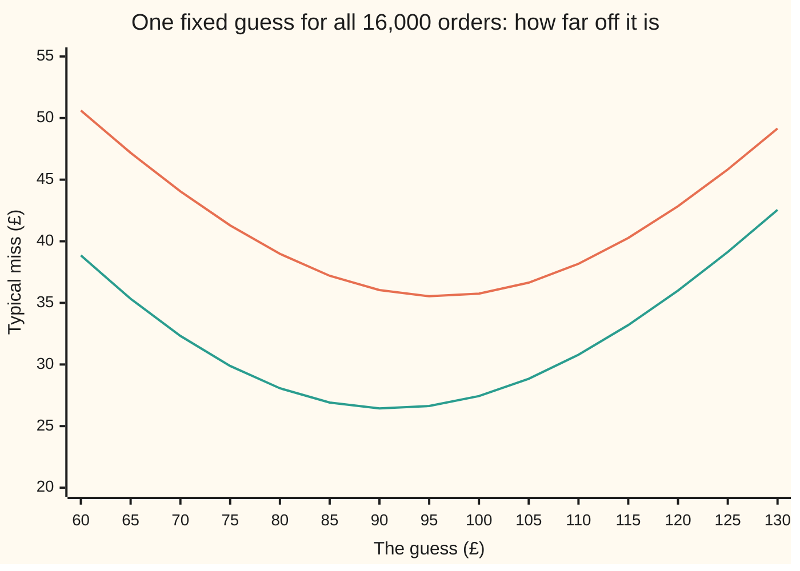
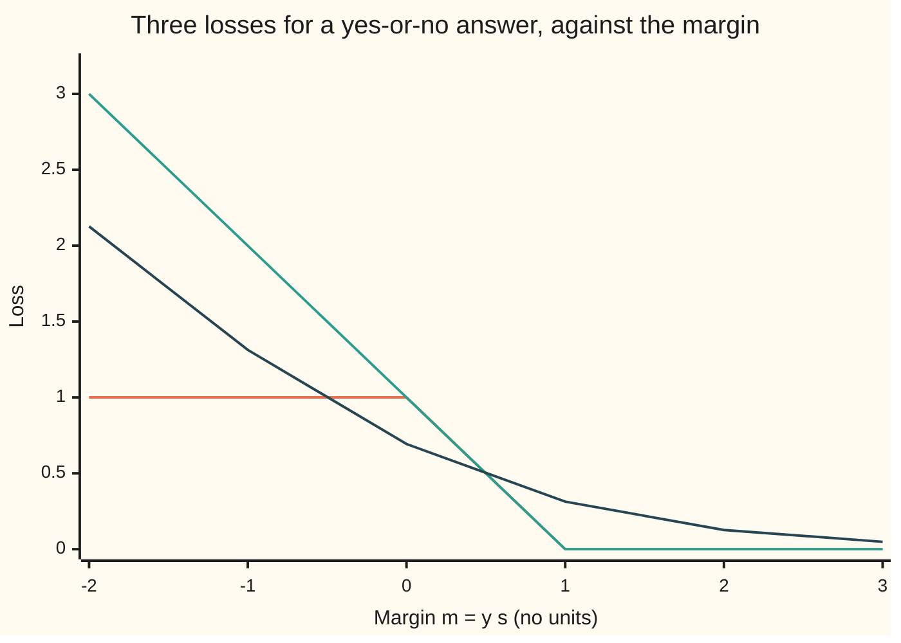

# Loss and empirical risk: writing "learning" as a sum you can minimise

[Syllabus](../../../SYLLABUS.md) → [Applied and computational](../README.md) → [Machine Learning Mathematics](../README.md#s06) → Loss and empirical risk

---

## General Overview

An online shop has 20,000 past orders on file. Each order is described by 12 numbers: items in the basket, their average shelf price, the customer's past orders, days since their last order, phone or not, hour of day, discount code or not, delivery distance, weekend or not, account age, newsletter or not, and items viewed.

Each order also carries the number the shop cares about: what it was worth, in pounds. The shop wants a rule that reads a new basket's 12 numbers and predicts its value, to plan stock and forecast revenue.

"Learn a rule from the data" is vague. Two moves make it exact. First, pick a **loss**: a formula that scores one prediction against what happened, 0 for a perfect hit and larger for a worse miss. Second, average the loss over the orders on file.

That average is the **empirical risk**: empirical because it is measured on data in hand, risk because it stands in for the average loss on orders still to come. Learning is then a search: among the rules on offer, find the one with the smallest average.

The choice of loss is a real decision. Take the simplest rule, one fixed guess for every order, and fit it on 16,000 of the orders. Under **squared loss** (square each miss) the best guess is the average order, £96.04. Under **absolute loss** (take each miss's size, ignoring its sign) it is the middle order, £91.07. Each is best by its own score and worse by the other's. Forecast revenue for the other 4,000 orders from the £91.07 answer and the forecast comes up £19,484.64 short.

**Learning, made exact, is choosing a loss that scores one prediction, averaging it over the data in hand, and picking the rule with the lowest average; the loss decides which answer counts as best, and because the average flatters the rule it was used to pick, the rule is judged on data kept aside.**

**What kind of fact this is:** a method, empirical-risk minimisation. Inside it are three theorems, proved on this card in Why it works: squared loss is minimised by the mean, absolute loss by the median, and log loss by the true chance. The 20,000 orders are synthetic, generated from a stated rule and seed in the code.

### The picture: one guess for every order, scored two ways

The checks try every guess from £60 to £130 in £5 steps on the 16,000 orders. Each line is a typical miss in pounds. The squared-loss risk is in square pounds, so the chart shows its square root, the **root-mean-square miss**; taking a square root moves no minimum.



Orange: root-mean-square miss, lowest near £95; its exact bottom is the mean, £96.04. Green: mean absolute miss, lowest near £90; its exact bottom is the median, £91.07. Same orders, two scores, two different bottoms.

---

## The formula

Notation first. The orders used for fitting are numbered $i = 1$ to $n$. Order $i$ has value $y_i$ in pounds and twelve numbers $x_{i1}, \dots, x_{i,12}$. A rule turns those into a prediction $\hat y_i$; the hat marks a value the rule produces, as on [Least squares](../../09-Probability%20and%20statistics/09-Regression/01-least-squares-regression.md). The rule here is a weighted sum,

$$\hat y_i = w_0 + w_1 x_{i1} + w_2 x_{i2} + \dots + w_{12}\,x_{i,12},$$

whose 13 adjustable numbers $w = (w_0, \dots, w_{12})$ are its **weights**; $w_0$ is the starting amount every prediction gets. A **loss** $\ell(y, \hat y)$ (a script l) scores one prediction. The **empirical risk** of the weights is the average loss:

$$\hat R(w) = \frac{1}{n}\sum_{i=1}^{n} \ell\big(y_i,\ \hat y_i\big)$$

**Read it aloud:** the empirical risk of a set of weights is the loss of each of its predictions, averaged over the $n$ orders on file.

Four losses cover most practice. For amounts, such as an order's value:

$$\text{squared: } (y - \hat y)^2 \qquad\qquad \text{absolute: } |y - \hat y|$$

For yes-or-no questions, such as "will this order be sent back?", the answer is coded $y = +1$ (returned) or $y = -1$ (kept), and the rule outputs a **score** $s$, positive for "returned". The product $m = y\,s$ is the **margin**: positive when the score points the right way, and larger the more room it leaves.

$$\text{hinge: } \max(0,\ 1 - m) \qquad\qquad \text{log: } \ln\big(1 + e^{-m}\big)$$

| Symbol | Plain meaning | In our example | Push it up and the answer… |
| --- | --- | --- | --- |
| $n$ | orders used for fitting | 16,000 | the average settles nearer the true risk |
| $i$, $j$ | which order; which of its 12 numbers | order 1; number 1 is items in the basket | — |
| $y_i$ | the value of order $i$, in pounds | £14 to £102 in the five-order sample below | the mean rises by $1/n$ of the rise; the median may not move |
| $x_{ij}$ | the $j$-th of order $i$'s 12 numbers | items in the basket: 1 to 8 | the prediction moves by $w_j$ per unit |
| $w$, $w_0$, $w_j$ | the weights; the starting amount; the weight on number $j$ | fitted: £34.77 to start, £5.95 per item | — |
| $\hat y_i$ | the rule's prediction for order $i$ | the weighted sum above | — |
| $c$, $\bar y$ | one fixed guess used for every order, the simplest rule; the mean order value | both £96.04 at the squared-loss best | squared risk grows by $(c - \bar y)^2$ |
| $\ell(y, \hat y)$ | the loss: the score for one prediction | squared, $(y - \hat y)^2$ | — |
| $\hat R(w)$ | empirical risk: average loss on the orders used for fitting | 901.09 square pounds, 12-number rule | — |
| $R(w)$ | true risk: average loss over all orders to come, estimated on 4,000 orders kept aside | 908.25 square pounds | — |
| $s$, $m$ | a yes-or-no rule's score; the margin $m = y\,s$ | $m = 1$: hinge loss 0, log loss 0.3133 | both losses fall |
| $q$, $p$ | the true chance an order like this is returned; the rule's forecast of it | $q = 0.1$, 1 in 10 | — |

### When it holds

- **The orders on file must be like the orders to come.** The empirical risk estimates the true risk only for orders drawn the same way. A rule fitted on spring orders and used in the Christmas rush is judged by an average over the wrong orders.
- **The loss must match the decision.** Revenue is a sum, and the guess that gets sums right is the squared-loss guess. Forecast 4,000 orders with the absolute-loss guess and the total is £19,484.64 short.
- **Enough orders per weight.** Thirteen weights fitted on 20 orders reach a training risk of 209.25 and a risk of 2,520.14 on the 4,000 kept aside. The low average was bought by copying noise.
- **Every row deserves its vote.** Squared loss lets one wild row pull hard. Key 100 of the 16,000 orders in pence instead of pounds and the mean jumps from £96.04 to £152.73; the median moves to £91.33.
- **The rule is judged on rows it never saw.** The average on the fitting rows is biased low. Training error against held-out error, and k-fold cross-validation (split the rows into k parts and let each part take a turn as the rows kept aside), are taught on [Overfitting](../../09-Probability%20and%20statistics/09-Regression/08-cross-validation-and-overfitting.md); this card keeps 4,000 orders aside and never fits on them.

---

## Why it works

### Step 0: an average over the orders in hand stands in for the orders to come

The shop cares about the true risk $R(w)$: the average loss on every order it will ever take. That cannot be measured. But it is an average over orders drawn the same way as the ones on file, and an average over many such orders lands near it, by the law of large numbers. So the shop minimises the average it can measure, $\hat R(w)$.

Two consequences follow, and the rest of the card is about them. The loss decides which answer counts as best. And the rule picked to make $\hat R$ small was picked partly for the noise in these particular rows, so its own $\hat R$ is optimistic.

### Step 1: squared loss is minimised by the mean

Try one fixed guess $c$ for every order. Write the mean of the values as $\bar y$. Each miss splits into the order's distance from the mean plus the mean's distance from the guess: $y_i - c = (y_i - \bar y) + (\bar y - c)$. Square and average. The cross term is $2(\bar y - c)$ times the average of $y_i - \bar y$, and distances from a mean average to zero. What is left is

$$\hat R(c) = \hat R(\bar y) + (c - \bar y)^2.$$

The first term does not depend on $c$. The second is a square, zero only at $c = \bar y$. So the mean is the one best guess, and every other guess pays exactly its squared distance from the mean.

On the 16,000 orders: the mean £96.04 scores 1,262.24 square pounds. The median £91.07 scores 1,286.99. The gap is 24.75. The code squares the distance from median to mean, using the unrounded values, and gets 24.75 too, as the identity says. (Squaring the rounded pounds-and-pence figures gives slightly less.)

### Step 2: absolute loss is minimised by the median

Slide the guess up by a small amount. Every order above the guess comes that much closer; every order below goes that much further. The total changes by the amount times (orders below minus orders above). While more than half the orders sit above the guess, sliding up helps. Once more than half sit below, sliding up hurts. The bottom is where half lie on each side: the **median**, the middle value.

With 16,000 orders there are two middle values, the 8,000th and 8,001st from the bottom, and every guess between them ties. The code takes their midpoint, £91.07, and a search that knows no formula, cutting the range by thirds 200 times, lands at the same height.

Why the two answers differ: squared loss pays the square of a miss, so one very large order pulls the guess hard. Absolute loss pays only the miss's size, so the same order is one vote above. These order values have a long tail of unusually large orders, so the mean sits above the median.

### Step 3: with 12 numbers, squared loss is least squares

Swap the fixed guess for the weighted sum. With squared loss, $\hat R(w)$ is the least-squares score of [Least squares](../../09-Probability%20and%20statistics/09-Regression/01-least-squares-regression.md) with 12 inputs instead of one, and its bottom is where the risk has no slope in any direction: thirteen equations, one per weight, called the normal equations. The code solves them by elimination, then measures the slope of $\hat R$ at the answer directly. The largest slope is 0.00.

The fitted weights land near the hidden rule that made the data: £5.95 per item (true: £6), £1.07 per pound of average price (true: £1.10), £0.03 per hour of day (true: 0). The starting amount is £34.77, not the hidden rule's £4, and Step 1 says why. The hidden rule adds a random extra spend that averages £30, and squared loss aims at the average. With 12 numbers it predicts the average value of orders with those numbers.

How good can any rule be? The extra spend has a variance (the average squared distance from its own mean) of 900 square pounds (a standard deviation of £30), and no rule can predict it. Estimating 13 weights adds a little on top: 900 × (1 + 13/16,000), about 900.73 on average.

The fitted rule scores 901.09 on its own 16,000 orders and 908.25 on the 4,000 kept aside. The hidden rule itself, plus its £30 average, scores 908.41 on those same 4,000. The fitted rule is as good as the truth, to within the noise of 4,000 orders.

### Step 4: for yes or no, a loss with a slope replaces the mistake count

The natural score for a yes-or-no rule is the **zero-one loss**: 1 if the margin is zero or less (wrong side, or undecided), 0 if not. Its average is the error rate. But it is flat almost everywhere: nudge the weights and no count changes, so there is no slope to follow downhill ([Gradient descent](02-gradient-descent-and-stochastic-gradient.md)). Hinge and log loss keep charging for the wrong side, keep charging a little for a narrow right side, and slope everywhere they charge.



Orange: zero-one loss, a step at 0 (the chart joins its points with a straight segment). Green: hinge loss, a straight ramp that reaches 0 at margin 1 and never falls below the zero-one loss, so a small average hinge forces a low error rate. Dark: log loss, a smooth curve that never quite reaches 0.

### Step 5: log loss rewards an honest chance; hinge loss does not

Suppose 1 in 10 orders like this one comes back, so $q = 0.1$. A rule that forecasts a chance $p$ pays $-\ln p$ when the order is returned and $-\ln(1 - p)$ when it is kept. This is the log loss above: with $p = 1/(1 + e^{-s})$, the logistic curve of [Logistic regression](../../09-Probability%20and%20statistics/09-Regression/05-logistic-regression.md), $-\ln p$ for a returned order equals $\ln(1 + e^{-s})$. Averaged over many such orders, the forecast $p$ pays

$$-\big(q \ln p + (1 - q)\ln(1 - p)\big).$$

Its slope in $p$ is $-q/p + (1 - q)/(1 - p)$, which is zero only at $p = q$; below $q$ the slope is negative and above it positive. So the honest forecast scores best: 0.3251 at $p = 0.1$, against 0.4414 at 0.3 and 0.6931 at 0.5. A loss whose average is lowest at the true chance is called **proper**.

Hinge loss on a score $s$ averages $q\max(0, 1 - s) + (1 - q)\max(0, 1 + s)$. For any $q$ below one half this is lowest at $s = -1$, "kept", with the value $2q$: 0.2000 when $q = 0.1$, 0.8000 when $q = 0.4$. The best score is the same −1 whether 1 in 10 or 4 in 10 orders come back. Hinge loss buys a decision; log loss buys a chance. [Support vector machines](09-kernels-and-support-vector-machines.md) use the first and [Softmax and cross-entropy](05-softmax-and-cross-entropy-for-classification.md) the second.

---

## Worked numbers, by hand

Five made-up orders, small enough to do on paper: £14, £22, £27, £35 and £102.

| Step | Arithmetic | Value |
| --- | --- | --- |
| mean | (14 + 22 + 27 + 35 + 102) / 5 | £40 |
| median | the middle of the five | £27 |
| misses from £40 | 26, 18, 13, 5, 62 | — |
| squared losses at £40 | 676 + 324 + 169 + 25 + 3,844 | 5,038 |
| squared risk at £40 | 5,038 / 5 | 1,007.60 |
| misses from £27 | 13, 5, 0, 8, 75 | — |
| squared losses at £27 | 169 + 25 + 0 + 64 + 5,625 | 5,883 |
| squared risk at £27 | 5,883 / 5 | 1,176.60 |
| Step 1's check | 1,007.60 + (27 − 40)² = 1,007.60 + 169 | 1,176.60 |
| absolute risk at £40 | (26 + 18 + 13 + 5 + 62) / 5 = 124 / 5 | 24.80 |
| absolute risk at £27 | (13 + 5 + 0 + 8 + 75) / 5 = 101 / 5 | 20.20 |
| **verdict** | each guess wins on its own loss | **squared loss picks £40, absolute loss picks £27** |

The £102 order alone supplies 3,844 of the 5,038: squared loss lets one big basket drag the guess to £40, above four of the five orders.

### What breaks if you drop a piece

| Mistake | Comes out at | What went wrong |
| --- | --- | --- |
| Forecast revenue from the absolute-loss guess | £364,271.87 for 4,000 orders that came to £383,756.51: £19,484.64 short | The median ignores how big the big orders are. A sum needs the mean: £416.86 over, or the 12-number rule, £928.44 under |
| Fit 13 weights on 20 orders and trust the training risk | 209.25 on the 20; 2,520.14 on the 4,000 kept aside | Few rows per weight: the weights copied the noise |
| Keep squared loss when 100 of 16,000 orders were keyed in pence | mean £152.73 instead of £96.04; median £91.33 | Squaring gives a wild row a huge vote; the mean moved by exactly 99 × (their total) / 16,000 = £56.69 |
| Use hinge loss to estimate the chance of a return | best score −1 at $q = 0.1$ and at $q = 0.4$ | Hinge loss is not proper: it returns a side, not a chance |

---

## Code, from first principles, and it actually runs

The script builds the 20,000 synthetic orders from a hidden rule and a seed, using SplitMix64 written out so Python and Rust draw the same numbers. It fits on the first 16,000 and never touches the last 4,000 until scoring. It reaches each answer by two independent roads:

- The best fixed guess: the mean and median by formula, against a search that only compares risks.
- The 12-number rule: the normal equations solved by elimination, against the slope of the risk measured at the answer and against the hidden rule's own weights and its known noise.
- Log and hinge loss: the proofs of Step 5, against a grid of every forecast to three decimals.

### Python

```python
# Loss and empirical risk -- the check behind the card.  Standard library only.
# Data: 20,000 SYNTHETIC orders from a stated rule and seed (SplitMix64, written out).
from math import log, exp

MASK = (1 << 64) - 1
class SplitMix64:
    def __init__(self, seed): self.x = seed
    def u(self):                                   # a uniform number in [0, 1)
        self.x = (self.x + 0x9E3779B97F4A7C15) & MASK
        z = self.x
        z = ((z ^ (z >> 30)) * 0xBF58476D1CE4E5B9) & MASK
        z = ((z ^ (z >> 27)) * 0x94D049BB133111EB) & MASK
        return ((z ^ (z >> 31)) >> 11) / 9007199254740992.0

# the hidden rule: bias 4, then one weight per number; 5 of the 12 numbers do nothing
TRUE = [4.0, 6.0, 1.1, 0.4, -0.05, 0.0, 0.0, 3.0, 0.0, 2.0, 0.0, 0.0, 0.2]
def order(g):   # 1, items, avg price, past orders, days since last, mobile, hour,
    x = [1.0, 1 + int(8 * g.u()), 5 + 40 * g.u(), int(21 * g.u()), int(91 * g.u()),   # discount,
         float(g.u() < 0.6), int(24 * g.u()), float(g.u() < 0.25), 1 + 49 * g.u(),     # distance,
         float(g.u() < 0.3), 10 * g.u(), float(g.u() < 0.4), 1 + int(40 * g.u())]       # weekend, ...
    x = [float(v) for v in x]
    return x, sum(w * v for w, v in zip(TRUE, x)) - 30.0 * log(1.0 - g.u())   # skewed extra spend

def sq_risk(c, ys): return sum((y - c) ** 2 for y in ys) / len(ys)      # squared loss, averaged
def abs_risk(c, ys): return sum(abs(y - c) for y in ys) / len(ys)       # absolute loss, averaged
def median(ys):
    s = sorted(ys); n = len(s)
    return s[n // 2] if n % 2 else (s[n // 2 - 1] + s[n // 2]) / 2
def ternary(f, lo, hi):                            # road 2: search the bowl, no formula used
    for _ in range(200):
        a, b = lo + (hi - lo) / 3, hi - (hi - lo) / 3
        if f(a) <= f(b): hi = b
        else: lo = a
    return (lo + hi) / 2

def fit(rows):                                     # least squares: solve (X^T X) w = X^T y
    p = len(rows[0][0])
    A = [[0.0] * (p + 1) for _ in range(p)]
    for x, y in rows:
        for i in range(p):
            for j in range(p): A[i][j] += x[i] * x[j]
            A[i][p] += x[i] * y
    for c in range(p):                             # Gaussian elimination, partial pivoting
        r = max(range(c, p), key=lambda k: abs(A[k][c])); A[c], A[r] = A[r], A[c]
        for k in range(c + 1, p):
            f = A[k][c] / A[c][c]
            for j in range(c, p + 1): A[k][j] -= f * A[c][j]
    w = [0.0] * p
    for c in range(p - 1, -1, -1):
        w[c] = (A[c][p] - sum(A[c][j] * w[j] for j in range(c + 1, p))) / A[c][c]
    return w
def risk(w, rows): return sum((y - sum(a * b for a, b in zip(w, x))) ** 2 for x, y in rows) / len(rows)

def show(label, *vals, d=2): print(f"{label:<36}" + " ".join(f"{v:10.{d}f}" for v in vals))

five = [14.0, 22.0, 27.0, 35.0, 102.0]             # worked by hand on the card
m5, d5 = sum(five) / 5, median(five)
show("five orders: mean, median", m5, d5)
show("five: squared sum at mean, median", 5 * sq_risk(m5, five), 5 * sq_risk(d5, five))
show("five: absolute sum at mean, median", 5 * abs_risk(m5, five), 5 * abs_risk(d5, five))
for c in (m5, d5):
    print(f"five at {c:.0f}: squared misses".ljust(36) + " ".join(f"{(y - c) ** 2:7.0f}" for y in five))
    print(f"five at {c:.0f}: absolute misses".ljust(36) + " ".join(f"{abs(y - c):7.0f}" for y in five))
show("five: squared risk at mean, median", sq_risk(m5, five), sq_risk(d5, five))
show("five: absolute risk at mean, median", abs_risk(m5, five), abs_risk(d5, five))
assert sq_risk(m5, five) < sq_risk(d5, five) and abs_risk(d5, five) < abs_risk(m5, five)

g = SplitMix64(20261111)
rows = [order(g) for _ in range(20000)]
train, test = rows[:16000], rows[16000:]          # the last 4,000 are never used to fit
ys, yt = [y for _, y in train], [y for _, y in test]
mean, med = sum(ys) / len(ys), median(ys)
t_sq, t_ab = ternary(lambda c: sq_risk(c, ys), 0, 500), ternary(lambda c: abs_risk(c, ys), 0, 500)
show("train: mean, median order value", mean, med)
show("ternary search: squared, absolute", t_sq, t_ab)
show("constant = mean: sq risk, abs risk", sq_risk(mean, ys), abs_risk(mean, ys))
show("constant = median: sq risk, abs risk", sq_risk(med, ys), abs_risk(med, ys))
assert abs(t_sq - mean) < 1e-6 and abs(abs_risk(t_ab, ys) - abs_risk(med, ys)) < 1e-9
assert sq_risk(mean, ys) < sq_risk(med, ys) and abs_risk(med, ys) < abs_risk(mean, ys)
gap = sq_risk(med, ys) - sq_risk(mean, ys)        # Step 1: the gap is exactly (median - mean)^2
show("sq risk gap, (median - mean)^2", gap, (med - mean) ** 2)
assert abs(gap - (med - mean) ** 2) < 1e-6
grid = [60 + 5 * i for i in range(15)]
print("chart, constant guess (pounds)     " + " ".join(f"{c:6d}" for c in grid))
print("chart, root mean square miss       " + " ".join(f"{sq_risk(c, ys) ** 0.5:6.2f}" for c in grid))
print("chart, mean absolute miss          " + " ".join(f"{abs_risk(c, ys):6.2f}" for c in grid))

w = fit(train)                                    # 13 weights: bias + one per number
show("fitted bias, items, avg price", w[0], w[1], w[2])
show("fitted mobile, hour, distance", w[5], w[6], w[8])
r_tr, r_te, r_true = risk(w, train), risk(w, test), risk([TRUE[0] + 30.0] + TRUE[1:], test)
show("12 numbers: train risk, test risk", r_tr, r_te)
show("true rule + 30 on test; 900(1+13/n)", r_true, 900 * (1 + 13 / 16000))
assert abs(w[1] - 6.0) < 0.3 and abs(w[2] - 1.1) < 0.05 and abs(w[6]) < 0.1   # the truth comes back
assert abs(r_te - 900 * (1 + 13 / 16000)) < 4 * 8 ** 0.5 * 900 / 4000 ** 0.5   # 4 SEs; (E - 30)^2 has SD sqrt(8) * 900
assert r_tr < sq_risk(mean, ys)
grad = [sum(2 * (sum(a * b for a, b in zip(w, x)) - y) * x[i] for x, y in train) / 16000 for i in range(13)]
show("largest slope of risk at the fit", max(abs(v) for v in grad))
assert max(abs(v) for v in grad) < 1e-6
pred = [sum(a * b for a, b in zip(w, x)) for x, _ in test]
show("test revenue: actual, linear", sum(yt), sum(pred))
show("test revenue: x mean, x median", 4000 * mean, 4000 * med)
show("pred - actual: linear, mean, median", sum(pred) - sum(yt), 4000 * mean - sum(yt), 4000 * med - sum(yt))

w20 = fit(train[:20])                             # what breaks: 13 weights from 20 orders
show("20-order fit: train risk, test risk", risk(w20, train[:20]), risk(w20, test))
assert risk(w20, train[:20]) < 0.5 * r_tr and risk(w20, test) > 1.5 * r_te
for k in (13, 100):                               # try: as many orders as weights, then more
    wk = fit(train[:k]); show(f"try: {k}-order fit: train, test risk", risk(wk, train[:k]), risk(wk, test))
typo = [y * 100 for y in ys[:100]] + ys[100:]    # 100 orders keyed in pence, not pounds
show("100 typos: mean, median", sum(typo) / len(typo), median(typo))
show("mean shift: run, 99*sum(first 100)/n", sum(typo) / len(typo) - mean, 99 * sum(ys[:100]) / 16000)
assert abs(sum(typo) / len(typo) - mean - 99 * sum(ys[:100]) / 16000) < 1e-9 and median(typo) - med < 1

margins = [-2.0, -1.0, 0.0, 1.0, 2.0, 3.0]   # yes/no: will the order be returned?
print("margin m = y*s       " + " ".join(f"{m:7.4f}" for m in margins))
print("zero-one loss        " + " ".join(f"{float(m <= 0):7.4f}" for m in margins))
print("hinge max(0, 1-m)    " + " ".join(f"{max(0.0, 1 - m):7.4f}" for m in margins))
print("log ln(1+e^-m)       " + " ".join(f"{log(1 + exp(-m)):7.4f}" for m in margins))
ll = lambda p, q: -(q * log(p) + (1 - q) * log(1 - p))   # average log loss when a chance q comes true
hinge = lambda s, q: q * max(0.0, 1 - s) + (1 - q) * max(0.0, 1 + s)
for q in (0.1, 0.4):                              # 1 in 10 such orders comes back; try 4 in 10
    best_p = min((k / 1000 for k in range(1, 1000)), key=lambda p: ll(p, q))
    best_s = min((k / 100 for k in range(-300, 301)), key=lambda s: hinge(s, q))
    show(f"q = {q}: best p by grid, its log loss", best_p, ll(best_p, q), d=4)
    show(f"q = {q}: best score, its hinge", best_s, hinge(best_s, q), d=4)
    assert abs(best_p - q) < 1e-9 and abs(best_s + 1) < 1e-9 and abs(hinge(best_s, q) - 2 * q) < 1e-9
show("q = 0.1: log loss at p = 0.3, 0.5", ll(0.3, 0.1), ll(0.5, 0.1), d=4)
print("ALL CHECKS PASS")
```

**Ran 2026-11-11 on macOS, Python 3.14.10, standard library only. All checks passed. Output, pasted from the run:**

```
five orders: mean, median                40.00      27.00
five: squared sum at mean, median      5038.00    5883.00
five: absolute sum at mean, median      124.00     101.00
five at 40: squared misses              676     324     169      25    3844
five at 40: absolute misses              26      18      13       5      62
five at 27: squared misses              169      25       0      64    5625
five at 27: absolute misses              13       5       0       8      75
five: squared risk at mean, median     1007.60    1176.60
five: absolute risk at mean, median      24.80      20.20
train: mean, median order value          96.04      91.07
ternary search: squared, absolute        96.04      91.07
constant = mean: sq risk, abs risk     1262.24      26.75
constant = median: sq risk, abs risk   1286.99      26.42
sq risk gap, (median - mean)^2           24.75      24.75
chart, constant guess (pounds)         60     65     70     75     80     85     90     95    100    105    110    115    120    125    130
chart, root mean square miss        50.61  47.18  44.05  41.29  38.98  37.20  36.04  35.54  35.75  36.64  38.17  40.27  42.85  45.83  49.15
chart, mean absolute miss           38.85  35.33  32.32  29.88  28.07  26.91  26.44  26.63  27.44  28.84  30.79  33.20  36.00  39.13  42.55
fitted bias, items, avg price            34.77       5.95       1.07
fitted mobile, hour, distance            -0.92       0.03      -0.01
12 numbers: train risk, test risk       901.09     908.25
true rule + 30 on test; 900(1+13/n)     908.41     900.73
largest slope of risk at the fit          0.00
test revenue: actual, linear         383756.51  382828.07
test revenue: x mean, x median       384173.37  364271.87
pred - actual: linear, mean, median    -928.44     416.86  -19484.64
20-order fit: train risk, test risk     209.25    2520.14
try: 13-order fit: train, test risk       0.00    3838.49
try: 100-order fit: train, test risk    603.80    1007.04
100 typos: mean, median                 152.73      91.33
mean shift: run, 99*sum(first 100)/n     56.69      56.69
margin m = y*s       -2.0000 -1.0000  0.0000  1.0000  2.0000  3.0000
zero-one loss         1.0000  1.0000  1.0000  0.0000  0.0000  0.0000
hinge max(0, 1-m)     3.0000  2.0000  1.0000  0.0000  0.0000  0.0000
log ln(1+e^-m)        2.1269  1.3133  0.6931  0.3133  0.1269  0.0486
q = 0.1: best p by grid, its log loss    0.1000     0.3251
q = 0.1: best score, its hinge         -1.0000     0.2000
q = 0.4: best p by grid, its log loss    0.4000     0.6730
q = 0.4: best score, its hinge         -1.0000     0.8000
q = 0.1: log loss at p = 0.3, 0.5       0.4414     0.6931
ALL CHECKS PASS
```

### Rust

```rust
// Loss and empirical risk -- the check behind the card.  std only, no crates.
// Data: 20,000 SYNTHETIC orders from a stated rule and seed (SplitMix64, written out).
struct SplitMix64 { x: u64 }
impl SplitMix64 {
    fn u(&mut self) -> f64 {                       // a uniform number in [0, 1)
        self.x = self.x.wrapping_add(0x9E3779B97F4A7C15);
        let mut z = self.x;
        z = (z ^ (z >> 30)).wrapping_mul(0xBF58476D1CE4E5B9);
        z = (z ^ (z >> 27)).wrapping_mul(0x94D049BB133111EB);
        ((z ^ (z >> 31)) >> 11) as f64 / 9007199254740992.0
    }
}
// the hidden rule: bias 4, then one weight per number; 5 of the 12 numbers do nothing
const TRUE: [f64; 13] = [4.0, 6.0, 1.1, 0.4, -0.05, 0.0, 0.0, 3.0, 0.0, 2.0, 0.0, 0.0, 0.2];
type Row = (Vec<f64>, f64);

fn nsum<I: Iterator<Item = f64>>(it: I) -> f64 {  // compensated sum, the same as Python's sum()
    let (mut s, mut c) = (0.0f64, 0.0f64);
    for x in it {
        let t = s + x;
        if s.abs() >= x.abs() { c += (s - t) + x; } else { c += (x - t) + s; }
        s = t;
    }
    s + c
}
fn dot(w: &[f64], x: &[f64]) -> f64 { nsum(w.iter().zip(x).map(|(a, b)| a * b)) }
fn flag(c: bool) -> f64 { if c { 1.0 } else { 0.0 } }
fn order(g: &mut SplitMix64) -> Row {   // 1, items, avg price, past orders, days since last, ...
    let x = vec![1.0, 1.0 + (8.0 * g.u()).floor(), 5.0 + 40.0 * g.u(), (21.0 * g.u()).floor(),
        (91.0 * g.u()).floor(), flag(g.u() < 0.6), (24.0 * g.u()).floor(), flag(g.u() < 0.25),
        1.0 + 49.0 * g.u(), flag(g.u() < 0.3), 10.0 * g.u(), flag(g.u() < 0.4), 1.0 + (40.0 * g.u()).floor()];
    let y = dot(&TRUE, &x) - 30.0 * (1.0 - g.u()).ln();          // skewed extra spend
    (x, y)
}
fn sq_risk(c: f64, ys: &[f64]) -> f64 { nsum(ys.iter().map(|y| (y - c).powi(2))) / ys.len() as f64 }
fn abs_risk(c: f64, ys: &[f64]) -> f64 { nsum(ys.iter().map(|y| (y - c).abs())) / ys.len() as f64 }
fn median(ys: &[f64]) -> f64 {
    let mut s = ys.to_vec(); s.sort_by(|a, b| a.partial_cmp(b).unwrap()); let n = s.len();
    if n % 2 == 1 { s[n / 2] } else { (s[n / 2 - 1] + s[n / 2]) / 2.0 }
}
fn ternary(f: &dyn Fn(f64) -> f64, mut lo: f64, mut hi: f64) -> f64 {   // road 2: search the bowl
    for _ in 0..200 {
        let (a, b) = (lo + (hi - lo) / 3.0, hi - (hi - lo) / 3.0);
        if f(a) <= f(b) { hi = b; } else { lo = a; }
    }
    (lo + hi) / 2.0
}
fn fit(rows: &[Row]) -> Vec<f64> {                 // least squares: solve (X^T X) w = X^T y
    let p = rows[0].0.len();
    let mut a = vec![vec![0.0f64; p + 1]; p];
    for (x, y) in rows {
        for i in 0..p {
            for j in 0..p { a[i][j] += x[i] * x[j]; }
            a[i][p] += x[i] * y;
        }
    }
    for c in 0..p {                                // Gaussian elimination, partial pivoting
        let mut r = c;
        for k in c..p { if a[k][c].abs() > a[r][c].abs() { r = k; } }
        a.swap(c, r);
        for k in c + 1..p {
            let f = a[k][c] / a[c][c];
            for j in c..p + 1 { a[k][j] -= f * a[c][j]; }
        }
    }
    let mut w = vec![0.0f64; p];
    for c in (0..p).rev() {
        w[c] = (a[c][p] - nsum((c + 1..p).map(|j| a[c][j] * w[j]))) / a[c][c];
    }
    w
}
fn risk(w: &[f64], rows: &[Row]) -> f64 { nsum(rows.iter().map(|(x, y)| (y - dot(w, x)).powi(2))) / rows.len() as f64 }
fn show(label: &str, vals: &[f64], d: usize) {
    let v: Vec<String> = vals.iter().map(|v| format!("{:10.*}", d, v)).collect();
    println!("{:<36}{}", label, v.join(" "));
}
fn line(label: &str, vals: &[f64], width: usize, d: usize) {
    let v: Vec<String> = vals.iter().map(|v| format!("{:width$.d$}", v, width = width, d = d)).collect();
    println!("{}{}", label, v.join(" "));
}

fn main() {
    let five = [14.0, 22.0, 27.0, 35.0, 102.0];    // worked by hand on the card
    let (m5, d5) = (nsum(five.iter().copied()) / 5.0, median(&five));
    show("five orders: mean, median", &[m5, d5], 2);
    show("five: squared sum at mean, median", &[5.0 * sq_risk(m5, &five), 5.0 * sq_risk(d5, &five)], 2);
    show("five: absolute sum at mean, median", &[5.0 * abs_risk(m5, &five), 5.0 * abs_risk(d5, &five)], 2);
    for c in [m5, d5] {
        line(&format!("{:<36}", format!("five at {:.0}: squared misses", c)), &five.map(|y: f64| (y - c).powi(2)), 7, 0);
        line(&format!("{:<36}", format!("five at {:.0}: absolute misses", c)), &five.map(|y: f64| (y - c).abs()), 7, 0);
    }
    show("five: squared risk at mean, median", &[sq_risk(m5, &five), sq_risk(d5, &five)], 2);
    show("five: absolute risk at mean, median", &[abs_risk(m5, &five), abs_risk(d5, &five)], 2);
    assert!(sq_risk(m5, &five) < sq_risk(d5, &five) && abs_risk(d5, &five) < abs_risk(m5, &five));

    let mut g = SplitMix64 { x: 20261111 };
    let rows: Vec<Row> = (0..20000).map(|_| order(&mut g)).collect();
    let (train, test) = (&rows[..16000], &rows[16000..]);   // the last 4,000 are never used to fit
    let ys: Vec<f64> = train.iter().map(|r| r.1).collect();
    let yt: Vec<f64> = test.iter().map(|r| r.1).collect();
    let (mean, med) = (nsum(ys.iter().copied()) / 16000.0, median(&ys));
    let t_sq = ternary(&|c| sq_risk(c, &ys), 0.0, 500.0);
    let t_ab = ternary(&|c| abs_risk(c, &ys), 0.0, 500.0);
    show("train: mean, median order value", &[mean, med], 2);
    show("ternary search: squared, absolute", &[t_sq, t_ab], 2);
    show("constant = mean: sq risk, abs risk", &[sq_risk(mean, &ys), abs_risk(mean, &ys)], 2);
    show("constant = median: sq risk, abs risk", &[sq_risk(med, &ys), abs_risk(med, &ys)], 2);
    assert!((t_sq - mean).abs() < 1e-6 && (abs_risk(t_ab, &ys) - abs_risk(med, &ys)).abs() < 1e-9);
    assert!(sq_risk(mean, &ys) < sq_risk(med, &ys) && abs_risk(med, &ys) < abs_risk(mean, &ys));
    let gap = sq_risk(med, &ys) - sq_risk(mean, &ys);    // Step 1: the gap is exactly (median - mean)^2
    show("sq risk gap, (median - mean)^2", &[gap, (med - mean).powi(2)], 2);
    assert!((gap - (med - mean).powi(2)).abs() < 1e-6);
    let grid: Vec<f64> = (0..15).map(|i| 60.0 + 5.0 * i as f64).collect();
    line("chart, constant guess (pounds)     ", &grid, 6, 0);
    line("chart, root mean square miss       ", &grid.iter().map(|&c| sq_risk(c, &ys).powf(0.5)).collect::<Vec<_>>(), 6, 2);
    line("chart, mean absolute miss          ", &grid.iter().map(|&c| abs_risk(c, &ys)).collect::<Vec<_>>(), 6, 2);

    let w = fit(train);                            // 13 weights: bias + one per number
    show("fitted bias, items, avg price", &[w[0], w[1], w[2]], 2);
    show("fitted mobile, hour, distance", &[w[5], w[6], w[8]], 2);
    let mut truth = TRUE.to_vec(); truth[0] += 30.0;
    let (r_tr, r_te, r_true) = (risk(&w, train), risk(&w, test), risk(&truth, test));
    show("12 numbers: train risk, test risk", &[r_tr, r_te], 2);
    show("true rule + 30 on test; 900(1+13/n)", &[r_true, 900.0 * (1.0 + 13.0 / 16000.0)], 2);
    assert!((w[1] - 6.0).abs() < 0.3 && (w[2] - 1.1).abs() < 0.05 && w[6].abs() < 0.1);   // the truth comes back
    assert!((r_te - 900.0 * (1.0 + 13.0 / 16000.0)).abs() < 4.0 * 8f64.sqrt() * 900.0 / 4000f64.sqrt()); // 4 SEs; (E - 30)^2 has SD sqrt(8) * 900
    assert!(r_tr < sq_risk(mean, &ys));
    let grad: Vec<f64> = (0..13).map(|i| nsum(train.iter().map(|(x, y)| 2.0 * (dot(&w, x) - y) * x[i])) / 16000.0).collect();
    let gmax = grad.iter().fold(0.0f64, |m, v| m.max(v.abs()));
    show("largest slope of risk at the fit", &[gmax], 2);
    assert!(gmax < 1e-6);
    let pred = nsum(test.iter().map(|(x, _)| dot(&w, x)));
    show("test revenue: actual, linear", &[nsum(yt.iter().copied()), pred], 2);
    show("test revenue: x mean, x median", &[4000.0 * mean, 4000.0 * med], 2);
    let act = nsum(yt.iter().copied());
    show("pred - actual: linear, mean, median", &[pred - act, 4000.0 * mean - act, 4000.0 * med - act], 2);

    let w20 = fit(&train[..20]);                   // what breaks: 13 weights from 20 orders
    show("20-order fit: train risk, test risk", &[risk(&w20, &train[..20]), risk(&w20, test)], 2);
    assert!(risk(&w20, &train[..20]) < 0.5 * r_tr && risk(&w20, test) > 1.5 * r_te);
    for k in [13, 100] {                           // try: as many orders as weights, then more
        let wk = fit(&train[..k]); show(&format!("try: {}-order fit: train, test risk", k), &[risk(&wk, &train[..k]), risk(&wk, test)], 2);
    }
    let typo: Vec<f64> = ys.iter().enumerate().map(|(i, y)| if i < 100 { y * 100.0 } else { *y }).collect();
    let tmean = nsum(typo.iter().copied()) / 16000.0;   // 100 orders keyed in pence, not pounds
    let shift = 99.0 * nsum(ys[..100].iter().copied()) / 16000.0;
    show("100 typos: mean, median", &[tmean, median(&typo)], 2);
    show("mean shift: run, 99*sum(first 100)/n", &[tmean - mean, shift], 2);
    assert!((tmean - mean - shift).abs() < 1e-9 && median(&typo) - med < 1.0);

    let margins = [-2.0, -1.0, 0.0, 1.0, 2.0, 3.0];   // yes/no: will the order be returned?
    line("margin m = y*s       ", &margins, 7, 4);
    line("zero-one loss        ", &margins.map(|m: f64| flag(m <= 0.0)), 7, 4);
    line("hinge max(0, 1-m)    ", &margins.map(|m: f64| (1.0 - m).max(0.0)), 7, 4);
    line("log ln(1+e^-m)       ", &margins.map(|m: f64| (1.0 + (-m).exp()).ln()), 7, 4);
    let ll = |p: f64, q: f64| -(q * p.ln() + (1.0 - q) * (1.0 - p).ln());   // average log loss when a chance q comes true
    let hinge = |s: f64, q: f64| q * (1.0 - s).max(0.0) + (1.0 - q) * (1.0 + s).max(0.0);
    for q in [0.1, 0.4] {                          // 1 in 10 such orders comes back; try 4 in 10
        let mut best_p = 0.001;
        for k in 1..1000 { let p = k as f64 / 1000.0; if ll(p, q) < ll(best_p, q) { best_p = p; } }
        let mut best_s = -3.0;
        for k in -300..301 { let s = k as f64 / 100.0; if hinge(s, q) < hinge(best_s, q) { best_s = s; } }
        show(&format!("q = {}: best p by grid, its log loss", q), &[best_p, ll(best_p, q)], 4);
        show(&format!("q = {}: best score, its hinge", q), &[best_s, hinge(best_s, q)], 4);
        assert!((best_p - q).abs() < 1e-9 && (best_s + 1.0).abs() < 1e-9 && (hinge(best_s, q) - 2.0 * q).abs() < 1e-9);
    }
    show("q = 0.1: log loss at p = 0.3, 0.5", &[ll(0.3, 0.1), ll(0.5, 0.1)], 4);
    println!("ALL CHECKS PASS");
}
```

**Ran 2026-11-11 on macOS, rustc 1.98.1, no crates. All checks passed. Output, pasted from the run:**

```
five orders: mean, median                40.00      27.00
five: squared sum at mean, median      5038.00    5883.00
five: absolute sum at mean, median      124.00     101.00
five at 40: squared misses              676     324     169      25    3844
five at 40: absolute misses              26      18      13       5      62
five at 27: squared misses              169      25       0      64    5625
five at 27: absolute misses              13       5       0       8      75
five: squared risk at mean, median     1007.60    1176.60
five: absolute risk at mean, median      24.80      20.20
train: mean, median order value          96.04      91.07
ternary search: squared, absolute        96.04      91.07
constant = mean: sq risk, abs risk     1262.24      26.75
constant = median: sq risk, abs risk   1286.99      26.42
sq risk gap, (median - mean)^2           24.75      24.75
chart, constant guess (pounds)         60     65     70     75     80     85     90     95    100    105    110    115    120    125    130
chart, root mean square miss        50.61  47.18  44.05  41.29  38.98  37.20  36.04  35.54  35.75  36.64  38.17  40.27  42.85  45.83  49.15
chart, mean absolute miss           38.85  35.33  32.32  29.88  28.07  26.91  26.44  26.63  27.44  28.84  30.79  33.20  36.00  39.13  42.55
fitted bias, items, avg price            34.77       5.95       1.07
fitted mobile, hour, distance            -0.92       0.03      -0.01
12 numbers: train risk, test risk       901.09     908.25
true rule + 30 on test; 900(1+13/n)     908.41     900.73
largest slope of risk at the fit          0.00
test revenue: actual, linear         383756.51  382828.07
test revenue: x mean, x median       384173.37  364271.87
pred - actual: linear, mean, median    -928.44     416.86  -19484.64
20-order fit: train risk, test risk     209.25    2520.14
try: 13-order fit: train, test risk       0.00    3838.49
try: 100-order fit: train, test risk    603.80    1007.04
100 typos: mean, median                 152.73      91.33
mean shift: run, 99*sum(first 100)/n     56.69      56.69
margin m = y*s       -2.0000 -1.0000  0.0000  1.0000  2.0000  3.0000
zero-one loss         1.0000  1.0000  1.0000  0.0000  0.0000  0.0000
hinge max(0, 1-m)     3.0000  2.0000  1.0000  0.0000  0.0000  0.0000
log ln(1+e^-m)        2.1269  1.3133  0.6931  0.3133  0.1269  0.0486
q = 0.1: best p by grid, its log loss    0.1000     0.3251
q = 0.1: best score, its hinge         -1.0000     0.2000
q = 0.4: best p by grid, its log loss    0.4000     0.6730
q = 0.4: best score, its hinge         -1.0000     0.8000
q = 0.1: log loss at p = 0.3, 0.5       0.4414     0.6931
ALL CHECKS PASS
```

### Lean

Lean proves Steps 1, 2 and 5 for every list of values and every chance, and checks the five-order sums.

- Take any $n \ge 1$ values and any fixed guess $c$. Then $\hat R(c) = \hat R(\bar y) + (c - \bar y)^2$ under squared loss. So every other guess scores strictly worse than the mean.
- Take any list of values and any median: at least half lie at or below it, and at least half at or above it. Then no fixed guess has a smaller average absolute loss.
- Take a true chance $q$ and a forecast $p \ne q$, both strictly between 0 and 1. Then $p$ pays a strictly larger average log loss than $q$. So log loss is proper.
- Take the five made-up orders. Then the mean is £40, and £27 is a median.
- Take the same five orders. Then the squared losses total 5,038 at £40 and 5,883 at £27, and the absolute losses 124 and 101.
- As arithmetic, $1007.60 + (27 - 40)^2 = 1176.60$. Hinge loss at score −1 averages 0.2 when $q = 0.1$ and 0.8 when $q = 0.4$.

The 20,000 synthetic orders, the 12-number fit, and hinge loss's best score of −1 are left to the Python and Rust checks.

```lean
-- Loss and empirical risk: for any finite list of values, the mean minimises the average squared miss with exactly a squared-distance penalty, any median minimises the average absolute miss, and log loss is lowest at the true chance, with the card's five-order example checked.
import Mathlib.Analysis.SpecialFunctions.Log.Basic
import Mathlib.Algebra.BigOperators.Fin
import Mathlib.Algebra.Order.BigOperators.Group.Finset
import Mathlib.Data.Fin.VecNotation
import Mathlib.Tactic.NormNum

open Finset Real

namespace LossAndEmpiricalRisk

/-- **Squared loss is minimised by the mean** (Step 1). Take `n ≥ 1` values `y₁, …, yₙ` and
use one fixed guess `c` for all of them. Let `ȳ` be their mean and `R(c)` the empirical risk
under squared loss, the average of `(yᵢ - c)²`. Then `R(c) = R(ȳ) + (c - ȳ)²` for every `c`,
so the mean is the one best guess and every other guess scores strictly worse. -/
theorem squared_loss_minimised_by_mean (n : ℕ) (hn : 0 < n) (y : Fin n → ℝ) :
    let ybar : ℝ := (∑ i, y i) / n
    let R : ℝ → ℝ := fun c => (∑ i, (y i - c) ^ 2) / n
    (∀ c : ℝ, R c = R ybar + (c - ybar) ^ 2) ∧ (∀ c : ℝ, c ≠ ybar → R ybar < R c) := by
  intro ybar R
  have hn' : (n : ℝ) ≠ 0 := by positivity
  have hsum : ∑ i, (y i - ybar) = 0 := by
    rw [Finset.sum_sub_distrib]
    simp only [Finset.sum_const, Finset.card_univ, Fintype.card_fin, nsmul_eq_mul, ybar]
    field_simp
    ring
  have key : ∀ c : ℝ, ∑ i, (y i - c) ^ 2 = ∑ i, (y i - ybar) ^ 2 + n * (c - ybar) ^ 2 := by
    intro c
    have h : ∀ i, (y i - c) ^ 2
        = (y i - ybar) ^ 2 + 2 * (ybar - c) * (y i - ybar) + (c - ybar) ^ 2 := fun i => by ring
    simp only [h, Finset.sum_add_distrib, ← Finset.mul_sum, hsum, Finset.sum_const,
      Finset.card_univ, Fintype.card_fin, nsmul_eq_mul]
    ring
  have h1 : ∀ c : ℝ, R c = R ybar + (c - ybar) ^ 2 := by
    intro c
    simp only [R]
    rw [key c, key ybar]
    field_simp
  refine ⟨h1, fun c hc => ?_⟩
  rw [h1 c]
  have : 0 < (c - ybar) ^ 2 := by
    have : c - ybar ≠ 0 := sub_ne_zero.mpr hc
    positivity
  linarith

/-- **Absolute loss is minimised by the median** (Step 2). Take `n` values `y₁, …, yₙ` and a
median `m`: at least half the values lie at or below `m`, and at least half at or above it
(with an even count, any guess between the two middle values is one). Then no fixed guess `c`
has a smaller average absolute miss: the average of `|yᵢ - m|` is at most the average of
`|yᵢ - c|`. -/
theorem absolute_loss_minimised_by_median (n : ℕ) (y : Fin n → ℝ) (m : ℝ)
    (hbelow : n ≤ 2 * (univ.filter (fun i => y i ≤ m)).card)
    (habove : n ≤ 2 * (univ.filter (fun i => m ≤ y i)).card) (c : ℝ) :
    (∑ i, |y i - m|) / n ≤ (∑ i, |y i - c|) / n := by
  have hn0 : (0 : ℝ) ≤ n := by positivity
  apply div_le_div_of_nonneg_right _ hn0
  rcases le_total m c with hmc | hcm
  · -- guess above the median
    have hpt : ∀ i, (c - m) * (2 * (if y i ≤ m then (1 : ℝ) else 0) - 1)
        ≤ |y i - c| - |y i - m| := by
      intro i
      by_cases h : y i ≤ m
      · simp only [h, ↓reduceIte]
        rw [ abs_of_nonpos (by linarith), abs_of_nonpos (by linarith)]
        linarith
      · simp only [h, ↓reduceIte]
        have := abs_sub_abs_le_abs_sub (y i - m) (y i - c)
        have e : y i - m - (y i - c) = c - m := by ring
        rw [e, abs_of_nonneg (show (0 : ℝ) ≤ c - m by linarith)] at this
        linarith
    have hs := Finset.sum_le_sum (fun i (_ : i ∈ (univ : Finset (Fin n))) => hpt i)
    rw [← Finset.mul_sum, Finset.sum_sub_distrib, ← Finset.mul_sum, Finset.sum_boole,
      Finset.sum_sub_distrib] at hs
    simp only [Finset.sum_const, Finset.card_univ, Fintype.card_fin, nsmul_eq_mul,
      mul_one] at hs
    have hc : (n : ℝ) ≤ 2 * ((univ.filter (fun i => y i ≤ m)).card : ℝ) := by
      exact_mod_cast hbelow
    have : 0 ≤ (c - m) * (2 * ((univ.filter (fun i => y i ≤ m)).card : ℝ) - n) :=
      mul_nonneg (by linarith) (by linarith)
    linarith
  · -- guess below the median
    have hpt : ∀ i, (m - c) * (2 * (if m ≤ y i then (1 : ℝ) else 0) - 1)
        ≤ |y i - c| - |y i - m| := by
      intro i
      by_cases h : m ≤ y i
      · simp only [h, ↓reduceIte]
        rw [ abs_of_nonneg (by linarith), abs_of_nonneg (by linarith)]
        linarith
      · simp only [h, ↓reduceIte]
        have := abs_sub_abs_le_abs_sub (y i - m) (y i - c)
        have e : y i - m - (y i - c) = c - m := by ring
        rw [e, abs_of_nonpos (show c - m ≤ (0 : ℝ) by linarith)] at this
        linarith
    have hs := Finset.sum_le_sum (fun i (_ : i ∈ (univ : Finset (Fin n))) => hpt i)
    rw [← Finset.mul_sum, Finset.sum_sub_distrib, ← Finset.mul_sum, Finset.sum_boole,
      Finset.sum_sub_distrib] at hs
    simp only [Finset.sum_const, Finset.card_univ, Fintype.card_fin, nsmul_eq_mul,
      mul_one] at hs
    have hc : (n : ℝ) ≤ 2 * ((univ.filter (fun i => m ≤ y i)).card : ℝ) := by
      exact_mod_cast habove
    have : 0 ≤ (m - c) * (2 * ((univ.filter (fun i => m ≤ y i)).card : ℝ) - n) :=
      mul_nonneg (by linarith) (by linarith)
    linarith

/-- **Log loss rewards the honest chance** (Step 5). If a yes-or-no outcome comes true with
chance `q`, strictly between 0 and 1, a forecast `p` (also strictly between 0 and 1) pays on
average `-(q ln p + (1 - q) ln (1 - p))`. Every forecast `p ≠ q` pays strictly more than the
honest forecast `p = q`: log loss is proper. -/
theorem log_loss_lowest_at_true_chance (q p : ℝ) (hq0 : 0 < q) (hq1 : q < 1)
    (hp0 : 0 < p) (hp1 : p < 1) (hpq : p ≠ q) :
    -(q * log q + (1 - q) * log (1 - q)) < -(q * log p + (1 - q) * log (1 - p)) := by
  have hq1' : 0 < 1 - q := by linarith
  have hp1' : 0 < 1 - p := by linarith
  have ha : log (p / q) < p / q - 1 :=
    Real.log_lt_sub_one_of_pos (div_pos hp0 hq0) (fun h => hpq ((div_eq_one_iff_eq hq0.ne').mp h))
  have hb : log ((1 - p) / (1 - q)) < (1 - p) / (1 - q) - 1 :=
    Real.log_lt_sub_one_of_pos (div_pos hp1' hq1')
      (fun h => hpq (by have := (div_eq_one_iff_eq hq1'.ne').mp h; linarith))
  rw [Real.log_div hp0.ne' hq0.ne'] at ha
  rw [Real.log_div hp1'.ne' hq1'.ne'] at hb
  have ha' : q * (log p - log q) < p - q := by
    have := mul_lt_mul_of_pos_left ha hq0
    rw [show q * (p / q - 1) = p - q by field_simp] at this
    linarith
  have hb' : (1 - q) * (log (1 - p) - log (1 - q)) < q - p := by
    have := mul_lt_mul_of_pos_left hb hq1'
    rw [show (1 - q) * ((1 - p) / (1 - q) - 1) = q - p by field_simp; ring] at this
    linarith
  nlinarith

/-- The card's five made-up orders, in pounds. -/
def five : Fin 5 → ℤ := ![14, 22, 27, 35, 102]

-- Mean (14 + 22 + 27 + 35 + 102) / 5 = 40.
example : ∑ i, five i = 200 ∧ (200 : ℤ) / 5 = 40 := by decide
-- 27 is the median: 3 of the 5 lie at or below it and 3 at or above it.
example : 5 ≤ 2 * (univ.filter (fun i => five i ≤ 27)).card ∧
    5 ≤ 2 * (univ.filter (fun i => 27 ≤ five i)).card := by decide
-- Squared losses at £40: 676 + 324 + 169 + 25 + 3,844 = 5,038; at £27: 169 + 25 + 0 + 64 + 5,625 = 5,883.
example : ∑ i, (five i - 40) ^ 2 = 5038 := by decide
example : ∑ i, (five i - 27) ^ 2 = 5883 := by decide
-- The £102 order alone supplies 3,844 of the 5,038.
example : (102 - 40 : ℤ) ^ 2 = 3844 := by decide
-- Squared risks 5,038 / 5 = 1,007.60 and 5,883 / 5 = 1,176.60; Step 1's check: 1,007.60 + (27 − 40)² = 1,176.60.
example : (5038 : ℚ) / 5 = 100760 / 100 ∧ (5883 : ℚ) / 5 = 117660 / 100 ∧
    (5038 : ℚ) / 5 + (27 - 40) ^ 2 = 5883 / 5 := by norm_num
-- Absolute losses: 124 at £40 and 101 at £27, so absolute risks 24.80 and 20.20.
example : ∑ i, |five i - 40| = 124 ∧ ∑ i, |five i - 27| = 101 := by decide
example : (124 : ℚ) / 5 = 2480 / 100 ∧ (101 : ℚ) / 5 = 2020 / 100 := by norm_num
-- Hinge loss at score −1 averages 2q: 1/5 when q = 1/10 and 4/5 when q = 2/5.
example : (1 / 10 : ℚ) * max 0 (1 - (-1)) + (1 - 1 / 10) * max 0 (1 + (-1)) = 1 / 5 := by norm_num
example : (2 / 5 : ℚ) * max 0 (1 - (-1)) + (1 - 2 / 5) * max 0 (1 + (-1)) = 4 / 5 := by norm_num

#print axioms squared_loss_minimised_by_mean
#print axioms absolute_loss_minimised_by_median
#print axioms log_loss_lowest_at_true_chance

end LossAndEmpiricalRisk
```

**Checked 2026-11-14 on macOS, Lean 4.36.0-rc2, Mathlib v4.36.0-rc2. Every proof is complete and uses only Lean's standard axioms. Output, pasted from the run:**

```
'LossAndEmpiricalRisk.squared_loss_minimised_by_mean' depends on axioms: [propext, Classical.choice, Quot.sound]
'LossAndEmpiricalRisk.absolute_loss_minimised_by_median' depends on axioms: [propext, Classical.choice, Quot.sound]
'LossAndEmpiricalRisk.log_loss_lowest_at_true_chance' depends on axioms: [propext, Classical.choice, Quot.sound]
```

> [!TIP]
> **Try changing**
> - Guess first: fit the 13 weights on exactly 13 orders, `train[:13]`. The training risk falls to 0.00, a perfect fit, and the risk on the 4,000 kept aside rises to 3,838.49. A score of zero on the fitting rows is the worst sign, not the best.
> - Guess first: fit on 100 orders, `train[:100]`. Training risk 603.80, risk on the kept-aside orders 1,007.04: already close to the 908.25 that 16,000 orders reach.
> - Guess first: raise the return chance to `q = 0.4`. Log loss's best forecast moves to 0.4000, with average loss 0.6730. Hinge loss's best score stays at −1.0000; only its value changes, to 0.8000.

---

## The usual mistake

> [!warning]
> **Picking the loss by habit.** Squared loss is the default in most software, so it gets used for questions it does not answer. It predicts the average; if the decision needs the typical order, as when setting a free-delivery threshold half the baskets will clear, absolute loss is the honest choice. If the decision is a total, such as revenue or expected stock use, squared loss is right and absolute loss is £19,484.64 short on 4,000 orders.
>
> Smaller traps:
> - **Reporting the fitting rows' risk as the forecast.** Thirteen weights on 20 orders score 209.25 on those orders and 2,520.14 on new ones.
> - **Comparing risks under different losses.** 1,262.24 square pounds and £26.42 are on different scales; only risks under the same loss on the same rows compare.
> - **Letting data errors meet squared loss.** 100 orders in pence move the mean £56.69. Clean the data, or choose a loss that grows more slowly for big misses.
> - **Reading a hinge score as a chance.** The best hinge score is −1 at both 1 in 10 and 4 in 10. Only a proper loss, such as log loss, makes a forecast mean a chance.

---

## Where you meet it in real life

- **Every machine-learning library.** "Fit" means minimise an empirical risk. The loss is the argument people leave on its default.
- **Demand and revenue forecasts.** Squared loss, because totals must add up. Forecasts quoted as ranges use a third loss that tilts the absolute loss toward one side, and its best guess is a chosen percentile.
- **Delivery-time promises.** "Most orders arrive within this many days" is a median or percentile question, so absolute-style losses fit it.
- **Weather and risk forecasts.** A "30% chance of rain" is scored by log loss or a cousin, because a proper loss is what makes a forecaster's honest chance their best strategy.
- **Spam filters and fraud screens.** Trained on log loss when a probability is needed downstream, on hinge loss when only the yes-or-no decision matters.

> **Say it back**
> A loss scores one prediction; the empirical risk averages it over the data in hand; learning is picking the rule with the lowest average. Squared loss is minimised by the mean and absolute loss by the median, so the choice of loss decides which answer is best: £96.04 or £91.07 for the same 16,000 orders. With 12 numbers, squared loss is least squares, and it recovered the hidden rule's weights. Log loss is lowest at the true chance; hinge loss gives only a side. The average on the fitting rows flatters the rule, so it is judged on rows kept aside.

---

## What this builds on

- [Least squares](../../09-Probability%20and%20statistics/09-Regression/01-least-squares-regression.md): the squared-loss fit with one input, solved by completing the square. Step 3 is the same fit with 12 inputs.
- [Bias and variance](../../09-Probability%20and%20statistics/07-Sampling%20and%20Estimation/06-bias-variance-and-mean-squared-error.md): mean squared error as variance plus squared bias. Step 1's identity is that split for a fixed guess.
- [Overfitting](../../09-Probability%20and%20statistics/09-Regression/08-cross-validation-and-overfitting.md): why training error flatters a fit, by how much, and cross-validation to catch it. This card only keeps a test set aside.

## Where this goes next

- [Gradient descent](02-gradient-descent-and-stochastic-gradient.md): how to find the bottom of an empirical risk when no equation gives it directly, by walking downhill, and with a cheap noisy step when the rows number millions.

The question left open: squared loss had a formula for its bottom, but hinge loss, log loss and absolute loss with 12 numbers do not, so how is their lowest average found?

---

## Sources

Verified 2026-11-11: every link below resolves to the publisher's page.

- Vapnik, Vladimir N. "An Overview of Statistical Learning Theory." *IEEE Transactions on Neural Networks* 10, no. 5 (1999): 988–999. [doi:10.1109/72.788640](https://doi.org/10.1109/72.788640). Learning framed as minimising an empirical risk in place of the true risk.
- Gneiting, Tilmann, and Adrian E. Raftery. "Strictly Proper Scoring Rules, Prediction, and Estimation." *Journal of the American Statistical Association* 102, no. 477 (2007): 359–378. [doi:10.1198/016214506000001437](https://doi.org/10.1198/016214506000001437). Proper scoring rules, the log score among them: Step 5.
- Bartlett, Peter L., Michael I. Jordan, and Jon D. McAuliffe. "Convexity, Classification, and Risk Bounds." *Journal of the American Statistical Association* 101, no. 473 (2006): 138–156. [doi:10.1198/016214505000000907](https://doi.org/10.1198/016214505000000907). When minimising hinge or log loss in place of the zero-one loss still gives good decisions: Step 4.
- Hastie, Trevor, Robert Tibshirani, and Jerome Friedman. *The Elements of Statistical Learning*, 2nd ed. Springer, 2009. [doi:10.1007/978-0-387-84858-7](https://doi.org/10.1007/978-0-387-84858-7). Loss functions, the mean and median as their minimisers, and training against test error.
- Shalev-Shwartz, Shai, and Shai Ben-David. *Understanding Machine Learning: From Theory to Algorithms*. Cambridge University Press, 2014. [doi:10.1017/CBO9781107298019](https://doi.org/10.1017/CBO9781107298019). Empirical-risk minimisation as the organising idea, and the hinge and log losses as stand-ins for the zero-one loss.
