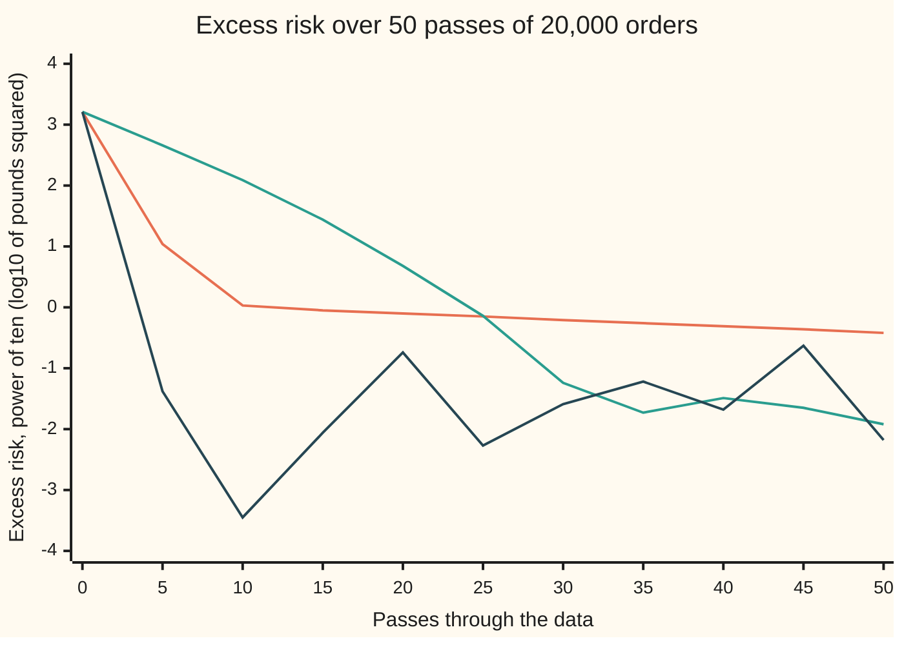

# Gradient descent: walk downhill, and take a noisy step when the data is large

[Syllabus](../../../SYLLABUS.md) → [Applied and computational](../README.md) → [Machine Learning Mathematics](../README.md#s06) → Gradient descent

---

## General Overview

An online shop has 20,000 past orders, each described by 12 numbers. The shop wants a rule that predicts what an order is worth in pounds from those 12 numbers, so it can plan stock and delivery vans before the money arrives. This shop is synthetic and separate from the one on [Loss and empirical risk](01-loss-functions-and-empirical-risk.md). Its 12 numbers come already standardised (rescaled to a common size, with no units), each between about −1.3 and 1.3, and its average order is £40.0056.

The rule is a weighted sum: multiply each of the 12 numbers by its own **weight** (pounds per unit of that number), add the products, and add a fixed starting amount, the **bias**. Fitting means choosing the 12 weights and the bias that make the predictions miss by as little as possible. The miss is measured as on [Loss and empirical risk](01-loss-functions-and-empirical-risk.md): square each order's miss, then average over all 20,000 orders. That average is the **risk**.

Here the best rule is known exactly, so every method can be scored against it. Its typical miss is £4.96. Start from all weights at zero and let three methods run for 50 **passes**, where one pass means reading all 20,000 orders once. Plain gradient descent ends with one weight still wrong by £1.88. Add momentum and the worst weight is off by £0.11. Read the orders 100 at a time and step after each handful, and on this shuffle the worst is off by £0.07.

**Gradient descent fits a model by repeatedly stepping against the gradient of the average loss, with a step size below 2 over the steepest curvature; on large data, a gradient from a small random batch is an honest but noisy stand-in that lets the model take hundreds of steps per pass instead of one.**

**What kind of fact this is:** a method (an algorithm). For a squared-error loss, its step limit and its shrink factor per step are theorems, proved on this card in Why it works. General convergence rates for other losses are the optimisation wing's, and this card uses them only in outline.

### The picture: how wrong the worst weight is after 50 passes

```
plain gradient descent      ████████████████████████████████████████  1.878 pounds
with momentum 0.8           ██▎                                        0.109 pounds
mini-batches of 100         █▌                                         0.074 pounds
```

The same 50 readings of the data, used three ways. The data is synthetic: generated from a stated rule and seed in the code below. The mini-batch bar is one reading of a walk that jitters, so another shuffle gives a different value of the same size.

---

## The formula

Notation first, in words. Order number i (from 1 to n) has a list of 12 numbers, written $x_i$, and a value in pounds, $y_i$. The 12 weights are one list, $w$; the bias is one number, $b$, which the loss card calls the starting amount. The prediction is $\hat y_i$ ("y hat"). The risk is $\hat R(w, b)$ ("R hat"), as on the loss card. Its gradient $\nabla \hat R$ (read "grad R hat") is the list of its rates of change, one per weight and one for the bias; it points up the steepest climb ([Gradient](../../06-Calculus%20and%20analysis/07-Several%20Variables/03-gradient-and-directional-derivatives.md)).

$$\hat y_i = w\cdot x_i + b, \qquad \hat R(w,b)=\frac1n\sum_{i=1}^{n}\big(\hat y_i-y_i\big)^2$$

**Read it aloud:** the prediction is the weighted sum plus the bias; the risk is the average squared miss.

The **excess risk** is the risk minus its lowest possible value: how much worse the current weights do than the best ones, in pounds squared.

The update, one step of size $\eta$ (the Greek letter eta), the **learning rate**:

$$(w,b)_{t+1} = (w,b)_t-\eta\,\nabla\hat R\big((w,b)_t\big), \qquad \nabla\hat R=\frac2n\sum_{i=1}^{n}\big(\hat y_i-y_i\big)\,(x_i,\ 1)$$

**Read it aloud:** move every weight against its slope, by the learning rate times the slope; each slope is twice the average of each order's miss times that order's number for the weight (and times 1 for the bias).

The step must stay under a limit set by the steepest curvature of the risk, $\lambda_{\max}$:

$$0<\eta<\frac{2}{\lambda_{\max}}$$

**Read it aloud:** the step must be shorter than two over the steepest bend of the bowl, or the walk overshoots and grows.

**Mini-batch (stochastic) gradient descent** keeps the same update but replaces the average over all n orders by an average over a random batch of $B$ orders. **Momentum** keeps a running velocity $v$: $v \leftarrow \beta v - \eta\nabla \hat R$, then $(w,b) \leftarrow (w,b) + v$, so a fraction $\beta$ (beta) of the last move carries over.

| Symbol | Plain meaning | In our example | Push it up and the answer… |
| --- | --- | --- | --- |
| $n$ | number of orders | 20,000 | each full step costs more |
| $x_i$, $y_i$ | order i's 12 numbers (number j of them is weight j's partner); its value in pounds | mean value £40.0056 | — |
| $w$, $b$, $\theta$ | the 12 weights (pounds per unit); the bias (pounds); all 13 as one list, theta | best bias £39.98 | — |
| $\hat y_i$ | the prediction for order i, pounds | £0 for every order at the start | — |
| $\hat R$ | risk: average squared miss, pounds squared; excess risk is the part above the lowest | lowest 24.6409; excess 1622.9421 at the start | — |
| $\nabla \hat R$ | gradient: one slope per weight and for the bias | bias slope −80.0113 at the start | bigger steps for the same η |
| $\eta$, $t$ | learning rate: the step size; the step count | 0.2; 50 full steps, or 10,000 small ones | faster, until 0.2477, then it blows up |
| $B$ | batch size: orders per noisy step | 100 | less noise, fewer steps per pass |
| $\beta$, $v$ | momentum fraction; the velocity it keeps | 0.8 | faster along a valley, more early bounce |
| $H$, $I$ | Hessian: the table of second rates of the risk; the do-nothing matrix | 13 rows by 13 | — |
| $\lambda$, $\lambda_{\max}$, $\lambda_{\min}$ | a curvature of the bowl; the steepest; the gentlest | 8.0732 and 0.05714 | a larger ratio means a slower walk |
| $e$, $\theta^*$ | distance from the best weights, as a list; the best weights | minus θ* at the start, since every weight begins at zero | — |

The λ here are curvatures (the stretch factors of the [Hessian](../../06-Calculus%20and%20analysis/07-Several%20Variables/05-hessian-and-second-order-approximation.md)), not the arrival rate of the queueing cards.

### When it holds

- **The loss has a gradient.** Squared error does. A loss with a corner, such as the absolute miss, has no gradient at the corner, and the step there is a guess.
- **The step is under the limit.** At 0.24 the walk settles; at 0.25, just past 2/8.0732 = 0.2477, the excess risk is 136.6 after 50 passes and growing.
- **The loss is a bowl with one bottom** ([Convex functions](../../06-Calculus%20and%20analysis/07-Several%20Variables/09-convex-functions.md)). Squared error of a weighted sum is. A neural network's loss is not, and the walk can stop in a lesser dip.
- **Batches are fair samples.** Reshuffling every pass makes each batch a random handful. Orders sorted by date would feed the walk one season at a time, and it would drift with the season.
- **The numbers sit on similar scales.** Record number 1 at 100 times its size, as when an amount is keyed in pence instead of pounds. The curvature along its weight grows 10,000-fold and the steepest curvature 899-fold, so the safe step shrinks 899-fold and the other weights barely move.

---

## Why it works

### Step 0: a small step against the gradient always goes down

Close up, the risk is nearly a tilted plane. The gradient points up the steepest climb of that plane ([Gradient](../../06-Calculus%20and%20analysis/07-Several%20Variables/03-gradient-and-directional-derivatives.md)). So a short step straight against it is the steepest way down. A step of size η lowers the risk by about η times the gradient's length squared. The only danger is the word "short": the plane is a good guide for a short way only, because the bowl curves.

### Step 1: the slope of the average squared miss

The risk is an average of squares of misses, and each miss depends on the weights through the prediction. By the chain rule ([Chain rule in several variables](../../06-Calculus%20and%20analysis/07-Several%20Variables/04-multivariable-chain-rule-and-jacobians.md)), the rate of one order's squared miss with respect to weight j is 2 × (the miss) × (that order's number j). Averaging over orders gives the formula above. For the bias, the "number" is always 1.

At the start every prediction is £0, so every miss is minus the order's value. The bias slope is then twice minus the mean value: −80.0113. The code gets the same gradient three ways: from summed products, order by order, and from difference quotients of the risk computed straight from the orders, which use no slope formula at all.

### Step 2: the step size, from the shape of the bowl

Squared error of a weighted sum is exactly a bowl. Write e for the distance from the best weights, as a list. Then the risk is the lowest risk plus half of e times the Hessian H times e, and the gradient is H times e. One step turns e into (I − ηH) e, where I is the "do nothing" matrix.

The Hessian here is symmetric, so it has perpendicular directions it only stretches, each with its own stretch factor λ, the curvature along that direction ([The spectral theorem](../../03-Algebra/07-Eigenvalues%20and%20Symmetric%20Matrices/04-spectral-theorem.md)). Along each such direction, one step multiplies the error by 1 − ηλ. The walk shrinks every error only if every such factor lies between −1 and 1. That needs ηλ < 2 for the steepest curvature, which is the step limit. [Wiener and LMS](../../13-Engineering%20mathematics/05-Signals/07-adaptive-and-optimal-filters.md) met the same limit on a two-weight filter; here it governs 13 weights.

The gentlest direction sets the pace. Its factor per step is 1 − η λ_min. Here the 12 numbers all rise with the size of the order, so they move together. The bowl is a long, narrow valley: its steepest curvature is 141.3 times its gentlest. At η = 0.2 the gentlest error shrinks by a factor of only 0.98857 per pass.

The risk counts the error squared, so late in the walk the excess risk should shrink by 0.98857 squared, 0.9773, per pass. The run measures 0.9761, slightly faster. The valley floor is not one gentle direction but eleven: of the 13 curvatures, 11 lie between 0.05714 and 0.07. After 50 passes the slightly steeper of them still hold some error, and it drains a little faster.

<details>
<summary>Detailed proof: the bowl is exact, and the limit is 2 over the steepest curvature</summary>

Write θ for the 13 numbers (w, b) and θ* for the best ones, where the gradient is zero. The risk is a polynomial of degree 2 in θ, so its second-order expansion about θ* has no remainder:

$$\hat R(\theta)=\hat R(\theta^*)+\tfrac12(\theta-\theta^*)^{\top}H(\theta-\theta^*),\qquad H=\frac2n\sum_{i=1}^{n}(x_i,1)(x_i,1)^{\top}.$$

The gradient is $H(\theta-\theta^*)$. With $e_t=\theta_t-\theta^*$ the step gives $e_{t+1}=(I-\eta H)e_t$, so $e_t=(I-\eta H)^t e_0$. H is symmetric and its curvatures are not negative, so it has perpendicular directions it only stretches ([The spectral theorem](../../03-Algebra/07-Eigenvalues%20and%20Symmetric%20Matrices/04-spectral-theorem.md)). Split the starting error into parts along those directions. After t steps the part along a direction of curvature λ has been multiplied by $(1-\eta\lambda)^t$. Every part tends to zero for every start exactly when $|1-\eta\lambda|<1$ for every curvature, which is $0<\eta<2/\lambda_{\max}$ when the gentlest curvature is positive. The excess risk is half the sum, over the directions, of λ times that part squared, so each term shrinks by $(1-\eta\lambda)^2$ per step. Late in the walk the terms whose factors are nearest 1 are all that is left, and in the very long run only the gentlest. After 50 passes here, all eleven gentle terms still count.

</details>

### Step 3: a random batch is an honest, noisy stand-in

A full step reads all 20,000 orders: 520,000 multiply-adds for one move, 13 to predict each order and 13 more to add its miss into the slopes. A batch of 100 random orders gives an average that is, on average over the shuffle, exactly the full gradient. It costs one two-hundredth as much. So one pass buys 200 steps, and 50 passes buy 10,000.

The price is noise. Each batch's average wobbles around the true gradient, and the wobble shrinks as the batch grows. Far from the bottom the true slope is large and the wobble hardly matters. After one pass the mini-batch walk has an excess risk of 0.4078. Plain descent has 0.3836 only after all 50.

Near the bottom the true gradient goes to zero but each batch's does not, because every order has its own miss. With a fixed step the weights never settle; they jitter around the bottom. The size of the jitter scales with the step. Averaged over passes 31 to 50, the excess risk is 0.0670 at step 0.05 and 0.0138 at step 0.0125: a quarter of the step gives a jitter 4.84 times smaller. To settle exactly, the step must shrink over time, slowly enough that the steps still add up to an unlimited distance, but fast enough that their squares add up to a finite total. A step that falls like 1 divided by the step count does both. That is the stochastic-approximation condition of the 1951 paper in Sources.

A batch of one order, stepped after every sample, is [Wiener and LMS](../../13-Engineering%20mathematics/05-Signals/07-adaptive-and-optimal-filters.md)'s least-mean-squares filter: the same method on a stream of signal samples.

### Step 4: momentum, in outline

In a narrow valley the gradient points mostly across the valley, not along it. Plain descent zigzags across the walls and creeps along the floor. Momentum adds a fraction β of the last move to the next one. Across the valley the slope flips sign each step, so those pushes cancel in the velocity. Along the floor the slope points the same way every step, so those pushes pile up: up to 1/(1 − β), here 5 times one step.

The cost is overshoot early on. With β = 0.8 the excess risk is 22.3233 after two passes and 461.8404 after five, as the velocity carries the walk up the far wall, then it settles: 0.0121 after 50. On a bowl like this one, momentum with well-chosen settings shrinks the slow error at a pace set by roughly the square root of the curvature ratio instead of the ratio itself. That theorem, and its relatives, belong to the optimisation wing.

---

## Worked numbers, by hand

The first plain step, then the pace of the walk.

| Step | Arithmetic | Value |
| --- | --- | --- |
| mean order value | add the 20,000 values, divide by 20,000 | £40.0056 |
| bias slope at the start | 2 × (0 − mean value) | −80.0113 |
| first move of the bias | 0 − 0.2 × (−80.0113) | 16.0023 |
| first move of weight 1 | 0 − 0.2 × (−5.5299) | 1.1060 |
| step limit | 2 ÷ 8.0732 | 0.2477 |
| slow factor per pass | 1 − 0.2 × 0.05714 | 0.98857 |
| slow error left after 50 passes | 0.98857 multiplied 50 times | 0.563 |
| passes to cut the slow error tenfold | ln 10 ÷ (−ln 0.98857) | **200 passes** |

Plain descent needs about 200 full passes to cut its slowest error by ten, so 50 passes leave over half of it. The 10,000 small steps of the mini-batch walk cover the same slow direction many times over.

### What breaks if you drop a piece

| Mistake | Comes out at | What went wrong |
| --- | --- | --- |
| Step 0.25, just past the limit | excess risk 136.6 after 50 passes, still climbing | The steepest direction overshoots further every step |
| Summing the misses instead of averaging | 1.255e+11 after one step | The gradient is 20,000 times too big, so is the step |
| Stepping with the gradient, not against it | 1.225e+43 after 50 passes | The gradient points uphill |
| Number 1 recorded at 100 times its size | 1.966e+20 after 3 passes at step 0.2; at the new safe step 0.000262, still 1520.2084 after 50 | Number 1's curvature grew 10,000-fold and the steepest 899-fold; the scale assumption failed |

---

## Fifty passes, three ways

The puzzle: all three walks read the data the same 50 times. Plain descent turns each reading into one careful step. Momentum takes the same steps but lets them build speed. The mini-batch walk turns each reading into 200 rough steps. Which ends nearest the bottom?

### One story: the excess risk, pass by pass

Excess risk is the risk above the lowest possible, in pounds squared. Every walk starts at 1622.9421, with all weights zero.

| Pass | 0 | 1 | 2 | 5 | 10 | 20 | 30 | 40 | 50 |
| --- | ---: | ---: | ---: | ---: | ---: | ---: | ---: | ---: | ---: |
| plain, step 0.2 | 1622.9421 | 585.4417 | 211.6811 | 10.9838 | 1.0716 | 0.7939 | 0.6230 | 0.4889 | 0.3836 |
| momentum 0.8 | 1622.9421 | 585.4417 | 22.3233 | 461.8404 | 122.4004 | 4.8390 | 0.0582 | 0.0324 | 0.0121 |
| mini-batch of 100 | 1622.9421 | 0.4078 | 0.1487 | 0.0415 | 0.0004 | 0.1805 | 0.0259 | 0.0210 | 0.0065 |

Plain descent drops fast for ten passes, then crawls: it has fixed the steep directions and is stuck on the gentle ones. Momentum bounces, then overtakes. The mini-batch walk is near the bottom after one pass and then jitters.

So plain descent ends furthest away: even the mini-batch walk's average over passes 31 to 50, 0.0670, is far below its 0.3836. Between the other two there is no fixed winner. On this shuffle the mini-batch walk ends lower, 0.0065 against 0.0121, but its own average over passes 31 to 50 is above momentum's final value, so another shuffle can as easily end the other way round.

### One force at a time: the step size

Excess risk after 50 plain passes, by step size:

```
step 0.05    ████████████████████████████████████████  0.9961
step 0.1     ████████████████████████████▎             0.7046
step 0.2     ███████████████▍                          0.3836
step 0.24    █████████████▍                            0.3358
step 0.25    ▶▶▶ off the scale                        136.5911
```

Longer steps are better right up to the limit 0.2477, then the walk blows up. The best plain step sits just under the cliff, which is why the limit is worth computing.

### One force at a time: the batch noise

Mean excess risk over passes 31 to 50, mini-batches of 100:

```
step 0.05      ████████████████████████████████████████  0.0670
step 0.0125    ████████▎                                 0.0138
```

A smaller step means a smaller jitter, at the cost of a slower start.

### Both forces in one picture



Orange: plain descent, step 0.2, a slow straight slide once the steep directions are done. Green: momentum 0.8, a bounce, then the steepest fall. Dark blue: mini-batches of 100 at step 0.05, down in one pass, then a jitter between about 0.0004 and 0.2. Each unit down the axis is a tenfold drop.

---

## Code, from first principles, and it actually runs

The script builds the 20,000 synthetic orders from SplitMix64 with seed 2026: each order has a shared size between −1 and 1, and each of its 12 numbers is that size plus its own wobble of up to 0.3. The value is £40 plus the true weights times the numbers plus noise with a standard deviation of £5. It then takes four roads. Road 1 solves for the exact bottom by elimination, as on [Least squares](../../03-Algebra/06-Dot%20Products%20and%20Best%20Fits/04-least-squares.md). Road 2 computes the gradient at zero three ways: from the summed products, order by order, and as a difference quotient of the risk read straight from the orders, which uses no slope formula. Road 3 finds the steepest and gentlest curvatures by power iteration (multiply a list by the matrix again and again until its direction stops changing; the gentlest takes 100,000 rounds, because eleven gentle curvatures sit close together) and predicts the step limit and the late shrink factor. It then confirms both curvatures a second way. Eliminate the Hessian minus a trial value: the number of negative pivots (the diagonal numbers left by elimination) equals the number of curvatures below that value, by the law of inertia for symmetric matrices. The count steps from 0 to 1 within 0.0001 of the gentlest and from 12 to 13 within 0.0001 of the steepest. Road 4 runs the three walks and scores them against road 1. The full-gradient walks use summed products added once, which give the same gradient as reading every order (road 2 checks this) and keep the script fast. The mini-batch walk really does read the orders, 100 at a time, reshuffled each pass with SplitMix64 seed 7.

### Python

```python
# Gradient descent and stochastic gradient -- the check behind the card.  Standard
# library only.  Synthetic shop: 20,000 orders, 12 numbers each, made by the rule
# below from SplitMix64 seed 2026.  Fit 12 weights and a bias by squared error.
from math import log, sqrt
MASK, N, D, P = (1 << 64) - 1, 20000, 12, 13
state = [0]
def rnd():                                     # SplitMix64, a uniform number in [0, 1)
    state[0] = (state[0] + 0x9E3779B97F4A7C15) & MASK
    z = state[0]
    z = ((z ^ (z >> 30)) * 0xBF58476D1CE4E5B9) & MASK
    z = ((z ^ (z >> 27)) * 0x94D049BB133111EB) & MASK
    return ((z ^ (z >> 31)) >> 11) * 2.0 ** -53
TRUE_W, TRUE_B = [3, -2, 1.5, 0, 4, -1, 2, 0.5, -3, 1, 2.5, -0.5], 40.0
state[0], X, Y = 2026, [], []
for i in range(N):                             # each order: a shared size z plus its own wobble
    z = 2 * rnd() - 1
    x = [z + 0.3 * (2 * rnd() - 1) for j in range(D)]
    y = TRUE_B
    for j in range(D): y += TRUE_W[j] * x[j]
    X.append(x + [1.0]); Y.append(y + 10 * (rnd() + rnd() + rnd() - 1.5))   # noise, sd 5 pounds
A, c, yy = [[0.0] * P for _ in range(P)], [0.0] * P, 0.0
for x, y in zip(X, Y):                         # summed products, added once: H = A, grad = A w - c
    yy += y * y / N
    for j in range(P):
        c[j] += 2 * x[j] * y / N
        for k in range(P): A[j][k] += 2 * x[j] * x[k] / N
def mul(M, v):
    out = []
    for row in M:
        s = 0.0
        for k in range(P): s += row[k] * v[k]
        out.append(s)
    return out
def risk(w, M=A, cc=c):                        # mean squared error, in pounds squared
    Mw, s = mul(M, w), yy
    for j in range(P): s += 0.5 * w[j] * Mw[j] - cc[j] * w[j]
    return s
def grad(w, M=A, cc=c): return [g - cj for g, cj in zip(mul(M, w), cc)]
G = [r[:] + [cj] for r, cj in zip(A, c)]      # road 1: exact bottom, by elimination
for j in range(P):
    for r in range(j + 1, P):
        f = G[r][j] / G[j][j]
        for k in range(j, P + 1): G[r][k] -= f * G[j][k]
best = [0.0] * P
for j in range(P - 1, -1, -1):
    s = G[j][P]
    for k in range(j + 1, P): s -= G[j][k] * best[k]
    best[j] = s / G[j][j]
R0 = risk(best)
def excess(w, M=A, cc=c): return risk(w, M, cc) - R0
def worst(w): return max(abs(w[j] - best[j]) for j in range(P))
print(f"orders {N}, numbers per order {D}, mean order value {c[P - 1] / 2:.4f} pounds")
print("best weights " + " ".join(f"{v:.2f}" for v in best[:D]) + f"; bias {best[D]:.2f}")
print(f"lowest risk {R0:.4f} pounds squared, typical miss {sqrt(R0):.2f} pounds")
rowg = [0.0] * P                               # road 2: the gradient at zero, order by order
for x, y in zip(X, Y):
    for j in range(P): rowg[j] += 2 * (0.0 - y) * x[j] / N
def rowrisk(w): return sum((sum(a * b for a, b in zip(w, x)) - y) ** 2 for x, y in zip(X, Y)) / N   # from the orders
zero, h = [0.0] * P, 1e-3
fd = [(rowrisk([h if k == j else 0.0 for k in range(P)]) - rowrisk([-h if k == j else 0.0 for k in range(P)])) / (2 * h) for j in range(P)]
g0 = grad(zero)
print(f"gradient at zero: bias {g0[D]:.4f}, weight 1 {g0[0]:.4f}; row sum {rowg[D]:.4f}, {rowg[0]:.4f}; difference quotient {fd[D]:.4f}, {fd[0]:.4f}")
def eig(M, shift):                             # power iteration on M - shift I
    v = [1.0 + 0.01 * j for j in range(P)]
    for _ in range(100000):
        u = [a - shift * b for a, b in zip(mul(M, v), v)]
        top = max(abs(a) for a in u)
        v = [a / top for a in u]
    u = [a - shift * b for a, b in zip(mul(M, v), v)]
    num, den = 0.0, 0.0
    for a, b in zip(u, v): num += a * b; den += b * b
    return num / den
def below(M, mu):                              # road 3b: curvatures below mu = negative pivots
    G, neg = [[M[i][j] - mu * (i == j) for j in range(P)] for i in range(P)], 0   # of M - mu I
    for j in range(P):
        neg += G[j][j] < 0
        for r in range(j + 1, P):
            f = G[r][j] / G[j][j]
            for k in range(j, P): G[r][k] -= f * G[j][k]
    return neg
lmax = eig(A, 0.0); lmin = lmax + eig(A, lmax)
print(f"first plain step, size 0.2: bias {-0.2 * g0[D]:.4f}, weight 1 {-0.2 * g0[0]:.4f}")
print(f"steepest curvature {lmax:.4f}, gentlest {lmin:.5f}, ratio {lmax / lmin:.1f}; step limit 2/steepest {2 / lmax:.4f}")
cnt = [below(A, m) for m in (lmin - 1e-4, lmin + 1e-4, 0.07, lmax - 1e-4, lmax + 1e-4)]
print(f"curvatures counted below gentlest -/+ 0.0001: {cnt[0]}, {cnt[1]}; below 0.07: {cnt[2]}; below steepest -/+ 0.0001: {cnt[3]}, {cnt[4]}")
def descend(eta, beta, steps, M=A, cc=c, sign=1):
    w, v, trace = [0.0] * P, [0.0] * P, [excess([0.0] * P, M, cc)]
    for t in range(steps):
        g = grad(w, M, cc)
        v = [beta * v[j] - sign * eta * g[j] for j in range(P)]
        w = [w[j] + v[j] for j in range(P)]
        trace.append(excess(w, M, cc))
    return w, trace
print("step size, excess risk after 50 passes: " + ", ".join(f"{e} -> {descend(e, 0, 50)[1][-1]:.4f}" for e in (0.05, 0.1, 0.2, 0.24, 0.25)))
wg, tg = descend(0.2, 0.0, 50)
wm, tm = descend(0.2, 0.8, 50)
slow = (1 - 0.2 * lmin) ** 2
print(f"plain, late shrink per pass {tg[50] / tg[49]:.4f}; predicted (1 - 0.2 x gentlest)^2 = {slow:.4f}; passes to cut slow error tenfold {log(10) / -log(1 - 0.2 * lmin):.0f}")
print(f"slow factor per pass {1 - 0.2 * lmin:.5f}, slow error left after 50 passes {(1 - 0.2 * lmin) ** 50:.3f}")
print(f"multiply-adds per pass {2 * N * P}; mini-batch steps per pass {N // 100}, in 50 passes {50 * N // 100}")
def sgd(eta, B, passes, seed):                 # mini-batches, reshuffled every pass
    state[0], w, idx, trace = seed, [0.0] * P, list(range(N)), [excess([0.0] * P)]
    for p in range(passes):
        for i in range(N - 1, 0, -1):
            j = int(rnd() * (i + 1)); idx[i], idx[j] = idx[j], idx[i]
        for s in range(0, N, B):
            g = [0.0] * P
            for i in idx[s:s + B]:
                x, e = X[i], -Y[i]
                for j in range(P): e += w[j] * x[j]
                for j in range(P): g[j] += 2 * e * x[j] / B
            for j in range(P): w[j] -= eta * g[j]
        trace.append(excess(w))
    return w, trace
ws, ts = sgd(0.05, 100, 50, 7)
wq, tq = sgd(0.0125, 100, 50, 7)
floor = [0.0, 0.0]
for k, t in enumerate((ts, tq)):
    for p in range(31, 51): floor[k] += t[p] / 20
print(f"mini-batch jitter floor, mean excess over passes 31-50: step 0.05 -> {floor[0]:.4f}, step 0.0125 -> {floor[1]:.4f}, ratio {floor[0] / floor[1]:.2f}")
for name, t in (("plain, step 0.2   ", tg), ("momentum 0.8      ", tm), ("mini-batch of 100 ", ts)):
    print(name + " " + " ".join(f"{t[p]:9.4f}" for p in (0, 1, 2, 5, 10, 20, 30, 40, 50)))
print(f"typical miss after 50 plain passes {sqrt(R0 + tg[50]):.3f} pounds, at the bottom {sqrt(R0):.3f}")
for name, w, t in (("plain", wg, tg), ("momentum", wm, tm), ("mini-batch", ws, ts)):
    print(f"after 50 passes, {name}: excess {t[50]:.4f}, worst weight off by {worst(w):.3f} pounds")
print("chart, log10 excess: " + " | ".join(" ".join(f"{log(t[p], 10):.2f}" for p in range(0, 51, 5)) for t in (tg, tm, ts)))
Np = [r[:] for r in A]; cp = c[:]               # what breaks: number 1 recorded 100 times too large
for k in range(P): Np[0][k] *= 100; Np[k][0] *= 100
cp[0] *= 100
lp = eig(Np, 0.0)
print(f"breaks: step 0.25 -> {descend(0.25, 0, 50)[1][-1]:.1f}; sum not mean, one step -> {descend(0.2 * N, 0, 1)[1][-1]:.3e}; uphill -> {descend(0.2, 0, 50, sign=-1)[1][-1]:.3e}")
print(f"breaks: number 1 x100: steepest {lp:.2f}, {lp / lmax:.0f} times; step 0.2, 3 passes -> {descend(0.2, 0, 3, Np, cp)[1][-1]:.3e}; safe step {1.9 / lp:.6f} -> {descend(1.9 / lp, 0, 50, Np, cp)[1][-1]:.4f}")
assert max(abs(g0[j] - rowg[j]) + abs(g0[j] - fd[j]) for j in range(P)) < 1e-6   # three gradients agree
assert max(abs(v) for v in grad(best)) < 1e-9 and abs(best[D] - TRUE_B) < 0.2       # bottom is flat, bias recovered
assert 0.995 < (tg[50] / tg[49]) / slow < 1.005                                      # rate meets prediction
assert cnt[:2] == [0, 1] and cnt[3:] == [P - 1, P]                                  # curvatures, second road
assert descend(0.24, 0, 50)[1][-1] < 10 < descend(0.25, 0, 50)[1][-1] and 0.24 < 2 / lmax < 0.25   # cliff at 2/steepest
assert tm[50] < tg[50] / 10 and floor[0] < tg[50] / 2 and worst(ws) < worst(wg) / 5 # momentum, mini-batch win
assert 2 < floor[0] / floor[1] < 16                                                 # quarter step, smaller jitter
print("ALL CHECKS PASS")
```

**Ran 2026-11-11 on macOS, Python 3.14.10, standard library only. All checks passed. Output, pasted from the run:**

```
orders 20000, numbers per order 12, mean order value 40.0056 pounds
best weights 2.91 -1.99 1.57 -0.09 3.61 -0.91 2.22 0.50 -2.85 0.74 2.58 -0.35; bias 39.98
lowest risk 24.6409 pounds squared, typical miss 4.96 pounds
gradient at zero: bias -80.0113, weight 1 -5.5299; row sum -80.0113, -5.5299; difference quotient -80.0113, -5.5299
first plain step, size 0.2: bias 16.0023, weight 1 1.1060
steepest curvature 8.0732, gentlest 0.05714, ratio 141.3; step limit 2/steepest 0.2477
curvatures counted below gentlest -/+ 0.0001: 0, 1; below 0.07: 11; below steepest -/+ 0.0001: 12, 13
step size, excess risk after 50 passes: 0.05 -> 0.9961, 0.1 -> 0.7046, 0.2 -> 0.3836, 0.24 -> 0.3358, 0.25 -> 136.5911
plain, late shrink per pass 0.9761; predicted (1 - 0.2 x gentlest)^2 = 0.9773; passes to cut slow error tenfold 200
slow factor per pass 0.98857, slow error left after 50 passes 0.563
multiply-adds per pass 520000; mini-batch steps per pass 200, in 50 passes 10000
mini-batch jitter floor, mean excess over passes 31-50: step 0.05 -> 0.0670, step 0.0125 -> 0.0138, ratio 4.84
plain, step 0.2    1622.9421  585.4417  211.6811   10.9838    1.0716    0.7939    0.6230    0.4889    0.3836
momentum 0.8       1622.9421  585.4417   22.3233  461.8404  122.4004    4.8390    0.0582    0.0324    0.0121
mini-batch of 100  1622.9421    0.4078    0.1487    0.0415    0.0004    0.1805    0.0259    0.0210    0.0065
typical miss after 50 plain passes 5.002 pounds, at the bottom 4.964
after 50 passes, plain: excess 0.3836, worst weight off by 1.878 pounds
after 50 passes, momentum: excess 0.0121, worst weight off by 0.109 pounds
after 50 passes, mini-batch: excess 0.0065, worst weight off by 0.074 pounds
chart, log10 excess: 3.21 1.04 0.03 -0.05 -0.10 -0.15 -0.21 -0.26 -0.31 -0.36 -0.42 | 3.21 2.66 2.09 1.44 0.68 -0.14 -1.24 -1.73 -1.49 -1.65 -1.92 | 3.21 -1.38 -3.45 -2.06 -0.74 -2.27 -1.59 -1.22 -1.68 -0.63 -2.18
breaks: step 0.25 -> 136.6; sum not mean, one step -> 1.255e+11; uphill -> 1.225e+43
breaks: number 1 x100: steepest 7258.59, 899 times; step 0.2, 3 passes -> 1.966e+20; safe step 0.000262 -> 1520.2084
ALL CHECKS PASS
```

### Rust

```rust
// Gradient descent and stochastic gradient -- the check behind the card.  Rust std
// only.  Synthetic shop: 20,000 orders, 12 numbers each, made by the rule below
// from SplitMix64 seed 2026.  Fit 12 weights and a bias by squared error.
const N: usize = 20000; const D: usize = 12; const P: usize = 13;
type Mat = Vec<Vec<f64>>;
struct Rng(u64);
impl Rng {
    fn rnd(&mut self) -> f64 { // SplitMix64, a uniform number in [0, 1)
        self.0 = self.0.wrapping_add(0x9E3779B97F4A7C15);
        let mut z = self.0;
        z = (z ^ (z >> 30)).wrapping_mul(0xBF58476D1CE4E5B9);
        z = (z ^ (z >> 27)).wrapping_mul(0x94D049BB133111EB);
        ((z ^ (z >> 31)) >> 11) as f64 * 2f64.powi(-53)
    }
}
struct Fit { yy: f64, r0: f64 }
fn mul(m: &Mat, v: &[f64]) -> Vec<f64> {
    m.iter().map(|row| { let mut s = 0.0; for k in 0..P { s += row[k] * v[k]; } s }).collect()
}
fn risk(f: &Fit, w: &[f64], m: &Mat, cc: &[f64]) -> f64 { // mean squared error, pounds squared
    let mw = mul(m, w);
    let mut s = f.yy;
    for j in 0..P { s += 0.5 * w[j] * mw[j] - cc[j] * w[j]; }
    s
}
fn grad(w: &[f64], m: &Mat, cc: &[f64]) -> Vec<f64> { mul(m, w).iter().zip(cc).map(|(g, c)| g - c).collect() }
fn excess(f: &Fit, w: &[f64], m: &Mat, cc: &[f64]) -> f64 { risk(f, w, m, cc) - f.r0 }
fn eig(m: &Mat, shift: f64) -> f64 { // power iteration on M - shift I
    let mut v: Vec<f64> = (0..P).map(|j| 1.0 + 0.01 * j as f64).collect();
    for _ in 0..100000 {
        let u: Vec<f64> = mul(m, &v).iter().zip(&v).map(|(a, b)| a - shift * b).collect();
        let top = u.iter().fold(0.0f64, |t, a| t.max(a.abs()));
        v = u.iter().map(|a| a / top).collect();
    }
    let u: Vec<f64> = mul(m, &v).iter().zip(&v).map(|(a, b)| a - shift * b).collect();
    let (mut num, mut den) = (0.0, 0.0);
    for (a, b) in u.iter().zip(&v) { num += a * b; den += b * b; }
    num / den
}
fn below(m: &Mat, mu: f64) -> usize { // road 3b: curvatures below mu = negative pivots of M - mu I
    let mut g: Mat = (0..P).map(|i| (0..P).map(|j| m[i][j] - if i == j { mu } else { 0.0 }).collect()).collect();
    let mut neg = 0;
    for j in 0..P {
        if g[j][j] < 0.0 { neg += 1; }
        for r in j + 1..P { let f = g[r][j] / g[j][j]; for k in j..P { g[r][k] -= f * g[j][k]; } }
    }
    neg
}
fn descend(f: &Fit, eta: f64, beta: f64, steps: usize, m: &Mat, cc: &[f64], sign: f64) -> (Vec<f64>, Vec<f64>) {
    let (mut w, mut v) = (vec![0.0; P], vec![0.0; P]); let mut trace = vec![excess(f, &w, m, cc)];
    for _ in 0..steps {
        let g = grad(&w, m, cc);
        v = (0..P).map(|j| beta * v[j] - sign * eta * g[j]).collect();
        w = (0..P).map(|j| w[j] + v[j]).collect();
        trace.push(excess(f, &w, m, cc));
    }
    (w, trace)
}
fn sci(x: f64) -> String { // Python's 1.234e+05 style
    let s = format!("{:.3e}", x); let (m, e) = s.split_once('e').unwrap(); let e: i32 = e.parse().unwrap();
    format!("{}e{}{:02}", m, if e < 0 { '-' } else { '+' }, e.abs())
}
fn main() {
    let (true_w, true_b) = ([3.0, -2.0, 1.5, 0.0, 4.0, -1.0, 2.0, 0.5, -3.0, 1.0, 2.5, -0.5], 40.0);
    let mut rng = Rng(2026);
    let (mut xs, mut ys): (Mat, Vec<f64>) = (vec![], vec![]);
    for _ in 0..N { // each order: a shared size z plus its own wobble
        let z = 2.0 * rng.rnd() - 1.0;
        let mut x: Vec<f64> = (0..D).map(|_| z + 0.3 * (2.0 * rng.rnd() - 1.0)).collect();
        let mut y = true_b;
        for j in 0..D { y += true_w[j] * x[j]; }
        x.push(1.0);
        xs.push(x);
        ys.push(y + 10.0 * (rng.rnd() + rng.rnd() + rng.rnd() - 1.5)); // noise, sd 5 pounds
    }
    let nf = N as f64;
    let (mut a, mut c, mut yy) = (vec![vec![0.0; P]; P], vec![0.0; P], 0.0);
    for (x, &y) in xs.iter().zip(&ys) { // summed products, added once: H = A, grad = A w - c
        yy += y * y / nf;
        for j in 0..P {
            c[j] += 2.0 * x[j] * y / nf;
            for k in 0..P { a[j][k] += 2.0 * x[j] * x[k] / nf; }
        }
    }
    let mut g: Mat = a.iter().zip(&c).map(|(r, &cj)| { let mut r = r.clone(); r.push(cj); r }).collect();
    for j in 0..P { // road 1: exact bottom, by elimination
        for r in j + 1..P {
            let f = g[r][j] / g[j][j];
            for k in j..P + 1 { g[r][k] -= f * g[j][k]; }
        }
    }
    let mut best = vec![0.0; P];
    for j in (0..P).rev() {
        let mut s = g[j][P];
        for k in j + 1..P { s -= g[j][k] * best[k]; }
        best[j] = s / g[j][j];
    }
    let mut fit = Fit { yy, r0: 0.0 }; fit.r0 = risk(&fit, &best, &a, &c);
    let r0 = fit.r0;
    let worst = |w: &[f64]| (0..P).fold(0.0f64, |t, j| t.max((w[j] - best[j]).abs()));
    println!("orders {}, numbers per order {}, mean order value {:.4} pounds", N, D, c[P - 1] / 2.0);
    println!("best weights {}; bias {:.2}", best[..D].iter().map(|v| format!("{:.2}", v)).collect::<Vec<_>>().join(" "), best[D]);
    println!("lowest risk {:.4} pounds squared, typical miss {:.2} pounds", r0, r0.sqrt());
    let mut rowg = vec![0.0; P]; // road 2: the gradient at zero, order by order
    for (x, &y) in xs.iter().zip(&ys) { for j in 0..P { rowg[j] += 2.0 * (0.0 - y) * x[j] / nf; } }
    let (h, unit) = (1e-3, |j: usize, s: f64| -> Vec<f64> { (0..P).map(|k| if k == j { s } else { 0.0 }).collect() });
    let rowrisk = |w: &[f64]| xs.iter().zip(&ys).map(|(x, y)| (x.iter().zip(w).map(|(a, b)| a * b).sum::<f64>() - y).powi(2)).sum::<f64>() / nf;
    let fd: Vec<f64> = (0..P).map(|j| (rowrisk(&unit(j, h)) - rowrisk(&unit(j, -h))) / (2.0 * h)).collect();
    let g0 = grad(&vec![0.0; P], &a, &c);
    println!("gradient at zero: bias {:.4}, weight 1 {:.4}; row sum {:.4}, {:.4}; difference quotient {:.4}, {:.4}", g0[D], g0[0], rowg[D], rowg[0], fd[D], fd[0]);
    println!("first plain step, size 0.2: bias {:.4}, weight 1 {:.4}", -0.2 * g0[D], -0.2 * g0[0]);
    let lmax = eig(&a, 0.0); let lmin = lmax + eig(&a, lmax);
    println!("steepest curvature {:.4}, gentlest {:.5}, ratio {:.1}; step limit 2/steepest {:.4}", lmax, lmin, lmax / lmin, 2.0 / lmax);
    let cnt: Vec<usize> = [lmin - 1e-4, lmin + 1e-4, 0.07, lmax - 1e-4, lmax + 1e-4].iter().map(|&m| below(&a, m)).collect();
    println!("curvatures counted below gentlest -/+ 0.0001: {}, {}; below 0.07: {}; below steepest -/+ 0.0001: {}, {}", cnt[0], cnt[1], cnt[2], cnt[3], cnt[4]);
    let run = |eta: f64, beta: f64, steps: usize| descend(&fit, eta, beta, steps, &a, &c, 1.0);
    let sizes = [("0.05", 0.05), ("0.1", 0.1), ("0.2", 0.2), ("0.24", 0.24), ("0.25", 0.25)];
    println!("step size, excess risk after 50 passes: {}", sizes.iter().map(|(s, e)| format!("{} -> {:.4}", s, run(*e, 0.0, 50).1[50])).collect::<Vec<_>>().join(", "));
    let ((wg, tg), (wm, tm)) = (run(0.2, 0.0, 50), run(0.2, 0.8, 50));
    let slow = (1.0 - 0.2 * lmin).powf(2.0);
    println!("plain, late shrink per pass {:.4}; predicted (1 - 0.2 x gentlest)^2 = {:.4}; passes to cut slow error tenfold {:.0}", tg[50] / tg[49], slow, 10f64.ln() / -(1.0 - 0.2 * lmin).ln());
    println!("slow factor per pass {:.5}, slow error left after 50 passes {:.3}", 1.0 - 0.2 * lmin, (1.0 - 0.2 * lmin).powf(50.0));
    println!("multiply-adds per pass {}; mini-batch steps per pass {}, in 50 passes {}", 2 * N * P, N / 100, 50 * N / 100);
    let sgd = |eta: f64, bsz: usize, passes: usize, seed: u64| { // mini-batches, reshuffled every pass
        let (mut rng, mut w, mut idx) = (Rng(seed), vec![0.0; P], (0..N).collect::<Vec<usize>>());
        let mut trace = vec![excess(&fit, &w, &a, &c)];
        for _ in 0..passes {
            for i in (1..N).rev() { let j = (rng.rnd() * (i + 1) as f64) as usize; idx.swap(i, j); }
            for s in (0..N).step_by(bsz) {
                let mut gr = vec![0.0; P];
                for &i in &idx[s..s + bsz] {
                    let (x, mut e) = (&xs[i], -ys[i]);
                    for j in 0..P { e += w[j] * x[j]; }
                    for j in 0..P { gr[j] += 2.0 * e * x[j] / bsz as f64; }
                }
                for j in 0..P { w[j] -= eta * gr[j]; }
            }
            trace.push(excess(&fit, &w, &a, &c));
        }
        (w, trace)
    };
    let ((ws, ts), (_wq, tq)) = (sgd(0.05, 100, 50, 7), sgd(0.0125, 100, 50, 7));
    let mut floor = [0.0, 0.0]; for (k, t) in [&ts, &tq].iter().enumerate() { for p in 31..51 { floor[k] += t[p] / 20.0; } }
    println!("mini-batch jitter floor, mean excess over passes 31-50: step 0.05 -> {:.4}, step 0.0125 -> {:.4}, ratio {:.2}", floor[0], floor[1], floor[0] / floor[1]);
    for (name, t) in [("plain, step 0.2   ", &tg), ("momentum 0.8      ", &tm), ("mini-batch of 100 ", &ts)] {
        println!("{} {}", name, [0, 1, 2, 5, 10, 20, 30, 40, 50].iter().map(|&p| format!("{:9.4}", t[p])).collect::<Vec<_>>().join(" "));
    }
    println!("typical miss after 50 plain passes {:.3} pounds, at the bottom {:.3}", (r0 + tg[50]).sqrt(), r0.sqrt());
    for (name, w, t) in [("plain", &wg, &tg), ("momentum", &wm, &tm), ("mini-batch", &ws, &ts)] {
        println!("after 50 passes, {}: excess {:.4}, worst weight off by {:.3} pounds", name, t[50], worst(w));
    }
    let chart = |t: &Vec<f64>| (0..51).step_by(5).map(|p| format!("{:.2}", t[p].ln() / 10f64.ln())).collect::<Vec<_>>().join(" ");
    println!("chart, log10 excess: {} | {} | {}", chart(&tg), chart(&tm), chart(&ts));
    let (mut np, mut cp) = (a.clone(), c.clone()); // what breaks: number 1 recorded 100 times too large
    for k in 0..P { np[0][k] *= 100.0; np[k][0] *= 100.0; } cp[0] *= 100.0;
    let lp = eig(&np, 0.0);
    println!("breaks: step 0.25 -> {:.1}; sum not mean, one step -> {}; uphill -> {}", run(0.25, 0.0, 50).1[50],
             sci(run(0.2 * nf, 0.0, 1).1[1]), sci(descend(&fit, 0.2, 0.0, 50, &a, &c, -1.0).1[50]));
    println!("breaks: number 1 x100: steepest {:.2}, {:.0} times; step 0.2, 3 passes -> {}; safe step {:.6} -> {:.4}", lp, lp / lmax, sci(descend(&fit, 0.2, 0.0, 3, &np, &cp, 1.0).1[3]),
             1.9 / lp, descend(&fit, 1.9 / lp, 0.0, 50, &np, &cp, 1.0).1[50]);
    let gap = (0..P).fold(0.0f64, |t, j| t.max((g0[j] - rowg[j]).abs() + (g0[j] - fd[j]).abs()));
    assert!(gap < 1e-6); // three gradients agree
    assert!(grad(&best, &a, &c).iter().all(|v| v.abs() < 1e-9) && (best[D] - true_b).abs() < 0.2); // flat bottom
    assert!(0.995 < (tg[50] / tg[49]) / slow && (tg[50] / tg[49]) / slow < 1.005); // rate meets prediction
    assert!(cnt[..2] == [0, 1] && cnt[3..] == [P - 1, P]); // curvatures, second road
    assert!(run(0.24, 0.0, 50).1[50] < 10.0 && 10.0 < run(0.25, 0.0, 50).1[50] && 0.24 < 2.0 / lmax && 2.0 / lmax < 0.25); // cliff at 2/steepest
    assert!(tm[50] < tg[50] / 10.0 && floor[0] < tg[50] / 2.0 && worst(&ws) < worst(&wg) / 5.0); // the two win
    assert!(2.0 < floor[0] / floor[1] && floor[0] / floor[1] < 16.0); // quarter step, smaller jitter
    println!("ALL CHECKS PASS");
}
```

**Ran 2026-11-11 on macOS, rustc 1.98.1, no crates. All checks passed. Output, pasted from the run:**

```
orders 20000, numbers per order 12, mean order value 40.0056 pounds
best weights 2.91 -1.99 1.57 -0.09 3.61 -0.91 2.22 0.50 -2.85 0.74 2.58 -0.35; bias 39.98
lowest risk 24.6409 pounds squared, typical miss 4.96 pounds
gradient at zero: bias -80.0113, weight 1 -5.5299; row sum -80.0113, -5.5299; difference quotient -80.0113, -5.5299
first plain step, size 0.2: bias 16.0023, weight 1 1.1060
steepest curvature 8.0732, gentlest 0.05714, ratio 141.3; step limit 2/steepest 0.2477
curvatures counted below gentlest -/+ 0.0001: 0, 1; below 0.07: 11; below steepest -/+ 0.0001: 12, 13
step size, excess risk after 50 passes: 0.05 -> 0.9961, 0.1 -> 0.7046, 0.2 -> 0.3836, 0.24 -> 0.3358, 0.25 -> 136.5911
plain, late shrink per pass 0.9761; predicted (1 - 0.2 x gentlest)^2 = 0.9773; passes to cut slow error tenfold 200
slow factor per pass 0.98857, slow error left after 50 passes 0.563
multiply-adds per pass 520000; mini-batch steps per pass 200, in 50 passes 10000
mini-batch jitter floor, mean excess over passes 31-50: step 0.05 -> 0.0670, step 0.0125 -> 0.0138, ratio 4.84
plain, step 0.2    1622.9421  585.4417  211.6811   10.9838    1.0716    0.7939    0.6230    0.4889    0.3836
momentum 0.8       1622.9421  585.4417   22.3233  461.8404  122.4004    4.8390    0.0582    0.0324    0.0121
mini-batch of 100  1622.9421    0.4078    0.1487    0.0415    0.0004    0.1805    0.0259    0.0210    0.0065
typical miss after 50 plain passes 5.002 pounds, at the bottom 4.964
after 50 passes, plain: excess 0.3836, worst weight off by 1.878 pounds
after 50 passes, momentum: excess 0.0121, worst weight off by 0.109 pounds
after 50 passes, mini-batch: excess 0.0065, worst weight off by 0.074 pounds
chart, log10 excess: 3.21 1.04 0.03 -0.05 -0.10 -0.15 -0.21 -0.26 -0.31 -0.36 -0.42 | 3.21 2.66 2.09 1.44 0.68 -0.14 -1.24 -1.73 -1.49 -1.65 -1.92 | 3.21 -1.38 -3.45 -2.06 -0.74 -2.27 -1.59 -1.22 -1.68 -0.63 -2.18
breaks: step 0.25 -> 136.6; sum not mean, one step -> 1.255e+11; uphill -> 1.225e+43
breaks: number 1 x100: steepest 7258.59, 899 times; step 0.2, 3 passes -> 1.966e+20; safe step 0.000262 -> 1520.2084
ALL CHECKS PASS
```

The two outputs match line for line.

> [!TIP]
> **Try changing**
> Guess first, then run it. The asserts are pinned to this shop's numbers, so expect some changes to stop the script.
> - **Guess first: what does momentum 0 do?** Set `0.8` to `0.0` in the momentum run. It becomes the plain walk, ends at 0.3836, and the "momentum wins" assert stops it.
> - **Guess first: is 0.25 really the edge?** Change the plain run's step from `0.2` to `0.25`. The step table already shows the answer: 136.5911 after 50 passes. The shrink-factor assert stops it, because the walk now grows.
> - **Guess first: a different shuffle.** Change seed `7` (both places) to another number. The mini-batch numbers move, because pass 50 lands at a different point of the jitter. Its average over passes 31 to 50 still sits far below plain descent's 0.3836, and a quarter step still gives a jitter several times smaller, so the asserts hold.
> - **Guess first: louder wobble.** Change `0.3` (the wobble) to `0.9`. The numbers stop moving together, the gentlest curvature grows, and plain descent gets much closer in 50 passes. The shrink-rate assert then stops the script: like the momentum one, it was pinned to a narrow valley.

---

## The usual mistake

> [!warning]
> **Reading a small risk as right weights.** After 50 plain passes the typical miss is £5.002 against £4.964 at the bottom: it looks finished. But one weight is still off by £1.878. The risk is flat along the valley floor, so moving along it barely changes the risk while changing the weights a lot. If the weights themselves are the answer (how much one unit of a number adds to an order's value), check that the walk has stopped moving, not only that the risk has.
>
> - **Taking the largest step that seems to work.** 0.24 gives 0.3358; 0.25 gives 136.5911. The cliff is sudden, so compute 2/λ_max or back off well below it.
> - **Summing instead of averaging.** The step becomes 20,000 times too big: 1.255e+11 after one step. The step size then depends on how many orders there are.
> - **Mixing scales.** One number recorded at 100 times its size, such as pence keyed for pounds, forces a step of 0.000262, and the walk is still at 1520.2084 after 50 passes. Put the numbers on similar scales first.
> - **Expecting a fixed-step mini-batch walk to settle.** It jitters: 0.0670 on average at step 0.05. Shrink the step near the end.

---

## Where you meet it in real life

- **Training neural networks.** Mini-batch gradient descent with momentum, or a close relative, fits nearly every network in use, from image recognisers to language models. The gradient itself comes from [Backpropagation](04-backpropagation.md).
- **Click and recommendation models.** Shops and streaming services refit scoring models on billions of logged events; no computer reads them all for every step, so batches are the only practical road.
- **Echo cancellers and noise-cancelling headsets.** The least-mean-squares filter steps after every sample, a batch of one, and keeps tracking as the room or the engine changes ([Wiener and LMS](../../13-Engineering%20mathematics/05-Signals/07-adaptive-and-optimal-filters.md)).
- **Classifiers scored in bits.** The same walk minimises the cross-entropy loss of [Softmax and cross-entropy](05-softmax-and-cross-entropy-for-classification.md); only the gradient formula changes.

> **Say it back**
> Gradient descent lowers the average loss by stepping against its gradient, again and again. The step must stay under 2 over the steepest curvature, and the gentlest curvature sets how slowly the last of the error goes. A random batch gives an honest but noisy gradient for a fraction of the cost, so one pass through the data buys hundreds of steps. With a fixed step the batch walk jitters around the bottom, by an amount that scales with the step. Momentum lets steps along a narrow valley build speed, after an early bounce.

---

## What this builds on

- [Loss and empirical risk](01-loss-functions-and-empirical-risk.md): the average loss that this card walks down.
- [Gradient](../../06-Calculus%20and%20analysis/07-Several%20Variables/03-gradient-and-directional-derivatives.md): why the gradient points up the steepest climb, so its opposite is the way down.
- [Convex functions](../../06-Calculus%20and%20analysis/07-Several%20Variables/09-convex-functions.md): why a bowl's only dip is its bottom, so a walk that stops has found it.
- [Chain rule in several variables](../../06-Calculus%20and%20analysis/07-Several%20Variables/04-multivariable-chain-rule-and-jacobians.md): the rule that turns each squared miss into its slope for each weight.
- [Wiener and LMS](../../13-Engineering%20mathematics/05-Signals/07-adaptive-and-optimal-filters.md): the same method with a batch of one, run on a live signal.

## Where this goes next

- [The perceptron and its stack](03-perceptron-and-neural-networks.md): single units that learn by a mistake-driven step, and how layers of them draw boundaries one line cannot.
- [k-means](06-k-means-and-clustering.md): another fit by repeated improving steps, this time by taking turns instead of following a gradient.
- [The perceptron and its stack](03-perceptron-and-neural-networks.md): the optimisation wing's proofs of the rates for smooth and convex losses in general.
- [Backpropagation](04-backpropagation.md): shrinking steps, and the proof that the noisy walk reaches the bottom.
- [Softmax and cross-entropy](05-softmax-and-cross-entropy-for-classification.md): the accelerated rates sketched in Step 4, and step sizes that adapt for each weight.

On a loss that is not a bowl, with many dips and flat ridges, what does the noise in a batch gradient do to where the walk ends up?

---

## Sources

Verified 2026-11-11: every link below resolves to the publisher's page.

- Robbins, Herbert, and Sutton Monro. "A Stochastic Approximation Method." *The Annals of Mathematical Statistics* 22, no. 3 (1951): 400–407. [doi:10.1214/aoms/1177729586](https://doi.org/10.1214/aoms/1177729586). The founding paper on stepping with noisy measurements, and the shrinking-step condition in Step 3.
- Polyak, B. T. "Some Methods of Speeding Up the Convergence of Iteration Methods." *USSR Computational Mathematics and Mathematical Physics* 4, no. 5 (1964): 1–17. [doi:10.1016/0041-5553(64)90137-5](https://doi.org/10.1016/0041-5553(64)90137-5). The heavy-ball momentum method of Step 4 and its faster rate on a bowl.
- Bottou, Léon, Frank E. Curtis, and Jorge Nocedal. "Optimization Methods for Large-Scale Machine Learning." *SIAM Review* 60, no. 2 (2018): 223–311. [doi:10.1137/16M1080173](https://doi.org/10.1137/16M1080173). Why mini-batch steps beat full steps on large data, the noise floor of a fixed step, and the role of curvature.
- Nesterov, Yurii. *Introductory Lectures on Convex Optimization: A Basic Course.* Springer, 2004. [doi:10.1007/978-1-4419-8853-9](https://doi.org/10.1007/978-1-4419-8853-9). The step limit 2 over the steepest curvature and the convergence rates of gradient methods, proved in full.
