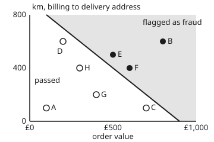
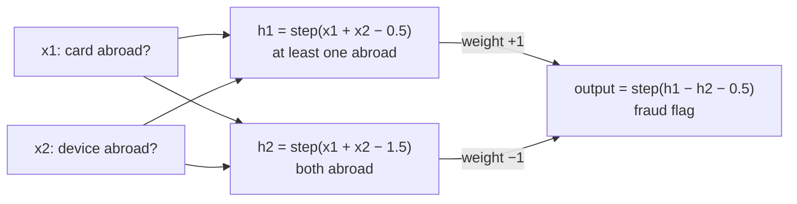

# The perceptron and its stack: weights, a bias, a squashing function, layers

[Syllabus](../../../SYLLABUS.md) → [Applied and computational](../README.md) → [Machine Learning Mathematics](../README.md#s06) → The perceptron and its stack

---

## General Overview

An online shop keeps 20,000 past orders, each described by 12 numbers. A few hundred of them were fraud: a stolen card, goods shipped to a stranger. The shop wants a rule that flags the next fraudulent order before it ships.

Start with two of the 12 numbers: the **order value** in pounds, and the **distance** from the card's billing address to the delivery address in km. Fraud tends to be expensive and shipped far away. Eight orders, made up for this card (synthetic), show the pattern. Three were fraud: B (£800, 600 km), E (£500, 500 km) and F (£600, 400 km). Five were normal, including C, a £700 order delivered 100 km from home, and D, a £200 order sent 600 km as a gift.

A **perceptron** finds a straight line that puts the fraud on one side and the normal orders on the other. It starts with no opinion. It walks through the orders, and each time it gets one wrong it nudges its line toward that order. On these eight it makes 6 nudges and then gets all eight right. The line it settles on says: flag an order when its value in hundreds of pounds plus its distance in hundreds of km is more than 9.

Then the shop meets a pattern no straight line can catch. Fraud also shows up when one of the card and the device is in the UK and the other is abroad. One perceptron fails on that forever. Two layers of perceptrons solve it, and that stack is a **neural network**.

**A perceptron scores an order as a weighted sum plus a bias, flags it when the score is above zero, and fixes its weights only on mistakes; if some straight line separates the classes, it stops within a guaranteed number of fixes, a ceiling that falls as the gap between the classes widens; when no line exists, stacking units in layers, with a squashing function between them, draws the boundary one line cannot.**

**What kind of fact this is:** the perceptron is a method. Two theorems about it are proved on this card in Why it works: it stops on data a line can separate, and no single line separates the XOR pattern. The fraud data is synthetic, so the card makes no claim about real fraud rates.

### The picture: the eight orders and the learned line

<p align="center"></p>

Filled dots are fraud, open dots are normal, drawn to scale. The line runs from (£100, 800 km) to (£900, 0 km): value in hundreds of pounds plus distance in hundreds of km equals 9. Above it, shaded, the order is flagged. C and D sit close to the line on the normal side. They are the two orders the perceptron got wrong twice before settling.

---

## The formula

[Gradient descent](02-gradient-descent-and-stochastic-gradient.md) introduced weights $w$, a bias $b$ and a learning rate $\eta$. This card uses them as they are, and adds layer matrices $W$. Here $W$ is a layer's table of weights, not the queue card's waiting time.

Each order is measured from a reference order of £400 shipped 300 km, near the middle of these eight made-up orders, in hundreds: $x_1 = (\text{value} - 400)/100$ and $x_2 = (\text{distance} - 300)/100$. Order E, £500 and 500 km, becomes $(1, 2)$. The label $y$ is $+1$ for fraud and $-1$ for normal.

$$s = w_1 x_1 + w_2 x_2 + b, \qquad \text{flag as fraud when } s > 0$$

**Read it aloud:** the score is each feature times its weight, added up, plus the bias; a positive score means fraud.

$$\text{if } y\,s \le 0: \qquad w_1 \leftarrow w_1 + \eta\,y\,x_1, \quad w_2 \leftarrow w_2 + \eta\,y\,x_2, \quad b \leftarrow b + \eta\,y$$

**Read it aloud:** when an order lands on the wrong side, or on the line, add the order to the weights if it was fraud and subtract it if it was normal; otherwise leave everything alone.

$$k \;\le\; \left(\frac{R}{\gamma}\right)^2$$

**Read it aloud:** the number of fixes is at most the squared ratio of $R$, the length of the longest order written with its extra 1, to $\gamma$, the clear gap around a separating line measured with that same extra 1.

Both lengths are measured with the bias as a third coordinate: each order becomes $\bar x = (x_1, x_2, 1)$, and a line becomes a flat sheet through the origin in three numbers. That is why $R = \sqrt{26} = 5.0990$, not order B's plain distance 5.0000 from the reference order, and $\gamma = 0.4082$, not the 0.7071 gap between the line and C, D, E and F in the plane of $x_1$ and $x_2$.

$$h = \mathrm{step}(W_1 x + b_1), \qquad \text{output} = \mathrm{step}(W_2 h + b_2)$$

**Read it aloud:** a layer is a matrix times the inputs, plus a bias for each unit, squashed; the next layer does the same to the first layer's answers.

| Symbol | Plain meaning | In our example | Push it up and the answer… |
| --- | --- | --- | --- |
| $x = (x_1, x_2)$; $\bar x = (x_1, x_2, 1)$ | an order's centred value and distance, in hundreds; $\bar x$ adds a constant 1 so the bias acts like a third weight | order E: $(1, 2)$ | further from the line, the score grows |
| $y$ | the label: $+1$ fraud, $-1$ normal | E: $+1$ | — |
| $w = (w_1, w_2)$; $\bar w = (w_1, w_2, b)$ | the weights: how much each feature pushes toward fraud | settled at $(2, 2)$ | that feature counts for more |
| $b$ | the bias: the score of the reference order, which slides the line without turning it | settled at $-4$ | more orders flagged |
| $s$ | the score $w_1 x_1 + w_2 x_2 + b$ | E: $+2$ | flagged once above 0 |
| $\eta$ | the learning rate: the size of each fix | 1 | bigger fixes; from a zero start, the same line |
| $\mathrm{step}$ | the hard squashing function: 1 if its input is above 0, else 0 | — | — |
| $k$ | the number of fixes (updates) before the perceptron stops | 6 | — |
| $R$ | the length of the longest $\bar x$ | $\sqrt{26} = 5.0990$ | the bound grows |
| $u$, $\gamma$ | a line that separates the data, written as a unit-length $\bar w$; the margin, the smallest $y\,u \cdot \bar x$, the clear gap on either side of $u$ | $u$ = settled line, $\gamma = 0.4082$ | the bound shrinks |
| $W_1$, $b_1$, $W_2$, $b_2$, $h$ | the layer matrices and their biases; $h$ the hidden units' outputs | $W_1$ = `[[1, 1], [1, 1]]`, $b_1 = (-0.5, -1.5)$, $W_2$ = `[1, -1]`, $b_2 = -0.5$ | — |
| $\Lambda$ | the smooth squashing function $1/(1 + e^{-s})$, the logistic curve | $\Lambda(0) = 0.5$ | — |

### When it holds

- **A straight line must separate the classes.** The stopping promise needs a margin $\gamma > 0$. Add one fraud order at £200 and 100 km and no line exists: after 200 passes the perceptron still makes 5 mistakes a pass.
- **The bias must be free to move.** Without $b$ the line must pass through the reference order. No such line splits these eight, so after 100 passes it still makes 4 mistakes a pass.
- **Features on a sensible scale, measured from the middle.** The bound grows with $R$. Fed the raw values (value and distance in hundreds, not centred), the same eight orders need 218 fixes over 49 passes, against 6.
- **A score of exactly 0 must count as a mistake.** From a zero start every score is 0. Count 0 as right and the perceptron never moves: it flags nothing and gets 5 of 8.
- **Stacked layers need a squashing function between them.** Without it two layers collapse into one line (Step 6).

---

## Why it works

### Step 0: each fix moves the offending order's score the right way

A fix adds $\eta\,y\,\bar x$ to $\bar w$. The order's own score then changes by $\eta\,y\,(x_1^2 + x_2^2 + 1)$, a positive amount times its label. So a fraud order's score rises and a normal order's score falls. Order A, normal at $(-3, -2)$, scored 0 at the start. After its fix the weights are $(3, 2)$ and $b = -1$, and its score is $3(-3) + 2(-2) - 1 = -14$: moved down by $9 + 4 + 1$.

A fix for one order can push another across the line, as C and D show in the trace. So the proof tracks a quantity that only goes one way.

### Step 1: progress toward a good line

Suppose some line $u$, of unit length, separates the data with margin $\gamma$: every order has $y\,u \cdot \bar x \ge \gamma$. Watch the number $u \cdot \bar w$, how far the current weights point along $u$. A fix adds $\eta\,y\,u \cdot \bar x \ge \eta\gamma$. Starting from $\bar w = 0$, after $k$ fixes

$$u \cdot \bar w_k \;\ge\; k\,\eta\,\gamma.$$

### Step 2: the weights cannot grow fast

A fix happens only when $y\,\bar w \cdot \bar x \le 0$. Expand the squared length after the fix:

$$|\bar w + \eta y \bar x|^2 = |\bar w|^2 + 2\eta\,y\,\bar w \cdot \bar x + \eta^2 |\bar x|^2 \;\le\; |\bar w|^2 + \eta^2 R^2.$$

The middle term is at most 0, because the order was a mistake. So after $k$ fixes $|\bar w_k|^2 \le k\,\eta^2 R^2$.

### Step 3: the squeeze

A dot product with a unit vector is at most the length, so $u \cdot \bar w_k \le |\bar w_k|$. Put Steps 1 and 2 together:

$$k\,\eta\,\gamma \;\le\; u \cdot \bar w_k \;\le\; |\bar w_k| \;\le\; \sqrt{k}\,\eta\,R.$$

The left side grows like $k$, the right like $\sqrt k$. Divide by $\sqrt{k}\,\eta\,\gamma$ and square: $k \le (R/\gamma)^2$. The learning rate cancels, and so does the order in which the data arrives.

For the eight orders, take $u$ along the settled line $(2, 2, -4)$. Its length is $\sqrt{24}$ and the closest orders, C, D, E and F, all score 2 on the correct side, so $\gamma = 2/\sqrt{24} = 0.4082$. The farthest order is B, with $R = \sqrt{16 + 9 + 1} = 5.0990$. The bound is $26 \times 24 / 4 = 156$ fixes. The perceptron used 6. The bound is a guarantee, not a forecast. On 1,000 synthetic orders the bound is 1,885.0 and the run used 41.

### Step 4: one line cannot split XOR

Now the second pattern. Record whether the card was issued abroad ($x_1 = 1$) and whether the device placing the order is abroad ($x_2 = 1$). A UK card on a UK device is normal; so is a foreign card on a device in its own country, a foreign customer at home. A mismatch is suspicious: fraud is $x_1 \ne x_2$. This is the **XOR** pattern, "exclusive or".

Suppose a line flags exactly the two mismatches. Then

- UK card, UK device: $b \le 0$;
- both abroad: $w_1 + w_2 + b \le 0$;
- card abroad only: $w_1 + b > 0$;
- device abroad only: $w_2 + b > 0$.

Add the first two: $w_1 + w_2 + 2b \le 0$. Add the last two: $w_1 + w_2 + 2b > 0$. Both cannot hold, so no such line exists. The checks confirm it by brute force: of 4,913 lines on a grid, the best gets 3 of 4 right.

The perceptron does worse than 3 of 4. From a zero start, one pass sets the weights and bias to $(0, 0, -1)$, $(0, 1, 0)$, $(1, 1, 1)$ and back to $(0, 0, 0)$. Every pass is the same 4 mistakes, for ever: 4,000 fixes in 1,000 passes.

### Step 5: two lines, then a vote

XOR needs two lines. Hidden unit 1 asks "is at least one of them abroad?": $h_1 = \mathrm{step}(x_1 + x_2 - 0.5)$. Hidden unit 2 asks "are both abroad?": $h_2 = \mathrm{step}(x_1 + x_2 - 1.5)$. The output unit flags "at least one, but not both": $\mathrm{step}(h_1 - h_2 - 0.5)$. Each unit is a perceptron. Written as layers, the hidden layer is a matrix times a vector ([Matrix times vector](../../03-Algebra/04-Matrices/02-matrix-times-vector.md)): $W_1$ = `[[1, 1], [1, 1]]`, one row per hidden unit, plus $b_1 = (-0.5, -1.5)$.



Schematic: the two-layer network for the mismatch pattern. Each box is one perceptron.

The hidden layer moves the four orders to new positions: (0, 0), (1, 0), (1, 0) and (1, 1). In those positions one line separates them. That is what layers do: each one re-draws the data so the next line has an easier job.

### Step 6: why the squashing function is not optional

Remove the step between the layers. The output score becomes $W_2(W_1 x + b_1) + b_2 = (W_2 W_1)\,x + (W_2 b_1 + b_2)$: one matrix times $x$ plus one bias. That is a single perceptron again, so Step 4 forbids it from doing XOR. In numbers, $W_2 W_1 = (1 - 1,\; 1 - 1) = (0, 0)$ and the bias is $-0.5 + 1.5 - 0.5 = 0.5$. Every order scores 0.5 and is flagged: 2 of 4 right. Any number of layers without squashing is one layer in disguise.

### Step 7: a smooth squash keeps the decisions and adds a slope

The step function has no slope to follow, so the weights above were set by hand. Replace each step by the logistic curve $\Lambda$, with every weight and bias multiplied by 10. The outputs become 0.0072 for the two matched orders and 0.9924 for the two mismatches: the same decisions, now as smooth numbers. A smooth network can be trained by following slopes downhill, which is the job of [Backpropagation](04-backpropagation.md). A single unit with $\Lambda$, fitted by maximum likelihood, is already a card of its own: [Logistic regression](../../09-Probability%20and%20statistics/09-Regression/05-logistic-regression.md), which calls it one artificial neuron.

The perceptron's own rule is a gradient step too. On the loss $\max(0, -y\,s)$, which is zero for a correct order and grows with how wrong a mistake is, the slope with respect to $\bar w$ is $-y\,\bar x$ for a mistake. A step of size $\eta$ downhill is exactly the perceptron fix.

---

## Worked numbers, by hand

The eight orders, centred: A $(-3, -2)$, B $(4, 3)$, C $(3, -2)$, D $(-2, 3)$, E $(1, 2)$, F $(2, 1)$, G $(0, -1)$, H $(-1, 1)$. B, E and F are fraud. Start at $w = (0, 0)$, $b = 0$, $\eta = 1$, and visit A to H in order. Only mistakes are shown.

| Step | Arithmetic | Value |
| --- | --- | --- |
| pass 1, A (normal), score 0 | $w - (-3, -2)$, $b - 1$ | $w = (3, 2)$, $b = -1$ |
| pass 1, C (normal), score $+4$ | $(3, 2) - (3, -2)$, $-1 - 1$ | $w = (0, 4)$, $b = -2$ |
| pass 1, D (normal), score $+10$ | $(0, 4) - (-2, 3)$, $-2 - 1$ | $w = (2, 1)$, $b = -3$ |
| pass 2, C again, score $+1$ | $(2, 1) - (3, -2)$, $-3 - 1$ | $w = (-1, 3)$, $b = -4$ |
| pass 2, D again, score $+7$ | $(-1, 3) - (-2, 3)$, $-4 - 1$ | $w = (1, 0)$, $b = -5$ |
| pass 2, E (fraud), score $-4$ | $(1, 0) + (1, 2)$, $-5 + 1$ | $w = (2, 2)$, $b = -4$ |
| pass 3, every order | scores A −14, B +10, C −2, D −2, E +2, F +2, G −6, H −4 | 0 mistakes |
| bound | $R^2 / \gamma^2 = 26 \times 24 / 4$ | 156 |
| **settled rule** | $2x_1 + 2x_2 - 4 > 0$, so $x_1 + x_2 > 2$ | **flag when value/£100 + distance/100 km > 9** |

Six fixes over two passes, then a clean third pass. Back in pounds and km, $x_1 + x_2 > 2$ means $(\text{value} - 400)/100 + (\text{distance} - 300)/100 > 2$: a £500 order shipped 500 km is flagged, and a £700 order shipped 100 km is not.

### What breaks if you drop a piece

| Mistake | Comes out at | What went wrong |
| --- | --- | --- |
| Drop the bias | still 4 mistakes in pass 100; 7 of 8 right at the end | the line is pinned to the reference order, and no line through it splits C and D from E and F |
| Count a score of 0 as right | 0 fixes; flags nothing; 5 of 8 right | from a zero start every score is 0, so nothing ever looks wrong |
| Feed raw values, not centred | 218 fixes over 49 passes; bound 8,383 | the bias moves 1 per fix while the line sits far from the origin |
| One perceptron on XOR | 4 mistakes in every pass; weights back to 0 after each | no line exists (Step 4); the best any line does is 3 of 4 |
| Two layers, no squashing | every score 0.5; 2 of 4 right | $W_2 W_1 = (0, 0)$: the stack collapses to one constant line |

---

## Code, from first principles, and it actually runs

Both programs train the perceptron on the eight orders and print each fix. They check the result three independent ways: the hand trace (6 fixes, ending at $w = (2, 2)$, $b = -4$); the stopping bound, computed by hand as 156 and from the data, on the eight orders and on 1,000 synthetic orders drawn by SplitMix64 (seed 2026) from the rule $0.6x_1 + 0.8x_2 > 1.4$ with a gap of 0.25 kept clear; and brute force over 4,913 lines, which finds a perfect line for the eight orders and none for XOR. They then build the two-layer network, test it against the XOR truth table, collapse it without squashing, and print every "what breaks" and "try changing" number.

### Python

```python
# The perceptron and its stack -- the check behind the card.  Standard library only.
# Every number on the card is printed here.  The orders are synthetic: eight made up
# by hand, and 1,000 drawn by SplitMix64 (seed 2026) from a stated rule.
from math import sqrt, exp

M64 = (1 << 64) - 1
def splitmix64(state):                                   # returns (new state, uniform in [0, 1))
    state = (state + 0x9E3779B97F4A7C15) & M64
    z = state
    z = ((z ^ (z >> 30)) * 0xBF58476D1CE4E5B9) & M64
    z = ((z ^ (z >> 27)) * 0x94D049BB133111EB) & M64
    return state, ((z ^ (z >> 31)) >> 11) / 9007199254740992.0

def train(data, eta=1.0, max_passes=1000, strict=False, use_bias=True, log=None):
    # The perceptron rule: on a mistake, w <- w + eta*y*x and b <- b + eta*y.
    w1 = w2 = b = 0.0
    updates, per_pass = 0, []
    for p in range(max_passes):
        mistakes = 0
        for name, x1, x2, y in data:
            s = w1 * x1 + w2 * x2 + b
            if (y * s < 0) if strict else (y * s <= 0):
                w1 += eta * y * x1; w2 += eta * y * x2
                if use_bias: b += eta * y
                mistakes += 1; updates += 1
                if log is not None: log.append((updates, p + 1, name, s, w1, w2, b))
        per_pass.append(mistakes)
        if mistakes == 0: break
    return w1, w2, b, updates, per_pass

def correct(data, w1, w2, b):                             # fraud if the score is above 0
    return sum(1 for _, x1, x2, y in data if (1 if w1 * x1 + w2 * x2 + b > 0 else -1) == y)

def bound(data, u):                                       # the stopping bound: updates <= (R / gamma)^2
    n = sqrt(u[0] ** 2 + u[1] ** 2 + u[2] ** 2)
    R = max(sqrt(x1 * x1 + x2 * x2 + 1.0) for _, x1, x2, _ in data)
    g = min(y * (u[0] * x1 + u[1] * x2 + u[2]) / n for _, x1, x2, y in data)
    return R, g, (R / g) ** 2

# ---- eight orders: value in pounds, distance billing-to-delivery in km, fraud +1 / normal -1 ----
RAW = [("A", 100, 100, -1), ("B", 800, 600, 1), ("C", 700, 100, -1), ("D", 200, 600, -1),
       ("E", 500, 500, 1), ("F", 600, 400, 1), ("G", 400, 200, -1), ("H", 300, 400, -1)]
ORD = [(n, (v - 400) / 100, (d - 300) / 100, y) for n, v, d, y in RAW]   # centred on £400, 300 km
log = []
w1, w2, b, k, per_pass = train(ORD, log=log)
for u, p, name, s, a1, a2, a3 in log:
    print(f"update {u}  pass {p}  order {name}  score {s:+.0f}  ->  w = ({a1:.0f}, {a2:.0f})  b = {a3:.0f}")
print(f"mistakes per pass {per_pass}; updates {k}; right {correct(ORD, w1, w2, b)} of 8")
print("settled scores " + " ".join(f"{n} {w1 * x1 + w2 * x2 + b:+.0f}" for n, x1, x2, _ in ORD))
print(f"order A's score just after update 1: {3 * -3 + 2 * -2 - 1:+d}")
R, g, B8 = bound(ORD, (w1, w2, b))
print(f"8 orders: R = {R:.4f}  gamma = {g:.4f}  bound (R/gamma)^2 = {B8:.1f}")
print(f"8 orders, plane only (no constant 1): farthest {max(sqrt(x1 * x1 + x2 * x2) for _, x1, x2, _ in ORD):.4f}  "
      f"gap {min(y * (w1 * x1 + w2 * x2 + b) for _, x1, x2, y in ORD) / sqrt(w1 * w1 + w2 * w2):.4f}")

# ---- 1,000 synthetic orders, labelled by the rule 0.6 x1 + 0.8 x2 > 1.4, gap 0.25 kept clear ----
st, BIG = 2026, []
while len(BIG) < 1000:
    st, a = splitmix64(st); st, c = splitmix64(st)
    x1, x2 = -5.0 + 10.0 * a, -4.0 + 8.0 * c
    m = 0.6 * x1 + 0.8 * x2 - 1.4
    if abs(m) >= 0.25: BIG.append(("o", x1, x2, 1 if m > 0 else -1))
v1, v2, vb, kb, pp = train(BIG)
Rb, gb, Bb = bound(BIG, (0.6, 0.8, -1.4))
print(f"1000 orders: fraud {sum(1 for o in BIG if o[3] == 1)}  updates {kb}  passes {len(pp)}  "
      f"right {correct(BIG, v1, v2, vb)}  R = {Rb:.4f}  gamma = {gb:.4f}  bound = {Bb:.1f}")

# ---- XOR: card abroad? device abroad? fraud when exactly one is ----
XOR = [("UK card, UK device", 0, 0, -1), ("UK card, device abroad", 0, 1, 1),
       ("card abroad, UK device", 1, 0, 1), ("card abroad, device abroad", 1, 1, -1)]
xl = []
x_w1, x_w2, x_b, xk, xpp = train(XOR, max_passes=1000, log=xl)
print(f"XOR one perceptron: passes {len(xpp)}  updates {xk}  mistakes in each of the first 5 passes "
      f"{xpp[:5]}  weights after every pass ({x_w1:.0f}, {x_w2:.0f}, {x_b:.0f})")
print("XOR pass 1, weights after each update: " + "  ".join(f"({a:.0f}, {c:.0f}, {d:.0f})" for _, _, _, _, a, c, d in xl[:4]))
grid = [i / 2 for i in range(-8, 9)]                      # every line with w1, w2, b in -4 .. 4, step 0.5
best_x = max(correct(XOR, p, q, r) for p in grid for q in grid for r in grid)
best_8 = max(correct(ORD, p, q, r) for p in grid for q in grid for r in grid)
print(f"brute force over {len(grid) ** 3} lines: best on XOR {best_x} of 4, best on the 8 orders {best_8} of 8")

# ---- two layers: h = step(W1 x + b1), out = step(W2 h + b2) ----
W1, B1, W2, B2 = [[1.0, 1.0], [1.0, 1.0]], [-0.5, -1.5], [1.0, -1.0], -0.5
step = lambda s: 1.0 if s > 0 else 0.0
lam = lambda s: 1.0 / (1.0 + exp(-s))                     # the logistic squashing function
def matvec(W, x): return [sum(W[i][j] * x[j] for j in range(len(x))) for i in range(len(W))]
def net(x, f, k=1.0):
    h = [f(k * (s + c)) for s, c in zip(matvec(W1, x), B1)]
    return h, f(k * (W2[0] * h[0] + W2[1] * h[1] + B2))
xor_ok = 0
for name, x1, x2, y in XOR:
    h, o = net([x1, x2], step)
    _, ol = net([x1, x2], lam, 10.0)
    _, o1 = net([x1, x2], lam, 1.0)
    xor_ok += (o == (1.0 if x1 != x2 else 0.0))
    print(f"{name:<27} h1 {h[0]:.0f}  h2 {h[1]:.0f}  out {o:.0f}  logistic x10 {ol:.4f}  logistic x1 {o1:.4f}")
c1 = matvec([W2], [W1[0][0], W1[1][0]])[0]; c2 = matvec([W2], [W1[0][1], W1[1][1]])[0]
c0 = W2[0] * B1[0] + W2[1] * B1[1] + B2
lin_right = sum(1 for _, x1, x2, y in XOR if (1 if c1 * x1 + c2 * x2 + c0 > 0 else -1) == y)
print(f"no squashing: W2 W1 = ({c1:.0f}, {c2:.0f}), bias {c0:.1f}, every score {c0:.1f}, right {lin_right} of 4")
print(f"shop network, 12 inputs, 8 hidden, 1 out: parameters {8 * 12 + 8 + 8 + 1}")

# ---- what breaks ----
nb = train(ORD, max_passes=100, use_bias=False)
st_ = train(ORD, strict=True)
RAWU = [(n, v / 100, d / 100, y) for n, v, d, y in RAW]
rw = train(RAWU)
_, _, Br = bound(RAWU, (1.0, 1.0, -9.0))
print(f"wrong: no bias: mistakes in pass 100 {nb[4][-1]}, right {correct(ORD, nb[0], nb[1], nb[2])} of 8")
print(f"wrong: score 0 counted right: updates {st_[3]}, w = ({st_[0]:.0f}, {st_[1]:.0f}) b = {st_[2]:.0f}, right {correct(ORD, *st_[:3])} of 8")
print(f"wrong: raw units, not centred: updates {rw[3]}  passes {len(rw[4])}  bound {Br:.0f}")

# ---- try changing ----
th = train(ORD, eta=0.5); rv = train(ORD[::-1])
bad = train(ORD + [("I", -2.0, -2.0, 1)], max_passes=200)
print(f"try: eta 0.5 -> updates {th[3]}, w = ({th[0]:.1f}, {th[1]:.1f}) b = {th[2]:.1f}")
print(f"try: reversed order -> updates {rv[3]}, w = ({rv[0]:.0f}, {rv[1]:.0f}) b = {rv[2]:.0f}")
print(f"try: add fraud at £200, 100 km -> mistakes in pass 200: {bad[4][-1]}")
pts = " ".join(f"{n}({50 + 0.28 * v:.0f},{205 - 0.225 * d:.1f})" for n, v, d, _ in RAW)
print(f"figure, {pts} line ({50 + 0.28 * 100:.0f},{205 - 0.225 * 800:.1f})-({50 + 0.28 * 900:.0f},{205 - 0.225 * 0:.1f})")

assert (k, w1, w2, b) == (6, 2.0, 2.0, -4.0), "hand trace: 6 updates ending at w = (2, 2), b = -4"
assert correct(ORD, w1, w2, b) == 8 and correct(BIG, v1, v2, vb) == 1000, "settled lines get every order right"
assert abs(B8 - 26 * 24 / 4) < 1e-9, "bound by hand: R^2 = 26, gamma = 2 / sqrt(24)"
assert k <= B8 and kb <= Bb, "the stopping promise: updates never exceed (R / gamma)^2"
assert best_x == 3 and best_8 == 8, "no line gets XOR fully right; some line gets the 8 orders right"
assert xpp[-1] == 4 and len(xpp) == 1000, "one perceptron never settles on XOR"
assert xor_ok == 4 and lin_right == 2, "two layers do XOR; without squashing they collapse"
assert nb[4][-1] > 0 and rw[3] > k, "dropping the bias or the centring costs"
print("ALL CHECKS PASS")
```

**Ran 2026-11-11 on macOS, Python 3.14.10, standard library only. All checks passed. Output, pasted from the run:**

```
update 1  pass 1  order A  score +0  ->  w = (3, 2)  b = -1
update 2  pass 1  order C  score +4  ->  w = (0, 4)  b = -2
update 3  pass 1  order D  score +10  ->  w = (2, 1)  b = -3
update 4  pass 2  order C  score +1  ->  w = (-1, 3)  b = -4
update 5  pass 2  order D  score +7  ->  w = (1, 0)  b = -5
update 6  pass 2  order E  score -4  ->  w = (2, 2)  b = -4
mistakes per pass [3, 3, 0]; updates 6; right 8 of 8
settled scores A -14 B +10 C -2 D -2 E +2 F +2 G -6 H -4
order A's score just after update 1: -14
8 orders: R = 5.0990  gamma = 0.4082  bound (R/gamma)^2 = 156.0
8 orders, plane only (no constant 1): farthest 5.0000  gap 0.7071
1000 orders: fraud 286  updates 41  passes 3  right 1000  R = 6.3406  gamma = 0.1460  bound = 1885.0
XOR one perceptron: passes 1000  updates 4000  mistakes in each of the first 5 passes [4, 4, 4, 4, 4]  weights after every pass (0, 0, 0)
XOR pass 1, weights after each update: (0, 0, -1)  (0, 1, 0)  (1, 1, 1)  (0, 0, 0)
brute force over 4913 lines: best on XOR 3 of 4, best on the 8 orders 8 of 8
UK card, UK device          h1 0  h2 0  out 0  logistic x10 0.0072  logistic x1 0.4244
UK card, device abroad      h1 1  h2 0  out 1  logistic x10 0.9924  logistic x1 0.4366
card abroad, UK device      h1 1  h2 0  out 1  logistic x10 0.9924  logistic x1 0.4366
card abroad, device abroad  h1 1  h2 1  out 0  logistic x10 0.0072  logistic x1 0.4244
no squashing: W2 W1 = (0, 0), bias 0.5, every score 0.5, right 2 of 4
shop network, 12 inputs, 8 hidden, 1 out: parameters 113
wrong: no bias: mistakes in pass 100 4, right 7 of 8
wrong: score 0 counted right: updates 0, w = (0, 0) b = 0, right 5 of 8
wrong: raw units, not centred: updates 218  passes 49  bound 8383
try: eta 0.5 -> updates 6, w = (1.0, 1.0) b = -2.0
try: reversed order -> updates 10, w = (3, 3) b = -6
try: add fraud at £200, 100 km -> mistakes in pass 200: 5
figure, A(78,182.5) B(274,70.0) C(246,182.5) D(106,70.0) E(190,92.5) F(218,115.0) G(162,160.0) H(134,115.0) line (78,25.0)-(302,205.0)
ALL CHECKS PASS
```

### Rust

The same checks, the same SplitMix64 stream, the same output line for line.

```rust
// The perceptron and its stack -- the same check as the Python, in Rust.  std only, no crates.
// The orders are synthetic: eight made up by hand, and 1,000 drawn by SplitMix64 (seed 2026).
// Compile: rustc --edition 2021 -O perceptron_and_neural_networks_check.rs -o /tmp/perceptron_check

type Order = (String, f64, f64, f64);                    // name, x1, x2, label (+1 fraud, -1 normal)

fn splitmix64(state: u64) -> (u64, f64) {                // returns (new state, uniform in [0, 1))
    let s = state.wrapping_add(0x9E3779B97F4A7C15);
    let mut z = s;
    z = (z ^ (z >> 30)).wrapping_mul(0xBF58476D1CE4E5B9);
    z = (z ^ (z >> 27)).wrapping_mul(0x94D049BB133111EB);
    (s, ((z ^ (z >> 31)) >> 11) as f64 / 9007199254740992.0)
}

struct Run { w1: f64, w2: f64, b: f64, updates: usize, per_pass: Vec<usize> }

// The perceptron rule: on a mistake, w <- w + eta*y*x and b <- b + eta*y.
fn train(data: &[Order], eta: f64, max_passes: usize, strict: bool, use_bias: bool,
         log: &mut Vec<(usize, usize, String, f64, f64, f64, f64)>) -> Run {
    let (mut w1, mut w2, mut b) = (0.0f64, 0.0f64, 0.0f64);
    let (mut updates, mut per_pass) = (0usize, Vec::new());
    for p in 0..max_passes {
        let mut mistakes = 0;
        for (name, x1, x2, y) in data {
            let s = w1 * x1 + w2 * x2 + b;
            let wrong = if strict { y * s < 0.0 } else { y * s <= 0.0 };
            if wrong {
                w1 += eta * y * x1; w2 += eta * y * x2;
                if use_bias { b += eta * y; }
                mistakes += 1; updates += 1;
                log.push((updates, p + 1, name.clone(), s, w1, w2, b));
            }
        }
        per_pass.push(mistakes);
        if mistakes == 0 { break; }
    }
    Run { w1, w2, b, updates, per_pass }
}
fn tr(data: &[Order], eta: f64, max_passes: usize, strict: bool, use_bias: bool) -> Run {
    train(data, eta, max_passes, strict, use_bias, &mut Vec::new())
}

fn correct(data: &[Order], w1: f64, w2: f64, b: f64) -> usize {      // fraud if the score is above 0
    data.iter().filter(|(_, x1, x2, y)| (if w1 * x1 + w2 * x2 + b > 0.0 { 1.0 } else { -1.0 }) == *y).count()
}

fn bound(data: &[Order], u: (f64, f64, f64)) -> (f64, f64, f64) {   // the stopping bound: updates <= (R / gamma)^2
    let n = (u.0 * u.0 + u.1 * u.1 + u.2 * u.2).sqrt();
    let r = data.iter().map(|(_, x1, x2, _)| (x1 * x1 + x2 * x2 + 1.0).sqrt()).fold(f64::MIN, f64::max);
    let g = data.iter().map(|(_, x1, x2, y)| y * (u.0 * x1 + u.1 * x2 + u.2) / n).fold(f64::MAX, f64::min);
    (r, g, (r / g).powi(2))
}

fn step(s: f64) -> f64 { if s > 0.0 { 1.0 } else { 0.0 } }
fn lam(s: f64) -> f64 { 1.0 / (1.0 + (-s).exp()) }                 // the logistic squashing function
fn matvec(w: &[[f64; 2]], x: &[f64; 2]) -> Vec<f64> {
    w.iter().map(|row| row[0] * x[0] + row[1] * x[1]).collect()
}
const W1: [[f64; 2]; 2] = [[1.0, 1.0], [1.0, 1.0]];
const B1: [f64; 2] = [-0.5, -1.5];
const W2: [f64; 2] = [1.0, -1.0];
const B2: f64 = -0.5;
fn net(x: [f64; 2], f: fn(f64) -> f64, k: f64) -> (Vec<f64>, f64) {
    let h: Vec<f64> = matvec(&W1, &x).iter().zip(B1.iter()).map(|(s, c)| f(k * (s + c))).collect();
    let o = f(k * (W2[0] * h[0] + W2[1] * h[1] + B2));
    (h, o)
}

fn main() {
    // ---- eight orders: value in pounds, distance billing-to-delivery in km ----
    let raw = [("A", 100.0, 100.0, -1.0), ("B", 800.0, 600.0, 1.0), ("C", 700.0, 100.0, -1.0),
               ("D", 200.0, 600.0, -1.0), ("E", 500.0, 500.0, 1.0), ("F", 600.0, 400.0, 1.0),
               ("G", 400.0, 200.0, -1.0), ("H", 300.0, 400.0, -1.0)];
    let ord: Vec<Order> = raw.iter().map(|&(n, v, d, y)| (n.to_string(), (v - 400.0) / 100.0, (d - 300.0) / 100.0, y)).collect();
    let mut log = Vec::new();
    let m = train(&ord, 1.0, 1000, false, true, &mut log);
    for (u, p, name, s, a1, a2, a3) in &log {
        println!("update {}  pass {}  order {}  score {:+.0}  ->  w = ({:.0}, {:.0})  b = {:.0}", u, p, name, s, a1, a2, a3);
    }
    println!("mistakes per pass {:?}; updates {}; right {} of 8", m.per_pass, m.updates, correct(&ord, m.w1, m.w2, m.b));
    let sc: Vec<String> = ord.iter().map(|(n, x1, x2, _)| format!("{} {:+.0}", n, m.w1 * x1 + m.w2 * x2 + m.b)).collect();
    println!("settled scores {}", sc.join(" "));
    println!("order A's score just after update 1: {:+}", 3 * -3 + 2 * -2 - 1);
    let (r8, g8, b8) = bound(&ord, (m.w1, m.w2, m.b));
    println!("8 orders: R = {:.4}  gamma = {:.4}  bound (R/gamma)^2 = {:.1}", r8, g8, b8);
    let r2 = ord.iter().map(|(_, x1, x2, _)| (x1 * x1 + x2 * x2).sqrt()).fold(f64::MIN, f64::max);
    let g2 = ord.iter().map(|(_, x1, x2, y)| y * (m.w1 * x1 + m.w2 * x2 + m.b)).fold(f64::MAX, f64::min) / (m.w1 * m.w1 + m.w2 * m.w2).sqrt();
    println!("8 orders, plane only (no constant 1): farthest {:.4}  gap {:.4}", r2, g2);

    // ---- 1,000 synthetic orders, labelled by the rule 0.6 x1 + 0.8 x2 > 1.4, gap 0.25 kept clear ----
    let (mut st, mut big): (u64, Vec<Order>) = (2026, Vec::new());
    while big.len() < 1000 {
        let (s1, a) = splitmix64(st); let (s2, c) = splitmix64(s1); st = s2;
        let (x1, x2) = (-5.0 + 10.0 * a, -4.0 + 8.0 * c);
        let mm = 0.6 * x1 + 0.8 * x2 - 1.4;
        if mm.abs() >= 0.25 { big.push(("o".to_string(), x1, x2, if mm > 0.0 { 1.0 } else { -1.0 })); }
    }
    let bg = tr(&big, 1.0, 1000, false, true);
    let (rb, gb, bb) = bound(&big, (0.6, 0.8, -1.4));
    println!("1000 orders: fraud {}  updates {}  passes {}  right {}  R = {:.4}  gamma = {:.4}  bound = {:.1}",
             big.iter().filter(|o| o.3 == 1.0).count(), bg.updates, bg.per_pass.len(),
             correct(&big, bg.w1, bg.w2, bg.b), rb, gb, bb);

    // ---- XOR: card abroad? device abroad? fraud when exactly one is ----
    let xor: Vec<Order> = [("UK card, UK device", 0.0, 0.0, -1.0), ("UK card, device abroad", 0.0, 1.0, 1.0),
        ("card abroad, UK device", 1.0, 0.0, 1.0), ("card abroad, device abroad", 1.0, 1.0, -1.0)]
        .iter().map(|&(n, a, c, y)| (n.to_string(), a, c, y)).collect();
    let mut xl = Vec::new();
    let xr = train(&xor, 1.0, 1000, false, true, &mut xl);
    println!("XOR one perceptron: passes {}  updates {}  mistakes in each of the first 5 passes {:?}  weights after every pass ({:.0}, {:.0}, {:.0})",
             xr.per_pass.len(), xr.updates, &xr.per_pass[..5], xr.w1, xr.w2, xr.b);
    let xs: Vec<String> = xl[..4].iter().map(|e| format!("({:.0}, {:.0}, {:.0})", e.4, e.5, e.6)).collect();
    println!("XOR pass 1, weights after each update: {}", xs.join("  "));
    let grid: Vec<f64> = (-8..=8).map(|i| i as f64 / 2.0).collect();   // every line with w1, w2, b in -4 .. 4
    let (mut best_x, mut best_8) = (0, 0);
    for &p in &grid { for &q in &grid { for &r in &grid {
        best_x = best_x.max(correct(&xor, p, q, r)); best_8 = best_8.max(correct(&ord, p, q, r));
    }}}
    println!("brute force over {} lines: best on XOR {} of 4, best on the 8 orders {} of 8", grid.len().pow(3), best_x, best_8);

    // ---- two layers: h = step(W1 x + b1), out = step(W2 h + b2) ----
    let mut xor_ok = 0;
    for (name, x1, x2, _) in &xor {
        let (h, o) = net([*x1, *x2], step, 1.0);
        let (_, ol) = net([*x1, *x2], lam, 10.0);
        let (_, o1) = net([*x1, *x2], lam, 1.0);
        if o == (if x1 != x2 { 1.0 } else { 0.0 }) { xor_ok += 1; }
        println!("{:<27} h1 {:.0}  h2 {:.0}  out {:.0}  logistic x10 {:.4}  logistic x1 {:.4}", name, h[0], h[1], o, ol, o1);
    }
    let c1 = matvec(&[W2], &[W1[0][0], W1[1][0]])[0];
    let c2 = matvec(&[W2], &[W1[0][1], W1[1][1]])[0];
    let c0 = W2[0] * B1[0] + W2[1] * B1[1] + B2;
    let lin_right = xor.iter().filter(|(_, x1, x2, y)| (if c1 * x1 + c2 * x2 + c0 > 0.0 { 1.0 } else { -1.0 }) == *y).count();
    println!("no squashing: W2 W1 = ({:.0}, {:.0}), bias {:.1}, every score {:.1}, right {} of 4", c1, c2, c0, c0, lin_right);
    println!("shop network, 12 inputs, 8 hidden, 1 out: parameters {}", 8 * 12 + 8 + 8 + 1);

    // ---- what breaks ----
    let nb = tr(&ord, 1.0, 100, false, false);
    let sr = tr(&ord, 1.0, 1000, true, true);
    let rawu: Vec<Order> = raw.iter().map(|&(n, v, d, y)| (n.to_string(), v / 100.0, d / 100.0, y)).collect();
    let rw = tr(&rawu, 1.0, 1000, false, true);
    let (_, _, br) = bound(&rawu, (1.0, 1.0, -9.0));
    println!("wrong: no bias: mistakes in pass 100 {}, right {} of 8", nb.per_pass[nb.per_pass.len() - 1], correct(&ord, nb.w1, nb.w2, nb.b));
    println!("wrong: score 0 counted right: updates {}, w = ({:.0}, {:.0}) b = {:.0}, right {} of 8", sr.updates, sr.w1, sr.w2, sr.b, correct(&ord, sr.w1, sr.w2, sr.b));
    println!("wrong: raw units, not centred: updates {}  passes {}  bound {:.0}", rw.updates, rw.per_pass.len(), br);

    // ---- try changing ----
    let th = tr(&ord, 0.5, 1000, false, true);
    let rev: Vec<Order> = ord.iter().rev().cloned().collect();
    let rv = tr(&rev, 1.0, 1000, false, true);
    let mut more = ord.clone(); more.push(("I".to_string(), -2.0, -2.0, 1.0));
    let bad = tr(&more, 1.0, 200, false, true);
    println!("try: eta 0.5 -> updates {}, w = ({:.1}, {:.1}) b = {:.1}", th.updates, th.w1, th.w2, th.b);
    println!("try: reversed order -> updates {}, w = ({:.0}, {:.0}) b = {:.0}", rv.updates, rv.w1, rv.w2, rv.b);
    println!("try: add fraud at £200, 100 km -> mistakes in pass 200: {}", bad.per_pass[bad.per_pass.len() - 1]);
    let pts: Vec<String> = raw.iter().map(|&(n, v, d, _)| format!("{}({:.0},{:.1})", n, 50.0 + 0.28 * v, 205.0 - 0.225 * d)).collect();
    println!("figure, {} line ({:.0},{:.1})-({:.0},{:.1})", pts.join(" "), 50.0 + 0.28 * 100.0, 205.0 - 0.225 * 800.0,
             50.0 + 0.28 * 900.0, 205.0 - 0.225 * 0.0);

    assert!((m.updates, m.w1, m.w2, m.b) == (6, 2.0, 2.0, -4.0), "hand trace: 6 updates ending at w = (2, 2), b = -4");
    assert!(correct(&ord, m.w1, m.w2, m.b) == 8 && correct(&big, bg.w1, bg.w2, bg.b) == 1000, "settled lines get every order right");
    assert!((b8 - 26.0 * 24.0 / 4.0).abs() < 1e-9, "bound by hand: R^2 = 26, gamma = 2 / sqrt(24)");
    assert!((m.updates as f64) <= b8 && (bg.updates as f64) <= bb, "the stopping promise: updates never exceed (R / gamma)^2");
    assert!(best_x == 3 && best_8 == 8, "no line gets XOR fully right; some line gets the 8 orders right");
    assert!(xr.per_pass[xr.per_pass.len() - 1] == 4 && xr.per_pass.len() == 1000, "one perceptron never settles on XOR");
    assert!(xor_ok == 4 && lin_right == 2, "two layers do XOR; without squashing they collapse");
    assert!(nb.per_pass[nb.per_pass.len() - 1] > 0 && rw.updates > m.updates, "dropping the bias or the centring costs");
    println!("ALL CHECKS PASS");
}
```

**Ran 2026-11-11 on macOS, rustc 1.98.1, no crates. All checks passed. Output, pasted from the run:**

```
update 1  pass 1  order A  score +0  ->  w = (3, 2)  b = -1
update 2  pass 1  order C  score +4  ->  w = (0, 4)  b = -2
update 3  pass 1  order D  score +10  ->  w = (2, 1)  b = -3
update 4  pass 2  order C  score +1  ->  w = (-1, 3)  b = -4
update 5  pass 2  order D  score +7  ->  w = (1, 0)  b = -5
update 6  pass 2  order E  score -4  ->  w = (2, 2)  b = -4
mistakes per pass [3, 3, 0]; updates 6; right 8 of 8
settled scores A -14 B +10 C -2 D -2 E +2 F +2 G -6 H -4
order A's score just after update 1: -14
8 orders: R = 5.0990  gamma = 0.4082  bound (R/gamma)^2 = 156.0
8 orders, plane only (no constant 1): farthest 5.0000  gap 0.7071
1000 orders: fraud 286  updates 41  passes 3  right 1000  R = 6.3406  gamma = 0.1460  bound = 1885.0
XOR one perceptron: passes 1000  updates 4000  mistakes in each of the first 5 passes [4, 4, 4, 4, 4]  weights after every pass (0, 0, 0)
XOR pass 1, weights after each update: (0, 0, -1)  (0, 1, 0)  (1, 1, 1)  (0, 0, 0)
brute force over 4913 lines: best on XOR 3 of 4, best on the 8 orders 8 of 8
UK card, UK device          h1 0  h2 0  out 0  logistic x10 0.0072  logistic x1 0.4244
UK card, device abroad      h1 1  h2 0  out 1  logistic x10 0.9924  logistic x1 0.4366
card abroad, UK device      h1 1  h2 0  out 1  logistic x10 0.9924  logistic x1 0.4366
card abroad, device abroad  h1 1  h2 1  out 0  logistic x10 0.0072  logistic x1 0.4244
no squashing: W2 W1 = (0, 0), bias 0.5, every score 0.5, right 2 of 4
shop network, 12 inputs, 8 hidden, 1 out: parameters 113
wrong: no bias: mistakes in pass 100 4, right 7 of 8
wrong: score 0 counted right: updates 0, w = (0, 0) b = 0, right 5 of 8
wrong: raw units, not centred: updates 218  passes 49  bound 8383
try: eta 0.5 -> updates 6, w = (1.0, 1.0) b = -2.0
try: reversed order -> updates 10, w = (3, 3) b = -6
try: add fraud at £200, 100 km -> mistakes in pass 200: 5
figure, A(78,182.5) B(274,70.0) C(246,182.5) D(106,70.0) E(190,92.5) F(218,115.0) G(162,160.0) H(134,115.0) line (78,25.0)-(302,205.0)
ALL CHECKS PASS
```

The two outputs are identical. On 1,000 orders, 286 of them fraud (a synthetic test built to check the bound, far richer in fraud than the shop's few hundred in 20,000), the perceptron needed 41 fixes in 3 passes against a promise of at most 1,885.0, and got all 1,000 right.

> [!TIP]
> **Try changing**
> - Guess first: halve the learning rate, `eta=0.5`. Does the line change? Answer: no. Still 6 fixes, ending at $w = (1.0, 1.0)$, $b = -2.0$: every number halves, and the line $x_1 + x_2 > 2$ is the same.
> - Guess first: visit the orders H to A instead. Answer: 10 fixes, ending at $w = (3, 3)$, $b = -6$. Different weights, and by luck the same line again.
> - Guess first: add a fraud order at £200 and 100 km. Answer: no line separates the nine, and in pass 200 it still makes 5 mistakes.
> - Guess first: use the logistic network with weights times 1, not times 10. Answer: the outputs are 0.4244 and 0.4366, nearly equal. The decisions are still in there, but too faint to read. Scale is something training has to find.

---

## The usual mistake

> [!warning]
> **Expecting a perceptron to learn any pattern if it runs long enough.** It stops only when a straight line separates the classes. On the mismatch pattern it makes the same 4 mistakes in every pass, 4,000 in 1,000 passes, and never gets better. A pattern that needs two lines needs two layers.
>
> Smaller traps:
> - **Stacking layers with nothing between them.** Without a squashing function two layers are one: here every score is 0.5 and only 2 of 4 orders come out right.
> - **Forgetting the bias.** The line must then pass through the reference order. On these eight orders that leaves 4 mistakes per pass after 100 passes.
> - **Skipping the centring.** The same orders in raw units take 218 fixes instead of 6, and the bound rises from 156 to 8,383.

---

## Where you meet it in real life

- **Card payment screening.** A fraud score that adds weighted signals and compares the total with a threshold is a perceptron's score.
- **This shop's own network.** Twelve numbers in, a hidden layer of 8 units, one fraud flag out: $W_1$ is 8 by 12, so the network has $96 + 8 + 8 + 1 = 113$ numbers to learn.
- **Every modern neural network.** Each layer is the step on this card: a matrix times a vector, plus a bias, through a squashing function.
- **Processor chips.** Some chips guess which way a program's next branch will go with a small perceptron per branch, trained as the program runs by a variant of this card's rule that also updates on narrow wins, not only on mistakes.

> **Say it back**
> A perceptron scores each order as weights times features plus a bias and flags it when the score is above zero. On a mistake it adds the order to its weights, or subtracts it, and otherwise does nothing. If a straight line separates the classes it stops, after at most (R/γ)² fixes: here 6, against a promise of 156. When no line exists, as with the card-and-device mismatch, it loops for ever. Two layers with a squashing function between them draw two lines and combine them, and that stack is a neural network.

---

## What this builds on

- [Gradient descent](02-gradient-descent-and-stochastic-gradient.md): weights, bias and learning rate, and stepping downhill one example at a time. The perceptron fix is that step on the loss $\max(0, -y\,s)$.
- [Matrix times vector](../../03-Algebra/04-Matrices/02-matrix-times-vector.md): a layer is a matrix times the input vector. Each row of $W_1$ is one hidden unit's weights.
- [Logistic regression](../../09-Probability%20and%20statistics/09-Regression/05-logistic-regression.md): one unit with the logistic squashing function, fitted by maximum likelihood. The smooth cousin of the perceptron.

## Where this goes next

- [Backpropagation](04-backpropagation.md): the next card. With a smooth squashing function, the chain rule gives every weight in every layer its slope, so the XOR network can be trained instead of set by hand.
- [Support vector machines](09-kernels-and-support-vector-machines.md): of all the lines that separate the data, pick the one with the widest margin $\gamma$, the quantity that controls this card's bound.

This card set the two-layer weights by hand; how a network finds such weights by itself, when the step function has no slope, is the question it leaves open.

---

## Sources

Verified 2026-11-11: every link below resolves to the publisher's page.

- Rosenblatt, Frank. "The Perceptron: A Probabilistic Model for Information Storage and Organization in the Brain." *Psychological Review* 65, no. 6 (1958): 386–408. [doi:10.1037/h0042519](https://doi.org/10.1037/h0042519). The original perceptron and its learning rule.
- Block, H. D. "The Perceptron: A Model for Brain Functioning. I." *Reviews of Modern Physics* 34, no. 1 (1962): 123–135. [doi:10.1103/RevModPhys.34.123](https://doi.org/10.1103/RevModPhys.34.123). A full analysis of the perceptron, including a proof that it stops on separable data.
- Rumelhart, David E., Geoffrey E. Hinton, and Ronald J. Williams. "Learning Representations by Back-Propagating Errors." *Nature* 323 (1986): 533–536. [doi:10.1038/323533a0](https://doi.org/10.1038/323533a0). Hidden layers with smooth squashing functions, trained by following slopes, learning features that no single layer can represent.
