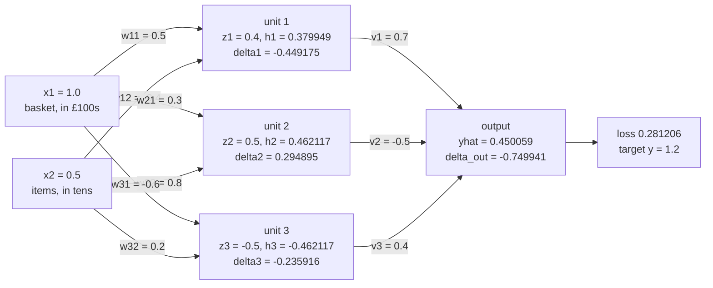

# Backpropagation: the chain rule run backwards through a network

[Syllabus](../../../SYLLABUS.md) → [Applied and computational](../README.md) → [Machine Learning Mathematics](../README.md#s06) → Backpropagation

---

## General Overview

A shop keeps 20,000 past orders, each described by 12 numbers: basket value, item count, days since the last order, and so on. It wants a network that reads those 12 numbers and predicts what the customer will spend next month. Training the network means adjusting its weights (the adjustable numbers inside it) to shrink its error. To know which way to adjust each weight, it needs the **gradient**: for every weight, how fast the error changes when that weight moves.

The plain way is to nudge one weight, run the network again, and see how far the error moved: two runs per weight. A network with 12 inputs, 16 hidden units and one output, written 12-16-1, has 225 weights and biases. Nudging costs 94,500 multiplications for one order's gradient, and 1,890,000,000 for all 20,000 orders. **Backpropagation** gets every slope from one run forward and one run backward: 450 multiplications per order, 9,000,000 for the whole shop. Its answers are exact, up to rounding, because it uses the chain rule instead of nudges.

This card works one order by hand on a tiny 2-3-1 network: two inputs, three hidden units, one output. The order had a £100 basket and 5 items, and the customer then spent £120. With its starting weights the network predicts £45.01. Backpropagation gives the slope of the error with respect to one chosen weight as −0.4491751254, and a numerical nudge each way agrees to ten decimals.

**Backpropagation runs the network forward once, keeping every intermediate value, then sends the error's slope backwards layer by layer, multiplying by each step's local slope; each weight's derivative is the slope arriving at the unit it feeds times the value that entered it.**

**What kind of fact this is:** a method, exact up to rounding. It rests on the chain rule for several variables, a theorem proved in [Chain rule in several variables](../../06-Calculus%20and%20analysis/07-Several%20Variables/04-multivariable-chain-rule-and-jacobians.md).

### The picture: one order through a 2-3-1 network



Left to right is the forward pass: each hidden unit adds its weighted inputs and its bias (0.1, −0.2 and 0) to get z, then squashes z to h; the output adds the weighted h values and its bias, 0.6. Right to left is the backward pass: each delta is how much the loss moves per unit change in that box's sum. The numbers are synthetic, chosen for the example, not fitted to real orders.

---

## The formula

A reminder from the earlier cards. A unit adds up its weighted inputs and passes the sum through a squashing function ([The perceptron and its stack](03-perceptron-and-neural-networks.md)). A loss scores one prediction against the truth ([Loss and empirical risk](01-loss-functions-and-empirical-risk.md)). Here the hidden units squash with tanh, an S-shaped curve from −1 to 1, and the output does not squash at all. The loss is half the squared miss between the prediction $\hat y$ and the true value $y$, $\ell = \tfrac12(\hat y - y)^2$. The half makes its slope come out as the plain miss, $\hat y - y$.

In the 2-3-1 network, $x_1$ and $x_2$ are the order's two inputs. Hidden unit $j$ has a weight $w_{ji}$ from input $i$ and a bias $b_j$; its sum is $z_j$ and its output $h_j$. The output unit has a weight $v_j$ from hidden unit $j$ and a bias $c$. The forward pass, for hidden units $j = 1, 2, 3$:

$$z_j = b_j + w_{j1}x_1 + w_{j2}x_2, \qquad h_j = \tanh z_j, \qquad \hat y = c + v_1h_1 + v_2h_2 + v_3h_3.$$

One new notation, in words first: the **backpropagated error** $\delta$ ("delta") of a unit is how much the loss moves per unit change in that unit's sum. This card introduces it; later cards on the shelf use it freely. Backpropagation is three lines:

$$\delta_{\text{out}} = \hat y - y, \qquad \delta_j = v_j\,\delta_{\text{out}}\,\bigl(1 - h_j^2\bigr), \qquad \frac{\partial \ell}{\partial w_{ji}} = \delta_j\,x_i, \quad \frac{\partial \ell}{\partial v_j} = \delta_{\text{out}}\,h_j.$$

**Read it aloud:** the output's error is the miss; a hidden unit's error is the output's error, carried back along the weight joining them and scaled by the unit's own slope; and a weight's derivative is the error at the unit it feeds times the value it carried in.

A bias is a weight whose input is always 1, so $\partial\ell/\partial b_j = \delta_j$ and $\partial\ell/\partial c = \delta_{\text{out}}$.

For a network of many layers, the same three lines read layer by layer. Number the layers $l = 1, 2, \dots$; layer $l$ has weight matrix $W^{(l)}$, sums $z^{(l)}$, outputs $a^{(l)} = f(z^{(l)})$, and the inputs are $a^{(0)}$. Then

$$\delta^{(l)} = \Bigl(\bigl(W^{(l+1)}\bigr)^{\mathsf T}\,\delta^{(l+1)}\Bigr) \odot f'\bigl(z^{(l)}\bigr), \qquad \frac{\partial \ell}{\partial W^{(l)}} = \delta^{(l)}\,\bigl(a^{(l-1)}\bigr)^{\mathsf T}.$$

**Read it aloud:** each layer's errors are the next layer's errors sent back through the transposed weights, then multiplied entry by entry by the layer's own slopes; and a layer's weight gradient pairs every error with every input that fed it.

The perceptron card's layer matrices $W_1$ and $W_2$ are $W^{(1)}$ and $W^{(2)}$ here; its bias vector $b_1$ holds this card's $b_1$, $b_2$, $b_3$, and its $b_2$ is this card's $c$.

| Symbol | Plain meaning | In our example | Push it up and the answer… |
| --- | --- | --- | --- |
| $x_1$, $x_2$; $y$ | the order's inputs: basket in £100s, items in tens; the true next-month spend in £100s | 1.0 and 0.5; 1.2 | $x_1$ is a factor of $\partial\ell/\partial w_{11} = \delta_1 x_1$, but $\delta_1$ moves with it, so the slope does not grow in proportion |
| $w_{ji}$, $b_j$ | weight from input $i$ into hidden unit $j$; that unit's bias | $w_{11} = 0.5$; $b_1 = 0.1$ | moves $z_j$ |
| $z_j$ | hidden unit $j$'s sum, before squashing | $z_1 = 0.4$ | the slope $1 - h_j^2$ shrinks as $z_j$ moves away from 0 |
| $h_j$, $\tanh$ | the unit's output, $\tanh z_j$; tanh's slope is $1 - \tanh^2$ | $h_1 = 0.379949$ | — |
| $v_j$, $c$ | weight from hidden unit $j$ to the output; the output's bias | $v_1 = 0.7$; $c = 0.6$ | a bigger $v_j$ sends more error back to unit $j$ |
| $\hat y$ | the prediction, in £100s ("y-hat") | 0.450059, about £45.01 | — |
| $\ell$ | the loss, $\tfrac12(\hat y - y)^2$ | 0.281206 | — |
| $\delta_{\text{out}}$, $\delta_j$ | the backpropagated error at the output and at hidden unit $j$ | −0.749941; $\delta_1 = -0.449175$ | every gradient scales with $\delta_{\text{out}}$ |
| $\Delta$; $\eta$ | the nudge in a central difference; the learning rate, how far one training step moves along the gradient | $10^{-5}$; 0.1 | $\Delta$: truncation error, the error that comes from the nudge's size, grows. $\eta$: bigger drop, until the step overshoots |
| $\partial\ell/\partial w$, $\sum$, $e$ | a partial derivative: the loss's slope against one weight, all others held still; add over the index beneath; the base of natural logarithms | $\partial\ell/\partial w_{11} = -0.449175$ | — |
| $n$, $H$, $P$ | inputs, hidden units, and weights plus biases in all | 2, 3, 13; for the shop 12, 16, 225 | backprop's cost grows like $P$, nudging's like $P$ squared |
| $W^{(l)}$, $z^{(l)}$, $a^{(l)}$, $\delta^{(l)}$, $f$, $f'$, $\odot$, ${}^{\mathsf T}$ | general form: layer $l$'s weight matrix, sums, outputs and errors; the squashing function and its slope; multiply entry by entry; transpose (rows become columns) | here $W^{(2)}$ is the row (0.7, −0.5, 0.4) | — |

### When it holds

- **Every step has a slope where it sits.** A ReLU unit, which outputs $\max(z, 0)$, has a kink at $z = 0$ and no slope there. Switch the hidden units to ReLU, set unit 3's bias so that $z_3 = 0$, and backpropagation, using the usual convention of slope 0, reports 0 for $w_{31}$. A central difference reports −0.114000, the average of the two sides, 0 and −0.228000. Neither is "the" derivative, because there is none.
- **The forward values are kept, at the same weights.** The backward pass reads every $z_j$ and $h_j$ from the forward pass, so memory grows with units times orders processed together. Change the weights in between and the gradient belongs to a network that no longer exists.
- **One number at the end.** One backward sweep gives the slopes of one output, the loss. A network with many outputs whose separate slopes are all wanted needs one sweep per output.
- **The gradient is local.** It is the slope at the current weights only. A step of $\eta = 0.1$ along it was predicted, from the slope alone, to cut the loss by 0.165866. The real cut was 0.140231, because the surface curves.

---

## Why it works

### Step 0: the loss reaches a weight through a chain, and most of the chain is shared

Follow $w_{11}$. It changes $z_1$, which changes $h_1$, which changes $\hat y$, which changes the loss. Nothing else. The chain rule says the loss's slope with respect to $w_{11}$ is the product of the four local slopes along that chain ([Chain rule in several variables](../../06-Calculus%20and%20analysis/07-Several%20Variables/04-multivariable-chain-rule-and-jacobians.md)).

Now follow $w_{12}$. Its chain is $w_{12} \to z_1 \to h_1 \to \hat y \to \ell$: the same as $w_{11}$'s from $z_1$ onwards. Every weight in the network ends its chain with $\hat y \to \ell$. So most of every product has already been computed for some other weight.

Backpropagation computes each shared tail once, starting from the loss, and stores it at the unit where the tails meet. That stored number is $\delta$. A weight's slope is then its stored $\delta$ times the one local slope left at the front of its chain.

### Step 1: each step has a simple local slope

Read each line of the forward pass and ask how its output moves when one input moves, the others held still.

| Step | Moves with | Local slope |
| --- | --- | --- |
| $\ell = \tfrac12(\hat y - y)^2$ | $\hat y$ | $\hat y - y$ |
| $\hat y = c + \sum_j v_j h_j$ | $h_j$; $v_j$ | $v_j$; $h_j$ |
| $h_j = \tanh z_j$ | $z_j$ | $1 - h_j^2$ |
| $z_j = b_j + \sum_i w_{ji} x_i$ | $w_{ji}$; $b_j$ | $x_i$; 1 |

Two of these deserve a word. The slope of a sum with respect to one weight is the input that weight multiplies: double the weight and the sum gains one more copy of that input. And tanh's slope can be read from tanh's own output, so the backward pass never recomputes tanh.

<details>
<summary>Why tanh's slope is 1 − tanh²</summary>

By definition $\tanh z = (e^z - e^{-z})/(e^z + e^{-z})$. The top's slope is the bottom, and the bottom's slope is the top. The quotient rule gives

$$\frac{d}{dz}\tanh z = \frac{(e^z + e^{-z})^2 - (e^z - e^{-z})^2}{(e^z + e^{-z})^2} = 1 - \tanh^2 z.$$

At $z_1 = 0.4$, $h_1 = 0.379949$, so the slope is $1 - 0.379949^2 = 0.855639$.

</details>

### Step 2: multiply along the chain, starting from the loss

For $w_{11}$ the four slopes are $\hat y - y$, then $v_1$, then $1 - h_1^2$, then $x_1$:

$$\frac{\partial \ell}{\partial w_{11}} = (\hat y - y)\cdot v_1 \cdot (1 - h_1^2)\cdot x_1.$$

Multiplication does not care about order, but storage does. Group from the loss end. The first factor is $\delta_{\text{out}}$. The first three together are $\delta_1$. Then

$$\frac{\partial \ell}{\partial w_{11}} = \underbrace{\underbrace{(\hat y - y)}_{\delta_{\text{out}}}\cdot v_1 \cdot (1 - h_1^2)}_{\delta_1}\cdot\, x_1 = \delta_1\,x_1.$$

The weight $w_{12}$ gets $\delta_1 x_2$, the bias $b_1$ gets $\delta_1$, and the output weight $v_1$ gets $\delta_{\text{out}} h_1$. Four slopes from one stored $\delta_1$ and one stored $\delta_{\text{out}}$. That is the whole method.

### Step 3: where paths fork, the slopes add

In the 2-3-1 network each hidden unit feeds a single output, so each chain is a single path. In a deeper network a unit feeds several units in the next layer, and a nudge to it reaches the loss along several routes. The chain rule for several variables handles this: the total slope is the sum over routes of the product along each route.

Backpropagation does that sum at each unit. A unit's $\delta$ is the sum, over the units it feeds, of their $\delta$ times the weight joining them, all times the unit's own slope. Written for a whole layer at once, that sum is the matrix product $(W^{(l+1)})^{\mathsf T}\delta^{(l+1)}$ in the general formula. For our network, layer 2 is the single output, $W^{(2)}$ is the row $(v_1, v_2, v_3)$, and its transpose times $\delta_{\text{out}}$ is the column of $v_j\,\delta_{\text{out}}$. Multiply each entry by its unit's slope $1 - h_j^2$ and out come $\delta_1$, $\delta_2$, $\delta_3$.

This is reverse-mode differentiation, the method on [Adjoint differentiation](../../12-Financial%20mathematics/07-Greeks%20by%20Numbers%20and%20Calibration/03-adjoint-differentiation-in-outline.md), where a pricing program is recorded as a numbered list of steps and swept backwards. A network is that list arranged in layers, so the sweep can be done a layer at a time, as matrix products.

### Step 4: what it costs, counted

The backward pass does a small fixed amount of work per weight, the same kind of work the forward pass did, so it costs about as much as the forward pass. The code counts every multiplication in both passes except inside the squashing function: tanh and its slope $1 - h_j^2$ are treated as one step each and left out of the count.

For a network with $n$ inputs, $H$ hidden units and one output, the forward pass costs $(n+1)H + 2$ multiplications and the backward pass $(n+3)H$. Together that is $(2n+4)H + 2$, exactly twice $P = nH + 2H + 1$, the number of weights and biases. **Two multiplications per parameter, for every slope at once.**

A central difference needs two forward passes per parameter: $2P$ passes of $(n+1)H + 2$ each. Divide one bill by the other and the ratio is the cost of one forward pass. It grows with the network. For the shop's 12-16-1 network the ratio is 210.0; for 12-64-1, 834.0. Real networks have millions of weights, which is why nobody trains them by nudging.

---

## Worked numbers, by hand

The order: $x_1 = 1.0$ (basket £100), $x_2 = 0.5$ (5 items), true spend $y = 1.2$ (£120). Weights as in the picture.

| Step | Arithmetic | Value |
| --- | --- | --- |
| $z_1$ | $0.1 + 0.5 \times 1.0 + (-0.4) \times 0.5$ | 0.4 |
| $h_1$ | $\tanh 0.4$ | 0.379949 |
| $h_2$, $h_3$ | $\tanh 0.5$, $\tanh(-0.5)$, from $z_2 = 0.5$ and $z_3 = -0.5$ | 0.462117, −0.462117 |
| $\hat y$ | $0.6 + 0.7 \times 0.379949 - 0.5 \times 0.462117 + 0.4 \times (-0.462117)$ | 0.450059 |
| loss $\ell$ | $\tfrac12 (0.450059 - 1.2)^2$ | 0.281206 |
| $\delta_{\text{out}}$ | $0.450059 - 1.2$ | −0.749941 |
| error arriving at unit 1 | $v_1\,\delta_{\text{out}} = 0.7 \times (-0.749941)$ | −0.524959 |
| unit 1's slope | $1 - 0.379949^2$ | 0.855639 |
| $\delta_1$ | $-0.524959 \times 0.855639$ | −0.449175 |
| $\partial\ell/\partial w_{11}$ | $\delta_1 \times x_1 = -0.449175 \times 1.0$ | **−0.449175** |
| check: central difference, $\Delta = 10^{-5}$ | $\bigl(\ell(w_{11} + \Delta) - \ell(w_{11} - \Delta)\bigr) / (2\Delta)$ | −0.4491751254 |

The slope is negative, so raising $w_{11}$ lowers the loss. That makes sense: the network predicts £45.01 against a true £120, and a bigger $w_{11}$ raises $h_1$, which reaches the output through the positive weight $v_1 = 0.7$ and lifts the prediction.

The check is the [Numerical derivatives](../../06-Calculus%20and%20analysis/03-What%20Derivatives%20Tell%20You/08-numerical-derivatives-and-sensitivity.md) card's central difference: nudge one weight each way, rerun the network, divide by the span. Its error shrinks with the square of the nudge until rounding takes over; at $10^{-5}$ it agrees with backpropagation to within $10^{-9}$ on all 13 parameters. This comparison is called a **gradient check**, and it is how backpropagation code is tested.

### What breaks if you drop a piece

Correct answer $\partial\ell/\partial w_{11} = -0.449175$.

| Mistake | Comes out at | What went wrong |
| --- | --- | --- |
| Skip tanh's slope $1 - h_1^2$ | −0.524959 | Treats the unit as if it did not squash; the error grows where a unit is near its flat ends, at ±1 |
| Read the slope at $h_1$ instead of $z_1$: $1 - \tanh^2(h_1)$ | −0.455914 | The slope belongs to the point the function was evaluated at, $z_1 = 0.4$ |
| Check with a forward difference, nudge 0.1 | −0.414808 | One-sided nudge, too big: the truncation error swamps the check |
| Step uphill: add $\eta$ times the gradient | loss 0.473064 instead of 0.140975 | The gradient points uphill; training subtracts it |
| ReLU unit on its kink ($z_3 = 0$): $\partial\ell/\partial w_{31}$ | backprop 0, central difference −0.114000 | No slope exists there; each method reports a convention |

Every number in the table is printed by the code below.

---

## Code, from first principles, and it actually runs

The scripts build the 2-3-1 network from scratch, with every multiplication outside the squashing function passed through a counter. They take **three independent roads** to all 13 slopes. The first is backpropagation. The second is forward mode: each value carries its own derivative with respect to one chosen parameter, which costs one pass per parameter. The third is a central difference with nudge $10^{-5}$. Then they take one training step, reproduce every "what breaks" number, and count the multiplications for one gradient on four network sizes, asserting each count against its formula.

### Python

```python
# Backpropagation -- the check behind the card.  Standard library only.
# A 2-3-1 network (2 inputs, 3 tanh hidden units, 1 output) on one synthetic order.
# Three roads to the gradient: backprop (reverse), forward mode (a derivative carried
# alongside every value), and central differences.  Every multiply outside act() is counted.
from math import tanh

COUNT = [0]
def mul(a, b):                       # every multiply outside act() goes through here, counted
    COUNT[0] += 1
    return a * b

def act(z, kind):                    # squashing function and its slope: one step, not counted
    if kind == "tanh":
        t = tanh(z); return t, 1.0 - t * t
    return (z, 1.0) if z > 0 else (0.0, 0.0)          # ReLU; slope at the kink taken as 0

def unpack(p, n, H):                 # parameter list -> W1 (H rows of n), b1, W2, b2
    W1 = [p[j * n:(j + 1) * n] for j in range(H)]
    return W1, p[H * n:H * n + H], p[H * n + H:H * n + 2 * H], p[-1]

def forward(p, x, y, n, H, kind="tanh"):
    W1, b1, W2, b2 = unpack(p, n, H)
    z = [b1[j] + sum(mul(W1[j][i], x[i]) for i in range(n)) for j in range(H)]
    h = [act(zj, kind)[0] for zj in z]
    yhat = b2 + sum(mul(W2[j], h[j]) for j in range(H))
    return z, h, yhat, mul(0.5, mul(yhat - y, yhat - y))

def backward(p, x, y, n, H, kind="tanh", slip=None):
    W1, b1, W2, b2 = unpack(p, n, H)
    z, h, yhat, loss = forward(p, x, y, n, H, kind)
    start = COUNT[0]
    d_out = yhat - y                                   # dloss/dyhat for loss = (yhat - y)^2 / 2
    gW2 = [mul(d_out, h[j]) for j in range(H)]
    d_h = []
    for j in range(H):
        slope = act(z[j], kind)[1]
        if slip == "no slope":   slope = 1.0           # mistake: skip the activation's slope
        if slip == "slope at h": slope = act(h[j], kind)[1]   # mistake: slope read at h, not z
        d_h.append(mul(mul(W2[j], d_out), slope))
    gW1 = [mul(d_h[j], x[i]) for j in range(H) for i in range(n)]
    return gW1 + d_h + gW2 + [d_out], COUNT[0] - start, loss

def forward_mode(p, x, y, n, H, k):  # carry (value, derivative wrt parameter k) through every step
    dp = [1.0 if m == k else 0.0 for m in range(len(p))]
    W1, b1, W2, b2 = unpack(p, n, H); dW1, db1, dW2, db2 = unpack(dp, n, H)
    yhat, dyhat = b2, db2
    for j in range(H):
        z = b1[j] + sum(mul(W1[j][i], x[i]) for i in range(n))
        dz = db1[j] + sum(mul(dW1[j][i], x[i]) for i in range(n))
        t, s = act(z, "tanh")
        yhat += mul(W2[j], t); dyhat += mul(dW2[j], t) + mul(W2[j], mul(s, dz))
    return mul(yhat - y, dyhat)

def central(p, x, y, n, H, k, step=1e-5, kind="tanh"):
    up = p[:]; up[k] += step; dn = p[:]; dn[k] -= step
    return (forward(up, x, y, n, H, kind)[3] - forward(dn, x, y, n, H, kind)[3]) / (2 * step)

# ---- the order: basket £100 and 5 items in, next month's spend £120 out (units of £100, tens) ----
X, Y, N, H = [1.0, 0.5], 1.2, 2, 3
P = [0.5, -0.4, 0.3, 0.8, -0.6, 0.2,   0.1, -0.2, 0.0,   0.7, -0.5, 0.4,   0.6]
NAMES = ["w11", "w12", "w21", "w22", "w31", "w32", "b1", "b2", "b3", "v1", "v2", "v3", "c"]
z, h, yhat, loss = forward(P, X, Y, N, H)
g = backward(P, X, Y, N, H)[0]
gf = [forward_mode(P, X, Y, N, H, k) for k in range(13)]
gc = [central(P, X, Y, N, H, k) for k in range(13)]
rows = [(f"z{j+1}", z[j]) for j in range(3)] + [(f"h{j+1} = tanh(z{j+1})", h[j]) for j in range(3)]
rows += [("yhat, in hundreds of pounds", yhat), ("yhat, in pounds", 100 * yhat), ("loss (yhat - y)^2 / 2", loss), ("delta_out = yhat - y", yhat - Y)]
rows += [(f"delta_h{j+1}", g[6 + j]) for j in range(3)] + [("tanh slope 1 - h1^2", 1 - h[0] ** 2)]
print("\n".join(f"{a:<34} {v:>14.6f}" for a, v in rows))
print(f"{'param':<6}{'backprop':>16}{'forward mode':>16}{'central diff':>16}")
for k in range(13):
    print(f"{NAMES[k]:<6}{g[k]:>16.10f}{gf[k]:>16.10f}{gc[k]:>16.10f}")
worst_c = max(abs(g[k] - gc[k]) for k in range(13)); worst_f = max(abs(g[k] - gf[k]) for k in range(13))
print(f"all 13 agree with central diff to 1e-9: {'yes' if worst_c < 1e-9 else 'NO'}")
print(f"all 13 agree with forward mode to 1e-12: {'yes' if worst_f < 1e-12 else 'NO'}")

# ---- one step downhill, learning rate 0.1 ----
eta = 0.1
loss_down = forward([P[k] - eta * g[k] for k in range(13)], X, Y, N, H)[3]
loss_up = forward([P[k] + eta * g[k] for k in range(13)], X, Y, N, H)[3]
predicted = eta * sum(gk * gk for gk in g)
more = [("step: loss after", loss_down), ("step: actual drop", loss - loss_down),
        ("step: predicted drop eta*|g|^2", predicted), ("wrong sign: loss after", loss_up)]

# ---- what breaks ----
no_slope = backward(P, X, Y, N, H, slip="no slope")[0][0]
at_h = backward(P, X, Y, N, H, slip="slope at h")[0][0]
fwd_big = (forward([P[0] + 0.1] + P[1:], X, Y, N, H)[3] - loss) / 0.1
R = P[:]; R[8] = -sum(R[4 + i] * X[i] for i in range(N))   # ReLU net: unit 3 sits on its kink
R_bp = backward(R, X, Y, N, H, kind="relu")[0][4] + 0.0   # + 0.0 turns -0.0 into 0.0
R_cd = central(R, X, Y, N, H, 4, kind="relu")
R_right = (forward(R[:4] + [R[4] + 1e-6] + R[5:], X, Y, N, H, "relu")[3]
           - forward(R, X, Y, N, H, "relu")[3]) / 1e-6
more += [("wrong: no tanh slope, dL/dw11", no_slope), ("wrong: slope read at h, dL/dw11", at_h),
         ("wrong: forward diff step 0.1", fwd_big), ("relu kink z3 = 0: backprop dL/dw31", R_bp),
         ("relu kink: central diff", R_cd), ("relu kink: slope from the right", R_right)]
print("\n".join(f"{a:<34} {v:>14.6f}" for a, v in more))

# ---- cost: multiplies for one full gradient; 12 inputs = an order's 12 numbers ----
print(f"{'network':<9}{'params':>7}{'forward':>9}{'backprop':>10}{'fwd mode':>10}{'central':>10}{'ratio':>7}")
costs = {}
for nn, HH in ((2, 3), (12, 4), (12, 16), (12, 64)):
    pp = [0.01 * ((7 * m) % 11 - 5) for m in range(nn * HH + 2 * HH + 1)]
    xx = [0.1 * (i + 1) for i in range(nn)]
    COUNT[0] = 0; forward(pp, xx, 1.0, nn, HH); fc = COUNT[0]
    bc = backward(pp, xx, 1.0, nn, HH)[1]
    COUNT[0] = 0
    for k in range(len(pp)): forward_mode(pp, xx, 1.0, nn, HH, k)
    fm = COUNT[0]
    COUNT[0] = 0
    for k in range(len(pp)): central(pp, xx, 1.0, nn, HH, k)
    cc = COUNT[0]
    costs[HH] = (nn, len(pp), fc, bc, cc)
    print(f"{f'{nn}-{HH}-1':<9}{len(pp):>7}{fc:>9}{fc + bc:>10}{fm:>10}{cc:>10}{cc / (fc + bc):>7.1f}")
_, P16, f16, b16, c16 = costs[16]
print(f"20,000 orders, 12-16-1, backprop: {20000 * (f16 + b16):,} multiplies")
print(f"20,000 orders, 12-16-1, central:  {20000 * c16:,} multiplies")

assert abs(g[0] - (-0.4491751254)) < 1e-9, "the hand-worked gradient for w11"
assert worst_c < 1e-9, "backprop vs central differences, all 13 parameters"
assert worst_f < 1e-12, "backprop vs forward mode, all 13 parameters"
assert abs((loss - loss_down) - predicted) < 0.2 * predicted, "first-order drop prediction"
assert loss_up > loss > loss_down, "downhill lowers the loss, uphill raises it"
assert abs(R_cd - 0.5 * R_right) < 1e-6, "at the kink, central diff averages the two sides"
assert abs(R_bp - R_cd) > 0.1, "at the kink, backprop and central diff disagree"
for HH, (nn, PP, fc, bc, cc) in costs.items():
    assert fc == (nn + 1) * HH + 2, "counted forward multiplies vs (n + 1)H + 2"
    assert fc + bc == 2 * PP, "counted backprop multiplies vs two per parameter"
    assert cc == 2 * PP * fc, "counted central-difference multiplies vs 2 x params x forward"
print("ALL CHECKS PASS")
```

**Ran 2026-11-11 on macOS, Python 3.14.10, standard library only. All checks passed. Output, pasted from the run:**

```
z1                                       0.400000
z2                                       0.500000
z3                                      -0.500000
h1 = tanh(z1)                            0.379949
h2 = tanh(z2)                            0.462117
h3 = tanh(z3)                           -0.462117
yhat, in hundreds of pounds              0.450059
yhat, in pounds                         45.005883
loss (yhat - y)^2 / 2                    0.281206
delta_out = yhat - y                    -0.749941
delta_h1                                -0.449175
delta_h2                                 0.294895
delta_h3                                -0.235916
tanh slope 1 - h1^2                      0.855639
param         backprop    forward mode    central diff
w11      -0.4491751254   -0.4491751254   -0.4491751254
w12      -0.2245875627   -0.2245875627   -0.2245875627
w21       0.2948947657    0.2948947657    0.2948947657
w22       0.1474473828    0.1474473828    0.1474473828
w31      -0.2359158126   -0.2359158126   -0.2359158125
w32      -0.1179579063   -0.1179579063   -0.1179579063
b1       -0.4491751254   -0.4491751254   -0.4491751254
b2        0.2948947657    0.2948947657    0.2948947657
b3       -0.2359158126   -0.2359158126   -0.2359158125
v1       -0.2849393685   -0.2849393685   -0.2849393685
v2       -0.3465606806   -0.3465606806   -0.3465606806
v3        0.3465606806    0.3465606806    0.3465606806
c        -0.7499411680   -0.7499411680   -0.7499411680
all 13 agree with central diff to 1e-9: yes
all 13 agree with forward mode to 1e-12: yes
step: loss after                         0.140975
step: actual drop                        0.140231
step: predicted drop eta*|g|^2           0.165866
wrong sign: loss after                   0.473064
wrong: no tanh slope, dL/dw11           -0.524959
wrong: slope read at h, dL/dw11         -0.455914
wrong: forward diff step 0.1            -0.414808
relu kink z3 = 0: backprop dL/dw31       0.000000
relu kink: central diff                 -0.114000
relu kink: slope from the right         -0.228000
network   params  forward  backprop  fwd mode   central  ratio
2-3-1         13       11        26       325       286   11.0
12-4-1        57       54       114      6441      6156   54.0
12-16-1      225      210       450    101025     94500  210.0
12-64-1      897      834      1794   1608321   1496196  834.0
20,000 orders, 12-16-1, backprop: 9,000,000 multiplies
20,000 orders, 12-16-1, central:  1,890,000,000 multiplies
ALL CHECKS PASS
```

All three roads give the same 13 slopes: forward mode to the last printed digit, the central difference to within $10^{-9}$. The step with $\eta = 0.1$ halves the loss, from 0.281206 to 0.140975.

### Rust

The same checks, the same inputs, std only. The counter is a thread-local cell, and it counts the same multiplications as the Python.

```rust
// Backpropagation -- the same check as backpropagation_check.py, in Rust.  std only, no crates.
// A 2-3-1 network (2 inputs, 3 tanh hidden units, 1 output) on one synthetic order.
// Three roads to the gradient: backprop (reverse), forward mode, central differences.
// Every multiplication outside act() goes through mul() and is counted.
// Compile: rustc --edition 2021 -O backpropagation_check.rs -o /tmp/backpropagation
use std::cell::Cell;

thread_local! { static COUNT: Cell<u64> = Cell::new(0); }
fn mul(a: f64, b: f64) -> f64 { COUNT.with(|c| c.set(c.get() + 1)); a * b }
fn count() -> u64 { COUNT.with(|c| c.get()) }  fn reset() { COUNT.with(|c| c.set(0)); }

#[derive(Clone, Copy, PartialEq)] enum Kind { Tanh, Relu }
#[derive(Clone, Copy, PartialEq)] enum Slip { None, NoSlope, SlopeAtH }

fn act(z: f64, kind: Kind) -> (f64, f64) {          // squashing function and its slope: not counted
    match kind {
        Kind::Tanh => { let t = z.tanh(); (t, 1.0 - t * t) }
        Kind::Relu => if z > 0.0 { (z, 1.0) } else { (0.0, 0.0) },   // slope at the kink taken as 0
    }
}

// parameter layout: W1 (H rows of n), b1 (H), W2 (H), b2 (1)
fn forward(p: &[f64], x: &[f64], y: f64, n: usize, h: usize, kind: Kind) -> (Vec<f64>, Vec<f64>, f64, f64) {
    let mut z = Vec::new();
    for j in 0..h {
        let mut s = 0.0;
        for i in 0..n { s += mul(p[j * n + i], x[i]); }
        z.push(p[h * n + j] + s);
    }
    let hv: Vec<f64> = z.iter().map(|&zj| act(zj, kind).0).collect();
    let mut s = 0.0;
    for j in 0..h { s += mul(p[h * n + h + j], hv[j]); }
    let yhat = p[p.len() - 1] + s;
    let loss = mul(0.5, mul(yhat - y, yhat - y));
    (z, hv, yhat, loss)
}

fn backward(p: &[f64], x: &[f64], y: f64, n: usize, h: usize, kind: Kind, slip: Slip) -> (Vec<f64>, u64) {
    let (z, hv, yhat, _) = forward(p, x, y, n, h, kind);
    let start = count();
    let d_out = yhat - y;                             // dloss/dyhat for loss = (yhat - y)^2 / 2
    let gw2: Vec<f64> = (0..h).map(|j| mul(d_out, hv[j])).collect();
    let mut d_h = Vec::new();
    for j in 0..h {
        let slope = match slip {
            Slip::None => act(z[j], kind).1,
            Slip::NoSlope => 1.0,                     // mistake: skip the activation's slope
            Slip::SlopeAtH => act(hv[j], kind).1,     // mistake: slope read at h, not z
        };
        d_h.push(mul(mul(p[h * n + h + j], d_out), slope));
    }
    let mut g = Vec::new();
    for j in 0..h { for i in 0..n { g.push(mul(d_h[j], x[i])); } }
    g.extend(d_h); g.extend(gw2); g.push(d_out);
    (g, count() - start)
}

fn forward_mode(p: &[f64], x: &[f64], y: f64, n: usize, h: usize, k: usize) -> f64 {
    let dp: Vec<f64> = (0..p.len()).map(|m| if m == k { 1.0 } else { 0.0 }).collect();
    let (mut yhat, mut dyhat) = (p[p.len() - 1], dp[p.len() - 1]);
    for j in 0..h {
        let (mut z, mut dz) = (0.0, 0.0);
        for i in 0..n { z += mul(p[j * n + i], x[i]); }
        for i in 0..n { dz += mul(dp[j * n + i], x[i]); }
        z = p[h * n + j] + z; dz = dp[h * n + j] + dz;
        let (t, s) = act(z, Kind::Tanh);
        let w = h * n + h + j;
        yhat += mul(p[w], t); dyhat += mul(dp[w], t) + mul(p[w], mul(s, dz));
    }
    mul(yhat - y, dyhat)
}

fn central(p: &[f64], x: &[f64], y: f64, n: usize, h: usize, k: usize, step: f64, kind: Kind) -> f64 {
    let (mut up, mut dn) = (p.to_vec(), p.to_vec()); up[k] += step; dn[k] -= step;
    (forward(&up, x, y, n, h, kind).3 - forward(&dn, x, y, n, h, kind).3) / (2.0 * step)
}

fn commas(v: u64) -> String {
    let s = v.to_string(); let mut out = String::new();
    for (i, ch) in s.chars().enumerate() {
        if i > 0 && (s.len() - i) % 3 == 0 { out.push(','); }
        out.push(ch);
    }
    out
}

fn main() {
    // the order: basket £100 and 5 items in, next month's spend £120 out (units of £100, tens)
    let (x, y, n, h) = ([1.0_f64, 0.5], 1.2_f64, 2usize, 3usize);
    let p = [0.5, -0.4, 0.3, 0.8, -0.6, 0.2, 0.1, -0.2, 0.0, 0.7, -0.5, 0.4, 0.6_f64];
    let names = ["w11", "w12", "w21", "w22", "w31", "w32", "b1", "b2", "b3", "v1", "v2", "v3", "c"];
    let (z, hv, yhat, loss) = forward(&p, &x, y, n, h, Kind::Tanh);
    let g = backward(&p, &x, y, n, h, Kind::Tanh, Slip::None).0;
    let gf: Vec<f64> = (0..13).map(|k| forward_mode(&p, &x, y, n, h, k)).collect();
    let gc: Vec<f64> = (0..13).map(|k| central(&p, &x, y, n, h, k, 1e-5, Kind::Tanh)).collect();
    let mut rows: Vec<(String, f64)> = Vec::new();
    for j in 0..3 { rows.push((format!("z{}", j + 1), z[j])); }
    for j in 0..3 { rows.push((format!("h{} = tanh(z{})", j + 1, j + 1), hv[j])); }
    rows.push(("yhat, in hundreds of pounds".into(), yhat)); rows.push(("yhat, in pounds".into(), 100.0 * yhat));
    rows.push(("loss (yhat - y)^2 / 2".into(), loss));
    rows.push(("delta_out = yhat - y".into(), yhat - y));
    for j in 0..3 { rows.push((format!("delta_h{}", j + 1), g[6 + j])); }
    rows.push(("tanh slope 1 - h1^2".into(), 1.0 - hv[0] * hv[0]));
    for (a, v) in &rows { println!("{:<34} {:>14.6}", a, v); }
    println!("{:<6}{:>16}{:>16}{:>16}", "param", "backprop", "forward mode", "central diff");
    for k in 0..13 { println!("{:<6}{:>16.10}{:>16.10}{:>16.10}", names[k], g[k], gf[k], gc[k]); }
    let worst_c = (0..13).map(|k| (g[k] - gc[k]).abs()).fold(0.0, f64::max);
    let worst_f = (0..13).map(|k| (g[k] - gf[k]).abs()).fold(0.0, f64::max);
    println!("all 13 agree with central diff to 1e-9: {}", if worst_c < 1e-9 { "yes" } else { "NO" });
    println!("all 13 agree with forward mode to 1e-12: {}", if worst_f < 1e-12 { "yes" } else { "NO" });

    // one step downhill, learning rate 0.1
    let eta = 0.1;
    let down: Vec<f64> = (0..13).map(|k| p[k] - eta * g[k]).collect();
    let upw: Vec<f64> = (0..13).map(|k| p[k] + eta * g[k]).collect();
    let loss_down = forward(&down, &x, y, n, h, Kind::Tanh).3;
    let loss_up = forward(&upw, &x, y, n, h, Kind::Tanh).3;
    let predicted = eta * g.iter().map(|v| v * v).sum::<f64>();

    // what breaks
    let no_slope = backward(&p, &x, y, n, h, Kind::Tanh, Slip::NoSlope).0[0];
    let at_h = backward(&p, &x, y, n, h, Kind::Tanh, Slip::SlopeAtH).0[0];
    let mut big = p.to_vec(); big[0] += 0.1;
    let fwd_big = (forward(&big, &x, y, n, h, Kind::Tanh).3 - loss) / 0.1;
    let mut r = p.to_vec();
    r[8] = -(0.0 + r[4] * x[0] + r[5] * x[1]);         // ReLU net: unit 3 sits on its kink
    let r_bp = backward(&r, &x, y, n, h, Kind::Relu, Slip::None).0[4] + 0.0;
    let r_cd = central(&r, &x, y, n, h, 4, 1e-5, Kind::Relu);
    let mut rr = r.clone(); rr[4] += 1e-6;
    let r_right = (forward(&rr, &x, y, n, h, Kind::Relu).3 - forward(&r, &x, y, n, h, Kind::Relu).3) / 1e-6;
    let more = [("step: loss after", loss_down), ("step: actual drop", loss - loss_down),
        ("step: predicted drop eta*|g|^2", predicted), ("wrong sign: loss after", loss_up),
        ("wrong: no tanh slope, dL/dw11", no_slope), ("wrong: slope read at h, dL/dw11", at_h),
        ("wrong: forward diff step 0.1", fwd_big), ("relu kink z3 = 0: backprop dL/dw31", r_bp),
        ("relu kink: central diff", r_cd), ("relu kink: slope from the right", r_right)];
    for (a, v) in &more { println!("{:<34} {:>14.6}", a, v); }

    // cost: multiplies for one full gradient; 12 inputs = an order's 12 numbers
    println!("{:<9}{:>7}{:>9}{:>10}{:>10}{:>10}{:>7}", "network", "params", "forward", "backprop", "fwd mode", "central", "ratio");
    let mut costs = Vec::new();
    for (nn, hh) in [(2usize, 3usize), (12, 4), (12, 16), (12, 64)] {
        let pp: Vec<f64> = (0..nn * hh + 2 * hh + 1).map(|m| 0.01 * (((7 * m) % 11) as f64 - 5.0)).collect();
        let xx: Vec<f64> = (0..nn).map(|i| 0.1 * (i + 1) as f64).collect();
        reset(); forward(&pp, &xx, 1.0, nn, hh, Kind::Tanh); let fc = count();
        let bc = backward(&pp, &xx, 1.0, nn, hh, Kind::Tanh, Slip::None).1;
        reset(); for k in 0..pp.len() { forward_mode(&pp, &xx, 1.0, nn, hh, k); } let fm = count();
        reset(); for k in 0..pp.len() { central(&pp, &xx, 1.0, nn, hh, k, 1e-5, Kind::Tanh); } let cc = count();
        costs.push((nn, hh, pp.len() as u64, fc, bc, cc));
        println!("{:<9}{:>7}{:>9}{:>10}{:>10}{:>10}{:>7.1}", format!("{}-{}-1", nn, hh), pp.len(), fc, fc + bc, fm, cc,
            cc as f64 / (fc + bc) as f64);
    }
    let (_, _, _, f16, b16, c16) = costs[2];
    println!("20,000 orders, 12-16-1, backprop: {} multiplies", commas(20000 * (f16 + b16)));
    println!("20,000 orders, 12-16-1, central:  {} multiplies", commas(20000 * c16));

    assert!((g[0] - (-0.4491751254)).abs() < 1e-9, "the hand-worked gradient for w11");
    assert!(worst_c < 1e-9, "backprop vs central differences, all 13 parameters");
    assert!(worst_f < 1e-12, "backprop vs forward mode, all 13 parameters");
    assert!(((loss - loss_down) - predicted).abs() < 0.2 * predicted, "first-order drop prediction");
    assert!(loss_up > loss && loss > loss_down, "downhill lowers the loss, uphill raises it");
    assert!((r_cd - 0.5 * r_right).abs() < 1e-6, "at the kink, central diff averages the two sides");
    assert!((r_bp - r_cd).abs() > 0.1, "at the kink, backprop and central diff disagree");
    for (nn, hh, pp, fc, bc, cc) in costs {
        assert!(fc == (nn as u64 + 1) * hh as u64 + 2, "counted forward multiplies vs (n + 1)H + 2");
        assert!(fc + bc == 2 * pp, "counted backprop multiplies vs two per parameter");
        assert!(cc == 2 * pp * fc, "counted central-difference multiplies vs 2 x params x forward");
    }
    println!("ALL CHECKS PASS");
}
```

**Ran 2026-11-11 on macOS, rustc 1.98.1, no crates. All checks passed. Output, pasted from the run:**

```
z1                                       0.400000
z2                                       0.500000
z3                                      -0.500000
h1 = tanh(z1)                            0.379949
h2 = tanh(z2)                            0.462117
h3 = tanh(z3)                           -0.462117
yhat, in hundreds of pounds              0.450059
yhat, in pounds                         45.005883
loss (yhat - y)^2 / 2                    0.281206
delta_out = yhat - y                    -0.749941
delta_h1                                -0.449175
delta_h2                                 0.294895
delta_h3                                -0.235916
tanh slope 1 - h1^2                      0.855639
param         backprop    forward mode    central diff
w11      -0.4491751254   -0.4491751254   -0.4491751254
w12      -0.2245875627   -0.2245875627   -0.2245875627
w21       0.2948947657    0.2948947657    0.2948947657
w22       0.1474473828    0.1474473828    0.1474473828
w31      -0.2359158126   -0.2359158126   -0.2359158125
w32      -0.1179579063   -0.1179579063   -0.1179579063
b1       -0.4491751254   -0.4491751254   -0.4491751254
b2        0.2948947657    0.2948947657    0.2948947657
b3       -0.2359158126   -0.2359158126   -0.2359158125
v1       -0.2849393685   -0.2849393685   -0.2849393685
v2       -0.3465606806   -0.3465606806   -0.3465606806
v3        0.3465606806    0.3465606806    0.3465606806
c        -0.7499411680   -0.7499411680   -0.7499411680
all 13 agree with central diff to 1e-9: yes
all 13 agree with forward mode to 1e-12: yes
step: loss after                         0.140975
step: actual drop                        0.140231
step: predicted drop eta*|g|^2           0.165866
wrong sign: loss after                   0.473064
wrong: no tanh slope, dL/dw11           -0.524959
wrong: slope read at h, dL/dw11         -0.455914
wrong: forward diff step 0.1            -0.414808
relu kink z3 = 0: backprop dL/dw31       0.000000
relu kink: central diff                 -0.114000
relu kink: slope from the right         -0.228000
network   params  forward  backprop  fwd mode   central  ratio
2-3-1         13       11        26       325       286   11.0
12-4-1        57       54       114      6441      6156   54.0
12-16-1      225      210       450    101025     94500  210.0
12-64-1      897      834      1794   1608321   1496196  834.0
20,000 orders, 12-16-1, backprop: 9,000,000 multiplies
20,000 orders, 12-16-1, central:  1,890,000,000 multiplies
ALL CHECKS PASS
```

The two outputs are identical line for line.

### Lean

Lean proves the backward-pass formulas and the cost count, for any number of inputs and of tanh hidden units.

- Take any weights, biases and order, and move one weight $w_{ji}$ alone. Then the loss's slope is exactly $\delta_j x_i$.
- Move one hidden bias $b_j$ alone. Then the loss's slope is $\delta_j$.
- Move one output weight $v_j$ alone. Then the loss's slope is $\delta_{\text{out}} h_j$.
- Move the output bias $c$ alone. Then the loss's slope is $\delta_{\text{out}} = \hat y - y$.
- Take $n$ inputs and $H$ hidden units. Then one forward pass plus one backward pass costs $2P$ multiplications.
- The cost table's counts for all four networks, and for the 20,000 orders, come out as printed.

The worked numbers, the three roads to the slopes, the training step and the ReLU kink are left to the Python and Rust checks.

```lean
-- Backpropagation: for a network with n inputs, H tanh hidden units and one plain output, scored by half the squared miss, the backward-pass formulas give the exact slope of the loss against every weight and bias, at two multiplications per parameter.
import Mathlib.Analysis.SpecialFunctions.Trigonometric.Deriv
import Mathlib.Analysis.Calculus.Deriv.Pow
import Mathlib.Analysis.SpecialFunctions.Trigonometric.DerivHyp

open Finset

namespace Backprop

variable {n H : ℕ}

/-- Hidden unit `j`'s sum: its bias plus its weighted inputs, `z_j = b_j + ∑ᵢ w_ji x_i`. -/
def hiddenSum (W : Fin H → Fin n → ℝ) (b : Fin H → ℝ) (x : Fin n → ℝ) (j : Fin H) : ℝ :=
  b j + ∑ i, W j i * x i

/-- Hidden unit `j`'s output, `h_j = tanh z_j`. -/
noncomputable def hidden (W : Fin H → Fin n → ℝ) (b : Fin H → ℝ) (x : Fin n → ℝ) (j : Fin H) : ℝ :=
  Real.tanh (hiddenSum W b x j)

/-- The prediction: the output does not squash, `ŷ = c + ∑ⱼ v_j h_j`. -/
noncomputable def predict (W : Fin H → Fin n → ℝ) (b : Fin H → ℝ) (v : Fin H → ℝ) (c : ℝ)
    (x : Fin n → ℝ) : ℝ :=
  c + ∑ j, v j * hidden W b x j

/-- The loss, half the squared miss, `ℓ = ½ (ŷ - y)²`. -/
noncomputable def loss (W : Fin H → Fin n → ℝ) (b : Fin H → ℝ) (v : Fin H → ℝ) (c : ℝ)
    (x : Fin n → ℝ) (y : ℝ) : ℝ :=
  (predict W b v c x - y) ^ 2 / 2

/-- The output's backpropagated error, the miss: `δ_out = ŷ - y`. -/
noncomputable def deltaOut (W : Fin H → Fin n → ℝ) (b : Fin H → ℝ) (v : Fin H → ℝ) (c : ℝ)
    (x : Fin n → ℝ) (y : ℝ) : ℝ :=
  predict W b v c x - y

/-- Hidden unit `j`'s backpropagated error, read from the kept forward values:
`δ_j = v_j δ_out (1 - h_j²)`. -/
noncomputable def deltaHidden (W : Fin H → Fin n → ℝ) (b : Fin H → ℝ) (v : Fin H → ℝ) (c : ℝ)
    (x : Fin n → ℝ) (y : ℝ) (j : Fin H) : ℝ :=
  v j * deltaOut W b v c x y * (1 - hidden W b x j ^ 2)

/-- Weights and biases in an `n`-`H`-1 network: `P = nH + 2H + 1`. -/
def paramCount (n H : ℕ) : ℕ := n * H + 2 * H + 1

/-- Multiplications in one forward pass, as the card counts them: `(n + 1)H + 2`. -/
def forwardCost (n H : ℕ) : ℕ := (n + 1) * H + 2

/-- Multiplications in one backward pass, as the card counts them: `(n + 3)H`. -/
def backwardCost (n H : ℕ) : ℕ := (n + 3) * H

/-- Multiplications for a full central-difference gradient: two forward passes per parameter. -/
def centralCost (n H : ℕ) : ℕ := 2 * paramCount n H * forwardCost n H

end Backprop

open Backprop

/-- The slope of `tanh` is `1 - tanh² `. -/
theorem backprop_tanh_hasDerivAt (z : ℝ) : HasDerivAt Real.tanh (1 - Real.tanh z ^ 2) z := by
  have h := (Real.hasDerivAt_sinh z).div (Real.hasDerivAt_cosh z) (Real.cosh_pos z).ne'
  have hf : Real.tanh = fun s => Real.sinh s / Real.cosh s := by
    funext s; exact Real.tanh_eq_sinh_div_cosh s
  rw [hf]
  convert h using 1
  have hc := (Real.cosh_pos z).ne'
  field_simp

/-- Chain rule for half the squared miss. -/
theorem backprop_halfsq_hasDerivAt {g : ℝ → ℝ} {g' t : ℝ} (y : ℝ) (hg : HasDerivAt g g' t) :
    HasDerivAt (fun s => (g s - y) ^ 2 / 2) ((g t - y) * g') t := by
  have h := ((hg.sub_const y).pow 2).div_const 2
  convert h using 1
  push_cast
  ring

/-- A sum whose `j`-th term alone moves has the slope of that term. -/
theorem backprop_sum_single_hasDerivAt {ι : Type*} [Fintype ι] [DecidableEq ι]
    (φ : ι → ℝ → ℝ) (j : ι) (d t : ℝ)
    (h : ∀ k, HasDerivAt (φ k) (if k = j then d else 0) t) :
    HasDerivAt (fun s => ∑ k, φ k s) d t := by
  have := HasDerivAt.fun_sum (u := Finset.univ) (fun k _ => h k)
  simpa [Finset.sum_ite_eq'] using this


/-- The card's main claim, for the hidden layer. Run the network forward once at the current
weights and keep every `z_j` and `h_j`. Then the slope of the loss against the weight `w_ji`
(all other weights held still) is `δ_j x_i`, the error at the unit it feeds times the value
that entered it, and the slope against the bias `b_j` is `δ_j`, where
`δ_j = v_j (ŷ - y)(1 - h_j²)`. -/
theorem backprop_hidden_weight_and_bias_slopes
    (W : Fin H → Fin n → ℝ) (b : Fin H → ℝ) (v : Fin H → ℝ) (c : ℝ)
    (x : Fin n → ℝ) (y : ℝ) (j : Fin H) (i : Fin n) :
    HasDerivAt (fun t => loss (Function.update W j (Function.update (W j) i t)) b v c x y)
        (deltaHidden W b v c x y j * x i) (W j i) ∧
      HasDerivAt (fun t => loss W (Function.update b j t) v c x y)
        (deltaHidden W b v c x y j) (b j) := by
  constructor
  · have hz : HasDerivAt (fun t => hiddenSum (Function.update W j (Function.update (W j) i t)) b x j)
        (x i) (W j i) := by
      unfold hiddenSum
      simp only [Function.update_self]
      apply HasDerivAt.const_add
      apply backprop_sum_single_hasDerivAt _ i
      intro k
      by_cases hk : k = i
      · subst hk; simp only [Function.update_self, ite_true]
        simpa using (hasDerivAt_id (W j k)).mul_const (x k)
      · simp only [Function.update_of_ne hk, hk, ite_false]
        exact hasDerivAt_const _ _
    have hp : HasDerivAt (fun t => predict (Function.update W j (Function.update (W j) i t)) b v c x)
        (v j * ((1 - hidden W b x j ^ 2) * x i)) (W j i) := by
      unfold predict
      apply HasDerivAt.const_add
      apply backprop_sum_single_hasDerivAt _ j
      intro k
      by_cases hk : k = j
      · subst hk; simp only [ite_true]
        apply HasDerivAt.const_mul
        have h2 := (backprop_tanh_hasDerivAt
          (hiddenSum (Function.update W k (Function.update (W k) i (W k i))) b x k)).comp (W k i) hz
        simpa [Backprop.hidden, Function.comp_def, Function.update_eq_self] using h2
      · simp only [hk, ite_false]
        unfold Backprop.hidden hiddenSum
        simp only [Function.update_of_ne hk]
        exact hasDerivAt_const _ _
    have h := backprop_halfsq_hasDerivAt y hp
    simp only [Function.update_eq_self] at h
    unfold loss deltaHidden deltaOut
    convert h using 1
    ring
  · have hp : HasDerivAt (fun t => predict W (Function.update b j t) v c x)
        (v j * (1 - hidden W b x j ^ 2)) (b j) := by
      unfold predict
      apply HasDerivAt.const_add
      apply backprop_sum_single_hasDerivAt _ j
      intro k
      by_cases hk : k = j
      · subst hk; simp only [ite_true]
        apply HasDerivAt.const_mul
        have hz : HasDerivAt (fun t => hiddenSum W (Function.update b k t) x k) 1 (b k) := by
          unfold hiddenSum
          simp only [Function.update_self]
          exact (hasDerivAt_id (b k)).add_const _
        have h2 := (backprop_tanh_hasDerivAt
          (hiddenSum W (Function.update b k (b k)) x k)).comp (b k) hz
        simpa [Backprop.hidden, Function.comp_def, Function.update_eq_self] using h2
      · simp only [hk, ite_false]
        unfold Backprop.hidden hiddenSum
        simp only [Function.update_of_ne hk]
        exact hasDerivAt_const _ _
    have h := backprop_halfsq_hasDerivAt y hp
    simp only [Function.update_eq_self] at h
    unfold loss deltaHidden deltaOut
    convert h using 1
    ring

/-- The output layer. The slope of the loss against the output weight `v_j` is
`δ_out h_j`, and against the output bias `c` it is `δ_out = ŷ - y`. -/
theorem backprop_output_weight_and_bias_slopes
    (W : Fin H → Fin n → ℝ) (b : Fin H → ℝ) (v : Fin H → ℝ) (c : ℝ)
    (x : Fin n → ℝ) (y : ℝ) (j : Fin H) :
    HasDerivAt (fun t => loss W b (Function.update v j t) c x y)
        (deltaOut W b v c x y * hidden W b x j) (v j) ∧
      HasDerivAt (fun t => loss W b v t x y) (deltaOut W b v c x y) c := by
  constructor
  · have hp : HasDerivAt (fun t => predict W b (Function.update v j t) c x)
        (hidden W b x j) (v j) := by
      unfold predict
      apply HasDerivAt.const_add
      apply backprop_sum_single_hasDerivAt _ j
      intro k
      by_cases hk : k = j
      · subst hk; simp only [Function.update_self, ite_true]
        simpa using (hasDerivAt_id (v k)).mul_const (hidden W b x k)
      · simp only [Function.update_of_ne hk, hk, ite_false]
        exact hasDerivAt_const _ _
    have h := backprop_halfsq_hasDerivAt y hp
    simp only [Function.update_eq_self] at h
    unfold loss deltaOut
    exact h
  · have hp : HasDerivAt (fun t => predict W b v t x) 1 c := by
      unfold predict
      exact (hasDerivAt_id c).add_const _
    have h := backprop_halfsq_hasDerivAt y hp
    unfold loss deltaOut
    simpa using h

/-- The cost count. One forward pass, `(n + 1)H + 2` multiplications, plus one backward pass,
`(n + 3)H`, is exactly two multiplications per parameter, `2P` with `P = nH + 2H + 1`. -/
theorem forward_plus_backward_is_two_per_parameter (n H : ℕ) :
    forwardCost n H + backwardCost n H = 2 * paramCount n H := by
  unfold forwardCost backwardCost paramCount
  ring

-- The 2-3-1 network: 13 parameters, 11 + 15 = 26 multiplications, 286 by central differences.
example : paramCount 2 3 = 13 := by decide
example : forwardCost 2 3 = 11 := by decide
example : forwardCost 2 3 + backwardCost 2 3 = 26 := by decide
example : centralCost 2 3 = 286 := by decide
-- The 12-4-1 network.
example : paramCount 12 4 = 57 ∧ forwardCost 12 4 = 54 := by decide
example : forwardCost 12 4 + backwardCost 12 4 = 114 ∧ centralCost 12 4 = 6156 := by decide
-- The shop's 12-16-1 network: 225 parameters, 450 by backprop, 94,500 by nudging, ratio 210.
example : paramCount 12 16 = 225 ∧ forwardCost 12 16 = 210 := by decide
example : forwardCost 12 16 + backwardCost 12 16 = 450 := by decide
example : centralCost 12 16 = 94500 := by norm_num [centralCost, paramCount, forwardCost]
example : centralCost 12 16 / (forwardCost 12 16 + backwardCost 12 16) = 210 := by
  norm_num [centralCost, paramCount, forwardCost, backwardCost]
-- All 20,000 orders.
example : 20000 * (forwardCost 12 16 + backwardCost 12 16) = 9000000 := by
  norm_num [forwardCost, backwardCost]
example : 20000 * centralCost 12 16 = 1890000000 := by
  norm_num [centralCost, paramCount, forwardCost]
-- The 12-64-1 network: ratio 834.
example : paramCount 12 64 = 897 ∧ forwardCost 12 64 = 834 := by decide
example : forwardCost 12 64 + backwardCost 12 64 = 1794 := by decide
example : centralCost 12 64 = 1496196 := by norm_num [centralCost, paramCount, forwardCost]

#print axioms backprop_tanh_hasDerivAt
#print axioms backprop_halfsq_hasDerivAt
#print axioms backprop_sum_single_hasDerivAt
#print axioms backprop_hidden_weight_and_bias_slopes
#print axioms backprop_output_weight_and_bias_slopes
#print axioms forward_plus_backward_is_two_per_parameter
```

**Checked 2026-11-14 on macOS, Lean 4.36.0-rc2, Mathlib v4.36.0-rc2. Every proof is complete and uses only Lean's standard axioms. Output, pasted from the run:**

```
'backprop_tanh_hasDerivAt' depends on axioms: [propext, Classical.choice, Quot.sound]
'backprop_halfsq_hasDerivAt' depends on axioms: [propext, Classical.choice, Quot.sound]
'backprop_sum_single_hasDerivAt' depends on axioms: [propext, Classical.choice, Quot.sound]
'backprop_hidden_weight_and_bias_slopes' depends on axioms: [propext, Classical.choice, Quot.sound]
'backprop_output_weight_and_bias_slopes' depends on axioms: [propext, Classical.choice, Quot.sound]
'forward_plus_backward_is_two_per_parameter' depends on axioms: [propext]
```

> [!TIP]
> **Try changing**
> - Guess first: with 32 hidden units, how many times dearer is the nudging gradient than backpropagation? Change `(12, 64)` to `(12, 32)` in the cost loop. The last row of the edited script's cost table reads 12-32-1, ratio 418.0: the cost of one forward pass, $13 \times 32 + 2$ multiplications, nearly twice the 210.0 of 12-16-1.
> - Guess first: flip the sign of the step, adding $\eta$ times the gradient. The loss climbs from 0.281206 to 0.473064 instead of falling to 0.140975.
> - Guess first: drop tanh's slope by changing the default `slip=None` to `slip="no slope"` in `backward`. The slope for $w_{11}$ becomes −0.524959, and the asserts fail.
> - Guess first: switch the hidden units to ReLU and set unit 3's bias so that $z_3 = 0$. Backpropagation says 0 for $w_{31}$; the central difference says −0.114000, half the slope from the right, −0.228000.

---

## The usual mistake

> [!warning]
> **Treating backpropagation as the learning rule.** It is not. Backpropagation only computes the gradient: the slope of the loss with respect to every weight, at the weights as they stand. What to do with it is a separate choice, made by [Gradient descent](02-gradient-descent-and-stochastic-gradient.md) or one of its variants: how far to step, how many orders to average over, when to stop. A correct gradient with a bad step size still fails to train. A wrong gradient with a good optimiser fails quietly, because the network still improves a little.
>
> Smaller traps, each with the wrong number it gives here:
> - **Dropping the squashing slope:** −0.524959 instead of −0.449175.
> - **Taking the slope at the output instead of the sum,** $1 - \tanh^2(h)$ for $1 - h^2$: −0.455914. Close enough to pass a careless eye, wrong enough to fail a gradient check.
> - **Checking with a big one-sided nudge:** a forward difference with nudge 0.1 gives −0.414808 and makes correct code look broken.
> - **Gradient-checking at a kink:** backpropagation says 0, the central difference −0.114000, and neither is wrong, because no derivative exists there. Check away from kinks.

---

## Where you meet it in real life

- **Every neural network library.** Training code records the forward pass and runs it backwards to get the gradient. The user writes only the forward pass.
- **Library test suites.** New layer types ship with a gradient check: backpropagation against a central difference, exactly as in this card's code.
- **The shop's spend forecast.** A model reading each order's 12 numbers is trained by backpropagation over 20,000 orders: 9,000,000 multiplications per pass over the data for the 12-16-1 network, against 1,890,000,000 by nudging.
- **Option pricing.** The finance wing runs the same backward sweep through a pricing formula to get every sensitivity in one pass: [Adjoint differentiation](../../12-Financial%20mathematics/07-Greeks%20by%20Numbers%20and%20Calibration/03-adjoint-differentiation-in-outline.md).
- **Weather and climate models.** Forecast centres fit a model's starting state to observations by sweeping the model backwards in time, the same reverse chain rule on a far larger chain.

> **Say it back**
> Training a network needs the slope of the loss with respect to every weight. Each weight reaches the loss through a chain of steps, and the chain rule multiplies the local slopes along it. Most of every chain is shared, so backpropagation computes the shared part once, from the loss backwards, and stores it at each unit as delta. A weight's slope is the delta of the unit it feeds times the value it carried in. That costs about two forward passes in all; nudging costs two forward passes per weight.

---

## What this builds on

- [The perceptron and its stack](03-perceptron-and-neural-networks.md): the network itself. Units that add weighted inputs and squash, stacked in layers with weight matrices.
- [Chain rule in several variables](../../06-Calculus%20and%20analysis/07-Several%20Variables/04-multivariable-chain-rule-and-jacobians.md): the theorem underneath. Slopes multiply along a chain and add across routes.
- [Numerical derivatives](../../06-Calculus%20and%20analysis/03-What%20Derivatives%20Tell%20You/08-numerical-derivatives-and-sensitivity.md): forward and central differences and how to choose the nudge. This card uses the central difference as its gradient check.
- [Adjoint differentiation](../../12-Financial%20mathematics/07-Greeks%20by%20Numbers%20and%20Calibration/03-adjoint-differentiation-in-outline.md): reverse mode on a small recorded computation. This card runs the same sweep layer by layer through a network.

## Where this goes next

- [Softmax and cross-entropy](05-softmax-and-cross-entropy-for-classification.md): the next card. A network that sorts orders into classes, and a loss whose backpropagated error at the output is again just prediction minus truth.
- [Automatic differentiation](../../15-Optimization/02-Unconstrained%20Methods/10-automatic-differentiation-and-backpropagation.md): the general machinery that builds the backward pass for any program, not only a layered network.
- [Reverse mode](../../16-Numerical%20analysis/08-Derivatives%20by%20Machine/07-reverse-mode-automatic-differentiation.md): reverse-mode differentiation in general, with its memory cost and the trade-offs that come with it.

Backpropagation hands over an exact gradient at the current weights; how far to trust it on a curved surface, and how to step along it, is left open.

---

## Sources

Verified 2026-11-11: every link below resolves to the publisher's page. Each DOI was checked against its Crossref record for title and first author.

- Rumelhart, David E., Geoffrey E. Hinton, and Ronald J. Williams. "Learning Representations by Back-Propagating Errors." *Nature* 323 (1986): 533–536. [doi:10.1038/323533a0](https://doi.org/10.1038/323533a0). The paper that made backpropagation the standard way to train layered networks.
- Linnainmaa, Seppo. "Taylor Expansion of the Accumulated Rounding Error." *BIT* 16, no. 2 (1976): 146–160. [doi:10.1007/BF01931367](https://doi.org/10.1007/BF01931367). An early statement of reverse-mode differentiation, the general method backpropagation is a case of.
- Griewank, Andreas, and Andrea Walther. *Evaluating Derivatives: Principles and Techniques of Algorithmic Differentiation*, 2nd ed. SIAM, 2008. [doi:10.1137/1.9780898717761](https://doi.org/10.1137/1.9780898717761). Forward and reverse mode, their costs, and the memory the reverse sweep needs.
- LeCun, Yann A., Léon Bottou, Genevieve B. Orr, and Klaus-Robert Müller. "Efficient BackProp." In *Neural Networks: Tricks of the Trade*, 2nd ed., 9–48. Springer, 2012. [doi:10.1007/978-3-642-35289-8_3](https://doi.org/10.1007/978-3-642-35289-8_3). Practical backpropagation: squashing functions, scaling and the traps that slow training.
- Baydin, Atılım Güneş, Barak A. Pearlmutter, Alexey Andreyevich Radul, and Jeffrey Mark Siskind. "Automatic Differentiation in Machine Learning: a Survey." *Journal of Machine Learning Research* 18, no. 153 (2018): 1–43. [Publisher page](https://www.jmlr.org/papers/v18/17-468.html). How backpropagation sits inside automatic differentiation, and why it is not numerical or symbolic differentiation.
