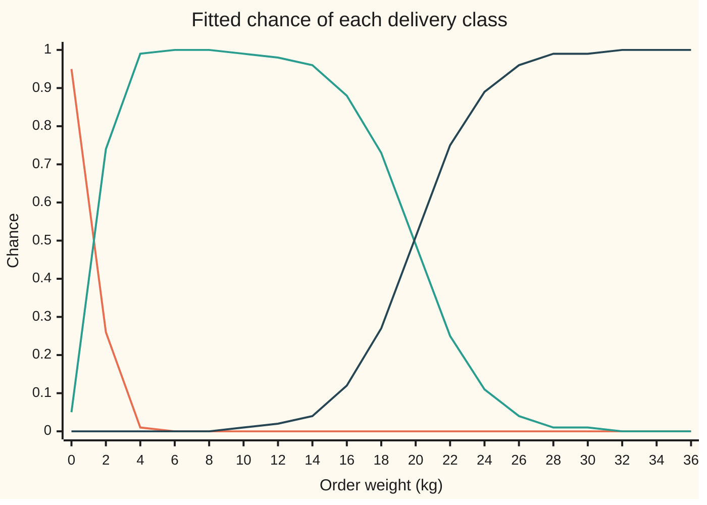

# Softmax and cross-entropy: scores into probabilities, then scored in bits

[Syllabus](../../../SYLLABUS.md) → [Applied and computational](../README.md) → [Machine Learning Mathematics](../README.md#s06) → Softmax and cross-entropy

---

## General Overview

A shop has 20,000 past orders. Each one left the warehouse in one of three **delivery classes**: as a **letter** (an envelope through the post), a **parcel** (a box on a van) or a **pallet** (a crate moved by forklift).

The packers chose by eye, so the cut-offs are soft: a 2 kg order sometimes went as a large letter, and an 18 kg order sometimes went on a pallet. At checkout, before anything is packed, the warehouse wants to book the right transport. So it wants, for each new order, a chance for each class.

The shop records 12 numbers per order. This card uses one of them, the order's weight in kg, so every step can be done by hand. The orders are synthetic: drawn from a stated rule with a fixed seed (the starting number for the random draws), so the fit can be graded against the truth. Of the 20,000, 7,883 went as letters, 9,151 as parcels and 2,966 as pallets.

A model first gives each class a **score**: any number, positive or negative, higher meaning "more likely". **Softmax** turns the three scores into three chances that are positive and add to 1. For a 2 kg order the fitted model says: letter 0.2553, parcel 0.7446, pallet 0.0001.

**Cross-entropy** then grades the model. It charges each order the surprise, in bits, of the class that actually happened: 0.4254 bits when a 2 kg order goes as a parcel, 1.9698 bits when it goes as a letter, 13.8568 bits when it goes on a pallet. Training picks the scores that make the average charge as small as possible. Over the 20,000 orders that average falls from 1.5850 bits, a blind guess among three classes, to 0.4015 bits.

**Softmax raises e to the power of each score and divides by the total, so the gap between two scores becomes the log of their odds; cross-entropy charges each order −log2 of the chance the model gave to what really happened, and minimising its average is maximum likelihood (the fit that makes the recorded classes most probable), the same fit as logistic regression extended to any number of classes.**

**What kind of fact this is:** softmax and cross-entropy are definitions, chosen for the properties proved on this card in Why it works. That the minimum average loss is reached by telling the truth is a theorem, proved there too, from Gibbs' inequality on [KL divergence](../03-Information%20Theory/03-kl-divergence-and-cross-entropy.md). The straight-line scores are a model: an assumption that fits these orders, not a law.

### The picture: the fitted chances against weight



Orange: letter. Green: parcel. Dark blue: pallet. At every weight the three heights add to 1. Letters give way to parcels at 1.4704 kg, quickly. Parcels give way to pallets at 19.9095 kg, slowly, because the packers disagreed more there.

---

## The formula

Classes are numbered k = 0 (letter), 1 (parcel), 2 (pallet). An order of weight $x$ kg gets one score per class, a straight line in its weight:

$$z_k = b_k + w_k\,x, \qquad \hat y_k = \frac{e^{z_k}}{e^{z_0} + e^{z_1} + e^{z_2}}$$

**Read it aloud:** each class's score is a starting value plus a slope times the weight; the class's chance is its exponentiated score as a share of the three exponentiated scores.

The loss for one order that actually went as class $c$, and the average over all $n$ orders:

$$\ell = -\log_2 \hat y_c, \qquad \hat R = \frac{1}{n}\sum_{i=1}^{n} \ell_i$$

**Read it aloud:** one order costs the bits of surprise at the class it really went as; the model is graded by the average cost.

Written with $y_k$, which is 1 for the class that happened and 0 for the others, the same loss is $\ell = -\sum_k y_k \log_2 \hat y_k$. That is the cross-entropy $H(y, \hat y)$ between what happened and what was predicted. [KL divergence](../03-Information%20Theory/03-kl-divergence-and-cross-entropy.md) defines it and splits it, for any two lists of chances $p$ and $q$ over the same classes:

$$H(p, q) = -\sum_k p_k \log_2 q_k = H(p) + D(p\,\|\,q)$$

**Read it aloud:** the average surprise when the truth is $p$ but you bet on $q$ is the surprise you could never avoid, the entropy $H(p)$, plus a penalty for betting wrong, the KL divergence $D(p\,\|\,q)$.

| Symbol | Plain meaning | In our example | Push it up and the answer… |
| --- | --- | --- | --- |
| $x$ | the order's weight, in kg | 2 kg | the parcel, then the pallet, gains |
| $k$, $j$, $c$ | class numbers (0 letter, 1 parcel, 2 pallet); $c$ is the class the order really went as | $c$ = 1, parcel | — |
| $b_k$, $w_k$ | class $k$'s starting score and its score per kg; the letter's are pinned at 0 | parcel −2.9724 and 2.0214; pallet −13.3220 and 2.5412 | that class gains at every weight; more so at heavy weights |
| $z_k$ | class $k$'s score; only differences between scores matter; $\partial/\partial z_k$ is the slope in $z_k$ with the other scores held still | (0, 1.0705, −8.2395) | that class's chance rises, the others fall |
| $\hat y_k$ | the model's chance for class $k$, the softmax of the scores; $e$ is the base of natural logarithms | (0.2553, 0.7446, 0.0001) | the loss falls if $k$ is what happened |
| $y_k$ | 1 for the class that happened, 0 for the others | (0, 1, 0) | — |
| $\ell$ | one order's loss: bits of surprise at what happened, $-\log_2$ of its chance; $\log_2$ is the base-2 logarithm, $\ln$ the natural one, which counts nats | 0.4254 bits | — |
| $\hat R$, $n$ | the average loss over $n$ orders, called the empirical risk on [Loss and empirical risk](01-loss-functions-and-empirical-risk.md); $\sum$ adds over the orders $i$ | 0.4015 bits over $n$ = 20,000 | — |
| $p_k$, $q_k$ | two lists of chances for class $k$: $p$ the truth, from the rule that drew the synthetic orders; $q$ a prediction, such as $\hat y$ | the rule: parcel −3 + 2$x$, pallet −13 + 2.5$x$ | — |
| $H(p)$; $H(p, q)$ | entropy: the average surprise of the truth itself, the floor no model beats on average; cross-entropy: the average surprise when the truth is $p$ and the bet is $q$ | 0.4030 bits; 0.4032 bits for $q = \hat y$; both averaged over the orders | $H(p, q)$ grows as $q$ drifts from $p$ |
| $D(p\,\|\,q)$ | KL divergence: the extra bits paid for predicting $q$ when the truth is $p$; never negative | 0.0002 bits, fitted model against truth | — |
| $\Lambda$ | the logistic curve $1/(1+e^{-z})$, which turns one score into one chance | Λ(1.0705) = 0.7447 | rises toward 1 |

### When it holds

- **Exactly one class per order.** Softmax forces the chances to add to 1. If an order could go as a parcel *and* a pallet (split shipments), the classes are not exclusive, and each needs its own yes-or-no logistic model instead.
- **Labels are right.** Cross-entropy trusts every label. A 2 kg order wrongly recorded as a pallet costs 13.8568 bits, as much as 34.5141 average orders, and drags the fit toward the mistake.
- **Scores straight in the features.** Here the score climbs steadily with weight. If pallets were chosen by size rather than weight, no straight line in weight could find them, and the fitted chances would be wrong in a way the loss only partly shows.
- **Classes overlap.** If some weight split letters from parcels perfectly, the best slope would be infinite: the loss keeps falling as the slope grows and never reaches a minimum, exactly as on [Logistic regression](../../09-Probability%20and%20statistics/09-Regression/05-logistic-regression.md).
- **Future orders like past ones.** The 0.4015 bits describe these 20,000 orders. A new courier with new rules changes who goes on a pallet, and the fit says nothing about that.

---

## Why it works

### Step 0: scores become odds

A score can be any number. A chance must be positive, and the chances must add to 1. The exponential makes any number positive, and dividing by the total makes the list add to 1. The point of choosing the exponential is what it does to ratios. Divide one class's chance by another's and the total cancels:

$$\frac{\hat y_j}{\hat y_k} = e^{z_j - z_k}$$

So the gap between two scores is the log of the odds between those two classes. For the 2 kg order the parcel's score beats the letter's by 1.0705, so the parcel is $e^{1.0705}$ = 2.9168 times as likely. This is the same log-odds scale [Logistic regression](../../09-Probability%20and%20statistics/09-Regression/05-logistic-regression.md) uses for one yes-or-no.

### Step 1: only differences matter, so one class is pinned

Add the same number to every score. Each exponential is multiplied by the same factor, and the factor cancels in the share. The chances do not move: the check adds 100 to every score of the 2 kg order and gets 0.2553, 0.7446, 0.0001 again.

Two consequences. First, the letter's score can be pinned at 0 without losing anything, leaving four numbers to fit, $b_1, w_1, b_2, w_2$. Second, a computer should subtract the largest score before exponentiating. The chances are unchanged, the biggest exponential is exactly 1, and nothing overflows. A 400 kg order has a pallet score of 1003.1766, and $e^{1000}$ is too large for a computer's numbers.

### Step 2: two classes give the logistic curve

With only two classes, scores $z_0$ and $z_1$, divide top and bottom by $e^{z_1}$:

$$\hat y_1 = \frac{e^{z_1}}{e^{z_0} + e^{z_1}} = \frac{1}{1 + e^{-(z_1 - z_0)}} = \Lambda(z_1 - z_0)$$

That is the logistic curve applied to the score gap. For the 2 kg order, letter against parcel alone, both sides give 0.7447. So softmax is logistic regression with more than two outcomes, and logistic regression is softmax with two.

### Step 3: the loss is the likelihood, in bits

The model's chance of the whole record is the product, over orders, of the chance it gave to what actually happened, if orders are independent. Taking −log2 turns that product into a sum of losses, and dividing by $n$ gives $\hat R$. So the smallest average loss is the largest likelihood: training by cross-entropy is maximum likelihood, as on the logistic card.

The base-2 log measures the surprise in **bits**, the unit of [Entropy](../03-Information%20Theory/01-entropy.md): one bit is one fair yes-or-no answer. A chance of 0.7446 costs 0.4254 bits, a chance of 1/2 costs 1 bit, the pallet's 0.0001 costs 13.8568 bits. Natural logs measure the same surprise in **nats**; one bit is 0.6931 nats. Training code usually works in nats; the minimum is in the same place.

The scale gives two plain readings of the 0.4015 bits:

- **Perplexity**, $2^{\hat R}$ = 1.3209. On average the model is as unsure as a fair choice among 1.32 classes. Blind, it was a fair choice among 3.
- **The baseline.** Knowing only the class shares, the best constant prediction is the shares themselves, and its loss is their entropy, 1.4539 bits. Weight brings that down to 0.4015 bits: weight is worth 1.0524 bits per order.

### Step 4: telling the truth wins

Suppose an order's true chances are $p$ and the model says $q$. Over many such orders, class $k$ happens a fraction $p_k$ of the time and costs $-\log_2 q_k$ each time, so the average loss is $H(p, q)$. Split it, as the KL divergence card does:

$$H(p, q) = -\sum_k p_k \log_2 p_k \;+\; \sum_k p_k \log_2 \frac{p_k}{q_k} = H(p) + D(p\,\|\,q)$$

The first part depends only on the truth. The second is never negative, and is zero only when $q = p$: Gibbs' inequality, proved on [KL divergence](../03-Information%20Theory/03-kl-divergence-and-cross-entropy.md). So the expected loss is smallest exactly when the model reports the true chances. A scoring rule with this property is called **proper**: no shading of the chances up or down can beat honesty.

Accuracy, by contrast, only checks the top class, and is the same whether the model said 0.51 or 0.99.

On the 20,000 orders the check computes all three averages from the true rule and the fitted model: $H(p)$ = 0.4030, $D(p\,\|\,\hat y)$ = 0.0002, and their sum $H(p, \hat y)$ = 0.4032 bits, matching the cross-entropy computed directly. The fitted model is within 0.0002 bits of the truth.

### Step 5: the slope is "predicted minus actual"

Measure one order's loss in nats, $-\ln \hat y_c = -z_c + \ln\left(e^{z_0} + e^{z_1} + e^{z_2}\right)$. Its slope in score $z_k$ is

$$\frac{\partial}{\partial z_k}\left(-\ln \hat y_c\right) = \hat y_k - y_k$$

The first term contributes $-1$ only for the class that happened. The second contributes $e^{z_k}$ over the total, which is $\hat y_k$. In bits the slope is the same divided by 0.6931.

For the 2 kg parcel: (0.2553, −0.2554, 0.0001). Push the letter's score down, push the parcel's up, leave the pallet almost alone. The check nudges each score by a millionth and gets the same three numbers. This "predicted minus actual" is the error signal that [Backpropagation](04-backpropagation.md) carries back through a network from its softmax output.

Each score is $b_k + w_k x$, so by the chain rule the slope of the average loss is the average of $(\hat y_k - y_k)$ for $b_k$ and of $(\hat y_k - y_k)\,x$ for $w_k$. At the minimum both are zero. The first says the predicted chances, added over all orders, equal the observed counts: the check gets 7,883.0000, 9,151.0000 and 2,966.0000, matching the counts exactly.

### Step 6: one minimum, found by Newton's method

The second slopes of the loss in the scores form a table with $\hat y_k(1 - \hat y_k)$ on the diagonal and $-\hat y_j \hat y_k$ off it. Along any direction its value is the variance of the score change under the model's own chances, which is never negative. So the average loss is a bowl (convex): it has one bottom, and any point where all slopes are zero is that bottom.

The check finds it by Newton's method, the climb used on the logistic card, here run downhill on four numbers. Each step fits a bowl to the loss's slopes and curvature at the current point, then jumps to that bowl's bottom. Starting from all scores 0, the loss by step:

| Step | 0 | 1 | 2 | 3 | 4 | 5 | 6 | 7 |
| --- | --- | --- | --- | --- | --- | --- | --- | --- |
| $\hat R$, bits | 1.5850 | 1.0271 | 0.7855 | 0.6079 | 0.4885 | 0.4250 | 0.4041 | 0.4015 |

After step 7 nothing changes in four decimals. The fit is parcel $b_1$ = −2.9724, $w_1$ = 2.0214, and pallet $b_2$ = −13.3220, $w_2$ = 2.5412, close to the rule that drew the orders: −3, 2, −13, 2.5, as close as chance allows by the likelihood ratio test after the Python output. As a check that this is the bottom, the code moves each of the four numbers by 0.01 either way; all eight moves raise the loss, the smallest by 1.1333 millionths of a bit. Large networks use [Gradient descent](02-gradient-descent-and-stochastic-gradient.md) instead, stepping along "predicted minus actual" a little at a time.

---

## Worked numbers, by hand

The 2 kg order, packed as a parcel, with the fitted numbers. Each row carries the numbers unrounded, so redoing a row from the four-decimal values shown can move its last digit by 1.

| Step | Arithmetic | Value |
| --- | --- | --- |
| letter score $z_0$ | pinned | 0 |
| parcel score $z_1$ | −2.9724 + 2.0214 × 2 | 1.0705 |
| pallet score $z_2$ | −13.3220 + 2.5412 × 2 | −8.2395 |
| subtract the largest, 1.0705 | (0 − 1.0705, 1.0705 − 1.0705, −8.2395 − 1.0705) | (−1.0705, 0, −9.3099) |
| exponentiate | $e^{-1.0705}$, $e^{0}$, $e^{-9.3099}$ | (0.3428, 1, 0.0001) |
| total | 0.3428 + 1 + 0.0001 | 1.3429 |
| chances $\hat y$ | each divided by 1.3429 | (0.2553, 0.7446, 0.0001) |
| loss, parcel happened | $-\log_2 0.7446$ | **0.4254 bits** |
| same loss in nats | $-\ln 0.7446$ | 0.2949 nats |
| slope in the scores, $\hat y - y$ | (0.2553 − 0, 0.7446 − 1, 0.0001 − 0) | (0.2553, −0.2554, 0.0001) |

So this order costs the model 0.4254 bits, a little more than its average of 0.4015: the model gave the parcel about 3 in 4, and a parcel is what happened.

### What breaks if you drop a piece

| Mistake | Comes out at | What went wrong |
| --- | --- | --- |
| Divide the scores by their total, no exponential | letter 0.0000, parcel −0.1493, pallet 1.1493 | A negative chance, and a pallet "certainty" above 1: raw scores can be negative, so their share is meaningless |
| Exponentiate without subtracting the largest score, 400 kg order | overflow | The pallet score is 1003.1766; $e^{1000}$ does not fit. Shifted first, the answer is pallet 1.0000 |
| Use natural logs and call the result bits | 0.2949 "bits" | That is nats. Every loss reads 0.6931 times its true size |
| Swap the two lists, $H(\hat y, y)$ | inf | The model's chances now weight $\log_2$ of the labels, and $\log_2 0$ is minus infinity: the order is charged without limit |
| A modelling assumption fails: one 2 kg order mislabelled as pallet | 13.8568 bits | As much as 34.5141 average orders. Cross-entropy trusts labels; a few confident mistakes in the data pull hard on the fit |

---

## Code, from first principles, and it actually runs

The code draws the 20,000 orders from the stated rule with a SplitMix64 random-number generator (seed 2026), fits the four numbers by Newton's method, and works the 2 kg order. Newton's method is road 1, and five more roads check it: Newton's minimum against eight nudged neighbours; predicted counts against observed counts; the fit against the true rule, by its loss within four standard errors of the expected loss under the truth and by a likelihood ratio test; the slope formula against finite differences; and two-class softmax against the logistic curve.

Two more lines are consistency checks, identities that catch a slip in the code rather than test the fit: the shares-only loss against the entropy of the shares, and cross-entropy computed directly against entropy plus KL divergence. Every "what breaks" number is printed too. Python and Rust print identical output.

### Python

```python
# Softmax and cross-entropy -- the check behind the card.  Standard library only.
# 20,000 synthetic orders (SplitMix64, seed 2026), one feature: weight in kg.
# Classes 0 letter, 1 parcel, 2 pallet.  Letter's score is pinned at 0.
from math import exp, log, log2, inf
M64 = (1 << 64) - 1
def splitmix(s):
    s = (s + 0x9E3779B97F4A7C15) & M64
    z = ((s ^ (s >> 30)) * 0xBF58476D1CE4E5B9) & M64
    z = ((z ^ (z >> 27)) * 0x94D049BB133111EB) & M64
    return s, ((z ^ (z >> 31)) >> 11) / 2.0 ** 53
def softmax(z):                        # subtract the largest score, exponentiate, divide by the total
    m = max(z); e = [exp(t - m) for t in z]; s = sum(e)
    return [t / s for t in e]
def naive_softmax(z):                  # no shift: fails once a score passes about 709
    try: e = [exp(t) for t in z]
    except OverflowError: return None
    return [t / sum(e) for t in e]
def ce_bits(p, q):                     # cross-entropy H(p, q) in bits; infinite if q misses a p outcome
    if any(pk > 0 and qk == 0 for pk, qk in zip(p, q)): return inf
    return -sum(pk * log2(qk) for pk, qk in zip(p, q) if pk > 0)
def scores(th, x): return [0.0, th[0] + th[1] * x, th[2] + th[3] * x]
TRUE = [-3.0, 2.0, -13.0, 2.5]         # the rule the synthetic orders were drawn from
def out(label, *v): print(f"{label:<34}" + "".join(f"{t:>10.4f}" for t in v))
s, X, Y = 2026, [], []
for i in range(20000):
    s, u = splitmix(s); x = 0.1 * 500.0 ** u          # weights spread evenly in ratio, 0.1 to 50 kg
    s, u = splitmix(s); p = softmax(scores(TRUE, x))
    X.append(x); Y.append(0 if u < p[0] else (1 if u < p[0] + p[1] else 2))
n = len(X); counts = [Y.count(k) for k in range(3)]
def nll_bits(z, c):                    # -log2 of softmax(z)[c] in one step: -z_c + log-sum-exp, shifted
    m = max(z); return (m - z[c] + log(sum(exp(t - m) for t in z))) / log(2)
def risk(th, labels=None):             # average loss in bits over the orders
    return sum(nll_bits(scores(th, x), c) for x, c in zip(X, labels or Y)) / n
def grad_hess(th):                     # gradient and curvature of the average loss, in nats
    g = [0.0] * 4; H = [[0.0] * 4 for _ in range(4)]
    for x, c in zip(X, Y):
        q = softmax(scores(th, x)); f = (1.0, x)
        for a in range(2):
            for i in range(2):
                g[2*a+i] += (q[a+1] - (c == a + 1)) * f[i] / n
                for b in range(2):
                    for j in range(2):
                        H[2*a+i][2*b+j] += q[a+1] * ((a == b) - q[b+1]) * f[i] * f[j] / n
    return g, H
def solve(H, g):                       # Gaussian elimination, 4 by 4
    A = [H[r][:] + [g[r]] for r in range(4)]
    for c in range(4):
        for r in range(c + 1, 4):
            m = A[r][c] / A[c][c]
            for k in range(c, 5): A[r][k] -= m * A[c][k]
    d = [0.0] * 4
    for r in range(3, -1, -1):
        d[r] = (A[r][4] - sum(A[r][k] * d[k] for k in range(r + 1, 4))) / A[r][r]
    return d
th, trace = [0.0] * 4, []
for step in range(30):                 # road 1: Newton's method on the average cross-entropy
    trace.append(risk(th)); g, H = grad_hess(th)
    if max(abs(t) for t in g) < 1e-10: break
    th = [a - d for a, d in zip(th, solve(H, g))]
R = trace[-1]
print("orders by class (letter, parcel, pallet):", *counts)
out("fitted b_parcel w_parcel", th[0], th[1]); out("fitted b_pallet w_pallet", th[2], th[3]); out("true rule b1 w1 b2 w2", *TRUE)
out("class boundaries, kg", -th[0] / th[1], (th[0] - th[2]) / (th[3] - th[1]))
print("loss by Newton step, bits:", " ".join(f"{t:.4f}" for t in trace))
out("fitted loss R, bits; perplexity", R, 2 ** R)
out("blind guess log2 3; perplexity", log2(3), 3.0)
# road 2: nudge every parameter both ways; the loss must rise each time
nudged = [risk([t + (h if k == j else 0) for k, t in enumerate(th)]) for j in range(4) for h in (0.01, -0.01)]
out("smallest nudge rise, micro-bits", (min(nudged) - R) * 1e6); assert min(nudged) > R
# road 3: at the minimum the predicted counts equal the observed counts
pred = [sum(softmax(scores(th, x))[k] for x in X) for k in range(3)]
out("predicted counts", *pred); assert all(abs(a - b) < 1e-6 for a, b in zip(pred, counts))
# consistency check: class shares only; their loss is the entropy of the shares
sh = [c / n for c in counts]
th0 = [log(sh[1] / sh[0]), 0.0, log(sh[2] / sh[0]), 0.0]
out("shares only: loss; entropy H", risk(th0), ce_bits(sh, sh)); assert abs(risk(th0) - ce_bits(sh, sh)) < 1e-9
out("bits saved by knowing weight", risk(th0) - R)
# road 4: truth against fit.  H(p, q) = H(p) + D(p || q), order by order, is a consistency check
Hp = Hpq = Dpq = sq = 0.0
for x in X:
    p, q = softmax(scores(TRUE, x)), softmax(scores(th, x))
    Hp += ce_bits(p, p) / n; Hpq += ce_bits(p, q) / n
    Dpq += sum(pk * log2(pk / qk) for pk, qk in zip(p, q)) / n
for x, c in zip(X, Y): sq += (nll_bits(scores(th, x), c) - R) ** 2 / n
se = (sq / n) ** 0.5
out("floor H(p); H(p,q); D(p||q)", Hp, Hpq, Dpq); out("true rule's loss on the orders", risk(TRUE))
assert abs(Hpq - (Hp + Dpq)) < 1e-9 and Dpq > 0
out("fitted loss vs H(p,q): gap, SE", R - Hpq, se); assert abs(R - Hpq) < 4 * se
W = 2 * n * log(2) * (risk(TRUE) - R)  # Wilks: twice the fit's log-likelihood gain over the rule, in nats
chance = exp(-W / 2) * (1 + W / 2)     # chi-square, 4 degrees of freedom: the chance of a gain above W
out("fit vs rule: 2 ln LR; chance", W, chance); assert chance > 0.001
# the worked order: 2 kg, packed as a parcel
z = scores(th, 2.0); q = softmax(z); m = max(z); e = [exp(t - m) for t in z]
out("2 kg: scores", *z); out("2 kg: shifted scores", *[t - m for t in z]); out("2 kg: exp", *e)
out("2 kg: total; probabilities", sum(e), *q)
out("2 kg: odds parcel to letter", q[1] / q[0], exp(z[1] - z[0])); assert abs(q[1] / q[0] - exp(z[1] - z[0])) < 1e-12
out("2 kg: loss bits if L, P, Pal", *[-log2(t) for t in q]); out("2 kg: loss in nats if parcel", -log(q[1]))
gz = [qk - (k == 1) for k, qk in enumerate(q)]; out("2 kg: gradient q - y", *gz)
fd = []
for k in range(3):                     # road 5: the gradient by finite differences, in nats
    zp = z[:]; zm = z[:]; zp[k] += 1e-6; zm[k] -= 1e-6
    fd.append((log(softmax(zm)[1]) - log(softmax(zp)[1])) / 2e-6)
out("2 kg: gradient by nudging", *fd); assert all(abs(a - b) < 1e-6 for a, b in zip(gz, fd))
lam = 1 / (1 + exp(-(z[1] - z[0])))    # road 6: two classes give the logistic curve
out("two classes: softmax; logistic", softmax(z[:2])[1], lam); assert abs(softmax(z[:2])[1] - lam) < 1e-12
# what breaks
raw = [t / sum(z) + 0.0 for t in z]; out("wrong: scores / their sum", *raw)
big = scores(th, 400.0); print(f"{'wrong: no shift, 400 kg':<34}", "overflow" if naive_softmax(big) is None else "ok")
out("400 kg pallet score; right answer", big[2], *softmax(big))
out("wrong: ln as bits; nats per bit", -log(q[1]), log(2)); out("wrong: arguments swapped H(q, y)", ce_bits(q, [0.0, 1.0, 0.0]))
out("2 kg order labelled pallet, bits", -log2(q[2])); out("  = this many average orders", -log2(q[2]) / R)
out("loss at 0.51, 0.99; at 0.49, 0.01", *[-log2(t) for t in (0.51, 0.99, 0.49, 0.01)])
# try changing
out("try: 20 kg order", *softmax(scores(th, 20.0)))
out("try: every score + 100", *softmax([t + 100 for t in z])); out("try: every score x 2", *softmax([2 * t for t in z]))
print("chart, kg", *range(0, 37, 2))
for k, name in enumerate(("letter", "parcel", "pallet")):
    print(f"chart, {name}", " ".join(f"{softmax(scores(th, float(w)))[k]:.2f}" for w in range(0, 37, 2)))
print("ALL CHECKS PASS")
```

**Ran 2026-11-11 on macOS, Python 3.14.10, standard library only. All checks passed. Output, pasted from the run:**

```
orders by class (letter, parcel, pallet): 7883 9151 2966
fitted b_parcel w_parcel             -2.9724    2.0214
fitted b_pallet w_pallet            -13.3220    2.5412
true rule b1 w1 b2 w2                -3.0000    2.0000  -13.0000    2.5000
class boundaries, kg                  1.4704   19.9095
loss by Newton step, bits: 1.5850 1.0271 0.7855 0.6079 0.4885 0.4250 0.4041 0.4015 0.4015 0.4015 0.4015
fitted loss R, bits; perplexity       0.4015    1.3209
blind guess log2 3; perplexity        1.5850    3.0000
smallest nudge rise, micro-bits       1.1333
predicted counts                   7883.0000 9151.0000 2966.0000
shares only: loss; entropy H          1.4539    1.4539
bits saved by knowing weight          1.0524
floor H(p); H(p,q); D(p||q)           0.4030    0.4032    0.0002
true rule's loss on the orders        0.4017
fitted loss vs H(p,q): gap, SE       -0.0017    0.0057
fit vs rule: 2 ln LR; chance          6.0346    0.1966
2 kg: scores                          0.0000    1.0705   -8.2395
2 kg: shifted scores                 -1.0705    0.0000   -9.3099
2 kg: exp                             0.3428    1.0000    0.0001
2 kg: total; probabilities            1.3429    0.2553    0.7446    0.0001
2 kg: odds parcel to letter           2.9168    2.9168
2 kg: loss bits if L, P, Pal          1.9698    0.4254   13.8568
2 kg: loss in nats if parcel          0.2949
2 kg: gradient q - y                  0.2553   -0.2554    0.0001
2 kg: gradient by nudging             0.2553   -0.2554    0.0001
two classes: softmax; logistic        0.7447    0.7447
wrong: scores / their sum             0.0000   -0.1493    1.1493
wrong: no shift, 400 kg            overflow
400 kg pallet score; right answer  1003.1766    0.0000    0.0000    1.0000
wrong: ln as bits; nats per bit       0.2949    0.6931
wrong: arguments swapped H(q, y)         inf
2 kg order labelled pallet, bits     13.8568
  = this many average orders         34.5141
loss at 0.51, 0.99; at 0.49, 0.01     0.9714    0.0145    1.0291    6.6439
try: 20 kg order                      0.0000    0.4882    0.5118
try: every score + 100                0.2553    0.7446    0.0001
try: every score x 2                  0.1052    0.8948    0.0000
chart, kg 0 2 4 6 8 10 12 14 16 18 20 22 24 26 28 30 32 34 36
chart, letter 0.95 0.26 0.01 0.00 0.00 0.00 0.00 0.00 0.00 0.00 0.00 0.00 0.00 0.00 0.00 0.00 0.00 0.00 0.00
chart, parcel 0.05 0.74 0.99 1.00 1.00 0.99 0.98 0.96 0.88 0.73 0.49 0.25 0.11 0.04 0.01 0.01 0.00 0.00 0.00
chart, pallet 0.00 0.00 0.00 0.00 0.00 0.01 0.02 0.04 0.12 0.27 0.51 0.75 0.89 0.96 0.99 0.99 1.00 1.00 1.00
ALL CHECKS PASS
```

Three lines need reading. "floor H(p)" is 0.4030 bits, yet on these orders the true rule scores 0.4017 and the fitted model 0.4015, both below the floor. That is not a contradiction: the floor is an average over fresh labels, and the 20,000 labels drawn happened to fall a little on the easy side.

Against what the fitted model should score on average, $H(p, \hat y)$ = 0.4032, the gap is −0.0017 bits, well inside the standard error of 0.0057. The standard error is the typical size of the chance wobble in an average over 20,000 orders.

Tuning the four numbers to these orders buys only the last step, from 0.4017 to 0.4015 bits. Over all 20,000 orders that gain is a log-likelihood ratio, and twice it, in nats, is 6.0346. By Wilks' rule on [Likelihood ratio tests](../../09-Probability%20and%20statistics/08-Confidence%20Intervals%20and%20Tests/07-likelihood-ratio-tests.md), a fit of four free numbers beats the true rule by that much or more by chance alone 19.66% of the time, so the fit is as close to the rule as chance allows. The check asserts that this chance is above 1 in 1,000.

### Rust

Same orders, same fit, same checks. No crates.

```rust
// Softmax and cross-entropy -- the same check as the Python file, in Rust.  std only.
// 20,000 synthetic orders (SplitMix64, seed 2026), one feature: weight in kg.
// Classes 0 letter, 1 parcel, 2 pallet.  Letter's score is pinned at 0.
fn splitmix(s: &mut u64) -> f64 {
    *s = s.wrapping_add(0x9E3779B97F4A7C15);
    let mut z = (*s ^ (*s >> 30)).wrapping_mul(0xBF58476D1CE4E5B9);
    z = (z ^ (z >> 27)).wrapping_mul(0x94D049BB133111EB);
    ((z ^ (z >> 31)) >> 11) as f64 / 9007199254740992.0
}
fn softmax(z: &[f64]) -> Vec<f64> {   // subtract the largest score, exponentiate, divide by the total
    let m = z.iter().cloned().fold(f64::NEG_INFINITY, f64::max);
    let e: Vec<f64> = z.iter().map(|t| (t - m).exp()).collect();
    let s: f64 = e.iter().sum();
    e.iter().map(|t| t / s).collect()
}
fn naive_softmax(z: &[f64]) -> Option<Vec<f64>> { // no shift: fails once a score passes about 709
    let e: Vec<f64> = z.iter().map(|t| t.exp()).collect();
    if e.iter().any(|t| t.is_infinite()) { return None; }
    let s: f64 = e.iter().sum();
    Some(e.iter().map(|t| t / s).collect())
}
fn ce_bits(p: &[f64], q: &[f64]) -> f64 { // cross-entropy H(p, q) in bits; infinite if q misses a p outcome
    if p.iter().zip(q).any(|(a, b)| *a > 0.0 && *b == 0.0) { return f64::INFINITY; }
    -p.iter().zip(q).filter(|(a, _)| **a > 0.0).map(|(a, b)| a * b.log2()).sum::<f64>()
}
fn scores(th: &[f64], x: f64) -> Vec<f64> { vec![0.0, th[0] + th[1] * x, th[2] + th[3] * x] }
const TRUE: [f64; 4] = [-3.0, 2.0, -13.0, 2.5]; // the rule the synthetic orders were drawn from
fn out(label: &str, v: &[f64]) {
    let mut line = format!("{:<34}", label);
    for t in v { line += &format!("{:>10.4}", t); }
    println!("{}", line);
}
fn nll_bits(z: &[f64], c: usize) -> f64 { // -log2 of softmax(z)[c] in one step: -z_c + log-sum-exp, shifted
    let m = z.iter().cloned().fold(f64::NEG_INFINITY, f64::max);
    (m - z[c] + z.iter().map(|t| (t - m).exp()).sum::<f64>().ln()) / 2f64.ln()
}
fn risk(th: &[f64], x: &[f64], y: &[usize]) -> f64 { // average loss in bits over the orders
    x.iter().zip(y).map(|(xi, &c)| nll_bits(&scores(th, *xi), c)).sum::<f64>() / x.len() as f64
}
fn grad_hess(th: &[f64], x: &[f64], y: &[usize]) -> (Vec<f64>, Vec<Vec<f64>>) { // in nats
    let n = x.len() as f64;
    let (mut g, mut h) = (vec![0.0; 4], vec![vec![0.0; 4]; 4]);
    for (xi, &c) in x.iter().zip(y) {
        let q = softmax(&scores(th, *xi)); let f = [1.0, *xi];
        for a in 0..2 { for i in 0..2 {
            g[2*a+i] += (q[a+1] - if c == a + 1 { 1.0 } else { 0.0 }) * f[i] / n;
            for b in 0..2 { for j in 0..2 {
                h[2*a+i][2*b+j] += q[a+1] * (if a == b { 1.0 } else { 0.0 } - q[b+1]) * f[i] * f[j] / n;
            }}
        }}
    }
    (g, h)
}
fn solve(h: &[Vec<f64>], g: &[f64]) -> Vec<f64> { // Gaussian elimination, 4 by 4
    let mut a: Vec<Vec<f64>> = (0..4).map(|r| { let mut row = h[r].clone(); row.push(g[r]); row }).collect();
    for c in 0..4 { for r in c + 1..4 {
        let m = a[r][c] / a[c][c];
        for k in c..5 { a[r][k] -= m * a[c][k]; }
    }}
    let mut d = vec![0.0; 4];
    for r in (0..4).rev() {
        let s: f64 = (r + 1..4).map(|k| a[r][k] * d[k]).sum();
        d[r] = (a[r][4] - s) / a[r][r];
    }
    d
}
fn main() {
    let (mut s, mut x, mut y) = (2026u64, Vec::new(), Vec::new());
    for _ in 0..20000 {
        let xi = 0.1 * 500f64.powf(splitmix(&mut s)); // weights spread evenly in ratio, 0.1 to 50 kg
        let u = splitmix(&mut s); let p = softmax(&scores(&TRUE, xi));
        x.push(xi); y.push(if u < p[0] { 0 } else if u < p[0] + p[1] { 1 } else { 2 });
    }
    let n = x.len() as f64;
    let counts: Vec<f64> = (0..3).map(|k| y.iter().filter(|&&c| c == k).count() as f64).collect();
    let (mut th, mut trace) = (vec![0.0; 4], Vec::new());
    for _ in 0..30 { // road 1: Newton's method on the average cross-entropy
        trace.push(risk(&th, &x, &y)); let (g, h) = grad_hess(&th, &x, &y);
        if g.iter().map(|t| t.abs()).fold(0.0, f64::max) < 1e-10 { break; }
        let d = solve(&h, &g); th = th.iter().zip(&d).map(|(a, b)| a - b).collect();
    }
    let r = *trace.last().unwrap();
    println!("orders by class (letter, parcel, pallet): {} {} {}", counts[0], counts[1], counts[2]);
    out("fitted b_parcel w_parcel", &th[0..2]); out("fitted b_pallet w_pallet", &th[2..4]); out("true rule b1 w1 b2 w2", &TRUE);
    out("class boundaries, kg", &[-th[0] / th[1], (th[0] - th[2]) / (th[3] - th[1])]);
    println!("loss by Newton step, bits: {}", trace.iter().map(|t| format!("{:.4}", t)).collect::<Vec<_>>().join(" "));
    out("fitted loss R, bits; perplexity", &[r, 2f64.powf(r)]);
    out("blind guess log2 3; perplexity", &[3f64.log2(), 3.0]);
    // road 2: nudge every parameter both ways; the loss must rise each time
    let mut lowest = f64::INFINITY;
    for j in 0..4 { for h in [0.01, -0.01] {
        let mut t = th.clone(); t[j] += h; lowest = lowest.min(risk(&t, &x, &y));
    }}
    out("smallest nudge rise, micro-bits", &[(lowest - r) * 1e6]); assert!(lowest > r);
    // road 3: at the minimum the predicted counts equal the observed counts
    let pred: Vec<f64> = (0..3).map(|k| x.iter().map(|xi| softmax(&scores(&th, *xi))[k]).sum()).collect();
    out("predicted counts", &pred); assert!((0..3).all(|k| (pred[k] - counts[k]).abs() < 1e-6));
    // consistency check: class shares only; their loss is the entropy of the shares
    let sh: Vec<f64> = counts.iter().map(|c| c / n).collect();
    let th0 = [(sh[1] / sh[0]).ln(), 0.0, (sh[2] / sh[0]).ln(), 0.0];
    let r0 = risk(&th0, &x, &y);
    out("shares only: loss; entropy H", &[r0, ce_bits(&sh, &sh)]); assert!((r0 - ce_bits(&sh, &sh)).abs() < 1e-9);
    out("bits saved by knowing weight", &[r0 - r]);
    // road 4: truth against fit.  H(p, q) = H(p) + D(p || q), order by order, is a consistency check
    let (mut hp, mut hpq, mut dpq, mut sq) = (0.0, 0.0, 0.0, 0.0);
    for xi in &x {
        let (p, q) = (softmax(&scores(&TRUE, *xi)), softmax(&scores(&th, *xi)));
        hp += ce_bits(&p, &p) / n; hpq += ce_bits(&p, &q) / n;
        dpq += (0..3).map(|k| p[k] * (p[k] / q[k]).log2()).sum::<f64>() / n;
    }
    for (xi, &c) in x.iter().zip(&y) { sq += (nll_bits(&scores(&th, *xi), c) - r).powi(2) / n; }
    let se = (sq / n).sqrt();
    out("floor H(p); H(p,q); D(p||q)", &[hp, hpq, dpq]); out("true rule's loss on the orders", &[risk(&TRUE, &x, &y)]);
    assert!((hpq - (hp + dpq)).abs() < 1e-9 && dpq > 0.0);
    out("fitted loss vs H(p,q): gap, SE", &[r - hpq, se]); assert!((r - hpq).abs() < 4.0 * se);
    let w = 2.0 * n * 2f64.ln() * (risk(&TRUE, &x, &y) - r); // Wilks: twice the fit's log-likelihood gain over the rule, in nats
    let chance = (-w / 2.0).exp() * (1.0 + w / 2.0);          // chi-square, 4 degrees of freedom: the chance of a gain above w
    out("fit vs rule: 2 ln LR; chance", &[w, chance]); assert!(chance > 0.001);
    // the worked order: 2 kg, packed as a parcel
    let z = scores(&th, 2.0); let q = softmax(&z);
    let m = z.iter().cloned().fold(f64::NEG_INFINITY, f64::max);
    let e: Vec<f64> = z.iter().map(|t| (t - m).exp()).collect();
    out("2 kg: scores", &z); out("2 kg: shifted scores", &z.iter().map(|t| t - m).collect::<Vec<_>>());
    out("2 kg: exp", &e); out("2 kg: total; probabilities", &[e.iter().sum(), q[0], q[1], q[2]]);
    out("2 kg: odds parcel to letter", &[q[1] / q[0], (z[1] - z[0]).exp()]); assert!((q[1] / q[0] - (z[1] - z[0]).exp()).abs() < 1e-12);
    out("2 kg: loss bits if L, P, Pal", &q.iter().map(|t| -t.log2()).collect::<Vec<_>>());
    out("2 kg: loss in nats if parcel", &[-q[1].ln()]);
    let gz: Vec<f64> = (0..3).map(|k| q[k] - if k == 1 { 1.0 } else { 0.0 }).collect();
    out("2 kg: gradient q - y", &gz);
    let mut fd = Vec::new();
    for k in 0..3 { // road 5: the gradient by finite differences, in nats
        let (mut zp, mut zm) = (z.clone(), z.clone()); zp[k] += 1e-6; zm[k] -= 1e-6;
        fd.push((softmax(&zm)[1].ln() - softmax(&zp)[1].ln()) / 2e-6);
    }
    out("2 kg: gradient by nudging", &fd); assert!((0..3).all(|k| (gz[k] - fd[k]).abs() < 1e-6));
    let lam = 1.0 / (1.0 + (-(z[1] - z[0])).exp()); // road 6: two classes give the logistic curve
    let two = softmax(&z[..2])[1];
    out("two classes: softmax; logistic", &[two, lam]); assert!((two - lam).abs() < 1e-12);
    // what breaks
    let zs: f64 = z.iter().sum();
    out("wrong: scores / their sum", &z.iter().map(|t| t / zs + 0.0).collect::<Vec<_>>());
    let big = scores(&th, 400.0);
    println!("{:<34} {}", "wrong: no shift, 400 kg", if naive_softmax(&big).is_none() { "overflow" } else { "ok" });
    let sb = softmax(&big); out("400 kg pallet score; right answer", &[big[2], sb[0], sb[1], sb[2]]);
    out("wrong: ln as bits; nats per bit", &[-q[1].ln(), 2f64.ln()]); out("wrong: arguments swapped H(q, y)", &[ce_bits(&q, &[0.0, 1.0, 0.0])]);
    out("2 kg order labelled pallet, bits", &[-q[2].log2()]); out("  = this many average orders", &[-q[2].log2() / r]);
    out("loss at 0.51, 0.99; at 0.49, 0.01", &[0.51f64, 0.99, 0.49, 0.01].iter().map(|t| -t.log2()).collect::<Vec<_>>());
    // try changing
    out("try: 20 kg order", &softmax(&scores(&th, 20.0)));
    out("try: every score + 100", &softmax(&z.iter().map(|t| t + 100.0).collect::<Vec<_>>()));
    out("try: every score x 2", &softmax(&z.iter().map(|t| 2.0 * t).collect::<Vec<_>>()));
    println!("chart, kg {}", (0..37).step_by(2).map(|w| w.to_string()).collect::<Vec<_>>().join(" "));
    for (k, name) in ["letter", "parcel", "pallet"].iter().enumerate() {
        let v: Vec<String> = (0..37).step_by(2).map(|w| format!("{:.2}", softmax(&scores(&th, w as f64))[k])).collect();
        println!("chart, {} {}", name, v.join(" "));
    }
    println!("ALL CHECKS PASS");
}
```

**Ran 2026-11-11 on macOS, rustc 1.98.1, no crates. All checks passed. Output, pasted from the run:**

```
orders by class (letter, parcel, pallet): 7883 9151 2966
fitted b_parcel w_parcel             -2.9724    2.0214
fitted b_pallet w_pallet            -13.3220    2.5412
true rule b1 w1 b2 w2                -3.0000    2.0000  -13.0000    2.5000
class boundaries, kg                  1.4704   19.9095
loss by Newton step, bits: 1.5850 1.0271 0.7855 0.6079 0.4885 0.4250 0.4041 0.4015 0.4015 0.4015 0.4015
fitted loss R, bits; perplexity       0.4015    1.3209
blind guess log2 3; perplexity        1.5850    3.0000
smallest nudge rise, micro-bits       1.1333
predicted counts                   7883.0000 9151.0000 2966.0000
shares only: loss; entropy H          1.4539    1.4539
bits saved by knowing weight          1.0524
floor H(p); H(p,q); D(p||q)           0.4030    0.4032    0.0002
true rule's loss on the orders        0.4017
fitted loss vs H(p,q): gap, SE       -0.0017    0.0057
fit vs rule: 2 ln LR; chance          6.0346    0.1966
2 kg: scores                          0.0000    1.0705   -8.2395
2 kg: shifted scores                 -1.0705    0.0000   -9.3099
2 kg: exp                             0.3428    1.0000    0.0001
2 kg: total; probabilities            1.3429    0.2553    0.7446    0.0001
2 kg: odds parcel to letter           2.9168    2.9168
2 kg: loss bits if L, P, Pal          1.9698    0.4254   13.8568
2 kg: loss in nats if parcel          0.2949
2 kg: gradient q - y                  0.2553   -0.2554    0.0001
2 kg: gradient by nudging             0.2553   -0.2554    0.0001
two classes: softmax; logistic        0.7447    0.7447
wrong: scores / their sum             0.0000   -0.1493    1.1493
wrong: no shift, 400 kg            overflow
400 kg pallet score; right answer  1003.1766    0.0000    0.0000    1.0000
wrong: ln as bits; nats per bit       0.2949    0.6931
wrong: arguments swapped H(q, y)         inf
2 kg order labelled pallet, bits     13.8568
  = this many average orders         34.5141
loss at 0.51, 0.99; at 0.49, 0.01     0.9714    0.0145    1.0291    6.6439
try: 20 kg order                      0.0000    0.4882    0.5118
try: every score + 100                0.2553    0.7446    0.0001
try: every score x 2                  0.1052    0.8948    0.0000
chart, kg 0 2 4 6 8 10 12 14 16 18 20 22 24 26 28 30 32 34 36
chart, letter 0.95 0.26 0.01 0.00 0.00 0.00 0.00 0.00 0.00 0.00 0.00 0.00 0.00 0.00 0.00 0.00 0.00 0.00 0.00
chart, parcel 0.05 0.74 0.99 1.00 1.00 0.99 0.98 0.96 0.88 0.73 0.49 0.25 0.11 0.04 0.01 0.01 0.00 0.00 0.00
chart, pallet 0.00 0.00 0.00 0.00 0.00 0.01 0.02 0.04 0.12 0.27 0.51 0.75 0.89 0.96 0.99 0.99 1.00 1.00 1.00
ALL CHECKS PASS
```

### Lean

Lean proves the card's general facts for any scores and any chances, on a finite set of at least one class.

- Take any scores. Then softmax gives every class a chance above 0, and the chances add to 1.
- Take any two classes $j$ and $k$. Then $\hat y_j / \hat y_k = e^{z_j - z_k}$.
- Adding the same number to every score leaves the chances unchanged.
- Take just two classes, with scores $z_0$ and $z_1$. Then $\hat y_1 = 1/(1 + e^{-(z_1 - z_0)})$, the logistic curve at the score gap.
- Suppose an order went as class $c$, with loss $-\ln \hat y_c$ in nats. Then its slope in score $z_k$ alone is $\hat y_k - y_k$.
- Suppose $p$ and $q$ are lists of chances adding to 1, and $q_k > 0$ wherever $p_k > 0$. Then $H(p, q) \ge H(p)$, with equality exactly when $q = p$.
- It also checks small numbers: a chance of 1/2 costs 1 bit, and all scores 0 give each of three classes 1/3.

The 20,000 orders, the fitted numbers and Newton's method are left to the Python and Rust checks.

```lean
-- Softmax and cross-entropy: softmax turns any scores into positive chances that add to 1 whose ratios are the exponentials of the score gaps, the slope of the loss in each score is "predicted minus actual", and the average cross-entropy charge is smallest exactly when the model reports the true chances.
import Mathlib.Analysis.SpecialFunctions.Log.Base
import Mathlib.Analysis.SpecialFunctions.ExpDeriv
import Mathlib.Analysis.SpecialFunctions.Log.Deriv
import Mathlib.Algebra.BigOperators.Fin
import Mathlib.Data.Fin.VecNotation
import Mathlib.Tactic.NormNum

namespace SoftmaxCard

open Real

/-- Softmax of a list of scores `z`: each class's chance is its exponentiated score as a share
of all the exponentiated scores, ŷ_k = e^{z_k} / Σ_j e^{z_j}. -/
noncomputable def softmax {ι : Type*} [Fintype ι] (z : ι → ℝ) (k : ι) : ℝ :=
  exp (z k) / ∑ j, exp (z j)

/-- The entropy in bits of a list of chances `p`: H(p) = -Σ p_k log2 p_k. A class of chance 0
adds nothing, since its term is 0 · log2 0 = 0. -/
noncomputable def entropy {ι : Type*} [Fintype ι] (p : ι → ℝ) : ℝ :=
  -∑ k, p k * logb 2 (p k)

/-- The cross-entropy in bits: the average surprise H(p, q) = -Σ p_k log2 q_k when the truth
is `p` and the model bets on `q`. -/
noncomputable def crossEntropy {ι : Type*} [Fintype ι] (p q : ι → ℝ) : ℝ :=
  -∑ k, p k * logb 2 (q k)

/-- Helper: one class's share of Gibbs' inequality, in nats. -/
theorem gibbs_term (p q : ℝ) (hp : 0 ≤ p) (hq : 0 ≤ q) (hpos : 0 < p → 0 < q) :
    p * log q - p * log p ≤ q - p ∧ (p * log q - p * log p = q - p → q = p) := by
  rcases hp.eq_or_lt with h0 | hp'
  · subst h0
    simp only [zero_mul, sub_zero, sub_self]
    exact ⟨hq, fun h => h.symm⟩
  · have hq' := hpos hp'
    have hx : 0 < q / p := div_pos hq' hp'
    have hlog : log q - log p = log (q / p) := (log_div hq'.ne' hp'.ne').symm
    have key : p * log q - p * log p = p * log (q / p) := by rw [← hlog]; ring
    have hqp : p * (q / p - 1) = q - p := by field_simp
    refine ⟨?_, ?_⟩
    · rw [key, ← hqp]
      exact mul_le_mul_of_nonneg_left (log_le_sub_one_of_pos hx) hp'.le
    · intro h
      by_contra hne
      have hx1 : q / p ≠ 1 := by
        intro h1; apply hne; field_simp at h1; linarith
      have := mul_lt_mul_of_pos_left (log_lt_sub_one_of_pos hx hx1) hp'
      rw [hqp, ← key] at this
      linarith

#print axioms gibbs_term

/-- **Telling the truth wins (cross-entropy is a proper scoring rule).** Let the classes be
any finite set, exactly one of which happens: the true chances `p` and the model's chances `q`
are each at least 0 and add to 1. Let `q` give a chance above zero to every class that `p` can
produce (otherwise some order is charged without limit, H(p, q) is infinite, and there is
nothing to prove). Then the model's average charge H(p, q) is at least the entropy H(p), and it
equals H(p) exactly when the model reports the true chances, `q = p`. -/
theorem cross_entropy_minimized_exactly_by_true_chances {ι : Type*} [Fintype ι]
    (p q : ι → ℝ) (hp : ∀ k, 0 ≤ p k) (hp1 : ∑ k, p k = 1)
    (hq : ∀ k, 0 ≤ q k) (hq1 : ∑ k, q k = 1) (hpos : ∀ k, 0 < p k → 0 < q k) :
    entropy p ≤ crossEntropy p q ∧ (crossEntropy p q = entropy p ↔ q = p) := by
  have hl2 : 0 < log 2 := log_pos (by norm_num)
  have hT := fun k => gibbs_term (p k) (q k) (hp k) (hq k) (hpos k)
  have hdiff : crossEntropy p q - entropy p
      = -(∑ k, (p k * log (q k) - p k * log (p k))) / log 2 := by
    simp only [crossEntropy, entropy, logb, Finset.sum_sub_distrib]
    ring_nf
    rw [Finset.mul_sum, Finset.mul_sum, ← Finset.sum_neg_distrib, ← Finset.sum_neg_distrib,
      ← Finset.sum_add_distrib, ← Finset.sum_add_distrib]
    exact Finset.sum_congr rfl fun x _ => by ring
  have hsum : ∑ k, (q k - p k) = 0 := by rw [Finset.sum_sub_distrib, hq1, hp1]; ring
  have hle : ∑ k, (p k * log (q k) - p k * log (p k)) ≤ 0 := by
    rw [← hsum]; exact Finset.sum_le_sum fun k _ => (hT k).1
  refine ⟨?_, ?_, ?_⟩
  · have : 0 ≤ crossEntropy p q - entropy p := by
      rw [hdiff]; exact div_nonneg (by linarith) hl2.le
    linarith
  · intro h
    have h0 : ∑ k, (p k * log (q k) - p k * log (p k)) = 0 := by
      have : crossEntropy p q - entropy p = 0 := by linarith
      rw [hdiff, div_eq_zero_iff] at this
      rcases this with h1 | h1
      · linarith
      · exact absurd h1 hl2.ne'
    have hz : ∑ k, ((q k - p k) - (p k * log (q k) - p k * log (p k))) = 0 := by
      rw [Finset.sum_sub_distrib, hsum, h0]; ring
    have hall := (Finset.sum_eq_zero_iff_of_nonneg (fun k _ => sub_nonneg.mpr (hT k).1)).mp hz
    funext k
    exact (hT k).2 (by linarith [hall k (Finset.mem_univ k)])
  · rintro rfl; rfl

/-- **Scores become odds.** For any scores `z` on a finite, nonempty set of classes, softmax
gives every class a chance above 0, the chances add to 1, the odds between two classes are the
exponential of their score gap, ŷ_j / ŷ_k = e^{z_j - z_k}, adding the same number `a` to every
score leaves the chances unchanged, and with two classes softmax is the logistic curve at the
score gap: ŷ_1 = 1 / (1 + e^{-(z_1 - z_0)}). -/
theorem softmax_chances_odds_and_shift {ι : Type*} [Fintype ι] [Nonempty ι] (z : ι → ℝ) :
    (∀ k, 0 < softmax z k) ∧ ∑ k, softmax z k = 1 ∧
      (∀ j k, softmax z j / softmax z k = exp (z j - z k)) ∧
      (∀ a : ℝ, softmax (fun k => z k + a) = softmax z) ∧
      (∀ w : Fin 2 → ℝ, softmax w 1 = 1 / (1 + exp (-(w 1 - w 0)))) := by
  have hS : 0 < ∑ j, exp (z j) := Finset.sum_pos (fun j _ => exp_pos _) Finset.univ_nonempty
  refine ⟨fun k => div_pos (exp_pos _) hS, ?_, ?_, ?_, ?_⟩
  · simp only [softmax, ← Finset.sum_div]; exact div_self hS.ne'
  · intro j k
    simp only [softmax]
    rw [exp_sub]; field_simp
  · intro a
    funext k
    simp only [softmax, exp_add, ← Finset.sum_mul]
    rw [mul_div_mul_right _ _ (exp_pos a).ne']
  · intro w
    simp only [softmax, Fin.sum_univ_two]
    rw [exp_neg, exp_sub]
    have h0 := exp_pos (w 0)
    have h1 := exp_pos (w 1)
    field_simp
    ring

/-- **The slope is "predicted minus actual".** For one order that went as class `c`, measure
its loss in nats, -ln ŷ_c. Move score `z_k` alone, holding the other scores still. The slope of
the loss is ŷ_k - y_k, where y_k is 1 if `k = c` and 0 otherwise. -/
theorem softmax_cross_entropy_slope {ι : Type*} [Fintype ι] [DecidableEq ι]
    (z : ι → ℝ) (c k : ι) :
    HasDerivAt (fun t => -log (softmax (Function.update z k t) c))
      (softmax z k - if k = c then 1 else 0) (z k) := by
  set S : ℝ → ℝ := fun t => ∑ j, exp (Function.update z k t j) with hSdef
  have hSpos : ∀ t, 0 < S t := fun t =>
    Finset.sum_pos (fun j _ => exp_pos _) ⟨k, Finset.mem_univ k⟩
  have hfun : (fun t => -log (softmax (Function.update z k t) c))
      = fun t => -(Function.update z k t c) + log (S t) := by
    funext t
    simp only [softmax, hSdef]
    rw [log_div (exp_pos _).ne' (hSpos t).ne', log_exp]
    ring
  have hterm : ∀ j ∈ (Finset.univ : Finset ι),
      HasDerivAt (fun t => exp (Function.update z k t j)) (if j = k then exp (z k) else 0) (z k) := by
    intro j _
    by_cases hj : j = k
    · subst hj
      simp only [Function.update_self, ite_true]
      exact hasDerivAt_exp _
    · simp only [Function.update_of_ne hj, hj, ite_false]
      exact hasDerivAt_const _ _
  have hSd : HasDerivAt S (exp (z k)) (z k) := by
    have := HasDerivAt.fun_sum hterm
    simpa [Finset.sum_ite_eq'] using this
  have hc : HasDerivAt (fun t => Function.update z k t c) (if k = c then 1 else 0) (z k) := by
    by_cases hkc : k = c
    · subst hkc
      simp only [Function.update_self, ite_true]
      exact hasDerivAt_id' _
    · simp only [Function.update_of_ne (Ne.symm hkc), hkc, ite_false]
      exact hasDerivAt_const _ _
  have hlog := hSd.log (hSpos (z k)).ne'
  have hall := hc.neg.add hlog
  rw [hfun]
  convert hall using 1
  have : S (z k) = ∑ j, exp (z j) := by simp [hSdef, Function.update_eq_self]
  rw [this]
  simp only [softmax]
  ring

end SoftmaxCard

open SoftmaxCard Real

-- The 20,000 orders: 7,883 letters, 9,151 parcels and 2,966 pallets.
example : (7883 : ℕ) + 9151 + 2966 = 20000 := by norm_num
-- A chance of 1/2 costs exactly 1 bit.
example : -logb 2 (1 / 2 : ℝ) = 1 := by norm_num [logb_div, logb_self_eq_one]
-- The blind guess: all scores 0 give each of the three classes chance 1/3.
example : softmax (fun _ : Fin 3 => (0 : ℝ)) 1 = 1 / 3 := by norm_num [softmax]
-- A blind guess among three classes costs log2 3 bits whatever happens.
example : -logb 2 (1 / 3 : ℝ) = logb 2 3 := by norm_num [logb_div, logb_self_eq_one]

#print axioms cross_entropy_minimized_exactly_by_true_chances
#print axioms softmax_chances_odds_and_shift
#print axioms softmax_cross_entropy_slope
```

**Checked 2026-11-14 on macOS, Lean 4.36.0-rc2, Mathlib v4.36.0-rc2. Every proof is complete and uses only Lean's standard axioms. Output, pasted from the run:**

```
'SoftmaxCard.gibbs_term' depends on axioms: [propext, Classical.choice, Quot.sound]
'SoftmaxCard.cross_entropy_minimized_exactly_by_true_chances' depends on axioms: [propext, Classical.choice, Quot.sound]
'SoftmaxCard.softmax_chances_odds_and_shift' depends on axioms: [propext, Classical.choice, Quot.sound]
'SoftmaxCard.softmax_cross_entropy_slope' depends on axioms: [propext, Classical.choice, Quot.sound]
```

> [!TIP]
> **Try changing**
> - Guess first: a 20 kg order, which class? Change `scores(th, 2.0)` to `scores(th, 20.0)`. The answer is pallet 0.5118 against parcel 0.4882: almost a coin flip, the packers' own disagreement learned from the data.
> - Guess first: add 100 to every score of the 2 kg order. Nothing changes: 0.2553, 0.7446, 0.0001. Only differences between scores carry information.
> - Guess first: double every score. The parcel rises from 0.7446 to 0.8948 and the letter falls to 0.1052. Doubling the gaps squares the odds; the model becomes more confident without changing its top pick.
> - Guess first: drop the pallet and keep letter against parcel. Two-class softmax gives 0.7447, the logistic curve at the score gap 1.0705. The pallet's tiny 0.0001 was the only difference.

---

## The usual mistake

> [!warning]
> **Reading softmax outputs as calibrated chances because they add to 1.** Adding to 1 is guaranteed by the division; it says nothing about whether 0.7446 is right. The chances are honest only if the model was fitted by a proper loss such as cross-entropy, on data like the new orders, with straight-line scores that fit. A large network trained until its loss is tiny on its own data often reports 0.99 where the true rate is lower. Check calibration on orders the model never saw: do orders given a parcel chance near the 2 kg order's 0.7446 really go as parcels that often?
>
> - **Calling nats bits.** Most training code uses natural logs. Its 0.2949 for the 2 kg order is 0.4254 bits. Divide nats by 0.6931 to get bits.
> - **Taking the log of a softmax computed in two steps.** If a chance underflows to 0, its log is minus infinity. Compute $-\ln\hat y_c$ directly as $-z_c + \ln\sum e^{z_k}$, with the largest score subtracted inside the log, as the check's `nll_bits` does.
> - **Fitting all three classes' scores freely and reading the numbers.** Adding the same amount to every class leaves the chances unchanged, so the individual $b_k$ and $w_k$ are not pinned down. Only differences, such as parcel minus letter, mean anything.
> - **Judging by accuracy alone.** The model's top pick for the 2 kg order is parcel whether it says 0.51 or 0.99. Accuracy cannot tell those apart; when the parcel happens, cross-entropy charges 0.9714 bits for the first and 0.0145 for the second; when a letter happens instead (and the rest of the chance sat on letter), it charges 1.0291 bits against 6.6439.

---

## Where you meet it in real life

- **Image and speech recognisers.** The last layer of almost every classifier network is a softmax over the classes, trained by cross-entropy.
- **Language models.** Predicting the next word is a softmax over tens of thousands of words. The training loss is cross-entropy per word, and perplexity, $2$ to the loss in bits, is the number reported.
- **Weather and sports forecasts.** Forecasts are graded by the log score, which is cross-entropy against what happened, because it rewards honest chances.
- **Statistics packages.** Multinomial logistic regression, for outcomes with three or more categories, is exactly this card's model fitted by maximum likelihood.
- **Physics.** The Boltzmann distribution gives each state of a gas a chance that falls exponentially with its energy divided by the temperature: a softmax of minus energy over temperature. Dividing scores by a temperature above 1 flattens a softmax; below 1 sharpens it, as doubling the scores did.

> **Say it back**
> A model gives each class a score. Softmax exponentiates the scores and divides by their total, so the chances are positive, add to 1, and the gap between two scores is the log of their odds. Cross-entropy charges each order −log2 of the chance the model gave to what happened, in bits, and minimising the average charge is maximum likelihood. Because the expected charge is entropy plus KL divergence, honesty about the chances is what minimises it. With two classes, all of this is logistic regression.

---

## What this builds on

- [Backpropagation](04-backpropagation.md): the chain rule run backwards through a network. This card supplies its starting error at a softmax output, "predicted minus actual", $\hat y - y$.
- [KL divergence](../03-Information%20Theory/03-kl-divergence-and-cross-entropy.md): the extra bits paid for betting on the wrong chances. This card uses its split, cross-entropy = entropy + KL, and its proof that the divergence is never negative.
- [Logistic regression](../../09-Probability%20and%20statistics/09-Regression/05-logistic-regression.md): one yes-or-no outcome fitted by maximum likelihood with Newton's method. This card extends it to several classes with softmax and reads its log-likelihood as cross-entropy.

## Where this goes next

- [EM](08-em-algorithm.md): its responsibilities, the chance each hidden group explains a point, are a softmax of log-weights, computed the same way.
- [Support vector machines](09-kernels-and-support-vector-machines.md): a rival loss, the hinge, that cares only about the margin of the top class and gives no chances at all.

This card fits a straight-line score in one feature; what scores should be made of when the shop uses all 12 numbers, or images of the parcels, is the question it leaves open.

---

## Sources

Verified 2026-11-11: every link below resolves to the publisher's page.

- Bridle, John S. "Probabilistic Interpretation of Feedforward Classification Network Outputs, with Relationships to Statistical Pattern Recognition." In *Neurocomputing*, NATO ASI Series F 68, Springer, 1990: 227–236. [doi:10.1007/978-3-642-76153-9_28](https://doi.org/10.1007/978-3-642-76153-9_28). Names softmax and reads network outputs as class chances.
- Shannon, C. E. "A Mathematical Theory of Communication." *Bell System Technical Journal* 27, no. 3 (1948): 379–423. [doi:10.1002/j.1538-7305.1948.tb01338.x](https://doi.org/10.1002/j.1538-7305.1948.tb01338.x). Entropy and the bit.
- Kullback, Solomon, and Richard A. Leibler. "On Information and Sufficiency." *Annals of Mathematical Statistics* 22, no. 1 (1951): 79–86. [doi:10.1214/aoms/1177729694](https://doi.org/10.1214/aoms/1177729694). The divergence $D(p\,\|\,q)$ and why it is never negative.
- Good, I. J. "Rational Decisions." *Journal of the Royal Statistical Society, Series B* 14, no. 1 (1952): 107–114. [doi:10.1111/j.2517-6161.1952.tb00104.x](https://doi.org/10.1111/j.2517-6161.1952.tb00104.x). The logarithmic score for forecasts, and why it rewards honest chances.
- Cover, Thomas M., and Joy A. Thomas. *Elements of Information Theory*, 2nd ed. Wiley, 2006. [Publisher page](https://www.wiley.com/en-us/Elements+of+Information+Theory%2C+2nd+Edition-p-9780471241959). Cross-entropy, relative entropy and Gibbs' inequality, chapter 2.
