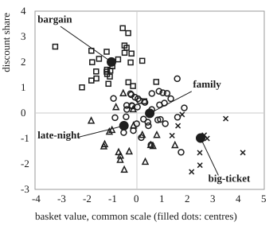
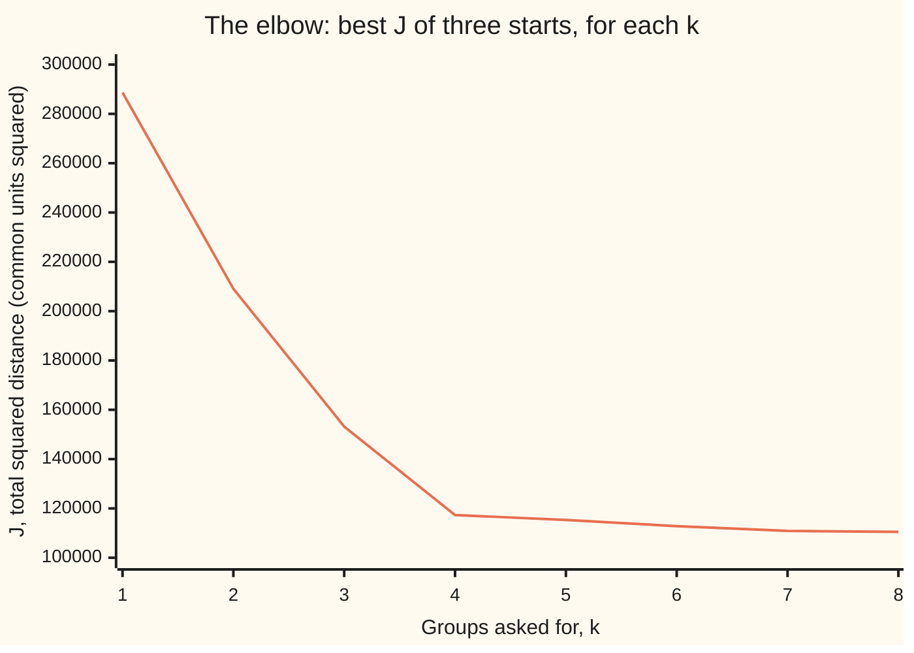

# k-means: groups defined by their own centres, found by taking turns

[Syllabus](../../../SYLLABUS.md) → [Applied and computational](../README.md) → [Machine Learning Mathematics](../README.md#s06) → k-means

---

## General Overview

A shop has 20,000 past orders. Each order is described by 12 numbers: basket value, number of items, share bought on discount, share of fresh food, share of household goods, share of electronics, share of clothing, home delivery or pickup, hour of day, weekday or weekend, days since the customer's last order, and items returned. The marketing team wants to know what kinds of customer are in there, so it can send each kind a different offer. Nobody has labelled any order. The groups have to come out of the numbers.

k-means does this with one simple picture of a group: a group is a centre, and an order belongs to the group whose centre is nearest. Pick 4 starting centres. Then take turns. First, send every order to its nearest centre. Second, move every centre to the average of the orders it now holds. Repeat until no order changes group. On this shop's orders it settles in 3 passes. It finds a family weekly shop of 8,005 orders, bargain hunters (5,992), late-night top-ups (4,003) and big-ticket buyers (2,000). Because this dataset is synthetic, made from a stated rule, the true kinds are known, and 19,965 of the 20,000 orders land with their own kind.

Two questions remain, and the card answers both with numbers. Why does taking turns ever stop? Each turn can only lower one score, the total squared distance from orders to their centres. And why 4 groups, not 3 or 8? That score always falls when you add groups, so it cannot choose by itself. Two other tests, the elbow and the silhouette, both point to 4.

**k-means looks for k centres that make the total squared distance from each point to its nearest centre small, by alternating two steps that each can only lower that total: assign every point to its nearest centre, then move every centre to the mean of its points.**

**What kind of fact this is:** a method with a theorem attached. That the score never rises and the method stops in finitely many passes is proved on this card in Why it works. That it stops at the *best possible* grouping is false in general, and the code shows a start where it does not. The elbow and the silhouette are rules of thumb, not theorems.

### The picture: two of the twelve numbers, with the four centres

<p align="center"></p>

To scale, in the common units explained below. Every 11th order of a 1,053-order sample is drawn: circles are family shops, squares bargain hunters, triangles late-night top-ups and crosses big-ticket buyers, as k-means grouped them. In these two numbers the triangles and circles overlap. In all twelve they separate: the late-night orders also differ in hour of day, items and fresh food.

---

## The formula

First, the common scale. Basket value in pounds and hour of day are in different units, so each of the 12 numbers is first rescaled: shifted so a typical order scores 0 and stretched so a typical spread is 1. This is **standardising**. After it, a difference of 1 means the same amount in every column. The usual mistake below shows what happens without it.

Notation, in words. Order $i$ is a list of $d = 12$ numbers, written $x_i$. There are $n = 20{,}000$ orders and $k$ groups. Centre $j$ is a list of 12 numbers too, $c_j$. The label $g_i$ says which group order $i$ is in. $\lVert x - c \rVert$ is the straight-line distance between two lists of numbers: Pythagoras from [Distance and midpoint](../../05-Geometry%20and%20trig/04-Coordinates%20and%20Curves/01-distance-and-midpoint.md), with 12 differences squared and added instead of 2.

$$J = \sum_{i=1}^{n} \lVert x_i - c_{g_i} \rVert^2$$

**Read it aloud:** the score $J$ is the squared distance from every order to the centre of its own group, added up over all orders.

The two turns that lower it:

$$\text{assign: } g_i = \text{the } j \text{ with the smallest } \lVert x_i - c_j \rVert^2, \qquad \text{update: } c_j = \frac{1}{n_j} \sum_{i \,:\, g_i = j} x_i$$

**Read it aloud:** give each order the label of its nearest centre; then set each centre to the average, number by number, of the $n_j$ orders labelled $j$.

To choose $k$, the **silhouette** of order $i$ compares $a_i$, its average distance to the other orders in its own group, with $b_i$, its average distance to the orders of the nearest other group:

$$s_i = \frac{b_i - a_i}{\max(a_i, b_i)}$$

**Read it aloud:** the silhouette is how much farther the next-nearest group is than the order's own group, as a fraction of the larger of the two; near 1 means well placed, near 0 means on a border, below 0 means probably in the wrong group.

| Symbol | Plain meaning | In our example | Push it up and the answer… |
| --- | --- | --- | --- |
| $x_i$ | order $i$: its 12 numbers, on the common scale | one order's basket value, items, … | — |
| $n$ | number of orders | 20,000 | $J$ grows in proportion; the work per pass grows in proportion |
| $d$ | numbers per order | 12 | each distance takes longer; $J$ grows |
| $k$ | number of groups asked for | 4 | $J$ always falls, slower and slower past the true number |
| $g_i$ | the group label of order $i$ | 0, 1, 2 or 3 | — |
| $c_j$ | centre of group $j$: 12 numbers | big-ticket centre has basket value 2.50 | — |
| $n_j$ | number of orders in group $j$ | 8,005, 5,992, 2,000, 4,003 | — |
| $J$ | the score: total squared distance to own centre | 117,324.1 | worse grouping |
| $\sigma$ | spread of the wobble round each true centre (synthetic data only) | 0.7 | groups overlap; $J$ grows like $\sigma^2$ |
| $a_i$, $b_i$ | order $i$'s average distance to its own group, and to the nearest other group | — | $a_i$ up: worse fit; $b_i$ up: better separated |
| $m$, $\bar x$, $c$ | in Step 2: one group's size, its mean, and any centre tried | A, B, C: 3, (0.3333, 3) and A | $c$ away from $\bar x$: that group's share of $J$ rises |
| $s_i$, $\bar s$ | silhouette of one order; its average over a sample | $\bar s$ = 0.3597 at $k = 4$ | clearer groups |

### When it holds

- **A group really is a blob round a centre.** k-means describes groups by centres and nearest-centre borders, which are straight. Two long thin groups lying side by side, or one ring inside another, get cut the wrong way. Spectral clustering in [The graph Laplacian](../07-Network%20Science%20and%20Spectral%20Graphs/03-graph-laplacian-and-spectral-clustering.md) handles shapes like that.
- **The numbers share a scale.** Distance treats a unit in every column alike. Leave basket value in pounds and it swamps the other 11 numbers: only 63.15% of orders then land with their own kind.
- **Squared distance is a fair price.** Squaring makes one far-off order cost a lot, so a handful of extreme orders can drag a centre towards them. With heavy outliers, a version that uses medians is safer.
- **Several starts, not one.** The method stops at a grouping no single turn can improve, which need not be the best grouping. One of three starts here stops at $J$ = 172,458.5, 1.4699 times the best.
- **You choose $k$, and the method never questions it.** Ask for 8 groups and it returns 8. The elbow and the silhouette are checks you run beside it.

---

## Why it works

### Step 0: two easy half-problems

Finding the labels and the centres together is hard. But each half alone is easy. If the centres are fixed, the best labels are obvious: send each order to its nearest centre. If the labels are fixed, the best centres are obvious too: the mean of each group, as Step 2 proves. k-means solves one half, then the other, and repeats. This is **coordinate descent**: lower a score by improving one block of unknowns at a time, holding the rest still.

### Step 1: the assign turn cannot raise $J$

Hold the centres still. $J$ is a sum with one term per order, and each order's term depends only on its own label. Switching order $i$ to its nearest centre makes its term as small as it can be, so no term rises and the sum cannot rise. If two centres tie, keep the current label; then a label changes only when $J$ strictly falls. (The code breaks a tie by the lower group number instead; with numbers like these, exact ties are vanishingly rare.)

### Step 2: the update turn cannot raise $J$, because the mean is the best centre

Hold the labels still and look at one group of $m$ orders with mean $\bar x$. For any centre $c$, the **shift identity** says

$$\sum_{i} \lVert x_i - c \rVert^2 = \sum_{i} \lVert x_i - \bar x \rVert^2 + m\,\lVert \bar x - c \rVert^2 .$$

The first part does not depend on $c$. The second part is never negative and is zero only at $c = \bar x$. So the mean is the one best centre, and moving each centre to its group's mean lowers $J$ or leaves it alone. The one-number case is Step 1 of [Loss and empirical risk](01-loss-functions-and-empirical-risk.md); here it is the same with 12 numbers.

<details>
<summary>Proof of the shift identity, with the dot product</summary>

Write $x_i - c = (x_i - \bar x) + (\bar x - c)$ and square its length using [The dot product](../../03-Algebra/06-Dot%20Products%20and%20Best%20Fits/01-dot-product.md): $\lVert u + v \rVert^2 = \lVert u \rVert^2 + 2\,u \cdot v + \lVert v \rVert^2$. Add over the $m$ orders:

$$\sum_i \lVert x_i - c \rVert^2 = \sum_i \lVert x_i - \bar x \rVert^2 + 2 \Big(\sum_i (x_i - \bar x)\Big) \cdot (\bar x - c) + m\,\lVert \bar x - c \rVert^2 .$$

The middle sum is $\sum_i x_i - m\bar x = 0$, by the definition of the mean. What is left is the identity.

The same answer comes from [Gradient descent](02-gradient-descent-and-stochastic-gradient.md)'s view: the slope of $\sum_i \lVert x_i - c \rVert^2$ with respect to $c$ is $-2\sum_i (x_i - c)$, which is zero exactly when $c$ is the mean. k-means jumps straight to the bottom instead of stepping downhill.

</details>

On the six-order example below, group A, B, C with its centre at A scores 6.0000. The identity splits that as 2.6667 at the mean plus 3 × 1.1111 for the distance from A to the mean. The code checks it.

### Step 3: taking turns must stop

There are only finitely many ways to label $n$ orders with $k$ groups: at most $k^n$. Each pass that changes any label lowers $J$ strictly (Step 1, with the tie rule), and the update that follows cannot raise it (Step 2). So $J$ after each pass is strictly lower than after the one before, and no labelling can come back. A walk through a finite set that never revisits a point must end. When an assign turn changes nothing, the update changes nothing either, and the method has stopped.

The bound $k^n$ is astronomically loose. In practice the passes are few: the best start here stops after 3, and the slowest after 67.

### Step 4: it stops at a local best, not the best

"No single turn helps" is not "nothing helps". In the worst of the three starts, two centres end up sharing the 2,000 big-ticket orders (basket values 2.76 and 2.24), while one centre is left to cover the family shoppers and bargain hunters together. No order wants to move, and no centre wants to move, yet $J$ = 172,458.5, against 117,324.1 for the good answer. Only 13,996 orders end up with their own kind.

Finding the grouping with the lowest $J$ for sure is hard: for points in many dimensions it is NP-hard even with $k = 2$ (Aloise and others, in Sources), which means no known method does it fast on every input. The practical remedy is careful starts. **k-means++** picks the first centre at random from the orders and each later one at random too, with an order's chance in proportion to its squared distance from the nearest centre chosen so far, so starts spread out. Running several starts and keeping the lowest $J$ costs little. The code runs three starts for every $k$.

### Step 5: choosing $k$, when $J$ always prefers more

The best $J$ with $k + 1$ centres is never above the best with $k$: add a centre on top of any order and that order's term drops to 0. With $k = n$, $J$ is 0. So "pick the $k$ with the lowest $J$" always picks the most groups you allow: here 8.

The **elbow** looks at how much each extra centre buys. Going from 3 to 4 groups cuts $J$ by 35,873.4. Going from 4 to 5 cuts it by only 2,013.6: the fifth centre is splitting a real group, not finding a new one.



The one line is $J$, the best of three k-means++ starts at each $k$, as printed by the code. It falls steeply to $k = 4$, then almost flat: the bend is the elbow.

The **silhouette** asks each order whether it sits closer to its own group than to the next one, and averages. It is computed on every 19th order, 1,053 of them, because it needs the distance between every pair of orders, and that count grows with the square of the number of orders. The average is highest at $k = 4$:

```
k = 2  ##############################        0.3010
k = 3  ################################      0.3168
k = 4  ####################################  0.3597
k = 5  ###########################           0.2677
k = 6  #######################               0.2291
k = 7  ###############                       0.1512
k = 8  #####                                 0.0520
```

Both tests agree with the rule the data was made from: 4 kinds. On real orders they often disagree or show no clear bend, and then the choice of $k$ is a business decision, not a theorem.

---

## Worked numbers, by hand

Six orders, just two numbers each, basket value and discount share, as small whole scores so the arithmetic fits on paper: A (0, 4), B (1, 3), C (0, 2), D (3, 0), E (4, 1), F (5, 0). Two groups. A careless start puts both centres at A and B, which sit in the same corner.

| Step | Arithmetic | Value |
| --- | --- | --- |
| start | centres at A (0, 4) and B (1, 3) | — |
| pass 1, assign | A to centre 1; B, C, D, E, F nearer B: squared distances 0 + 0 + 2 + 13 + 13 + 25 | $J$ = 53 |
| pass 1, update | centre 1 stays at (0, 4); centre 2 = mean of B to F = (13/5, 6/5) = (2.6, 1.2) | $J$ = 24 |
| pass 2, assign | B and C are now nearer (0, 4): 0 + 2 + 4 + 1.6 + 2 + 7.2 | $J$ = 16.8 |
| pass 2, update | centres to (1/3, 3) and (4, 1/3) | $J$ = 16/3 = 5.3333 |
| pass 3, assign | no order changes group | stop after 2 passes |
| check: every split | all 31 ways to cut six orders into two groups, scored | lowest $J$ = 5.3333, A B C against D E F |
| **answer** | **groups A B C and D E F, centres (0.3333, 3) and (4, 0.3333)** | **$J$ = 5.3333** |

The score fell 53, 24, 16.8, 5.3333, never rising, and from a bad start it still reached the grouping that brute force says is best.

### What breaks if you drop a piece

| Mistake | Comes out at | What went wrong |
| --- | --- | --- |
| One start only, the unlucky one | $J$ = 172,458.5, 1.4699 times the best; 13,996 orders with their own kind | Two centres split the big-ticket buyers; family and bargain shoppers share one centre |
| Basket value left in pounds | 12,631 of 20,000 with their own kind, 63.15% | One column's units are 30 times larger, so distance is mostly basket value |
| Choose $k$ by the lowest $J$ | $k$ = 8, $J$ = 110,494.4 | $J$ always falls as $k$ grows; the eighth centre buys only 383.1 |
| Choose $k$ = 3 | silhouette 0.3168 against 0.3597 | Two real kinds are forced to share a centre |

The code prints every one.

---

## How the objective falls

The best k-means++ start on the 20,000 orders, one half-turn at a time. "Assign" is $J$ just after orders move to their nearest centre; "update" is $J$ just after centres move to their means.

| Pass | $J$ after assign | $J$ after update |
| --- | --- | --- |
| 1 | 260,300.0 | 125,908.7 |
| 2 | 118,361.5 | 117,356.4 |
| 3 | 117,325.2 | 117,324.1 |

The first update does almost all the work: centres that started on single orders jump to the middle of their groups. After that only orders near a border change sides, and $J$ barely moves. The fourth assign moves nobody, so the method stops.

Where does it settle? Each order wobbles round its kind's true centre by a spread of 0.7 in each of 12 numbers, so a perfect grouping should leave about $n \times d \times \sigma^2$ = 20,000 × 12 × 0.7² = 117,600.0, give or take a standard deviation of $\sigma^2\sqrt{2nd}$ = 339.5 from chance in the wobble: one squared bell-shaped wobble has standard deviation $\sqrt 2\,\sigma^2$, and the $nd$ of them add independently. The run's 117,324.1, or 5.8662 per order, is just under that, inside one standard deviation; fitted centres also sit slightly closer to their orders than the true ones do. The check asserts that the gap is under three standard deviations. This is the third road: the score agrees with the rule that made the data, not just with itself.

The other two starts at $k = 4$ took 67 and 37 passes. The slow one reached the same 117,324.1; the other stopped in the trap of Step 4.

---

## Code, from first principles, and it actually runs

The script builds the 20,000 synthetic orders from SplitMix64 with seed 2026, each one a true centre plus a bell-shaped wobble made by the Box–Muller method from two uniform numbers. It writes k-means out in full: assign, update, the stopping rule, k-means++ starts, the silhouette. Only `math` is imported, for the logarithm, cosine and square root and for `math.dist`, the straight-line distance between two lists. Four independent roads check the answer. (1) Brute force: all 31 splits of the six-order example, against k-means. (2) The shift identity of Step 2, both sides computed separately. (3) The run's $J$ against $n d \sigma^2$ from the generating rule, within three standard deviations. (4) The groups found, against the kinds the data was made from. It also asserts that $J$ never rises between half-turns, that the best $J$ falls as $k$ grows, and that the silhouette code matches a four-order example worked by hand. The Rust program does the same and prints identical lines.

### Python

```python
# k-means -- the check behind the card.  Standard library: math only.
# A shop's 20,000 past orders, each described by 12 numbers on a common scale.
# SYNTHETIC: four customer groups, each a centre plus a bell-shaped wobble of
# spread 0.7 in every number, drawn from SplitMix64 with seed 2026.
# Roads: (1) every split of a six-order example, by brute force, against k-means;
# (2) the shift identity behind the update step; (3) the run's objective against
# the generating rule's expected value; (4) the found groups against the true ones.
import math
M64 = (1 << 64) - 1
state = 2026
def rnd():                                      # SplitMix64, a uniform number in [0, 1)
    global state
    state = (state + 0x9E3779B97F4A7C15) & M64
    z = state
    z = ((z ^ (z >> 30)) * 0xBF58476D1CE4E5B9) & M64
    z = ((z ^ (z >> 27)) * 0x94D049BB133111EB) & M64
    return ((z ^ (z >> 31)) >> 11) / 9007199254740992.0
def gauss():                                    # Box-Muller: one bell-shaped number from two uniforms
    u1, u2 = 1.0 - rnd(), rnd()
    return math.sqrt(-2.0 * math.log(u1)) * math.cos(2.0 * math.pi * u2)
def sq(a, b): d = math.dist(a, b); return d * d  # squared straight-line distance
def assign(X, C):                               # each order to its nearest centre
    lab, J = [], 0.0
    for x in X:
        best, bd = 0, sq(x, C[0])
        for j in range(1, len(C)):
            d = sq(x, C[j])
            if d < bd:
                best, bd = j, d
        lab.append(best); J += bd
    return lab, J
def update(X, lab, C):                          # each centre to the mean of its orders
    S, n = [[0.0] * len(X[0]) for _ in C], [0] * len(C)
    for x, l in zip(X, lab):
        n[l] += 1
        for i in range(len(x)):
            S[l][i] += x[i]
    return [[s / n[j] for s in S[j]] if n[j] else C[j] for j in range(len(C))]
def cost(X, lab, C):
    J = 0.0
    for x, l in zip(X, lab):
        J += sq(x, C[l])
    return J
def kmeans(X, C, trace):                        # assign, update, repeat until no label moves
    lab = None
    while True:
        new, J1 = assign(X, C)
        if new == lab:
            return lab, C, J1, len(trace), trace
        lab = new
        C = update(X, lab, C)
        trace.append((J1, cost(X, lab, C)))
def plusplus(X, k):                             # k-means++: each new seed far from the old ones
    C = [X[int(rnd() * len(X))]]
    D = [sq(x, C[0]) for x in X]
    while len(C) < k:
        tot = 0.0
        for d in D:
            tot += d
        r, i = rnd() * tot, 0
        while r >= D[i] and i < len(X) - 1:
            r -= D[i]; i += 1
        C.append(X[i]); D = [min(D[t], sq(X[t], X[i])) for t in range(len(X))]
    return C
def kind(lab, truth, k):                        # orders sharing a group with the majority of their kind
    return sum(max(sum(1 for l, t in zip(lab, truth) if l == j and t == g) for g in range(4)) for j in range(k))

# road 1: six orders, two numbers each (basket value, discount share), k = 2, by hand
P = [(0, 4), (1, 3), (0, 2), (3, 0), (4, 1), (5, 0)]
lab6, C6, J6, it6, tr6 = kmeans(P, [P[0], P[1]], [])
print("six orders, J after each assign -> update:", ", ".join(f"{a:.4f} -> {b:.4f}" for a, b in tr6))
print(f"six orders: stable after {it6} passes; centres " + " and ".join(f"({c[0]:.4f}, {c[1]:.4f})" for c in C6) + f"; J = {J6:.4f}")
splits = [[m >> i & 1 for i in range(6)] for m in range(2, 64, 2)]   # every split with A in group 0: 31
best = min((cost(P, s, update(P, s, [P[0], P[0]])), s) for s in splits)
print(f"brute force over {len(splits)} splits: lowest J = {best[0]:.4f}, with A in a group of", " ".join(c for c, b in zip("ABCDEF", best[1]) if b == 0))
G = P[:3]; m = update(G, [0, 0, 0], [P[0]])[0]
lhs, rhs = cost(G, [0, 0, 0], [P[0]]), cost(G, [0, 0, 0], [m]) + 3 * sq(m, P[0])
print(f"shift identity on A, B, C with centre A: {lhs:.4f} = {cost(G, [0, 0, 0], [m]):.4f} + 3 x {sq(m, P[0]):.4f}")

# the shop: 20,000 orders, 12 numbers, 4 true groups in proportion 4 : 3 : 2 : 1
NAMES = ["family weekly shop", "bargain hunter", "late-night top-up", "big-ticket buyer"]
TRUE_C = [[0.5, 1.5, 0, 1.5, 1, -0.5, 0, 1, 0, 1, -1, -0.5], [-1, 0.5, 2, 0, 0.5, -0.5, 0.5, -1, 0, 0, 0, 0],
          [-0.5, -1, -0.5, -1, -1, 0, 0, 1, 2, 0, -0.5, 0], [2.5, -1, -1, -1, -0.5, 2.5, 0, 1, 0, 0, 2, 1]]
N, SIG = 20000, 0.7
truth = [[0, 0, 0, 0, 1, 1, 1, 2, 2, 3][i % 10] for i in range(N)]
X = [[TRUE_C[t][d] + SIG * gauss() for d in range(12)] for t in truth]
runs = {k: [kmeans(X, plusplus(X, k), []) for _ in range(3)] for k in range(1, 9)}   # 3 starts per k
lab, C, J, it, trace = min(runs[4], key=lambda r: r[2])
print("k = 4, three k-means++ starts stop at J =", ", ".join(f"{r[2]:.1f} ({r[3]} passes)" for r in runs[4]))
for p, (a, b) in enumerate(trace):
    print(f"  best start, pass {p + 1}: J {a:.1f} after assign -> {b:.1f} after update")
expect, sd = N * 12 * SIG * SIG, SIG * SIG * math.sqrt(2 * N * 12)   # N x 12 squared wobbles: mean, SD
print(f"final J = {J:.1f}, per order {J / N:.4f}; the generating rule expects about {expect:.1f} = 20000 x 12 x 0.7^2, SD {sd:.1f}")
for j in range(4):
    cnt = [sum(1 for l, t in zip(lab, truth) if l == j and t == g) for g in range(4)]
    g = cnt.index(max(cnt))
    print(f"  group {j}: {sum(cnt)} orders, {cnt[g]} of them {NAMES[g]}; centre's basket value {C[j][0]:.2f}, discount {C[j][2]:.2f}")
right = kind(lab, truth, 4)
print(f"orders grouped with their own kind: {right} of {N} = {right / N:.4f}")

# choosing k: the elbow on all orders, the silhouette on every 19th order
Js = {k: min(r[2] for r in runs[k]) for k in runs}
S = list(range(0, N, 19))
dist = [[math.dist(X[a], X[b]) for b in S] for a in S]
def silhouette(D, L, k):                        # mean over the orders of (b - a) / max(a, b); D: their distances
    tot = 0.0
    for i in range(len(D)):
        sums, cnt = [0.0] * k, [0] * k
        for j in range(len(D)):
            sums[L[j]] += D[i][j]; cnt[L[j]] += 1
        if cnt[L[i]] > 1:
            a = sums[L[i]] / (cnt[L[i]] - 1)
            b = min(sums[c] / cnt[c] for c in range(k) if c != L[i] and cnt[c])
            tot += (b - a) / max(a, b)
    return tot / len(D)
sil = {k: silhouette(dist, [min(runs[k], key=lambda r: r[2])[0][s] for s in S], k) for k in range(2, 9)}
sil_hand = silhouette([[abs(a - b) for b in (0, 1, 3, 4)] for a in (0, 1, 3, 4)], [0, 0, 1, 1], 2)
for k in range(1, 9):
    print(f"k = {k}: J = {Js[k]:9.1f}" + (f", drop from k - 1 = {Js[k - 1] - Js[k]:8.1f}, silhouette = {sil[k]:.4f}" if k > 1 else ""))
best_k = max(sil, key=lambda k: sil[k])
print(f"silhouette sample: {len(S)} orders; it picks k = {best_k}; lowest J picks k = {min(Js, key=lambda k: Js[k])}")

# what breaks
wl, wC, JB, _, _ = max(runs[4], key=lambda r: r[2])
print(f"worst k = 4 start: J = {JB:.1f}, {JB / J:.4f} times the best; with own kind {kind(wl, truth, 4)}; basket values",
      ", ".join(f"{c[0]:.2f}" for c in wC))
XP = [[45 + 30 * x[0]] + x[1:] for x in X]                   # basket value left in pounds, not on the common scale
rightP = kind(kmeans(XP, plusplus(XP, 4), [])[0], truth, 4)
print(f"basket value left in pounds: grouped with their own kind {rightP} of {N} = {rightP / N:.4f}")
fig = S[::11]                                   # every 11th sampled order goes on the figure
print("figure, centres (basket value, discount):", "; ".join(f"({c[0]:.2f}, {c[2]:.2f})" for c in C) + f"; {len(fig)} orders drawn")

assert abs(best[0] - J6) < 1e-9 and abs(J6 - 16 / 3) < 1e-9 and it6 == 2      # k-means meets brute force
assert abs(lhs - rhs) < 1e-9 and abs(lhs - 6) < 1e-9                             # shift identity
assert all(b <= a + 1e-9 for a, b in trace) and all(trace[i + 1][0] <= trace[i][1] + 1e-9 for i in range(len(trace) - 1))
assert all(Js[k + 1] < Js[k] for k in range(1, 8))                             # more centres, lower J
assert abs(J - expect) < 3 * sd                                                 # run against the generating rule, 3 SD
assert abs(sil_hand - 23 / 35) < 1e-12          # orders at 0, 1 | 3, 4 by hand: (5/7 + 3/5 + 3/5 + 5/7) / 4 = 23/35
assert right / N > 0.99 and best_k == 4 and JB > 1.05 * J and rightP / N < 0.9
print("ALL CHECKS PASS")
```

**Ran 2026-11-11 on macOS, Python 3.14.10, standard library only. All checks passed. Output, pasted from the run:**

```
six orders, J after each assign -> update: 53.0000 -> 24.0000, 16.8000 -> 5.3333
six orders: stable after 2 passes; centres (0.3333, 3.0000) and (4.0000, 0.3333); J = 5.3333
brute force over 31 splits: lowest J = 5.3333, with A in a group of A B C
shift identity on A, B, C with centre A: 6.0000 = 2.6667 + 3 x 1.1111
k = 4, three k-means++ starts stop at J = 117324.1 (3 passes), 117324.1 (67 passes), 172458.5 (37 passes)
  best start, pass 1: J 260300.0 after assign -> 125908.7 after update
  best start, pass 2: J 118361.5 after assign -> 117356.4 after update
  best start, pass 3: J 117325.2 after assign -> 117324.1 after update
final J = 117324.1, per order 5.8662; the generating rule expects about 117600.0 = 20000 x 12 x 0.7^2, SD 339.5
  group 0: 8005 orders, 7988 of them family weekly shop; centre's basket value 0.50, discount -0.01
  group 1: 5992 orders, 5980 of them bargain hunter; centre's basket value -1.00, discount 2.00
  group 2: 2000 orders, 2000 of them big-ticket buyer; centre's basket value 2.50, discount -0.99
  group 3: 4003 orders, 3997 of them late-night top-up; centre's basket value -0.51, discount -0.50
orders grouped with their own kind: 19965 of 20000 = 0.9982
k = 1: J =  288653.1
k = 2: J =  209097.5, drop from k - 1 =  79555.6, silhouette = 0.3010
k = 3: J =  153197.5, drop from k - 1 =  55900.1, silhouette = 0.3168
k = 4: J =  117324.1, drop from k - 1 =  35873.4, silhouette = 0.3597
k = 5: J =  115310.4, drop from k - 1 =   2013.6, silhouette = 0.2677
k = 6: J =  112824.3, drop from k - 1 =   2486.1, silhouette = 0.2291
k = 7: J =  110877.5, drop from k - 1 =   1946.8, silhouette = 0.1512
k = 8: J =  110494.4, drop from k - 1 =    383.1, silhouette = 0.0520
silhouette sample: 1053 orders; it picks k = 4; lowest J picks k = 8
worst k = 4 start: J = 172458.5, 1.4699 times the best; with own kind 13996; basket values -0.14, 2.76, -0.52, 2.24
basket value left in pounds: grouped with their own kind 12631 of 20000 = 0.6315
figure, centres (basket value, discount): (0.50, -0.01); (-1.00, 2.00); (2.50, -0.99); (-0.51, -0.50); 96 orders drawn
ALL CHECKS PASS
```

### Rust

Same numbers, same labels, built with `rustc --edition 2021 -O`.

```rust
// k-means -- the same check as the Python, in Rust.  No crates.
// A shop's 20,000 past orders, each described by 12 numbers on a common scale.
// SYNTHETIC: four customer groups, each a centre plus a bell-shaped wobble of
// spread 0.7 in every number, drawn from SplitMix64 with seed 2026.
// Roads: (1) every split of a six-order example, by brute force, against k-means;
// (2) the shift identity behind the update step; (3) the run's objective against
// the generating rule's expected value; (4) the found groups against the true ones.
type Pt = Vec<f64>;
struct Rng(u64);
impl Rng {
    fn rnd(&mut self) -> f64 { // SplitMix64, a uniform number in [0, 1)
        self.0 = self.0.wrapping_add(0x9E3779B97F4A7C15);
        let mut z = self.0;
        z = (z ^ (z >> 30)).wrapping_mul(0xBF58476D1CE4E5B9);
        z = (z ^ (z >> 27)).wrapping_mul(0x94D049BB133111EB);
        ((z ^ (z >> 31)) >> 11) as f64 / 9007199254740992.0
    }
    fn gauss(&mut self) -> f64 { // Box-Muller: one bell-shaped number from two uniforms
        let (u1, u2) = (1.0 - self.rnd(), self.rnd());
        (-2.0 * u1.ln()).sqrt() * (2.0 * std::f64::consts::PI * u2).cos()
    }
}
fn dist(a: &[f64], b: &[f64]) -> f64 { a.iter().zip(b).map(|(x, y)| (x - y) * (x - y)).sum::<f64>().sqrt() }
fn sq(a: &[f64], b: &[f64]) -> f64 { let d = dist(a, b); d * d }
fn assign(x: &[Pt], c: &[Pt]) -> (Vec<usize>, f64) {
    let (mut lab, mut j) = (Vec::new(), 0.0);
    for p in x {
        let (mut best, mut bd) = (0, sq(p, &c[0]));
        for i in 1..c.len() { let d = sq(p, &c[i]); if d < bd { best = i; bd = d; } }
        lab.push(best); j += bd;
    }
    (lab, j)
}
fn update(x: &[Pt], lab: &[usize], c: &[Pt]) -> Vec<Pt> {
    let mut s = vec![vec![0.0; x[0].len()]; c.len()];
    let mut n = vec![0usize; c.len()];
    for (p, &l) in x.iter().zip(lab) { n[l] += 1; for i in 0..p.len() { s[l][i] += p[i]; } }
    (0..c.len()).map(|j| if n[j] > 0 { s[j].iter().map(|v| v / n[j] as f64).collect() } else { c[j].clone() }).collect()
}
fn cost(x: &[Pt], lab: &[usize], c: &[Pt]) -> f64 { let mut j = 0.0; for (p, &l) in x.iter().zip(lab) { j += sq(p, &c[l]); } j }
struct Run { lab: Vec<usize>, c: Vec<Pt>, j: f64, trace: Vec<(f64, f64)> }
fn kmeans(x: &[Pt], mut c: Vec<Pt>) -> Run { // assign, update, repeat until no label moves
    let mut lab: Vec<usize> = Vec::new();
    let mut trace = Vec::new();
    loop {
        let (new, j1) = assign(x, &c);
        if new == lab { return Run { lab, c, j: j1, trace }; }
        lab = new;
        c = update(x, &lab, &c);
        trace.push((j1, cost(x, &lab, &c)));
    }
}
fn plusplus(x: &[Pt], k: usize, g: &mut Rng) -> Vec<Pt> { // k-means++: each new seed far from the old ones
    let mut c = vec![x[(g.rnd() * x.len() as f64) as usize].clone()];
    let mut d: Vec<f64> = x.iter().map(|p| sq(p, &c[0])).collect();
    while c.len() < k {
        let mut tot = 0.0;
        for v in &d { tot += v; }
        let (mut r, mut i) = (g.rnd() * tot, 0);
        while r >= d[i] && i < x.len() - 1 { r -= d[i]; i += 1; }
        c.push(x[i].clone());
        for t in 0..x.len() { d[t] = d[t].min(sq(&x[t], &x[i])); }
    }
    c
}
fn kind(lab: &[usize], truth: &[usize], k: usize) -> usize { // orders sharing a group with the majority of their kind
    (0..k).map(|j| (0..4).map(|g| lab.iter().zip(truth).filter(|(&l, &t)| l == j && t == g).count()).max().unwrap()).sum()
}
fn silhouette(dm: &[Vec<f64>], l: &[usize], k: usize) -> f64 { // mean over the orders of (b - a) / max(a, b); dm: their distances
    let mut tot = 0.0;
    for i in 0..l.len() {
        let (mut sums, mut cnt) = (vec![0.0; k], vec![0usize; k]);
        for jx in 0..l.len() { sums[l[jx]] += dm[i][jx]; cnt[l[jx]] += 1; }
        if cnt[l[i]] > 1 {
            let a = sums[l[i]] / (cnt[l[i]] - 1) as f64;
            let b = (0..k).filter(|&cc| cc != l[i] && cnt[cc] > 0).map(|cc| sums[cc] / cnt[cc] as f64).fold(f64::INFINITY, f64::min);
            tot += (b - a) / a.max(b);
        }
    }
    tot / l.len() as f64
}
fn first_by(runs: &[Run], better: fn(f64, f64) -> bool) -> &Run { let mut b = &runs[0]; for r in runs { if better(r.j, b.j) { b = r; } } b }

fn main() {
    // road 1: six orders, two numbers each (basket value, discount share), k = 2, by hand
    let p: Vec<Pt> = [(0., 4.), (1., 3.), (0., 2.), (3., 0.), (4., 1.), (5., 0.)].iter().map(|&(a, b)| vec![a, b]).collect();
    let r6 = kmeans(&p, vec![p[0].clone(), p[1].clone()]);
    let t: Vec<String> = r6.trace.iter().map(|(a, b)| format!("{:.4} -> {:.4}", a, b)).collect();
    println!("six orders, J after each assign -> update: {}", t.join(", "));
    let cs: Vec<String> = r6.c.iter().map(|c| format!("({:.4}, {:.4})", c[0], c[1])).collect();
    println!("six orders: stable after {} passes; centres {}; J = {:.4}", r6.trace.len(), cs.join(" and "), r6.j);
    let (mut best, mut bs) = (f64::INFINITY, vec![]);
    for m in (2..64).step_by(2) { // every split with A in group 0: 31
        let s: Vec<usize> = (0..6).map(|i| (m >> i) & 1).collect();
        let j = cost(&p, &s, &update(&p, &s, &[p[0].clone(), p[0].clone()]));
        if j < best { best = j; bs = s; }
    }
    let ga: Vec<String> = "ABCDEF".chars().zip(&bs).filter(|(_, &b)| b == 0).map(|(c, _)| c.to_string()).collect();
    println!("brute force over 31 splits: lowest J = {:.4}, with A in a group of {}", best, ga.join(" "));
    let g3 = &p[..3];
    let m = update(g3, &[0, 0, 0], &[p[0].clone()]).remove(0);
    let lhs = cost(g3, &[0, 0, 0], &[p[0].clone()]);
    let rhs = cost(g3, &[0, 0, 0], &[m.clone()]) + 3.0 * sq(&m, &p[0]);
    println!("shift identity on A, B, C with centre A: {:.4} = {:.4} + 3 x {:.4}", lhs, cost(g3, &[0, 0, 0], &[m.clone()]), sq(&m, &p[0]));

    // the shop: 20,000 orders, 12 numbers, 4 true groups in proportion 4 : 3 : 2 : 1
    let names = ["family weekly shop", "bargain hunter", "late-night top-up", "big-ticket buyer"];
    let true_c: [[f64; 12]; 4] = [[0.5, 1.5, 0., 1.5, 1., -0.5, 0., 1., 0., 1., -1., -0.5], [-1., 0.5, 2., 0., 0.5, -0.5, 0.5, -1., 0., 0., 0., 0.],
        [-0.5, -1., -0.5, -1., -1., 0., 0., 1., 2., 0., -0.5, 0.], [2.5, -1., -1., -1., -0.5, 2.5, 0., 1., 0., 0., 2., 1.]];
    let (n, sig) = (20000usize, 0.7);
    let mut g = Rng(2026);
    let truth: Vec<usize> = (0..n).map(|i| [0, 0, 0, 0, 1, 1, 1, 2, 2, 3][i % 10]).collect();
    let x: Vec<Pt> = truth.iter().map(|&t| (0..12).map(|d| true_c[t][d] + sig * g.gauss()).collect()).collect();
    let mut runs: Vec<Vec<Run>> = vec![vec![]];
    for k in 1..9 { let mut v = vec![]; for _ in 0..3 { let c = plusplus(&x, k, &mut g); v.push(kmeans(&x, c)); } runs.push(v); }
    let b4 = first_by(&runs[4], |a, b| a < b);
    let (lab, c, j) = (&b4.lab, &b4.c, b4.j);
    let st: Vec<String> = runs[4].iter().map(|r| format!("{:.1} ({} passes)", r.j, r.trace.len())).collect();
    println!("k = 4, three k-means++ starts stop at J = {}", st.join(", "));
    for (i, (a, b)) in b4.trace.iter().enumerate() { println!("  best start, pass {}: J {:.1} after assign -> {:.1} after update", i + 1, a, b); }
    let (expect, sd) = (n as f64 * 12.0 * sig * sig, sig * sig * (2.0 * n as f64 * 12.0).sqrt()); // n x 12 squared wobbles: mean, SD
    println!("final J = {:.1}, per order {:.4}; the generating rule expects about {:.1} = 20000 x 12 x 0.7^2, SD {:.1}", j, j / n as f64, expect, sd);
    for jj in 0..4 {
        let cnt: Vec<usize> = (0..4).map(|gg| lab.iter().zip(&truth).filter(|(&l, &t)| l == jj && t == gg).count()).collect();
        let mut gi = 0;
        for gg in 1..4 { if cnt[gg] > cnt[gi] { gi = gg; } }
        println!("  group {}: {} orders, {} of them {}; centre's basket value {:.2}, discount {:.2}",
                 jj, cnt.iter().sum::<usize>(), cnt[gi], names[gi], c[jj][0], c[jj][2]);
    }
    let right = kind(lab, &truth, 4);
    println!("orders grouped with their own kind: {} of {} = {:.4}", right, n, right as f64 / n as f64);

    // choosing k: the elbow on all orders, the silhouette on every 19th order
    let js: Vec<f64> = (0..9).map(|k| if k == 0 { 0.0 } else { first_by(&runs[k], |a, b| a < b).j }).collect();
    let s: Vec<usize> = (0..n).step_by(19).collect();
    let dm: Vec<Vec<f64>> = s.iter().map(|&a| s.iter().map(|&b| dist(&x[a], &x[b])).collect()).collect();
    let mut sil = vec![0.0; 9];
    for k in 2..9 { let bl = &first_by(&runs[k], |a, b| a < b).lab; sil[k] = silhouette(&dm, &s.iter().map(|&i| bl[i]).collect::<Vec<_>>(), k); }
    let pts = [0.0, 1.0, 3.0, 4.0_f64];
    let sil_hand = silhouette(&pts.iter().map(|a| pts.iter().map(|b| (a - b).abs()).collect()).collect::<Vec<Vec<f64>>>(), &[0, 0, 1, 1], 2);
    for k in 1..9 {
        if k == 1 { println!("k = {}: J = {:9.1}", k, js[k]); }
        else { println!("k = {}: J = {:9.1}, drop from k - 1 = {:8.1}, silhouette = {:.4}", k, js[k], js[k - 1] - js[k], sil[k]); }
    }
    let (mut best_k, mut low_k) = (2, 1);
    for k in 2..9 { if sil[k] > sil[best_k] { best_k = k; } }
    for k in 1..9 { if js[k] < js[low_k] { low_k = k; } }
    println!("silhouette sample: {} orders; it picks k = {}; lowest J picks k = {}", s.len(), best_k, low_k);

    // what breaks
    let w = first_by(&runs[4], |a, b| a > b);
    let wb: Vec<String> = w.c.iter().map(|c| format!("{:.2}", c[0])).collect();
    println!("worst k = 4 start: J = {:.1}, {:.4} times the best; with own kind {}; basket values {}", w.j, w.j / j, kind(&w.lab, &truth, 4), wb.join(", "));
    let xp: Vec<Pt> = x.iter().map(|p| { let mut q = p.clone(); q[0] = 45.0 + 30.0 * p[0]; q }).collect();
    let cp = plusplus(&xp, 4, &mut g);
    let right_p = kind(&kmeans(&xp, cp).lab, &truth, 4);
    println!("basket value left in pounds: grouped with their own kind {} of {} = {:.4}", right_p, n, right_p as f64 / n as f64);
    let fc: Vec<String> = c.iter().map(|q| format!("({:.2}, {:.2})", q[0], q[2])).collect();
    println!("figure, centres (basket value, discount): {}; {} orders drawn", fc.join("; "), (s.len() + 10) / 11);

    assert!((best - r6.j).abs() < 1e-9 && (r6.j - 16.0 / 3.0).abs() < 1e-9 && r6.trace.len() == 2);
    assert!((lhs - rhs).abs() < 1e-9 && (lhs - 6.0).abs() < 1e-9);
    let tr = &b4.trace;
    assert!(tr.iter().all(|(a, b)| *b <= a + 1e-9) && (0..tr.len() - 1).all(|i| tr[i + 1].0 <= tr[i].1 + 1e-9));
    assert!((1..8).all(|k| js[k + 1] < js[k]));
    assert!((j - expect).abs() < 3.0 * sd); // run against the generating rule, 3 SD
    assert!((sil_hand - 23.0 / 35.0).abs() < 1e-12); // orders at 0, 1 | 3, 4 by hand: (5/7 + 3/5 + 3/5 + 5/7) / 4 = 23/35
    assert!(right as f64 / n as f64 > 0.99 && best_k == 4 && w.j > 1.05 * j && (right_p as f64 / n as f64) < 0.9);
    println!("ALL CHECKS PASS");
}
```

**Ran 2026-11-11 on macOS, rustc 1.98.1, no crates. All checks passed. Output, pasted from the run:**

```
six orders, J after each assign -> update: 53.0000 -> 24.0000, 16.8000 -> 5.3333
six orders: stable after 2 passes; centres (0.3333, 3.0000) and (4.0000, 0.3333); J = 5.3333
brute force over 31 splits: lowest J = 5.3333, with A in a group of A B C
shift identity on A, B, C with centre A: 6.0000 = 2.6667 + 3 x 1.1111
k = 4, three k-means++ starts stop at J = 117324.1 (3 passes), 117324.1 (67 passes), 172458.5 (37 passes)
  best start, pass 1: J 260300.0 after assign -> 125908.7 after update
  best start, pass 2: J 118361.5 after assign -> 117356.4 after update
  best start, pass 3: J 117325.2 after assign -> 117324.1 after update
final J = 117324.1, per order 5.8662; the generating rule expects about 117600.0 = 20000 x 12 x 0.7^2, SD 339.5
  group 0: 8005 orders, 7988 of them family weekly shop; centre's basket value 0.50, discount -0.01
  group 1: 5992 orders, 5980 of them bargain hunter; centre's basket value -1.00, discount 2.00
  group 2: 2000 orders, 2000 of them big-ticket buyer; centre's basket value 2.50, discount -0.99
  group 3: 4003 orders, 3997 of them late-night top-up; centre's basket value -0.51, discount -0.50
orders grouped with their own kind: 19965 of 20000 = 0.9982
k = 1: J =  288653.1
k = 2: J =  209097.5, drop from k - 1 =  79555.6, silhouette = 0.3010
k = 3: J =  153197.5, drop from k - 1 =  55900.1, silhouette = 0.3168
k = 4: J =  117324.1, drop from k - 1 =  35873.4, silhouette = 0.3597
k = 5: J =  115310.4, drop from k - 1 =   2013.6, silhouette = 0.2677
k = 6: J =  112824.3, drop from k - 1 =   2486.1, silhouette = 0.2291
k = 7: J =  110877.5, drop from k - 1 =   1946.8, silhouette = 0.1512
k = 8: J =  110494.4, drop from k - 1 =    383.1, silhouette = 0.0520
silhouette sample: 1053 orders; it picks k = 4; lowest J picks k = 8
worst k = 4 start: J = 172458.5, 1.4699 times the best; with own kind 13996; basket values -0.14, 2.76, -0.52, 2.24
basket value left in pounds: grouped with their own kind 12631 of 20000 = 0.6315
figure, centres (basket value, discount): (0.50, -0.01); (-1.00, 2.00); (2.50, -0.99); (-0.51, -0.50); 96 orders drawn
ALL CHECKS PASS
```

> [!TIP]
> **Try changing**
> - Guess first: if the wobble `SIG` goes from 0.7 to 1.2, do the two tests still agree on 4? Set `N, SIG = 20000, 1.2`. The groups now overlap. The elbow still bends at 4 (drops of 35,684.5, then 7,957.6), but the silhouette picks 2, at 0.1770 against 0.1745. The tests disagree, and the choice is yours.
> - Guess first: how many passes does the six-order example need if it starts at C and D instead of A and B? Change `[P[0], P[1]]` to `[P[2], P[3]]`. One: the first assign already splits A B C from D E F, $J$ goes 12 then 5.3333, and the answer is the same.
> - Guess first: with one start per $k$ instead of three, does the elbow survive? Change `range(3)` to `range(1)`. The elbow stays at 4, but $k = 5$ now stops at 116,624.7 instead of 115,310.4, so the drop from 4 to 5 shrinks to 699.4: a single start can leave some points on the curve worse than others, which bends the elbow's shape.
> - Guess first: does stretching the pounds column ten times more make the pounds mistake ten times worse? Change `30 * x[0]` to `300 * x[0]`. No: 12,616 orders with their own kind instead of 12,631. At 30 the grouping already follows basket value almost alone.
>
> Each answer is what both scripts print after that one edit. After the first three edits an assert then stops the script, because the run no longer matches the card.

---

## The usual mistake

> [!warning]
> **Trusting one run.** k-means always stops, and it always returns $k$ tidy groups, so a single run looks finished. But stopping means only that no single turn helps. One of three k-means++ starts here stopped at $J$ = 172,458.5, 1.4699 times the best, with two centres splitting the big-ticket buyers and family and bargain shoppers lumped together. Run several starts and keep the lowest $J$.
>
> - **Forgetting to standardise.** Leave basket value in pounds and only 12,631 of 20,000 orders, 63.15%, land with their own kind, against 19,965 on the common scale.
> - **Choosing $k$ by the lowest $J$.** It always picks the largest $k$ allowed: 8 here, at $J$ = 110,494.4. Look for the elbow or the highest silhouette instead.
> - **Treating the groups as facts about customers.** k-means returns $k$ groups even from data with no groups in it. Here the data was built with 4 kinds, so the answer can be checked; on real orders, check that the groups are stable across starts and mean something to the business.
> - **Reading $J$ without its units.** $J$ = 117,324.1 is in squared common units, summed over 20,000 orders. Per order it is 5.8662, close to the 12 × 0.7² that the wobble alone would give.

---

## Where you meet it in real life

- **Customer segments.** Shops, banks and phone companies group customers by behaviour exactly as here, then design one offer per group.
- **Fewer colours in an image.** Treat each pixel as three numbers, red, green and blue, run k-means with $k$ = 16 or 256, and repaint each pixel with its centre's colour. The picture keeps its look with far fewer colours.
- **Signal coding.** Lloyd first wrote the method in 1957 to choose the levels for turning a speech signal into a few allowed values, which is still called Lloyd's algorithm. Codebooks for speech and image compression are built the same way.
- **Fast search over many items.** A search index over millions of song or document vectors first sorts them into k-means groups, then searches only the groups whose centres are nearest the query.

> **Say it back**
> k-means describes each group by a centre and puts every point with its nearest centre. It takes turns: assign each point to its nearest centre, then move each centre to the mean of its points. Each turn can only lower $J$, the total squared distance to own centre, because the nearest centre and the mean are the best choices for their half, so the method must stop. It may stop at a local best, so run several starts: one start on the 20,000 orders stopped at 172,458.5 instead of 117,324.1. $J$ always falls as $k$ grows, so choose $k$ by the elbow or the silhouette; both pick 4 here.

---

## What this builds on

- [Gradient descent](02-gradient-descent-and-stochastic-gradient.md): lowering a score by following its slope. k-means lowers $J$ too, but solves each half exactly instead of stepping.
- [The dot product](../../03-Algebra/06-Dot%20Products%20and%20Best%20Fits/01-dot-product.md): expands the squared length in the shift identity, which proves the mean is the best centre.
- [Distance and midpoint](../../05-Geometry%20and%20trig/04-Coordinates%20and%20Curves/01-distance-and-midpoint.md): Pythagoras on coordinates, here with 12 numbers instead of 2, and the midpoint as the mean of two points.

## Where this goes next

- [Principal components](07-principal-components-and-dimension-reduction.md): finds the few directions along which the 12 numbers vary most, so a picture like the one above can show the groups at their clearest, and so k-means can run on fewer numbers.
- [The graph Laplacian](../07-Network%20Science%20and%20Spectral%20Graphs/03-graph-laplacian-and-spectral-clustering.md): spectral clustering, which finds groups that are not blobs round a centre, by treating the orders as a network.

[EM](08-em-algorithm.md) on this shelf softens the assign turn: instead of a hard label, each order gets a share of membership in every group. The question left open is how to choose $k$ with a guarantee, rather than by a bend in a curve.

---

## Sources

Verified 2026-11-11: every link below resolves to the publisher's page.

- Lloyd, Stuart P. "Least squares quantization in PCM." *IEEE Transactions on Information Theory* 28 (1982): 129–137. [doi:10.1109/TIT.1982.1056489](https://doi.org/10.1109/TIT.1982.1056489). The assign-and-update method and its proof that the error never rises, written in 1957 for signal coding.
- Rousseeuw, Peter J. "Silhouettes: a graphical aid to the interpretation and validation of cluster analysis." *Journal of Computational and Applied Mathematics* 20 (1987): 53–65. [doi:10.1016/0377-0427(87)90125-7](https://doi.org/10.1016/0377-0427(87)90125-7). Defines the silhouette $s_i$ and its average as a test for the number of groups.
- Aloise, Daniel, Amit Deshpande, Pierre Hansen and Preyas Popat. "NP-hardness of Euclidean sum-of-squares clustering." *Machine Learning* 75 (2009): 245–248. [doi:10.1007/s10994-009-5103-0](https://doi.org/10.1007/s10994-009-5103-0). Proves that finding the lowest $J$ is hard in general, even for two groups.
- Steinley, Douglas. "K-means clustering: a half-century synthesis." *British Journal of Mathematical and Statistical Psychology* 59 (2006): 1–34. [doi:10.1348/000711005X48266](https://doi.org/10.1348/000711005X48266). A survey of the method's history, local minima, starting rules, standardising and choosing $k$.
- Hastie, Trevor, Robert Tibshirani and Jerome Friedman. *The Elements of Statistical Learning*, 2nd ed. Springer, 2009. [doi:10.1007/978-0-387-84858-7](https://doi.org/10.1007/978-0-387-84858-7). Chapter 14 presents k-means as coordinate descent on $J$ and discusses choosing the number of groups.
