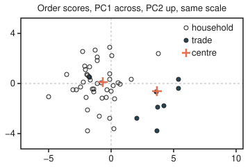

# Principal components: the few directions that carry most of the variation

[Syllabus](../../../SYLLABUS.md) → [Applied and computational](../README.md) → [Machine Learning Mathematics](../README.md#s06) → Principal components

---

## General Overview

An online shop has 20,000 past orders. Each order is described by 12 numbers: basket value in pounds, item count, distinct products, parcel weight in kg, shipping charged, discount, the customer's orders in the past year, days since their last order, minutes on the site, pages viewed, the share of the basket bought on sale, and delivery distance in km. The analyst wants two things: a picture of all 20,000 orders on one page, and fewer columns to hand to a clustering method such as [k-means](06-k-means-and-clustering.md).

Twelve columns cannot be drawn, and most of them say the same thing twice. A big basket means more items, more products, a heavier parcel and a bigger discount. Principal components find new columns, each a fixed blend of the old twelve, ranked by how much the orders spread out along them. Here the first four blends keep 85.82% of all the variation in the twelve. The first two give a flat map of the orders that keeps 64.54%, and on it the shop's trade buyers sit visibly to the right of the households.

The orders on this card are synthetic: made by a stated rule from three hidden traits (basket size, loyalty, browsing), plus noise, with 15% trade buyers and seed 2026. So the right answer is known in advance, and the code checks the method against it. The rule is a plain bell-curve model, so about 1.5 values in 100 dip below zero, which a real shop would never record; it does not change the method.

The method itself is already on the statistics shelf: the components are the eigenvectors of the covariance matrix (the directions that matrix only stretches, never turns), each eigenvalue (the stretch factor) is the variance along its own component, and the same components come from the singular value decomposition of the data table, all proved on [Principal components](../../09-Probability%20and%20statistics/09-Regression/07-principal-components.md). This card adds what a working analyst has to decide: how to put twelve columns in different units on an equal footing, how many components keep 85%, and how to read the two-dimensional plot.

**Rescale every column to mean 0 and standard deviation 1, take the eigenvectors of the resulting correlation matrix (the 12-by-12 table of how each pair of columns moves together), keep the fewest that add up to the target share of the total, here four for 85%, and plot each order by its first two scores.**

**What kind of fact this is:** a method, resting on a theorem proved on [Principal components](../../09-Probability%20and%20statistics/09-Regression/07-principal-components.md): no r directions keep more variance than the top r eigenvectors. The 85% target is a working convention chosen by the analyst, not a theorem.

### The picture: the orders on their first two components

<p align="center"></p>

Every 400th order is drawn, 50 in all, at 18 drawing units per score unit on both axes. Right means a bigger basket. Up means a customer who orders rarely and came back after a long gap. The two crosses are the centres of all the households and all 3,018 trade buyers: scores (−0.66, 0.11) and (3.69, −0.63). The method was never told who is a trade buyer; the filled circles were coloured afterwards. The two groups overlap, but they separate along the first component.

---

## The formula

Notation first, in words. Order i has value $x_{ij}$ in column j. Each column has mean $m_j$ and standard deviation $s_j$ over the 20,000 orders. **Standardising** a column means subtracting its mean and dividing by its standard deviation, which turns pounds, kg and days into "standard deviations from the average order". The standardised orders, one row each, form the table $Z$.

$$z_{ij} = \frac{x_{ij} - m_j}{s_j}, \qquad R = \frac{1}{n-1}\,Z^T Z, \qquad R\,v_k = \lambda_k\, v_k$$

**Read it aloud:** put every column in standard-deviation units, average the products of every pair of columns to get the correlation matrix, and find the directions that matrix only stretches.

$$\text{share}(r) = \frac{\lambda_1 + \dots + \lambda_r}{d}, \qquad t_{ik} = v_k^T z_i = \sum_j v_{kj}\, z_{ij}$$

**Read it aloud:** the first r components keep their eigenvalues' total out of d, the number of columns; an order's score on a component is its standardised values weighted by that component's loadings and added up.

The denominator is d because each standardised column has variance exactly 1, so the total is 12. An eigenvalue therefore counts columns' worth of variance: the first component, $\lambda_1 = 5.717$, carries as much as 5.7 of the original columns.

| Symbol | Plain meaning | In our example | Push it up and the answer… |
| --- | --- | --- | --- |
| $x_{ij}$ | order i's raw value in column j | order 1: basket £45.61, 4.52 items, 20.95 km | moves that order's scores |
| $m_j$, $s_j$ | column j's mean and standard deviation | basket value: £70.58 and £37.86 | none: standardising cancels the unit |
| $z_{ij}$, $z_i$, $Z$ | standardised value; order i's row of 12; the 20,000-by-12 table | order 1's basket value: −0.66 | moves that order's scores |
| $n$, $d$ | orders, columns | 20,000 and 12 | n: estimates settle; d: more to share out |
| $R$ | correlation matrix, 12 by 12, ones on the diagonal | items with basket value: strongly positive | more correlation, fewer components needed |
| $v_k$, $v_{kj}$ | component k, a unit direction; its loading on column j | $v_1$: 0.38 on basket value, about 0 on distance | — |
| $\lambda_k$ | eigenvalue: the variance of all orders along $v_k$ | 5.717, 2.027, 1.554, 1.000, … | that component's share grows |
| $r$ | components kept | 4 | share rises, never falls |
| $\text{share}(r)$ | fraction of the total variance the first r keep | 85.82% at r = 4 | — |
| $t_{ik}$ | order i's score on component k: its coordinate on the new axis | order 1: −1.51 on $v_1$ | — |
| $U$, $S$, $V$ | the singular value decomposition $Z = U S V^T$; the columns of $V$ are the $v_k$ | $S$'s squared entries over n − 1 equal the $\lambda_k$ | — |

### When it holds

- **Columns are put on one scale.** Variance counts squared units, so an unstandardised column in big numbers takes over. In raw units the first component is 0.95 basket value and keeps 68.57% of a total that is mostly pounds; items get a loading of 0.06.
- **Every column deserves an equal vote.** Standardising gives each column exactly one unit of variance, even one that is pure noise. Delivery distance has nothing to do with the three traits, yet it takes a whole component: the fourth, eigenvalue 0.9998, loading 0.9996 on distance alone, 8.33% of the total. A component is a direction of spread, not proof of a pattern.
- **The structure is flat.** Components are straight-line blends. If the orders lay along a curve in the twelve columns, a flat summary would need more components than the curve has dimensions. Curved methods (manifold learning) are beyond this card.
- **New orders are scaled with the old means and standard deviations.** Scoring an order means standardising it with $m_j$ and $s_j$ from the 20,000. Skip that and order 1 scores 32.21 on the first component instead of −1.51.
- **The sample is large enough.** With 20,000 orders, the data's shares sit within 0.11 percentage points of the model's true shares at every r. With 2,000 orders the gap grows to 0.66 points (Try changing, below).

---

## Why it works

### Step 0: the method ranks spread, so the units decide the ranking

Principal components look for the direction with the most variance, then the next, and so on. Variance is measured in the square of the column's units. Basket value has a standard deviation of £37.86 and distinct products one of 2.07, and variance squares both. Left alone, the method would rank pounds above products because the numbers are bigger, not because they say more. Standardising removes the units, so every column starts with the same variance, 1, and only the way columns move together decides the ranking.

### Step 1: standardised covariance is correlation, and the total is d

The covariance of two standardised columns is the covariance of the originals divided by both standard deviations: their **correlation**, a number between −1 and 1. So $R$ is the correlation matrix, with ones on its diagonal. The total variance is the sum of the diagonal, its trace: 12. The eigenvalues of a symmetric matrix add up to its trace (proved on [Principal components](../../09-Probability%20and%20statistics/09-Regression/07-principal-components.md), Step 4), so they share out exactly 12 units. In the code both sums are 12.0000.

### Step 2: keeping r components keeps the top r eigenvalues, and no choice does better

By [The spectral theorem](../../03-Algebra/07-Eigenvalues%20and%20Symmetric%20Matrices/04-spectral-theorem.md), $R$ has 12 perpendicular unit eigenvectors. The variance of the 20,000 scores on $v_k$ is $\lambda_k$. The proof on the statistics card shows that no r directions together keep more than $\lambda_1 + \dots + \lambda_r$. Rebuild an order from its first r scores and the part lost is its spread along the dropped components. Averaged over orders, that loss is the sum of the dropped eigenvalues. The code measures it directly on the 20,000 orders with r = 4: 1.7015, equal to the last eight eigenvalues.

So choosing r for a target is reading a running total. Add eigenvalues from the largest down and stop at the first r whose total reaches 85% of 12.

### Step 3: the SVD gives the same components without forming R

Write the table as $Z = U S V^T$ ([The singular value decomposition](../../03-Algebra/07-Eigenvalues%20and%20Symmetric%20Matrices/06-singular-value-decomposition.md)): $U$ and $V$ have perpendicular unit columns, and $S$ is diagonal. Then

$$R = \frac{1}{n-1} Z^T Z = \frac{1}{n-1}\, V S U^T U S V^T = V\, \frac{S^2}{n-1}\, V^T$$

because $U^T U$ is the identity. That is $R$ written as eigenvectors and eigenvalues: the columns of $V$ are the components, and each squared singular value over $n - 1$ is an eigenvalue. Software prefers this road because it works on the table itself and never squares its rounding errors. The code takes it with a one-sided Jacobi method: it rotates pairs of the table's columns until every pair is perpendicular, then reads each column's squared length. The twelve values agree with the eigenvalue road to within $10^{-9}$.

### Step 4: the plot is a shadow, and it keeps share(2)

An order's first two scores are the coordinates of its shadow on the plane through the average order spanned by $v_1$ and $v_2$. A shadow is never longer than the thing that casts it, so two orders close on the plot may be far apart along the other ten directions; two orders far apart on the plot are far apart in fact. The plot keeps $\lambda_1 + \lambda_2$ of the 12 units: 64.54%, not the 85% of four components.

Scores on different components are uncorrelated, with variances $\lambda_1$ and $\lambda_2$. The plot's horizontal spread is genuinely larger than its vertical one, variance 5.717 against 2.027. Drawing both axes at the same scale shows that; stretching each axis to fill the box would hide it.

---

## Worked numbers, by hand

| Step | Arithmetic | Value |
| --- | --- | --- |
| standardise order 1's basket value | (45.61 − 70.58) / 37.86 | −0.66 |
| standardise order 1's distance | (20.95 − 29.83) / 12.04 | −0.74 |
| order 1's score on $v_1$ | 12 loadings times 12 standardised values, shown rounded: −0.25 − 0.31 − 0.18 − 0.37 − 0.10 − 0.29 − 0.06 + 0.05 − 0.12 − 0.02 + 0.13 + 0.00, added unrounded | −1.51 (code: −1.5148) |
| total variance | 12 columns, 1 each | 12 |
| r = 1 | 5.717 / 12 | 47.64% |
| r = 2 | (5.717 + 2.027) / 12, from the unrounded eigenvalues | 64.54% |
| r = 3 | (5.717 + 2.027 + 1.554) / 12, from the unrounded eigenvalues | 77.49% |
| r = 4 | (5.717 + 2.027 + 1.554 + 1.000) / 12 | **85.82%, the first past 85%** |
| lost at r = 4 | the last eight eigenvalues, 0.338 + 0.314 + … + 0.111, added unrounded | 1.7015 per order |

Four numbers per order, in place of twelve, keep 85.82% of how the 20,000 orders differ. Order 1, a smallish basket from an average customer, has scores −1.51, −0.42, 0.96 and −0.76; rebuilt from them, its £45.61 basket reads £41.26 and its 20.95 km distance reads 21.06 km.

The four components read as the three hidden traits plus the noise column. The first loads on everything that grows with a big basket. The second is a lapsed customer: 0.55 on days since last order, −0.53 on orders in the past year. The third is browsing for deals: 0.63 on share bought on sale, 0.42 on minutes, 0.40 on pages. The fourth is delivery distance alone.

### What breaks if you drop a piece

| Mistake | Comes out at | What went wrong |
| --- | --- | --- |
| Run on raw units, no standardising | first component 0.95 basket value, keeping 68.57%; two keep 84.99%, so a third is added, and it is 0.99 distance | pounds, days and km win by size of number, not by information |
| Score a new order with its raw values | order 1 at 32.21 on $v_1$, not −1.51 | the components were built for standardised inputs |
| Read the 2-D plot as the 85% summary | the plot keeps 64.54% | two components were plotted; four were needed for 85% |
| Read the fourth component as a customer pattern | eigenvalue 0.9998, loading 0.9996 on distance | one noise column, given a full vote by standardising |

The code prints all four.

---

## Code, from first principles, and it actually runs

Both programs generate the same 20,000 orders from SplitMix64 with seed 2026 and the Box–Muller formula (which turns two uniform random numbers into one bell-curve number), so Python and Rust print identical lines. Four roads meet. The first standardises, builds $R$ and diagonalises it by Jacobi rotations, which zero one off-diagonal pair at a time. The second takes the SVD of the 20,000-by-12 table by one-sided Jacobi, never forming $R$. The third computes the model's exact correlation matrix from the generating rule and its eigenvalues, with no data at all. The fourth works straight from the orders: the variance of the 20,000 first scores, and the rebuild error at r = 4. The plain `add` loop sums left to right in both languages, so the last digits agree.

### Python

```python
# Principal components and dimension reduction -- the check behind the card.  Only math is imported.
# 20,000 synthetic shop orders, 12 numbers each in mixed units, made by a stated rule from three
# hidden traits (basket size, loyalty, browsing) plus noise; 15% are trade buyers.  Seed 2026.
import math

N, D, P_TRADE, SHIFT, M64 = 20000, 12, 0.15, [2.5, 1.5, 0.0], (1 << 64) - 1
# name, unit, base value, loadings on (size, loyalty, browsing), noise sd
FEATS = [("basket value", "GBP", 60, [25, 5, 4], 12), ("items", "count", 6, [1.8, .3, .5], 1),
         ("distinct products", "count", 4, [1.3, .2, .6], .8), ("parcel weight", "kg", 5, [1.6, 0, .2], 1),
         ("shipping charged", "GBP", 4.5, [1, -.8, 0], 1), ("discount", "GBP", 6, [2.5, 2, 1], 2.5),
         ("orders past year", "count", 8, [.5, 4, 0], 2), ("days since last", "days", 50, [0, -15, 0], 12),
         ("minutes on site", "min", 14, [2, -1, 5], 3), ("pages viewed", "count", 18, [3, -1, 7], 4),
         ("share on sale", "%", 25, [0, 3, 7], 6), ("delivery distance", "km", 30, [0, 0, 0], 12)]

class Rng:                                                 # SplitMix64
    def __init__(self, seed): self.s = seed
    def unif(self):
        self.s = (self.s + 0x9E3779B97F4A7C15) & M64
        z = ((self.s ^ (self.s >> 30)) * 0xBF58476D1CE4E5B9) & M64
        z = ((z ^ (z >> 27)) * 0x94D049BB133111EB) & M64
        return (((z ^ (z >> 31)) >> 11) + 0.5) / 2.0 ** 53
    def normal(self):                                      # Box-Muller, cosine half
        u1 = self.unif(); u2 = self.unif()
        return math.sqrt(-2.0 * math.log(u1)) * math.cos(2.0 * math.pi * u2)

def add(xs):                                               # plain left-to-right sum, as in Rust
    s = 0.0
    for x in xs: s += x
    return s
def dot(a, b): return add(x * y for x, y in zip(a, b))
def line(label, vals, f="{:8.4f}"): print(f"{label:<32}" + "".join(f.format(x) for x in vals))

def covariance(rows):                                      # centre each column, divide by n - 1
    n = len(rows); m = [add(r[j] for r in rows) / n for j in range(D)]
    c = [[r[j] - m[j] for r in rows] for j in range(D)]
    return [[dot(c[i], c[j]) / (n - 1) for j in range(D)] for i in range(D)], m

def jacobi_eig(a):                                         # rotate pairs until the matrix is diagonal
    a = [r[:] for r in a]; v = [[float(i == j) for j in range(D)] for i in range(D)]
    for _ in range(60):
        if add(a[i][j] ** 2 for i in range(D) for j in range(D) if i != j) < 1e-24: break
        for p in range(D):
            for q in range(p + 1, D):
                if a[p][q] == 0.0: continue
                th = (a[q][q] - a[p][p]) / (2.0 * a[p][q])
                t = (1.0 if th >= 0 else -1.0) / (abs(th) + math.sqrt(th * th + 1.0))
                c = 1.0 / math.sqrt(t * t + 1.0); s = t * c
                for m in (a, v):
                    for k in range(D): x, y = m[k][p], m[k][q]; m[k][p] = c * x - s * y; m[k][q] = s * x + c * y
                for k in range(D): x, y = a[p][k], a[q][k]; a[p][k] = c * x - s * y; a[q][k] = s * x + c * y
    pairs = [(a[i][i], [v[k][i] for k in range(D)]) for i in range(D)]
    out = []
    while pairs:                                           # largest eigenvalue first, by selection
        b = max(range(len(pairs)), key=lambda i: pairs[i][0]); lam, u = pairs.pop(b)
        big = max(range(D), key=lambda k: abs(u[k]))       # sign: largest loading positive
        out.append((lam, u if u[big] > 0 else [-x for x in u]))
    return out

def svd_values(cols):                                      # one-sided Jacobi on the data table itself
    cols = [c[:] for c in cols]
    for _ in range(30):
        worst = 0.0
        for p in range(D):
            for q in range(p + 1, D):
                al, be, ga = dot(cols[p], cols[p]), dot(cols[q], cols[q]), dot(cols[p], cols[q])
                worst = max(worst, abs(ga) / math.sqrt(al * be))
                ze = (be - al) / (2.0 * ga)
                t = (1.0 if ze >= 0 else -1.0) / (abs(ze) + math.sqrt(ze * ze + 1.0))
                c = 1.0 / math.sqrt(t * t + 1.0); s = t * c
                x, y = cols[p], cols[q]
                cols[p] = [c * a - s * b for a, b in zip(x, y)]; cols[q] = [s * a + c * b for a, b in zip(x, y)]
        if worst < 1e-13: break
    sv = [dot(c, c) for c in cols]                          # squared singular values
    return [sv.pop(max(range(len(sv)), key=lambda i: sv[i])) for _ in range(D)]   # largest first

# ---- the data: 20,000 orders ----
rng = Rng(2026); X, trade = [], []
for _ in range(N):
    t = 1.0 if rng.unif() < P_TRADE else 0.0
    h = [rng.normal() + SHIFT[k] * t for k in range(3)]
    X.append([f[2] + dot(f[3], h) + f[4] * rng.normal() for f in FEATS]); trade.append(t)
below = add(1.0 for r in X for x in r if x < 0) / (N * D) * 100
print(f"orders {N}, trade buyers {int(add(trade))}, values below zero per 100: {below:.2f}")
C, mean = covariance(X); sd = [math.sqrt(C[j][j]) for j in range(D)]
Z = [[(r[j] - mean[j]) / sd[j] for j in range(D)] for r in X]          # standardise every column
R, _ = covariance(Z)
eig = jacobi_eig(R); lam = [e[0] for e in eig]; U = [e[1] for e in eig]
z1 = Z[0]
print(f"{'feature':<18}{'unit':>6}{'mean':>8}{'sd':>8}{'order 1':>9}{'z':>7}{'PC1':>7}{'PC2':>7}{'PC3':>7}{'PC4':>7}")
for j, f in enumerate(FEATS):
    print(f"{f[0]:<18}{f[1]:>6}{mean[j]:8.2f}{sd[j]:8.2f}{X[0][j]:9.2f}{z1[j]:7.2f}" + "".join(f"{U[k][j]:7.2f}" for k in range(4)))

# ---- road 1: eigenvalues of the correlation matrix; road 2: SVD of the table; road 3: the model's truth ----
sv = [s / (N - 1) for s in svd_values([[r[j] for r in Z] for j in range(D)])]
p = P_TRADE * (1 - P_TRADE)                                # the model's covariance, exactly
Sz = [[float(i == j) + p * SHIFT[i] * SHIFT[j] for j in range(3)] for i in range(3)]
A = [f[3] for f in FEATS]
S = [[dot(A[i], [dot(Sz[k], A[j]) for k in range(3)]) + (FEATS[i][4] ** 2 if i == j else 0) for j in range(D)] for i in range(D)]
true = [e[0] for e in jacobi_eig([[S[i][j] / math.sqrt(S[i][i] * S[j][j]) for j in range(D)] for i in range(D)])]
def cum(ls): tot = add(ls); return [add(ls[:k + 1]) / tot * 100 for k in range(D)]
for lab, v, f in (("eigenvalues, Jacobi on R", lam, "{:7.3f}"), ("eigenvalues, SVD of the table", sv, "{:7.3f}"),
                  ("eigenvalues, the model's truth", true, "{:7.3f}"), ("kept by first r, data, %", cum(lam), "{:7.2f}"),
                  ("kept by first r, truth, %", cum(true), "{:7.2f}")): line(lab, v, f)
gap = max(abs(a - b) for a, b in zip(cum(lam), cum(true)))
r85 = next(k + 1 for k in range(D) if cum(lam)[k] >= 85.0)
print(f"components needed for 85%: r = {r85}, keeping {cum(lam)[r85 - 1]:.2f}%; largest gap to truth {gap:.2f} points")
print(f"trace of R {add(R[i][i] for i in range(D)):.4f}, eigenvalue sum {add(lam):.4f}")

# ---- road 4: straight from the orders: score variance and the rebuild error ----
scores = [[dot(U[k], z) for k in range(D)] for z in Z]
var1 = add(s[0] ** 2 for s in scores) / (N - 1)
lost = add(add((z[j] - add(s[k] * U[k][j] for k in range(r85))) ** 2 for j in range(D)) for z, s in zip(Z, scores)) / (N - 1)
print(f"variance of the 20,000 PC1 scores {var1:.4f}; rebuild error with r = 4 {lost:.4f}, last eight eigenvalues {add(lam[4:]):.4f}")
print("order 1 PC1 products " + " ".join(f"{U[0][j] * z1[j]:.2f}" for j in range(D)) + f" -> score {scores[0][0]:.4f}")
line("order 1 scores PC1 to PC4", scores[0][:4], "{:8.4f}")
line("order 1 rebuilt from 4, raw units", [mean[j] + sd[j] * add(scores[0][k] * U[k][j] for k in range(4)) for j in range(D)], "{:7.2f}")

# ---- what breaks ----
raw = jacobi_eig(C)
print(f"wrong, raw units: PC1 keeps {cum([e[0] for e in raw])[0]:.2f}%, loading on basket value {raw[0][1][0]:.2f}, on items {raw[0][1][1]:.2f}; "
      f"two keep {cum([e[0] for e in raw])[1]:.2f}%; PC3 loading on distance {raw[2][1][11]:.2f}")
print(f"wrong, order 1 not standardised: PC1 score {dot(U[0], X[0]):.2f}, right {scores[0][0]:.2f}")
print(f"wrong, the 2-D plot read as the 85% summary: it keeps {cum(lam)[1]:.2f}%")
print(f"pure-noise column (distance): PC4 eigenvalue {lam[3]:.4f}, loading {U[3][11]:.4f}, share {lam[3] / D * 100:.2f}%")
# ---- the figure: every 400th order, PC1 across and PC2 up, 18 units per score unit on both axes ----
px = lambda s1: math.floor(160 + 18 * s1 + 0.5); py = lambda s2: math.floor(120 - 18 * s2 + 0.5)
for g, name in ((0.0, "households"), (1.0, "trade buyers")):
    k = add(1.0 for t in trade if t == g); c1, c2 = (add(s[i] for s, t in zip(scores, trade) if t == g) / k for i in (0, 1))
    print(f"figure, centre of the {name:<13} x {px(c1)} y {py(c2)}   (scores PC1 {c1:5.2f}, PC2 {c2:5.2f})")
pts = [(px(scores[i][0]), py(scores[i][1]), int(trade[i])) for i in range(0, N, 400)]
for k in range(0, 50, 10): print("figure, x,y,trade " + " ".join(f"{a},{b},{c}" for a, b, c in pts[k:k + 10]))

assert r85 == 4 and abs(cum(lam)[3] - 85.82) < 0.01,         "four components clear 85 percent"
assert max(abs(a - b) for a, b in zip(lam, sv)) < 1e-9,       "SVD of the table meets the covariance road"
assert gap < 0.5,                                             "sample shares within half a point of the model"
assert abs(var1 - lam[0]) < 1e-9,                             "variance along PC1 is its eigenvalue"
assert abs(lost - add(lam[4:])) < 1e-9,                       "rebuild error is the dropped eigenvalues"
assert abs(add(lam) - D) < 1e-9,                              "eigenvalues share out the 12 units of variance"
assert all(30 <= a <= 350 and 26 <= b <= 214 for a, b, _ in pts), "every plotted order inside the frame"
print("ALL CHECKS PASS")
```

**Ran 2026-11-11 on macOS, Python 3.14.10, standard library only. All checks passed. Output, pasted from the run:**

```
orders 20000, trade buyers 3018, values below zero per 100: 1.49
feature             unit    mean      sd  order 1      z    PC1    PC2    PC3    PC4
basket value         GBP   70.58   37.86    45.61  -0.66   0.38  -0.01  -0.20   0.01
items              count    6.75    2.76     4.52  -0.81   0.38   0.02  -0.15   0.01
distinct products  count    4.54    2.07     3.59  -0.46   0.39   0.05  -0.07   0.00
parcel weight         kg    5.60    2.36     3.19  -1.02   0.36   0.08  -0.25   0.01
shipping charged     GBP    4.67    1.68     3.86  -0.48   0.20   0.43  -0.36   0.01
discount             GBP    7.42    5.34     3.20  -0.79   0.36  -0.18  -0.05  -0.00
orders past year   count    9.14    5.21     7.76  -0.26   0.23  -0.53   0.02  -0.01
days since last     days   46.21   20.71    40.34  -0.28  -0.18   0.55  -0.06   0.01
minutes on site      min   14.53    6.30    11.41  -0.49   0.25   0.32   0.42  -0.01
pages viewed       count   18.95    8.83    18.22  -0.08   0.27   0.29   0.40  -0.01
share on sale          %   25.78    9.83    32.65   0.70   0.19  -0.07   0.63  -0.00
delivery distance     km   29.83   12.04    20.95  -0.74  -0.00  -0.01   0.02   1.00
eigenvalues, Jacobi on R          5.717  2.027  1.554  1.000  0.338  0.314  0.221  0.220  0.194  0.164  0.137  0.111
eigenvalues, SVD of the table     5.717  2.027  1.554  1.000  0.338  0.314  0.221  0.220  0.194  0.164  0.137  0.111
eigenvalues, the model's truth    5.710  2.045  1.556  1.000  0.336  0.311  0.223  0.211  0.195  0.163  0.139  0.111
kept by first r, data, %          47.64  64.54  77.49  85.82  88.64  91.26  93.11  94.94  96.56  97.93  99.07 100.00
kept by first r, truth, %         47.59  64.63  77.59  85.93  88.73  91.32  93.18  94.93  96.56  97.91  99.07 100.00
components needed for 85%: r = 4, keeping 85.82%; largest gap to truth 0.11 points
trace of R 12.0000, eigenvalue sum 12.0000
variance of the 20,000 PC1 scores 5.7173; rebuild error with r = 4 1.7015, last eight eigenvalues 1.7015
order 1 PC1 products -0.25 -0.31 -0.18 -0.37 -0.10 -0.29 -0.06 0.05 -0.12 -0.02 0.13 0.00 -> score -1.5148
order 1 scores PC1 to PC4        -1.5148 -0.4190  0.9557 -0.7571
order 1 rebuilt from 4, raw units  41.26   4.69   3.13   3.65   3.27   4.64   8.58  45.57  13.89  17.75  29.17  21.06
wrong, raw units: PC1 keeps 68.57%, loading on basket value 0.95, on items 0.06; two keep 84.99%; PC3 loading on distance 0.99
wrong, order 1 not standardised: PC1 score 32.21, right -1.51
wrong, the 2-D plot read as the 85% summary: it keeps 64.54%
pure-noise column (distance): PC4 eigenvalue 0.9998, loading 0.9996, share 8.33%
figure, centre of the households    x 148 y 118   (scores PC1 -0.66, PC2  0.11)
figure, centre of the trade buyers  x 226 y 131   (scores PC1  3.69, PC2 -0.63)
figure, x,y,trade 133,128,0 227,154,1 126,108,0 140,120,0 158,114,0 158,170,0 226,188,1 140,82,0 257,127,1 96,107,0
figure, x,y,trade 120,118,0 158,106,0 70,139,0 126,188,0 164,185,0 125,107,0 123,100,0 163,123,0 236,152,1 225,132,1
figure, x,y,trade 130,115,0 160,131,0 170,119,0 165,142,0 189,114,0 228,77,0 147,141,0 154,129,0 129,111,1 158,68,0
figure, x,y,trade 129,96,0 119,74,0 173,121,0 135,132,0 161,80,0 135,128,0 146,119,0 137,72,0 126,158,0 124,140,0
figure, x,y,trade 122,95,0 105,129,0 143,167,0 128,110,0 257,114,1 116,125,0 197,170,1 110,129,0 153,140,0 140,87,0
ALL CHECKS PASS
```

### Rust

```rust
// Principal components and dimension reduction -- the check behind the card.  std only.
// 20,000 synthetic shop orders, 12 numbers each in mixed units, made by a stated rule from three
// hidden traits (basket size, loyalty, browsing) plus noise; 15% are trade buyers.  Seed 2026.
const N: usize = 20000; const D: usize = 12;
const P_TRADE: f64 = 0.15; const SHIFT: [f64; 3] = [2.5, 1.5, 0.0];
// name, unit, base value, loadings on (size, loyalty, browsing), noise sd
const FEATS: [(&str, &str, f64, [f64; 3], f64); D] = [
    ("basket value", "GBP", 60.0, [25.0, 5.0, 4.0], 12.0), ("items", "count", 6.0, [1.8, 0.3, 0.5], 1.0),
    ("distinct products", "count", 4.0, [1.3, 0.2, 0.6], 0.8), ("parcel weight", "kg", 5.0, [1.6, 0.0, 0.2], 1.0),
    ("shipping charged", "GBP", 4.5, [1.0, -0.8, 0.0], 1.0), ("discount", "GBP", 6.0, [2.5, 2.0, 1.0], 2.5),
    ("orders past year", "count", 8.0, [0.5, 4.0, 0.0], 2.0), ("days since last", "days", 50.0, [0.0, -15.0, 0.0], 12.0),
    ("minutes on site", "min", 14.0, [2.0, -1.0, 5.0], 3.0), ("pages viewed", "count", 18.0, [3.0, -1.0, 7.0], 4.0),
    ("share on sale", "%", 25.0, [0.0, 3.0, 7.0], 6.0), ("delivery distance", "km", 30.0, [0.0, 0.0, 0.0], 12.0)];
type M = Vec<Vec<f64>>;

struct Rng { s: u64 } // SplitMix64
impl Rng {
    fn unif(&mut self) -> f64 {
        self.s = self.s.wrapping_add(0x9E3779B97F4A7C15);
        let mut z = (self.s ^ (self.s >> 30)).wrapping_mul(0xBF58476D1CE4E5B9);
        z = (z ^ (z >> 27)).wrapping_mul(0x94D049BB133111EB);
        (((z ^ (z >> 31)) >> 11) as f64 + 0.5) / 9007199254740992.0
    }
    fn normal(&mut self) -> f64 { // Box-Muller, cosine half
        let u1 = self.unif(); let u2 = self.unif();
        (-2.0 * u1.ln()).sqrt() * (2.0 * std::f64::consts::PI * u2).cos()
    }
}
fn add<I: Iterator<Item = f64>>(xs: I) -> f64 { let mut s = 0.0; for x in xs { s += x; } s } // left to right
fn dot(a: &[f64], b: &[f64]) -> f64 { add(a.iter().zip(b).map(|(x, y)| x * y)) }
fn line(label: &str, vals: &[f64], w: usize, p: usize) {
    print!("{:<32}", label); for x in vals { print!("{:w$.p$}", x, w = w, p = p); } println!();
}
fn covariance(rows: &M) -> (M, Vec<f64>) { // centre each column, divide by n - 1
    let n = rows.len() as f64;
    let m: Vec<f64> = (0..D).map(|j| add(rows.iter().map(|r| r[j])) / n).collect();
    let c: M = (0..D).map(|j| rows.iter().map(|r| r[j] - m[j]).collect()).collect();
    ((0..D).map(|i| (0..D).map(|j| dot(&c[i], &c[j]) / (n - 1.0)).collect()).collect(), m)
}
fn rot(m: &mut M, p: usize, q: usize, c: f64, s: f64, cols: bool) {
    for k in 0..D {
        if cols { let (x, y) = (m[k][p], m[k][q]); m[k][p] = c * x - s * y; m[k][q] = s * x + c * y; }
        else { let (x, y) = (m[p][k], m[q][k]); m[p][k] = c * x - s * y; m[q][k] = s * x + c * y; }
    }
}
fn jacobi_eig(a0: &M) -> Vec<(f64, Vec<f64>)> { // rotate pairs until the matrix is diagonal
    let mut a = a0.clone();
    let mut v: M = (0..D).map(|i| (0..D).map(|j| if i == j { 1.0 } else { 0.0 }).collect()).collect();
    for _ in 0..60 {
        let off = add((0..D).flat_map(|i| (0..D).map(move |j| (i, j))).filter(|(i, j)| i != j).map(|(i, j)| a[i][j] * a[i][j]));
        if off < 1e-24 { break; }
        for p in 0..D { for q in p + 1..D {
            if a[p][q] == 0.0 { continue; }
            let th = (a[q][q] - a[p][p]) / (2.0 * a[p][q]);
            let t = (if th >= 0.0 { 1.0 } else { -1.0 }) / (th.abs() + (th * th + 1.0).sqrt());
            let c = 1.0 / (t * t + 1.0).sqrt(); let s = t * c;
            rot(&mut a, p, q, c, s, true); rot(&mut v, p, q, c, s, true); rot(&mut a, p, q, c, s, false);
        } }
    }
    let mut pairs: Vec<(f64, Vec<f64>)> = (0..D).map(|i| (a[i][i], (0..D).map(|k| v[k][i]).collect())).collect();
    let mut out = Vec::new();
    while !pairs.is_empty() { // largest eigenvalue first, by selection
        let mut b = 0; for i in 0..pairs.len() { if pairs[i].0 > pairs[b].0 { b = i; } }
        let (lam, u) = pairs.remove(b);
        let mut big = 0; for k in 0..D { if u[k].abs() > u[big].abs() { big = k; } } // sign: largest loading positive
        out.push((lam, if u[big] > 0.0 { u } else { u.iter().map(|x| -x).collect() }));
    }
    out
}
fn svd_values(cols0: &M) -> Vec<f64> { // one-sided Jacobi on the data table itself
    let mut cols = cols0.clone();
    for _ in 0..30 {
        let mut worst: f64 = 0.0;
        for p in 0..D { for q in p + 1..D {
            let (al, be, ga) = (dot(&cols[p], &cols[p]), dot(&cols[q], &cols[q]), dot(&cols[p], &cols[q]));
            worst = worst.max(ga.abs() / (al * be).sqrt());
            let ze = (be - al) / (2.0 * ga);
            let t = (if ze >= 0.0 { 1.0 } else { -1.0 }) / (ze.abs() + (ze * ze + 1.0).sqrt());
            let c = 1.0 / (t * t + 1.0).sqrt(); let s = t * c;
            for i in 0..cols[p].len() { let (a, b) = (cols[p][i], cols[q][i]); cols[p][i] = c * a - s * b; cols[q][i] = s * a + c * b; }
        } }
        if worst < 1e-13 { break; }
    }
    let mut sv: Vec<f64> = cols.iter().map(|c| dot(c, c)).collect(); // squared singular values
    let mut out = Vec::new();
    while !sv.is_empty() { let mut b = 0; for i in 0..sv.len() { if sv[i] > sv[b] { b = i; } } out.push(sv.remove(b)); }
    out
}
fn cum(ls: &[f64]) -> Vec<f64> { let tot = add(ls.iter().cloned()); (0..D).map(|k| add(ls[..k + 1].iter().cloned()) / tot * 100.0).collect() }
fn px(s1: f64) -> i64 { (160.0 + 18.0 * s1 + 0.5).floor() as i64 }
fn py(s2: f64) -> i64 { (120.0 - 18.0 * s2 + 0.5).floor() as i64 }

fn main() {
    // ---- the data: 20,000 orders ----
    let mut rng = Rng { s: 2026 }; let mut x: M = Vec::new(); let mut trade = Vec::new();
    for _ in 0..N {
        let t = if rng.unif() < P_TRADE { 1.0 } else { 0.0 };
        let h: Vec<f64> = (0..3).map(|k| rng.normal() + SHIFT[k] * t).collect();
        x.push(FEATS.iter().map(|f| f.2 + dot(&f.3, &h) + f.4 * rng.normal()).collect()); trade.push(t);
    }
    let below = add(x.iter().flat_map(|r| r.iter()).map(|&v| if v < 0.0 { 1.0 } else { 0.0 })) / (N * D) as f64 * 100.0;
    println!("orders {}, trade buyers {}, values below zero per 100: {:.2}", N, add(trade.iter().cloned()) as i64, below);
    let (c, mean) = covariance(&x); let sd: Vec<f64> = (0..D).map(|j| c[j][j].sqrt()).collect();
    let z: M = x.iter().map(|r| (0..D).map(|j| (r[j] - mean[j]) / sd[j]).collect()).collect(); // standardise every column
    let (r, _) = covariance(&z);
    let eig = jacobi_eig(&r); let lam: Vec<f64> = eig.iter().map(|e| e.0).collect(); let u: M = eig.iter().map(|e| e.1.clone()).collect();
    println!("{:<18}{:>6}{:>8}{:>8}{:>9}{:>7}{:>7}{:>7}{:>7}{:>7}", "feature", "unit", "mean", "sd", "order 1", "z", "PC1", "PC2", "PC3", "PC4");
    for (j, f) in FEATS.iter().enumerate() {
        print!("{:<18}{:>6}{:8.2}{:8.2}{:9.2}{:7.2}", f.0, f.1, mean[j], sd[j], x[0][j], z[0][j]);
        for k in 0..4 { print!("{:7.2}", u[k][j]); } println!();
    }

    // ---- road 1: eigenvalues of the correlation matrix; road 2: SVD of the table; road 3: the model's truth ----
    let sv: Vec<f64> = svd_values(&(0..D).map(|j| z.iter().map(|r| r[j]).collect()).collect()).iter().map(|s| s / (N - 1) as f64).collect();
    let p = P_TRADE * (1.0 - P_TRADE); // the model's covariance, exactly
    let sz: M = (0..3).map(|i| (0..3).map(|j| (if i == j { 1.0 } else { 0.0 }) + p * SHIFT[i] * SHIFT[j]).collect()).collect();
    let s: M = (0..D).map(|i| (0..D).map(|j| {
        let inner: Vec<f64> = (0..3).map(|k| dot(&sz[k], &FEATS[j].3)).collect();
        dot(&FEATS[i].3, &inner) + if i == j { FEATS[i].4 * FEATS[i].4 } else { 0.0 }
    }).collect()).collect();
    let corr: M = (0..D).map(|i| (0..D).map(|j| s[i][j] / (s[i][i] * s[j][j]).sqrt()).collect()).collect();
    let truth: Vec<f64> = jacobi_eig(&corr).iter().map(|e| e.0).collect();
    let (cl, ct) = (cum(&lam), cum(&truth));
    line("eigenvalues, Jacobi on R", &lam, 7, 3); line("eigenvalues, SVD of the table", &sv, 7, 3);
    line("eigenvalues, the model's truth", &truth, 7, 3); line("kept by first r, data, %", &cl, 7, 2); line("kept by first r, truth, %", &ct, 7, 2);
    let gap = (0..D).map(|k| (cl[k] - ct[k]).abs()).fold(0.0, f64::max);
    let r85 = (0..D).find(|&k| cl[k] >= 85.0).unwrap() + 1;
    println!("components needed for 85%: r = {}, keeping {:.2}%; largest gap to truth {:.2} points", r85, cl[r85 - 1], gap);
    println!("trace of R {:.4}, eigenvalue sum {:.4}", add((0..D).map(|i| r[i][i])), add(lam.iter().cloned()));

    // ---- road 4: straight from the orders: score variance and the rebuild error ----
    let scores: M = z.iter().map(|zr| (0..D).map(|k| dot(&u[k], zr)).collect()).collect();
    let var1 = add(scores.iter().map(|s| s[0] * s[0])) / (N - 1) as f64;
    let lost = add(z.iter().zip(&scores).map(|(zr, s)| add((0..D).map(|j| {
        let e = zr[j] - add((0..r85).map(|k| s[k] * u[k][j])); e * e })))) / (N - 1) as f64;
    println!("variance of the 20,000 PC1 scores {:.4}; rebuild error with r = 4 {:.4}, last eight eigenvalues {:.4}", var1, lost, add(lam[4..].iter().cloned()));
    let prods: Vec<String> = (0..D).map(|j| format!("{:.2}", u[0][j] * z[0][j])).collect();
    println!("order 1 PC1 products {} -> score {:.4}", prods.join(" "), scores[0][0]);
    line("order 1 scores PC1 to PC4", &scores[0][..4], 8, 4);
    let rebuilt: Vec<f64> = (0..D).map(|j| mean[j] + sd[j] * add((0..4).map(|k| scores[0][k] * u[k][j]))).collect();
    line("order 1 rebuilt from 4, raw units", &rebuilt, 7, 2);

    // ---- what breaks ----
    let raw = jacobi_eig(&c); let craw = cum(&raw.iter().map(|e| e.0).collect::<Vec<f64>>());
    println!("wrong, raw units: PC1 keeps {:.2}%, loading on basket value {:.2}, on items {:.2}; two keep {:.2}%; PC3 loading on distance {:.2}",
             craw[0], raw[0].1[0], raw[0].1[1], craw[1], raw[2].1[11]);
    println!("wrong, order 1 not standardised: PC1 score {:.2}, right {:.2}", dot(&u[0], &x[0]), scores[0][0]);
    println!("wrong, the 2-D plot read as the 85% summary: it keeps {:.2}%", cl[1]);
    println!("pure-noise column (distance): PC4 eigenvalue {:.4}, loading {:.4}, share {:.2}%", lam[3], u[3][11], lam[3] / D as f64 * 100.0);
    // ---- the figure: every 400th order, PC1 across and PC2 up, 18 units per score unit on both axes ----
    for (g, name) in [(0.0, "households"), (1.0, "trade buyers")] {
        let k = add(trade.iter().map(|&t| if t == g { 1.0 } else { 0.0 }));
        let cc: Vec<f64> = (0..2).map(|i| add(scores.iter().zip(&trade).filter(|(_, &t)| t == g).map(|(s, _)| s[i])) / k).collect();
        println!("figure, centre of the {:<13} x {} y {}   (scores PC1 {:5.2}, PC2 {:5.2})", name, px(cc[0]), py(cc[1]), cc[0], cc[1]);
    }
    let pts: Vec<(i64, i64, i64)> = (0..N).step_by(400).map(|i| (px(scores[i][0]), py(scores[i][1]), trade[i] as i64)).collect();
    for k in (0..50).step_by(10) {
        let parts: Vec<String> = pts[k..k + 10].iter().map(|(a, b, c)| format!("{},{},{}", a, b, c)).collect();
        println!("figure, x,y,trade {}", parts.join(" "));
    }

    assert!(r85 == 4 && (cl[3] - 85.82).abs() < 0.01, "four components clear 85 percent");
    assert!(lam.iter().zip(&sv).all(|(a, b)| (a - b).abs() < 1e-9), "SVD of the table meets the covariance road");
    assert!(gap < 0.5, "sample shares within half a point of the model");
    assert!((var1 - lam[0]).abs() < 1e-9, "variance along PC1 is its eigenvalue");
    assert!((lost - add(lam[4..].iter().cloned())).abs() < 1e-9, "rebuild error is the dropped eigenvalues");
    assert!((add(lam.iter().cloned()) - D as f64).abs() < 1e-9, "eigenvalues share out the 12 units of variance");
    assert!(pts.iter().all(|&(a, b, _)| (30..=350).contains(&a) && (26..=214).contains(&b)), "every plotted order inside the frame");
    println!("ALL CHECKS PASS");
}
```

**Ran 2026-11-11 on macOS, rustc 1.98.1, no crates. All checks passed. Output, pasted from the run:**

```
orders 20000, trade buyers 3018, values below zero per 100: 1.49
feature             unit    mean      sd  order 1      z    PC1    PC2    PC3    PC4
basket value         GBP   70.58   37.86    45.61  -0.66   0.38  -0.01  -0.20   0.01
items              count    6.75    2.76     4.52  -0.81   0.38   0.02  -0.15   0.01
distinct products  count    4.54    2.07     3.59  -0.46   0.39   0.05  -0.07   0.00
parcel weight         kg    5.60    2.36     3.19  -1.02   0.36   0.08  -0.25   0.01
shipping charged     GBP    4.67    1.68     3.86  -0.48   0.20   0.43  -0.36   0.01
discount             GBP    7.42    5.34     3.20  -0.79   0.36  -0.18  -0.05  -0.00
orders past year   count    9.14    5.21     7.76  -0.26   0.23  -0.53   0.02  -0.01
days since last     days   46.21   20.71    40.34  -0.28  -0.18   0.55  -0.06   0.01
minutes on site      min   14.53    6.30    11.41  -0.49   0.25   0.32   0.42  -0.01
pages viewed       count   18.95    8.83    18.22  -0.08   0.27   0.29   0.40  -0.01
share on sale          %   25.78    9.83    32.65   0.70   0.19  -0.07   0.63  -0.00
delivery distance     km   29.83   12.04    20.95  -0.74  -0.00  -0.01   0.02   1.00
eigenvalues, Jacobi on R          5.717  2.027  1.554  1.000  0.338  0.314  0.221  0.220  0.194  0.164  0.137  0.111
eigenvalues, SVD of the table     5.717  2.027  1.554  1.000  0.338  0.314  0.221  0.220  0.194  0.164  0.137  0.111
eigenvalues, the model's truth    5.710  2.045  1.556  1.000  0.336  0.311  0.223  0.211  0.195  0.163  0.139  0.111
kept by first r, data, %          47.64  64.54  77.49  85.82  88.64  91.26  93.11  94.94  96.56  97.93  99.07 100.00
kept by first r, truth, %         47.59  64.63  77.59  85.93  88.73  91.32  93.18  94.93  96.56  97.91  99.07 100.00
components needed for 85%: r = 4, keeping 85.82%; largest gap to truth 0.11 points
trace of R 12.0000, eigenvalue sum 12.0000
variance of the 20,000 PC1 scores 5.7173; rebuild error with r = 4 1.7015, last eight eigenvalues 1.7015
order 1 PC1 products -0.25 -0.31 -0.18 -0.37 -0.10 -0.29 -0.06 0.05 -0.12 -0.02 0.13 0.00 -> score -1.5148
order 1 scores PC1 to PC4        -1.5148 -0.4190  0.9557 -0.7571
order 1 rebuilt from 4, raw units  41.26   4.69   3.13   3.65   3.27   4.64   8.58  45.57  13.89  17.75  29.17  21.06
wrong, raw units: PC1 keeps 68.57%, loading on basket value 0.95, on items 0.06; two keep 84.99%; PC3 loading on distance 0.99
wrong, order 1 not standardised: PC1 score 32.21, right -1.51
wrong, the 2-D plot read as the 85% summary: it keeps 64.54%
pure-noise column (distance): PC4 eigenvalue 0.9998, loading 0.9996, share 8.33%
figure, centre of the households    x 148 y 118   (scores PC1 -0.66, PC2  0.11)
figure, centre of the trade buyers  x 226 y 131   (scores PC1  3.69, PC2 -0.63)
figure, x,y,trade 133,128,0 227,154,1 126,108,0 140,120,0 158,114,0 158,170,0 226,188,1 140,82,0 257,127,1 96,107,0
figure, x,y,trade 120,118,0 158,106,0 70,139,0 126,188,0 164,185,0 125,107,0 123,100,0 163,123,0 236,152,1 225,132,1
figure, x,y,trade 130,115,0 160,131,0 170,119,0 165,142,0 189,114,0 228,77,0 147,141,0 154,129,0 129,111,1 158,68,0
figure, x,y,trade 129,96,0 119,74,0 173,121,0 135,132,0 161,80,0 135,128,0 146,119,0 137,72,0 126,158,0 124,140,0
figure, x,y,trade 122,95,0 105,129,0 143,167,0 128,110,0 257,114,1 116,125,0 197,170,1 110,129,0 153,140,0 140,87,0
ALL CHECKS PASS
```

The two outputs match line for line.

> [!TIP]
> **Try changing**
> Guess first, then run it. The first assert is pinned to this run, so expect it to stop some experiments.
> - **Ask for 90% instead of 85%.** Change `>= 85.0` to `>= 90.0`. Six components are needed, keeping 91.26%: the extra 5 points cost two more columns. The first assert stops it.
> - **Quote distance in metres.** Change the distance row to `"m", 30000, [0, 0, 0], 12000`. Every standardised number is unchanged and every check passes. The raw-units line now says the first component keeps 100.00% and is distance alone.
> - **Remove the trade buyers.** Set `P_TRADE` to 0. The first component falls to 40.58% and six components are needed for 85%: the gap between the two groups was itself a large part of the shared spread. The run stops at the trade-buyer centre, since there are none.
> - **Use 2,000 orders.** Set `N = 2000`. Four components still clear 85%, now with 85.96%, and the largest gap to the model's shares grows to 0.66 points. The first assert stops it.

---

## The usual mistake

> [!warning]
> **Running principal components on columns in different units.** The method ranks by variance, and variance is in squared units. On the raw orders the first component is basket value in pounds, 0.95 of it, "keeping" 68.57%, and the third is delivery distance in km, a column of pure noise that wins by having big numbers. Items, which tell the same story as basket value, get a loading of 0.06. Standardise first; on these orders four components keep 85.82%, and the first is the blend of all the basket-size columns.
>
> - **Scoring new data without the stored means and standard deviations.** Order 1 lands at 32.21 instead of −1.51, off the map.
> - **Taking the plot for the summary.** Two components keep 64.54%; points that look close may differ along the other ten directions.
> - **Reading every component as a pattern.** The fourth is one noise column, eigenvalue 0.9998, because standardising gives every column one full unit.
> - **Stretching each plot axis to fill the box.** The horizontal variance is 5.717 and the vertical 2.027; unequal axes make the second component look as important as the first.

---

## Where you meet it in real life

- **Retail and customer analytics.** Order and customer tables are standardised and reduced before clustering, so that k-means measures distance on a few meaningful axes instead of twelve redundant ones.
- **Fraud and fault checks.** An order or a machine reading that its first few components rebuild badly is unusual; the rebuild error is a common alarm signal.
- **Genetics.** Plots of people's first two component scores, computed from many thousands of genetic markers, separate populations by ancestry, and studies correct for that before testing a gene.
- **Sensors and images.** Long sensor logs and image patches are stored as a few scores per record, with the share kept stated in advance.

> **Say it back**
> Put every column on the same scale by subtracting its mean and dividing by its standard deviation, so each holds one unit of variance and the total is the number of columns. The eigenvectors of the correlation matrix, or the right singular vectors of the standardised table, are the components, and each eigenvalue is the variance along its own component. Add eigenvalues from the largest down until the total reaches the target: for these 20,000 orders, four components keep 85.82% of twelve. Plot each order by its first two scores at the same scale on both axes, and remember that the plot keeps only 64.54%.

---

## What this builds on

- [k-means](06-k-means-and-clustering.md): the clustering that is usually run on the scores this card produces.
- [Principal components](../../09-Probability%20and%20statistics/09-Regression/07-principal-components.md): the proof that the top eigenvectors keep the most variance, explained variance, and the warning about units.
- [The spectral theorem](../../03-Algebra/07-Eigenvalues%20and%20Symmetric%20Matrices/04-spectral-theorem.md): perpendicular eigenvectors and real eigenvalues for the symmetric matrix $R$.
- [The singular value decomposition](../../03-Algebra/07-Eigenvalues%20and%20Symmetric%20Matrices/06-singular-value-decomposition.md): $Z = U S V^T$, the second road to the components.

## Where this goes next

- [EM](08-em-algorithm.md): hidden groups fitted as a mixture, each order given a share of responsibility; there, weekly and top-up shoppers in one spend histogram.
- [Support vector machines](09-kernels-and-support-vector-machines.md): kernels, which bend a straight boundary into a curve; the same swap gives kernel principal components.
- [Loss and empirical risk](01-loss-functions-and-empirical-risk.md): computing the components stably from very large tables.

The 85% target is a convention; whether four components keep the variation that matters for a given decision, such as predicting returns, is a question principal components cannot answer, because they never look at the outcome.

---

## Sources

Verified 2026-11-11: every link below resolves to the publisher's page.

- Pearson, Karl. "On lines and planes of closest fit to systems of points in space." *The London, Edinburgh, and Dublin Philosophical Magazine and Journal of Science* 2, no. 11 (1901): 559–572. [doi:10.1080/14786440109462720](https://doi.org/10.1080/14786440109462720). The best-fitting flat summary of a cloud of points.
- Hotelling, Harold. "Analysis of a complex of statistical variables into principal components." *Journal of Educational Psychology* 24, no. 6 (1933): 417–441. [doi:10.1037/h0071325](https://doi.org/10.1037/h0071325). Names the components and finds them as eigenvectors, including for standardised variables.
- Jolliffe, Ian T., and Jorge Cadima. "Principal component analysis: a review and recent developments." *Philosophical Transactions of the Royal Society A* 374, no. 2065 (2016): 20150202. [doi:10.1098/rsta.2015.0202](https://doi.org/10.1098/rsta.2015.0202). Covariance against correlation, the SVD road, and choosing how many components to keep.
- Jolliffe, I. T. *Principal Component Analysis*, 2nd ed. Springer, 2002. [Publisher page](https://doi.org/10.1007/b98835). The standard monograph, with the cumulative-percentage rule for choosing r.
- Hestenes, Magnus R. "Inversion of matrices by biorthogonalization and related results." *Journal of the Society for Industrial and Applied Mathematics* 6, no. 1 (1958): 51–90. [doi:10.1137/0106005](https://doi.org/10.1137/0106005). Rotating pairs of columns until they are perpendicular: the one-sided Jacobi method behind the SVD road.
