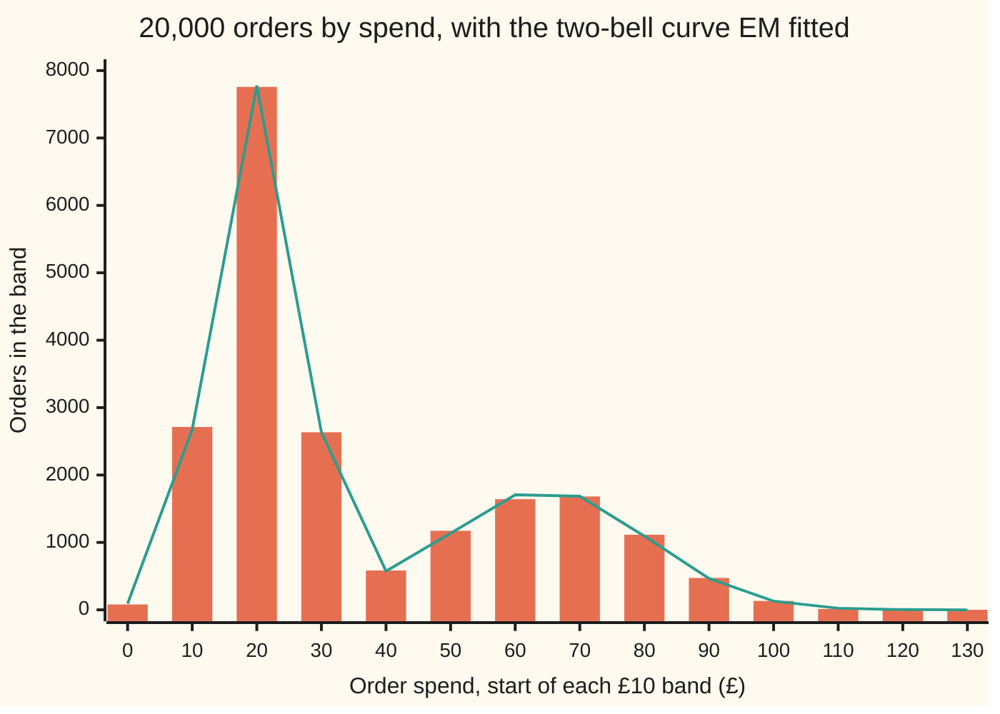
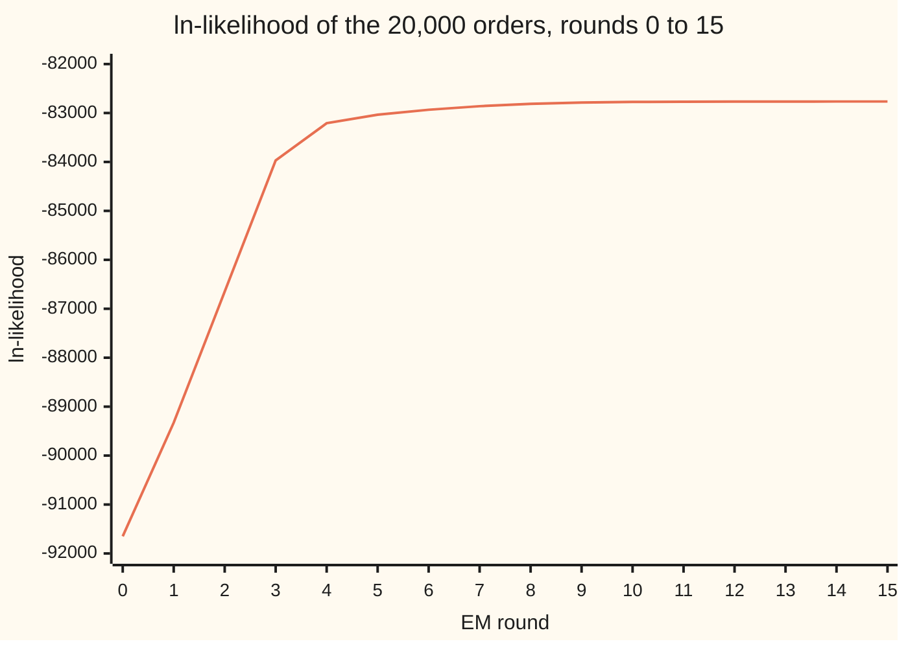

# EM: guess the hidden labels, refit, repeat until nothing moves

[Syllabus](../../../SYLLABUS.md) → [Applied and computational](../README.md) → [Machine Learning Mathematics](../README.md#s06) → EM

---

## General Overview

A shop has 20,000 past orders. Each one has a basket total in pounds. Plot how many orders fall in each £10 band and two humps appear. One tall, narrow hump sits near £25: people popping in for milk and bread, a **top-up shop**. A lower, wider hump sits near £70: the **weekly shop**.

The marketing team wants to know three things. What share of orders are weekly shops? What does each kind of shopper typically spend? And for a single £45 order, how likely is it to be a weekly shopper?

Nobody ticked a box saying which kind they were. That label is **hidden**. If the labels were known, the answer would be two averages and a count. If the two humps were known, each order could be labelled by asking which hump explains it better. Each half of the problem needs the other half's answer first.

The **EM algorithm** (expectation–maximisation) breaks the circle by taking turns. Guess the two humps. Use them to give every order a *probability* of being a weekly shop (the E-step). Refit the two humps, letting each order count towards each hump by that probability (the M-step). Repeat.

Each round the fit can only get better or stay level, and it stops when nothing moves. On this shop's orders it settles after 48 rounds: 34.56% weekly shops averaging £69.69, top-ups averaging £24.84, and a £45 order is a weekly shop with probability 0.936.

**EM replaces each hidden label by its probability under the current fit, refits as if those probabilities were counts, and repeats; no round can lower the likelihood, but where it stops depends on where it starts.**

**What kind of fact this is:** a method. That no round lowers the likelihood is a theorem, proved on this card in Why it works. That it finds the best fit is not promised, and this card shows two starts where it does not. The two-bell description of shoppers is a model, and the 20,000 orders are synthetic: made by a stated rule and seed, so the true labels are known and can be checked.

### The picture: the spend histogram and the fitted two-bell curve



Bars (orange): the orders counted in each £10 band. Line (green): how many orders the fitted mixture expects in each band, 20,000 times the area under the fitted curve over that band. The two agree to within a few percent in every busy band. The dip at £40 to £50 is where the two kinds of shopper overlap, and where labelling an order is hardest.

---

## The formula

Notation first, in words. Order $i$ has spend $x_i$ pounds, for $i$ from 1 to $n = 20{,}000$. The humps are bell curves ([Normal](../../09-Probability%20and%20statistics/04-Continuous%20Distributions/04-normal-distribution.md)): $k = 1$ is top-up, $k = 2$ weekly.

Bell $k$ has a centre $\mu_k$ (mu, its mean spend), a spread $\sigma_k$ (sigma, its standard deviation) and a **mixing weight** $\alpha_k$ (alpha, its share of orders), with $\alpha_1 + \alpha_2 = 1$. Its height at spend $x$ is $f(x;\mu,\sigma)$. The **responsibility** $r_{ik}$ is the chance, under the current fit, that order $i$ came from bell $k$. Σ means "add over all orders".

**The fit is judged by** the log-likelihood (ln of the chance of all the data, as on [Maximum likelihood](../../09-Probability%20and%20statistics/07-Sampling%20and%20Estimation/04-maximum-likelihood.md)):

$$\ell(\theta) = \sum_{i=1}^{n} \ln\big(\alpha_1 f(x_i;\mu_1,\sigma_1) + \alpha_2 f(x_i;\mu_2,\sigma_2)\big)$$

**E-step**, with the current $\theta$ held fixed:

$$r_{ik} = \frac{\alpha_k\, f(x_i;\mu_k,\sigma_k)}{\alpha_1 f(x_i;\mu_1,\sigma_1) + \alpha_2 f(x_i;\mu_2,\sigma_2)}$$

**M-step**, with the responsibilities held fixed, for each bell $k$:

$$n_k = \sum_i r_{ik}, \qquad \alpha_k = \frac{n_k}{n}, \qquad \mu_k = \frac{1}{n_k}\sum_i r_{ik}\,x_i, \qquad \sigma_k^2 = \frac{1}{n_k}\sum_i r_{ik}\,(x_i-\mu_k)^2$$

**Read it aloud:** split each order between the bells in proportion to share times height; refit each bell's share, mean and spread as weighted counts and averages; repeat until nothing moves, and the log-likelihood never falls on the way.

| Symbol | Plain meaning | In our example | Push it up and the answer… |
| --- | --- | --- | --- |
| $x_i$, $n$ | order $i$'s spend in pounds; the number of orders | £1.97 to £136.81; $n$ = 20,000 | more orders: estimates closer to the truth (200 orders put the weekly mean at £72.26) |
| $k$ | which bell: 1 top-up, 2 weekly | — | — |
| $\alpha_k$ | mixing weight: the share of orders bell $k$ produces | $\alpha_2$ = 0.3456 fitted | a bigger $\alpha_2$ tilts every order towards weekly |
| $\mu_k$ | bell $k$'s centre: its mean spend | £24.84 and £69.69 | that bell slides right |
| $\sigma_k$ | bell $k$'s spread: its standard deviation | £6.04 and £15.15 | that bell widens and claims more far-off orders |
| $f(x;\mu,\sigma)$ | the bell-curve height (normal density) at spend $x$ | — | — |
| $r_{ik}$ | responsibility: chance order $i$ came from bell $k$, given the current fit | $r_{i2}$ = 0.419 for a £40 order | — |
| $n_k$ | soft count: the responsibilities added up, orders counted fractionally | 2.508618 weekly among six orders, by hand | — |
| $\theta$ | all five numbers ($\alpha_2$, $\mu_1$, $\sigma_1$, $\mu_2$, $\sigma_2$) together; $\theta_{\text{old}}$ and $\theta_{\text{new}}$ are the fit before and after one round | settles after 48 rounds | — |
| $\ell(\theta)$ | log-likelihood: ln of the chance of all the orders under $\theta$ | −82,765.3 at the fit | higher is a better fit |
| $a$, $b$; $r_1$, $r_2$ | for one order, the two parts inside the logarithm (share times height); any two weights that are positive and add to 1 | for £40 at the fit, $b/(a+b)$ = 0.419 | — |
| $B$ | the lower bound on $\ell$ that each round pushes up (Why it works) | −25.584238 after one round, by hand | — |

### When it holds

- **Each kind of shopper really spends in a bell shape.** If weekly spends had a long right tail, EM would still fit two bells, but the weekly one would be dragged wide and the shares would be off.
- **The number of kinds is chosen in advance.** Ask for three and EM splits a hump whether or not a third kind exists.
- **The two bells must start different.** Start both bells at the same place and every order is split 50–50 forever; EM stops after 2 rounds at one wide bell, £40.35 with spread £23.62, counted twice.
- **No bell may shrink onto a single order.** A bell of spread near zero on one order makes the likelihood as large as you like. EM can fall into that hole (What breaks, below), so working code puts a floor under every spread.
- **Enough orders per bell.** With 200 orders the weekly mean comes out £72.26, not £69.69.

---

## Why it works

### Step 0: if the labels were known, this would be easy

Suppose each order carried a label, 1 for weekly and 0 for top-up. Fitting would be three lines of [Maximum likelihood](../../09-Probability%20and%20statistics/07-Sampling%20and%20Estimation/04-maximum-likelihood.md): the weekly share is the fraction labelled 1; each bell's mean is the average of its own orders; each spread is the root of their average squared gap. For our synthetic orders the labels *are* known, and this labelled fit gives share 0.3445, means £24.86 and £69.81.

EM puts a probability where the 0-or-1 label would be and runs the same three lines with every order counted fractionally. The rest of this section shows why this back-and-forth only goes uphill.

### Step 1: the E-step is Bayes' rule

Before seeing an order's spend, the chance it is a weekly shop is $\alpha_2$, the share. After seeing the spend $x$, [Bayes' rule](../../09-Probability%20and%20statistics/01-Chance%20and%20Events/06-bayes-rule.md) multiplies that prior chance by how well the weekly bell explains $x$, its height $f(x;\mu_2,\sigma_2)$, and divides by the total over both bells. That is the E-step formula. The name: the responsibility is the expected value of the hidden 0-or-1 label, so this is the **E**xpectation step.

### Step 2: the M-step is weighted maximum likelihood

Hold the responsibilities fixed and treat order $i$ as $r_{i2}$ of a weekly order plus $r_{i1}$ of a top-up. The weekly bell's weighted log-likelihood is $\sum_i r_{i2}\ln f(x_i;\mu_2,\sigma_2)$. Its slope in $\mu_2$ is $\sum_i r_{i2}(x_i-\mu_2)/\sigma_2^2$, zero exactly when $\mu_2 = \sum_i r_{i2}x_i / n_2$, the weighted average.

The normal-model algebra on Maximum likelihood, with each order counted $r_{i2}$ times, gives the weighted average squared gap for $\sigma_2^2$. Maximising $n_1\ln\alpha_1 + n_2\ln\alpha_2$ with $\alpha_1+\alpha_2=1$ gives $\alpha_k = n_k/n$. This step **M**aximises, hence the name.

### Step 3: a lower bound that touches the curve

The trouble with $\ell$ is the logarithm of a *sum*, which has no tidy maximum. The fix is an inequality. Write the two parts inside the logarithm for one order as $a = \alpha_1 f(x;\mu_1,\sigma_1)$ and $b = \alpha_2 f(x;\mu_2,\sigma_2)$. For any two weights $r_1, r_2$ that are positive and add to 1:

$$\ln(a+b) \;\ge\; r_1 \ln\frac{a}{r_1} + r_2\ln\frac{b}{r_2},$$

with equality exactly when $r_1 = a/(a+b)$ and $r_2 = b/(a+b)$. Those are the E-step's responsibilities. This is [Jensen's inequality](../../09-Probability%20and%20statistics/02-Random%20Variables/06-jensens-inequality.md) for the logarithm; the fold proves it in two lines.

Add the right-hand side over all orders and call it $B$. With the responsibilities frozen, $B$ is a sum of *logarithms of single bells*, and the M-step of Step 2 maximises it exactly. (The $-r\ln r$ pieces do not involve $\theta$ and come along unchanged.)

<details>
<summary>Proof of the inequality, from ln y ≤ y − 1</summary>

The curve $\ln y$ lies below its tangent line at $y = 1$, so $\ln y \le y - 1$ for every $y > 0$, with equality only at $y = 1$. Put $S = a + b$. Then

$$r_1\ln\frac{a}{r_1} + r_2\ln\frac{b}{r_2} - \ln S = r_1\ln\frac{a}{r_1 S} + r_2\ln\frac{b}{r_2 S} \le r_1\Big(\frac{a}{r_1 S}-1\Big) + r_2\Big(\frac{b}{r_2 S}-1\Big) = \frac{a+b}{S} - 1 = 0.$$

The first equality uses $r_1 + r_2 = 1$. Equality throughout needs $a/(r_1 S) = 1$ and $b/(r_2 S) = 1$, that is $r_1 = a/S$ and $r_2 = b/S$.

</details>

### Step 4: the sandwich

Call the fit before a round $\theta_{\text{old}}$ and after it $\theta_{\text{new}}$. Then

$$\ell(\theta_{\text{new}}) \;\ge\; B(\theta_{\text{new}}) \;\ge\; B(\theta_{\text{old}}) \;=\; \ell(\theta_{\text{old}}).$$

Read right to left. The E-step chose the weights that make the bound touch $\ell$ at the old fit, so $B(\theta_{\text{old}}) = \ell(\theta_{\text{old}})$. The M-step moved to the top of $B$, so $B$ went up or stayed. And $B$ never sits above $\ell$ anywhere. So $\ell$ went up or stayed. That is the whole proof that EM climbs.

On the six orders worked by hand below: $\ell$ before the round is −26.375554, the bound before is also −26.375554 (it touches), the bound after is −25.584238, and $\ell$ after is −25.564328. The check confirms the climb in every one of the 48 rounds on the 20,000 orders: rounds where the log-likelihood fell, 0 of 48.

### Step 5: what climbing does not promise

A climber that only goes up stops where the ground is flat. From the start used here, that is the sensible fit, beside the labelled one. But flat ground can also be a lower peak, or a balance point with slopes on either side (the identical start). And a mixture's likelihood has no top at all (the needle start). The theorem guarantees the climb, nothing more; Wu (Sources) gives the careful conditions.

---

## Worked numbers, by hand

Six orders, small enough to follow every number: £15, £22, £28, £40, £60 and £75. Start with share 0.5, centres £20 and £60, both spreads £10.

With equal shares and spreads the odds that an order is weekly come out neatly. The ratio of the bell heights is $e^{-(x-60)^2/200} \big/ e^{-(x-20)^2/200}$, and $(x-20)^2 - (x-60)^2 = 80x - 3200$, so the odds are $e^{0.4(x-40)}$: even at £40, halfway between the centres. Then $r = \text{odds}/(1+\text{odds})$.

| Step | Arithmetic | Value |
| --- | --- | --- |
| E: order £15 | odds $e^{0.4 \times (-25)}$ = 0.000045 | $r$ = 0.000045 |
| E: order £22 | odds $e^{0.4 \times (-18)}$ = 0.000747 | $r$ = 0.000746 |
| E: order £28 | odds $e^{0.4 \times (-12)}$ = 0.008230 | $r$ = 0.008163 |
| E: order £40 | odds $e^{0}$ = 1 | $r$ = 0.500000 |
| E: order £60 | odds $e^{0.4 \times 20}$ = 2980.957987 | $r$ = 0.999665 |
| E: order £75 | odds $e^{0.4 \times 35}$ = 1202604.284165 | $r$ = 0.999999 |
| M: soft counts | add the $r$: weekly $n_2$; top-up $6 - n_2$ | 2.508618 and 3.491382 |
| M: weekly share | 2.508618 / 6 | 0.4181 |
| M: weekly mean | $\sum r x$ = 155.225462, then / 2.508618 | £61.88 |
| M: top-up mean | $\sum (1-r) x$ = 84.774538, then / 3.491382 | £24.28 |
| M: spreads | same weighting on the squared gaps from each new mean | £8.10 and £13.03 |
| ln-likelihood | before the round → after | −26.375554 → −25.564328 |
| **settled** | repeat until no number moves by 0.000000001 | **18 rounds: share 0.3332, top-up £26.27 (spread £9.22), weekly £67.48 (spread £7.56)** |

The £40 order is split evenly, half an order to each bell. The top-up mean rises from the guessed £20 to £24.28, pulled up by £28 and by that half of £40. The weekly mean rises from £60 to £61.88: £75 pulls it up more than the half of £40 pulls it down. After 18 rounds the six orders say that about two in six are weekly shops, and the weekly bell sits between £60 and £75.

On the 20,000 orders, started from share 0.5, centres £30 and £50, spreads £20, EM settles after 48 rounds at **share 0.3456, top-up £24.84 (spread £6.04), weekly £69.69 (spread £15.15)**. The orders were made with share 0.35, centres £25 and £70, spreads £6 and £15; the fit with the hidden labels revealed is 0.3445, £24.86 (£6.06), £69.81 (£15.03). EM, never shown a label, lands beside it. For the marketing team, the chance each spend is a weekly shop:

```
order spend   chance it is a weekly shop
     £30      ▏                                      0.010
     £35      ██                                     0.059
     £40      ████████████████                       0.419
     £45      ███████████████████████████████████    0.936
     £50      █████████████████████████████████████  0.998
```

An order is even odds at £40.59. A £45 order is a weekly shop with probability 0.936; a £30 order almost never is.

### What breaks if you drop a piece

Same 20,000 orders, same start unless stated. The right answer: share 0.3456, weekly mean £69.69, weekly spread £15.15, ln-likelihood −82,765.3.

| Mistake | Comes out at | What went wrong |
| --- | --- | --- |
| Hard labels: give each order wholly to its likelier bell (the [k-means](06-k-means-and-clustering.md) habit) | share 0.3371, weekly £70.61, spread £14.18; ln-likelihood −82,789.6 | Overlap orders are handed out whole: every order below the even-odds point goes wholly to top-up, so the weekly bell loses its lower tail, narrows and slides right |
| Leave the share out of the E-step | share 0.4028, weekly £64.05, spread £19.97; ln-likelihood −83,089.0 | Bayes' rule without its prior: overlap orders are pushed to the rarer weekly bell, which widens and slides left |
| Start both bells identical: share 0.5, both at £40, spread £20 | both bells £40.35, spread £23.62, after 2 rounds; ln-likelihood −91,624.7 | Every order is split 50–50, both bells get identical refits, and the tie is never broken |
| Needle start: share 0.05, weekly bell at £130, spread £2 | weekly spread by round 5.8776, 6.7367, 5.9419, 3.9810, 1.1081, then $1.75 \times 10^{-12}$, then exactly 0, ending on the single £136.81 order | The narrow bell crawls onto the largest order and shrinks to nothing. The ln-likelihood climbs towards plus infinity: −91,626.0 to −91,624.2 over five rounds, then a jump to −91,597.2 as the spread nears zero. Once the spread is exactly 0 the bell formula divides by zero, so no further round can be computed |

The last row is the deepest: a bell of spread zero on one order has infinite height, so a mixture's likelihood has no top, and EM is climbing honestly when it falls in.

---

## How it moves: the climb, round by round

The puzzle: EM changes all five numbers at once every round, yet the score only goes one way. Here is the run on the 20,000 orders, from the deliberately poor start of centres £30 and £50.

| Round | Weekly share | Top-up mean (spread) | Weekly mean (spread) | ln-likelihood |
| --- | --- | --- | --- | --- |
| 0 | 0.5000 | £30.00 (£20.00) | £50.00 (£20.00) | −91,649.3 |
| 1 | 0.4845 | £29.46 (£15.02) | £51.93 (£25.53) | −89,328.5 |
| 2 | 0.4676 | £27.16 (£10.40) | £55.36 (£25.44) | −86,650.4 |
| 3 | 0.4387 | £25.36 (£6.99) | £59.52 (£23.55) | −83,969.0 |
| 5 | 0.3928 | £24.54 (£5.71) | £64.78 (£19.69) | −83,035.1 |
| 10 | 0.3520 | £24.75 (£5.96) | £69.05 (£15.77) | −82,774.2 |
| 20 | 0.3457 | £24.84 (£6.04) | £69.69 (£15.15) | −82,765.3 |
| 48 | 0.3456 | £24.84 (£6.04) | £69.69 (£15.15) | −82,765.3 |

The top-up bell finds its place first: the crowd of orders near £25 votes for it almost unanimously, and by round 3 its spread has shrunk from £20 to £6.99. The weekly bell has to win the overlap orders a fraction at a time; its spread swings up to £25.53 before settling. By round 20 the means and spreads have stopped to the penny; later rounds move only the share's fourth decimal and digits past it.



The one line is the log-likelihood after each round: steep for three rounds, then flat near −82,765, and never dipping, as Step 4 promised.

---

## Code, from first principles, and it actually runs

The script makes the 20,000 orders with a written-out random generator (SplitMix64, seed 2026) and the Box-Muller recipe for bell-curve draws, then runs EM from the formulas above. It takes **three independent roads**. Road 1 is EM itself. Road 2 nudges each of the five numbers and measures the log-likelihood's slope directly, with no EM formula: the largest slope is 0.000004 at EM's answer and 1243.3 at the start. Road 3 reveals the hidden labels, which only synthetic data allows, and fits each group directly. It also checks the climb in every round, the bound sandwich by hand, and each row of What breaks.

### Python

```python
# EM for two kinds of shopper -- the check behind the card.  Standard library only.
# The 20,000 order totals are synthetic: made by a stated rule and seed (SplitMix64, Box-Muller).
from math import exp, log, sqrt, pi, cos

MASK = (1 << 64) - 1
class SplitMix64:
    def __init__(self, seed): self.s = seed
    def next(self):
        self.s = z = (self.s + 0x9E3779B97F4A7C15) & MASK
        z = ((z ^ (z >> 30)) * 0xBF58476D1CE4E5B9) & MASK
        z = ((z ^ (z >> 27)) * 0x94D049BB133111EB) & MASK
        return z ^ (z >> 31)
    def uniform(self): return (self.next() >> 11) * 2.0 ** -53
    def normal(self):                                  # Box-Muller: two uniforms -> one bell draw
        u1, u2 = 1.0 - self.uniform(), self.uniform()
        return sqrt(-2.0 * log(u1)) * cos(2.0 * pi * u2)

def orders(n, share, m1, s1, m2, s2, seed=2026):       # spends, and the hidden label of each
    g, xs, weekly = SplitMix64(seed), [], []
    for _ in range(n):
        w = g.uniform() < share
        xs.append(m2 + s2 * g.normal() if w else m1 + s1 * g.normal()); weekly.append(w)
    return xs, weekly

def log_bell(x, m, s): return -0.5 * ((x - m) / s) * ((x - m) / s) - log(s * sqrt(2.0 * pi))
def mix(x, th):                    # ln of the two-bell density at x, and r = chance x is weekly
    a, m1, s1, m2, s2 = th
    l1, l2 = log(1.0 - a) + log_bell(x, m1, s1), log(a) + log_bell(x, m2, s2)
    hi = max(l1, l2); e1, e2 = exp(l1 - hi), exp(l2 - hi)
    return hi + log(e1 + e2), e2 / (e1 + e2)
def loglik(xs, th): return sum(mix(x, th)[0] for x in xs)

def m_step(xs, rs):                # weighted maximum likelihood: order i counts r_i as weekly
    n2 = sum(rs); n1 = len(xs) - n2
    m1 = sum((1 - r) * x for r, x in zip(rs, xs)) / n1
    m2 = sum(r * x for r, x in zip(rs, xs)) / n2
    s1 = sqrt(sum((1 - r) * (x - m1) * (x - m1) for r, x in zip(rs, xs)) / n1)
    s2 = sqrt(sum(r * (x - m2) * (x - m2) for r, x in zip(rs, xs)) / n2)
    return (n2 / len(xs), m1, s1, m2, s2)
def em_round(xs, th, hard=False, share_in_e=True):
    t = th if share_in_e else (0.5,) + th[1:]          # mistake: E-step ignores the share
    rs = [mix(x, t)[1] for x in xs]
    if hard: rs = [1.0 if r > 0.5 else 0.0 for r in rs]   # mistake: hard labels
    return m_step(xs, rs)
def run(xs, th, tol=1e-9, cap=1000, **kw):            # repeat until no parameter moves 1e-9
    lls, path = [loglik(xs, th)], [th]
    for k in range(1, cap + 1):
        new = em_round(xs, th, **kw); moved = max(abs(u - v) for u, v in zip(th, new)); th = new
        lls.append(loglik(xs, th)); path.append(th)
        if moved < tol: break
    return th, lls, k, path
def bound(xs, rs, th):             # the lower bound B: sum of r ln(part / r), 0 ln 0 = 0
    a, m1, s1, m2, s2 = th; b = 0.0
    for r, x in zip(rs, xs):
        if r < 1: b += (1 - r) * (log(1 - a) + log_bell(x, m1, s1) - log(1 - r))
        if r > 0: b += r * (log(a) + log_bell(x, m2, s2) - log(r))
    return b
def slopes(xs, th, h=1e-5):        # road 2: slope of ln-likelihood by nudging, no EM formulas
    out = []
    for i in range(5):
        up = list(th); dn = list(th); up[i] += h; dn[i] -= h
        out.append((loglik(xs, up) - loglik(xs, dn)) / (2 * h))
    return out
def show(th): return "share %.4f  top-up %.2f sd %.2f  weekly %.2f sd %.2f" % th

# ---- by hand: six orders, one round from a start of 20 and 60, spread 10, share 0.5 ----
six, start6 = [15.0, 22.0, 28.0, 40.0, 60.0, 75.0], (0.5, 20.0, 10.0, 60.0, 10.0)
r6 = [mix(x, start6)[1] for x in six]
for x, r in zip(six, r6):
    print("hand E  order %5.2f  x-40 %6.2f  odds e^(0.4(x-40)) %15.6f  r %.6f" % (x, x - 40, exp(0.4 * (x - 40)), r))
new6 = m_step(six, r6)
print("hand M  soft count weekly %.6f  top-up %.6f" % (sum(r6), 6 - sum(r6)))
print("hand M  sum of r*spend weekly %.6f  top-up %.6f" % (sum(r * x for r, x in zip(r6, six)), sum((1 - r) * x for r, x in zip(r6, six))))
print("hand M ", show(new6))
l_old, b_old, b_new, l_new = loglik(six, start6), bound(six, r6, start6), bound(six, r6, new6), loglik(six, new6)
print("hand ln-lik before %.6f  bound before %.6f  bound after %.6f  ln-lik after %.6f" % (l_old, b_old, b_new, l_new))
fit6, lls6, k6, _ = run(six, start6)
print("six orders settle after %d rounds: %s  ln-lik %.6f" % (k6, show(fit6), lls6[-1]))

# ---- the shop: 20,000 orders, 35% weekly shoppers N(70, 15), the rest top-ups N(25, 6) ----
xs, weekly = orders(20000, 0.35, 25.0, 6.0, 70.0, 15.0)
print("orders %d  hidden weekly %d  smallest %.2f  largest %.2f" % (len(xs), sum(weekly), min(xs), max(xs)))
start = (0.5, 30.0, 20.0, 50.0, 20.0)
fit, lls, rounds, path = run(xs, start)
for k in (0, 1, 2, 3, 5, 10, 20):
    print("round %2d  %s  ln-lik %.1f" % (k, show(path[k]), lls[k]))
print("settled after %d rounds: %s  ln-lik %.1f" % (rounds, show(fit), lls[-1]))
gains = [lls[k + 1] - lls[k] for k in range(rounds)]
print("chart, ln-lik rounds 0-15:", " ".join("%.0f" % v for v in lls[:16]))
print("rounds where ln-lik fell: %d of %d" % (sum(1 for g in gains if g < -1e-9), rounds))
lab = m_step(xs, [1.0 if w else 0.0 for w in weekly])
print("labels known: %s" % show(lab))
sl_fit, sl_start = slopes(xs, fit), slopes(xs, start)
print("largest slope at the fit %.6f  at the start %.1f" % (max(abs(v) for v in sl_fit), max(abs(v) for v in sl_start)))
rr = [mix(x, fit)[1] for x in (30.0, 35.0, 40.0, 45.0, 50.0)]
print("r at 30 35 40 45 50:", " ".join("%.3f" % v for v in rr))
lo, hi = 30.0, 60.0
for _ in range(60):
    mid = (lo + hi) / 2; lo, hi = (mid, hi) if mix(mid, fit)[1] < 0.5 else (lo, mid)
print("an order is even odds at %.2f" % lo)

# ---- what breaks ----
hard, _, _, _ = run(xs, start, hard=True)
print("hard labels: %s  ln-lik %.1f" % (show(hard), loglik(xs, hard)))
noshare, _, _, _ = run(xs, start, share_in_e=False)
print("share left out of E: %s  ln-lik %.1f" % (show(noshare), loglik(xs, noshare)))
sym, lsym, ks, _ = run(xs, (0.5, 40.0, 20.0, 40.0, 20.0))
print("same start for both: %s  ln-lik %.1f  after %d rounds" % (show(sym), lsym[-1], ks))
th, sig, ll = (0.05, 40.0, 25.0, 130.0, 2.0), [], []
while th[4] > 0 and len(sig) < 12:                    # run until the spread is exactly zero
    th = em_round(xs, th); sig.append(th[4]); ll.append(loglik(xs, th) if th[4] > 0 else float("nan"))
print("needle start: weekly sd by round", " ".join("%.4f" % v for v in sig[:-2]), "then %.2e, then exactly %.1f" % (sig[-2], sig[-1]))
print("needle start: ln-lik by round", " ".join("%.1f" % v for v in ll[:-1]), "then none: the bell formula divides by the zero spread")
print("needle start: weekly bell sits on %.2f, share %.6f" % (th[3], th[0]))

# ---- the picture: spend histogram in 10-pound bins, and the fitted two-bell curve ----
counts = [sum(1 for x in xs if 10 * b <= x < 10 * b + 10) for b in range(14)]
area = lambda a, b, n=100: sum((1 if j in (0, n) else 4 if j % 2 else 2) * exp(mix(a + j * (b - a) / n, fit)[0]) for j in range(n + 1)) * (b - a) / (3 * n)
print("chart, orders per bin:", " ".join(str(c) for c in counts))
print("chart, fitted per bin:", " ".join("%.0f" % (20000 * area(10 * b, 10 * b + 10)) for b in range(14)))

# ---- try changing ----
near, _ = orders(20000, 0.35, 25.0, 6.0, 45.0, 15.0)
fn, _, kn2, _ = run(near, start)
print("try: weekly mean 45, rounds %d: %s" % (kn2, show(fn)))
small, _ = orders(200, 0.35, 25.0, 6.0, 70.0, 15.0)
fs, _, _, _ = run(small, start)
print("try: 200 orders: %s" % show(fs))
sw, _, _, _ = run(xs, (0.5, 50.0, 20.0, 30.0, 20.0))
print("try: starts swapped: %s" % show(sw))

assert all(g > -1e-9 for g in gains) and all(b - a > -1e-9 for a, b in zip(lls6, lls6[1:])), "EM never lowers ln-lik"
assert abs(b_old - l_old) < 1e-9 and l_old < b_new <= l_new, "bound touches before, sandwiched after"
assert max(abs(v) for v in sl_fit) < 0.01 < max(abs(v) for v in sl_start), "fit is a flat point; start is not"
assert abs(fit[0] - lab[0]) < 0.01 and all(abs(fit[i] - lab[i]) < 0.5 for i in range(1, 5)), "EM finds the labelled fit"
assert abs(sym[1] - sym[3]) < 1e-9 and lsym[-1] < lls[-1] - 1000, "identical start never splits"
assert sig[-1] == 0.0 and all(b > a for a, b in zip(ll, ll[1:-1])), "needle start climbs, then collapses onto one order"
print("ALL CHECKS PASS")
```

**Ran 2026-11-11 on macOS, Python 3.14.10, standard library only. All checks passed. Output, pasted from the run:**

```
hand E  order 15.00  x-40 -25.00  odds e^(0.4(x-40))        0.000045  r 0.000045
hand E  order 22.00  x-40 -18.00  odds e^(0.4(x-40))        0.000747  r 0.000746
hand E  order 28.00  x-40 -12.00  odds e^(0.4(x-40))        0.008230  r 0.008163
hand E  order 40.00  x-40   0.00  odds e^(0.4(x-40))        1.000000  r 0.500000
hand E  order 60.00  x-40  20.00  odds e^(0.4(x-40))     2980.957987  r 0.999665
hand E  order 75.00  x-40  35.00  odds e^(0.4(x-40))  1202604.284165  r 0.999999
hand M  soft count weekly 2.508618  top-up 3.491382
hand M  sum of r*spend weekly 155.225462  top-up 84.774538
hand M  share 0.4181  top-up 24.28 sd 8.10  weekly 61.88 sd 13.03
hand ln-lik before -26.375554  bound before -26.375554  bound after -25.584238  ln-lik after -25.564328
six orders settle after 18 rounds: share 0.3332  top-up 26.27 sd 9.22  weekly 67.48 sd 7.56  ln-lik -25.223038
orders 20000  hidden weekly 6890  smallest 1.97  largest 136.81
round  0  share 0.5000  top-up 30.00 sd 20.00  weekly 50.00 sd 20.00  ln-lik -91649.3
round  1  share 0.4845  top-up 29.46 sd 15.02  weekly 51.93 sd 25.53  ln-lik -89328.5
round  2  share 0.4676  top-up 27.16 sd 10.40  weekly 55.36 sd 25.44  ln-lik -86650.4
round  3  share 0.4387  top-up 25.36 sd 6.99  weekly 59.52 sd 23.55  ln-lik -83969.0
round  5  share 0.3928  top-up 24.54 sd 5.71  weekly 64.78 sd 19.69  ln-lik -83035.1
round 10  share 0.3520  top-up 24.75 sd 5.96  weekly 69.05 sd 15.77  ln-lik -82774.2
round 20  share 0.3457  top-up 24.84 sd 6.04  weekly 69.69 sd 15.15  ln-lik -82765.3
settled after 48 rounds: share 0.3456  top-up 24.84 sd 6.04  weekly 69.69 sd 15.15  ln-lik -82765.3
chart, ln-lik rounds 0-15: -91649 -89328 -86650 -83969 -83209 -83035 -82934 -82861 -82814 -82787 -82774 -82769 -82767 -82766 -82765 -82765
rounds where ln-lik fell: 0 of 48
labels known: share 0.3445  top-up 24.86 sd 6.06  weekly 69.81 sd 15.03
largest slope at the fit 0.000004  at the start 1243.3
r at 30 35 40 45 50: 0.010 0.059 0.419 0.936 0.998
an order is even odds at 40.59
hard labels: share 0.3371  top-up 24.96 sd 6.10  weekly 70.61 sd 14.18  ln-lik -82789.6
share left out of E: share 0.4028  top-up 24.36 sd 5.58  weekly 64.05 sd 19.97  ln-lik -83089.0
same start for both: share 0.5000  top-up 40.35 sd 23.62  weekly 40.35 sd 23.62  ln-lik -91624.7  after 2 rounds
needle start: weekly sd by round 5.8776 6.7367 5.9419 3.9810 1.1081 then 1.75e-12, then exactly 0.0
needle start: ln-lik by round -91626.0 -91625.0 -91624.8 -91624.6 -91624.2 -91597.2 then none: the bell formula divides by the zero spread
needle start: weekly bell sits on 136.81, share 0.000050
chart, orders per bin: 80 2713 7758 2634 584 1173 1642 1682 1114 473 132 12 2 1
chart, fitted per bin: 91 2676 7778 2636 575 1136 1707 1685 1093 466 130 24 3 0
try: weekly mean 45, rounds 284: share 0.3305  top-up 24.83 sd 6.08  weekly 45.72 sd 14.61
try: 200 orders: share 0.3321  top-up 24.53 sd 5.88  weekly 72.26 sd 13.77
try: starts swapped: share 0.6544  top-up 69.69 sd 15.15  weekly 24.84 sd 6.04
ALL CHECKS PASS
```

### Rust

Same orders, same rounds, same printout. Rust's adding of a long list is written out to match Python's, so the two print the same digits.

```rust
// EM for two kinds of shopper -- the same check as em_algorithm_check.py, in Rust.
// Standard library only, no crates.  The 20,000 order totals are synthetic (SplitMix64, Box-Muller).
// psum adds a list the way Python's sum() does (Neumaier's compensated sum), so both print the same digits.
// Compile: rustc --edition 2021 -O em_algorithm_check.rs -o /tmp/em_algorithm_check
use std::f64::consts::PI;
type Th = [f64; 5]; // weekly share, top-up mean, top-up sd, weekly mean, weekly sd

struct SplitMix64 { s: u64 }
impl SplitMix64 {
    fn next(&mut self) -> u64 {
        self.s = self.s.wrapping_add(0x9E3779B97F4A7C15);
        let z = (self.s ^ (self.s >> 30)).wrapping_mul(0xBF58476D1CE4E5B9);
        let z = (z ^ (z >> 27)).wrapping_mul(0x94D049BB133111EB);
        z ^ (z >> 31)
    }
    fn uniform(&mut self) -> f64 { (self.next() >> 11) as f64 / 9007199254740992.0 }
    fn normal(&mut self) -> f64 { // Box-Muller: two uniforms -> one bell draw
        let (u1, u2) = (1.0 - self.uniform(), self.uniform());
        (-2.0 * u1.ln()).sqrt() * (2.0 * PI * u2).cos()
    }
}

fn orders(n: usize, share: f64, m1: f64, s1: f64, m2: f64, s2: f64) -> (Vec<f64>, Vec<bool>) {
    let mut g = SplitMix64 { s: 2026 };
    let (mut xs, mut weekly) = (Vec::new(), Vec::new());
    for _ in 0..n {
        let w = g.uniform() < share;
        xs.push(if w { m2 + s2 * g.normal() } else { m1 + s1 * g.normal() }); weekly.push(w);
    }
    (xs, weekly)
}

fn psum<I: Iterator<Item = f64>>(it: I) -> f64 {
    let (mut f, mut c) = (0.0f64, 0.0f64);
    for x in it { let t = f + x; c += if f.abs() >= x.abs() { (f - t) + x } else { (x - t) + f }; f = t; }
    if c != 0.0 && c.is_finite() { f + c } else { f }
}
fn log_bell(x: f64, m: f64, s: f64) -> f64 { -0.5 * ((x - m) / s) * ((x - m) / s) - (s * (2.0 * PI).sqrt()).ln() }
fn mix(x: f64, th: &Th) -> (f64, f64) { // ln of the two-bell density at x, and r = chance x is weekly
    let (l1, l2) = ((1.0 - th[0]).ln() + log_bell(x, th[1], th[2]), th[0].ln() + log_bell(x, th[3], th[4]));
    let hi = l1.max(l2);
    let (e1, e2) = ((l1 - hi).exp(), (l2 - hi).exp());
    (hi + (e1 + e2).ln(), e2 / (e1 + e2))
}
fn loglik(xs: &[f64], th: &Th) -> f64 { psum(xs.iter().map(|&x| mix(x, th).0)) }

fn m_step(xs: &[f64], rs: &[f64]) -> Th { // weighted maximum likelihood: order i counts r_i as weekly
    let p = || rs.iter().zip(xs.iter());
    let n2 = psum(rs.iter().cloned()); let n1 = xs.len() as f64 - n2;
    let m1 = psum(p().map(|(r, x)| (1.0 - r) * x)) / n1;
    let m2 = psum(p().map(|(r, x)| r * x)) / n2;
    let s1 = (psum(p().map(|(r, x)| (1.0 - r) * (x - m1) * (x - m1))) / n1).sqrt();
    let s2 = (psum(p().map(|(r, x)| r * (x - m2) * (x - m2))) / n2).sqrt();
    [n2 / xs.len() as f64, m1, s1, m2, s2]
}
fn em_round(xs: &[f64], th: &Th, hard: bool, share_in_e: bool) -> Th {
    let mut t = *th; if !share_in_e { t[0] = 0.5 } // mistake: E-step ignores the share
    let mut rs: Vec<f64> = xs.iter().map(|&x| mix(x, &t).1).collect();
    if hard { rs = rs.iter().map(|&r| if r > 0.5 { 1.0 } else { 0.0 }).collect() } // mistake: hard labels
    m_step(xs, &rs)
}
fn run(xs: &[f64], start: Th, hard: bool, share_in_e: bool) -> (Th, Vec<f64>, usize, Vec<Th>) {
    let (mut th, mut lls, mut path, mut k) = (start, vec![loglik(xs, &start)], vec![start], 0);
    for kk in 1..=1000 {
        let new = em_round(xs, &th, hard, share_in_e);
        let moved = (0..5).map(|i| (th[i] - new[i]).abs()).fold(0.0f64, f64::max);
        th = new; k = kk;
        lls.push(loglik(xs, &th)); path.push(th);
        if moved < 1e-9 { break }
    }
    (th, lls, k, path)
}
fn bound(xs: &[f64], rs: &[f64], th: &Th) -> f64 { // the lower bound B: sum of r ln(part / r)
    let mut b = 0.0; for (&r, &x) in rs.iter().zip(xs.iter()) {
        if r < 1.0 { b += (1.0 - r) * ((1.0 - th[0]).ln() + log_bell(x, th[1], th[2]) - (1.0 - r).ln()) }
        if r > 0.0 { b += r * (th[0].ln() + log_bell(x, th[3], th[4]) - r.ln()) }
    } b
}
fn slopes(xs: &[f64], th: &Th) -> f64 { // road 2: largest slope of ln-likelihood by nudging
    let h = 1e-5;
    (0..5).map(|i| {
        let (mut up, mut dn) = (*th, *th); up[i] += h; dn[i] -= h;
        ((loglik(xs, &up) - loglik(xs, &dn)) / (2.0 * h)).abs()
    }).fold(0.0f64, f64::max)
}
fn show(t: &Th) -> String { format!("share {:.4}  top-up {:.2} sd {:.2}  weekly {:.2} sd {:.2}", t[0], t[1], t[2], t[3], t[4]) }
fn join(v: &[f64], d: usize) -> String { v.iter().map(|x| format!("{:.*}", d, x)).collect::<Vec<_>>().join(" ") }

fn main() {
    // ---- by hand: six orders, one round from a start of 20 and 60, spread 10, share 0.5 ----
    let six = [15.0, 22.0, 28.0, 40.0, 60.0, 75.0];
    let start6: Th = [0.5, 20.0, 10.0, 60.0, 10.0];
    let r6: Vec<f64> = six.iter().map(|&x| mix(x, &start6).1).collect();
    for (&x, &r) in six.iter().zip(r6.iter()) { println!("hand E  order {:5.2}  x-40 {:6.2}  odds e^(0.4(x-40)) {:15.6}  r {:.6}", x, x - 40.0, (0.4 * (x - 40.0)).exp(), r) }
    let new6 = m_step(&six, &r6);
    println!("hand M  soft count weekly {:.6}  top-up {:.6}", psum(r6.iter().cloned()), 6.0 - psum(r6.iter().cloned()));
    println!("hand M  sum of r*spend weekly {:.6}  top-up {:.6}", psum(r6.iter().zip(six.iter()).map(|(r, x)| r * x)), psum(r6.iter().zip(six.iter()).map(|(r, x)| (1.0 - r) * x)));
    println!("hand M  {}", show(&new6));
    let (l_old, b_old, b_new, l_new) = (loglik(&six, &start6), bound(&six, &r6, &start6), bound(&six, &r6, &new6), loglik(&six, &new6));
    println!("hand ln-lik before {:.6}  bound before {:.6}  bound after {:.6}  ln-lik after {:.6}", l_old, b_old, b_new, l_new);
    let (fit6, lls6, k6, _) = run(&six, start6, false, true);
    println!("six orders settle after {} rounds: {}  ln-lik {:.6}", k6, show(&fit6), lls6[lls6.len() - 1]);

    // ---- the shop: 20,000 orders, 35% weekly shoppers N(70, 15), the rest top-ups N(25, 6) ----
    let (xs, weekly) = orders(20000, 0.35, 25.0, 6.0, 70.0, 15.0);
    let (lo_x, hi_x) = xs.iter().fold((f64::MAX, f64::MIN), |(a, b), &x| (a.min(x), b.max(x)));
    println!("orders {}  hidden weekly {}  smallest {:.2}  largest {:.2}", xs.len(), weekly.iter().filter(|&&w| w).count(), lo_x, hi_x);
    let start: Th = [0.5, 30.0, 20.0, 50.0, 20.0];
    let (fit, lls, rounds, path) = run(&xs, start, false, true);
    for k in [0usize, 1, 2, 3, 5, 10, 20] { println!("round {:2}  {}  ln-lik {:.1}", k, show(&path[k]), lls[k]) }
    println!("settled after {} rounds: {}  ln-lik {:.1}", rounds, show(&fit), lls[lls.len() - 1]);
    let gains: Vec<f64> = (0..rounds).map(|k| lls[k + 1] - lls[k]).collect();
    println!("chart, ln-lik rounds 0-15: {}", join(&lls[..16], 0));
    println!("rounds where ln-lik fell: {} of {}", gains.iter().filter(|&&g| g < -1e-9).count(), rounds);
    let lab = m_step(&xs, &weekly.iter().map(|&w| if w { 1.0 } else { 0.0 }).collect::<Vec<f64>>());
    println!("labels known: {}", show(&lab));
    let (sl_fit, sl_start) = (slopes(&xs, &fit), slopes(&xs, &start));
    println!("largest slope at the fit {:.6}  at the start {:.1}", sl_fit, sl_start);
    let rr: Vec<f64> = [30.0, 35.0, 40.0, 45.0, 50.0].iter().map(|&x| mix(x, &fit).1).collect();
    println!("r at 30 35 40 45 50: {}", join(&rr, 3));
    let (mut lo, mut hi) = (30.0f64, 60.0f64);
    for _ in 0..60 { let mid = (lo + hi) / 2.0; if mix(mid, &fit).1 < 0.5 { lo = mid } else { hi = mid } }
    println!("an order is even odds at {:.2}", lo);

    // ---- what breaks ----
    let hard = run(&xs, start, true, true).0;
    println!("hard labels: {}  ln-lik {:.1}", show(&hard), loglik(&xs, &hard));
    let noshare = run(&xs, start, false, false).0;
    println!("share left out of E: {}  ln-lik {:.1}", show(&noshare), loglik(&xs, &noshare));
    let (sym, lsym, ks, _) = run(&xs, [0.5, 40.0, 20.0, 40.0, 20.0], false, true);
    println!("same start for both: {}  ln-lik {:.1}  after {} rounds", show(&sym), lsym[lsym.len() - 1], ks);
    let (mut th, mut sig, mut ll): (Th, Vec<f64>, Vec<f64>) = ([0.05, 40.0, 25.0, 130.0, 2.0], vec![], vec![]);
    while th[4] > 0.0 && sig.len() < 12 { // run until the spread is exactly zero
        th = em_round(&xs, &th, false, true); sig.push(th[4]);
        ll.push(if th[4] > 0.0 { loglik(&xs, &th) } else { f64::NAN });
    }
    let n = sig.len();
    println!("needle start: weekly sd by round {} then {:.2e}, then exactly {:.1}", join(&sig[..n - 2], 4), sig[n - 2], sig[n - 1]);
    println!("needle start: ln-lik by round {} then none: the bell formula divides by the zero spread", join(&ll[..ll.len() - 1], 1));
    println!("needle start: weekly bell sits on {:.2}, share {:.6}", th[3], th[0]);

    // ---- the picture: spend histogram in 10-pound bins, and the fitted two-bell curve ----
    let counts: Vec<String> = (0..14).map(|b| xs.iter().filter(|&&x| 10.0 * b as f64 <= x && x < 10.0 * b as f64 + 10.0).count().to_string()).collect();
    let area = |a: f64, b: f64| {
        let n = 100;
        psum((0..=n).map(|j| (if j == 0 || j == n { 1.0 } else if j % 2 == 1 { 4.0 } else { 2.0 })
            * mix(a + j as f64 * (b - a) / n as f64, &fit).0.exp())) * (b - a) / (3 * n) as f64
    };
    println!("chart, orders per bin: {}", counts.join(" "));
    let fitted: Vec<f64> = (0..14).map(|b| 20000.0 * area(10.0 * b as f64, 10.0 * b as f64 + 10.0)).collect();
    println!("chart, fitted per bin: {}", join(&fitted, 0));

    // ---- try changing ----
    let (near, _) = orders(20000, 0.35, 25.0, 6.0, 45.0, 15.0);
    let (fnear, _, kn2, _) = run(&near, start, false, true);
    println!("try: weekly mean 45, rounds {}: {}", kn2, show(&fnear));
    let (small, _) = orders(200, 0.35, 25.0, 6.0, 70.0, 15.0);
    println!("try: 200 orders: {}", show(&run(&small, start, false, true).0));
    println!("try: starts swapped: {}", show(&run(&xs, [0.5, 50.0, 20.0, 30.0, 20.0], false, true).0));

    assert!(gains.iter().all(|&g| g > -1e-9) && lls6.windows(2).all(|w| w[1] - w[0] > -1e-9), "EM never lowers ln-lik");
    assert!((b_old - l_old).abs() < 1e-9 && l_old < b_new && b_new <= l_new, "bound touches before, sandwiched after");
    assert!(sl_fit < 0.01 && 0.01 < sl_start, "fit is a flat point; start is not");
    assert!((fit[0] - lab[0]).abs() < 0.01 && (1..5).all(|i| (fit[i] - lab[i]).abs() < 0.5), "EM finds the labelled fit");
    assert!((sym[1] - sym[3]).abs() < 1e-9 && lsym[lsym.len() - 1] < lls[lls.len() - 1] - 1000.0, "identical start never splits");
    assert!(sig[n - 1] == 0.0 && ll[..n - 1].windows(2).all(|w| w[1] > w[0]), "needle start climbs, then collapses onto one order");
    println!("ALL CHECKS PASS");
}
```

**Ran 2026-11-11 on macOS, rustc 1.98.1, no crates. All checks passed. Output, pasted from the run:**

```
hand E  order 15.00  x-40 -25.00  odds e^(0.4(x-40))        0.000045  r 0.000045
hand E  order 22.00  x-40 -18.00  odds e^(0.4(x-40))        0.000747  r 0.000746
hand E  order 28.00  x-40 -12.00  odds e^(0.4(x-40))        0.008230  r 0.008163
hand E  order 40.00  x-40   0.00  odds e^(0.4(x-40))        1.000000  r 0.500000
hand E  order 60.00  x-40  20.00  odds e^(0.4(x-40))     2980.957987  r 0.999665
hand E  order 75.00  x-40  35.00  odds e^(0.4(x-40))  1202604.284165  r 0.999999
hand M  soft count weekly 2.508618  top-up 3.491382
hand M  sum of r*spend weekly 155.225462  top-up 84.774538
hand M  share 0.4181  top-up 24.28 sd 8.10  weekly 61.88 sd 13.03
hand ln-lik before -26.375554  bound before -26.375554  bound after -25.584238  ln-lik after -25.564328
six orders settle after 18 rounds: share 0.3332  top-up 26.27 sd 9.22  weekly 67.48 sd 7.56  ln-lik -25.223038
orders 20000  hidden weekly 6890  smallest 1.97  largest 136.81
round  0  share 0.5000  top-up 30.00 sd 20.00  weekly 50.00 sd 20.00  ln-lik -91649.3
round  1  share 0.4845  top-up 29.46 sd 15.02  weekly 51.93 sd 25.53  ln-lik -89328.5
round  2  share 0.4676  top-up 27.16 sd 10.40  weekly 55.36 sd 25.44  ln-lik -86650.4
round  3  share 0.4387  top-up 25.36 sd 6.99  weekly 59.52 sd 23.55  ln-lik -83969.0
round  5  share 0.3928  top-up 24.54 sd 5.71  weekly 64.78 sd 19.69  ln-lik -83035.1
round 10  share 0.3520  top-up 24.75 sd 5.96  weekly 69.05 sd 15.77  ln-lik -82774.2
round 20  share 0.3457  top-up 24.84 sd 6.04  weekly 69.69 sd 15.15  ln-lik -82765.3
settled after 48 rounds: share 0.3456  top-up 24.84 sd 6.04  weekly 69.69 sd 15.15  ln-lik -82765.3
chart, ln-lik rounds 0-15: -91649 -89328 -86650 -83969 -83209 -83035 -82934 -82861 -82814 -82787 -82774 -82769 -82767 -82766 -82765 -82765
rounds where ln-lik fell: 0 of 48
labels known: share 0.3445  top-up 24.86 sd 6.06  weekly 69.81 sd 15.03
largest slope at the fit 0.000004  at the start 1243.3
r at 30 35 40 45 50: 0.010 0.059 0.419 0.936 0.998
an order is even odds at 40.59
hard labels: share 0.3371  top-up 24.96 sd 6.10  weekly 70.61 sd 14.18  ln-lik -82789.6
share left out of E: share 0.4028  top-up 24.36 sd 5.58  weekly 64.05 sd 19.97  ln-lik -83089.0
same start for both: share 0.5000  top-up 40.35 sd 23.62  weekly 40.35 sd 23.62  ln-lik -91624.7  after 2 rounds
needle start: weekly sd by round 5.8776 6.7367 5.9419 3.9810 1.1081 then 1.75e-12, then exactly 0.0
needle start: ln-lik by round -91626.0 -91625.0 -91624.8 -91624.6 -91624.2 -91597.2 then none: the bell formula divides by the zero spread
needle start: weekly bell sits on 136.81, share 0.000050
chart, orders per bin: 80 2713 7758 2634 584 1173 1642 1682 1114 473 132 12 2 1
chart, fitted per bin: 91 2676 7778 2636 575 1136 1707 1685 1093 466 130 24 3 0
try: weekly mean 45, rounds 284: share 0.3305  top-up 24.83 sd 6.08  weekly 45.72 sd 14.61
try: 200 orders: share 0.3321  top-up 24.53 sd 5.88  weekly 72.26 sd 13.77
try: starts swapped: share 0.6544  top-up 69.69 sd 15.15  weekly 24.84 sd 6.04
ALL CHECKS PASS
```

The two outputs are identical line for line.

### Lean

Lean proves that no EM round lowers the log-likelihood for any two-bell fit, and proves the inequality behind the bound $B$.

- Take any orders that do not all have the same spend, and a fit whose two shares and two spreads are above zero. Then the log-likelihood after one EM round is at least the log-likelihood before it.
- Take positive parts $a$, $b$ and weights $r_1$, $r_2$ that are positive and add to 1. Then $\ln(a+b) \ge r_1 \ln(a/r_1) + r_2 \ln(b/r_2)$.
- Take the same $a$, $b$, $r_1$, $r_2$. Then the two sides are equal exactly when $r_1 = a/(a+b)$ and $r_2 = b/(a+b)$, the E-step's responsibilities.
- Take the six orders worked by hand. Then the odds are $e^{0.4(x-40)}$, the £40 order is split evenly, and £155.225462 plus £84.774538 is £240.

The fitted numbers, the 48 rounds, the slopes and every row of What breaks are left to the Python and Rust checks.

```lean
-- EM: one round of EM on a two-bell (two-normal) mixture never lowers the log-likelihood, and the lower bound behind it never sits above ln(a + b) and touches it exactly at the E-step's responsibilities.
import Mathlib.Probability.Distributions.Gaussian.Real

open Real ProbabilityTheory
open scoped NNReal

namespace EMCard

lemma log_gauss_eq (μ : ℝ) (v : ℝ≥0) (hv : v ≠ 0) (x : ℝ) :
    Real.log (gaussianPDFReal μ v x) =
      -(1 / 2) * Real.log (2 * π) - (1 / 2) * Real.log (v : ℝ) - (x - μ) ^ 2 / (2 * v) := by
  have hv' : (0 : ℝ) < v := NNReal.coe_pos.2 (pos_iff_ne_zero.2 hv)
  have h2 : (0 : ℝ) < 2 * π := by positivity
  rw [gaussianPDFReal, Real.log_mul (inv_ne_zero (Real.sqrt_ne_zero'.2 (by positivity)))
    (Real.exp_pos _).ne', Real.log_inv, Real.log_exp, Real.log_sqrt (by positivity),
    Real.log_mul h2.ne' hv'.ne']
  ring

#print axioms log_gauss_eq

lemma fit_var_pos {n : ℕ} (w x : Fin n → ℝ) (hw : ∀ i, 0 < w i) (hx : ∃ i j, x i ≠ x j) :
    0 < (∑ i, w i * (x i - (∑ i, w i * x i) / ∑ i, w i) ^ 2) / ∑ i, w i := by
  obtain ⟨i₀, j₀, hij⟩ := hx
  have hW : 0 < ∑ i, w i := Finset.sum_pos (fun i _ => hw i) ⟨i₀, Finset.mem_univ _⟩
  apply div_pos _ hW
  set m := (∑ i, w i * x i) / ∑ i, w i
  have hnn : ∀ i ∈ (Finset.univ : Finset (Fin n)), 0 ≤ w i * (x i - m) ^ 2 :=
    fun i _ => mul_nonneg (hw i).le (sq_nonneg _)
  have key : ∀ k, x k ≠ m → 0 < ∑ i, w i * (x i - m) ^ 2 := by
    intro k hk
    calc 0 < w k * (x k - m) ^ 2 := mul_pos (hw k) (by
            have : x k - m ≠ 0 := sub_ne_zero.2 hk
            positivity)
      _ ≤ ∑ i, w i * (x i - m) ^ 2 :=
          Finset.single_le_sum (f := fun i => w i * (x i - m) ^ 2) hnn (Finset.mem_univ k)
  by_cases h : x i₀ = m
  · exact key j₀ (fun h' => hij (h.trans h'.symm))
  · exact key i₀ h

#print axioms fit_var_pos

lemma fit_var_ne_zero {n : ℕ} (w x : Fin n → ℝ) (hw : ∀ i, 0 < w i) (hx : ∃ i j, x i ≠ x j) :
    Real.toNNReal ((∑ i, w i * (x i - (∑ i, w i * x i) / ∑ i, w i) ^ 2) / ∑ i, w i) ≠ 0 := by
  have := fit_var_pos w x hw hx
  simpa [Real.toNNReal_eq_zero, not_le] using this

#print axioms fit_var_ne_zero

lemma gauss_fit_le {n : ℕ} (w x : Fin n → ℝ) (hw : ∀ i, 0 < w i) (hx : ∃ i j, x i ≠ x j)
    (μ : ℝ) (v : ℝ≥0) (hv : v ≠ 0) :
    ∑ i, w i * Real.log (gaussianPDFReal μ v (x i)) ≤
      ∑ i, w i * Real.log (gaussianPDFReal ((∑ i, w i * x i) / ∑ i, w i)
        (Real.toNNReal ((∑ i, w i * (x i - (∑ i, w i * x i) / ∑ i, w i) ^ 2) / ∑ i, w i))
        (x i)) := by
  have hvsNN := fit_var_ne_zero w x hw hx
  have hvs_pos := fit_var_pos w x hw hx
  obtain ⟨i₀, -, -⟩ := hx
  have hW : 0 < ∑ i, w i := Finset.sum_pos (fun i _ => hw i) ⟨i₀, Finset.mem_univ _⟩
  have hvpos : (0 : ℝ) < v := NNReal.coe_pos.2 (pos_iff_ne_zero.2 hv)
  simp only [log_gauss_eq _ _ hv, log_gauss_eq _ _ hvsNN, Real.coe_toNNReal _ hvs_pos.le]
  set W := ∑ i, w i with hWdef
  set m := (∑ i, w i * x i) / W with hm
  set S0 := ∑ i, w i * (x i - m) ^ 2 with hS0
  set vs := S0 / W with hvs
  have key : ∀ (μ' : ℝ) (v' : ℝ), ∑ i, w i * (-(1 / 2) * Real.log (2 * π) - (1 / 2) *
      Real.log v' - (x i - μ') ^ 2 / (2 * v')) =
      W * (-(1 / 2) * Real.log (2 * π) - (1 / 2) * Real.log v') -
        (∑ i, w i * (x i - μ') ^ 2) / (2 * v') := by
    intro μ' v'
    rw [hWdef, Finset.sum_mul, Finset.sum_div, ← Finset.sum_sub_distrib]
    refine Finset.sum_congr rfl (fun i _ => ?_)
    ring
  have hsum : ∑ i, w i * x i = m * W := by rw [hm]; field_simp
  have hSμ : ∑ i, w i * (x i - μ) ^ 2 = S0 + W * (m - μ) ^ 2 := by
    have : ∀ i, w i * (x i - μ) ^ 2 = w i * (x i - m) ^ 2 + 2 * (m - μ) * (w i * x i)
        - 2 * (m - μ) * m * w i + (m - μ) ^ 2 * w i := fun i => by ring
    simp only [this, Finset.sum_add_distrib, Finset.sum_sub_distrib, ← Finset.mul_sum,
      hsum]
    rw [← hWdef, ← hS0]
    ring
  rw [key, key, hSμ]
  have hS0eq : S0 = W * vs := by rw [hvs]; field_simp
  have hlog : Real.log (vs / v) ≤ vs / v - 1 :=
    Real.log_le_sub_one_of_pos (div_pos hvs_pos hvpos)
  rw [Real.log_div hvs_pos.ne' hvpos.ne'] at hlog
  rw [← hS0, hS0eq]
  have h1 : W * vs / (2 * v) ≤ (W * vs + W * (m - μ) ^ 2) / (2 * v) := by
    apply div_le_div_of_nonneg_right _ (by positivity)
    nlinarith [sq_nonneg (m - μ)]
  have h2 : W * vs / (2 * vs) = W / 2 := by field_simp
  have h3 : W * vs / (2 * v) = W / 2 * (vs / v) := by ring
  rw [h2]
  rw [h3] at h1
  nlinarith [mul_le_mul_of_nonneg_left hlog hW.le]

#print axioms gauss_fit_le

lemma mix_le {n₁ n₂ a : ℝ} (h₁ : 0 < n₁) (h₂ : 0 < n₂) (ha₀ : 0 < a) (ha₁ : a < 1) :
    n₁ * Real.log (1 - a) + n₂ * Real.log a ≤
      n₁ * Real.log (n₁ / (n₁ + n₂)) + n₂ * Real.log (n₂ / (n₁ + n₂)) := by
  have hN : 0 < n₁ + n₂ := by linarith
  have h1a : 0 < 1 - a := by linarith
  have e1 := Real.log_le_sub_one_of_pos (show 0 < (1 - a) * (n₁ + n₂) / n₁ by positivity)
  have e2 := Real.log_le_sub_one_of_pos (show 0 < a * (n₁ + n₂) / n₂ by positivity)
  rw [Real.log_div (by positivity) h₁.ne', Real.log_mul h1a.ne' hN.ne'] at e1
  rw [Real.log_div (by positivity) h₂.ne', Real.log_mul ha₀.ne' hN.ne'] at e2
  rw [Real.log_div h₁.ne' hN.ne', Real.log_div h₂.ne' hN.ne']
  have hz : n₁ * ((1 - a) * (n₁ + n₂) / n₁ - 1) + n₂ * (a * (n₁ + n₂) / n₂ - 1) = 0 := by
    field_simp; ring
  nlinarith [mul_le_mul_of_nonneg_left e1 h₁.le, mul_le_mul_of_nonneg_left e2 h₂.le]

#print axioms mix_le

lemma two_point_jensen {a b r₁ r₂ : ℝ} (ha : 0 < a) (hb : 0 < b)
    (hr₁ : 0 < r₁) (hr₂ : 0 < r₂) (hr : r₁ + r₂ = 1) :
    r₁ * Real.log (a / r₁) + r₂ * Real.log (b / r₂) ≤ Real.log (a + b) := by
  have h := strictConcaveOn_log_Ioi.concaveOn.2 (Set.mem_Ioi.2 (div_pos ha hr₁))
    (Set.mem_Ioi.2 (div_pos hb hr₂)) hr₁.le hr₂.le hr
  simp only [smul_eq_mul] at h
  have e : r₁ * (a / r₁) + r₂ * (b / r₂) = a + b := by field_simp
  rwa [e] at h

#print axioms two_point_jensen

lemma em_step_term {A B A' B' : ℝ} (hA : 0 < A) (hB : 0 < B) (hA' : 0 < A') (hB' : 0 < B') :
    (1 - B / (A + B)) * (Real.log A' - Real.log A) + B / (A + B) * (Real.log B' - Real.log B) ≤
      Real.log (A' + B') - Real.log (A + B) := by
  have hs : 0 < A + B := by linarith
  have h := two_point_jensen hA' hB' (div_pos hA hs) (div_pos hB hs) (by field_simp)
  rw [Real.log_div hA'.ne' (div_pos hA hs).ne', Real.log_div hA.ne' hs.ne',
    Real.log_div hB'.ne' (div_pos hB hs).ne', Real.log_div hB.ne' hs.ne'] at h
  have e1 : 1 - B / (A + B) = A / (A + B) := by field_simp; ring
  have e2 : A / (A + B) + B / (A + B) = 1 := by field_simp
  rw [e1]
  linear_combination h - Real.log (A + B) * e2

#print axioms em_step_term


/-- The five numbers of a two-bell fit: the weekly share `α` (so the top-up share is `1 - α`),
the top-up bell's mean `μ₁` and variance `v₁ = σ₁²`, and the weekly bell's mean `μ₂` and
variance `v₂ = σ₂²`. -/
structure Params where
  α : ℝ
  μ₁ : ℝ
  v₁ : ℝ≥0
  μ₂ : ℝ
  v₂ : ℝ≥0

/-- The log-likelihood `ℓ(θ) = Σᵢ ln(α₁ f(xᵢ; μ₁, σ₁) + α₂ f(xᵢ; μ₂, σ₂))`, with Mathlib's normal
density `gaussianPDFReal` (mean, variance) as the bell height `f`. -/
noncomputable def loglik {n : ℕ} (x : Fin n → ℝ) (θ : Params) : ℝ :=
  ∑ i, Real.log ((1 - θ.α) * gaussianPDFReal θ.μ₁ θ.v₁ (x i) +
    θ.α * gaussianPDFReal θ.μ₂ θ.v₂ (x i))

/-- E-step: the responsibility `rᵢ₂`, the chance under `θ` that order `i` came from the weekly
bell (Bayes' rule: share times height over the total). The top-up responsibility is `1 - rᵢ₂`. -/
noncomputable def resp {n : ℕ} (x : Fin n → ℝ) (θ : Params) (i : Fin n) : ℝ :=
  θ.α * gaussianPDFReal θ.μ₂ θ.v₂ (x i) /
    ((1 - θ.α) * gaussianPDFReal θ.μ₁ θ.v₁ (x i) + θ.α * gaussianPDFReal θ.μ₂ θ.v₂ (x i))

/-- One EM round: the E-step responsibilities, then the M-step
`n_k = Σ r_ik`, `α_k = n_k / n`, `μ_k = Σ r_ik xᵢ / n_k`, `σ_k² = Σ r_ik (xᵢ - μ_k)² / n_k`. -/
noncomputable def emRound {n : ℕ} (x : Fin n → ℝ) (θ : Params) : Params :=
  let r := resp x θ
  let n₂ := ∑ i, r i
  let n₁ := ∑ i, (1 - r i)
  let μ₁ := (∑ i, (1 - r i) * x i) / n₁
  let μ₂ := (∑ i, r i * x i) / n₂
  { α := n₂ / n
    μ₁ := μ₁
    v₁ := Real.toNNReal ((∑ i, (1 - r i) * (x i - μ₁) ^ 2) / n₁)
    μ₂ := μ₂
    v₂ := Real.toNNReal ((∑ i, r i * (x i - μ₂) ^ 2) / n₂) }

/-- EM climbs: for any spends `x₁, …, xₙ` and any current fit with both shares positive and both
spreads positive, one EM round (E-step, then M-step) gives a log-likelihood at least as high as
before. The one hypothesis on the data, that not every order has the same spend, is the card's
"no bell may shrink onto a single order": without it the M-step's spreads come out zero. -/
theorem em_round_never_lowers_loglik {n : ℕ} (x : Fin n → ℝ) (θ : Params)
    (hα₀ : 0 < θ.α) (hα₁ : θ.α < 1) (hv₁ : θ.v₁ ≠ 0) (hv₂ : θ.v₂ ≠ 0)
    (hx : ∃ i j, x i ≠ x j) :
    loglik x θ ≤ loglik x (emRound x θ) := by
  have hx' := hx
  classical
  set r := resp x θ with hr_def
  have hf₁ : ∀ i, 0 < gaussianPDFReal θ.μ₁ θ.v₁ (x i) := fun i => gaussianPDFReal_pos _ _ _ hv₁
  have hf₂ : ∀ i, 0 < gaussianPDFReal θ.μ₂ θ.v₂ (x i) := fun i => gaussianPDFReal_pos _ _ _ hv₂
  have h1α : 0 < 1 - θ.α := by linarith
  have hA : ∀ i, 0 < (1 - θ.α) * gaussianPDFReal θ.μ₁ θ.v₁ (x i) := fun i => mul_pos h1α (hf₁ i)
  have hB : ∀ i, 0 < θ.α * gaussianPDFReal θ.μ₂ θ.v₂ (x i) := fun i => mul_pos hα₀ (hf₂ i)
  have hr_eq : ∀ i, r i = θ.α * gaussianPDFReal θ.μ₂ θ.v₂ (x i) /
      ((1 - θ.α) * gaussianPDFReal θ.μ₁ θ.v₁ (x i) + θ.α * gaussianPDFReal θ.μ₂ θ.v₂ (x i)) :=
    fun i => rfl
  have hr0 : ∀ i, 0 < r i := fun i => by
    rw [hr_eq]; exact div_pos (hB i) (by linarith [hA i, hB i])
  have hr1 : ∀ i, r i < 1 := fun i => by
    rw [hr_eq, div_lt_one (by linarith [hA i, hB i])]; linarith [hA i]
  have hw₁ : ∀ i, 0 < 1 - r i := fun i => by linarith [hr1 i]
  obtain ⟨i₀, -, -⟩ := hx
  have hn₂ : 0 < ∑ i, r i := Finset.sum_pos (fun i _ => hr0 i) ⟨i₀, Finset.mem_univ _⟩
  have hn₁ : 0 < ∑ i, (1 - r i) := Finset.sum_pos (fun i _ => hw₁ i) ⟨i₀, Finset.mem_univ _⟩
  have hN : ∑ i, (1 - r i) + ∑ i, r i = (n : ℝ) := by
    rw [← Finset.sum_add_distrib]; simp
  have hnpos : (0 : ℝ) < n := by rw [← hN]; linarith
  set θ' := emRound x θ with hθ'
  have hα' : θ'.α = (∑ i, r i) / n := rfl
  have hα'pos : 0 < θ'.α := by rw [hα']; exact div_pos hn₂ hnpos
  have h1α' : 1 - θ'.α = (∑ i, (1 - r i)) / n := by
    rw [hα']; field_simp; linarith
  have h1α'pos : 0 < 1 - θ'.α := by rw [h1α']; exact div_pos hn₁ hnpos
  have hv₁' : θ'.v₁ ≠ 0 := fit_var_ne_zero (fun i => 1 - r i) x hw₁ hx'
  have hv₂' : θ'.v₂ ≠ 0 := fit_var_ne_zero r x hr0 hx'
  have hf₁' : ∀ i, 0 < gaussianPDFReal θ'.μ₁ θ'.v₁ (x i) := fun i => gaussianPDFReal_pos _ _ _ hv₁'
  have hf₂' : ∀ i, 0 < gaussianPDFReal θ'.μ₂ θ'.v₂ (x i) := fun i => gaussianPDFReal_pos _ _ _ hv₂'
  have hA' : ∀ i, 0 < (1 - θ'.α) * gaussianPDFReal θ'.μ₁ θ'.v₁ (x i) :=
    fun i => mul_pos h1α'pos (hf₁' i)
  have hB' : ∀ i, 0 < θ'.α * gaussianPDFReal θ'.μ₂ θ'.v₂ (x i) := fun i => mul_pos hα'pos (hf₂' i)
  -- the three M-step gains
  have hQ₁ : ∑ i, (1 - r i) * Real.log (gaussianPDFReal θ.μ₁ θ.v₁ (x i)) ≤
      ∑ i, (1 - r i) * Real.log (gaussianPDFReal θ'.μ₁ θ'.v₁ (x i)) :=
    gauss_fit_le (fun i => 1 - r i) x hw₁ hx' θ.μ₁ θ.v₁ hv₁
  have hQ₂ : ∑ i, r i * Real.log (gaussianPDFReal θ.μ₂ θ.v₂ (x i)) ≤
      ∑ i, r i * Real.log (gaussianPDFReal θ'.μ₂ θ'.v₂ (x i)) :=
    gauss_fit_le r x hr0 hx' θ.μ₂ θ.v₂ hv₂
  have hQ₀ : (∑ i, (1 - r i)) * Real.log (1 - θ.α) + (∑ i, r i) * Real.log θ.α ≤
      (∑ i, (1 - r i)) * Real.log (1 - θ'.α) + (∑ i, r i) * Real.log θ'.α := by
    have := mix_le hn₁ hn₂ hα₀ hα₁
    rw [hN] at this
    rw [h1α', hα']
    exact this
  -- the E-step bound, term by term
  have hstep : ∀ i,
      (1 - r i) * Real.log (1 - θ'.α) + r i * Real.log θ'.α
        - ((1 - r i) * Real.log (1 - θ.α) + r i * Real.log θ.α)
      + ((1 - r i) * Real.log (gaussianPDFReal θ'.μ₁ θ'.v₁ (x i))
        - (1 - r i) * Real.log (gaussianPDFReal θ.μ₁ θ.v₁ (x i)))
      + (r i * Real.log (gaussianPDFReal θ'.μ₂ θ'.v₂ (x i))
        - r i * Real.log (gaussianPDFReal θ.μ₂ θ.v₂ (x i))) ≤
      Real.log ((1 - θ'.α) * gaussianPDFReal θ'.μ₁ θ'.v₁ (x i) +
          θ'.α * gaussianPDFReal θ'.μ₂ θ'.v₂ (x i)) -
        Real.log ((1 - θ.α) * gaussianPDFReal θ.μ₁ θ.v₁ (x i) +
          θ.α * gaussianPDFReal θ.μ₂ θ.v₂ (x i)) := by
    intro i
    have h := em_step_term (hA i) (hB i) (hA' i) (hB' i)
    rw [← hr_eq i] at h
    rw [Real.log_mul h1α'pos.ne' (hf₁' i).ne', Real.log_mul hα'pos.ne' (hf₂' i).ne',
      Real.log_mul h1α.ne' (hf₁ i).ne', Real.log_mul hα₀.ne' (hf₂ i).ne'] at h
    linarith
  have hsum := Finset.sum_le_sum (fun i (_ : i ∈ (Finset.univ : Finset (Fin n))) => hstep i)
  simp only [Finset.sum_add_distrib, Finset.sum_sub_distrib, ← Finset.sum_mul] at hsum
  simp only [Finset.sum_sub_distrib] at hQ₀
  unfold loglik
  linarith

/-- The lower bound (Jensen for the logarithm): for positive parts `a`, `b` and any two positive
weights `r₁`, `r₂` that add to 1, `ln(a + b) ≥ r₁ ln(a / r₁) + r₂ ln(b / r₂)`. -/
theorem log_add_ge_weighted_bound {a b r₁ r₂ : ℝ} (ha : 0 < a) (hb : 0 < b)
    (hr₁ : 0 < r₁) (hr₂ : 0 < r₂) (hr : r₁ + r₂ = 1) :
    r₁ * Real.log (a / r₁) + r₂ * Real.log (b / r₂) ≤ Real.log (a + b) := by
  exact two_point_jensen ha hb hr₁ hr₂ hr

/-- The bound touches the curve exactly at the E-step's responsibilities: equality holds in
`ln(a + b) ≥ r₁ ln(a / r₁) + r₂ ln(b / r₂)` exactly when `r₁ = a / (a + b)` and `r₂ = b / (a + b)`. -/
theorem weighted_bound_eq_iff_responsibilities {a b r₁ r₂ : ℝ} (ha : 0 < a) (hb : 0 < b)
    (hr₁ : 0 < r₁) (hr₂ : 0 < r₂) (hr : r₁ + r₂ = 1) :
    r₁ * Real.log (a / r₁) + r₂ * Real.log (b / r₂) = Real.log (a + b) ↔
      r₁ = a / (a + b) ∧ r₂ = b / (a + b) := by
  have hs : 0 < a + b := by linarith
  constructor
  · intro heq
    have hxy : a / r₁ = b / r₂ := by
      by_contra hne
      have h := strictConcaveOn_log_Ioi.2 (Set.mem_Ioi.2 (div_pos ha hr₁))
        (Set.mem_Ioi.2 (div_pos hb hr₂)) hne hr₁ hr₂ hr
      simp only [smul_eq_mul] at h
      have e : r₁ * (a / r₁) + r₂ * (b / r₂) = a + b := by field_simp
      rw [e] at h
      linarith
    have ha' : a = (a / r₁) * r₁ := by field_simp
    have hb' : b = (a / r₁) * r₂ := by rw [hxy]; field_simp
    have hab : a + b = a / r₁ := by
      calc a + b = (a / r₁) * (r₁ + r₂) := by rw [mul_add, ← ha', ← hb']
        _ = a / r₁ := by rw [hr, mul_one]
    have ht : 0 < a / r₁ := div_pos ha hr₁
    constructor
    · rw [hab]; field_simp
    · rw [hab, hb']; field_simp
  · rintro ⟨h₁, h₂⟩
    have e₁ : a / r₁ = a + b := by rw [h₁]; field_simp
    have e₂ : b / r₂ = a + b := by rw [h₂]; field_simp
    rw [e₁, e₂, ← add_mul, hr, one_mul]

-- Worked numbers from the card's six orders (£15, £22, £28, £40, £60, £75; centres £20 and £60).
-- The gap in squared distances behind the odds: (x - 20)² - (x - 60)² = 80x - 3200.
example (x : ℝ) : (x - 20) ^ 2 - (x - 60) ^ 2 = 80 * x - 3200 := by ring
-- Divided by 2σ² = 200, that is 0.4 (x - 40), so the odds are e^(0.4 (x - 40)).
example (x : ℝ) : (80 * x - 3200) / 200 = 2 / 5 * (x - 40) := by ring
-- At £40 the odds are e⁰ = 1, so r = 1 / (1 + 1) = 1/2: the order is split evenly.
example : Real.exp (2 / 5 * ((40 : ℝ) - 40)) / (1 + Real.exp (2 / 5 * ((40 : ℝ) - 40))) = 1 / 2 := by
  norm_num
-- The six spends add to £240, which the M-step splits as £155.225462 weekly and £84.774538 top-up.
example : (15 : ℕ) + 22 + 28 + 40 + 60 + 75 = 240 := by decide
example : (155225462 : ℕ) + 84774538 = 240 * 10 ^ 6 := by decide

#print axioms em_round_never_lowers_loglik
#print axioms log_add_ge_weighted_bound
#print axioms weighted_bound_eq_iff_responsibilities

end EMCard
```

**Checked 2026-11-14 on macOS, Lean 4.36.0-rc2, Mathlib v4.36.0-rc2. Every proof is complete and uses only Lean's standard axioms. Output, pasted from the run:**

```
'EMCard.log_gauss_eq' depends on axioms: [propext, Classical.choice, Quot.sound]
'EMCard.fit_var_pos' depends on axioms: [propext, Classical.choice, Quot.sound]
'EMCard.fit_var_ne_zero' depends on axioms: [propext, Classical.choice, Quot.sound]
'EMCard.gauss_fit_le' depends on axioms: [propext, Classical.choice, Quot.sound]
'EMCard.mix_le' depends on axioms: [propext, Classical.choice, Quot.sound]
'EMCard.two_point_jensen' depends on axioms: [propext, Classical.choice, Quot.sound]
'EMCard.em_step_term' depends on axioms: [propext, Classical.choice, Quot.sound]
'EMCard.em_round_never_lowers_loglik' depends on axioms: [propext, Classical.choice, Quot.sound]
'EMCard.log_add_ge_weighted_bound' depends on axioms: [propext, Classical.choice, Quot.sound]
'EMCard.weighted_bound_eq_iff_responsibilities' depends on axioms: [propext, Classical.choice, Quot.sound]
```

> [!TIP]
> **Try changing**
> - **Move the weekly shoppers closer.** Guess first: with the weekly mean at £45 instead of £70, does EM need more or fewer than 48 rounds? In the line that makes `xs`, change `70.0` to `45.0`; the script's `near` line does exactly this. It needs **284 rounds**, and finds share 0.3305, weekly £45.72. Overlapping bells disagree less about each order, so each round moves less.
> - **Use 200 orders.** Guess first: does the fit still land near £70? Change `20000` to `200` where `xs` is made, as the `small` line does. It gives weekly **£72.26** and share 0.3321: the right neighbourhood, with a few pounds of wobble.
> - **Swap the starting centres.** Guess first: does EM find a different answer? Start the first bell at £50 and the second at £30, as the `sw` line does. It finds the **same two bells with their names swapped**: "top-up" is now the £69.69 bell, share 0.6544. The labels 1 and 2 mean nothing; only the bells do.

---

## The usual mistake

> [!warning]
> **Taking "nothing moves" to mean "best fit found".** EM stops at the first flat ground it reaches. On these orders two starts stop somewhere wrong: identical bells stay merged at £40.35, and a needle collapses onto one £136.81 order. With more bells or messier data, a start can also stop on a lower peak. Run EM from several starts, keep the highest log-likelihood, and put a floor under every spread.
>
> Smaller traps:
> - **Hard labels.** Giving each order wholly to one bell is k-means, not EM: hard labels, equal shares and equal fixed spreads turn EM into k-means. It shrinks the weekly spread to £14.18 and lowers the log-likelihood to −82,789.6.
> - **Dropping the share from the E-step.** Bayes' rule needs the prior. Without it the weekly mean comes out £64.05 instead of £69.69.
> - **Stopping after a fixed few rounds.** At round 10 the weekly mean is still £69.05 and the share 0.3520. Stop on "no number moves", not on a round count.
> - **Comparing labels between runs.** Bell 1 in one run can be bell 2 in the next: the swapped start calls the £69.69 bell "top-up". Name the bells by what they fit, not by their number.

---

## Where you meet it in real life

- **Customer segments.** Shops split orders into kinds of shopper as on this card, usually with several numbers per order.
- **Gaps in records.** Skipped survey questions and missed clinic visits are hidden values of another kind; the 1977 paper that named EM set it out for incomplete data of exactly this kind.
- **Speech recognition.** Before neural networks, each speech sound was modelled as a mixture of bells and fitted by EM.
- **Hidden Markov models.** When each moment's hidden label depends on the one before, the same E and M steps run along the chain, a version called Baum–Welch.
- **Medical scans.** Brain scans are split into tissue types by fitting a mixture of bells to pixel brightness.

> **Say it back**
> The shop's orders come from two hidden kinds of shopper, and nobody recorded which. EM guesses two bells, gives every order a probability of belonging to each by Bayes' rule, then refits each bell as a weighted average, and repeats. Each round pushes up a lower bound that touches the log-likelihood, so the log-likelihood never falls. On 20,000 orders it settles in 48 rounds at 34.56% weekly shops averaging £69.69, beside the fit with the labels revealed. It stops wherever the ground is flat, so identical starts stay merged and a needle start collapses onto one order.

---

## What this builds on

- [Principal components](07-principal-components-and-dimension-reduction.md): there the shop's orders carry 12 numbers each, and principal components squeeze them to a few directions, where a mixture is often fitted. This card uses one number, the spend, and draws its own synthetic orders, so its spends are not that card's basket values.
- [Maximum likelihood](../../09-Probability%20and%20statistics/07-Sampling%20and%20Estimation/04-maximum-likelihood.md): the yardstick EM climbs, and the M-step's formulas, which are its normal-model answers with weights. It also shows the unbounded likelihood behind the needle start.
- [Normal](../../09-Probability%20and%20statistics/04-Continuous%20Distributions/04-normal-distribution.md): the bell curve each kind of shopper is modelled by, and its height $f(x;\mu,\sigma)$.

## Where this goes next

- [Support vector machines](09-kernels-and-support-vector-machines.md): the next card on this shelf. It draws a boundary between groups whose labels *are* known, the opposite situation from this card's.
- [Hidden Markov models](../../11-Stochastic%20processes%20and%20calculus/03-Markov%20Chains/08-hidden-markov-models.md): hidden labels that follow a chain through time. Fitting one is EM run along the chain.

This card fixed the number of kinds of shopper at two; how to let the data choose that number is the question it leaves open.

---

## Sources

Verified 2026-11-11: every link below resolves to the publisher's page.

- Dempster, A. P., N. M. Laird, and D. B. Rubin. "Maximum Likelihood from Incomplete Data via the EM Algorithm." *Journal of the Royal Statistical Society, Series B* 39, no. 1 (1977): 1–22. [doi:10.1111/j.2517-6161.1977.tb01600.x](https://doi.org/10.1111/j.2517-6161.1977.tb01600.x). Names the method, gives the E and M steps in general, and proves that no round lowers the likelihood.
- Wu, C. F. Jeff. "On the Convergence Properties of the EM Algorithm." *The Annals of Statistics* 11, no. 1 (1983): 95–103. [doi:10.1214/aos/1176346060](https://doi.org/10.1214/aos/1176346060). The careful conditions under which the climb ends at a flat point, and why that point need not be the top.
- Redner, Richard A., and Homer F. Walker. "Mixture Densities, Maximum Likelihood and the EM Algorithm." *SIAM Review* 26, no. 2 (1984): 195–239. [doi:10.1137/1026034](https://doi.org/10.1137/1026034). The mixture case on this card in full, including the unbounded likelihood and slow progress when bells overlap.
- Neal, Radford M., and Geoffrey E. Hinton. "A View of the EM Algorithm that Justifies Incremental, Sparse, and other Variants." In *Learning in Graphical Models*, 355–368. Springer, 1998. [doi:10.1007/978-94-011-5014-9_12](https://doi.org/10.1007/978-94-011-5014-9_12). The lower-bound view of Steps 3 and 4: both steps climb the same bound.
