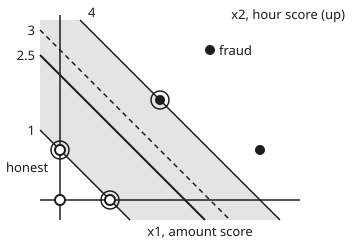

# Support vector machines: the widest safe margin, and the kernel trick

[Syllabus](../../../SYLLABUS.md) → [Applied and computational](../README.md) → [Machine Learning Mathematics](../README.md#s06) → Support vector machines

---

## General Overview

A shop keeps 20,000 past orders, each described by 12 numbers, and knows which ones turned out to be fraud. It wants a rule that flags the next fraudulent order before it ships.

Take two of the 12 numbers, each measured against the customer's own habits. The **amount score** is how far this order's amount sits from what the customer usually spends, counted in their typical swings: someone who spends about £60, give or take £20, scores +2 for a £100 order. The **hour score** does the same for the time of day: someone who orders around 8pm, give or take 2 hours, scores +0.5 at 9pm.

Honest orders crowd round (0, 0). Fraud is unusual in *any* direction: thieves test a stolen card with a £5 charge (amount score −2.75), then spend big. So the fraud forms a ring round a disc of honest orders. No straight line cuts a ring from its middle.

A **support vector machine** (SVM) does two things. It picks the straight line with the widest empty strip on each side, the **margin**, letting a few orders sit inside the strip at a price. And because its calculation touches orders only through dot products, swapping the dot product for a **kernel** (a similarity score between two orders) bends the line into a curve. With the **radial kernel**, similarity that fades with distance, on synthetic data the boundary comes out as a closed loop round the honest orders, between 1.43 and 2.12 from the centre: it misses 20 of 100 test frauds, with 4 false alarms among 300 honest orders. A straight-line SVM gives up and flags nothing, so it misses all 100; even the best straight cut, found by scanning, misses 78.

**An SVM draws the boundary that leaves the widest gap to the nearest orders on each side, charges for any order that crosses it, and, because the answer needs only dot products between orders, can bend that boundary by replacing the dot product with a kernel.**

**What kind of fact this is:** a method: the shape of the boundary is a modelling choice, not a law. It rests on three facts proved on this card in Why it works: the gap is 2 over the length of the weights, the best weights are a weighted sum of the training orders, and the radial kernel is a dot product of hidden features. Solving the resulting problem with a guarantee is the optimisation wing's job; this card's solver is checked, not proved.

### The picture: six orders and the widest gap

<p align="center"></p>

Before the ring, a simpler case: six orders where every fraud is both big and late. Drawn to scale, across is the amount score $x_1$, up the hour score $x_2$. Open dots are honest, at (0, 0), (1, 0) and (0, 1); filled dots are fraud, at (2, 2), (3, 3) and (4, 1). The number beside each line is its value of $x_1 + x_2$. The shaded strip, from 1 to 4, is the widest empty strip any straight line allows, and the SVM's boundary, solid, runs down its middle at 2.5. The three ringed orders touch the strip: they are the **support vectors**, the word used from here on, and they alone fix the boundary. The dashed line at 3 is where a perceptron stopped. It splits the orders too, but passes only 0.7071 from the fraud at (2, 2), against 1.0607 for the SVM.

---

## The formula

The perceptron card ([The perceptron and its stack](03-perceptron-and-neural-networks.md)) scores an order $x$ as $s(x) = w \cdot x + b$, with weights $w$ and a bias $b$, and flags fraud when $s > 0$. Labels are $y = +1$ for fraud and $y = -1$ for honest. This card keeps all of that and adds the slack $\xi_i$, the penalty $C$ and the kernel $K(x, x')$.

The SVM chooses $w$ and $b$ by solving

$$\min_{w,\,b,\,\xi}\ \tfrac12\lvert w\rvert^2 + C\sum_{i=1}^{n}\xi_i \quad\text{subject to}\quad y_i\,(w\cdot x_i + b) \ge 1 - \xi_i,\quad \xi_i \ge 0 .$$

**Read it aloud:** keep the weights as short as possible, which makes the gap as wide as possible, plus a charge of C for every unit by which an order crosses its edge of the gap.

The gap between the edges is $2/\lvert w\rvert$. The answer turns out to be a weighted sum over the training orders, so the score can be written with a kernel in place of each dot product:

$$s(x) = \sum_{i=1}^{n} \alpha_i\, y_i\, K(x_i, x) + b, \qquad K(x, x') = e^{-\gamma\,\lvert x - x'\rvert^2}.$$

**Read it aloud:** the score of a new order is a vote of the training orders, each weighted by how much it matters and how similar it is to the new one, plus the bias.

| Symbol | Plain meaning | In our example | Push it up and the answer… |
| --- | --- | --- | --- |
| $x$, $x_i$ | an order as (amount score, hour score); $x_i$ is training order $i$ | £100 at the usual hour: (2, 0) | further out on the ring, more likely flagged |
| $y_i$ | the label: +1 fraud, −1 honest | (2, 2): +1 | — |
| $n$ | the number of training orders | 6 here; 160 on the ring | the kernel table grows as $n^2$ |
| $w$, $\lvert w\rvert$, $2/\lvert w\rvert$ | the weights, their length, and the margin: the width of the empty strip | (0.6667, 0.6667), length 0.9428, margin 2.1213 | a narrower gap |
| $b$ | the bias: slides the boundary without turning it | −1.6667 | more orders flagged |
| $s(x)$ | the score; above 0 means flag | (2, 0) on the ring: +1.6770 | — |
| $\xi_i$ | slack: how far order $i$ crosses its edge, in units of $1/\lvert w\rvert$ | 2.00 for an honest order deep among fraud | — |
| $C$ | the price per unit of slack | 1 on six orders; 10 on the ring | fewer crossings, narrower gap |
| $\alpha_i$, $L$ | order $i$'s weight in the answer, zero unless it touches or crosses the gap; $L$ is the cost with every limit's price attached (Step 3's fold) | 0.2222, 0.2222, 0.4444, rest 0 | that order pulls the boundary harder |
| $K(x, x')$ | the kernel: a similarity that stands in for $x \cdot x'$ | $e^{-2.5} = 0.082085$ for (1, 0) and (2, 2) | — |
| $\phi(x)$ | the hidden features a kernel stands for: $K(x, x') = \phi(x)\cdot\phi(x')$ | $(x_1^2,\ \sqrt2\,x_1x_2,\ x_2^2)$ for the squared kernel | — |
| $\gamma$ | the radial kernel's reach setting: big means similarity fades fast | 0.5 | a wigglier boundary |

Two clashes: the perceptron card used $\gamma$ for a margin. Here $\gamma$ is only the radial kernel's setting; the margin is always written $2/\lvert w\rvert$. And $\alpha_i$ here is an order's weight in the answer, not the mixing weight $\alpha_k$ of [EM](08-em-algorithm.md).

### When it holds

- **Features on one scale.** The radial kernel measures distance, so a feature in pounds swamps one in scores. Measure the amount in pounds and the ring SVM misses 46 frauds and raises 31 false alarms, against 20 and 4.
- **Future orders look like the training orders.** The boundary is drawn round what it saw. If fraudsters move to ordinary amounts at ordinary hours, the circle never sees them.
- **C and γ chosen on orders held back.** With $\gamma = 50$ every training order becomes its own island: 0 training errors, then 87 of 100 test frauds missed.
- **n small enough for an n by n table.** The kernel needs every pair of training orders: 20,000 orders make 400 million entries, 3.2 GB.
- **A genuine kernel.** $K$ must be a dot product of some features (the radial one is, Step 4). An arbitrary similarity score can make the problem have no best answer.

---

## Why it works

### Step 0: the widest gap is the safest bet, and only the nearest orders decide it

Many straight lines split the six orders in the picture. A line that grazes an order misjudges a new order that differs from it by a little noise. The widest empty strip tolerates the most noise, so it is the best bet for orders not yet seen. And it depends only on the orders touching it: move any other order, keeping it outside, and nothing changes.

### Step 1: the gap is 2 over the length of the weights

The distance from a point to a plane, measured along the normal, is $\lvert w \cdot x + b\rvert / \lvert w\rvert$ ([Lines and planes](../../05-Geometry%20and%20trig/05-Vectors%20in%20Space/02-lines-and-planes-in-space.md)). Here the "plane" is the boundary $w \cdot x + b = 0$ and the normal is $w$.

Doubling $w$ and $b$ draws the same boundary, so fix the scale: choose it so the nearest orders score exactly ±1. Then every order obeys $y_i(w \cdot x_i + b) \ge 1$, the strip's two edges are the lines $s = -1$ and $s = +1$, and each edge lies $1/\lvert w\rvert$ from the boundary. The strip is $2/\lvert w\rvert$ wide.

So the widest strip is the shortest $w$. Minimising $\tfrac12\lvert w\rvert^2$ instead of $\lvert w\rvert$ gives the same answer and a smooth bowl. A bowl under straight-line limits has one bottom ([Convex functions](../../06-Calculus%20and%20analysis/07-Several%20Variables/09-convex-functions.md)), so the widest strip is unique.

### Step 2: slack pays for orders that will not fit

Add a seventh order: an honest customer at (3, 2), a large late order that sits in the middle of the three frauds. Now no straight line splits the groups. Along the direction $(1, 2)/\sqrt5$ the nearest frauds, (2, 2) and (4, 1), sit at $6/\sqrt5$, and the honest order at (3, 2) sits beyond them at $7/\sqrt5$: a clearance of $-1/\sqrt5 = -0.4472$, a negative gap. A scan of every direction, 0.01 degree apart, finds nothing better: −0.4473, as close as its steps reach.

Slack $\xi_i$ lets order $i$ fall short of its edge by that much, at a cost of $C\,\xi_i$. With $C = 1$ the SVM picks $w = (0.5000, 0.5000)$ and $b = -1.5000$, the boundary $x_1 + x_2 = 3$, a strip 2.8284 wide, and pays slack 0.50 for the fraud at (2, 2) and 2.00 for the honest order at (3, 2). Cheaper slack, $C = 0.1$, buys a wider strip, 3.6011, with more orders inside it. Large C means "trust every label"; small C means "keep the boundary simple".

### Step 3: the best weights are a weighted sum of the orders

First, why the best weights are built from the orders at all. Split $w$ into a part that is a combination of the orders $x_i$ and a part perpendicular to every one of them. The perpendicular part adds nothing to any $w \cdot x_i$, so it changes no limit and no slack, and it only makes $\lvert w\rvert^2$ bigger. So the best $w$ has no such part: it is a weighted sum of the orders.

Lagrange multipliers ([Lagrange multipliers](../../06-Calculus%20and%20analysis/07-Several%20Variables/08-lagrange-multipliers.md)) say which weights: one multiplier $\alpha_i \ge 0$ per order, a price on its limit. At the best point the gradient of the cost lines up with the limits' gradients, which gives

$$w = \sum_{i} \alpha_i\, y_i\, x_i, \qquad \sum_i \alpha_i\, y_i = 0 .$$

An order beyond its edge of the strip, on its own side, meets its limit with room to spare, so its price is zero: $\alpha_i = 0$. Only orders on or inside the strip can get weight. Those that do are the support vectors. In the picture, (1, 0) and (0, 1) get 0.2222 each and (2, 2) gets 0.4444. The other three get 0.

<details>
<summary>The algebra: from the multipliers to a problem that only uses dot products</summary>

Write the hard-margin cost with its prices: $L = \tfrac12\lvert w\rvert^2 - \sum_i \alpha_i\,[\,y_i(w\cdot x_i + b) - 1\,]$.

Set the rate of change in $w$ to zero: $w - \sum_i \alpha_i y_i x_i = 0$. Set the rate in $b$ to zero: $\sum_i \alpha_i y_i = 0$.

Put $w$ back into $L$. The $b$ term vanishes because $\sum_i \alpha_i y_i = 0$, and $\lvert w\rvert^2 = \sum_i\sum_j \alpha_i\alpha_j y_i y_j\, x_i \cdot x_j$. What is left is the **dual problem**:

$$\max_{\alpha}\ \sum_i \alpha_i - \tfrac12\sum_i\sum_j \alpha_i\alpha_j\, y_i y_j\, x_i\cdot x_j \quad\text{with}\quad 0 \le \alpha_i \le C,\ \ \sum_i \alpha_i y_i = 0.$$

The cap $\alpha_i \le C$ is what slack adds. At the best point the two problems have the same value, so $\lvert w\rvert^2 = \sum_i \alpha_i$ in the hard-margin case: 0.8889 both ways for the six orders. Why "zero price when there is room to spare" holds for inequality limits, and why the two values meet, is the Karush–Kuhn–Tucker (KKT) conditions card in the optimisation wing (planned).

</details>

The orders enter the dual, and the score $s(x) = \sum_i \alpha_i y_i\, x_i \cdot x + b$, **only through dot products**. That is the opening for Step 4.

### Step 4: a kernel is a dot product of features nobody has to compute

Lift each order into more features: $\phi(x) = (x_1^2,\ \sqrt2\,x_1x_2,\ x_2^2)$. Then

$$\phi(x)\cdot\phi(x') = x_1^2x_1'^2 + 2x_1x_2x_1'x_2' + x_2^2x_2'^2 = (x\cdot x')^2 .$$

The lifted dot product costs one ordinary dot product and a squaring. And in lifted coordinates, a circle round the centre, $x_1^2 + x_2^2$ equal to a fixed number, becomes $\phi_1 + \phi_3$ equal to that number: a flat plane. A straight cut in the lifted space is a circle back in the plane of orders. So run the whole SVM with $(x \cdot x')^2$ in place of $x \cdot x'$, and its "straight line" is a curve.

The radial kernel goes further. Split it:

$$e^{-\gamma\lvert x - x'\rvert^2} = e^{-\gamma\lvert x\rvert^2}\; e^{-\gamma\lvert x'\rvert^2}\; \sum_{k=0}^{\infty} \frac{(2\gamma\, x\cdot x')^k}{k!}.$$

Each power $(x \cdot x')^k$ is a dot product of lifted features, as above for $k = 2$. A sum of dot products is a dot product of the features laid end to end. Multiplying by $e^{-\gamma\lvert x\rvert^2}$ and $e^{-\gamma\lvert x'\rvert^2}$ just rescales each order's features. So the radial kernel is a dot product over infinitely many features, yet it costs one distance and one exponential. For (1, 0) and (2, 2) with $\gamma = 0.5$, the 30-term series and $e^{-2.5}$ agree: 0.082085.

### Step 5: what the solver does

The code solves the dual one pair of orders at a time: it shifts the two $\alpha$ that most want to move, keeping $\sum_i \alpha_i y_i$ at zero, until no pair can raise the dual. This is sequential minimal optimisation (SMO), the method inside common SVM libraries; its convergence proof belongs to the optimisation wing. The check here is direct: on the ring, the cost and the dual value meet at 213.041234, a gap of 0.000000017.

---

## Worked numbers, by hand

The six orders in the picture, hard margin (no slack allowed).

| Step | Arithmetic | Value |
| --- | --- | --- |
| nearest honest orders | (1, 0) and (0, 1) both have $x_1 + x_2 = 1$ | edge at 1 |
| nearest fraud | (2, 2) has $x_1 + x_2 = 4$ | edge at 4 |
| boundary | halfway between the edges | $x_1 + x_2 = 2.5$ |
| scale so the edges score ±1 | $s = \tfrac23(x_1 + x_2) - \tfrac53$ | $w = (0.6667, 0.6667)$, $b = -1.6667$ |
| check an edge | (1, 0): $\tfrac23 - \tfrac53$ | −1 |
| length of $w$ | $\sqrt{(2/3)^2 + (2/3)^2} = \sqrt{8/9}$ | 0.9428 |
| margin | $2 / 0.9428$, the same as $3/\sqrt2$ | **2.1213** |
| weights on the orders | $\alpha$ for (1, 0), (0, 1), (2, 2) | 0.2222, 0.2222, 0.4444 |
| rebuild $w$ | $0.4444\,(2, 2) - 0.2222\,(1, 0) - 0.2222\,(0, 1)$ | (0.6667, 0.6667) |
| one radial kernel value | (1, 0) and (2, 2): $\lvert x - x'\rvert^2 = 1 + 4 = 5$, $e^{-0.5 \times 5}$ | 0.082085 |

The boundary sits 1.0607 from the nearest order on each side, the most any straight line can manage for these six. The perceptron's line, $x_1 + x_2 = 3$, splits them too but leaves only 0.7071 on the fraud side.

On the 160-order ring, the radial SVM with $\gamma = 0.5$ and $C = 10$ keeps 32 support vectors. A £100 order at the usual hour, (2, 0), scores +1.6770: flagged. A £5 order at 9pm, (−2.75, 0.50), scores +2.3179: flagged. A £70 order at 7pm, (0.50, −0.50), scores −3.6994: passed.

### What breaks if you drop a piece

| Mistake | Comes out at | What went wrong |
| --- | --- | --- |
| Demand no slack once an honest order sits among the fraud | best gap −0.4472: no line exists | A hard margin needs data a line can split |
| Use a straight line on the ring | linear SVM: weights 0, all 100 test frauds missed; best straight cut by scanning: 78 missed | No line separates a ring. The SVM's cheapest line is no line at all: a score of −1 everywhere |
| Radial kernel with $\gamma = 50$ | 0 training errors, 87 of 100 test frauds missed | Each order is its own island: memorised, not learned |
| Amount in pounds instead of a score | 46 frauds missed, 31 false alarms | Distance is all pounds; the hour hardly counts |

Test errors out of 400 orders, the same 160 training orders each time:

```
ideal rule, flag beyond 1.6   ████                                  12
radial, gamma 0.5, C 10       ████████                              24
radial, gamma 2               █████████████                         38
radial, amount in pounds      ██████████████████████████            77
best straight cut             ██████████████████████████            78
radial, gamma 50              █████████████████████████████████     99
linear SVM                    █████████████████████████████████    100
```

The ideal rule knows how the data were made: honest orders lie within 1.6, fraud between 1.2 and 3.0, and in the overlap honest orders are 8.86 times as dense, so the best possible boundary is the circle at 1.6. The SVM, never told this, draws a wobbly loop: 1.60 from the centre along the amount axis, but anywhere from 1.43 to 2.12 round the circle, 1.73 on average. From 160 training orders it finds the circle only roughly, and makes 24 test errors to the ideal rule's 12.

The linear SVM's 88 support vectors mean little. With the weights at zero, many different sets of $\alpha_i$ give the same best cost, so another solver could report another count.

---

## Code, from first principles, and it actually runs

Both programs build the data from a SplitMix64 generator written out (seed 2026), so every order is synthetic and both languages see the same ones. The solver is SMO written out. The widest gap on six orders is reached three independent ways: the dual solver, a brute-force scan of 36,000 directions, and $3/\sqrt2$ by hand. The kernel identity is checked two ways: the lifted features against $(x\cdot x')^2$ on 200 random pairs, and the 30-term series against $e^{-2.5}$. On the ring, the cost and dual values must meet; the boundary's average distance from the centre, over 360 rays one degree apart, must lie within 0.2 of the generator's 1.6; and a sweep over 3,600 directions finds the straight cut with the fewest training errors, recounted directly, which the radial SVM must beat.

### Python

```python
# Support vector machines -- the check behind the card.  Standard library only.
# The solver is a pair-at-a-time climb on the dual (SMO), written out; the data
# come from a SplitMix64 generator written out, so Python and Rust agree.
from math import exp, sqrt, cos, sin, pi

M64 = (1 << 64) - 1
class Rng:                                       # SplitMix64, seed stated below
    def __init__(self, seed): self.s = seed
    def u(self):
        self.s = (self.s + 0x9E3779B97F4A7C15) & M64
        z = self.s
        z = ((z ^ (z >> 30)) * 0xBF58476D1CE4E5B9) & M64
        z = ((z ^ (z >> 27)) * 0x94D049BB133111EB) & M64
        return ((z ^ (z >> 31)) >> 11) / 9007199254740992.0

def ring(rng, n, lo, hi):                        # n orders, uniform where lo <= distance < hi
    out = []
    while len(out) < n:
        a, b = 6 * rng.u() - 3, 6 * rng.u() - 3
        if lo * lo <= a * a + b * b < hi * hi: out.append((a, b))
    return out

def dot(p, q): return p[0] * q[0] + p[1] * q[1]
def rbf(g): return lambda p, q: exp(-g * ((p[0] - q[0]) ** 2 + (p[1] - q[1]) ** 2))

def smo(X, y, K, C):                             # maximise sum(al) - 1/2 sum al_i al_j y_i y_j K_ij
    n = len(X); Kx = [[K(p, q) for q in X] for p in X]
    al, G = [0.0] * n, [-1.0] * n                # G: slope of the dual, tracked as al moves
    while True:
        up = [t for t in range(n) if (y[t] > 0 and al[t] < C) or (y[t] < 0 and al[t] > 0)]
        dn = [t for t in range(n) if (y[t] < 0 and al[t] < C) or (y[t] > 0 and al[t] > 0)]
        i = max(up, key=lambda t: -y[t] * G[t]); j = min(dn, key=lambda t: -y[t] * G[t])
        hi, lo = -y[i] * G[i], -y[j] * G[j]
        if hi - lo < 1e-9: break                 # no pair can still raise the dual
        t = (hi - lo) / max(Kx[i][i] + Kx[j][j] - 2 * Kx[i][j], 1e-12)
        t = min(t, C - al[i] if y[i] > 0 else al[i], al[j] if y[j] > 0 else C - al[j])
        al[i] += y[i] * t; al[j] -= y[j] * t
        for k in range(n): G[k] += y[k] * t * (Kx[k][i] - Kx[k][j])
    return al, (hi + lo) / 2, Kx

def score(X, y, al, b, K, x): return sum(al[k] * y[k] * K(X[k], x) for k in range(len(X)) if al[k] > 0) + b
def errors(X, y, al, b, K, T, z): return sum(1 for x, s in zip(T, z) if s * score(X, y, al, b, K, x) <= 0)
def weights(X, y, al): return [sum(al[k] * y[k] * X[k][d] for k in range(len(X))) for d in (0, 1)]

def widest_by_scan(H, F):                        # road 2: try every direction round the circle, 0.01 degree apart
    best, at = -1e9, 0
    for k in range(36000):
        u = (cos(k * pi / 18000), sin(k * pi / 18000))
        gap = min(dot(u, f) for f in F) - max(dot(u, h) for h in H)
        if gap > best: best, at = gap, k
    return best, at / 100

# ---- six orders: (amount score, hour score); honest -1, fraud +1 ----
H, F = [(0, 0), (1, 0), (0, 1)], [(2, 2), (3, 3), (4, 1)]
X6, y6 = H + F, [-1] * 3 + [1] * 3
al6, b6, _ = smo(X6, y6, dot, float('inf'))
w6 = weights(X6, y6, al6); nw = sqrt(dot(w6, w6))
scan, angle = widest_by_scan(H, F)
print("hard margin: alphas", " ".join(f"{a:.4f}" for a in al6))
print(f"w = ({w6[0]:.4f}, {w6[1]:.4f})  b = {b6:.4f}  |w| = {nw:.4f}  |w|^2 = {nw * nw:.4f}  sum of alphas = {sum(al6):.4f}")
print(f"widest margin: 2/|w| = {2 / nw:.4f}   scan = {scan:.4f} at {angle:.2f} deg   by hand 3/sqrt2 = {3 / sqrt(2):.4f}")
pw, pb, sweeps = [0.0, 0.0], 0.0, 0                # a perceptron's line, for contrast
while any(s * (dot(pw, x) + pb) <= 0 for x, s in zip(X6, y6)):
    sweeps += 1
    for x, s in zip(X6, y6):
        if s * (dot(pw, x) + pb) <= 0: pw, pb = [pw[0] + s * x[0], pw[1] + s * x[1]], pb + s
pgap = min(s * (dot(pw, x) + pb) for x, s in zip(X6, y6)) / sqrt(dot(pw, pw))
print(f"perceptron after {sweeps} sweeps: w = ({pw[0]:.0f}, {pw[1]:.0f}) b = {pb:.0f}  nearest order {pgap:.4f} away, svm {1 / nw:.4f}")
print(f"figure, centre x1 + x2 = {-b6 / w6[0]:.4f}, edges x1 + x2 = {(-1 - b6) / w6[0]:.4f} and {(1 - b6) / w6[0]:.4f}")

# ---- add a genuine big, late order in the middle of the fraud: slack ----
X7, y7 = X6 + [(3, 2)], y6 + [-1]
gap7, _ = widest_by_scan(H + [(3, 2)], F)
print(f"with honest (3, 2): best hard gap, scan = {gap7:.4f}, by hand -1/sqrt5 = {-1 / sqrt(5):.4f} (negative: no line works)")
for C in (1.0, 0.1):
    al, b, _ = smo(X7, y7, dot, C); w = weights(X7, y7, al)
    xi = [max(0.0, 1 - s * score(X7, y7, al, b, dot, x)) for x, s in zip(X7, y7)]
    print(f"C = {C:.1f}: w = ({w[0]:.4f}, {w[1]:.4f}) b = {b:.4f} width {2 / sqrt(dot(w, w)):.4f} slacks", " ".join(f"{v:.2f}" for v in xi))

# ---- the kernel trick: the same number from features and from the shortcut ----
p, q = (1.0, 0.0), (2.0, 2.0)
lift = lambda x: (x[0] * x[0], sqrt(2) * x[0] * x[1], x[1] * x[1])
print(f"(p.q)^2 = {dot(p, q) ** 2:.4f}  lift(p).lift(q) = {sum(a * c for a, c in zip(lift(p), lift(q))):.4f}")
term, total = 1.0, 0.0                          # e^(p.q) as 1 + p.q + (p.q)^2/2! + ...: one term per feature group
for k in range(1, 31): total, term = total + term, term * dot(p, q) / k
series = exp(-0.5 * dot(p, p)) * exp(-0.5 * dot(q, q)) * total
print(f"radial K(p, q), gamma 0.5: exp(-0.5*5) = {rbf(0.5)(p, q):.6f}  as 30-term feature series = {series:.6f}")
rng = Rng(2026); lifts = []
for _ in range(200):
    a, c = (6 * rng.u() - 3, 6 * rng.u() - 3), (6 * rng.u() - 3, 6 * rng.u() - 3)
    lifts.append(abs(dot(a, c) ** 2 - sum(s * t for s, t in zip(lift(a), lift(c)))))

print(f"generator: honest within 1.6, fraud from 1.2 to 3.0; in the overlap honest is {(120 / 2.56) / (40 / (9 - 1.44)):.2f}x as dense")
# ---- the fraud ring: 160 training orders, 400 test orders, all synthetic, seed 2026 ----
TR = ring(rng, 120, 0.0, 1.6) + ring(rng, 40, 1.2, 3.0); ytr = [-1] * 120 + [1] * 40
TE = ring(rng, 300, 0.0, 1.6) + ring(rng, 100, 1.2, 3.0); yte = [-1] * 300 + [1] * 100
def run(name, K, C, tr=TR, te=TE):
    al, b, Kx = smo(tr, ytr, K, C)
    sv = sum(1 for a in al if a > 1e-9)
    miss, alarm = errors(tr, ytr, al, b, K, te[300:], yte[300:]), errors(tr, ytr, al, b, K, te[:300], yte[:300])
    print(f"{name:<25} SVs {sv:>3}  train errors {errors(tr, ytr, al, b, K, tr, ytr):>2}/160  test: missed "
          f"fraud {miss:>3}/100, false alarms {alarm:>2}/300, total {miss + alarm:>3}/400")
    return al, b, Kx, miss
al, b, Kx, miss_rbf = run("radial, gamma 0.5, C 10", rbf(0.5), 10.0)
n = len(TR); quad = sum(al[i] * al[j] * ytr[i] * ytr[j] * Kx[i][j] for i in range(n) for j in range(n))
hinge = sum(max(0.0, 1 - ytr[i] * score(TR, ytr, al, b, rbf(0.5), TR[i])) for i in range(n))
primal, dual = quad / 2 + 10.0 * hinge, sum(al) - quad / 2
print(f"primal {primal:.6f}  dual {dual:.6f}  gap {primal - dual:.9f}")
for name, x in (("100 pounds, usual hour", (2.0, 0.0)), ("5 pounds, 9pm", (-2.75, 0.5)), ("70 pounds, 7pm", (0.5, -0.5))):
    print(f"order {name:<22} at ({x[0]:.2f}, {x[1]:.2f}): score {score(TR, ytr, al, b, rbf(0.5), x):+.4f}")
ideal = sum(1 for a, c in TE[300:] if a * a + c * c < 1.6 * 1.6)
print(f"ideal rule, flag beyond 1.6, on the test orders: missed fraud {ideal}/100, false alarms 0/300, total {ideal}/400")
radii = [next(r / 100 for r in range(400) if score(TR, ytr, al, b, rbf(0.5), (r / 100 * cos(d * pi / 180), r / 100 * sin(d * pi / 180))) > 0) for d in range(360)]
print(f"boundary radius on 360 rays: amount axis {radii[0]:.2f}, smallest {min(radii):.2f}, largest {max(radii):.2f}, mean {sum(radii) / 360:.2f}")
al_l, b_l, _, miss_line = run("linear SVM, C 10", dot, 10.0); w_l = weights(TR, ytr, al_l)
print(f"linear SVM answer: |w| = {sqrt(dot(w_l, w_l)):.6f}  b = {b_l:.4f}")
cut = (161, 0, 0.0)                              # every straight cut round the circle: the fewest training errors
for k in range(3600):
    u, e = (cos(2 * pi * k / 3600), sin(2 * pi * k / 3600)), 120     # cut below every order: all 120 honest flagged
    for t, s in sorted((dot(u, x), s) for x, s in zip(TR, ytr)):
        e += s; cut = min(cut, (e, k, t))        # move the cut past this order; flag only u.x > t
cut_err, k, t = cut; u = (cos(2 * pi * k / 3600), sin(2 * pi * k / 3600)); flag = lambda pts: sum(1 for x in pts if dot(u, x) > t)
cut_miss, cut_alarm, recount = 100 - flag(TE[300:]), flag(TE[:300]), 40 - flag(TR[120:]) + flag(TR[:120])
print(f"best straight cut, 3600 directions: flag u.x > {t:.4f} at {k / 10:.1f} deg  train errors {cut_err}/160  "
      f"test: missed fraud {cut_miss}/100, false alarms {cut_alarm}/300, total {cut_miss + cut_alarm}/400")
run("radial, gamma 50", rbf(50.0), 10.0)
run("radial, amount in pounds", rbf(0.5), 10.0, [(20 * a, c) for a, c in TR], [(20 * a, c) for a, c in TE])
run("try: radial, C 0.1", rbf(0.5), 0.1)
run("try: radial, gamma 2", rbf(2.0), 10.0)
print(f"full shop: kernel table 20000 x 20000 = {20000 * 20000 / 1e6:.0f} million entries, {20000 * 20000 * 8 / 1e9:.1f} GB")

assert abs(2 / nw - 3 / sqrt(2)) < 1e-9 and abs(scan - 3 / sqrt(2)) < 1e-6, "dual, scan and hand must agree"
assert abs(nw * nw - sum(al6)) < 1e-9, "at the optimum |w|^2 equals the sum of the alphas"
assert pgap < 1 / nw - 0.1, "the perceptron's line is a worse fit than the widest one"
assert abs(gap7 + 1 / sqrt(5)) < 1e-3, "scan meets the hand value: the seventh order makes the data inseparable"
assert max(lifts) < 1e-9 and abs(series - exp(-2.5)) < 1e-12, "kernel equals a dot product of features"
assert 0 <= primal - dual < 1e-6 * primal, "primal and dual meet at the optimum"
assert recount == cut_err and miss_rbf < cut_miss < miss_line, "recount meets the sweep; the radial loop misses less than the best straight cut"
assert abs(sum(radii) / 360 - 1.6) < 0.2, "the radial loop sits near the circle the data were cut at"
print("ALL CHECKS PASS")
```

**Ran 2026-11-11 on macOS, Python 3.14.10, standard library only. All checks passed. Output, pasted from the run:**

```
hard margin: alphas 0.0000 0.2222 0.2222 0.4444 0.0000 0.0000
w = (0.6667, 0.6667)  b = -1.6667  |w| = 0.9428  |w|^2 = 0.8889  sum of alphas = 0.8889
widest margin: 2/|w| = 2.1213   scan = 2.1213 at 45.00 deg   by hand 3/sqrt2 = 2.1213
perceptron after 2 sweeps: w = (1, 1) b = -3  nearest order 0.7071 away, svm 1.0607
figure, centre x1 + x2 = 2.5000, edges x1 + x2 = 1.0000 and 4.0000
with honest (3, 2): best hard gap, scan = -0.4473, by hand -1/sqrt5 = -0.4472 (negative: no line works)
C = 1.0: w = (0.5000, 0.5000) b = -1.5000 width 2.8284 slacks 0.00 0.00 0.00 0.50 0.00 0.00 2.00
C = 0.1: w = (0.4769, 0.2846) b = -1.2846 width 3.6011 slacks 0.00 0.19 0.00 0.76 0.00 0.09 1.72
(p.q)^2 = 4.0000  lift(p).lift(q) = 4.0000
radial K(p, q), gamma 0.5: exp(-0.5*5) = 0.082085  as 30-term feature series = 0.082085
generator: honest within 1.6, fraud from 1.2 to 3.0; in the overlap honest is 8.86x as dense
radial, gamma 0.5, C 10   SVs  32  train errors  8/160  test: missed fraud  20/100, false alarms  4/300, total  24/400
primal 213.041234  dual 213.041234  gap 0.000000017
order 100 pounds, usual hour at (2.00, 0.00): score +1.6770
order 5 pounds, 9pm          at (-2.75, 0.50): score +2.3179
order 70 pounds, 7pm         at (0.50, -0.50): score -3.6994
ideal rule, flag beyond 1.6, on the test orders: missed fraud 12/100, false alarms 0/300, total 12/400
boundary radius on 360 rays: amount axis 1.60, smallest 1.43, largest 2.12, mean 1.73
linear SVM, C 10          SVs  88  train errors 40/160  test: missed fraud 100/100, false alarms  0/300, total 100/400
linear SVM answer: |w| = 0.000000  b = -1.0000
best straight cut, 3600 directions: flag u.x > 1.5706 at 31.0 deg  train errors 27/160  test: missed fraud 78/100, false alarms 0/300, total 78/400
radial, gamma 50          SVs 151  train errors  0/160  test: missed fraud  87/100, false alarms 12/300, total  99/400
radial, amount in pounds  SVs  98  train errors  1/160  test: missed fraud  46/100, false alarms 31/300, total  77/400
try: radial, C 0.1        SVs  83  train errors 32/160  test: missed fraud  91/100, false alarms  0/300, total  91/400
try: radial, gamma 2      SVs  46  train errors  5/160  test: missed fraud  21/100, false alarms 17/300, total  38/400
full shop: kernel table 20000 x 20000 = 400 million entries, 3.2 GB
ALL CHECKS PASS
```

### Rust

```rust
// Support vector machines -- the same check as kernels_and_support_vector_machines_check.py, in Rust.
// Standard library only, no crates.  Same SMO solver, same SplitMix64 data.
use std::f64::consts::PI;
type P = (f64, f64);

struct Rng(u64);                                          // SplitMix64, seed stated below
impl Rng {
    fn u(&mut self) -> f64 {
        self.0 = self.0.wrapping_add(0x9E3779B97F4A7C15); let mut z = self.0;
        z = (z ^ (z >> 30)).wrapping_mul(0xBF58476D1CE4E5B9);
        z = (z ^ (z >> 27)).wrapping_mul(0x94D049BB133111EB);
        ((z ^ (z >> 31)) >> 11) as f64 / 9007199254740992.0
    }
}

fn ring(rng: &mut Rng, n: usize, lo: f64, hi: f64) -> Vec<P> {   // n orders, uniform where lo <= distance < hi
    let mut out = Vec::new();
    while out.len() < n {
        let (a, b) = (6.0 * rng.u() - 3.0, 6.0 * rng.u() - 3.0); if lo * lo <= a * a + b * b && a * a + b * b < hi * hi { out.push((a, b)); }
    }
    out
}
fn dot(p: P, q: P) -> f64 { p.0 * q.0 + p.1 * q.1 }
fn rbf(g: f64) -> impl Fn(P, P) -> f64 { move |p: P, q: P| (-g * ((p.0 - q.0).powi(2) + (p.1 - q.1).powi(2))).exp() }

fn smo(x: &[P], y: &[f64], k: &dyn Fn(P, P) -> f64, c: f64) -> (Vec<f64>, f64, Vec<Vec<f64>>) {
    let n = x.len();
    let kx: Vec<Vec<f64>> = x.iter().map(|&p| x.iter().map(|&q| k(p, q)).collect()).collect();
    let (mut al, mut g) = (vec![0.0; n], vec![-1.0; n]);  // g: slope of the dual, tracked as al moves
    loop {
        let (mut i, mut j, mut hi, mut lo) = (n, n, f64::NEG_INFINITY, f64::INFINITY);
        for t in 0..n {
            let v = -y[t] * g[t];
            if ((y[t] > 0.0 && al[t] < c) || (y[t] < 0.0 && al[t] > 0.0)) && v > hi { i = t; hi = v; }
            if ((y[t] < 0.0 && al[t] < c) || (y[t] > 0.0 && al[t] > 0.0)) && v < lo { j = t; lo = v; }
        }
        if hi - lo < 1e-9 { return (al, (hi + lo) / 2.0, kx); }   // no pair can still raise the dual
        let mut t = (hi - lo) / (kx[i][i] + kx[j][j] - 2.0 * kx[i][j]).max(1e-12);
        t = t.min(if y[i] > 0.0 { c - al[i] } else { al[i] }).min(if y[j] > 0.0 { al[j] } else { c - al[j] });
        al[i] += y[i] * t; al[j] -= y[j] * t;
        for m in 0..n { g[m] += y[m] * t * (kx[m][i] - kx[m][j]); }
    }
}
fn score(x: &[P], y: &[f64], al: &[f64], b: f64, k: &dyn Fn(P, P) -> f64, p: P) -> f64 {
    (0..x.len()).filter(|&m| al[m] > 0.0).map(|m| al[m] * y[m] * k(x[m], p)).sum::<f64>() + b
}
fn errors(x: &[P], y: &[f64], al: &[f64], b: f64, k: &dyn Fn(P, P) -> f64, t: &[P], z: &[f64]) -> usize {
    t.iter().zip(z).filter(|(p, s)| **s * score(x, y, al, b, k, **p) <= 0.0).count()
}
fn weights(x: &[P], y: &[f64], al: &[f64]) -> P {
    (0..x.len()).fold((0.0, 0.0), |w, m| (w.0 + al[m] * y[m] * x[m].0, w.1 + al[m] * y[m] * x[m].1))
}

fn widest_by_scan(h: &[P], f: &[P]) -> (f64, f64) {           // road 2: try every direction round the circle, 0.01 degree apart
    let (mut best, mut at) = (-1e9, 0);
    for k in 0..36000 {
        let u = ((k as f64 * PI / 18000.0).cos(), (k as f64 * PI / 18000.0).sin());
        let gap = f.iter().map(|&p| dot(u, p)).fold(f64::INFINITY, f64::min) - h.iter().map(|&p| dot(u, p)).fold(f64::NEG_INFINITY, f64::max);
        if gap > best { best = gap; at = k; }
    }
    (best, at as f64 / 100.0)
}

fn main() {
    // ---- six orders: (amount score, hour score); honest -1, fraud +1 ----
    let (h, f): (Vec<P>, Vec<P>) = (vec![(0.0, 0.0), (1.0, 0.0), (0.0, 1.0)], vec![(2.0, 2.0), (3.0, 3.0), (4.0, 1.0)]);
    let (x6, y6): (Vec<P>, Vec<f64>) = (h.iter().chain(f.iter()).cloned().collect(), vec![-1.0, -1.0, -1.0, 1.0, 1.0, 1.0]);
    let (al6, b6, _) = smo(&x6, &y6, &dot, f64::INFINITY);
    let w6 = weights(&x6, &y6, &al6); let nw = dot(w6, w6).sqrt();
    let sum6: f64 = al6.iter().sum();
    let (scan, angle) = widest_by_scan(&h, &f);
    println!("hard margin: alphas {}", al6.iter().map(|a| format!("{:.4}", a)).collect::<Vec<_>>().join(" "));
    println!("w = ({:.4}, {:.4})  b = {:.4}  |w| = {:.4}  |w|^2 = {:.4}  sum of alphas = {:.4}", w6.0, w6.1, b6, nw, nw * nw, sum6);
    println!("widest margin: 2/|w| = {:.4}   scan = {:.4} at {:.2} deg   by hand 3/sqrt2 = {:.4}", 2.0 / nw, scan, angle, 3.0 / 2f64.sqrt());
    let (mut pw, mut pb, mut sweeps) = ((0.0, 0.0), 0.0, 0);      // a perceptron's line, for contrast
    while x6.iter().zip(&y6).any(|(&p, &s)| s * (dot(pw, p) + pb) <= 0.0) {
        sweeps += 1;
        for (&p, &s) in x6.iter().zip(&y6) { if s * (dot(pw, p) + pb) <= 0.0 { pw = (pw.0 + s * p.0, pw.1 + s * p.1); pb += s; } }
    }
    let pgap = x6.iter().zip(&y6).map(|(&p, &s)| s * (dot(pw, p) + pb)).fold(f64::INFINITY, f64::min) / dot(pw, pw).sqrt();
    println!("perceptron after {} sweeps: w = ({:.0}, {:.0}) b = {:.0}  nearest order {:.4} away, svm {:.4}", sweeps, pw.0, pw.1, pb, pgap, 1.0 / nw);
    println!("figure, centre x1 + x2 = {:.4}, edges x1 + x2 = {:.4} and {:.4}", -b6 / w6.0, (-1.0 - b6) / w6.0, (1.0 - b6) / w6.0);

    // ---- add a genuine big, late order in the middle of the fraud: slack ----
    let (mut x7, mut y7, mut h7) = (x6.clone(), y6.clone(), h.clone());
    x7.push((3.0, 2.0)); y7.push(-1.0); h7.push((3.0, 2.0));
    let (gap7, _) = widest_by_scan(&h7, &f);
    println!("with honest (3, 2): best hard gap, scan = {:.4}, by hand -1/sqrt5 = {:.4} (negative: no line works)", gap7, -1.0 / 5f64.sqrt());
    for c in [1.0, 0.1] {
        let (al, b, _) = smo(&x7, &y7, &dot, c);
        let w = weights(&x7, &y7, &al);
        let xi: Vec<String> = x7.iter().zip(&y7).map(|(&p, &s)| format!("{:.2}", (1.0 - s * score(&x7, &y7, &al, b, &dot, p)).max(0.0))).collect();
        println!("C = {:.1}: w = ({:.4}, {:.4}) b = {:.4} width {:.4} slacks {}", c, w.0, w.1, b, 2.0 / dot(w, w).sqrt(), xi.join(" "));
    }

    // ---- the kernel trick: the same number from features and from the shortcut ----
    let (p, q) = ((1.0, 0.0), (2.0, 2.0));
    let lift = |x: P| [x.0 * x.0, 2f64.sqrt() * x.0 * x.1, x.1 * x.1];
    let ld = |a: P, c: P| { let (s, t) = (lift(a), lift(c)); s[0] * t[0] + s[1] * t[1] + s[2] * t[2] };
    println!("(p.q)^2 = {:.4}  lift(p).lift(q) = {:.4}", dot(p, q).powi(2), ld(p, q));
    let (mut term, mut total) = (1.0, 0.0);                       // e^(p.q) as 1 + p.q + (p.q)^2/2! + ...
    for k in 1..31 { total += term; term = term * dot(p, q) / k as f64; }
    let series = (-0.5 * dot(p, p)).exp() * (-0.5 * dot(q, q)).exp() * total;
    println!("radial K(p, q), gamma 0.5: exp(-0.5*5) = {:.6}  as 30-term feature series = {:.6}", rbf(0.5)(p, q), series);
    let (mut rng, mut lifts) = (Rng(2026), 0.0f64);
    for _ in 0..200 {
        let (a, c) = ((6.0 * rng.u() - 3.0, 6.0 * rng.u() - 3.0), (6.0 * rng.u() - 3.0, 6.0 * rng.u() - 3.0));
        lifts = lifts.max((dot(a, c).powi(2) - ld(a, c)).abs());
    }
    println!("generator: honest within 1.6, fraud from 1.2 to 3.0; in the overlap honest is {:.2}x as dense", (120.0 / 2.56) / (40.0 / (9.0 - 1.44)));
    // ---- the fraud ring: 160 training orders, 400 test orders, all synthetic, seed 2026 ----
    let mut tr = ring(&mut rng, 120, 0.0, 1.6); tr.extend(ring(&mut rng, 40, 1.2, 3.0));
    let mut te = ring(&mut rng, 300, 0.0, 1.6); te.extend(ring(&mut rng, 100, 1.2, 3.0));
    let (ytr, yte): (Vec<f64>, Vec<f64>) = ((0..160).map(|i| if i < 120 { -1.0 } else { 1.0 }).collect(), (0..400).map(|i| if i < 300 { -1.0 } else { 1.0 }).collect());
    let run = |name: &str, k: &dyn Fn(P, P) -> f64, c: f64, tr: &[P], te: &[P]| {
        let (al, b, kx) = smo(tr, &ytr, k, c);
        let sv = al.iter().filter(|&&a| a > 1e-9).count();
        let miss = errors(tr, &ytr, &al, b, k, &te[300..], &yte[300..]);
        let alarm = errors(tr, &ytr, &al, b, k, &te[..300], &yte[..300]);
        println!("{:<25} SVs {:>3}  train errors {:>2}/160  test: missed fraud {:>3}/100, false alarms {:>2}/300, total {:>3}/400",
                 name, sv, errors(tr, &ytr, &al, b, k, tr, &ytr), miss, alarm, miss + alarm);
        (al, b, kx, miss)
    };
    let k5 = rbf(0.5);
    let (al, b, kx, miss_rbf) = run("radial, gamma 0.5, C 10", &k5, 10.0, &tr, &te);
    let (mut quad, mut hinge) = (0.0, 0.0);
    for i in 0..160 { for j in 0..160 { quad += al[i] * al[j] * ytr[i] * ytr[j] * kx[i][j]; } }
    for i in 0..160 { hinge += (1.0 - ytr[i] * score(&tr, &ytr, &al, b, &k5, tr[i])).max(0.0); }
    let (primal, dual) = (quad / 2.0 + 10.0 * hinge, al.iter().sum::<f64>() - quad / 2.0);
    println!("primal {:.6}  dual {:.6}  gap {:.9}", primal, dual, primal - dual);
    for (name, x) in [("100 pounds, usual hour", (2.0, 0.0)), ("5 pounds, 9pm", (-2.75, 0.5)), ("70 pounds, 7pm", (0.5, -0.5))] {
        println!("order {:<22} at ({:.2}, {:.2}): score {:+.4}", name, x.0, x.1, score(&tr, &ytr, &al, b, &k5, x));
    }
    let ideal = te[300..].iter().filter(|p| p.0 * p.0 + p.1 * p.1 < 1.6 * 1.6).count();
    println!("ideal rule, flag beyond 1.6, on the test orders: missed fraud {}/100, false alarms 0/300, total {}/400", ideal, ideal);
    let radii: Vec<f64> = (0..360).map(|d| { let a = d as f64 * PI / 180.0;
        (0..400).map(|r| r as f64 / 100.0).find(|&r| score(&tr, &ytr, &al, b, &k5, (r * a.cos(), r * a.sin())) > 0.0).unwrap() }).collect();
    let (rmin, rmax, rmean) = (radii.iter().cloned().fold(9.0, f64::min), radii.iter().cloned().fold(0.0, f64::max), radii.iter().sum::<f64>() / 360.0);
    println!("boundary radius on 360 rays: amount axis {:.2}, smallest {:.2}, largest {:.2}, mean {:.2}", radii[0], rmin, rmax, rmean);
    let (al_l, b_l, _, miss_line) = run("linear SVM, C 10", &dot, 10.0, &tr, &te); let w_l = weights(&tr, &ytr, &al_l);
    println!("linear SVM answer: |w| = {:.6}  b = {:.4}", dot(w_l, w_l).sqrt(), b_l);
    let mut cut = (161, 0, 0.0);                                  // every straight cut round the circle: the fewest training errors
    for k in 0..3600 {
        let u = ((2.0 * PI * k as f64 / 3600.0).cos(), (2.0 * PI * k as f64 / 3600.0).sin());
        let mut pr: Vec<(f64, f64)> = tr.iter().zip(&ytr).map(|(&x, &s)| (dot(u, x), s)).collect(); pr.sort_by(|p, q| p.partial_cmp(q).unwrap());
        let mut e = 120;                                              // cut below every order: all 120 honest flagged
        for &(t, s) in &pr { e += s as i32; if e < cut.0 { cut = (e, k, t); } }   // move the cut past this order; flag only u.x > t
    }
    let (cut_err, kc, tc) = cut; let uc = ((2.0 * PI * kc as f64 / 3600.0).cos(), (2.0 * PI * kc as f64 / 3600.0).sin());
    let flag = |pts: &[P]| pts.iter().filter(|&&p| dot(uc, p) > tc).count();
    let (cut_miss, cut_alarm, recount) = (100 - flag(&te[300..]), flag(&te[..300]), 40 - flag(&tr[120..]) + flag(&tr[..120]));
    println!("best straight cut, 3600 directions: flag u.x > {:.4} at {:.1} deg  train errors {}/160  test: missed fraud {}/100, false alarms {}/300, total {}/400",
             tc, kc as f64 / 10.0, cut_err, cut_miss, cut_alarm, cut_miss + cut_alarm);
    run("radial, gamma 50", &rbf(50.0), 10.0, &tr, &te);
    let (trp, tep): (Vec<P>, Vec<P>) = (tr.iter().map(|p| (20.0 * p.0, p.1)).collect(), te.iter().map(|p| (20.0 * p.0, p.1)).collect());
    run("radial, amount in pounds", &k5, 10.0, &trp, &tep);
    run("try: radial, C 0.1", &k5, 0.1, &tr, &te);
    run("try: radial, gamma 2", &rbf(2.0), 10.0, &tr, &te);
    println!("full shop: kernel table 20000 x 20000 = {:.0} million entries, {:.1} GB", 20000.0 * 20000.0 / 1e6, 20000.0 * 20000.0 * 8.0 / 1e9);

    assert!((2.0 / nw - 3.0 / 2f64.sqrt()).abs() < 1e-9 && (scan - 3.0 / 2f64.sqrt()).abs() < 1e-6, "dual, scan and hand must agree");
    assert!((nw * nw - sum6).abs() < 1e-9, "at the optimum |w|^2 equals the sum of the alphas");
    assert!(pgap < 1.0 / nw - 0.1, "the perceptron's line is a worse fit than the widest one");
    assert!((gap7 + 1.0 / 5f64.sqrt()).abs() < 1e-3, "scan meets the hand value: the seventh order makes the data inseparable");
    assert!(lifts < 1e-9 && (series - (-2.5f64).exp()).abs() < 1e-12, "kernel equals a dot product of features");
    assert!(0.0 <= primal - dual && primal - dual < 1e-6 * primal, "primal and dual meet at the optimum");
    assert!(recount as i32 == cut_err && miss_rbf < cut_miss && cut_miss < miss_line, "recount meets the sweep; the radial loop misses less than the best straight cut");
    assert!((rmean - 1.6).abs() < 0.2, "the radial loop sits near the circle the data were cut at");
    println!("ALL CHECKS PASS");
}
```

**Ran 2026-11-11 on macOS, rustc 1.98.1, no crates. All checks passed. Output, pasted from the run:**

```
hard margin: alphas 0.0000 0.2222 0.2222 0.4444 0.0000 0.0000
w = (0.6667, 0.6667)  b = -1.6667  |w| = 0.9428  |w|^2 = 0.8889  sum of alphas = 0.8889
widest margin: 2/|w| = 2.1213   scan = 2.1213 at 45.00 deg   by hand 3/sqrt2 = 2.1213
perceptron after 2 sweeps: w = (1, 1) b = -3  nearest order 0.7071 away, svm 1.0607
figure, centre x1 + x2 = 2.5000, edges x1 + x2 = 1.0000 and 4.0000
with honest (3, 2): best hard gap, scan = -0.4473, by hand -1/sqrt5 = -0.4472 (negative: no line works)
C = 1.0: w = (0.5000, 0.5000) b = -1.5000 width 2.8284 slacks 0.00 0.00 0.00 0.50 0.00 0.00 2.00
C = 0.1: w = (0.4769, 0.2846) b = -1.2846 width 3.6011 slacks 0.00 0.19 0.00 0.76 0.00 0.09 1.72
(p.q)^2 = 4.0000  lift(p).lift(q) = 4.0000
radial K(p, q), gamma 0.5: exp(-0.5*5) = 0.082085  as 30-term feature series = 0.082085
generator: honest within 1.6, fraud from 1.2 to 3.0; in the overlap honest is 8.86x as dense
radial, gamma 0.5, C 10   SVs  32  train errors  8/160  test: missed fraud  20/100, false alarms  4/300, total  24/400
primal 213.041234  dual 213.041234  gap 0.000000017
order 100 pounds, usual hour at (2.00, 0.00): score +1.6770
order 5 pounds, 9pm          at (-2.75, 0.50): score +2.3179
order 70 pounds, 7pm         at (0.50, -0.50): score -3.6994
ideal rule, flag beyond 1.6, on the test orders: missed fraud 12/100, false alarms 0/300, total 12/400
boundary radius on 360 rays: amount axis 1.60, smallest 1.43, largest 2.12, mean 1.73
linear SVM, C 10          SVs  88  train errors 40/160  test: missed fraud 100/100, false alarms  0/300, total 100/400
linear SVM answer: |w| = 0.000000  b = -1.0000
best straight cut, 3600 directions: flag u.x > 1.5706 at 31.0 deg  train errors 27/160  test: missed fraud 78/100, false alarms 0/300, total 78/400
radial, gamma 50          SVs 151  train errors  0/160  test: missed fraud  87/100, false alarms 12/300, total  99/400
radial, amount in pounds  SVs  98  train errors  1/160  test: missed fraud  46/100, false alarms 31/300, total  77/400
try: radial, C 0.1        SVs  83  train errors 32/160  test: missed fraud  91/100, false alarms  0/300, total  91/400
try: radial, gamma 2      SVs  46  train errors  5/160  test: missed fraud  21/100, false alarms 17/300, total  38/400
full shop: kernel table 20000 x 20000 = 400 million entries, 3.2 GB
ALL CHECKS PASS
```

The two outputs match line for line.

> [!TIP]
> **Try changing**
> Guess first, then run it. The asserts are pinned to the card's numbers, so a change may stop the program after the printed lines.
> - **Cheaper slack on the ring.** Guess first: does $C = 0.1$ catch more fraud or less? In the `radial, gamma 0.5, C 10` run, change `10.0` to `0.1`; the script's `try: radial, C 0.1` line does exactly this. Less: 91 of 100 missed, 0 false alarms, 83 support vectors. Slack is so cheap that calling every order honest costs little.
> - **A shorter reach.** Guess first: what does $\gamma = 2$ do? Change `rbf(0.5)` to `rbf(2.0)` in that run, as the `try: radial, gamma 2` line does. 46 support vectors, 21 frauds missed and 17 false alarms: a wigglier curve that fits the training orders more closely and the test orders worse: 38 errors against 24.
> - **Cheaper slack on the six orders.** Guess first: with the honest order at (3, 2), does $C = 0.1$ widen or narrow the strip? The loop `for C in (1.0, 0.1)` runs both prices. It widens from 2.8284 to 3.6011, and four orders carry slack instead of two.

---

## The usual mistake

> [!warning]
> **Feeding raw features to a radial kernel.** The kernel only sees distance, so the feature with the biggest numbers decides everything. With the amount in pounds the ring SVM misses 46 of 100 frauds and raises 31 false alarms; with both features as scores, 20 and 4. Put every feature on a comparable scale before training.
>
> - **Judging by training errors.** $\gamma = 50$ makes 0 mistakes on the 160 training orders and then misses 87 of 100 new frauds. Always score on orders the solver never saw.
> - **Reading the score as a probability.** A score of +1.6770 means "1.6770 on the scale where the edge is 1", not a 1.677 chance. Turning scores into probabilities takes a separate fitted step.
> - **Thinking a bigger C is always safer.** A huge C insists on every label; with the honest order at (3, 2), demanding no slack at all has no solution (best gap −0.4472).
> - **Forgetting how rare fraud is.** The synthetic sample is a quarter fraud; a real shop's orders are not. Fitted to such a sample, the boundary flags too much on the real stream unless the two kinds of error are priced separately.

---

## Where you meet it in real life

- **Card and order screening.** Kernel SVMs have long been used to flag fraud and network intrusions from a handful of behaviour scores, as in this card's ring.
- **Handwritten digits.** The paper that introduced the soft margin tested it on handwritten postal-code digits, using polynomial kernels on the raw pixels.
- **Text and spam filters.** Documents become word counts with tens of thousands of features; there a straight-line SVM is already wide enough, and the kernel is not needed.
- **Any method that only needs dot products.** The same swap gives kernel versions of principal components ([Principal components](07-principal-components-and-dimension-reduction.md)) and of ridge regression.

> **Say it back**
> An SVM picks the boundary with the widest empty strip between the two kinds of order; the strip is 2 over the length of the weights. Slack lets a few orders cross the strip at a price C per unit. The best weights are a weighted sum of the few orders touching the strip, so the calculation needs only dot products between orders. Swapping each dot product for a kernel works in a space of hidden features, where a straight cut becomes a curve, such as the loop round the shop's honest orders. Features must share a scale, and C and the kernel's reach are judged on orders held back.

---

## What this builds on

- [The perceptron and its stack](03-perceptron-and-neural-networks.md): the score $w \cdot x + b$, the ±1 labels, and a line that splits the orders without caring how close it passes.
- [Principal components](07-principal-components-and-dimension-reduction.md): another method built entirely from dot products between data points, and so another place the kernel swap applies.
- [The dot product](../../03-Algebra/06-Dot%20Products%20and%20Best%20Fits/01-dot-product.md): the operation the kernel replaces, and the length $\lvert w\rvert = \sqrt{w \cdot w}$.
- [Lagrange multipliers](../../06-Calculus%20and%20analysis/07-Several%20Variables/08-lagrange-multipliers.md): one price per limit; at the best point the gradients line up, which makes $w$ a weighted sum of orders.
- [Convex functions](../../06-Calculus%20and%20analysis/07-Several%20Variables/09-convex-functions.md): the bowl $\tfrac12\lvert w\rvert^2$ has one bottom, so the widest strip is unique.
- [Lines and planes](../../05-Geometry%20and%20trig/05-Vectors%20in%20Space/02-lines-and-planes-in-space.md): the distance from a point to a plane along its normal, which makes the margin $2/\lvert w\rvert$.

## Where this goes next

- Support vector machines (planned): the same problem in the optimisation wing, as a quadratic program, with the KKT conditions proved and the solver's convergence shown.

This card leaves open how to choose C and the kernel's reach without wasting data, and how to train on all 20,000 orders when the kernel table alone fills 3.2 GB.

---

## Sources

Verified 2026-11-11: every link below resolves to the publisher's page.

- Boser, Bernhard E., Isabelle M. Guyon, and Vladimir N. Vapnik. "A Training Algorithm for Optimal Margin Classifiers." *Proceedings of the Fifth Annual Workshop on Computational Learning Theory* (1992): 144–152. [doi:10.1145/130385.130401](https://doi.org/10.1145/130385.130401). The widest-margin boundary and the kernel swap, in one paper.
- Cortes, Corinna, and Vladimir Vapnik. "Support-Vector Networks." *Machine Learning* 20, no. 3 (1995): 273–297. [doi:10.1007/BF00994018](https://doi.org/10.1007/BF00994018). Adds slack and the price C, and tests on handwritten digits.
- Aronszajn, N. "Theory of Reproducing Kernels." *Transactions of the American Mathematical Society* 68, no. 3 (1950): 337–404. [doi:10.1090/S0002-9947-1950-0051437-7](https://doi.org/10.1090/S0002-9947-1950-0051437-7). Why a valid kernel is always a dot product of some features.
- Chang, Chih-Chung, and Chih-Jen Lin. "LIBSVM: A Library for Support Vector Machines." *ACM Transactions on Intelligent Systems and Technology* 2, no. 3 (2011): 27:1–27:27. [doi:10.1145/1961189.1961199](https://doi.org/10.1145/1961189.1961199). The pair-at-a-time solver used in the code; the code picks the pair by the simpler most-violating rule, the library by a second-order one.
- Schölkopf, Bernhard, and Alexander J. Smola. *Learning with Kernels*. MIT Press, 2001. [doi:10.7551/mitpress/4175.001.0001](https://doi.org/10.7551/mitpress/4175.001.0001). The textbook account of margins, slack, duals and kernels.
