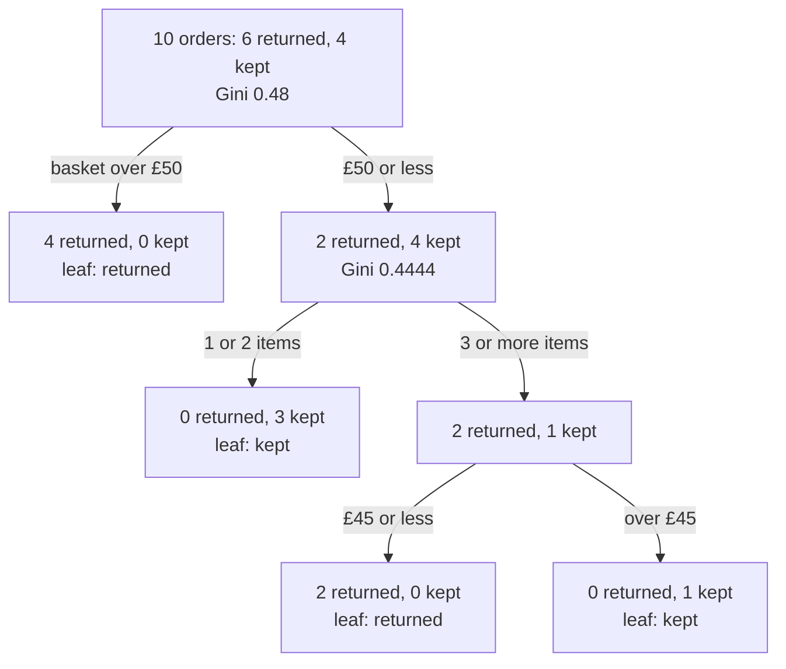
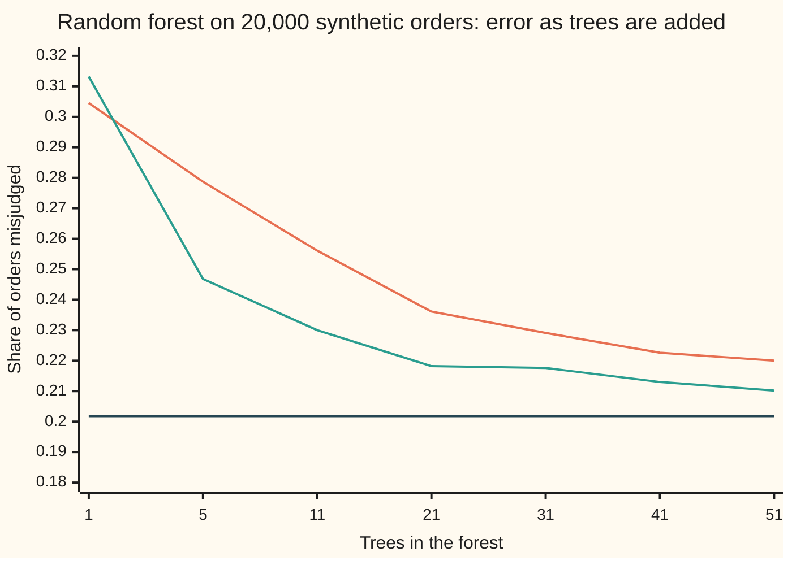

# Decision trees and forests: ask the best question, then average many noisy trees

[Syllabus](../../../SYLLABUS.md) → [Applied and computational](../README.md) → [Machine Learning Mathematics](../README.md#s06) → Decision trees and forests

---

## General Overview

A shop keeps 20,000 past orders, each described by 12 numbers such as items in the basket, average shelf price and hour of day. It knows which orders came back. Returns cost postage and handling, so the shop wants a rule that flags a likely return before it ships.

A **decision tree** is such a rule written as a flowchart of yes-or-no questions. Each question asks about one number, such as "is the basket over £50?". Each answer sends the order down one branch, and the branch ends in a **leaf**: a final group of past orders whose majority outcome becomes the prediction. A person can read and check it.

The method picks each question by how well it sorts the orders. Take ten orders, 6 returned and 4 kept. Their **Gini impurity** (a score of how mixed a group is: 0 when every order agrees, higher when mixed) is 0.48. Ask "basket over £50?" and the ten split into 4 returned with 0 kept, and 2 returned with 4 kept. Weighted by group size, the impurity falls to 0.2667. No other cut on these ten orders does better.

Asking question after question until every leaf is pure goes too far. On 16,000 synthetic orders such a tree grows 2,710 leaves and gets every training order right. Then it misjudges 28.56% of 5,000 fresh orders: it has learned the noise.

**Pruning** (cutting back branches that do not pay for themselves) brings it down to 114 leaves and 23.50%. A **random forest** does better again. It grows 51 trees, each on a resampled copy of the orders and each offered only 3 of the 12 numbers per question, and lets them vote. It misjudges 21.02%. Even the rule that generated the orders, used to call each one, would expect to misjudge 20.18%.

Each resampled copy leaves out about 36.8% of the orders, because $`(1 - 1/n)^n`$ approaches $`1/e`$. Those left-out orders score the forest for free: 22.00%, without setting any orders aside.

**A decision tree asks, at each step, the question that most reduces the mix of outcomes; a deep tree memorises its data, so it is pruned back or replaced by a forest of varied trees, whose vote varies far less and whose left-out orders give an honest error for free.**

**What kind of fact this is:** a method. Inside it are three theorems, proved on this card in Why it works: a split never raises the weighted impurity; an average of $`B`$ equally correlated trees has variance $`\rho\sigma^2 + (1 - \rho)\sigma^2/B`$; and the share of orders a resample leaves out tends to $`1/e`$. The 20,000 orders are synthetic, drawn from a stated rule and seed in the code.

### The picture: the tree grown on ten orders



Schematic. Grown until every leaf is pure, the tree asks three questions and fits all ten orders. Its last question exists to isolate one order, a £48 basket of 3 items that was kept. That is the kind of branch pruning removes.

---

## The formula

Notation first. A **node** is a group of orders at one point in the tree. It holds $`n`$ orders, of which $`a`$ came back, so the share returned is $`p = a/n`$. A question with a cut sends $`n_L`$ orders down the yes branch, with share returned $`p_L`$, and $`n_R`$ down the no branch, with share $`p_R`$. Write $`w = n_L/n`$ for the share sent down the yes branch.

The **Gini impurity** of a node, and the score of a split, are

```math
\mathrm{Gini}(p) = 1 - p^2 - (1 - p)^2 = 2p(1 - p), \qquad \mathrm{Gini}_{\text{split}} = w\,\mathrm{Gini}(p_L) + (1 - w)\,\mathrm{Gini}(p_R)
```

**Read it aloud:** a group's Gini is one minus the squared shares of each outcome; a split's Gini is the two groups' Gini, each weighted by the share of orders it holds. The tree asks the question with the lowest split Gini.

The second common score uses the binary entropy $`h(p) = -p\log_2 p - (1 - p)\log_2(1 - p)`$, in bits, from [Conditional entropy and mutual information](../03-Information%20Theory/02-conditional-entropy-and-mutual-information.md). The drop it measures is the **information gain**:

```math
\text{gain} = h(p) - \big[\,w\,h(p_L) + (1 - w)\,h(p_R)\,\big] = I(Y; S)
```

**Read it aloud:** the information gain is the outcome's uncertainty before the question, minus the size-weighted uncertainty left after it; it equals the mutual information between the outcome $`Y`$ and the answer $`S`$.

Pruning scores a whole tree $`T`$ by its training mistakes plus a price $`\alpha`$ per leaf:

```math
C_\alpha(T) = \mathrm{err}(T) + \alpha\,\lvert T\rvert
```

**Read it aloud:** the cost of a tree is the number of training orders it gets wrong plus alpha for every leaf it keeps; pruning keeps the version of the tree with the lowest cost.

A forest of $`B`$ trees votes. The vote of tree $`b`$ on an order $`x`$ is $`f_b(x)`$: 1 for "returned", 0 for "kept". Two facts govern it:

```math
\mathrm{Var}\Big(\frac{1}{B}\sum_{b=1}^{B} f_b(x)\Big) = \rho\,\sigma^2 + \frac{1 - \rho}{B}\,\sigma^2, \qquad \Big(1 - \frac{1}{n}\Big)^{n} \longrightarrow e^{-1} \approx 0.368
```

**Read it aloud:** the share of trees voting "returned" wobbles, from one training set to another, by the correlation between two trees times one tree's variance, plus the rest of that variance divided by the number of trees. A resample of $`n`$ orders misses any given order with a chance that tends to one over $`e`$.

| Symbol | Plain meaning | In our example | Push it up and the answer… |
| --- | --- | --- | --- |
| $`n`$, $`a`$ | orders in a node; how many of them came back | 10 and 6 at the top; $`n = 20{,}000`$ in the forest | — |
| $`p`$, $`p_L`$, $`p_R`$ | share returned: in the node; down the yes branch; down the no branch | 0.6; 1; 1/3 | Gini rises toward 0.5 at $`p = 0.5`$ |
| $`n_L`$, $`n_R`$, $`w`$ | orders sent each way; $`w = n_L/n`$ | 4 and 6; 0.4 | — |
| $`\mathrm{Gini}(p)`$ | chance that two orders drawn from the node, with replacement, disagree | 0.48 at the top; 0.2667 after the split | — |
| $`h(p)`$ | binary entropy: the node's uncertainty in bits | 0.9710 at the top; 0.5510 after the split | — |
| $`Y`$, $`S`$, $`I(Y; S)`$ | the outcome; the answer to the question; the mutual information between them | 0.4200 bits for "basket over £50?" | — |
| $`T`$, $`\lvert T\rvert`$, $`\mathrm{err}(T)`$ | a tree; its number of leaves; training orders it gets wrong | 4 leaves, 0 wrong, on ten orders | — |
| $`\alpha`$, $`C_\alpha(T)`$ | price per leaf, in orders; the penalised cost | 1.5, cost 5.0 on ten orders; 4 on 16,000 | fewer leaves survive |
| $`B`$, $`b`$ | trees in the forest; one of them | 51 | test error falls, then levels off |
| $`m`$ | numbers offered to each question, drawn at random from the 12 | 3 | trees grow more alike |
| $`x`$, $`f_b(x)`$ | one order's 12 numbers; tree $`b`$'s vote on it, 1 or 0 | — | — |
| $`\sigma^2`$, $`\rho`$, $`e`$ | variance of one tree's vote; correlation between two trees' votes; 2.71828…, the base of natural logarithms | $`\rho`$ over the test orders: 0.33 with $`m = 3`$, 0.39 with all 12 | larger $`\rho`$: averaging helps less |

On this shelf $`\alpha`$ also names the mixing weight $`\alpha_k`$ on [EM](08-em-algorithm.md) and an order's weight $`\alpha_i`$ on [Support vector machines](09-kernels-and-support-vector-machines.md), and [Boosting](11-boosting-adaboost-and-gradient-boosting.md) uses $`\alpha_t`$ for a rule's say; here it is only the price per leaf.

### When it holds

- **Future orders resemble past ones.** Every question and every vote is fitted to the orders on file. A tree grown on spring orders asks spring questions in the Christmas rush.
- **Questions ask about one number at a time.** A cut such as "basket over £50" draws a straight boundary along one axis. A pattern that depends on a combination, such as items times price, needs a staircase of many questions to copy it.
- **Bagging needs a model that changes a lot from sample to sample.** A one-question tree hardly changes, and 51 of them vote exactly like one: test error 0.3056 either way.
- **Trees must not be too alike.** With all 12 numbers on offer at every question, the trees tend to ask the same strong questions first: two trees' votes correlate 0.39 over the test orders, against 0.33 when each question sees 3 numbers drawn at random. The shared part of the variance, $`\rho\sigma^2`$, stays however many trees vote. In this seeded run bagging alone scores 0.2260 on the test orders and the forest 0.2102, but one run cannot size that gain: it changes with the seed.
- **Out-of-bag error needs enough trees.** The out-of-bag error is the forest's error on the orders each tree left out of its sample (Step 6). Each order's out-of-bag vote comes from only about 37% of the trees, so a small forest reads too high: at 5 trees about 1.8 trees vote on each order, and out-of-bag reads 0.2787 against 0.2468 on the test orders. At 51 trees about 18.7 vote, and the gap, 0.0098, is under two standard errors of the test error (0.0058), so out-of-bag error is a fair estimate of the forest's error.

---

## Why it works

### Step 0: one good question at a time

A good question sends returned orders one way and kept orders the other. Impurity measures how far a group is from that ideal. The tree takes the question that lowers impurity most, then repeats inside each branch.

This is a **greedy** method: it never looks ahead, because searching over whole trees is out of reach. So the grown tree is good, not promised best.

### Step 1: Gini is the chance of a wrong random label

Draw one order from the node. Label it by copying the outcome of a second order drawn at random, with replacement. The label is wrong when the two disagree: returned then kept, chance $`p(1 - p)`$, or kept then returned, the same again. That totals $`2p(1 - p)`$.

For the ten orders, $`2 \times 0.6 \times 0.4 = 0.48`$. A pure group scores 0, because copying any label is always right.

### Step 2: a split never makes things worse

The parent's share is the size-weighted average of the two branches' shares: $`p = w p_L + (1 - w) p_R`$. Here $`0.4 \times 1 + 0.6 \times 1/3 = 0.6`$.

Gini, drawn against $`p`$, is an arch: it bends downward everywhere (it is **concave**). Between any two of its points, a downward-bending curve sits on or above the straight line joining them. So the parent's Gini is at least the weighted average of the branches' Gini. Exactly:

```math
\mathrm{Gini}(p) - \mathrm{Gini}_{\text{split}} = 2\,w(1 - w)\,(p_L - p_R)^2
```

**Read it aloud:** the Gini drop is twice the two branch shares multiplied, times the squared gap between the branches' return rates.

For the basket question: $`2 \times 0.4 \times 0.6 \times (2/3)^2 = 0.2133`$, which is $`0.48 - 0.2667`$. The drop is zero only when both branches have the same mix. Over all 1,022 yes/no labellings of the ten orders with both groups non-empty (511 distinct splits, each counted once per side), the worst leaves the Gini at 0.4800 and the entropy at 0.9710: none raises either.

<details>
<summary>Detailed proof: the Gini drop formula</summary>

Write $`\mathrm{Gini}(p) = 2p - 2p^2`$. The linear part averages exactly: $`2p = w \cdot 2p_L + (1 - w) \cdot 2p_R`$. Only the squares remain:

$`\displaystyle \mathrm{Gini}(p) - \mathrm{Gini}_{\text{split}} = 2\big[\,w p_L^2 + (1 - w) p_R^2 - (w p_L + (1 - w) p_R)^2\,\big]`$

Expand the last square and collect terms. The bracket is $`w(1 - w)(p_L^2 - 2p_L p_R + p_R^2) = w(1 - w)(p_L - p_R)^2`$, which is never negative.

</details>

### Step 3: information gain is mutual information

Entropy before the question is $`h(0.6) = 0.9710`$ bits. After it, the yes branch is pure and the no branch holds $`h(1/3) = 0.9183`$ bits, weighted by 0.6: $`0.5510`$ bits. The gain is $`0.4200`$ bits.

The gain is $`H(Y) - H(Y \mid S)`$: uncertainty about the outcome minus uncertainty left after the answer. That is the mutual information $`I(Y; S)`$, so it also equals $`H(Y) + H(S) - H(Y, S)`$. The checks compute it that second way, from the answer's own entropy and the three-cell joint table (0.4, 0.2, 0.4), and get $`0.4200`$ again.

Both scores pick "basket over £50?" on these ten orders.

### Step 4: pruning prices each leaf

A tree grown until every leaf is pure has zero training error, so training error cannot say when to stop. The cost $`C_\alpha(T)`$ adds a price per leaf: a branch survives only if it removes more than $`\alpha`$ mistakes for each leaf it adds.

The best pruned tree for a given $`\alpha`$ takes one backward sweep. A node's cost is the smaller of two options: make it a leaf (its own mistakes plus $`\alpha`$), or keep its two branches (the sum of their best costs). The cost of a kept node is a sum over its two branches. So each branch can be settled on its own, from the leaves upward.

Of the ten-order tree's four pruned versions, the one-question tree wins at $`\alpha = 1.5`$, with cost 5.0 (Worked numbers lists all four).

$`\alpha`$ is chosen on orders the tree never saw. Grown on 16,000 orders and scored on 4,000 held back, the held-out error is lowest at $`\alpha = 4`$: 0.2225, against 0.2777 at $`\alpha = 0`$ and 0.2547 at $`\alpha = 32`$. That leaves 114 of the 2,710 leaves.

### Step 5: averaging removes variance, if the trees differ

A deep tree has low bias (it can follow any pattern) and high variance: grown on a slightly different sample, it asks different questions. Averaging attacks the variance part of the error, as split on [Bias and variance](../../09-Probability%20and%20statistics/07-Sampling%20and%20Estimation/06-bias-variance-and-mean-squared-error.md).

Suppose each tree's vote has variance $`\sigma^2`$ and every pair of trees has correlation $`\rho`$. Then the average of $`B`$ votes has variance $`\rho\sigma^2 + (1 - \rho)\sigma^2/B`$. More trees shrink the second term toward zero. The first term stays: trees grown from the same 20,000 orders share their quirks.

<details>
<summary>Detailed proof: the variance of an average of correlated votes</summary>

The variance of a sum is the sum of every covariance between its terms. There are $`B`$ terms paired with themselves, each $`\sigma^2`$, and $`B(B - 1)`$ ordered pairs of different trees, each $`\rho\sigma^2`$:

$`\displaystyle \mathrm{Var}\Big(\frac{1}{B}\sum_{b} f_b\Big) = \frac{1}{B^2}\big[B\sigma^2 + B(B - 1)\rho\sigma^2\big] = \rho\sigma^2 + \frac{1 - \rho}{B}\sigma^2`$

</details>

That formula explains both tricks of the forest.

- **Bagging** (bootstrap aggregating): grow each tree on a **bootstrap sample**, $`n`$ orders drawn from the $`n`$ on file with replacement, as on [Bootstrap](../../09-Probability%20and%20statistics/07-Sampling%20and%20Estimation/08-bootstrap.md). One data set yields many different trees.
- **Random feature choice:** at each question, offer only $`m`$ of the 12 numbers, drawn afresh. A strong number can no longer open every tree, so the trees agree less and $`\rho`$ falls. Measured as the correlation between two trees' votes over the 5,000 test orders, it is 0.39 with all 12 numbers and 0.33 with 3.

Each forest tree is worse alone: the first one misjudges 0.3132 of the test orders, against 0.2856 for the full tree. The vote of 51 such trees is far better, at 0.2102.

### Step 6: the left-out orders score the forest

A bootstrap draw picks a given order with chance $`1/n`$. It misses it with chance $`1 - 1/n`$, and all $`n`$ independent draws miss it with chance $`(1 - 1/n)^n`$.

Take logs: $`n \ln(1 - 1/n) = -1 - 1/(2n) - \dots`$, using $`\ln(1 - u) = -u - u^2/2 - \dots`$. That tends to $`-1`$, so the share tends to $`e^{-1}`$. At $`n = 20{,}000`$ it is 0.367870, against $`1/e = 0.367879`$. Across the 51 trees, the measured share left out was 0.3675.

The trees that left an order out never saw it, so their vote on it is a fair test. Counting those votes for every order gives the **out-of-bag error**: 0.2200 for the forest, against 0.2102 on 5,000 fresh orders. No orders had to be set aside to get it.

---

## Worked numbers, by hand

The ten orders:

| Order | Basket | Items | Outcome |
| --- | ---: | ---: | --- |
| 1 to 4 | £62, £75, £88, £120 | 3, 4, 2, 5 | returned |
| 5, 6 | £45, £28 | 3, 4 | returned |
| 7, 8, 9, 10 | £22, £33, £40, £48 | 1, 1, 2, 3 | kept |

| Step | Arithmetic | Value |
| --- | --- | --- |
| share returned | 6 of 10 | 0.6 |
| Gini at the top | $`1 - 0.6^2 - 0.4^2 = 1 - 0.36 - 0.16`$ | 0.4800 |
| basket over £50 | orders 1 to 4: 4 returned, 0 kept | Gini 0 |
| £50 or less | orders 5 to 10: 2 returned, 4 kept; $`1 - (1/3)^2 - (2/3)^2`$ | 0.4444 |
| split Gini | $`0.4 \times 0 + 0.6 \times 0.4444`$ | **0.2667** |
| Gini drop | $`0.4800 - 0.2667`$ | 0.2133 |
| entropy at the top | $`-0.6\log_2 0.6 - 0.4\log_2 0.4`$ | 0.9710 bits |
| entropy after | $`0.6 \times h(1/3) = 0.6 \times 0.9183`$ | 0.5510 bits |
| information gain | $`0.9710 - 0.5510`$ | **0.4200 bits** |
| pruned versions at $`\alpha = 1.5`$ | 1 leaf: $`4 + 1.5`$; 2 leaves: $`2 + 3.0`$; 3 leaves: $`1 + 4.5`$; 4 leaves: $`0 + 6.0`$ | 5.5, **5.0**, 5.5, 6.0 |
| share left out, $`n = 10`$ | $`0.9^{10}`$ | 0.3487 |
| share left out, $`n = 20{,}000`$ | $`(1 - 1/20{,}000)^{20{,}000}`$ | **0.367870** |

The basket question removes 0.2133 of the 0.48 Gini; at 1.5 orders per leaf only that question is worth keeping; and each bootstrap sample of the 20,000 orders leaves about 36.8% free to test the forest.

The tree's cut lands at £48, the largest basket on the low side. Any cut at £48 or above, but below £62, makes the same two groups, so "over £50" is the same question.

### What breaks if you drop a piece

| Mistake | Comes out at | What went wrong |
| --- | --- | --- |
| Score a split by the plain average of its two groups' Gini | picks "more than 1 item" at 0.1875, over the basket cut's 0.2222; its true split Gini is 0.3000 | A pure group of 2 orders counts as much as a mixed group of 8 |
| Judge a fully grown tree on the orders it grew from | training error 0.0000, test error 0.2856 | Every leaf is pure because the tree memorised the orders |
| Score the forest on its own training orders | 0.0003, against out-of-bag 0.2200 | Most trees saw each order while growing |
| Bag a one-question tree | 0.3056 with 1 tree and with 51 | A one-question tree barely varies, so there is no variance to average away |

The code prints all four.

---

## How the forest's error moves with more trees

**The puzzle:** one forest tree is worse than the full tree, yet the forest beats both. Each tree adds a noisy vote; the noise cancels and the signal adds up.

One story, traced: the same forest, scored as each tree joins it.

| Trees | Out-of-bag error | Test error |
| ---: | ---: | ---: |
| 1 | 0.3045 | 0.3132 |
| 5 | 0.2787 | 0.2468 |
| 11 | 0.2561 | 0.2300 |
| 21 | 0.2361 | 0.2182 |
| 51 | 0.2200 | 0.2102 |

The test error falls fast, then flattens. More trees shrink only the $`(1 - \rho)\sigma^2/B`$ part of the variance; the shared part, $`\rho\sigma^2`$, stays. Each piece of the method, one at a time:

```
full tree, 2,710 leaves   ████████████████████████████▌ 0.2856
pruned tree, 114 leaves   ███████████████████████▌      0.2350
bagging alone, 51 trees   ██████████████████████▌       0.2260
random forest, 51 trees   █████████████████████         0.2102
generating rule itself    ████████████████████▏         0.2018
```



Orange: out-of-bag error. Green: error on 5,000 fresh test orders. Dark: the best possible, 0.2018, from the generating rule. Out-of-bag runs above test while the forest is small, because each order's out-of-bag vote comes from only about 37% of the trees: 1.8 at 5 trees, 18.7 at 51. By 51 trees the gap, 0.0098, is within chance: under two standard errors of the test error, 0.0058.

---

## Code, from first principles, and it actually runs

Both programs grow trees by a single counting sweep over every cut of every number, written out. Randomness comes from a SplitMix64 generator, seed 2026, written out in both languages. They take six independent roads:

1. The best first question by the counting sweep, against brute-force scoring of all 13 cuts.
2. Information gain as a drop in entropy, against $`H(Y) + H(S) - H(Y, S)`$.
3. "A split never raises Gini", against all 1,022 yes/no labellings of the ten orders (511 splits).
4. Pruning by the backward sweep, against listing every pruned version.
5. The share left out, measured, against $`(1 - 1/n)^n`$ and $`1/e`$.
6. Out-of-bag error, against error on 5,000 fresh orders.

The 25,000 orders are synthetic. The chance of a return rises with items, price, a discount code, days since the last order, distance and browsing. It rises by 0.2 for phone orders from 9pm on, and falls with past orders and account age. The weekend and newsletter flags have no effect. Orders 1 to 16,000 grow the single tree, the next 4,000 choose $`\alpha`$, and the last 5,000 test everything; the forests use the first 20,000.

### Python

```python
# Decision trees and forests -- the check behind the card.  Standard library only.
# Ten hand-made orders show one split by hand; 25,000 synthetic orders, drawn by
# SplitMix64 (seed 2026) from the rule in order(), test pruning, bagging and out-of-bag error.
from math import log2, exp
M64 = (1 << 64) - 1
class Rng:                                       # SplitMix64, written out
    def __init__(self, seed): self.s = seed
    def u(self):                                 # uniform in [0, 1)
        self.s = (self.s + 0x9E3779B97F4A7C15) & M64
        z = self.s
        z = ((z ^ (z >> 30)) * 0xBF58476D1CE4E5B9) & M64
        z = ((z ^ (z >> 27)) * 0x94D049BB133111EB) & M64
        return ((z ^ (z >> 31)) >> 11) / 9007199254740992.0
    def k(self, n): return int(self.u() * n)     # whole number 0 .. n-1
def p_return(x):                                 # the synthetic rule: chance an order comes back
    s = (0.05 * (x[0] - 1) + 0.004 * (x[1] - 5) + 0.12 * x[6] - 0.01 * min(x[2], 15) + 0.0015 * x[3]
         + 0.003 * x[7] - 0.002 * x[9] + 0.004 * (x[11] - x[0]))
    p = 2.6 * s - 0.51 + (0.2 if x[4] == 1 and x[5] >= 21 else 0.0)   # late-night phone orders
    return max(0.02, min(0.95, p))
def order(g):  # items, avg price, past orders, days since last, phone, hour, code, km, weekend, months, newsletter, viewed
    x = [1 + g.k(8), 5 + g.k(56), g.k(31), g.k(91), int(g.u() < 0.6), g.k(24),
         int(g.u() < 0.3), 1 + g.k(50), int(g.u() < 0.3), g.k(61), int(g.u() < 0.4), 0]
    x[11] = x[0] + g.k(20)
    return x, int(g.u() < p_return(x))
def grow(X, Y, idx, m, g, T, size, depth=99):   # node: [feature, cut, left, right, returned, orders]
    n = len(idx); a = sum(Y[i] for i in idx); me = len(T); T.append([-1, 0, 0, 0, a, n])
    if a == 0 or a == n or depth == 0: return me
    feats = list(range(len(size)))
    if m < len(size):                            # random feature choice: m of them, partial shuffle
        for j in range(m):
            r = j + g.k(len(size) - j); feats[j], feats[r] = feats[r], feats[j]
    best, bf, bt = 2 * a * (n - a) / n, -1, 0    # n times the node's Gini; a split must beat it
    for f in feats[:m]:
        ret, tot = [0] * size[f], [0] * size[f]
        for i in idx: tot[X[i][f]] += 1; ret[X[i][f]] += Y[i]
        aL = nL = 0
        for t in range(size[f] - 1):             # every cut "value <= t" in one sweep
            aL += ret[t]; nL += tot[t]; nR = n - nL
            if tot[t] == 0 or nL == 0: continue
            if nR == 0: break
            s = 2 * aL * (nL - aL) / nL + 2 * (a - aL) * (nR - a + aL) / nR
            if s < best: best, bf, bt = s, f, t
    if bf < 0: return me
    T[me][0], T[me][1] = bf, bt
    T[me][2] = grow(X, Y, [i for i in idx if X[i][bf] <= bt], m, g, T, size, depth - 1)
    T[me][3] = grow(X, Y, [i for i in idx if X[i][bf] > bt], m, g, T, size, depth - 1)
    return me
def prune(T, alpha):                             # cheapest pruned tree for this alpha, one backward sweep
    cut, cost, leaves = [False] * len(T), [0.0] * len(T), [1] * len(T)
    for k in range(len(T) - 1, -1, -1):          # children sit after parents, so go backwards
        own = min(T[k][4], T[k][5] - T[k][4]) + alpha
        if T[k][0] < 0 or own <= cost[T[k][2]] + cost[T[k][3]]: cut[k], cost[k] = True, own
        else: cost[k], leaves[k] = cost[T[k][2]] + cost[T[k][3]], leaves[T[k][2]] + leaves[T[k][3]]
    return cut, cost[0], leaves[0]
def vote(T, x, cut=None):
    k = 0
    while T[k][0] >= 0 and not (cut and cut[k]): k = T[k][2] if x[T[k][0]] <= T[k][1] else T[k][3]
    return int(2 * T[k][4] > T[k][5])
def err(T, X, Y, rows, cut=None): return sum(vote(T, X[i], cut) != Y[i] for i in rows) / len(rows)
def gini(a, n): return 1 - (a / n) * (a / n) - ((n - a) / n) * ((n - a) / n) if n else 0.0
def ent(a, n): return -sum(c / n * log2(c / n) for c in (a, n - a) if c) if n else 0.0
def weighted(f, rows, mask):                     # impurity of a two-group split, groups weighted by size
    L = [r[2] for r, s in zip(rows, mask) if s]; R = [r[2] for r, s in zip(rows, mask) if not s]
    return (len(L) * f(sum(L), len(L)) + len(R) * f(sum(R), len(R))) / len(rows)
def plain(rows, mask):                           # the mistake: the two groups' Gini, not weighted
    L = [r[2] for r, s in zip(rows, mask) if s]; R = [r[2] for r, s in zip(rows, mask) if not s]
    return (gini(sum(L), len(L)) + gini(sum(R), len(R))) / 2
# ---- ten orders: (basket in pounds, items, 1 = returned) ----
ten = [(62, 3, 1), (75, 4, 1), (88, 2, 1), (120, 5, 1), (45, 3, 1), (28, 4, 1),
       (22, 1, 0), (33, 1, 0), (40, 2, 0), (48, 3, 0)]
cuts = [(f, t) for f in (0, 1) for t in sorted({r[f] for r in ten})[:-1]]
masks = {c: [r[c[0]] > c[1] for r in ten] for c in cuts}
name = lambda c: f"{'basket' if c[0] == 0 else 'items'} > {c[1]}"
bg = min(cuts, key=lambda c: weighted(gini, ten, masks[c]))
be = min(cuts, key=lambda c: weighted(ent, ten, masks[c]))
bp = min(cuts, key=lambda c: plain(ten, masks[c]))
G0, H0, Gs, Hs = gini(6, 10), ent(6, 10), weighted(gini, ten, masks[bg]), weighted(ent, ten, masks[bg])
HS, HYS = ent(4, 10), -sum(q * log2(q) for q in (0.4, 0.2, 0.4))   # H(S) and H(Y, S)
allsplits = [[(b >> j) & 1 for j in range(10)] for b in range(1, 1023)]
print(f"ten orders: Gini {G0:.4f}, entropy {H0:.4f} bits")
print(f"best of {len(cuts)} cuts by Gini: {name(bg)}, weighted Gini {Gs:.4f}; by entropy: {name(be)}, {Hs:.4f} bits")
print(f"group 2:4: Gini {gini(2, 6):.4f}, entropy {ent(2, 6):.4f}; Gini drop {G0 - Gs:.4f}")
print(f"information gain {H0 - Hs:.4f} bits = H(Y) + H(S) - H(Y,S) = {H0 + HS - HYS:.4f}")
print(f"worst of all 1,022 yes/no labellings (511 splits): Gini {max(weighted(gini, ten, s) for s in allsplits):.4f}, "
      f"entropy {max(weighted(ent, ten, s) for s in allsplits):.4f}")
print(f"mistake, plain average: picks {name(bp)} at {plain(ten, masks[bp]):.4f} (basket cut "
      f"{plain(ten, masks[bg]):.4f}); its weighted Gini {weighted(gini, ten, masks[bp]):.4f}")
small = []; grow([r[:2] for r in ten], [r[2] for r in ten], list(range(10)), 2, None, small, [121, 6])
print("tree: " + "; ".join(f"node {k}: {'basket' if t[0] == 0 else 'items'} <= {t[1]}" if t[0] >= 0
      else f"node {k}: leaf {t[4]}:{t[5] - t[4]}" for k, t in enumerate(small)))
for alpha in (0.5, 1.5, 2.5): print(f"alpha {alpha}: leaves kept {prune(small, alpha)[2]}, cost {prune(small, alpha)[1]:.1f}")
def options(k):                                  # brute force: every pruned version as (errors, leaves)
    t = small[k]; mine = [(min(t[4], t[5] - t[4]), 1)]
    if t[0] < 0: return mine
    return mine + [(a + c, b + d) for a, b in options(t[2]) for c, d in options(t[3])]
brute = {al: min(e + al * l for e, l in options(0)) for al in (0.5, 1.5, 2.5)}
print("every pruned version, errors + 1.5 x leaves: " + ", ".join(f"leaves {l}: {e} + {1.5 * l:.1f} = {e + 1.5 * l:.1f}" for e, l in options(0)))
# ---- 25,000 synthetic orders: 16,000 grow, 4,000 choose alpha, 5,000 test ----
g = Rng(2026); data = [order(g) for _ in range(25000)]; X, Y = [d[0] for d in data], [d[1] for d in data]
SIZE, N, test = [9, 61, 31, 91, 2, 24, 2, 51, 2, 61, 2, 28], 20000, range(20000, 25000)
print(f"orders returned: {sum(Y[:N])} of {N}; best possible test error (rule known) "
      f"{sum(min(p_return(X[i]), 1 - p_return(X[i])) for i in test) / 5000:.4f}")
full = []; grow(X, Y, list(range(16000)), 12, g, full, SIZE)
tr_full, te_full = err(full, X, Y, range(16000)), err(full, X, Y, test)
print(f"full tree: {sum(t[0] < 0 for t in full)} leaves, training error {tr_full:.4f}, test error {te_full:.4f}")
val = {a: err(full, X, Y, range(16000, 20000), prune(full, a)[0]) for a in (0, 1, 2, 4, 8, 16, 32)}
ab = min(val, key=val.get); pc, _, pl = prune(full, ab); te_pruned = err(full, X, Y, test, pc)
print("pruning, held-out error by alpha: " + ", ".join(f"{a}: {v:.4f}" for a, v in val.items()))
print(f"pruned at alpha {ab}: {pl} leaves, test error {te_pruned:.4f}")
def forest(m, B, depth=99, show=()):
    tv, ov, on, tr, left = [0] * 25000, [0] * N, [0] * N, [0] * N, 0
    for b in range(1, B + 1):
        idx = [g.k(N) for _ in range(N)]; inbag = [0] * N
        for i in idx: inbag[i] = 1
        T = []; grow(X, Y, idx, m, g, T, SIZE, depth); left += N - sum(inbag)
        for i in range(N):
            v = vote(T, X[i]); tr[i] += v
            if not inbag[i]: ov[i] += v; on[i] += 1
        for i in test: tv[i] += vote(T, X[i])
        seen = [i for i in range(N) if on[i]]
        oob = sum((2 * ov[i] > on[i]) != Y[i] for i in seen) / len(seen)
        te = sum((2 * tv[i] > b) != Y[i] for i in test) / 5000
        if b in show: print(f"  {b} trees: out-of-bag error {oob:.4f}, test error {te:.4f}")
    q, c = sum(tv) / (5000 * B), sum(t * (t - 1) for t in tv) / (5000 * B * max(B - 1, 1))   # rho: pairs of trees, test orders
    return oob, te, sum((2 * tr[i] > B) != Y[i] for i in range(N)) / N, left / (B * N), (c - q * q) / (q - q * q)
print("random forest, 3 of 12 numbers per question:"); oob, te, tr_forest, share, rho = forest(3, 51, show=(1, 5, 11, 21, 31, 41, 51))
print(f"share of orders left out per tree {share:.4f}, so {share * 5:.1f} of 5 and {share * 51:.1f} of 51 trees per order; (1-1/n)^n = {(1 - 1 / N) ** N:.6f}, "
      f"1/e = {exp(-1):.6f}; n = 10: {0.9 ** 10:.4f}")
print(f"out-of-bag minus test, whole forest, {oob - te:.4f}; standard error of a 5,000-order test error {(te * (1 - te) / 5000) ** 0.5:.4f}")
print(f"mistake, forest scored on its own training orders: {tr_forest:.4f}")
bag = forest(12, 51); print(f"bagging alone, all 12 numbers: out-of-bag {bag[0]:.4f}, test {bag[1]:.4f}")
print(f"correlation of two trees' votes over the test orders: all 12 numbers {bag[4]:.2f}, 3 numbers {rho:.2f}")
stump1, stumps = forest(12, 1, 1)[1], forest(12, 51, 1)[1]; print(f"mistake, bagging one-question trees: 1 tree {stump1:.4f}, 51 trees {stumps:.4f}")
assert abs(G0 - 2 * 6 * 4 / 100) < 1e-12 and abs(Gs - 4 / 15) < 1e-12 and bg == (0, 48) == tuple(small[0][:2])
assert abs((H0 - Hs) - (H0 + HS - HYS)) < 1e-12 and be == bg and bp == (1, 1)
assert max(weighted(gini, ten, s) for s in allsplits) <= G0 + 1e-12 and max(weighted(ent, ten, s) for s in allsplits) <= H0 + 1e-12
assert all(abs(prune(small, a)[1] - brute[a]) < 1e-12 for a in brute)
assert abs(share - (1 - 1 / N) ** N) < 0.002 and abs(share - exp(-1)) < 0.002 and rho < bag[4] - 0.02
assert te < te_full - 0.04 and te < te_pruned and abs(oob - te) < 0.025 and te_pruned < te_full and tr_full < 0.01
print("ALL CHECKS PASS")
```

**Ran 2026-11-23 on macOS, Python 3.14.10, standard library only. All checks passed. Output, pasted from the run:**

```
ten orders: Gini 0.4800, entropy 0.9710 bits
best of 13 cuts by Gini: basket > 48, weighted Gini 0.2667; by entropy: basket > 48, 0.5510 bits
group 2:4: Gini 0.4444, entropy 0.9183; Gini drop 0.2133
information gain 0.4200 bits = H(Y) + H(S) - H(Y,S) = 0.4200
worst of all 1,022 yes/no labellings (511 splits): Gini 0.4800, entropy 0.9710
mistake, plain average: picks items > 1 at 0.1875 (basket cut 0.2222); its weighted Gini 0.3000
tree: node 0: basket <= 48; node 1: items <= 2; node 2: leaf 0:3; node 3: basket <= 45; node 4: leaf 2:0; node 5: leaf 0:1; node 6: leaf 4:0
alpha 0.5: leaves kept 4, cost 2.0
alpha 1.5: leaves kept 2, cost 5.0
alpha 2.5: leaves kept 1, cost 6.5
every pruned version, errors + 1.5 x leaves: leaves 1: 4 + 1.5 = 5.5, leaves 2: 2 + 3.0 = 5.0, leaves 3: 1 + 4.5 = 5.5, leaves 4: 0 + 6.0 = 6.0
orders returned: 8092 of 20000; best possible test error (rule known) 0.2018
full tree: 2710 leaves, training error 0.0000, test error 0.2856
pruning, held-out error by alpha: 0: 0.2777, 1: 0.2457, 2: 0.2273, 4: 0.2225, 8: 0.2330, 16: 0.2477, 32: 0.2547
pruned at alpha 4: 114 leaves, test error 0.2350
random forest, 3 of 12 numbers per question:
  1 trees: out-of-bag error 0.3045, test error 0.3132
  5 trees: out-of-bag error 0.2787, test error 0.2468
  11 trees: out-of-bag error 0.2561, test error 0.2300
  21 trees: out-of-bag error 0.2361, test error 0.2182
  31 trees: out-of-bag error 0.2291, test error 0.2176
  41 trees: out-of-bag error 0.2226, test error 0.2130
  51 trees: out-of-bag error 0.2200, test error 0.2102
share of orders left out per tree 0.3675, so 1.8 of 5 and 18.7 of 51 trees per order; (1-1/n)^n = 0.367870, 1/e = 0.367879; n = 10: 0.3487
out-of-bag minus test, whole forest, 0.0098; standard error of a 5,000-order test error 0.0058
mistake, forest scored on its own training orders: 0.0003
bagging alone, all 12 numbers: out-of-bag 0.2232, test 0.2260
correlation of two trees' votes over the test orders: all 12 numbers 0.39, 3 numbers 0.33
mistake, bagging one-question trees: 1 tree 0.3056, 51 trees 0.3056
ALL CHECKS PASS
```

### Rust

Same numbers, same labels, built with `rustc --edition 2021 -O`.

```rust
// Decision trees and forests -- the same check as the Python, in Rust.  No crates.
// Ten hand-made orders show one split by hand; 25,000 synthetic orders, drawn by
// SplitMix64 (seed 2026) from the rule in order(), test pruning, bagging and out-of-bag error.
struct Rng { s: u64 }
impl Rng {                                         // SplitMix64, written out
    fn u(&mut self) -> f64 {                       // uniform in [0, 1)
        self.s = self.s.wrapping_add(0x9E3779B97F4A7C15);
        let mut z = self.s;
        z = (z ^ (z >> 30)).wrapping_mul(0xBF58476D1CE4E5B9);
        z = (z ^ (z >> 27)).wrapping_mul(0x94D049BB133111EB);
        ((z ^ (z >> 31)) >> 11) as f64 / 9007199254740992.0
    }
    fn k(&mut self, n: usize) -> usize { (self.u() * n as f64) as usize }   // whole number 0 .. n-1
}
type Node = [usize; 6]; const NONE: usize = usize::MAX;   // feature (NONE = leaf), cut, left, right, returned, orders
fn p_return(x: &[usize]) -> f64 {                  // the synthetic rule: chance an order comes back
    let f = |v: usize| v as f64;
    let s = 0.05 * f(x[0] - 1) + 0.004 * f(x[1] - 5) + 0.12 * f(x[6]) - 0.01 * f(x[2].min(15))
        + 0.0015 * f(x[3]) + 0.003 * f(x[7]) - 0.002 * f(x[9]) + 0.004 * f(x[11] - x[0]);
    let p = 2.6 * s - 0.51 + if x[4] == 1 && x[5] >= 21 { 0.2 } else { 0.0 };
    p.min(0.95).max(0.02)
}
fn order(g: &mut Rng) -> (Vec<usize>, usize) {
    let mut x = vec![1 + g.k(8), 5 + g.k(56), g.k(31), g.k(91), (g.u() < 0.6) as usize, g.k(24),
        (g.u() < 0.3) as usize, 1 + g.k(50), (g.u() < 0.3) as usize, g.k(61), (g.u() < 0.4) as usize, 0];
    x[11] = x[0] + g.k(20);
    let y = (g.u() < p_return(&x)) as usize; (x, y)
}
fn grow(xs: &[Vec<usize>], ys: &[usize], idx: &[usize], m: usize, g: &mut Rng, t: &mut Vec<Node>,
        size: &[usize], depth: usize) -> usize {
    let (n, a, me) = (idx.len(), idx.iter().map(|&i| ys[i]).sum::<usize>(), t.len()); t.push([NONE, 0, 0, 0, a, n]);
    if a == 0 || a == n || depth == 0 { return me }
    let mut feats: Vec<usize> = (0..size.len()).collect();
    if m < size.len() { for j in 0..m { let r = j + g.k(size.len() - j); feats.swap(j, r) } }  // m of them, at random
    let (mut best, mut bf, mut bt) = ((2 * a * (n - a)) as f64 / n as f64, NONE, 0);
    for &f in &feats[..m] {
        let (mut ret, mut tot) = (vec![0usize; size[f]], vec![0usize; size[f]]);
        for &i in idx { tot[xs[i][f]] += 1; ret[xs[i][f]] += ys[i] }
        let (mut al, mut nl) = (0usize, 0usize);
        for c in 0..size[f] - 1 {                  // every cut "value <= c" in one sweep
            al += ret[c]; nl += tot[c]; let nr = n - nl;
            if tot[c] == 0 || nl == 0 { continue } if nr == 0 { break }
            let s = (2 * al * (nl - al)) as f64 / nl as f64 + (2 * (a - al) * (nr - a + al)) as f64 / nr as f64;
            if s < best { best = s; bf = f; bt = c }
        }
    }
    if bf == NONE { return me }
    t[me][0] = bf; t[me][1] = bt;
    let (l, r): (Vec<usize>, Vec<usize>) = idx.iter().partition(|&&i| xs[i][bf] <= bt);
    t[me][2] = grow(xs, ys, &l, m, g, t, size, depth - 1); t[me][3] = grow(xs, ys, &r, m, g, t, size, depth - 1); me
}
fn prune(t: &[Node], alpha: f64) -> (Vec<bool>, f64, usize) {   // cheapest pruned tree for this alpha, one backward sweep
    let (mut cut, mut cost, mut leaves) = (vec![false; t.len()], vec![0.0; t.len()], vec![1usize; t.len()]);
    for k in (0..t.len()).rev() {                  // children sit after parents, so go backwards
        let own = t[k][4].min(t[k][5] - t[k][4]) as f64 + alpha;
        if t[k][0] == NONE || own <= cost[t[k][2]] + cost[t[k][3]] { cut[k] = true; cost[k] = own }
        else { cost[k] = cost[t[k][2]] + cost[t[k][3]]; leaves[k] = leaves[t[k][2]] + leaves[t[k][3]] }
    }
    (cut, cost[0], leaves[0])
}
fn vote(t: &[Node], x: &[usize], cut: Option<&[bool]>) -> usize {
    let mut k = 0; while t[k][0] != NONE && !cut.map_or(false, |c| c[k]) { k = if x[t[k][0]] <= t[k][1] { t[k][2] } else { t[k][3] } }
    (2 * t[k][4] > t[k][5]) as usize
}
fn err(t: &[Node], xs: &[Vec<usize>], ys: &[usize], rows: std::ops::Range<usize>, cut: Option<&[bool]>) -> f64 {
    let len = rows.len() as f64; rows.filter(|&i| vote(t, &xs[i], cut) != ys[i]).count() as f64 / len
}
fn gini(a: usize, n: usize) -> f64 { if n == 0 { return 0.0 } let (p, q) = (a as f64 / n as f64, (n - a) as f64 / n as f64); 1.0 - p * p - q * q }
fn ent(a: usize, n: usize) -> f64 { let mut s = 0.0; for c in [a, n - a] { if c > 0 { let p = c as f64 / n as f64; s += p * p.log2() } } -s }
fn groups(rows: &[(usize, usize, usize)], mask: &[bool]) -> (usize, usize, usize, usize) {
    let (mut al, mut nl, mut ar, mut nr) = (0, 0, 0, 0);
    for (r, &s) in rows.iter().zip(mask) { if s { al += r.2; nl += 1 } else { ar += r.2; nr += 1 } } (al, nl, ar, nr)
}
fn weighted(f: fn(usize, usize) -> f64, rows: &[(usize, usize, usize)], mask: &[bool]) -> f64 {
    let (al, nl, ar, nr) = groups(rows, mask); (nl as f64 * f(al, nl) + nr as f64 * f(ar, nr)) / rows.len() as f64
}
fn plain(rows: &[(usize, usize, usize)], mask: &[bool]) -> f64 {   // the mistake: not weighted
    let (al, nl, ar, nr) = groups(rows, mask); (gini(al, nl) + gini(ar, nr)) / 2.0 }
fn argmin<T: Copy>(items: &[T], key: impl Fn(T) -> f64) -> T { let mut b = items[0]; for &c in items { if key(c) < key(b) { b = c } } b }   // first smallest
fn main() {
    let ten = [(62, 3, 1), (75, 4, 1), (88, 2, 1), (120, 5, 1), (45, 3, 1), (28, 4, 1),
               (22, 1, 0), (33, 1, 0), (40, 2, 0), (48, 3, 0)];
    let mut cuts = vec![];
    for f in 0..2 {
        let mut v: Vec<usize> = ten.iter().map(|r| if f == 0 { r.0 } else { r.1 }).collect();
        v.sort(); v.dedup(); v.pop(); for c in v { cuts.push((f, c)) }
    }
    let mask = |c: (usize, usize)| -> Vec<bool> { ten.iter().map(|r| (if c.0 == 0 { r.0 } else { r.1 }) > c.1).collect() };
    let name = |c: (usize, usize)| format!("{} > {}", if c.0 == 0 { "basket" } else { "items" }, c.1);
    let bg = argmin(&cuts, |c| weighted(gini, &ten, &mask(c)));
    let (be, bp) = (argmin(&cuts, |c| weighted(ent, &ten, &mask(c))), argmin(&cuts, |c| plain(&ten, &mask(c))));
    let (g0, h0, gs, hs) = (gini(6, 10), ent(6, 10), weighted(gini, &ten, &mask(bg)), weighted(ent, &ten, &mask(bg)));
    let (hsp, hys) = (ent(4, 10), -[0.4f64, 0.2, 0.4].iter().map(|q| q * q.log2()).sum::<f64>());
    let all: Vec<Vec<bool>> = (1..1023).map(|b: usize| (0..10).map(|j| (b >> j) & 1 == 1).collect()).collect();
    let worst = |f: fn(usize, usize) -> f64| all.iter().map(|s| weighted(f, &ten, s)).fold(f64::MIN, f64::max);
    println!("ten orders: Gini {:.4}, entropy {:.4} bits", g0, h0);
    println!("best of {} cuts by Gini: {}, weighted Gini {:.4}; by entropy: {}, {:.4} bits", cuts.len(), name(bg), gs, name(be), hs);
    println!("group 2:4: Gini {:.4}, entropy {:.4}; Gini drop {:.4}", gini(2, 6), ent(2, 6), g0 - gs);
    println!("information gain {:.4} bits = H(Y) + H(S) - H(Y,S) = {:.4}", h0 - hs, h0 + hsp - hys);
    println!("worst of all 1,022 yes/no labellings (511 splits): Gini {:.4}, entropy {:.4}", worst(gini), worst(ent));
    println!("mistake, plain average: picks {} at {:.4} (basket cut {:.4}); its weighted Gini {:.4}", name(bp), plain(&ten, &mask(bp)), plain(&ten, &mask(bg)), weighted(gini, &ten, &mask(bp)));
    let (sx, sy): (Vec<Vec<usize>>, Vec<usize>) = ten.iter().map(|r| (vec![r.0, r.1], r.2)).unzip();
    let mut small = vec![]; let mut g = Rng { s: 2026 };
    grow(&sx, &sy, &(0..10).collect::<Vec<_>>(), 2, &mut g, &mut small, &[121, 6], 99);
    let desc: Vec<String> = small.iter().enumerate().map(|(k, t)| if t[0] != NONE { format!("node {}: {} <= {}",
        k, if t[0] == 0 { "basket" } else { "items" }, t[1]) } else { format!("node {}: leaf {}:{}", k, t[4], t[5] - t[4]) }).collect();
    println!("tree: {}", desc.join("; "));
    fn options(t: &[Node], k: usize) -> Vec<(usize, usize)> {   // brute force: every pruned version
        let mut out = vec![(t[k][4].min(t[k][5] - t[k][4]), 1)]; if t[k][0] == NONE { return out }
        for a in options(t, t[k][2]) { for c in options(t, t[k][3]) { out.push((a.0 + c.0, a.1 + c.1)) } } out
    }
    let mut prune_ok = true;   // the backward sweep against every pruned version, by brute force
    for alpha in [0.5, 1.5, 2.5] {
        let (_, cost, leaves) = prune(&small, alpha);
        println!("alpha {}: leaves kept {}, cost {:.1}", alpha, leaves, cost);
        let brute = options(&small, 0).iter().map(|&(e, l)| e as f64 + alpha * l as f64).fold(f64::MAX, f64::min);
        prune_ok &= (cost - brute).abs() < 1e-12;
    }
    println!("every pruned version, errors + 1.5 x leaves: {}", options(&small, 0).iter()
        .map(|&(e, l)| format!("leaves {}: {} + {:.1} = {:.1}", l, e, 1.5 * l as f64, e as f64 + 1.5 * l as f64)).collect::<Vec<_>>().join(", "));
    let (xs, ys): (Vec<Vec<usize>>, Vec<usize>) = (0..25000).map(|_| order(&mut g)).unzip();
    let (size, n) = ([9, 61, 31, 91, 2, 24, 2, 51, 2, 61, 2, 28], 20000usize);
    let bayes: f64 = (n..25000).map(|i| { let p = p_return(&xs[i]); p.min(1.0 - p) }).sum::<f64>() / 5000.0;
    println!("orders returned: {} of {}; best possible test error (rule known) {:.4}", ys[..n].iter().sum::<usize>(), n, bayes);
    let mut full = vec![]; grow(&xs, &ys, &(0..16000).collect::<Vec<_>>(), 12, &mut g, &mut full, &size, 99);
    let (tr_full, te_full) = (err(&full, &xs, &ys, 0..16000, None), err(&full, &xs, &ys, n..25000, None));
    println!("full tree: {} leaves, training error {:.4}, test error {:.4}", full.iter().filter(|t| t[0] == NONE).count(), tr_full, te_full);
    let alphas = [0.0, 1.0, 2.0, 4.0, 8.0, 16.0, 32.0];
    let val: Vec<f64> = alphas.iter().map(|&a| err(&full, &xs, &ys, 16000..n, Some(&prune(&full, a).0))).collect();
    let bi = argmin(&(0..7).collect::<Vec<_>>(), |i| val[i]);
    let (pc, _, pl) = prune(&full, alphas[bi]); let te_pruned = err(&full, &xs, &ys, n..25000, Some(&pc));
    println!("pruning, held-out error by alpha: {}", alphas.iter().zip(&val).map(|(a, e)| format!("{}: {:.4}", a, e)).collect::<Vec<_>>().join(", "));
    println!("pruned at alpha {}: {} leaves, test error {:.4}", alphas[bi], pl, te_pruned);
    let mut forest = |m: usize, b_max: usize, depth: usize, show: &[usize]| -> (f64, f64, f64, f64, f64) {
        let (mut tv, mut ov, mut on, mut tr, mut left, mut oob, mut te) = (vec![0; 25000], vec![0; n], vec![0; n], vec![0; n], 0, 0.0, 0.0);
        for b in 1..=b_max {
            let idx: Vec<usize> = (0..n).map(|_| g.k(n)).collect(); let mut inbag = vec![0; n];
            for &i in &idx { inbag[i] = 1 }   // a bootstrap sample: n draws with replacement
            let mut t = vec![]; grow(&xs, &ys, &idx, m, &mut g, &mut t, &size, depth);
            left += n - inbag.iter().sum::<usize>();
            for i in 0..n { let v = vote(&t, &xs[i], None); tr[i] += v; if inbag[i] == 0 { ov[i] += v; on[i] += 1 } }
            for i in n..25000 { tv[i] += vote(&t, &xs[i], None) }
            let seen: Vec<usize> = (0..n).filter(|&i| on[i] > 0).collect();
            oob = seen.iter().filter(|&&i| ((2 * ov[i] > on[i]) as usize) != ys[i]).count() as f64 / seen.len() as f64;
            te = (n..25000).filter(|&i| ((2 * tv[i] > b) as usize) != ys[i]).count() as f64 / 5000.0;
            if show.contains(&b) { println!("  {} trees: out-of-bag error {:.4}, test error {:.4}", b, oob, te) }
        }
        let (q, c) = (tv.iter().sum::<usize>() as f64 / (5000 * b_max) as f64, tv.iter().map(|&v| (v * v - v) as f64).sum::<f64>() / (5000 * b_max * (b_max - 1).max(1)) as f64);   // rho: pairs of trees, test orders
        (oob, te, (0..n).filter(|&i| ((2 * tr[i] > b_max) as usize) != ys[i]).count() as f64 / n as f64, left as f64 / (b_max * n) as f64, (c - q * q) / (q - q * q))
    };
    println!("random forest, 3 of 12 numbers per question:");
    let (oob, te, tr_forest, share, rho) = forest(3, 51, 99, &[1, 5, 11, 21, 31, 41, 51]);
    let exact = (1.0 - 1.0 / n as f64).powf(n as f64);
    println!("share of orders left out per tree {:.4}, so {:.1} of 5 and {:.1} of 51 trees per order; (1-1/n)^n = {:.6}, 1/e = {:.6}; n = 10: {:.4}",
             share, share * 5.0, share * 51.0, exact, (-1.0f64).exp(), 0.9f64.powf(10.0));
    println!("out-of-bag minus test, whole forest, {:.4}; standard error of a 5,000-order test error {:.4}", oob - te, (te * (1.0 - te) / 5000.0).sqrt());
    println!("mistake, forest scored on its own training orders: {:.4}", tr_forest);
    let bag = forest(12, 51, 99, &[]);
    println!("bagging alone, all 12 numbers: out-of-bag {:.4}, test {:.4}", bag.0, bag.1);
    println!("correlation of two trees' votes over the test orders: all 12 numbers {:.2}, 3 numbers {:.2}", bag.4, rho);
    let (stump1, stumps) = (forest(12, 1, 1, &[]).1, forest(12, 51, 1, &[]).1);
    println!("mistake, bagging one-question trees: 1 tree {:.4}, 51 trees {:.4}", stump1, stumps);
    assert!((g0 - 2.0 * 6.0 * 4.0 / 100.0).abs() < 1e-12 && (gs - 4.0 / 15.0).abs() < 1e-12 && bg == (0, 48) && (small[0][0], small[0][1]) == bg);
    assert!(((h0 - hs) - (h0 + hsp - hys)).abs() < 1e-12 && be == bg && bp == (1, 1));
    assert!(worst(gini) <= g0 + 1e-12 && worst(ent) <= h0 + 1e-12 && prune_ok);
    assert!((share - exact).abs() < 0.002 && (share - (-1.0f64).exp()).abs() < 0.002 && rho < bag.4 - 0.02);
    assert!(te < te_full - 0.04 && te < te_pruned && (oob - te).abs() < 0.025 && te_pruned < te_full && tr_full < 0.01);
    println!("ALL CHECKS PASS");
}
```

**Ran 2026-11-23 on macOS, rustc 1.98.1, no crates. All checks passed. Output, pasted from the run:**

```
ten orders: Gini 0.4800, entropy 0.9710 bits
best of 13 cuts by Gini: basket > 48, weighted Gini 0.2667; by entropy: basket > 48, 0.5510 bits
group 2:4: Gini 0.4444, entropy 0.9183; Gini drop 0.2133
information gain 0.4200 bits = H(Y) + H(S) - H(Y,S) = 0.4200
worst of all 1,022 yes/no labellings (511 splits): Gini 0.4800, entropy 0.9710
mistake, plain average: picks items > 1 at 0.1875 (basket cut 0.2222); its weighted Gini 0.3000
tree: node 0: basket <= 48; node 1: items <= 2; node 2: leaf 0:3; node 3: basket <= 45; node 4: leaf 2:0; node 5: leaf 0:1; node 6: leaf 4:0
alpha 0.5: leaves kept 4, cost 2.0
alpha 1.5: leaves kept 2, cost 5.0
alpha 2.5: leaves kept 1, cost 6.5
every pruned version, errors + 1.5 x leaves: leaves 1: 4 + 1.5 = 5.5, leaves 2: 2 + 3.0 = 5.0, leaves 3: 1 + 4.5 = 5.5, leaves 4: 0 + 6.0 = 6.0
orders returned: 8092 of 20000; best possible test error (rule known) 0.2018
full tree: 2710 leaves, training error 0.0000, test error 0.2856
pruning, held-out error by alpha: 0: 0.2777, 1: 0.2457, 2: 0.2273, 4: 0.2225, 8: 0.2330, 16: 0.2477, 32: 0.2547
pruned at alpha 4: 114 leaves, test error 0.2350
random forest, 3 of 12 numbers per question:
  1 trees: out-of-bag error 0.3045, test error 0.3132
  5 trees: out-of-bag error 0.2787, test error 0.2468
  11 trees: out-of-bag error 0.2561, test error 0.2300
  21 trees: out-of-bag error 0.2361, test error 0.2182
  31 trees: out-of-bag error 0.2291, test error 0.2176
  41 trees: out-of-bag error 0.2226, test error 0.2130
  51 trees: out-of-bag error 0.2200, test error 0.2102
share of orders left out per tree 0.3675, so 1.8 of 5 and 18.7 of 51 trees per order; (1-1/n)^n = 0.367870, 1/e = 0.367879; n = 10: 0.3487
out-of-bag minus test, whole forest, 0.0098; standard error of a 5,000-order test error 0.0058
mistake, forest scored on its own training orders: 0.0003
bagging alone, all 12 numbers: out-of-bag 0.2232, test 0.2260
correlation of two trees' votes over the test orders: all 12 numbers 0.39, 3 numbers 0.33
mistake, bagging one-question trees: 1 tree 0.3056, 51 trees 0.3056
ALL CHECKS PASS
```

The two outputs match line for line.

### Lean

Lean proves the split, averaging and left-out facts for any shares, any number of trees and any number of orders.

- Take a yes branch holding the share $`w`$ of a node's orders, with shares returned $`p_L`$ and $`p_R`$ in the branches. Then the Gini drop is exactly $`2\,w(1 - w)\,(p_L - p_R)^2`$.
- On the same split, the size-weighted Gini and the size-weighted entropy in bits are never above the parent's.
- Suppose each of $`B`$ tree votes has variance $`\sigma^2`$, and every two different trees have correlation $`\rho`$. Then the average vote has variance $`\rho\sigma^2 + (1 - \rho)\sigma^2/B`$.
- Let the number of orders $`n`$ grow without end. Then the left-out share $`(1 - 1/n)^n`$ tends to $`e^{-1}`$.
- The ten-order numbers come out as printed: the Gini values, the drop 0.2133, the plain-average trap, the four pruning costs and $`0.9^{10}`$.

Growing and pruning trees, the mutual-information identity and every error rate on synthetic orders are left to the Python and Rust checks.

```lean
-- Decision trees and forests: a split never raises the size-weighted Gini impurity or entropy (the Gini drop is exactly 2w(1 - w)(p_L - p_R)^2), an average of B equally correlated tree votes has variance ρσ² + (1 - ρ)σ²/B, and the share a bootstrap sample leaves out, (1 - 1/n)^n, tends to 1/e.
import Mathlib.Probability.Moments.Variance
import Mathlib.Analysis.SpecialFunctions.Complex.LogBounds
import Mathlib.Analysis.SpecialFunctions.Log.Base
import Mathlib.Analysis.SpecialFunctions.BinaryEntropy

open MeasureTheory ProbabilityTheory Filter Topology

/-- The Gini impurity of a node whose share of returned orders is `p`:
one minus the squared shares of each outcome. -/
noncomputable def gini (p : ℝ) : ℝ := 1 - p ^ 2 - (1 - p) ^ 2

/-- The binary entropy of a node whose share of returned orders is `p`, in bits. -/
noncomputable def entropyBits (p : ℝ) : ℝ :=
  -p * Real.logb 2 p - (1 - p) * Real.logb 2 (1 - p)

/-- A split never makes things worse. A node with share returned `p = w p_L + (1 - w) p_R`
is split into a yes branch holding the share `w` of its orders, with share returned `p_L`,
and a no branch with share returned `p_R`. Then the Gini drop is exactly
`2 w (1 - w) (p_L - p_R)^2`, so the size-weighted Gini of the branches is at most the
parent's Gini, and the same holds for the entropy in bits. -/
theorem split_never_raises_impurity (w pL pR : ℝ) (hw0 : 0 ≤ w) (hw1 : w ≤ 1)
    (hL0 : 0 ≤ pL) (hL1 : pL ≤ 1) (hR0 : 0 ≤ pR) (hR1 : pR ≤ 1) :
    gini (w * pL + (1 - w) * pR) - (w * gini pL + (1 - w) * gini pR)
        = 2 * w * (1 - w) * (pL - pR) ^ 2 ∧
      w * gini pL + (1 - w) * gini pR ≤ gini (w * pL + (1 - w) * pR) ∧
      w * entropyBits pL + (1 - w) * entropyBits pR ≤ entropyBits (w * pL + (1 - w) * pR) := by
  have hE : ∀ p : ℝ, entropyBits p = Real.binEntropy p / Real.log 2 := by
    intro p
    simp only [entropyBits, Real.binEntropy, Real.logb, Real.log_inv]
    ring
  have hlog : 0 < Real.log 2 := Real.log_pos (by norm_num)
  have hconc := Real.strictConcave_binEntropy.concaveOn.2
    (show pL ∈ Set.Icc (0 : ℝ) 1 from ⟨hL0, hL1⟩) (show pR ∈ Set.Icc (0 : ℝ) 1 from ⟨hR0, hR1⟩)
    hw0 (sub_nonneg.2 hw1) (by ring)
  simp only [smul_eq_mul] at hconc
  have hid : gini (w * pL + (1 - w) * pR) - (w * gini pL + (1 - w) * gini pR)
      = 2 * w * (1 - w) * (pL - pR) ^ 2 := by
    simp only [gini]; ring
  refine ⟨hid, ?_, ?_⟩
  · have : 0 ≤ 2 * w * (1 - w) * (pL - pR) ^ 2 := by
      have := sub_nonneg.2 hw1
      positivity
    linarith
  · rw [hE, hE, hE]
    rw [div_eq_mul_inv, div_eq_mul_inv, div_eq_mul_inv]
    have hi : 0 < (Real.log 2)⁻¹ := inv_pos.2 hlog
    nlinarith

/-- Averaging correlated votes: if each of `B ≥ 1` tree votes has variance `σ²` and every
pair of different trees has correlation `ρ` (covariance `ρ σ²`), then the forest's average
vote has variance `ρ σ² + (1 - ρ) σ² / B`. -/
theorem variance_of_average_of_correlated_votes {Ω : Type*} [MeasurableSpace Ω]
    {μ : Measure Ω} [IsProbabilityMeasure μ] {B : ℕ} (hB : 0 < B)
    (f : Fin B → Ω → ℝ) (σ ρ : ℝ) (hf : ∀ b, MemLp (f b) 2 μ)
    (hvar : ∀ b, Var[f b; μ] = σ ^ 2)
    (hcov : ∀ b c, b ≠ c → cov[f b, f c; μ] = ρ * σ ^ 2) :
    Var[fun ω => (1 / (B : ℝ)) * ∑ b, f b ω; μ] = ρ * σ ^ 2 + (1 - ρ) * σ ^ 2 / B := by
  rw [variance_const_mul, variance_fun_sum hf]
  have h : ∀ b c, cov[f b, f c; μ] = ρ * σ ^ 2 + (if b = c then (1 - ρ) * σ ^ 2 else 0) := by
    intro b c
    by_cases hbc : b = c
    · subst hbc
      rw [covariance_self (hf b).aemeasurable, hvar]
      simp; ring
    · rw [hcov b c hbc]; simp [hbc]
  simp only [h, Finset.sum_add_distrib, Finset.sum_ite_eq, Finset.mem_univ, ite_true,
    Finset.sum_const, Finset.card_univ, Fintype.card_fin, nsmul_eq_mul]
  have hB' : (B : ℝ) ≠ 0 := by exact_mod_cast hB.ne'
  field_simp

/-- The share of orders a bootstrap sample of `n` draws from `n` leaves out,
`(1 - 1/n)^n`, tends to `1/e` as `n` grows. -/
theorem out_of_bag_share_tendsto_inv_e :
    Tendsto (fun n : ℕ => (1 - 1 / (n : ℝ)) ^ n) atTop (𝓝 (Real.exp (-1))) := by
  convert Real.tendsto_one_add_div_pow_exp (-1) using 2 with n
  ring

-- Ten orders, 6 returned and 4 kept: Gini 0.48.
example : gini (3 / 5) = 12 / 25 := by norm_num [gini]
-- The £50 or less group, 2 returned and 4 kept: Gini 0.4444.
example : gini (1 / 3) = 4 / 9 := by norm_num [gini]
-- The parent's share is the size-weighted average of the branches' shares.
example : (2 / 5 : ℝ) * 1 + (3 / 5) * (1 / 3) = 3 / 5 := by norm_num
-- Basket over £50: groups 4:0 and 2:4, weighted Gini 0.2667.
example : (2 / 5) * gini 1 + (3 / 5) * gini (1 / 3) = 4 / 15 := by norm_num [gini]
-- The Gini drop 0.48 - 0.2667 = 0.2133 equals 2 × 0.4 × 0.6 × (2/3)^2.
example : gini (3 / 5) - 4 / 15 = 16 / 75 ∧ 2 * (2 / 5 : ℝ) * (3 / 5) * (1 - 1 / 3) ^ 2 = 16 / 75 := by
  norm_num [gini]
-- The mistake: "more than 1 item" makes groups 6:2 and 0:2; plain average 0.1875,
-- basket cut plain average 0.2222, true weighted Gini of the item cut 0.3000.
example : (gini (3 / 4) + gini 0) / 2 = 3 / 16 ∧ (gini 1 + gini (1 / 3)) / 2 = 2 / 9 ∧
    (4 / 5) * gini (3 / 4) + (1 / 5) * gini 0 = 3 / 10 := by
  norm_num [gini]
-- Pruned versions at α = 1.5: costs 5.5, 5.0, 5.5, 6.0; the one-question tree wins.
example : (4 : ℚ) + 3 / 2 * 1 = 11 / 2 ∧ (2 : ℚ) + 3 / 2 * 2 = 5 ∧
    (1 : ℚ) + 3 / 2 * 3 = 11 / 2 ∧ (0 : ℚ) + 3 / 2 * 4 = 6 := by norm_num
-- Share left out of a bootstrap sample of 10 orders: 0.9^10 = 0.3487 (to four places).
example : ((9 : ℚ) / 10) ^ 10 = 3486784401 / 10000000000 := by norm_num

#print axioms split_never_raises_impurity
#print axioms variance_of_average_of_correlated_votes
#print axioms out_of_bag_share_tendsto_inv_e
```

**Checked 2026-11-23 on macOS, Lean 4.36.0-rc2, Mathlib v4.36.0-rc2. Every proof is complete and uses only Lean's standard axioms. Output, pasted from the run:**

```
'split_never_raises_impurity' depends on axioms: [propext, Classical.choice, Quot.sound]
'variance_of_average_of_correlated_votes' depends on axioms: [propext, Classical.choice, Quot.sound]
'out_of_bag_share_tendsto_inv_e' depends on axioms: [propext, Classical.choice, Quot.sound]
```

> [!TIP]
> **Try changing**
> - Guess first: does a forest of 5 trees beat the pruned tree? Change `forest(3, 51, ...)` to `forest(3, 5, ...)`. Answer: no, 0.2468 against 0.2350, so the last assert, which needs the forest to beat both single trees, stops the run. Eleven trees, at 0.2300, beat the pruned tree, but the same assert still stops the run: with so few trees out-of-bag reads 0.2561, more than 0.025 above test. Twenty-one trees pass every check.
> - Guess first: how much does random feature choice add to bagging? The setting is `m`, the first argument of `forest`: 3 for the random forest, 12 for bagging alone. Answer: the trees' correlation over the test orders falls from 0.39 to 0.33, and in this seeded run test error falls from 0.2260 to 0.2102, a gain whose size changes with the seed.
> - Guess first: what does pruning do at $`\alpha = 0`$? Read the pruning line. Answer: nothing is cut, and the held-out error is 0.2777, the worst of the seven.
> - Guess first: what share does a resample of 10 orders leave out? Answer: $`0.9^{10} = 0.3487`$, already close to 0.368.

---

## The usual mistake

> [!warning]
> **Trusting a deep tree because it fits the training orders perfectly.** A tree grown until every leaf is pure always scores zero on its own orders: here 0.0000 training error, with 2,710 leaves. On fresh orders it misjudges 0.2856, worse than the 114-leaf pruned tree at 0.2350. Training error cannot see memorised noise.
>
> Smaller traps:
> - **Averaging the two groups' impurity without weights.** It chases tiny pure groups: it picks "more than 1 item", 0.1875 against 0.2222, a split whose weighted Gini is 0.3000.
> - **Scoring a forest on its training orders.** 0.0003 looks perfect; the out-of-bag error, 0.2200, is the honest figure.
> - **Reading out-of-bag error off a small forest.** Each order's out-of-bag vote uses only about 37% of the trees, so at 5 trees it reads 0.2787 where the forest scores 0.2468 on fresh orders. By 51 trees the two agree to within chance.
> - **Expecting bagging to help any model.** 51 one-question trees score 0.3056, the same as one.

---

## Where you meet it in real life

- **Online retail.** Return and fraud screening suits trees: the inputs mix counts, prices and yes-or-no flags, and trees need no rescaling of them.
- **Credit and insurance.** Lenders use shallow trees where each decision must be explained, and forests where accuracy matters more than a readable rule.
- **Clinical decision rules.** Some triage guidelines are short decision trees, because three yes-or-no questions can be followed at the bedside.
- **Satellite mapping.** Random forests label land cover, such as water, forest or crops, from each pixel's brightness in several colour bands.
- **Which numbers matter.** Adding up each number's Gini drops across a forest ranks the 12 numbers by usefulness.

> **Say it back**
> A decision tree asks one yes-or-no question about one number at a time, choosing the question that most lowers the size-weighted Gini or entropy of its groups. A split can never raise that impurity, because both measures bend downward. Grown to the end, a tree memorises noise, so it is pruned by charging a price per leaf chosen on held-out orders. A random forest instead averages many trees grown on bootstrap samples, each question choosing from a random few numbers, which keeps the trees different so the average varies less. Each bootstrap sample misses about 36.8% of the orders, and those orders give an honest out-of-bag error without a separate test set.

---

## What this builds on

- [Loss and empirical risk](01-loss-functions-and-empirical-risk.md): the shop's 20,000 orders and 12 numbers, the rule of judging a model on orders it did not fit, and misclassification counted as a loss.
- [Conditional entropy and mutual information](../03-Information%20Theory/02-conditional-entropy-and-mutual-information.md): $`H(Y \mid S)`$ and $`I(Y; S)`$, which make information gain exactly the mutual information between the outcome and the question.
- [Bootstrap](../../09-Probability%20and%20statistics/07-Sampling%20and%20Estimation/08-bootstrap.md): resampling $`n`$ orders with replacement, the step that gives each forest tree its own data.
- [Bias and variance](../../09-Probability%20and%20statistics/07-Sampling%20and%20Estimation/06-bias-variance-and-mean-squared-error.md): mean squared error as variance plus squared bias, the split that says averaging can only attack the variance part.
- [Overfitting](../../09-Probability%20and%20statistics/09-Regression/08-cross-validation-and-overfitting.md): training error biased low and held-out data as the judge, used here to choose $`\alpha`$ and replaced in forests by the out-of-bag error.

## Where this goes next

- [Boosting](11-boosting-adaboost-and-gradient-boosting.md): grows trees one after another, each aimed at the orders the earlier trees got wrong, so it lowers bias where the forest lowers variance.

This card leaves open how to lower the floor $`\rho\sigma^2`$ itself, since adding trees to a forest stops helping once the trees' shared errors dominate.

---

## Sources

Verified 2026-11-23: every link below resolves to the publisher's page.

- Breiman, Leo, Jerome H. Friedman, Richard A. Olshen, and Charles J. Stone. *Classification and Regression Trees*. Wadsworth, 1984; reissued by Routledge, 2017. [doi:10.1201/9781315139470](https://doi.org/10.1201/9781315139470). Gini impurity, growing trees by the best split, and cost-complexity pruning with the price per leaf.
- Quinlan, J. R. "Induction of Decision Trees." *Machine Learning* 1, no. 1 (1986): 81–106. [doi:10.1007/BF00116251](https://doi.org/10.1007/BF00116251). Choosing questions by information gain.
- Breiman, Leo. "Bagging Predictors." *Machine Learning* 24, no. 2 (1996): 123–140. [doi:10.1007/BF00058655](https://doi.org/10.1007/BF00058655). Averaging models grown on bootstrap samples, and why it helps unstable models such as deep trees.
- Breiman, Leo. "Random Forests." *Machine Learning* 45, no. 1 (2001): 5–32. [doi:10.1023/A:1010933404324](https://doi.org/10.1023/A:1010933404324). Random feature choice at each question, and the out-of-bag error estimate.
- Hastie, Trevor, Robert Tibshirani, and Jerome Friedman. *The Elements of Statistical Learning*. 2nd ed. Springer, 2009. [doi:10.1007/978-0-387-84858-7](https://doi.org/10.1007/978-0-387-84858-7). Section 9.2 on trees and chapter 15 on random forests, including the variance of an average of correlated trees.
