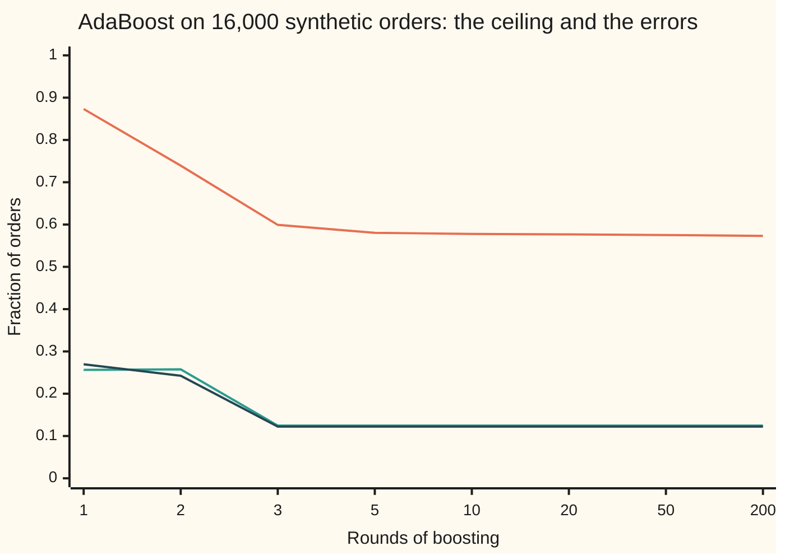

# Boosting: many weak rules, each fixing the last one's mistakes

[Syllabus](../../../SYLLABUS.md) → [Applied and computational](../README.md) → [Machine Learning Mathematics](../README.md#s06) → Boosting

---

## General Overview

An online shop keeps 20,000 past orders, each described by 12 numbers, and knows which orders came back. It wants to flag a likely return at checkout, before the order is placed, so it can show a size guide.

The simplest useful rule is a **stump**: one yes-or-no question about one number, such as "4 or more items in the basket? Then say returned." A stump is a **weak rule**: better than a coin flip, but not by much. On the shop's synthetic orders, the best single stump is wrong on 26.97% of new orders.

**Boosting** builds a committee of stumps, one round at a time. After each round, the orders the newest stump got wrong gain weight, so the next stump is chosen to fix them. Each stump's vote counts more the better it did.

**AdaBoost** (adaptive boosting, the first practical boosting method) needs three rounds here. The error on 4,000 new orders falls from 26.97% to 12.22%. That equals the error of the ideal rule, which knows the hidden chances the synthetic data came from.

The method comes with a promise. Each round whose stump beats a coin flip multiplies a ceiling on the training errors by a factor below 1, set by that round's error. A round whose stump is wrong on 30% of the weight, its **weighted error**, multiplies the ceiling by 0.9165. Only if every stump beats a coin flip by some fixed margin does the ceiling fall exponentially.

**Gradient boosting** reads the same loop as gradient descent: each new stump is a step downhill on a loss. That reading lets boosting use any loss with a slope.

**Boosting builds a committee of weak rules, each chosen on weights that make the last rule's mistakes count for half, so every rule that beats a coin flip shrinks a ceiling on the training errors by a factor below 1, and if every rule beats it by a fixed margin the ceiling falls exponentially; seen whole, it is gradient descent on a loss, one rule at a time.**

**What kind of fact this is:** a method (an algorithm), with one theorem proved on this card in Why it works: the training-error bound. The bound is about the orders used for training only. How well boosting does on new orders is measured here, never promised. The 20,000 orders are synthetic, made from a stated rule and seed in the code.

### The picture: 200 rounds on the shop's orders



Orange: the ceiling on the training error that the theorem gives. Green: the training error, on the 16,000 orders used for fitting. Dark: the error on 4,000 new orders. The rounds on the axis are not evenly spaced.

Both errors reach the ideal rule's level at round 3 and stay there. The ceiling keeps falling, but slowly: the labels carry noise, so later stumps barely beat a coin flip.

---

## The formula

Notation first. Order $`i`$ has its numbers $`x_i`$ and a label $`y_i`$: $`+1`$ for returned, $`-1`$ for kept, as on [Loss and empirical risk](01-loss-functions-and-empirical-risk.md). A stump $`h(x)`$ answers $`+1`$ or $`-1`$. Round $`t`$ gives each of the $`n`$ training orders a weight $`D_t(i)`$; the weights add to 1 and start equal, at $`1/n`$.

**AdaBoost, round $`t`$:** pick the stump $`h_t`$ with the least weighted error, give it a say $`\alpha_t`$, then reweight.

```math
\varepsilon_t = \sum_{i:\ h_t(x_i) \ne y_i} D_t(i), \qquad \alpha_t = \frac12 \ln\frac{1-\varepsilon_t}{\varepsilon_t}, \qquad D_{t+1}(i) = \frac{D_t(i)\, e^{-\alpha_t\, y_i\, h_t(x_i)}}{Z_t}
```

**Read it aloud:** the weighted error is the weight on the orders the stump gets wrong; the stump's say is half the log of its odds of being right; every wrong order's weight is multiplied by $`e^{\alpha_t}`$, every right one's by $`e^{-\alpha_t}`$, and $`Z_t`$ rescales the total back to 1.

After $`T`$ rounds the committee's score is $`F(x) = \sum_t \alpha_t h_t(x)`$, and it says "returned" when $`F(x) > 0`$. The theorem bounds the training error, the fraction of training orders where the vote is wrong:

```math
\frac{1}{n}\,\#\{i : y_i F(x_i) \le 0\} \;\le\; \prod_{t=1}^{T} Z_t \;=\; \prod_{t=1}^{T} 2\sqrt{\varepsilon_t(1-\varepsilon_t)} \;\le\; e^{-2\sum_{t} \gamma_t^2}, \qquad \gamma_t = \tfrac12 - \varepsilon_t
```

**Read it aloud:** the fraction of training orders the committee gets wrong is at most the product of the rescaling factors; each factor is twice the square root of error times one minus error; and the product is at most e to the minus twice the sum of the squared edges.

**Gradient boosting, round $`t`$:** for a loss $`\ell(y, F)`$, work out minus its slope at each training order, fit a **regression stump** to those numbers (one split, with a number on each side), and take a step of size $`\eta`$.

```math
r_i = -\frac{\partial \ell(y_i, F)}{\partial F}\Big|_{F = F(x_i)}, \qquad h_t = \text{the stump closest to the } r_i \text{ in squared error}, \qquad F \leftarrow F + \eta\, h_t
```

**Read it aloud:** each order's residual is minus the slope of its loss at its current score; the new stump is the one that best matches the residuals; the committee moves a step of size eta along it.

| Symbol | Plain meaning | In our example | Push it up and the answer… |
| --- | --- | --- | --- |
| $`x_i`$, $`y_i`$, $`n`$ | order $`i`$'s numbers; its label, +1 returned and −1 kept; the number of training orders | toy order C: 1 item at £80, returned; $`n = 10`$, or 16,000 for the shop | zero errors needs a ceiling below $`1/n`$ |
| $`h_t`$, $`T`$ | the stump chosen in round $`t`$; the number of rounds | round 1: "4 or more items: returned"; $`T = 3`$ | more rounds, a lower ceiling |
| $`D_t(i)`$ | order $`i`$'s weight in round $`t`$; the weights add to 1 | 0.1 each at the start | that order pulls the next stump harder |
| $`\varepsilon_t`$ | weighted error: the weight on the orders $`h_t`$ gets wrong | 0.3000 | a smaller say, a weaker shrink |
| $`\gamma_t`$ | the edge: how far the stump beats a coin flip, $`\tfrac12 - \varepsilon_t`$ | 0.2 | a stronger shrink |
| $`\alpha_t`$ | the stump's say in the vote | 0.4236 | that stump outvotes the others |
| $`Z_t`$ | the rescaling factor; also the round's shrink factor for the ceiling | 0.9165 | a slower fall; at 1, no fall |
| $`F(x)`$ | the committee's score; positive means "returned" | order H after 3 rounds: +0.4713 | — |
| $`\#\{i : y_i F(x_i) \le 0\}`$ | the count of training orders the vote gets wrong (margin zero or less) | 1 of the ten toy orders, H | — |
| $`\ell(y, F)`$, $`L`$, $`m`$ | a loss for one order; its total over the training orders; the margin $`m = yF`$ | exponential $`e^{-m}`$ for AdaBoost; log loss $`\ln(1 + e^{-m})`$ | — |
| $`g_i`$, $`r_i`$ | the loss's slope at order $`i`$; the residual $`r_i = -g_i`$ | ±0.5000 for log loss at $`F = 0`$ | the stump bends toward that order |
| $`\eta`$ | the learning rate: the step size along each new stump | 0.5 on the shop, 1 on the toy | faster, until steps overshoot |

Clashes on this shelf: $`\alpha_t`$ here is a stump's say, not the price per leaf of [Decision trees and forests](10-decision-trees-and-random-forests.md), EM's mixing weight $`\alpha_k`$ or an order's weight as on [Support vector machines](09-kernels-and-support-vector-machines.md). $`\gamma_t`$ is the edge, not that card's kernel reach. $`h`$ is a stump, not the trees card's binary entropy $`h(p)`$.

### When it holds

- **Each round, some stump beats a coin flip on the current weights.** If none does, $`\varepsilon_t = 0.5`$, $`\alpha_t = 0`$, $`Z_t = 1`$, and nothing moves. Four orders labelled "returned if phone order or weekend order, but not both" do exactly that.
- **The labels are mostly right.** With noisy labels the edges shrink toward zero. On the shop the ceiling stalls at 0.5731 while the training error sits at 0.1246.
- **No single order is far off the pattern.** On the ten toy orders, 100 rounds reach 0 training errors by fitting order H, a kept order that looks like a return. H then holds 0.3214 of all the weight.
- **New orders look like the training orders.** The theorem covers training orders only. The 12.22% on new orders is measured on 4,000 orders held back.
- **For gradient boosting, the loss has a slope.** Squared, log and exponential loss do. The zero-one mistake count has no useful slope (it is flat except at its jumps), which is why AdaBoost works on the exponential loss instead.

---

## Why it works

### Step 0: the weights are the committee's loss, and the loss bounds the mistakes

Reweighting does two things at once. It points the next stump at the current mistakes. It also keeps a running record: each order's weight equals the **exponential loss** $`e^{-y_i F(x_i)}`$ of the committee on that order, rescaled. The exponential loss is at least 1 on every mistake. So the average loss caps the training error, and each round multiplies the average loss by $`Z_t`$.

### Step 1: the weights remember the whole history

Start at $`D_1(i) = 1/n`$ and apply the update $`T`$ times. The factors multiply, and the exponents add up to the committee's score:

```math
D_{T+1}(i) = \frac{1}{n}\cdot\frac{e^{-y_i \alpha_1 h_1(x_i)} \cdots e^{-y_i \alpha_T h_T(x_i)}}{Z_1 \cdots Z_T} = \frac{e^{-y_i F(x_i)}}{n \prod_t Z_t}
```

The code checks this on the shop at eight rounds from 1 to 200: weights rebuilt from the scores match the updated weights to within $`10^{-12}`$.

### Step 2: a mistake costs at least 1 in exponential loss

The vote is wrong exactly when the margin $`y_i F(x_i)`$ is zero or less. Then $`e^{-y_i F(x_i)} \ge e^0 = 1`$. When the vote is right, the mistake count is 0 and the exponential loss is still positive. So for every order, mistake count $`\le e^{-y_i F(x_i)}`$.

### Step 3: average, and the product of the Z's appears

Average Step 2 over the $`n`$ orders, then use Step 1 to replace each loss by its weight:

```math
\frac{1}{n}\,\#\{i : y_i F(x_i) \le 0\} \le \frac1n \sum_i e^{-y_i F(x_i)} = \prod_t Z_t \sum_i D_{T+1}(i) = \prod_t Z_t
```

The last step holds because the weights add to 1. On the toy after 3 rounds, both the product of the Z's and the average exponential loss come out at 0.7324.

### Step 4: the say that makes Z smallest

Split $`Z_t`$ into the right orders, weight $`1 - \varepsilon_t`$, each multiplied by $`e^{-\alpha}`$, and the wrong ones, weight $`\varepsilon_t`$, each multiplied by $`e^{\alpha}`$:

```math
Z(\alpha) = (1-\varepsilon_t)\,e^{-\alpha} + \varepsilon_t\, e^{\alpha}
```

Its slope is $`-(1-\varepsilon_t)e^{-\alpha} + \varepsilon_t e^{\alpha}`$. That is zero when $`e^{2\alpha} = (1-\varepsilon_t)/\varepsilon_t`$, which gives the formula's $`\alpha_t`$. Put it back in: each term becomes $`\sqrt{\varepsilon_t(1-\varepsilon_t)}`$, so $`Z_t = 2\sqrt{\varepsilon_t(1-\varepsilon_t)}`$.

The two terms are equal, so after the update the wrong orders hold exactly half the weight. The stump just used now has error 0.5: no help at all. The next round must find something new.

### Step 5: from a product to an exponential fall

Write $`\varepsilon_t = \tfrac12 - \gamma_t`$. Then $`4\varepsilon_t(1-\varepsilon_t) = 1 - 4\gamma_t^2`$. Since $`1 + u \le e^{u}`$ for every number $`u`$:

```math
2\sqrt{\varepsilon_t(1-\varepsilon_t)} = \sqrt{1 - 4\gamma_t^2} \le \sqrt{e^{-4\gamma_t^2}} = e^{-2\gamma_t^2}
```

Multiply over the rounds and the exponents add. If every edge is at least some fixed $`\gamma`$, the ceiling falls at least as fast as $`e^{-2T\gamma^2}`$: exponentially in the number of rounds.

The training error is a whole number of orders divided by $`n`$. So once the ceiling drops below $`1/n`$, the training error must be 0. At $`\varepsilon = 0.3`$ every round, that takes 112 rounds for 16,000 orders.

### Step 6: AdaBoost is gradient descent on the exponential loss

[Gradient descent](02-gradient-descent-and-stochastic-gradient.md) steps a list of weights against the slope of a loss. Now treat the committee's $`n`$ scores $`F(x_1), \dots, F(x_n)`$ as that list. The loss is $`L = \sum_i \ell(y_i, F(x_i))`$, and its slope for order $`i`$ is $`g_i = \partial \ell / \partial F`$ at that order.

A step straight along $`-g`$ would change the $`n`$ training scores and say nothing about a new order. So boosting steps along the stump that points most nearly downhill: the one with the largest $`\sum_i (-g_i)\, h(x_i)`$. This is **gradient descent in function space**: the steps are whole rules, not numbers.

For the exponential loss, $`-g_i = y_i e^{-y_i F(x_i)}`$. By Step 1 that is $`y_i`$ times order $`i`$'s current weight $`D(i)`$, times the positive number $`n \prod_t Z_t`$, the same for every order. So

```math
\sum_i (-g_i)\, h(x_i) = n \prod_t Z_t \sum_i D(i)\, y_i\, h(x_i) = n \prod_t Z_t\,\big((1 - \varepsilon) - \varepsilon\big) = n \prod_t Z_t\,(1 - 2\varepsilon)
```

The steepest stump is the stump with the least weighted error. And Step 4's $`\alpha_t`$ is the best step length along it. AdaBoost is gradient descent on the exponential loss, with the step length chosen exactly.

Change the loss and the same recipe gives other methods. This is gradient boosting:

- **Squared loss** $`\tfrac12(y - F)^2`$: $`r_i = y_i - F(x_i)`$, the plain residual. Hence the usual summary, "fit the next tree to the residuals".
- **Log loss** $`\ln(1 + e^{-yF})`$: $`r_i = y_i / (1 + e^{y_i F(x_i)})`$. Big for orders still wrong, small for orders safely right: AdaBoost's reweighting, made gentler.

<details>
<summary>Why the log-loss residual has that form</summary>

The slope of $`\ln(1 + e^{-yF})`$ in $`F`$ is $`-y\,e^{-yF}/(1 + e^{-yF})`$, by the chain rule.

Multiply top and bottom by $`e^{yF}`$:

$`\displaystyle -\frac{y\,e^{-yF}}{1 + e^{-yF}} = -\frac{y}{e^{yF} + 1}.`$

Minus that is $`r = y/(1 + e^{yF})`$. At $`F = 0`$ every order has $`r = \pm 0.5`$. As an order's margin $`yF`$ grows, its residual shrinks toward 0; as the margin goes negative, it grows toward $`\pm 1`$, never more. The exponential loss's residual $`y e^{-yF}`$ has no such ceiling, which is why AdaBoost reacts harder to mislabelled orders.

</details>

---

## Worked numbers, by hand

Ten orders from a clothes shop, each with two numbers: items in the basket and the average price per item.

| Order | A | B | C | D | E | F | G | H | I | J |
| --- | --- | --- | --- | --- | --- | --- | --- | --- | --- | --- |
| Items | 1 | 1 | 1 | 1 | 3 | 4 | 4 | 4 | 5 | 6 |
| Price (£) | 50 | 60 | 80 | 90 | 30 | 30 | 40 | 60 | 60 | 40 |
| Outcome | kept | kept | returned | returned | kept | returned | returned | kept | returned | returned |

Two kinds of return show up: big baskets (people order several sizes and send back the rest) and expensive single items. Order H is the odd one: four items, kept.

| Step | Arithmetic | Value |
| --- | --- | --- |
| round 1 stump | best of all stumps: "4 or more items: returned"; wrong on C, D, H | — |
| weighted error | $`0.1 + 0.1 + 0.1`$ | $`\varepsilon_1 = 0.3000`$ |
| say | $`\tfrac12 \ln(0.7/0.3)`$ | $`\alpha_1 = 0.4236`$ |
| wrong weights grow | multiply by $`e^{0.4236}`$ | × 1.5275 |
| right weights shrink | multiply by $`e^{-0.4236}`$ | × 0.6547 |
| rescaling factor | $`0.3 \times 1.5275 + 0.7 \times 0.6547`$ | $`Z_1 = 0.9165`$ |
| check | $`2\sqrt{0.3 \times 0.7} = 2\sqrt{0.21}`$ | 0.9165 |
| new weights | $`0.1 \times 1.5275 / 0.9165`$ and $`0.1 \times 0.6547 / 0.9165`$ | 0.1667 wrong, 0.0714 right |
| wrong orders' share | $`3 \times 0.1667`$ | 0.5000 |
| round 2 stump | "£80 or more: returned"; wrong on F, G, I, J | $`\varepsilon_2 = 4 \times 0.0714 = 0.2857`$, $`\alpha_2 = 0.4581`$ |
| round 3 stump | "every order returned"; wrong on A, B, E, H | $`\varepsilon_3 = 0.2667`$, $`\alpha_3 = 0.5058`$ |
| committee | $`F = 0.4236\,h_1 + 0.4581\,h_2 + 0.5058`$ | A, B, E: −0.3760; C, D: +0.5403; F to J: +0.4713 |
| training error | only H is wrong: it scores +0.4713 but was kept | 1 of 10 |
| ceiling | $`0.9165 \times 0.9035 \times 0.8844`$ | **0.7324** |

Three stumps, each wrong on 3 or 4 of the ten orders alone, vote together to get 9 of the 10 right. The theorem's ceiling, 0.7324, is loose after three rounds, but every round multiplies it by a factor below 1.

The weaker bound gives $`e^{-2 \times 0.2^2} = 0.9231`$ for round 1: a little above 0.9165, as Step 5 says it must be.

The round-3 stump, "every order returned", works as a bias, like $`b`$ in the score of [The perceptron and its stack](03-perceptron-and-neural-networks.md): it shifts every order's score by the same amount.

One round of gradient boosting on the same ten orders, with log loss and $`\eta = 1`$, starting from $`F = 0`$: every residual is ±0.5000. The best split is again "4 or more items", tied with "5 or more items" and "£80 or more", which fit the residuals equally well; the code keeps the first it scans. The regression stump's two numbers are the mean residuals on each side: −0.1000 for A to E (three kept, two returned) and +0.3000 for F to J (four returned, one kept).

### What breaks if you drop a piece

| Mistake | Comes out at | What went wrong |
| --- | --- | --- |
| Use $`\ln\frac{1-\varepsilon}{\varepsilon}`$ for the say, dropping the ½ | $`Z_1 = 1.0000`$ | The step is twice the best length. The ceiling does not shrink at all |
| Grow the right orders' weights instead of the wrong ones | round 2 picks "4 or more items" again, error 0.1552 | The mistakes lose weight, so the committee repeats itself instead of fixing them |
| Labels with no stump better than a coin flip (returned if phone or weekend order, but not both) | best error 0.5000, $`\alpha = 0`$, $`Z = 1.0000`$ | The weak-rule assumption fails; boosting never starts |
| Noisy labels, 200 rounds on the shop | ceiling 0.5731 against training error 0.1246; last stump's error 0.4978 | The edges fall to nearly zero, so the ceiling stalls far above the truth |

---

## Round by round on the shop's orders

The shop's 20,000 orders are synthetic, made by a simpler rule than the one on [Decision trees and forests](10-decision-trees-and-random-forests.md), so the two cards' error rates cannot be compared. Each of the 12 numbers is stored as a whole number from 0 to 9. The hidden rule uses three of them, read as deciles: which tenth of all orders the value falls in. The other nine columns, the yes-or-no flags such as phone order and discount code among them, are random noise coded the same way. An order's chance of return is $`1/(1 + e^{4.5 - 3k})`$, where $`k`$ counts how many of the three signs hold: items decile 6 or more, price decile 7 or more, account-age decile 2 or less. So two or more of the three signs make a return likely.

Of the 20,000 orders, 6,053 were returned. The best possible error, for a rule that knows the chances, is 0.1259; on the 4,000 test orders that rule scores 0.1222.

### AdaBoost, one round at a time

| Round | Stump | Weighted error | Training error | Ceiling $`\prod Z_t`$ | Test error |
| --- | --- | --- | --- | --- | --- |
| 1 | account-age decile below 3 | 0.2563 | 0.2563 | 0.8732 | 0.2697 |
| 2 | price decile 7 or more | 0.2339 | 0.2577 | 0.7393 | 0.2425 |
| 3 | items decile 6 or more | 0.2071 | 0.1246 | 0.5992 | 0.1222 |
| 10 | price decile 4 or more | 0.4876 | 0.1246 | 0.5778 | 0.1222 |
| 200 | discount-code column 1 or more (noise) | 0.4978 | 0.1246 | 0.5731 | 0.1222 |

After three rounds each of the hidden rule's three signs has a stump, and the vote is "two or more signs: returned", the ideal rule. After that every stump has error close to 0.5, and the ceiling barely moves.

The training error rose in round 2, from 0.2563 to 0.2577. The theorem allows that: only the ceiling must fall.

### Gradient boosting, one round at a time

Log loss, step $`\eta = 0.5`$:

| Round | Split | Training log loss | Training error | Test error |
| --- | --- | --- | --- | --- |
| 1 | account-age decile 3 or more | 0.6597 | 0.2563 | 0.2697 |
| 5 | items decile 6 or more | 0.5673 | 0.2120 | 0.2188 |
| 10 | account-age decile 3 or more | 0.5044 | 0.1774 | 0.1822 |
| 20 | account-age decile 3 or more | 0.4400 | 0.1246 | 0.1222 |
| 200 | items decile 6 or more | 0.3361 | 0.1246 | 0.1222 |

With half steps and the gentler log loss, gradient boosting reaches the ideal rule later, by round 20. The log loss keeps falling after the votes stop changing.

Test error on the 4,000 held-back orders:

```
one stump (round 1)           ███████████████████████████   0.2697
gradient boosting, 10 rounds  ██████████████████            0.1822
gradient boosting, 20 rounds  ████████████                  0.1222
AdaBoost, 3 rounds            ████████████                  0.1222
ideal rule                    ████████████                  0.1222
```

---

## Code, from first principles, and it actually runs

Both programs build the shop's orders from SplitMix64, a short pseudo-random number generator written out in full (seed 2026), so the data are synthetic and identical in both languages. The stump search, AdaBoost and gradient boosting are written out; nothing imported knows the answer. The card's claims are reached by independent roads:

- each say $`\alpha_t`$ by the formula, and by a golden-section search for the minimum of $`Z(\alpha)`$;
- the ceiling $`\prod Z_t`$ as a product of rescaling factors, and as the average exponential loss computed straight from the scores;
- the weights by repeated multiplication, and rebuilt in one step from the scores (Step 1);
- the stump with the least weighted error, and by brute force the stump most aligned with minus the exponential loss's slope (Step 6);
- the log-loss residuals by formula, and by finite differences of the loss;
- training error $`\le \prod Z_t \le e^{-2\sum \gamma_t^2}`$ asserted at all 200 rounds on the shop, and both methods' test error within 0.02 of the ideal rule's.

### Python

```python
# Boosting -- the check behind the card.  Standard library only.
# Ten toy orders worked by hand, then 20,000 SYNTHETIC shop orders made from a
# stated rule with SplitMix64 (seed 2026), written out so Rust sees the same data.
from math import exp, log, sqrt
MASK = (1 << 64) - 1
def splitmix64(s):
    while True:
        s = (s + 0x9E3779B97F4A7C15) & MASK
        z = ((s ^ (s >> 30)) * 0xBF58476D1CE4E5B9) & MASK
        z = ((z ^ (z >> 27)) * 0x94D049BB133111EB) & MASK
        yield z ^ (z >> 31)

def best_stump(cols, y, w, nv):
    # stump (j, c, s): say s if number j >= c, else -s.  Returns (weighted error, j, c, s).
    best = (2.0, 0, 0, 1)
    for j, col in enumerate(cols):
        wp, wm, cnt = [0.0] * nv, [0.0] * nv, [0] * nv
        for b, wi, yi in zip(col, w, y):
            cnt[b] += 1
            if yi > 0: wp[b] += wi
            else: wm[b] += wi
        below_p, above_m, tot = 0.0, sum(wm), sum(wp) + sum(wm)
        for c in range(nv):
            if cnt[c] > 0:
                for s, e in ((1, below_p + above_m), (-1, tot - below_p - above_m)):
                    if e < best[0] - 1e-12: best = (e, j, c, s)
            below_p += wp[c]; above_m -= wm[c]
    return best
def h(st, x): return st[3] if x[st[1]] >= st[2] else -st[3]
def name(st, names, lo):
    if st[2] == lo[st[1]]: return "every order " + ("returned" if st[3] > 0 else "kept")
    return names[st[1]] + (">=" if st[3] > 0 else "<") + str(st[2])
def err(F, ys): return sum(1 for f, yi in zip(F, ys) if f * yi <= 0) / len(ys)

def adaboost(X, y, T, nv, report=None, sign=1.0, half=0.5, Xt=()):
    n, cols = len(X), [[x[j] for x in X] for j in range(len(X[0]))]
    w, F, Ft, prodZ, gam2, hist = [1.0 / n] * n, [0.0] * n, [0.0] * len(Xt), 1.0, 0.0, []
    for t in range(1, T + 1):
        st = best_stump(cols, y, w, nv); e = st[0]
        a = half * log((1 - e) / e) if 0 < e < 0.5 else 0.0
        hv = [h(st, x) for x in X]
        new = [wi * exp(-sign * a * yi * hi) for wi, yi, hi in zip(w, y, hv)]; Z = sum(new)
        if report: report(t, st, e, a, w, hv, Z, F)
        w = [v / Z for v in new]; prodZ *= Z; gam2 += (0.5 - e) ** 2
        F = [f + a * hi for f, hi in zip(F, hv)]
        Ft = [f + a * h(st, x) for f, x in zip(Ft, Xt)]
        hist.append((t, st, e, a, Z, prodZ, gam2, F, w, Ft))
    return hist

# ---- ten orders: (items in basket, average price in pounds); +1 returned, -1 kept ----
TOY = [(1, 50), (1, 60), (1, 80), (1, 90), (3, 30), (4, 30), (4, 40), (4, 60), (5, 60), (6, 40)]
TY, TN, TL = [-1, -1, 1, 1, -1, 1, 1, -1, 1, 1], ["items", "price"], [1, 30]
def toy_report(t, st, e, a, w, hv, Z, F):
    Zof = lambda al: sum(wi * exp(-al * yi * hi) for wi, yi, hi in zip(w, TY, hv))
    lo, hi_ = 0.0, 3.0                    # road 2 for alpha: golden-section search, no formula
    for _ in range(200):
        c, d = hi_ - 0.618034 * (hi_ - lo), lo + 0.618034 * (hi_ - lo)
        if Zof(c) < Zof(d): hi_ = d
        else: lo = c
    wrong = [i for i in range(10) if hv[i] != TY[i]]; share = sum(w[i] * exp(a) for i in wrong) / Z
    print(f"toy round {t}: {name(st, TN, TL):<20} error {e:.4f}  alpha {a:.4f}  by search {(lo + hi_) / 2:.4f}"
          f"  Z {Z:.4f}  2sqrt(e(1-e)) {2 * sqrt(e * (1 - e)):.4f}  wrong after update hold {share:.4f}  wrong: {''.join('ABCDEFGHIJ'[i] for i in wrong)}")
    assert abs((lo + hi_) / 2 - a) < 1e-6, "alpha formula = the minimum of Z found by search"
    assert abs(Z - 2 * sqrt(e * (1 - e))) < 1e-12 and abs(share - 0.5) < 1e-12
    # road 3, function space: brute-force the stump best aligned with minus the exp-loss gradient
    grad = [-yi * exp(-yi * f) for yi, f in zip(TY, F)]
    cands = [(0, j, c, s) for j in range(2) for c in sorted({x[j] for x in TOY}) for s in (1, -1)]
    al = max(cands, key=lambda q: sum(-g * h(q, x) for g, x in zip(grad, TOY)))
    assert [h(al, x) for x in TOY] == hv, "least weighted error = steepest way down"
hist = adaboost(TOY, TY, 3, 100, toy_report)
a1, F3, pz3 = hist[0][3], hist[2][7], hist[2][5]
print(f"round 1 by hand: grow e^alpha {exp(a1):.4f}  shrink e^-alpha {exp(-a1):.4f}  wrong each {1/6:.4f}  right each {1/14:.4f}  e^(-2*0.2^2) {exp(-0.08):.4f}  rounds at 0.3 to force 0 errors on 16000: {int(log(16000) / -log(2 * sqrt(0.21))) + 1}")
expl = sum(exp(-yi * f) for yi, f in zip(TY, F3)) / 10
print("toy scores after 3 rounds: " + " ".join(f"{'ABCDEFGHIJ'[i]} {F3[i]:+.4f}" for i in range(10)))
print(f"toy after 3 rounds: training errors {err(F3, TY):.1f}  bound prod Z {pz3:.4f}  mean e^(-yF) {expl:.4f}")
assert abs(a1 - 0.423649) < 1e-6 and abs(expl - pz3) < 1e-12 and err(F3, TY) <= pz3
h100 = adaboost(TOY, TY, 100, 100)[-1]
print(f"toy after 100 rounds: training errors {err(h100[7], TY):.1f}  order H holds {h100[8][7]:.4f} of the weight  bound {h100[5]:.6f}")
# ---- what breaks ----
flip = adaboost(TOY, TY, 2, 100, sign=-1.0)[1]
xor = adaboost([(0, 0), (0, 1), (1, 0), (1, 1)], [-1, 1, 1, -1], 1, 2)[0]
print(f"wrong: alpha without the 1/2: Z {adaboost(TOY, TY, 1, 100, half=1.0)[0][4]:.4f}")
print(f"wrong: grow the right orders: round 2 picks {name(flip[1], TN, TL)} again, error {flip[2]:.4f}")
print(f"no weak learner (returned if phone xor weekend): best error {xor[2]:.4f}  alpha {xor[3]:.4f}  Z {xor[4]:.4f}")
# ---- the shop: 20,000 synthetic orders, 12 numbers each stored as a decile 0..9 ----
SN = ["items", "price", "past", "gap", "phone", "hour", "code", "dist", "wkend", "age", "news", "viewed"]
def chance(x): return 1 / (1 + exp(4.5 - 3 * (x[0] >= 6) - 3 * (x[1] >= 7) - 3 * (x[9] <= 2)))
rng, X, Y = splitmix64(2026), [], []
for _ in range(20000):
    x = [next(rng) % 10 for _ in range(12)]
    X.append(x); Y.append(1 if (next(rng) >> 11) / 2.0 ** 53 < chance(x) else -1)
Xtr, Ytr, Xte, Yte = X[:16000], Y[:16000], X[16000:], Y[16000:]
bayes = sum(min(chance((a, b) + (0,) * 7 + (c,)), 1 - chance((a, b) + (0,) * 7 + (c,)))
            for a in range(10) for b in range(10) for c in range(10)) / 1000
ideal = err([chance(x) - 0.5 for x in Xte], Yte)
print(f"shop: returned {sum(1 for v in Y if v > 0)} of 20000  best possible error {bayes:.4f}  ideal rule on test {ideal:.4f}")
CHECK = (1, 2, 3, 5, 10, 20, 50, 200)
print(" round  stump        error   train   prod Z  e^-2sum(g^2)  test")
for t, st, e, a, Z, pz, g2, F, w, Ft in adaboost(Xtr, Ytr, 200, 10, Xt=Xte):
    assert err(F, Ytr) <= pz <= exp(-2 * g2), "training error <= prod Z <= exp(-2 sum gamma^2)"
    if t in CHECK:
        u = [exp(-yi * f) / (16000 * pz) for yi, f in zip(Ytr, F)]   # weights rebuilt from scores
        assert abs(sum(u) - 1) < 1e-9 and max(abs(p - q) for p, q in zip(u, w)) < 1e-12
        print(f"{t:>6}  {name(st, SN, [0] * 12):<11} {e:.4f}  {err(F, Ytr):.4f}  {pz:.4f}  {exp(-2 * g2):.4f}       {err(Ft, Yte):.4f}")
ada_test = err(Ft, Yte)
# ---- gradient boosting: log loss, regression stumps fitted to minus the gradient ----
def loss(yi, f): return log(1 + exp(-yi * f))
def gboost(X, y, T, nv, eta, Xt=()):
    n, cols = len(X), [[x[j] for x in X] for j in range(len(X[0]))]
    F, Ft, out = [0.0] * n, [0.0] * len(Xt), []
    for t in range(1, T + 1):
        r = [yi / (1 + exp(yi * f)) for yi, f in zip(y, F)]     # minus the slope of the loss
        best = (-1.0, 0, 0, 0.0, 0.0)
        for j, col in enumerate(cols):
            S, N = [0.0] * nv, [0] * nv
            for b, ri in zip(col, r): S[b] += ri; N[b] += 1
            tot, sl, nl = sum(S), 0.0, 0
            for c in range(nv):
                if N[c] == 0: continue
                gain = (sl * sl / nl if nl else 0.0) + (tot - sl) ** 2 / (n - nl)
                if gain > best[0] + 1e-12: best = (gain, j, c, sl / nl if nl else 0.0, (tot - sl) / (n - nl))
                sl += S[c]; nl += N[c]
        _, j, c, vlo, vhi = best
        F = [f + eta * (vhi if x[j] >= c else vlo) for f, x in zip(F, X)]
        Ft = [f + eta * (vhi if x[j] >= c else vlo) for f, x in zip(Ft, Xt)]
        out.append((t, j, c, vlo, vhi, r, F, Ft))
    return out
g1 = gboost(TOY, TY, 1, 100, 1.0)[0]
print(f"gradient boosting, toy round 1: residuals +-{abs(g1[5][0]):.4f}  split {TN[g1[1]]}>={g1[2]}  leaves {g1[3]:+.4f} {g1[4]:+.4f}")
gb = gboost(Xtr, Ytr, 200, 10, 0.5, Xte)
print(" round  split     train log loss  train   test")
for t, j, c, vlo, vhi, r, F, Ft in gb:
    if t in CHECK:
        print(f"{t:>6}  {SN[j] + '>=' + str(c):<9} {sum(loss(yi, f) for yi, f in zip(Ytr, F)) / 16000:.4f}"
              f"          {err(F, Ytr):.4f}  {err(Ft, Yte):.4f}")
fd = max(abs(-(loss(yi, f + 1e-6) - loss(yi, f - 1e-6)) / 2e-6 - ri) for yi, f, ri in zip(Ytr, gb[-2][6], gb[-1][5]))
print(f"residual vs finite-difference slope, worst gap {fd:.2e}")
assert fd < 1e-6, "residuals are minus the slope of the loss"
assert abs(ada_test - ideal) < 0.02 and abs(err(gb[-1][7], Yte) - ideal) < 0.02, "both near the ideal rule"
print("ALL CHECKS PASS")
```

**Ran 2026-11-23 on macOS, Python 3.14.10, standard library only. All checks passed. Output, pasted from the run:**

```
toy round 1: items>=4             error 0.3000  alpha 0.4236  by search 0.4236  Z 0.9165  2sqrt(e(1-e)) 0.9165  wrong after update hold 0.5000  wrong: CDH
toy round 2: price>=80            error 0.2857  alpha 0.4581  by search 0.4581  Z 0.9035  2sqrt(e(1-e)) 0.9035  wrong after update hold 0.5000  wrong: FGIJ
toy round 3: every order returned error 0.2667  alpha 0.5058  by search 0.5058  Z 0.8844  2sqrt(e(1-e)) 0.8844  wrong after update hold 0.5000  wrong: ABEH
round 1 by hand: grow e^alpha 1.5275  shrink e^-alpha 0.6547  wrong each 0.1667  right each 0.0714  e^(-2*0.2^2) 0.9231  rounds at 0.3 to force 0 errors on 16000: 112
toy scores after 3 rounds: A -0.3760 B -0.3760 C +0.5403 D +0.5403 E -0.3760 F +0.4713 G +0.4713 H +0.4713 I +0.4713 J +0.4713
toy after 3 rounds: training errors 0.1  bound prod Z 0.7324  mean e^(-yF) 0.7324
toy after 100 rounds: training errors 0.0  order H holds 0.3214 of the weight  bound 0.008079
wrong: alpha without the 1/2: Z 1.0000
wrong: grow the right orders: round 2 picks items>=4 again, error 0.1552
no weak learner (returned if phone xor weekend): best error 0.5000  alpha 0.0000  Z 1.0000
shop: returned 6053 of 20000  best possible error 0.1259  ideal rule on test 0.1222
 round  stump        error   train   prod Z  e^-2sum(g^2)  test
     1  age<3       0.2563  0.2563  0.8732  0.8880       0.2697
     2  price>=7    0.2339  0.2577  0.7393  0.7708       0.2425
     3  items>=6    0.2071  0.1246  0.5992  0.6492       0.1222
     5  price>=7    0.4235  0.1246  0.5805  0.6294       0.1222
    10  price>=4    0.4876  0.1246  0.5778  0.6264       0.1222
    20  age<7       0.4914  0.1246  0.5767  0.6253       0.1222
    50  age<3       0.4945  0.1246  0.5752  0.6236       0.1222
   200  code>=1     0.4978  0.1246  0.5731  0.6213       0.1222
gradient boosting, toy round 1: residuals +-0.5000  split items>=4  leaves -0.1000 +0.3000
 round  split     train log loss  train   test
     1  age>=3    0.6597          0.2563  0.2697
     2  items>=6  0.6308          0.2120  0.2188
     3  price>=7  0.6053          0.2689  0.2650
     5  items>=6  0.5673          0.2120  0.2188
    10  age>=3    0.5044          0.1774  0.1822
    20  age>=3    0.4400          0.1246  0.1222
    50  age>=3    0.3734          0.1246  0.1222
   200  items>=6  0.3361          0.1246  0.1222
residual vs finite-difference slope, worst gap 1.47e-10
ALL CHECKS PASS
```

### Rust

The Rust program adds floats with compensated summation, as Python's `sum` does, so the two outputs agree to the last digit.

```rust
// Boosting -- the same check as boosting_adaboost_and_gradient_boosting_check.py, in Rust.
// Standard library only, no crates.  Same toy orders, same SplitMix64 data (seed 2026).
// nsum is compensated (Neumaier) summation, the way Python's sum() adds floats.
#[derive(Clone, Copy)]
struct St { e: f64, j: usize, c: usize, s: f64 }
struct Round { st: St, e: f64, a: f64, z: f64, pz: f64, g2: f64, f: Vec<f64>, w: Vec<f64>, ft: Vec<f64> }
type Rep<'a> = Option<&'a dyn Fn(usize, &St, f64, f64, &[f64], &[f64], f64, &[f64])>;
fn nsum<I: IntoIterator<Item = f64>>(it: I) -> f64 {
    let (mut s, mut c) = (0.0f64, 0.0f64);
    for x in it { let t = s + x; if s.abs() >= x.abs() { c += (s - t) + x } else { c += (x - t) + s }; s = t; }
    if c != 0.0 && c.is_finite() { s + c } else { s }
}
fn splitmix64(s: &mut u64) -> u64 {
    *s = s.wrapping_add(0x9E3779B97F4A7C15);
    let z = (*s ^ (*s >> 30)).wrapping_mul(0xBF58476D1CE4E5B9);
    let z = (z ^ (z >> 27)).wrapping_mul(0x94D049BB133111EB);
    z ^ (z >> 31)
}
fn best_stump(cols: &[Vec<usize>], y: &[f64], w: &[f64], nv: usize) -> St {
    let mut best = St { e: 2.0, j: 0, c: 0, s: 1.0 };
    for (j, col) in cols.iter().enumerate() {
        let (mut wp, mut wm, mut cnt) = (vec![0.0; nv], vec![0.0; nv], vec![0usize; nv]);
        for i in 0..col.len() { cnt[col[i]] += 1; if y[i] > 0.0 { wp[col[i]] += w[i] } else { wm[col[i]] += w[i] } }
        let (mut below_p, mut above_m, tot) = (0.0, nsum(wm.iter().copied()), nsum(wp.iter().copied()) + nsum(wm.iter().copied()));
        for c in 0..nv {
            if cnt[c] > 0 {
                for (s, e) in [(1.0, below_p + above_m), (-1.0, tot - below_p - above_m)] {
                    if e < best.e - 1e-12 { best = St { e, j, c, s } }
                }
            }
            below_p += wp[c]; above_m -= wm[c];
        }
    }
    best
}
fn h(st: &St, x: &[usize]) -> f64 { if x[st.j] >= st.c { st.s } else { -st.s } }
fn name(st: &St, names: &[&str], lo: &[usize]) -> String {
    if st.c == lo[st.j] { return format!("every order {}", if st.s > 0.0 { "returned" } else { "kept" }) }
    format!("{}{}{}", names[st.j], if st.s > 0.0 { ">=" } else { "<" }, st.c)
}
fn err(f: &[f64], y: &[f64]) -> f64 { f.iter().zip(y).filter(|(a, b)| *a * *b <= 0.0).count() as f64 / y.len() as f64 }
fn cols_of(x: &[Vec<usize>]) -> Vec<Vec<usize>> { (0..x[0].len()).map(|j| x.iter().map(|r| r[j]).collect()).collect() }
fn adaboost(x: &[Vec<usize>], y: &[f64], tmax: usize, nv: usize, report: Rep, sign: f64, half: f64, xt: &[Vec<usize>]) -> Vec<Round> {
    let (n, cols) = (x.len(), cols_of(x));
    let (mut w, mut f, mut ft) = (vec![1.0 / n as f64; n], vec![0.0; n], vec![0.0; xt.len()]);
    let (mut pz, mut g2, mut hist) = (1.0, 0.0, Vec::new());
    for t in 1..=tmax {
        let st = best_stump(&cols, y, &w, nv); let e = st.e;
        let a = if e > 0.0 && e < 0.5 { half * ((1.0 - e) / e).ln() } else { 0.0 };
        let hv: Vec<f64> = x.iter().map(|r| h(&st, r)).collect();
        let new: Vec<f64> = (0..n).map(|i| w[i] * (-sign * a * y[i] * hv[i]).exp()).collect(); let z = nsum(new.iter().copied());
        if let Some(rep) = report { rep(t, &st, e, a, &w, &hv, z, &f) }
        w = new.iter().map(|v| v / z).collect(); pz *= z; g2 += (0.5 - e) * (0.5 - e);
        f = (0..n).map(|i| f[i] + a * hv[i]).collect();
        ft = (0..xt.len()).map(|i| ft[i] + a * h(&st, &xt[i])).collect();
        hist.push(Round { st, e, a, z, pz, g2, f: f.clone(), w: w.clone(), ft: ft.clone() });
    }
    hist
}
fn loss(y: f64, f: f64) -> f64 { (1.0 + (-y * f).exp()).ln() }
// gradient boosting: log loss, regression stumps fitted to minus the gradient; returns per round (j, c, lo, hi, r, F, Ft)
fn gboost(x: &[Vec<usize>], y: &[f64], tmax: usize, nv: usize, eta: f64, xt: &[Vec<usize>]) -> Vec<(usize, usize, f64, f64, Vec<f64>, Vec<f64>, Vec<f64>)> {
    let (n, cols) = (x.len(), cols_of(x));
    let (mut f, mut ft, mut out) = (vec![0.0; n], vec![0.0; xt.len()], Vec::new());
    for _ in 0..tmax {
        let r: Vec<f64> = (0..n).map(|i| y[i] / (1.0 + (y[i] * f[i]).exp())).collect();
        let mut best = (-1.0, 0, 0, 0.0, 0.0);
        for (j, col) in cols.iter().enumerate() {
            let (mut s, mut cnt) = (vec![0.0; nv], vec![0usize; nv]);
            for i in 0..n { s[col[i]] += r[i]; cnt[col[i]] += 1; }
            let (tot, mut sl, mut nl) = (nsum(s.iter().copied()), 0.0, 0usize);
            for c in 0..nv {
                if cnt[c] == 0 { continue }
                let left = if nl > 0 { sl * sl / nl as f64 } else { 0.0 };
                let gain = left + (tot - sl) * (tot - sl) / (n - nl) as f64;
                if gain > best.0 + 1e-12 { best = (gain, j, c, if nl > 0 { sl / nl as f64 } else { 0.0 }, (tot - sl) / (n - nl) as f64) }
                sl += s[c]; nl += cnt[c];
            }
        }
        let (_, j, c, vlo, vhi) = best;
        f = (0..n).map(|i| f[i] + eta * if x[i][j] >= c { vhi } else { vlo }).collect();
        ft = (0..xt.len()).map(|i| ft[i] + eta * if xt[i][j] >= c { vhi } else { vlo }).collect();
        out.push((j, c, vlo, vhi, r, f.clone(), ft.clone()));
    }
    out
}
fn chance(x: &[usize]) -> f64 { let b = |q: bool| -> f64 { if q { 3.0 } else { 0.0 } }; 1.0 / (1.0 + (4.5 - b(x[0] >= 6) - b(x[1] >= 7) - b(x[9] <= 2)).exp()) }
fn main() {
    let toy: Vec<Vec<usize>> = [(1, 50), (1, 60), (1, 80), (1, 90), (3, 30), (4, 30), (4, 40), (4, 60), (5, 60), (6, 40)].iter().map(|p| vec![p.0, p.1]).collect();
    let ty = [-1.0, -1.0, 1.0, 1.0, -1.0, 1.0, 1.0, -1.0, 1.0, 1.0];
    let (tn, tl, ab) = (["items", "price"], [1usize, 30], b"ABCDEFGHIJ");
    let toy_report = |t: usize, st: &St, e: f64, a: f64, w: &[f64], hv: &[f64], z: f64, f: &[f64]| {
        let zof = |al: f64| nsum((0..10).map(|i| w[i] * (-al * ty[i] * hv[i]).exp()));
        let (mut lo, mut hi) = (0.0f64, 3.0f64);            // road 2 for alpha: golden-section search
        for _ in 0..200 { let (c, d) = (hi - 0.618034 * (hi - lo), lo + 0.618034 * (hi - lo)); if zof(c) < zof(d) { hi = d } else { lo = c } }
        let wrong: Vec<usize> = (0..10).filter(|&i| hv[i] != ty[i]).collect(); let share = nsum(wrong.iter().map(|&i| w[i] * a.exp())) / z;
        let ws: String = wrong.iter().map(|&i| ab[i] as char).collect();
        println!("toy round {}: {:<20} error {:.4}  alpha {:.4}  by search {:.4}  Z {:.4}  2sqrt(e(1-e)) {:.4}  wrong after update hold {:.4}  wrong: {}",
            t, name(st, &tn, &tl), e, a, (lo + hi) / 2.0, z, 2.0 * (e * (1.0 - e)).sqrt(), share, ws);
        assert!(((lo + hi) / 2.0 - a).abs() < 1e-6, "alpha formula = the minimum of Z found by search");
        assert!((z - 2.0 * (e * (1.0 - e)).sqrt()).abs() < 1e-12 && (share - 0.5).abs() < 1e-12);
        // road 3, function space: brute-force the stump best aligned with minus the exp-loss gradient
        let grad: Vec<f64> = (0..10).map(|i| -ty[i] * (-ty[i] * f[i]).exp()).collect();
        let mut best: (f64, St) = (f64::NEG_INFINITY, *st);
        for j in 0..2 {
            let mut vals: Vec<usize> = toy.iter().map(|r| r[j]).collect(); vals.sort(); vals.dedup();
            for &c in &vals { for s in [1.0, -1.0] {
                let q = St { e: 0.0, j, c, s }; let v = nsum((0..10).map(|i| -grad[i] * h(&q, &toy[i]))); if v > best.0 { best = (v, q) }
            } }
        }
        assert!((0..10).all(|i| h(&best.1, &toy[i]) == hv[i]), "least weighted error = steepest way down");
    };
    let hist = adaboost(&toy, &ty, 3, 100, Some(&toy_report), 1.0, 0.5, &[]);
    let (a1, f3, pz3) = (hist[0].a, &hist[2].f, hist[2].pz);
    println!("round 1 by hand: grow e^alpha {:.4}  shrink e^-alpha {:.4}  wrong each {:.4}  right each {:.4}  e^(-2*0.2^2) {:.4}  rounds at 0.3 to force 0 errors on 16000: {}", a1.exp(), (-a1).exp(), 1.0 / 6.0, 1.0 / 14.0, (-0.08f64).exp(), (16000f64.ln() / -(2.0 * 0.21f64.sqrt()).ln()) as i64 + 1);
    let expl = nsum((0..10).map(|i| (-ty[i] * f3[i]).exp())) / 10.0;
    let sc: Vec<String> = (0..10).map(|i| format!("{} {:+.4}", ab[i] as char, f3[i])).collect();
    println!("toy scores after 3 rounds: {}", sc.join(" "));
    println!("toy after 3 rounds: training errors {:.1}  bound prod Z {:.4}  mean e^(-yF) {:.4}", err(f3, &ty), pz3, expl);
    assert!((a1 - 0.423649).abs() < 1e-6 && (expl - pz3).abs() < 1e-12 && err(f3, &ty) <= pz3);
    let h100 = adaboost(&toy, &ty, 100, 100, None, 1.0, 0.5, &[]).pop().unwrap();
    println!("toy after 100 rounds: training errors {:.1}  order H holds {:.4} of the weight  bound {:.6}", err(&h100.f, &ty), h100.w[7], h100.pz);
    // ---- what breaks ----
    let flip = &adaboost(&toy, &ty, 2, 100, None, -1.0, 0.5, &[])[1];
    let xs: Vec<Vec<usize>> = vec![vec![0, 0], vec![0, 1], vec![1, 0], vec![1, 1]];
    let xor = &adaboost(&xs, &[-1.0, 1.0, 1.0, -1.0], 1, 2, None, 1.0, 0.5, &[])[0];
    println!("wrong: alpha without the 1/2: Z {:.4}", adaboost(&toy, &ty, 1, 100, None, 1.0, 1.0, &[])[0].z);
    println!("wrong: grow the right orders: round 2 picks {} again, error {:.4}", name(&flip.st, &tn, &tl), flip.e);
    println!("no weak learner (returned if phone xor weekend): best error {:.4}  alpha {:.4}  Z {:.4}", xor.e, xor.a, xor.z);
    // ---- the shop: 20,000 synthetic orders, 12 numbers each stored as a decile 0..9 ----
    let sn = ["items", "price", "past", "gap", "phone", "hour", "code", "dist", "wkend", "age", "news", "viewed"];
    let (mut rng, mut xx, mut yy) = (2026u64, Vec::new(), Vec::new());
    for _ in 0..20000 {
        let x: Vec<usize> = (0..12).map(|_| (splitmix64(&mut rng) % 10) as usize).collect();
        yy.push(if (splitmix64(&mut rng) >> 11) as f64 / 2f64.powi(53) < chance(&x) { 1.0 } else { -1.0 }); xx.push(x);
    }
    let (xtr, ytr, xte, yte) = (&xx[..16000], &yy[..16000], &xx[16000..], &yy[16000..]);
    let bayes = nsum((0..1000).map(|k| { let mut x = vec![0usize; 12]; x[0] = k / 100; x[1] = k / 10 % 10; x[9] = k % 10;
        chance(&x).min(1.0 - chance(&x)) })) / 1000.0;
    let ideal = err(&xte.iter().map(|x| chance(x) - 0.5).collect::<Vec<_>>(), yte);
    println!("shop: returned {} of 20000  best possible error {:.4}  ideal rule on test {:.4}", yy.iter().filter(|v| **v > 0.0).count(), bayes, ideal);
    let check = [1usize, 2, 3, 5, 10, 20, 50, 200];
    println!(" round  stump        error   train   prod Z  e^-2sum(g^2)  test");
    let ada = adaboost(xtr, ytr, 200, 10, None, 1.0, 0.5, xte);
    for (k, r) in ada.iter().enumerate() { let t = k + 1;
        assert!(err(&r.f, ytr) <= r.pz && r.pz <= (-2.0 * r.g2).exp(), "training error <= prod Z <= exp(-2 sum gamma^2)");
        if check.contains(&t) {
            let u: Vec<f64> = (0..16000).map(|i| (-ytr[i] * r.f[i]).exp() / (16000.0 * r.pz)).collect();
            assert!((nsum(u.iter().copied()) - 1.0).abs() < 1e-9 && (0..16000).all(|i| (u[i] - r.w[i]).abs() < 1e-12));
            println!("{:>6}  {:<11} {:.4}  {:.4}  {:.4}  {:.4}       {:.4}", t, name(&r.st, &sn, &[0; 12]), r.e, err(&r.f, ytr), r.pz, (-2.0 * r.g2).exp(), err(&r.ft, yte));
        }
    }
    let ada_test = err(&ada[199].ft, yte);
    let g1 = &gboost(&toy, &ty, 1, 100, 1.0, &[])[0];
    println!("gradient boosting, toy round 1: residuals +-{:.4}  split {}>={}  leaves {:+.4} {:+.4}", g1.4[0].abs(), tn[g1.0], g1.1, g1.2, g1.3);
    let gb = gboost(xtr, ytr, 200, 10, 0.5, xte);
    println!(" round  split     train log loss  train   test");
    for (k, g) in gb.iter().enumerate() {
        if check.contains(&(k + 1)) {
            let ll = nsum((0..16000).map(|i| loss(ytr[i], g.5[i]))) / 16000.0;
            println!("{:>6}  {:<9} {:.4}          {:.4}  {:.4}", k + 1, format!("{}>={}", sn[g.0], g.1), ll, err(&g.5, ytr), err(&g.6, yte));
        }
    }
    let fd = (0..16000).map(|i| { let (y, f) = (ytr[i], gb[198].5[i]);
        (-(loss(y, f + 1e-6) - loss(y, f - 1e-6)) / 2e-6 - gb[199].4[i]).abs() }).fold(0.0, f64::max);
    println!("residual vs finite-difference slope, worst gap {:.2e}", fd);
    assert!(fd < 1e-6, "residuals are minus the slope of the loss");
    assert!((ada_test - ideal).abs() < 0.02 && (err(&gb[199].6, yte) - ideal).abs() < 0.02, "both near the ideal rule");
    println!("ALL CHECKS PASS");
}
```

**Ran 2026-11-23 on macOS, rustc 1.98.1, no crates. All checks passed. Output, pasted from the run:**

```
toy round 1: items>=4             error 0.3000  alpha 0.4236  by search 0.4236  Z 0.9165  2sqrt(e(1-e)) 0.9165  wrong after update hold 0.5000  wrong: CDH
toy round 2: price>=80            error 0.2857  alpha 0.4581  by search 0.4581  Z 0.9035  2sqrt(e(1-e)) 0.9035  wrong after update hold 0.5000  wrong: FGIJ
toy round 3: every order returned error 0.2667  alpha 0.5058  by search 0.5058  Z 0.8844  2sqrt(e(1-e)) 0.8844  wrong after update hold 0.5000  wrong: ABEH
round 1 by hand: grow e^alpha 1.5275  shrink e^-alpha 0.6547  wrong each 0.1667  right each 0.0714  e^(-2*0.2^2) 0.9231  rounds at 0.3 to force 0 errors on 16000: 112
toy scores after 3 rounds: A -0.3760 B -0.3760 C +0.5403 D +0.5403 E -0.3760 F +0.4713 G +0.4713 H +0.4713 I +0.4713 J +0.4713
toy after 3 rounds: training errors 0.1  bound prod Z 0.7324  mean e^(-yF) 0.7324
toy after 100 rounds: training errors 0.0  order H holds 0.3214 of the weight  bound 0.008079
wrong: alpha without the 1/2: Z 1.0000
wrong: grow the right orders: round 2 picks items>=4 again, error 0.1552
no weak learner (returned if phone xor weekend): best error 0.5000  alpha 0.0000  Z 1.0000
shop: returned 6053 of 20000  best possible error 0.1259  ideal rule on test 0.1222
 round  stump        error   train   prod Z  e^-2sum(g^2)  test
     1  age<3       0.2563  0.2563  0.8732  0.8880       0.2697
     2  price>=7    0.2339  0.2577  0.7393  0.7708       0.2425
     3  items>=6    0.2071  0.1246  0.5992  0.6492       0.1222
     5  price>=7    0.4235  0.1246  0.5805  0.6294       0.1222
    10  price>=4    0.4876  0.1246  0.5778  0.6264       0.1222
    20  age<7       0.4914  0.1246  0.5767  0.6253       0.1222
    50  age<3       0.4945  0.1246  0.5752  0.6236       0.1222
   200  code>=1     0.4978  0.1246  0.5731  0.6213       0.1222
gradient boosting, toy round 1: residuals +-0.5000  split items>=4  leaves -0.1000 +0.3000
 round  split     train log loss  train   test
     1  age>=3    0.6597          0.2563  0.2697
     2  items>=6  0.6308          0.2120  0.2188
     3  price>=7  0.6053          0.2689  0.2650
     5  items>=6  0.5673          0.2120  0.2188
    10  age>=3    0.5044          0.1774  0.1822
    20  age>=3    0.4400          0.1246  0.1222
    50  age>=3    0.3734          0.1246  0.1222
   200  items>=6  0.3361          0.1246  0.1222
residual vs finite-difference slope, worst gap 1.47e-10
ALL CHECKS PASS
```

### Lean

Lean proves the training-error bound and the best say for any number of orders, any number of rounds and any stumps.

- Suppose every round's weighted error $`\varepsilon_t`$ lies strictly between 0 and ½. Then the training error is at most $`\prod_t Z_t`$, which equals $`\prod_t 2\sqrt{\varepsilon_t(1-\varepsilon_t)}`$.
- Take any weighted error $`\varepsilon`$ and its edge $`\gamma = \tfrac12 - \varepsilon`$. Then $`2\sqrt{\varepsilon(1-\varepsilon)} \le e^{-2\gamma^2}`$.
- Multiply over the rounds. Then the ceiling is at most $`e^{-2\sum_t \gamma_t^2}`$.
- Take a weighted error $`\varepsilon`$ between 0 and 1. Then the say $`\tfrac12 \ln\frac{1-\varepsilon}{\varepsilon}`$ makes $`Z(\alpha)`$ smallest, at $`2\sqrt{\varepsilon(1-\varepsilon)}`$.
- At that say, the wrong orders hold exactly half the weight after the update.
- The ten toy orders come out as printed: weights 1/6 and 1/14, errors 2/7 and 4/15, and the ceiling 0.7324.
- Take $`\varepsilon = 0.3`$ in every round. Then the ceiling first drops below 1/16,000 at round 112.

Step 6's gradient-descent reading, gradient boosting and every error rate on the synthetic orders are left to the Python and Rust checks.

```lean
-- Boosting: for any ±1 labels and any ±1 rules whose weighted errors lie strictly between 0 and one half, AdaBoost's training error is at most the product of its rescaling factors, which equals the product of 2 sqrt(ε_t (1 - ε_t)) and is at most exp(-2 Σ γ_t²), and the say α_t is the one that makes each factor smallest.
import Mathlib.Algebra.BigOperators.Field
import Mathlib.Analysis.SpecialFunctions.Log.Basic
import Mathlib.Analysis.SpecialFunctions.Sqrt
import Mathlib.Tactic.NormNum

open Finset Real

/-- Helper: at the say a = ½ ln((1 - ε)/ε), ε e^a equals (1 - ε) e^(-a), equals √(ε(1 - ε)),
and ε e^a e^a = 1 - ε. -/
theorem say_facts (ε : ℝ) (h0 : 0 < ε) (h1 : ε < 1) :
    let a := 1 / 2 * log ((1 - ε) / ε)
    ε * exp a = (1 - ε) * exp (-a) ∧ ε * exp a = √(ε * (1 - ε)) ∧
      ε * exp a * exp a = 1 - ε := by
  intro a
  have hu : 0 < exp a := exp_pos a
  have hsq : exp a * exp a = (1 - ε) / ε := by
    rw [← exp_add, show a + a = log ((1 - ε) / ε) by simp only [a]; ring]
    exact exp_log (div_pos (by linarith) h0)
  have h3 : ε * exp a * exp a = 1 - ε := by
    rw [mul_assoc, hsq]; field_simp
  refine ⟨?_, ?_, h3⟩
  · rw [exp_neg, ← h3]; field_simp
  · symm
    rw [Real.sqrt_eq_iff_mul_self_eq (by nlinarith) (by positivity)]
    nlinarith [h3]

/-- Helper: the content of `adaboost_say_minimizes_Z`, stated above the main theorem so it can use it. -/
theorem say_minimizes_Z_helper
    (ε : ℝ) (h0 : 0 < ε) (h1 : ε < 1) :
    let a := 1 / 2 * log ((1 - ε) / ε)
    (1 - ε) * exp (-a) + ε * exp a = 2 * √(ε * (1 - ε)) ∧
      (∀ b : ℝ, (1 - ε) * exp (-a) + ε * exp a ≤ (1 - ε) * exp (-b) + ε * exp b) ∧
      ε * exp a = (1 - ε) * exp (-a) := by
  intro a
  obtain ⟨hA, hB, hC⟩ := say_facts ε h0 h1
  refine ⟨by rw [← hA, ← hB]; ring, ?_, hA⟩
  intro b
  rw [← hA]
  have hw : exp (-b) * exp b = 1 := by rw [← exp_add]; simp
  have hwp := exp_pos (-b)
  have hsq : (1 - ε) * exp (-b) + ε * exp b - 2 * (ε * exp a) =
      ε * exp (-b) * (exp a - exp b) ^ 2 := by
    linear_combination (2 * ε * exp a - ε * exp b) * hw - exp (-b) * hC
  nlinarith [mul_nonneg (mul_nonneg h0.le hwp.le) (sq_nonneg (exp a - exp b))]

/-- Helper: the content of `two_sqrt_err_mul_le_exp_neg_two_edge_sq`, stated above the main theorem. -/
theorem two_sqrt_le_exp_helper (ε : ℝ) :
    2 * √(ε * (1 - ε)) ≤ exp (-2 * (1 / 2 - ε) ^ 2) := by
  rcases le_or_gt 0 (ε * (1 - ε)) with hx | hx
  · have hs := Real.sq_sqrt hx
    have hsn := Real.sqrt_nonneg (ε * (1 - ε))
    have hE := exp_pos (-2 * (1 / 2 - ε) ^ 2)
    have hE2 : exp (-2 * (1 / 2 - ε) ^ 2) ^ 2 = exp (-4 * (1 / 2 - ε) ^ 2) := by
      rw [← exp_nat_mul]; congr 1; push_cast; ring
    have hle := add_one_le_exp (-4 * (1 / 2 - ε) ^ 2)
    have key : (2 * √(ε * (1 - ε))) ^ 2 ≤ exp (-2 * (1 / 2 - ε) ^ 2) ^ 2 := by
      rw [hE2, mul_pow, hs]; nlinarith
    exact (pow_le_pow_iff_left₀ (by positivity) hE.le (by norm_num)).1 key
  · rw [Real.sqrt_eq_zero'.2 hx.le]; simp; exact (exp_pos _).le

#print axioms say_facts
#print axioms say_minimizes_Z_helper
#print axioms two_sqrt_le_exp_helper

/-- The AdaBoost training-error bound (the card's theorem, Steps 0 to 5). Take n training
orders with labels y_i = +1 or -1, and in each round t a rule h_t that answers +1 or -1.
The weights start at D_0(i) = 1/n. In round t the weighted error ε_t is the weight on the orders
h_t gets wrong, the say is α_t = ½ ln((1 - ε_t)/ε_t), the rescaling factor is
Z_t = Σ_i D_t(i) e^(-α_t y_i h_t(x_i)), and the new weights are D_t(i) e^(-α_t y_i h_t(x_i)) / Z_t.
After T rounds the committee's score is F(x_i) = Σ_t α_t h_t(x_i). If in every round the rule
beats a coin flip (0 < ε_t < ½), then the fraction of training orders with margin y_i F(x_i) ≤ 0
is at most Π Z_t, this product equals Π 2√(ε_t(1 - ε_t)), and that is at most
exp(-2 Σ γ_t²) with the edge γ_t = ½ - ε_t. -/
theorem adaboost_training_error_le_prod_Z_le_exp
    {n : ℕ} (T : ℕ) (y : Fin n → ℝ) (h : ℕ → Fin n → ℝ)
    (D : ℕ → Fin n → ℝ) (ε α Z : ℕ → ℝ) (F : Fin n → ℝ)
    (hy : ∀ i, y i = 1 ∨ y i = -1)
    (hh : ∀ t i, h t i = 1 ∨ h t i = -1)
    (hD0 : ∀ i, D 0 i = 1 / n)
    (hε : ∀ t, ε t = ∑ i ∈ univ.filter (fun i => h t i ≠ y i), D t i)
    (hα : ∀ t, α t = 1 / 2 * log ((1 - ε t) / ε t))
    (hZ : ∀ t, Z t = ∑ i, D t i * exp (-(α t * y i * h t i)))
    (hD : ∀ t i, D (t + 1) i = D t i * exp (-(α t * y i * h t i)) / Z t)
    (hF : ∀ i, F i = ∑ t ∈ range T, α t * h t i)
    (hweak : ∀ t < T, 0 < ε t ∧ ε t < 1 / 2) :
    ((univ.filter (fun i => y i * F i ≤ 0)).card : ℝ) / n ≤ ∏ t ∈ range T, Z t ∧
      ∏ t ∈ range T, Z t = ∏ t ∈ range T, 2 * √(ε t * (1 - ε t)) ∧
      ∏ t ∈ range T, 2 * √(ε t * (1 - ε t)) ≤ exp (-2 * ∑ t ∈ range T, (1 / 2 - ε t) ^ 2) := by
  rcases Nat.eq_zero_or_pos n with hn | hn
  · subst hn
    cases T with
    | zero => simp
    | succ T =>
      exfalso
      have := (hweak 0 (Nat.succ_pos _)).1
      rw [hε 0] at this
      simp at this
  have hnR : (0 : ℝ) < n := by exact_mod_cast hn
  have : Nonempty (Fin n) := ⟨⟨0, hn⟩⟩
  -- weights stay positive and sum to one
  have key : ∀ t, (∀ i, 0 < D t i) ∧ ∑ i, D t i = 1 := by
    intro t
    induction t with
    | zero =>
      refine ⟨fun i => by rw [hD0]; positivity, ?_⟩
      simp only [hD0, sum_const, card_univ, Fintype.card_fin, nsmul_eq_mul]
      field_simp
    | succ t ih =>
      have hZpos : 0 < Z t := by
        rw [hZ]
        exact Finset.sum_pos (fun i _ => mul_pos (ih.1 i) (exp_pos _)) univ_nonempty
      refine ⟨fun i => by rw [hD]; exact div_pos (mul_pos (ih.1 i) (exp_pos _)) hZpos, ?_⟩
      simp_rw [hD]
      rw [← Finset.sum_div, ← hZ]
      exact div_self hZpos.ne'
  have hZpos : ∀ t, 0 < Z t := fun t => by
    rw [hZ]
    exact Finset.sum_pos (fun i _ => mul_pos ((key t).1 i) (exp_pos _)) univ_nonempty
  -- unrolled weights
  have unroll : ∀ S i, D S i * ∏ t ∈ range S, Z t =
      D 0 i * exp (-(∑ t ∈ range S, α t * y i * h t i)) := by
    intro S i
    induction S with
    | zero => simp
    | succ S ih =>
      rw [prod_range_succ, sum_range_succ, hD, neg_add, exp_add, ← mul_assoc (D 0 i), ← ih]
      field_simp [(hZpos S).ne']
  -- Z in terms of ε
  have hZε : ∀ t, Z t = (1 - ε t) * exp (-α t) + ε t * exp (α t) := by
    intro t
    have hsplit : ∀ i, D t i * exp (-(α t * y i * h t i)) =
        if h t i ≠ y i then D t i * exp (α t) else D t i * exp (-α t) := by
      intro i
      rcases hy i with h1 | h1 <;> rcases hh t i with h2 | h2 <;> simp [h1, h2] <;> norm_num
    have hsum := Finset.sum_filter_add_sum_filter_not univ (fun i => h t i ≠ y i) (D t)
    rw [(key t).2, ← hε] at hsum
    rw [hZ, sum_congr rfl (fun i _ => hsplit i), sum_ite, ← sum_mul, ← sum_mul, ← hε]
    have : ∑ x ∈ univ.filter (fun i => ¬h t i ≠ y i), D t x = 1 - ε t := by linarith
    rw [this]; ring
  refine ⟨?_, ?_, ?_⟩
  · -- training error bound
    have hcard : ((univ.filter (fun i => y i * F i ≤ 0)).card : ℝ) ≤
        ∑ i, exp (-(y i * F i)) := by
      rw [natCast_card_filter]
      refine sum_le_sum (fun i _ => ?_)
      split_ifs with hc
      · exact one_le_exp (by linarith)
      · exact (exp_pos _).le
    have hyF : ∀ i, y i * F i = ∑ t ∈ range T, α t * y i * h t i := by
      intro i; rw [hF, mul_sum]; exact sum_congr rfl (fun t _ => by ring)
    calc ((univ.filter (fun i => y i * F i ≤ 0)).card : ℝ) / n
        ≤ (∑ i, exp (-(y i * F i))) / n := div_le_div_of_nonneg_right hcard hnR.le
      _ = ∑ i, D T i * ∏ t ∈ range T, Z t := by
          rw [sum_div]
          refine sum_congr rfl (fun i _ => ?_)
          rw [unroll, hD0, hyF]; ring
      _ = ∏ t ∈ range T, Z t := by rw [← sum_mul, (key T).2, one_mul]
  · refine prod_congr rfl (fun t ht => ?_)
    have ⟨e0, e1⟩ := hweak t (mem_range.1 ht)
    rw [hZε, hα]
    exact (say_minimizes_Z_helper (ε t) e0 (by linarith)).1
  · rw [mul_sum, exp_sum]
    refine Finset.prod_le_prod₀ (fun t _ => by positivity) (fun t _ => ?_)
    exact two_sqrt_le_exp_helper (ε t)

/-- The say that makes Z smallest (Step 4). For a weighted error 0 < ε < 1, the rescaling
factor as a function of the say, Z(α) = (1 - ε) e^(-α) + ε e^(α), is smallest at
α = ½ ln((1 - ε)/ε), where it equals 2√(ε(1 - ε)); and there the wrong orders' new weight
ε e^(α) equals the right orders' (1 - ε) e^(-α), so after the update the wrong orders hold
exactly half the weight. -/
theorem adaboost_say_minimizes_Z
    (ε : ℝ) (h0 : 0 < ε) (h1 : ε < 1) :
    let a := 1 / 2 * log ((1 - ε) / ε)
    (1 - ε) * exp (-a) + ε * exp a = 2 * √(ε * (1 - ε)) ∧
      (∀ b : ℝ, (1 - ε) * exp (-a) + ε * exp a ≤ (1 - ε) * exp (-b) + ε * exp b) ∧
      ε * exp a = (1 - ε) * exp (-a) := by
  exact say_minimizes_Z_helper ε h0 h1

/-- Each round's shrink factor is at most an exponential in the edge (Step 5): writing
γ = ½ - ε, 2√(ε(1 - ε)) = √(1 - 4γ²) ≤ e^(-2γ²), because 1 + u ≤ e^u for every number u. -/
theorem two_sqrt_err_mul_le_exp_neg_two_edge_sq (ε : ℝ) :
    2 * √(ε * (1 - ε)) ≤ exp (-2 * (1 / 2 - ε) ^ 2) := by
  exact two_sqrt_le_exp_helper ε

-- Round 1 on the ten toy orders, ε₁ = 3/10 and edge γ₁ = 1/5: 4 ε(1 - ε) = 1 - 4γ², the
-- quantity under the square root in Z₁ = 2√(0.21).
example : 4 * ((3 : ℚ) / 10) * (1 - 3 / 10) = 1 - 4 * (1 / 2 - 3 / 10) ^ 2 := by
  norm_num

-- After round 1 each wrong order's weight 1/10 becomes 1/6 and each right one's becomes 1/14
-- (the update divides by 2ε and 2(1 - ε)), so the three wrong orders C, D, H hold half.
example : (1 : ℚ) / 10 / (2 * (3 / 10)) = 1 / 6 ∧ (1 : ℚ) / 10 / (2 * (7 / 10)) = 1 / 14 ∧
    3 * ((1 : ℚ) / 6) = 1 / 2 := by
  norm_num

-- Rounds 2 and 3: the round-2 stump is wrong on F, G, I, J, so ε₂ = 4 × 1/14 = 2/7; after its
-- update A, B, E weigh 1/20 each and H weighs 7/60, so the round-3 stump, wrong on A, B, E, H,
-- has ε₃ = 3/20 + 7/60 = 4/15.
example : 4 * ((1 : ℚ) / 14) = 2 / 7 ∧ (1 : ℚ) / 14 / (2 * (5 / 7)) = 1 / 20 ∧
    (1 : ℚ) / 6 / (2 * (5 / 7)) = 7 / 60 ∧ 3 * ((1 : ℚ) / 20) + 7 / 60 = 4 / 15 := by
  norm_num

-- The ceiling after 3 rounds, squared: (Z₁ Z₂ Z₃)² = 1408/2625, so Z₁ Z₂ Z₃ = 0.7324.
example : (4 * ((3 : ℚ) / 10 * (7 / 10))) * (4 * ((2 : ℚ) / 7 * (5 / 7))) *
    (4 * ((4 : ℚ) / 15 * (11 / 15))) = 1408 / 2625 := by
  norm_num

-- At ε = 0.3 every round, Z = 2√0.21 and Z^T < 1/16000 first holds at T = 112:
-- (Z²)^112 = 0.84^112 < 1/16000² but 0.84^111 ≥ 1/16000².
example : ((21 : ℚ) / 25) ^ 112 * 16000 ^ 2 < 1 ∧ 1 ≤ ((21 : ℚ) / 25) ^ 111 * 16000 ^ 2 := by
  norm_num

#print axioms adaboost_training_error_le_prod_Z_le_exp
#print axioms adaboost_say_minimizes_Z
#print axioms two_sqrt_err_mul_le_exp_neg_two_edge_sq
```

**Checked 2026-11-23 on macOS, Lean 4.36.0-rc2, Mathlib v4.36.0-rc2. Every proof is complete and uses only Lean's standard axioms. Output, pasted from the run:**

```
'say_facts' depends on axioms: [propext, Classical.choice, Quot.sound]
'say_minimizes_Z_helper' depends on axioms: [propext, Classical.choice, Quot.sound]
'two_sqrt_le_exp_helper' depends on axioms: [propext, Classical.choice, Quot.sound]
'adaboost_training_error_le_prod_Z_le_exp' depends on axioms: [propext, Classical.choice, Quot.sound]
'adaboost_say_minimizes_Z' depends on axioms: [propext, Classical.choice, Quot.sound]
'two_sqrt_err_mul_le_exp_neg_two_edge_sq' depends on axioms: [propext, Classical.choice, Quot.sound]
```

> [!TIP]
> **Try changing**
> Guess first, then run it. The asserts are pinned to the card's numbers, so a change may stop the program after the printed lines.
> - **Drop the ½.** Guess first: with $`\alpha = \ln(0.7/0.3)`$, how much does round 1 shrink the ceiling? The call `adaboost(TOY, TY, 1, 100, half=1.0)` runs exactly this. Not at all: $`Z = 0.7 \times \tfrac37 + 0.3 \times \tfrac73 = 1.0000`$.
> - **More rounds on the ten orders.** Guess first: can stumps on two numbers ever get order H right? The line `adaboost(TOY, TY, 100, 100)` runs 100 rounds. Yes: 0 training errors and a ceiling of 0.008079, below $`1/10`$. But H then holds 0.3214 of all the weight.
> - **An impossible pattern.** Guess first: what say does AdaBoost give a stump on the "phone or weekend, but not both" orders? The `xor` line answers: every stump has error 0.5000, so $`\alpha = 0.0000`$ and $`Z = 1.0000`$.
> - **Flip the update.** Guess first: what happens if the right orders gain weight? Pass `sign=-1.0`, as the `flip` line does. Round 2 picks "4 or more items" again, now with error 0.1552.

---

## The usual mistake

> [!warning]
> **Reading the training-error ceiling as a promise about new orders.** It is a statement about the training orders only. On the ten toy orders, 100 rounds drive the training error to 0 by fitting order H, which then holds 0.3214 of the weight. A kept order that looks like a return has been memorised, not learned. Judge a boosted committee on orders it never saw, and stop adding rounds when that error stops falling.
>
> - **Dropping the ½ in the say.** At $`\varepsilon = 0.3`$ it gives $`Z = 1.0000`$: the ceiling never moves.
> - **Raising the right orders' weights.** Round 2 then repeats round 1's stump, at error 0.1552.
> - **Expecting the ceiling to reach zero on noisy labels.** On the shop it stalls at 0.5731. No rule beats the noise, so the edges vanish.
> - **Reading the score as a chance.** $`F = +0.4713`$ for order H is a vote total, not a 47% chance of return.

---

## Where you meet it in real life

- **Tables of numbers.** Gradient-boosted trees are a common first choice for data in rows and columns: returns, credit risk, insurance claims. Each tree is a few levels deep, and hundreds are added with a small $`\eta`$.
- **Search ranking.** Ranking systems fit boosted trees to a loss that scores the order of results, by the residual recipe of Step 6.
- **Face detection in cameras.** An early real-time face finder used AdaBoost to pick a few hundred simple light-and-dark patterns, each one a stump, out of many thousands.
- **Raw units.** A stump only asks "above or below a cut?", so a price in pounds or in pence gives the same splits. Boosted trees need no rescaling, unlike [Support vector machines](09-kernels-and-support-vector-machines.md).

> **Say it back**
> Boosting builds a committee of weak rules, such as one-question stumps, one round at a time. After each round that rule's mistakes gain weight until they hold half the total, so the next rule must fix them. Each rule's say is half the log of its odds of being right, and each round multiplies a ceiling on the training errors by $`2\sqrt{\varepsilon(1-\varepsilon)}`$. The ceiling falls exponentially while every rule beats a coin flip by at least a fixed edge, but it promises nothing about new orders. Gradient boosting is the same loop read as gradient descent: each new rule is fitted to minus the slope of a loss.

---

## What this builds on

- [Decision trees and forests](10-decision-trees-and-random-forests.md): the trees that boosting adds one at a time; a stump is a tree with one split. Forests average many deep trees fitted separately; boosting adds small trees in sequence, each fitted to the last ones' mistakes.
- [Gradient descent](02-gradient-descent-and-stochastic-gradient.md): stepping against the slope of a loss with a learning rate $`\eta`$, which Step 6 applies to the committee's scores.
- [Loss and empirical risk](01-loss-functions-and-empirical-risk.md): the ±1 labels, the margin $`m = yF`$, the zero-one count and the log loss that boosting minimises in place of the mistake count.
- [Overfitting](../../09-Probability%20and%20statistics/09-Regression/08-cross-validation-and-overfitting.md): judging a model on data held back, which is how the number of rounds is chosen.

## Where this goes next

- [Graphical models](12-bayesian-networks-and-belief-propagation.md): the next card on this shelf, which models how the numbers depend on each other instead of voting over them.
- [Regret](../../24-Computability%20and%20complexity/06-Data%2C%20Learning%20and%20Fine-Grained%20Complexity/05-online-learning-and-regret.md): the multiplicative-weights rule from the same 1997 paper as AdaBoost, with the training orders in the role of experts.
- [Learning with a guarantee](../../24-Computability%20and%20complexity/06-Data%2C%20Learning%20and%20Fine-Grained%20Complexity/04-pac-learning-and-vc-dimension.md): how many examples are enough to learn a rule: the setting in which weak and strong learning were first defined, and where generalisation is proved.
- [Gradient descent](../../15-Optimization/02-Unconstrained%20Methods/02-gradient-descent-and-its-rate.md): the optimisation wing's rates for the descent that Step 6 runs in function space.

This card leaves open why boosting so often keeps improving on new data after the training error reaches zero, and when it stops.

---

## Sources

Verified 2026-11-23: every link below resolves to the publisher's page. Each DOI was checked against its Crossref record for title and first author.

- Schapire, Robert E. "The Strength of Weak Learnability." *Machine Learning* 5, no. 2 (1990): 197–227. [doi:10.1007/BF00116037](https://doi.org/10.1007/BF00116037). The first proof that any weak learner can be boosted into a strong one.
- Freund, Yoav, and Robert E. Schapire. "A Decision-Theoretic Generalization of On-Line Learning and an Application to Boosting." *Journal of Computer and System Sciences* 55, no. 1 (1997): 119–139. [doi:10.1006/jcss.1997.1504](https://doi.org/10.1006/jcss.1997.1504). AdaBoost and its training-error bound, the theorem of Why it works.
- Friedman, Jerome, Trevor Hastie, and Robert Tibshirani. "Additive Logistic Regression: A Statistical View of Boosting." *The Annals of Statistics* 28, no. 2 (2000): 337–407. [doi:10.1214/aos/1016218223](https://doi.org/10.1214/aos/1016218223). AdaBoost as stagewise fitting of the exponential loss, the reading in Step 6.
- Friedman, Jerome H. "Greedy Function Approximation: A Gradient Boosting Machine." *The Annals of Statistics* 29, no. 5 (2001): 1189–1232. [doi:10.1214/aos/1013203451](https://doi.org/10.1214/aos/1013203451). Gradient boosting for any loss with a slope, with shrinkage $`\eta`$.
- Shalev-Shwartz, Shai, and Shai Ben-David. *Understanding Machine Learning: From Theory to Algorithms*. Cambridge University Press, 2014. [doi:10.1017/CBO9781107298019](https://doi.org/10.1017/CBO9781107298019). Chapter 10 proves the training-error bound for AdaBoost, with stumps as the weak rules.
