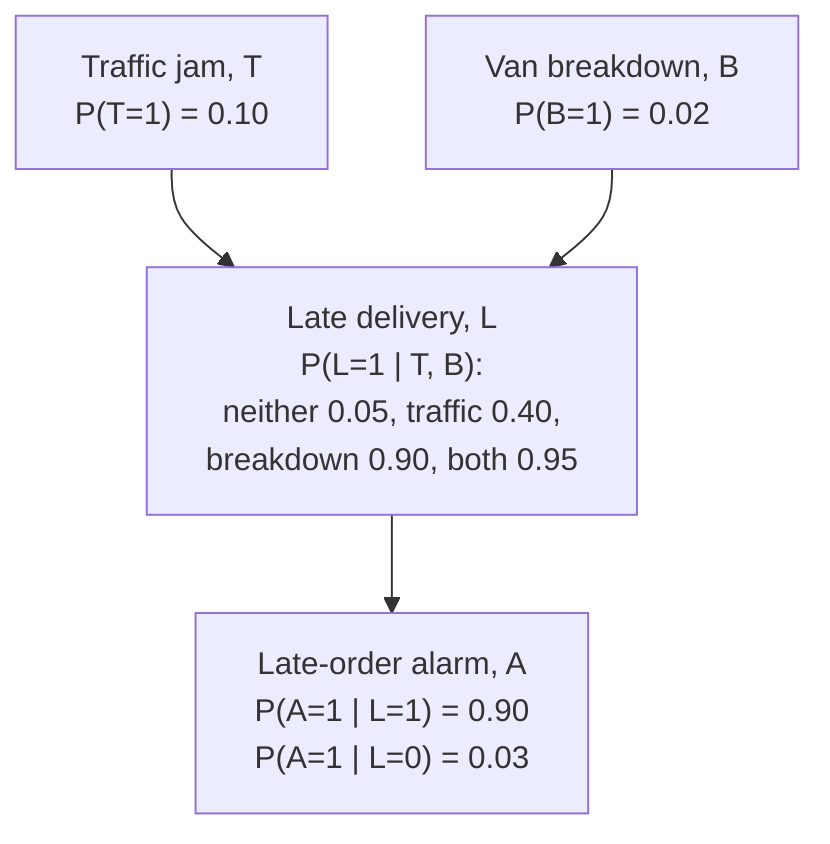
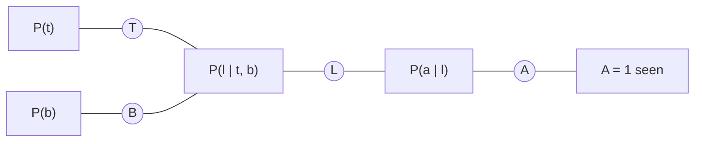

# Graphical models: draw who depends on whom, then sum out variables in a good order

[Syllabus](../../../SYLLABUS.md) → [Applied and computational](../README.md) → [Machine Learning Mathematics](../README.md#s06) → Graphical models

---

## General Overview

A shop sends out 20,000 orders. Its tracking system raises a **late-order alarm** when a delivery runs late. A delivery runs late for one of two reasons: a traffic jam on the route, or a breakdown of the van. The alarm itself is not perfect. It misses some late orders and fires on a few that are on time.

The alarm fires on an order. The depot manager wants one number: how likely is it that the van has broken down? If it has, a mechanic goes out. If it is only traffic, nobody does.

Four yes-or-no facts are in play: traffic, breakdown, late, alarm. A full table of their chances has 2 × 2 × 2 × 2 = 16 rows. For 30 facts it would have about a billion rows, too many to fill in or add up.

A **graphical model** avoids the big table. Draw an arrow from each fact to the facts it directly causes. Then give each fact a small table: its chance given only the facts with arrows into it. Four small tables replace the big one, and the picture shows which facts can inform which.

The answer for the shop: before the alarm, a breakdown has a chance of 2%. After the alarm, it has a chance of **13.8%**. Of the 20,000 orders, about 2,364 set off the alarm, and about 327 of those come from a broken-down van. If the manager also hears there was traffic on the route, the chance drops to 4.4%: the traffic already explains the late delivery.

**A graphical model writes a joint distribution as a product of small local tables, one per variable, given its direct causes; the graph shows which variables are independent, and any chance you want comes from summing the product over the unseen variables, one variable at a time, in an order that keeps the tables small.**

**What kind of fact this is:** the network is a model: the arrows are assumptions about what causes what, not laws. Given the model, variable elimination and sum-product on a tree are exact methods, proved on this card in Why it works. Sum-product on a graph with loops is an approximation with no guarantee, shown failing in What breaks.

### The picture: the delivery network and its four tables



Each box holds one variable and its table. An arrow means "is a direct cause of". These numbers are a stated model, chosen to be realistic; every later number comes from them.

---

## The formula

Notation first, in words. A **variable** here is a fact that is 0 (no) or 1 (yes). Capital letters name the variables: $`T`$ traffic, $`B`$ breakdown, $`L`$ late, $`A`$ alarm. Small letters $`t, b, l, a`$ stand for their values. $`P(x \mid y)`$ is the chance of $`x`$ given $`y`$ ([Conditional probability](../../09-Probability%20and%20statistics/01-Chance%20and%20Events/05-conditional-probability.md)).

In general there are $`n`$ variables $`X_1, \dots, X_n`$. The **parents** of $`X_i`$, written $`\mathrm{pa}(i)`$, are the variables with an arrow into it. A **Bayesian network** is the graph plus one table per variable, and it says:

```math
P(x_1, \dots, x_n) = \prod_{i=1}^{n} P\big(x_i \mid x_{\mathrm{pa}(i)}\big)
```

**Read it aloud:** the chance of any full set of values is the product, over the variables, of each variable's chance given its parents. For the shop:

```math
P(t, b, l, a) = P(t)\, P(b)\, P(l \mid t, b)\, P(a \mid l)
```

**Variable elimination** answers a question by adding up this product over the unseen variables, pulling each table outside every sum that does not involve it. For a breakdown given the alarm, sum out $`L`$ first, then $`T`$:

```math
g(t, b) = \sum_{l} P(l \mid t, b)\, P(A = 1 \mid l), \qquad h(b) = \sum_{t} P(t)\, g(t, b), \qquad P(B = 1 \mid A = 1) = \frac{P(B = 1)\, h(1)}{P(B = 0)\, h(0) + P(B = 1)\, h(1)}
```

**Read it aloud:** first fold the late flag away into a table $`g`$ over traffic and breakdown; then fold traffic away into a table $`h`$ over breakdown; multiply by the breakdown's own chance and divide by the total.

**Sum-product** (also called **belief propagation**) does all the variables at once on a **factor graph**: one node for each variable, one node for each table (a **factor** $`f`$), and an edge wherever a table uses a variable. Each edge carries a **message** $`\mu`$ (mu) in each direction: a pair of numbers, one for value 0 and one for value 1.

```math
\mu_{x \to f}(x) = \prod_{f' \ni x,\ f' \neq f} \mu_{f' \to x}(x), \qquad \mu_{f \to x}(x) = \sum_{\text{other variables of } f} f(\dots) \prod_{y \in f,\ y \neq x} \mu_{y \to f}(y), \qquad P(x \mid \text{evidence}) \propto \prod_{f \ni x} \mu_{f \to x}(x)
```

**Read it aloud:** a variable tells a factor what all its other factors told it; a factor tells a variable what it gets by summing its table against what all its other variables told it; a variable's chance is the product of everything its factors tell it, rescaled to add to 1. Here $`f \ni x`$ reads "the factors $`f`$ that use $`x`$", and $`\propto`$ reads "is proportional to".

**Reading independence from the graph.** Three small patterns decide everything. Two variables are **independent** when learning one never changes the chance of the other.

| Pattern | In the shop | Unseen middle | Middle seen |
| --- | --- | --- | --- |
| chain: $`X \to M \to Y`$ | breakdown → late → alarm | the path is open: $`B`$ informs $`A`$ | blocked: given $`L`$, the alarm says nothing more about $`B`$ |
| fork: $`X \leftarrow M \to Y`$ | (one cause, two effects) | open | blocked |
| collider: $`X \to M \leftarrow Y`$ | traffic → late ← breakdown | **blocked**: $`T`$ and $`B`$ are independent | **open**: seeing $`L`$, or its effect $`A`$, ties $`T`$ and $`B`$ together |

Two sets of variables are independent given the seen ones when every path between them is blocked somewhere. This rule is called **d-separation** ("d" for directed).

| Symbol | Plain meaning | In our example | Push it up and the answer… |
| --- | --- | --- | --- |
| $`T, B, L, A`$; $`t, b, l, a`$ | traffic, breakdown, late, alarm, each 0 or 1; their values | alarm seen: $`A = 1`$ | — |
| $`X_i`$, $`n`$; $`x`$, $`y`$; $`X`$, $`M`$, $`Y`$ | a variable in general; how many there are; any variable or its value; the three variables of a pattern, $`M`$ in the middle | $`n = 4`$; collider $`T \to L \leftarrow B`$ | the full table doubles with each new variable |
| $`\mathrm{pa}(i)`$ | the parents of $`X_i`$: the variables with an arrow into it | $`L`$ has parents $`T`$ and $`B`$ | each table doubles with each parent |
| $`P(x \mid y)`$ | chance of $`x`$ given $`y`$ | $`P(B = 1 \mid A = 1)`$ = 0.138278 | — |
| $`g(t, b)`$ | the table left after summing out $`L`$: chance of the alarm given $`t`$ and $`b`$ | $`g(1, 0)`$ = 0.378000 | — |
| $`h(b)`$ | the table left after summing out $`T`$: chance of the alarm given $`b`$ | $`h(1)`$ = 0.817350 | the alarm points harder at a breakdown |
| $`f`$, $`f'`$ | a factor: one local table, as a function of its variables; another factor | $`P(l \mid t, b)`$, 8 entries | — |
| $`\mu_{x \to f}`$, $`\mu_{f \to x}`$ | messages along an edge of the factor graph, a pair of numbers each | the late factor $`P(l \mid t, b)`$ to $`B`$: proportional to $`h(b)`$ | — |
| $`B_d`$, $`A_d`$, $`N`$ | the van faulty on day $`d`$; that day's alarm; the number of days | $`N`$ = 5, alarms 0, 1, 1, 0, 1 | brute force doubles per day; elimination adds 8 multiplications |
| $`p_{ij}`$, $`\nu`$ | the chance the van goes from state $`i`$ to $`j`$ overnight; the chance it is faulty on Monday | $`p_{01}`$ = 0.01, $`p_{11}`$ = 0.51; $`\nu`$ = 0.02 | faults last longer, so alarms on different days back each other up |
| $`S_j`$, $`F_j`$, $`V_j`$, $`k`$ | in the proof fold: branch $`j`$ behind a factor; the product of its factors; its variables other than $`y_j`$; how many branches | — | — |
| $`\alpha_d`$, $`\beta_d`$ | the [Hidden Markov models](../../11-Stochastic%20processes%20and%20calculus/03-Markov%20Chains/08-hidden-markov-models.md) card's forward and backward chances, indexed here by the day $`d`$ because $`n`$ counts variables (not EM's mixing weights) | they equal the left and right messages on the chain | — |

### When it holds

- **Each variable depends only on its parents.** If the van's own tracker also raised the alarm on a breakdown, the network would need an arrow $`B \to A`$. Without it, every answer describes a different shop.
- **The tables are right.** With traffic at 0.30 instead of 0.10, the alarm points to a breakdown with chance 0.092776, not 0.138278.
- **Elimination is always exact, but its cost depends on the order.** A bad order builds a table of 1,024 entries where a good one needs 2 (What breaks).
- **Sum-product is guaranteed exact only on a tree:** a factor graph with no loops. With a loop it still runs, but it can settle on a wrong answer: 0.390726 against the true 0.415928 (What breaks).
- **Evidence changes independence.** Seeing the alarm opens the collider at $`L`$. Treating traffic and breakdown as still independent gives wrong answers (The usual mistake).

---

## Why it works

### Step 0: products can be pulled out of sums

The method rests on the distributive law: 2 × 5 + 3 × 5 = (2 + 3) × 5. A sum over traffic of terms that all contain $`P(b)`$ is $`P(b)`$ times a smaller sum. When each table involves only a few variables, most tables come out of most sums, and the giant sum over every state collapses into a few small ones.

### Step 1: the network is the chain rule with most of the conditions crossed out

The chain rule of probability holds for any variables: $`P(t, b, l, a) = P(t)\, P(b \mid t)\, P(l \mid t, b)\, P(a \mid t, b, l)`$. It is [Conditional probability](../../09-Probability%20and%20statistics/01-Chance%20and%20Events/05-conditional-probability.md) applied three times.

The network adds two claims. Traffic does not affect breakdowns, so $`P(b \mid t) = P(b)`$. The alarm listens only to whether the order is late, so $`P(a \mid t, b, l) = P(a \mid l)`$. Cross out those conditions and the product formula appears. The checks confirm the second claim: $`P(A = 1 \mid L = 1, T, B)`$ is 0.900000 for all four values of $`T`$ and $`B`$.

### Step 2: independence comes from sums that equal 1

With nothing seen, sum the product over $`l`$ and $`a`$:

```math
P(t, b) = \sum_{l} \sum_{a} P(t)\, P(b)\, P(l \mid t, b)\, P(a \mid l) = P(t)\, P(b) \sum_{l} P(l \mid t, b) \sum_{a} P(a \mid l) = P(t)\, P(b)
```

Each table of chances adds to 1, so the inner sums each equal 1 and drop out. Traffic and breakdown are independent: $`P(T = 1, B = 1)`$ = 0.002000 = 0.10 × 0.02.

Now fix $`A = 1`$. The inner sum over $`a`$ is replaced by the single number $`P(A = 1 \mid l)`$, which does not add to 1 over anything. The sum over $`l`$ no longer drops out, and $`T`$ and $`B`$ become tied. Given the alarm, $`P(T = 1, B = 1 \mid A)`$ = 0.014490, but $`P(T \mid A)\, P(B \mid A)`$ = 0.045334. This is **explaining away**: once something late is seen, one cause makes the other less needed. The d-separation rule in the formula section is this argument applied to every path; its full proof is in the Geiger, Verma and Pearl paper in Sources.

### Step 3: variable elimination is Step 0, done in order

Write the question out in full. With $`A = 1`$ seen, the brute-force sum adds 8 terms, one for each value of $`(t, b, l)`$. For $`B = 1`$, push each table as far left as it will go:

```math
\sum_{t} \sum_{l} P(t)\, P(B = 1)\, P(l \mid t, 1)\, P(A = 1 \mid l) = P(B = 1) \sum_{t} P(t) \underbrace{\sum_{l} P(l \mid t, 1)\, P(A = 1 \mid l)}_{g(t,\,1)}
```

The innermost sum is the table $`g`$; the next is $`h`$. No term was dropped and none was changed, only regrouped, so the answer is exactly the brute-force answer, for any tables.

The cost is set by the largest table built. Summing out a variable creates a table over every variable that shared a factor with it. So a variable joined to many others should go last, and outlying variables, with few neighbours, first. The best order is hard to find in general; "fewest neighbours first" is a common rule of thumb, with no guarantee.

### Step 4: on a tree, a message is a whole branch already summed out

On the factor graph, cut the edge between a factor $`f`$ and a variable $`x`$. If the graph is a tree, the cut splits it into two parts that share nothing but $`x`$. The message $`\mu_{f \to x}`$ is exactly the elimination of every variable on $`f`$'s side of the cut.

The proof is by induction on the branch, in the fold below. The key fact: behind $`f`$, the branches through its other variables share nothing, so the sum over them splits into a product of separate sums, one per branch. Each separate sum is a message arriving at $`f`$.

So each variable's belief, the product of the messages arriving at it, is the full sum over everything else: its exact marginal, rescaled. One sweep in from the leaves and one sweep back out compute every variable's marginal for about twice the cost of one elimination.

The delivery network's factor graph is a tree. Traffic and breakdown meet only inside the one factor $`P(l \mid t, b)`$, so no loop forms. Sum-product gives all four marginals given the alarm, and they match brute force: traffic 0.327843, breakdown 0.138278, late 0.771964, alarm 1.



The delivery network's factor graph (schematic). Circles are variables, boxes are factors. It has no loops.

### Step 5: on a chain, sum-product is the forward-backward pass

A hidden Markov model ([Hidden Markov models](../../11-Stochastic%20processes%20and%20calculus/03-Markov%20Chains/08-hidden-markov-models.md)) is a chain: hidden state on day 1, day 2, and so on, each with its own signal. Its factor graph is a line, which is a tree.

Messages sent left to right along the line carry the chance of the signals so far for each value of today's state: the forward chance $`\alpha_d`$. Messages sent right to left carry the chance of the signals still to come: the backward chance $`\beta_d`$. The belief at day $`d`$ is proportional to $`\alpha_d \beta_d`$, which is the HMM card's smoothed chance. The forward-backward pass is sum-product, with the messages given names.

The [LDPC, turbo and polar codes](../03-Information%20Theory/09-ldpc-turbo-and-polar-codes-in-outline.md) card runs the same messages on a graph that has loops. There Step 4 fails: two branches can share a bit, so the product rule counts the same evidence twice. **Loopy belief propagation** still often works well on codes, but it carries no guarantee.

<details>
<summary>Detailed proof: why a sum over a tree branch splits into a product</summary>

Take a factor $`f`$ with variables $`x, y_1, \dots, y_k`$. Behind each $`y_j`$ lies a branch $`S_j`$: the factors and variables on $`y_j`$'s side once $`f`$ is removed. On a tree the branches $`S_1, \dots, S_k`$ share no variables. Write $`F_j`$ for the product of the factors in $`S_j`$ and $`V_j`$ for the variables in $`S_j`$ other than $`y_j`$.

The elimination of everything on $`f`$'s side of $`x`$ is

$`\displaystyle \sum_{y_1, \dots, y_k} f(x, y_1, \dots, y_k) \sum_{V_1} \cdots \sum_{V_k} F_1 \cdots F_k`$

Because $`F_j`$ involves only $`y_j`$ and $`V_j`$, the inner sums split by the distributive law:

$`\displaystyle \sum_{y_1, \dots, y_k} f(x, y_1, \dots, y_k) \prod_{j=1}^{k} \Big(\sum_{V_j} F_j\Big)`$

The bracket for branch $`j`$ depends on $`y_j`$ alone. By induction it is the product of the messages into $`y_j`$ from its factors in $`S_j`$, which is $`\mu_{y_j \to f}(y_j)`$. So the expression is the sum-product formula for $`\mu_{f \to x}(x)`$. A leaf factor has $`k = 0`$ and sends its own table, which starts the induction. Rescaling a message rescales the belief by the same constant, so the code's normalised messages give the same final answer.

If two branches share a variable, the inner sums do not split, and the product of messages is not the true sum: that is why loops break exactness.

</details>

---

## Worked numbers, by hand

The alarm has fired. Find the chance of a breakdown by summing out $`L`$, then $`T`$.

| Step | Arithmetic | Value |
| --- | --- | --- |
| $`g(0, 0)`$: no traffic, no breakdown | 0.05 × 0.90 + 0.95 × 0.03 | 0.073500 |
| $`g(1, 0)`$: traffic only | 0.40 × 0.90 + 0.60 × 0.03 | 0.378000 |
| $`g(0, 1)`$: breakdown only | 0.90 × 0.90 + 0.10 × 0.03 | 0.813000 |
| $`g(1, 1)`$: both | 0.95 × 0.90 + 0.05 × 0.03 | 0.856500 |
| $`h(0)`$: sum out traffic, no breakdown | 0.90 × 0.073500 + 0.10 × 0.378000 | 0.103950 |
| $`h(1)`$: sum out traffic, breakdown | 0.90 × 0.813000 + 0.10 × 0.856500 | 0.817350 |
| no breakdown and alarm | 0.98 × 0.103950 | 0.101871 |
| breakdown and alarm | 0.02 × 0.817350 | 0.016347 |
| chance of the alarm | 0.101871 + 0.016347 | 0.118218 |
| **breakdown given the alarm** | 0.016347 / 0.118218 | **0.138278** |

The alarm raises the chance of a breakdown from 2% to 13.8%, about 1 order in 7. Across 20,000 orders that is about 327 broken-down vans among 2,364 alarms. Most alarms come from traffic or from false alarms, so a mechanic sent out on every alarm would mostly find a working van.

Brute force over all 8 states needs 24 multiplications; elimination needs 14. Four variables are too few to show the saving; the week chain below shows it growing.

### What breaks if you drop a piece

| Mistake | Comes out at | What went wrong |
| --- | --- | --- |
| Forget to divide by the chance of the alarm | 0.016347 | That is the chance of "breakdown and alarm", not of breakdown given alarm |
| Read the arrow backwards | 0.817350 | That is the chance of an alarm given a breakdown; [Bayes' rule](../../09-Probability%20and%20statistics/01-Chance%20and%20Events/06-bayes-rule.md) turns it round, using the base rate 0.02 |
| Ignore news of traffic, as if $`T`$ and $`B`$ stayed independent after the alarm | 0.138278 kept, against 0.044198 | The alarm opened the collider at $`L`$: traffic now explains the late order |
| Sum out the hub first: one traffic jam behind 10 orders; is order 1 late, given alarms on orders 1 to 4 and none on 5 to 10? | same answer, 0.897749, but a table of 1,024 entries and 22,526 multiplications, against 2 entries and 78 | Removing traffic first ties all ten late flags together into one table; removing the leaves first never does |
| Run sum-product on a loop: two orders on the same van and the same route, both alarms fire | 0.390726, against the exact 0.415928 | Traffic and breakdown now meet in two factors, forming a loop; the messages count the shared evidence twice and settle on a wrong value |

The last two rows break assumptions, not arithmetic. The hub row is still exact but costly. The loop row is cheap but wrong, and nothing in the run warns of it: the messages settle to the same value at round 50 and round 51.

---

## How it moves: one van through a working week

The puzzle: an alarm on Tuesday and Wednesday, quiet Thursday, an alarm Friday. Is the van faulty, and on which days?

Make the breakdown a chain through time. Each night a healthy van develops a fault with chance 0.01. A faulty van is fixed overnight with chance 0.49, so it stays faulty with chance 0.51. These keep about 2% of days faulty, matching the one-day network. Each day one order's alarm is read.

The chance of an alarm given the van's state is $`h(b)`$ from the worked numbers: 0.103950 for a healthy van, 0.817350 for a faulty one. Elimination on the one-day network has produced the signal chances of a hidden Markov model.

| Day | Alarm | P(van faulty): forward-backward | sum-product | all 32 weeks |
| --- | --- | --- | --- | --- |
| Mon | 0 | 0.049776 | 0.049776 | 0.049776 |
| Tue | 1 | 0.275891 | 0.275891 | 0.275891 |
| Wed | 1 | 0.293585 | 0.293585 | 0.293585 |
| Thu | 0 | 0.144602 | 0.144602 | 0.144602 |
| Fri | 1 | 0.191796 | 0.191796 | 0.191796 |

```
day   chance the van is faulty, given the whole week
Mon   █████                                0.049776
Tue   ████████████████████████████         0.275891
Wed   █████████████████████████████        0.293585
Thu   ██████████████                       0.144602
Fri   ███████████████████                  0.191796
```

Three roads agree to the sixth decimal. Monday has no alarm, yet its chance is 0.049776, above the 0.02 base rate: a fault seen on Tuesday may have started Monday. Thursday sits between two alarms and keeps 0.144602 for the same reason. The chance of the whole alarm week is 0.00137358 by both the forward pass and the sum over all 32 weeks.

Brute force adds $`2^N`$ weeks, each a product of $`2N`$ factors. Elimination adds 8 multiplications per day.

| Days $`N`$ | Brute-force multiplications | Elimination multiplications |
| ---: | ---: | ---: |
| 5 | 288 | 34 |
| 10 | 19,456 | 74 |
| 20 | 40,894,464 | 154 |
| 30 | 63,350,767,616 | 234 |

At 5 and 10 days the code counts brute force as it runs; at 20 and 30 the count comes from the formula $`2^N(2N - 1)`$, which matches the code's own count at 5 and 10. A month of alarms takes 234 multiplications, not 63 billion.

---

## Code, from first principles, and it actually runs

The script stores each table as a list of numbers and builds three general tools for 0-or-1 variables: brute force over every state, variable elimination in a given order, and sum-product. It takes **three independent roads** to $`P(B = 1 \mid A = 1)`$: brute force over 8 states, elimination, and sum-product. On the week chain a fourth road joins: the forward-backward recursion, against sum-product and all 32 weeks. It also counts its own multiplications, checks independence and explaining away, and prints every row of What breaks.

### Python

```python
# Graphical models -- the check behind the card.  Standard library only.
# A late delivery L is caused by traffic T or a van breakdown B; a late L sets off
# the late-order alarm A.  Every variable is 0 or 1.  A factor is (variables, table),
# read as table[x0 + 2*x1 + 4*x2 + ...] for its variables x0, x1, x2, ...
# Roads: brute force over every state; variable elimination; sum-product messages;
# on the week chain also the forward-backward recursions of the HMM card.
def cpt(p1):                          # P(child = 1 | parents) -> table over (parents, child)
    return [1 - p for p in p1] + list(p1)
def val(f, x):
    return f[1][sum(x[v] << j for j, v in enumerate(f[0]))]
def brute(n, F, ev):                  # add the product of factors over every state
    tot, one, terms = 0.0, [0.0] * n, 0
    for s in range(2 ** n):
        x = [(s >> i) & 1 for i in range(n)]
        if any(x[v] != e for v, e in ev.items()): continue
        w = 1.0
        for f in F: w *= val(f, x)
        terms += 1; tot += w
        for i in range(n): one[i] += w * x[i]
    return tot, [o / tot for o in one], terms * (len(F) - 1)
def restrict(f, ev):                  # fix the evidence variables inside one factor
    keep, out = [v for v in f[0] if v not in ev], []
    for k in range(2 ** len(keep)):
        x = {v: (k >> j) & 1 for j, v in enumerate(keep)}; x.update(ev); out.append(val(f, x))
    return (keep, out)
def ve(F, order, ev):                 # variable elimination: sum out `order`, return P(the one left = 1 | ev)
    F, mults, big = [restrict(f, ev) for f in F], 0, 0
    for v in order:
        use, F = [f for f in F if v in f[0]], [f for f in F if v not in f[0]]
        vs, t = sorted({u for f in use for u in f[0]} - {v}), []
        for k in range(2 ** len(vs)):
            x, s = {u: (k >> j) & 1 for j, u in enumerate(vs)}, 0.0
            for xv in (0, 1):
                x[v], w = xv, 1.0
                for f in use: w *= val(f, x)
                s += w; mults += len(use) - 1
            t.append(s)
        F.append((vs, t)); big = max(big, len(t))
    p = [1.0, 1.0]
    for vs, t in F:
        for xq in (0, 1): p[xq] *= t[xq] if vs else t[0]
    return p[1] / (p[0] + p[1]), p[0] + p[1], mults + 2 * (len(F) - 1), big
def bp(n, F, rounds):                 # sum-product, every message updated every round
    nb = [[a for a, f in enumerate(F) if v in f[0]] for v in range(n)]
    fv = {(a, v): [1.0, 1.0] for a, f in enumerate(F) for v in f[0]}
    for _ in range(rounds):
        vf = {}
        for (a, v) in fv:
            m = [1.0, 1.0]
            for b in nb[v]:
                if b != a: m = [m[0] * fv[(b, v)][0], m[1] * fv[(b, v)][1]]
            vf[(a, v)] = [m[0] / (m[0] + m[1]), m[1] / (m[0] + m[1])]
        for (a, v) in fv:
            vs, t = F[a]; m = [0.0, 0.0]
            for k in range(2 ** len(vs)):
                x = {u: (k >> j) & 1 for j, u in enumerate(vs)}; w = t[k]
                for u in vs:
                    if u != v: w *= vf[(a, u)][x[u]]
                m[x[v]] += w
            fv[(a, v)] = [m[0] / (m[0] + m[1]), m[1] / (m[0] + m[1])]
    out = []
    for v in range(n):
        m = [1.0, 1.0]
        for b in nb[v]: m = [m[0] * fv[(b, v)][0], m[1] * fv[(b, v)][1]]
        out.append(m[1] / (m[0] + m[1]))
    return out
def net(pT, pB, late, alarm):         # T = 0, B = 1, L = 2, A = 3
    return [([0], cpt([pT])), ([1], cpt([pB])), ([0, 1, 2], cpt(late)), ([2, 3], cpt(alarm))]
f6 = lambda xs: " ".join(f"{x:.6f}" for x in xs)
LATE, ALARM = [0.05, 0.40, 0.90, 0.95], [0.03, 0.90]
F = net(0.10, 0.02, LATE, ALARM)
# ---- the delivery: P(breakdown | alarm), three roads ----
g = [sum(cpt(LATE)[t + 2 * b + 4 * l] * cpt(ALARM)[l + 2] for l in (0, 1)) for b in (0, 1) for t in (0, 1)]
h = [0.9 * g[2 * b] + 0.1 * g[2 * b + 1] for b in (0, 1)]
print(f"by hand: g(T,B) for (0,0) (1,0) (0,1) (1,1): {f6(g)}; h(B): {f6(h)}; P(B) h(B): {0.98 * h[0]:.6f} {0.02 * h[1]:.6f}")
Z, mb, bm = brute(4, F, {3: 1})
pv, Zv, vm, _ = ve(F, [2, 0], {3: 1})
mbp = bp(4, F + [([3], [0.0, 1.0])], 10)
print(f"P(alarm) = {Z:.6f}; P(breakdown and alarm) = {Z * mb[1]:.6f}; per 20,000 orders: {20000 * Z:.0f} alarms, {20000 * Z * mb[1]:.0f} of them breakdowns")
print(f"P(breakdown | alarm): brute force {mb[1]:.6f}  elimination {pv:.6f}  sum-product {mbp[1]:.6f}")
print(f"multiplications: brute force over 8 states {bm}, elimination {vm}\nall marginals given the alarm (T B L A): brute force {f6(mb)}")
print(f"                                         sum-product {f6(mbp)}")
assert abs(mb[1] - pv) < 1e-12 and abs(Z - Zv) < 1e-12 and abs(0.02 * h[1] - Z * mb[1]) < 1e-15
assert all(abs(a - b) < 1e-12 for a, b in zip(mb, mbp))
# ---- independence read from the graph ----
_, mt, _ = brute(4, F, {}); pTB = brute(4, F, {0: 1, 1: 1})[0]
eT1, eT0 = brute(4, F, {3: 1, 0: 1}), brute(4, F, {3: 1, 0: 0})
print(f"no evidence: P(T=1, B=1) = {pTB:.6f} = P(T=1) P(B=1) = {mt[0] * mt[1]:.6f}")
print(f"given the alarm: P(B=1 | A) = {mb[1]:.6f}; add traffic {eT1[1][1]:.6f}; add no traffic {eT0[1][1]:.6f}")
print(f"given the alarm: P(T=1, B=1 | A) = {brute(4, F, {3: 1, 0: 1, 1: 1})[0] / Z:.6f} against P(T|A) P(B|A) = {mb[0] * mb[1]:.6f}")
gL = [brute(4, F, {2: 1, 3: 1, 0: t, 1: b})[0] / brute(4, F, {2: 1, 0: t, 1: b})[0] for t in (0, 1) for b in (0, 1)]
print(f"P(A=1 | L=1, T, B) for the four (T, B): {f6(gL)}")
assert abs(pTB - mt[0] * mt[1]) < 1e-15 and eT1[1][1] < mb[1] < eT0[1][1]
assert all(abs(g - 0.9) < 1e-12 for g in gL)
# ---- the week chain: B_d = van faulty on day d, A_d = that day's alarm ----
em = [ve(F, [2, 0], {1: b})[0] for b in (0, 1)]       # P(A = 1 | B = b): T and L summed out
P, nu, ys = [[0.99, 0.01], [0.49, 0.51]], [0.98, 0.02], [0, 1, 1, 0, 1]
def chain(N, ys):
    G = [([0], cpt([nu[1]]))] + [([n - 1, n], cpt([P[0][1], P[1][1]])) for n in range(1, N)]
    return G + [([n], [1 - em[0], 1 - em[1]] if ys[n] == 0 else em) for n in range(N)]
def fwd_bwd(ys):
    e = lambda b, y: em[b] if y else 1 - em[b]
    al = [[nu[b] * e(b, ys[0]) for b in (0, 1)]]
    for y in ys[1:]: al.append([sum(al[-1][a] * P[a][b] for a in (0, 1)) * e(b, y) for b in (0, 1)])
    be = [[1.0, 1.0]]
    for y in reversed(ys[1:]): be.insert(0, [sum(P[a][b] * e(b, y) * be[0][b] for b in (0, 1)) for a in (0, 1)])
    L = al[-1][0] + al[-1][1]
    return L, [al[n][1] * be[n][1] / L for n in range(len(ys))]
Lw, fb = fwd_bwd(ys); Zw, bw, _ = brute(5, chain(5, ys), {}); sw = bp(5, chain(5, ys), 8)
print(f"alarm chance given the van: healthy {em[0]:.6f}, faulty {em[1]:.6f}")
print(f"alarm week {ys}: chance of the week {Lw:.8f} (forward), {Zw:.8f} (all 32 weeks)")
print(f"P(van faulty), Mon-Fri: forward-backward {f6(fb)}")
print(f"                        sum-product      {f6(sw)}")
print(f"                        all 32 weeks     {f6(bw)}")
assert abs(Lw - Zw) < 1e-15 and all(abs(a - b) < 1e-12 and abs(a - c) < 1e-12 for a, b, c in zip(fb, sw, bw))
for N in (5, 10, 20, 30):
    G = chain(N, [1] * N); vN = ve(G, list(range(N - 1)), {})[2]
    bN = brute(N, G, {})[2] if N <= 10 else 2 ** N * (2 * N - 1)
    print(f"chain of {N:2d} days: multiplications, brute force {bN:,}, elimination {vN}")
    assert (N > 10 or bN == 2 ** N * (2 * N - 1)) and vN == 8 * (N - 1) + 2
# ---- what breaks ----
eT = [ve(F, [3, 1], {0: t})[0] for t in (0, 1)]        # P(late | traffic t): alarm, breakdown summed out
assert all(abs(eT[t] - brute(4, F, {0: t, 2: 1})[0] / brute(4, F, {0: t})[0]) < 1e-12 for t in (0, 1))
H = [([0], cpt([0.10]))] + [([0, i], cpt(eT)) for i in range(1, 11)] + [([i, 10 + i], cpt(ALARM)) for i in range(1, 11)]
ev = {10 + i: int(i <= 4) for i in range(1, 11)}         # alarms on orders 1 to 4 of 10
good, bad = ve(H, list(range(2, 11)) + [0], ev), ve(H, [0] + list(range(2, 11)), ev)
print(f"hub: P(order 1 late | its alarm and 3 of 9 others) = {good[0]:.6f}; largest table: leaves first {good[3]}, hub first {bad[3]}")
print(f"hub: multiplications, leaves first {good[2]}, hub first {bad[2]}")
assert abs(good[0] - bad[0]) < 1e-12 and abs(good[0] - brute(21, H, ev)[1][1]) < 1e-12 and bad[3] == 1024
W = [([0], cpt([0.10])), ([1], cpt([0.02])), ([0, 1, 2], cpt(LATE)), ([0, 1, 3], cpt(LATE)),
     ([2, 4], cpt(ALARM)), ([3, 5], cpt(ALARM)), ([4], [0.0, 1.0]), ([5], [0.0, 1.0])]
ex, lp = brute(6, W, {4: 1, 5: 1})[1], [bp(6, W, r)[1] for r in (50, 51)]
print(f"loop (two orders, same van): P(B=1 | both alarms) exact {ex[1]:.6f}, loopy sum-product {lp[0]:.6f}")
print(f"wrong answers: unnormalised {Z * mb[1]:.6f}; arrow read backwards P(A | B=1) {em[1]:.6f}")
assert abs(lp[0] - lp[1]) < 1e-12 and abs(lp[0] - ex[1]) > 0.01
# ---- try changing ----
print(f"try: false alarms 0.01: P(B | A) = {ve(net(0.10, 0.02, LATE, [0.01, 0.90]), [2, 0], {3: 1})[0]:.6f}")
print(f"try: traffic 0.30: P(B | A) = {ve(net(0.30, 0.02, LATE, ALARM), [2, 0], {3: 1})[0]:.6f}")
print(f"try: alarm week [1, 1, 1, 1, 1]: P(faulty) {f6(fwd_bwd([1, 1, 1, 1, 1])[1])}")
print("ALL CHECKS PASS")
```

**Ran 2026-11-23 on macOS, Python 3.14.10, standard library only. All checks passed. Output, pasted from the run:**

```
by hand: g(T,B) for (0,0) (1,0) (0,1) (1,1): 0.073500 0.378000 0.813000 0.856500; h(B): 0.103950 0.817350; P(B) h(B): 0.101871 0.016347
P(alarm) = 0.118218; P(breakdown and alarm) = 0.016347; per 20,000 orders: 2364 alarms, 327 of them breakdowns
P(breakdown | alarm): brute force 0.138278  elimination 0.138278  sum-product 0.138278
multiplications: brute force over 8 states 24, elimination 14
all marginals given the alarm (T B L A): brute force 0.327843 0.138278 0.771964 1.000000
                                         sum-product 0.327843 0.138278 0.771964 1.000000
no evidence: P(T=1, B=1) = 0.002000 = P(T=1) P(B=1) = 0.002000
given the alarm: P(B=1 | A) = 0.138278; add traffic 0.044198; add no traffic 0.184166
given the alarm: P(T=1, B=1 | A) = 0.014490 against P(T|A) P(B|A) = 0.045334
P(A=1 | L=1, T, B) for the four (T, B): 0.900000 0.900000 0.900000 0.900000
alarm chance given the van: healthy 0.103950, faulty 0.817350
alarm week [0, 1, 1, 0, 1]: chance of the week 0.00137358 (forward), 0.00137358 (all 32 weeks)
P(van faulty), Mon-Fri: forward-backward 0.049776 0.275891 0.293585 0.144602 0.191796
                        sum-product      0.049776 0.275891 0.293585 0.144602 0.191796
                        all 32 weeks     0.049776 0.275891 0.293585 0.144602 0.191796
chain of  5 days: multiplications, brute force 288, elimination 34
chain of 10 days: multiplications, brute force 19,456, elimination 74
chain of 20 days: multiplications, brute force 40,894,464, elimination 154
chain of 30 days: multiplications, brute force 63,350,767,616, elimination 234
hub: P(order 1 late | its alarm and 3 of 9 others) = 0.897749; largest table: leaves first 2, hub first 1024
hub: multiplications, leaves first 78, hub first 22526
loop (two orders, same van): P(B=1 | both alarms) exact 0.415928, loopy sum-product 0.390726
wrong answers: unnormalised 0.016347; arrow read backwards P(A | B=1) 0.817350
try: false alarms 0.01: P(B | A) = 0.162690
try: traffic 0.30: P(B | A) = 0.092776
try: alarm week [1, 1, 1, 1, 1]: P(faulty) 0.847561 0.946728 0.965232 0.946728 0.847561
ALL CHECKS PASS
```

### Rust

Same network, same roads, same printout. The tables are indexed the same way, so the two programs multiply in the same order and print the same digits.

```rust
// Graphical models -- the check behind the card.  Rust std only.
// Same network, same three roads, same printout as the Python check.
// A factor is (variables, table), read as table[x0 + 2*x1 + 4*x2 + ...].
type Fac = (Vec<usize>, Vec<f64>);
fn cpt(p1: &[f64]) -> Vec<f64> { p1.iter().map(|p| 1.0 - p).chain(p1.iter().cloned()).collect() }
fn val(f: &Fac, x: &[usize]) -> f64 { f.1[f.0.iter().enumerate().map(|(j, &v)| x[v] << j).sum::<usize>()] }
fn fac(v: &[usize], t: Vec<f64>) -> Fac { (v.to_vec(), t) }
fn f6(xs: &[f64]) -> String { xs.iter().map(|x| format!("{:.6}", x)).collect::<Vec<_>>().join(" ") }
fn commas(n: u64) -> String { let s = n.to_string(); let mut o = String::new();
    for (i, c) in s.chars().enumerate() { if i > 0 && (s.len() - i) % 3 == 0 { o.push(','); } o.push(c); } o }
fn brute(n: usize, f: &[Fac], ev: &[(usize, usize)]) -> (f64, Vec<f64>, u64) {
    let (mut tot, mut one, mut terms) = (0.0, vec![0.0; n], 0u64);
    for s in 0..(1usize << n) {
        let x: Vec<usize> = (0..n).map(|i| (s >> i) & 1).collect();
        if ev.iter().any(|&(v, e)| x[v] != e) { continue; }
        let mut w = 1.0;
        for g in f { w *= val(g, &x); }
        terms += 1; tot += w;
        for i in 0..n { one[i] += w * x[i] as f64; }
    }
    (tot, one.iter().map(|o| o / tot).collect(), terms * (f.len() as u64 - 1))
}
fn assign(vs: &[usize], k: usize, x: &mut [usize]) { for (j, &u) in vs.iter().enumerate() { x[u] = (k >> j) & 1; } }
fn restrict(f: &Fac, ev: &[(usize, usize)]) -> Fac {
    let keep: Vec<usize> = f.0.iter().cloned().filter(|v| !ev.iter().any(|e| e.0 == *v)).collect();
    let mut x = vec![0; 64]; for &(v, e) in ev { x[v] = e; }
    let out = (0..1usize << keep.len()).map(|k| { assign(&keep, k, &mut x); val(f, &x) }).collect();
    (keep, out)
}
fn ve(f: &[Fac], order: &[usize], ev: &[(usize, usize)]) -> (f64, f64, u64, usize) {
    let mut fs: Vec<Fac> = f.iter().map(|g| restrict(g, ev)).collect();
    let (mut mults, mut big, mut x) = (0u64, 0usize, vec![0; 64]);
    for &v in order {
        let (usef, rest): (Vec<Fac>, Vec<Fac>) = fs.into_iter().partition(|g| g.0.contains(&v));
        let mut vs: Vec<usize> = usef.iter().flat_map(|g| g.0.iter().cloned()).filter(|&u| u != v).collect();
        vs.sort(); vs.dedup();
        let mut t = Vec::new();
        for k in 0..(1usize << vs.len()) {
            assign(&vs, k, &mut x); let mut s = 0.0;
            for xv in 0..2 {
                x[v] = xv; let mut w = 1.0;
                for g in &usef { w *= val(g, &x); }
                s += w; mults += usef.len() as u64 - 1;
            }
            t.push(s);
        }
        big = big.max(t.len()); fs = rest; fs.push((vs, t));
    }
    let mut p = [1.0, 1.0];
    for (vs, t) in &fs { for xq in 0..2 { p[xq] *= if vs.is_empty() { t[0] } else { t[xq] }; } }
    (p[1] / (p[0] + p[1]), p[0] + p[1], mults + 2 * (fs.len() as u64 - 1), big)
}
fn bp(n: usize, f: &[Fac], rounds: usize) -> Vec<f64> {
    let nb: Vec<Vec<usize>> = (0..n).map(|v| (0..f.len()).filter(|&a| f[a].0.contains(&v)).collect()).collect();
    let edges: Vec<(usize, usize)> = (0..f.len()).flat_map(|a| f[a].0.iter().map(move |&v| (a, v))).collect();
    let id = |a: usize, v: usize| edges.iter().position(|&e| e == (a, v)).unwrap();
    let (mut fv, mut x) = (vec![[1.0f64, 1.0]; edges.len()], vec![0; 64]);
    let norm = |m: [f64; 2]| [m[0] / (m[0] + m[1]), m[1] / (m[0] + m[1])];
    for _ in 0..rounds {
        let mut vf = vec![[1.0f64, 1.0]; edges.len()];
        for (e, &(a, v)) in edges.iter().enumerate() {
            let mut m = [1.0, 1.0];
            for &b in &nb[v] { if b != a { let o = fv[id(b, v)]; m = [m[0] * o[0], m[1] * o[1]]; } }
            vf[e] = norm(m);
        }
        for (e, &(a, v)) in edges.iter().enumerate() {
            let (vs, t) = &f[a]; let mut m = [0.0, 0.0];
            for k in 0..(1usize << vs.len()) {
                assign(vs, k, &mut x); let mut w = t[k];
                for &u in vs { if u != v { w *= vf[id(a, u)][x[u]]; } }
                m[x[v]] += w;
            }
            fv[e] = norm(m);
        }
    }
    (0..n).map(|v| {
        let mut m = [1.0, 1.0];
        for &b in &nb[v] { let o = fv[id(b, v)]; m = [m[0] * o[0], m[1] * o[1]]; }
        m[1] / (m[0] + m[1])
    }).collect()
}
fn net(pt: f64, pb: f64, late: &[f64], alarm: &[f64]) -> Vec<Fac> {
    vec![fac(&[0], cpt(&[pt])), fac(&[1], cpt(&[pb])), fac(&[0, 1, 2], cpt(late)), fac(&[2, 3], cpt(alarm))]
}
const P: [[f64; 2]; 2] = [[0.99, 0.01], [0.49, 0.51]]; const NU: [f64; 2] = [0.98, 0.02];
fn chain(n: usize, ys: &[usize], em: &[f64; 2]) -> Vec<Fac> {
    let mut g = vec![fac(&[0], cpt(&[NU[1]]))];
    for k in 1..n { g.push(fac(&[k - 1, k], cpt(&[P[0][1], P[1][1]]))); }
    for k in 0..n { g.push(fac(&[k], if ys[k] == 0 { vec![1.0 - em[0], 1.0 - em[1]] } else { em.to_vec() })); }
    g
}
fn fwd_bwd(ys: &[usize], em: &[f64; 2]) -> (f64, Vec<f64>) {
    let e = |b: usize, y: usize| if y == 1 { em[b] } else { 1.0 - em[b] };
    let mut al = vec![[NU[0] * e(0, ys[0]), NU[1] * e(1, ys[0])]];
    for &y in &ys[1..] {
        let l = *al.last().unwrap();
        al.push([0, 1].map(|b| (0.0 + l[0] * P[0][b] + l[1] * P[1][b]) * e(b, y)));
    }
    let mut be = vec![[1.0, 1.0]];
    for &y in ys[1..].iter().rev() {
        let n = be[0];
        be.insert(0, [0, 1].map(|a| 0.0 + P[a][0] * e(0, y) * n[0] + P[a][1] * e(1, y) * n[1]));
    }
    let l = al[ys.len() - 1][0] + al[ys.len() - 1][1];
    (l, (0..ys.len()).map(|k| al[k][1] * be[k][1] / l).collect())
}
fn main() {
    let (late, alarm) = ([0.05, 0.40, 0.90, 0.95], [0.03, 0.90]);
    let f = net(0.10, 0.02, &late, &alarm);
    let (cl, ca) = (cpt(&late), cpt(&alarm));
    let g: Vec<f64> = (0..4).map(|k| { let (t, b) = (k % 2, k / 2); (0..2).map(|l| cl[t + 2 * b + 4 * l] * ca[l + 2]).fold(0.0, |s, w| s + w) }).collect();
    let h: Vec<f64> = (0..2).map(|b| 0.9 * g[2 * b] + 0.1 * g[2 * b + 1]).collect();
    println!("by hand: g(T,B) for (0,0) (1,0) (0,1) (1,1): {}; h(B): {}; P(B) h(B): {:.6} {:.6}", f6(&g), f6(&h), 0.98 * h[0], 0.02 * h[1]);
    let (z, mb, bm) = brute(4, &f, &[(3, 1)]);
    let (pv, zv, vm, _) = ve(&f, &[2, 0], &[(3, 1)]);
    let mut f2 = f.clone(); f2.push(fac(&[3], vec![0.0, 1.0]));
    let mbp = bp(4, &f2, 10);
    println!("P(alarm) = {:.6}; P(breakdown and alarm) = {:.6}; per 20,000 orders: {:.0} alarms, {:.0} of them breakdowns", z, z * mb[1], 20000.0 * z, 20000.0 * z * mb[1]);
    println!("P(breakdown | alarm): brute force {:.6}  elimination {:.6}  sum-product {:.6}", mb[1], pv, mbp[1]);
    println!("multiplications: brute force over 8 states {}, elimination {}\nall marginals given the alarm (T B L A): brute force {}", bm, vm, f6(&mb));
    println!("                                         sum-product {}", f6(&mbp));
    assert!((mb[1] - pv).abs() < 1e-12 && (z - zv).abs() < 1e-12 && (0.02 * h[1] - z * mb[1]).abs() < 1e-15);
    assert!(mb.iter().zip(&mbp).all(|(a, b)| (a - b).abs() < 1e-12));
    let (_, mt, _) = brute(4, &f, &[]); let ptb = brute(4, &f, &[(0, 1), (1, 1)]).0;
    let (et1, et0) = (brute(4, &f, &[(3, 1), (0, 1)]), brute(4, &f, &[(3, 1), (0, 0)]));
    println!("no evidence: P(T=1, B=1) = {:.6} = P(T=1) P(B=1) = {:.6}", ptb, mt[0] * mt[1]);
    println!("given the alarm: P(B=1 | A) = {:.6}; add traffic {:.6}; add no traffic {:.6}", mb[1], et1.1[1], et0.1[1]);
    println!("given the alarm: P(T=1, B=1 | A) = {:.6} against P(T|A) P(B|A) = {:.6}", brute(4, &f, &[(3, 1), (0, 1), (1, 1)]).0 / z, mb[0] * mb[1]);
    let gl: Vec<f64> = (0..4).map(|k| { let (t, b) = (k / 2, k % 2); brute(4, &f, &[(2, 1), (3, 1), (0, t), (1, b)]).0 / brute(4, &f, &[(2, 1), (0, t), (1, b)]).0 }).collect();
    println!("P(A=1 | L=1, T, B) for the four (T, B): {}", f6(&gl));
    assert!((ptb - mt[0] * mt[1]).abs() < 1e-15 && et1.1[1] < mb[1] && mb[1] < et0.1[1]);
    assert!(gl.iter().all(|g| (g - 0.9).abs() < 1e-12));
    let em = [ve(&f, &[2, 0], &[(1, 0)]).0, ve(&f, &[2, 0], &[(1, 1)]).0];
    let ys = [0, 1, 1, 0, 1];
    let (lw, fb) = fwd_bwd(&ys, &em); let (zw, bw, _) = brute(5, &chain(5, &ys, &em), &[]); let sw = bp(5, &chain(5, &ys, &em), 8);
    println!("alarm chance given the van: healthy {:.6}, faulty {:.6}", em[0], em[1]);
    println!("alarm week {:?}: chance of the week {:.8} (forward), {:.8} (all 32 weeks)", ys, lw, zw);
    println!("P(van faulty), Mon-Fri: forward-backward {}", f6(&fb));
    println!("                        sum-product      {}", f6(&sw));
    println!("                        all 32 weeks     {}", f6(&bw));
    assert!((lw - zw).abs() < 1e-15 && (0..5).all(|k| (fb[k] - sw[k]).abs() < 1e-12 && (fb[k] - bw[k]).abs() < 1e-12));
    for n in [5usize, 10, 20, 30] {
        let g = chain(n, &vec![1; n], &em); let order: Vec<usize> = (0..n - 1).collect(); let vn = ve(&g, &order, &[]).2;
        let bn = if n <= 10 { brute(n, &g, &[]).2 } else { (1u64 << n) * (2 * n as u64 - 1) };
        println!("chain of {:2} days: multiplications, brute force {}, elimination {}", n, commas(bn), vn);
        assert!((n > 10 || bn == (1u64 << n) * (2 * n as u64 - 1)) && vn == 8 * (n as u64 - 1) + 2);
    }
    let et = [ve(&f, &[3, 1], &[(0, 0)]).0, ve(&f, &[3, 1], &[(0, 1)]).0];   // P(late | traffic t)
    assert!((0..2).all(|t| (et[t] - brute(4, &f, &[(0, t), (2, 1)]).0 / brute(4, &f, &[(0, t)]).0).abs() < 1e-12));
    let mut hub = vec![fac(&[0], cpt(&[0.10]))];
    for i in 1..11 { hub.push(fac(&[0, i], cpt(&et))); }
    for i in 1..11 { hub.push(fac(&[i, 10 + i], cpt(&alarm))); }
    let ev: Vec<(usize, usize)> = (1..11).map(|i| (10 + i, (i <= 4) as usize)).collect();
    let (lo, hi): (Vec<usize>, Vec<usize>) = ((2..11).chain([0]).collect(), [0].into_iter().chain(2..11).collect());
    let (good, bad) = (ve(&hub, &lo, &ev), ve(&hub, &hi, &ev));
    println!("hub: P(order 1 late | its alarm and 3 of 9 others) = {:.6}; largest table: leaves first {}, hub first {}", good.0, good.3, bad.3);
    println!("hub: multiplications, leaves first {}, hub first {}", good.2, bad.2);
    assert!((good.0 - bad.0).abs() < 1e-12 && (good.0 - brute(21, &hub, &ev).1[1]).abs() < 1e-12 && bad.3 == 1024);
    let w = vec![fac(&[0], cpt(&[0.10])), fac(&[1], cpt(&[0.02])), fac(&[0, 1, 2], cpt(&late)), fac(&[0, 1, 3], cpt(&late)),
        fac(&[2, 4], cpt(&alarm)), fac(&[3, 5], cpt(&alarm)), fac(&[4], vec![0.0, 1.0]), fac(&[5], vec![0.0, 1.0])];
    let ex = brute(6, &w, &[(4, 1), (5, 1)]).1; let lp: Vec<f64> = [50, 51].iter().map(|&r| bp(6, &w, r)[1]).collect();
    println!("loop (two orders, same van): P(B=1 | both alarms) exact {:.6}, loopy sum-product {:.6}", ex[1], lp[0]);
    println!("wrong answers: unnormalised {:.6}; arrow read backwards P(A | B=1) {:.6}", z * mb[1], em[1]);
    assert!((lp[0] - lp[1]).abs() < 1e-12 && (lp[0] - ex[1]).abs() > 0.01);
    println!("try: false alarms 0.01: P(B | A) = {:.6}", ve(&net(0.10, 0.02, &late, &[0.01, 0.90]), &[2, 0], &[(3, 1)]).0);
    println!("try: traffic 0.30: P(B | A) = {:.6}", ve(&net(0.30, 0.02, &late, &alarm), &[2, 0], &[(3, 1)]).0);
    println!("try: alarm week [1, 1, 1, 1, 1]: P(faulty) {}", f6(&fwd_bwd(&[1, 1, 1, 1, 1], &em).1));
    println!("ALL CHECKS PASS");
}
```

**Ran 2026-11-23 on macOS, rustc 1.98.1, no crates. All checks passed. Output, pasted from the run:**

```
by hand: g(T,B) for (0,0) (1,0) (0,1) (1,1): 0.073500 0.378000 0.813000 0.856500; h(B): 0.103950 0.817350; P(B) h(B): 0.101871 0.016347
P(alarm) = 0.118218; P(breakdown and alarm) = 0.016347; per 20,000 orders: 2364 alarms, 327 of them breakdowns
P(breakdown | alarm): brute force 0.138278  elimination 0.138278  sum-product 0.138278
multiplications: brute force over 8 states 24, elimination 14
all marginals given the alarm (T B L A): brute force 0.327843 0.138278 0.771964 1.000000
                                         sum-product 0.327843 0.138278 0.771964 1.000000
no evidence: P(T=1, B=1) = 0.002000 = P(T=1) P(B=1) = 0.002000
given the alarm: P(B=1 | A) = 0.138278; add traffic 0.044198; add no traffic 0.184166
given the alarm: P(T=1, B=1 | A) = 0.014490 against P(T|A) P(B|A) = 0.045334
P(A=1 | L=1, T, B) for the four (T, B): 0.900000 0.900000 0.900000 0.900000
alarm chance given the van: healthy 0.103950, faulty 0.817350
alarm week [0, 1, 1, 0, 1]: chance of the week 0.00137358 (forward), 0.00137358 (all 32 weeks)
P(van faulty), Mon-Fri: forward-backward 0.049776 0.275891 0.293585 0.144602 0.191796
                        sum-product      0.049776 0.275891 0.293585 0.144602 0.191796
                        all 32 weeks     0.049776 0.275891 0.293585 0.144602 0.191796
chain of  5 days: multiplications, brute force 288, elimination 34
chain of 10 days: multiplications, brute force 19,456, elimination 74
chain of 20 days: multiplications, brute force 40,894,464, elimination 154
chain of 30 days: multiplications, brute force 63,350,767,616, elimination 234
hub: P(order 1 late | its alarm and 3 of 9 others) = 0.897749; largest table: leaves first 2, hub first 1024
hub: multiplications, leaves first 78, hub first 22526
loop (two orders, same van): P(B=1 | both alarms) exact 0.415928, loopy sum-product 0.390726
wrong answers: unnormalised 0.016347; arrow read backwards P(A | B=1) 0.817350
try: false alarms 0.01: P(B | A) = 0.162690
try: traffic 0.30: P(B | A) = 0.092776
try: alarm week [1, 1, 1, 1, 1]: P(faulty) 0.847561 0.946728 0.965232 0.946728 0.847561
ALL CHECKS PASS
```

### Lean

Lean proves the three regrouping steps behind the card for any tables, with any finite sets of values, not only 0 and 1.

- Take the delivery network with the alarm seen. Then variable elimination, summing out $`L`$ then $`T`$, gives exactly the brute-force chance of each breakdown value.
- Suppose the late table adds to 1 over $`l`$ and the alarm table adds to 1 over $`a`$. Then with nothing seen, $`P(t, b) = P(t)\, P(b)`$.
- Take a factor whose branches share no variables, as on a tree. Then the sum over all the branches' variables splits into a product of one sum per branch.
- In exact fractions, the chance of the alarm is 0.118218, and a breakdown given the alarm is 0.016347 / 0.118218.
- Take $`N`$ = 5, 10, 20 and 30 days. Then $`2^N(2N - 1)`$ gives 288, 19,456, 40,894,464 and 63,350,767,616, and $`8(N - 1) + 2`$ gives 34, 74, 154 and 234.

That each branch sum is the incoming message, the hub and loop examples, and the printed decimals are left to the Python and Rust checks.

```lean
-- Graphical models: for the delivery network with any tables, variable elimination gives exactly the brute-force chance of a breakdown given the alarm, traffic and breakdown are independent when nothing is seen, a sum over a tree's separate branches splits into a product of messages, and the card's whole-number counts are exact.
import Mathlib.Algebra.BigOperators.Ring.Finset
import Mathlib.Algebra.BigOperators.Group.Finset.Sigma
import Mathlib.Data.Fintype.Pi
import Mathlib.Basic.Real.Basic
import Mathlib.Tactic.NormNum
import Mathlib.Tactic.Ring

open Finset

/-- Variable elimination is exact (the card's main claim, Step 3). Take the delivery network
T → L ← B, L → A, with the joint chance P(t, b, l, a) = P(t) P(b) P(l | t, b) P(a | l), for any
finite sets of values and any tables. Fix the seen alarm value a. The brute-force answer, the
sum of the product over every unseen value divided by the sum over every value of B as well,
equals the elimination answer: sum out L to get g(t, b) = Σ_l P(l | t, b) P(a | l), then sum
out T to get h(b) = Σ_t P(t) g(t, b), and return P(b) h(b) / Σ_b' P(b') h(b'). -/
theorem variable_elimination_eq_brute_force
    {T B L A : Type*} [Fintype T] [Fintype B] [Fintype L]
    (pT : T → ℝ) (pB : B → ℝ) (pL : T → B → L → ℝ) (pA : L → A → ℝ) (a : A) (b : B) :
    (∑ t, ∑ l, pT t * pB b * pL t b l * pA l a) /
        (∑ t, ∑ b', ∑ l, pT t * pB b' * pL t b' l * pA l a) =
      pB b * (∑ t, pT t * ∑ l, pL t b l * pA l a) /
        ∑ b', pB b' * (∑ t, pT t * ∑ l, pL t b' l * pA l a) := by
  have hnum : ∀ c : B, ∑ t, ∑ l, pT t * pB c * pL t c l * pA l a =
      pB c * (∑ t, pT t * ∑ l, pL t c l * pA l a) := by
    intro c
    rw [Finset.mul_sum]
    refine Finset.sum_congr rfl fun t _ => ?_
    rw [Finset.mul_sum, Finset.mul_sum]
    refine Finset.sum_congr rfl fun l _ => ?_
    ring
  rw [Finset.sum_comm (s := (Finset.univ : Finset T)) (t := (Finset.univ : Finset B)), hnum b]
  congr 1
  exact Finset.sum_congr rfl fun c _ => hnum c

/-- Independence from sums that equal 1 (Step 2). In the delivery network, when the late table
P(l | t, b) adds to 1 over l for every t and b, and the alarm table P(a | l) adds to 1 over a for
every l, summing the joint chance over the unseen L and A leaves P(t, b) = P(t) P(b): with nothing
seen, traffic and breakdown are independent. -/
theorem traffic_breakdown_independent_when_nothing_seen
    {T B L A : Type*} [Fintype L] [Fintype A]
    (pT : T → ℝ) (pB : B → ℝ) (pL : T → B → L → ℝ) (pA : L → A → ℝ)
    (hL : ∀ t b, ∑ l, pL t b l = 1) (hA : ∀ l, ∑ a, pA l a = 1) (t : T) (b : B) :
    ∑ l, ∑ a, pT t * pB b * pL t b l * pA l a = pT t * pB b := by
  calc ∑ l, ∑ a, pT t * pB b * pL t b l * pA l a
      = ∑ l, pT t * pB b * pL t b l * ∑ a, pA l a := by
        refine Finset.sum_congr rfl fun l _ => ?_
        rw [Finset.mul_sum]
    _ = ∑ l, pT t * pB b * pL t b l := by
        refine Finset.sum_congr rfl fun l _ => ?_
        rw [hA l, mul_one]
    _ = pT t * pB b := by
        rw [← Finset.mul_sum, hL t b, mul_one]

/-- On a tree, a sum over a factor's branches splits into a product of messages (Step 4 and the
detailed proof). A factor f uses x and y_1, ..., y_k. Behind each y_j lies a branch whose factors
multiply to F_j, a function of y_j and that branch's own other variables V_j; on a tree the
branches share no variables. Then eliminating everything on f's side of x, the sum over every
y and every branch's variables of f times F_1 ⋯ F_k, equals the sum over y of f times the product
of the separate branch sums Σ_{V_j} F_j, each of which depends on y_j alone (the message from
y_j to f). -/
theorem tree_branch_sum_splits_into_messages
    {ι X : Type*} [Fintype ι] [DecidableEq ι] {Y V : ι → Type*}
    [∀ j, Fintype (Y j)] [∀ j, Fintype (V j)]
    (f : X → (∀ j, Y j) → ℝ) (F : ∀ j, Y j → V j → ℝ) (x : X) :
    ∑ y : (∀ j, Y j), f x y * ∑ v : (∀ j, V j), ∏ j, F j (y j) (v j) =
      ∑ y : (∀ j, Y j), f x y * ∏ j, ∑ w : V j, F j (y j) w := by
  refine Finset.sum_congr rfl fun y _ => ?_
  rw [Fintype.prod_sum (fun j w => F j (y j) w)]

-- Four yes-or-no facts: the full table has 2 × 2 × 2 × 2 = 16 rows.
example : 2 * 2 * 2 * 2 = 16 := by norm_num
-- The distributive law of Step 0.
example : 2 * 5 + 3 * 5 = (2 + 3) * 5 := by norm_num
-- Brute force with the alarm seen: 8 states, each a product of 4 tables, 3 multiplications each.
example : 8 * (4 - 1) = 24 := by norm_num
-- The worked numbers in exact fractions: P(alarm) = 0.118218 and P(breakdown | alarm) = 0.016347 / 0.118218.
example :
    (98 / 100 : ℚ) * (9 / 10 * (5 / 100 * (90 / 100) + 95 / 100 * (3 / 100))
        + 1 / 10 * (40 / 100 * (90 / 100) + 60 / 100 * (3 / 100)))
      + 2 / 100 * (9 / 10 * (90 / 100 * (90 / 100) + 10 / 100 * (3 / 100))
        + 1 / 10 * (95 / 100 * (90 / 100) + 5 / 100 * (3 / 100))) = 118218 / 1000000 := by
  norm_num
example :
    (2 / 100 : ℚ) * (9 / 10 * (90 / 100 * (90 / 100) + 10 / 100 * (3 / 100))
        + 1 / 10 * (95 / 100 * (90 / 100) + 5 / 100 * (3 / 100))) / (118218 / 1000000)
      = 16347 / 118218 := by
  norm_num
-- With nothing seen, P(T = 1, B = 1) = 0.10 × 0.02 = 0.002.
example : (1 / 10 : ℚ) * (2 / 100) = 2 / 1000 := by norm_num
-- The week chain: brute force 2^N (2N - 1) multiplications, elimination 8 (N - 1) + 2.
example : 2 ^ 5 * (2 * 5 - 1) = 288 ∧ 8 * (5 - 1) + 2 = 34 := by norm_num
example : 2 ^ 10 * (2 * 10 - 1) = 19456 ∧ 8 * (10 - 1) + 2 = 74 := by norm_num
example : 2 ^ 20 * (2 * 20 - 1) = 40894464 ∧ 8 * (20 - 1) + 2 = 154 := by norm_num
example : 2 ^ 30 * (2 * 30 - 1) = 63350767616 ∧ 8 * (30 - 1) + 2 = 234 := by norm_num

#print axioms variable_elimination_eq_brute_force
#print axioms traffic_breakdown_independent_when_nothing_seen
#print axioms tree_branch_sum_splits_into_messages
```

**Checked 2026-11-23 on macOS, Lean 4.36.0-rc2, Mathlib v4.36.0-rc2. Every proof is complete and uses only Lean's standard axioms. Output, pasted from the run:**

```
'variable_elimination_eq_brute_force' depends on axioms: [propext, Classical.choice, Quot.sound]
'traffic_breakdown_independent_when_nothing_seen' depends on axioms: [propext, Classical.choice, Quot.sound]
'tree_branch_sum_splits_into_messages' depends on axioms: [propext, Classical.choice, Quot.sound]
```

> [!TIP]
> **Try changing**
> - **Make the alarm more reliable.** Guess first: if false alarms fall from 3 in 100 to 1 in 100, does a breakdown become more or less likely after an alarm? Change `[0.03, 0.90]` to `[0.01, 0.90]`, as the `false alarms` line does. It rises to **0.162690**: fewer alarms come from on-time orders, so more of the rest point to a real cause.
> - **Make traffic common.** Guess first: with traffic on 30% of routes instead of 10%, what happens to the breakdown chance? Change `0.10` to `0.30` in the line that makes `F`, as the `traffic 0.30` line does. It falls to **0.092776**: traffic now explains more of the late orders.
> - **Alarm every day.** Guess first: with alarms all five days, which day is most likely faulty? Change `ys` to `[1, 1, 1, 1, 1]`. Wednesday, at **0.965232**; Monday and Friday get 0.847561, because they have evidence on one side only.

---

## The usual mistake

> [!warning]
> **Treating two causes as independent after their shared effect is seen.** Traffic and breakdown are independent until the alarm fires. After it, they compete to explain it. Hearing of traffic should cut the breakdown chance from 0.138278 to 0.044198, and hearing of no traffic should raise it to 0.184166. A model that multiplies separate chances for the two causes after the alarm gets 0.045334 for both together, against the true 0.014490.
>
> Smaller traps:
> - **Forgetting to divide by the evidence.** The sum gives 0.016347, the chance of breakdown *and* alarm. Divide by 0.118218 to get 0.138278.
> - **Reading an arrow as the answer.** The table says an alarm follows a breakdown with chance 0.817350. The manager needs the reverse, 0.138278.
> - **A bad elimination order.** Summing out the traffic jam behind ten orders first builds a table of 1,024 entries, where 2 would do.
> - **Trusting loopy sum-product.** On two orders sharing one van and one route it settles at 0.390726 against the exact 0.415928, with no warning sign.

---

## Where you meet it in real life

- **Medical diagnosis.** Expert systems link diseases, risk factors and test results in a network and compute each disease's chance given the tests by these local sums.
- **Error-correcting codes.** Wi-Fi and 5G decoders run loopy sum-product, or a cheaper simplified form of it, on the code's graph. It is approximate, but long codes with few short loops make it very good.
- **Speech and gene finding.** Hidden Markov models label each moment of a recording or each letter of a gene, using forward-backward: sum-product on a chain.
- **Family trees in genetics.** Linkage analysis sums out each relative's unseen genes, one generation at a time: variable elimination on the family tree.
- **Fault diagnosis.** Help-desk and machine-monitoring tools rank likely causes of a failure from the symptoms seen, as the depot does here.

> **Say it back**
> A graphical model replaces one huge table of chances with a small table per variable, given its direct causes. The graph shows independence: two causes are independent until their shared effect is seen, and then they explain each other away. Any chance comes from summing the product over unseen variables; pulling tables out of sums, one variable at a time, keeps this cheap if the order keeps the tables small. On a tree, sum-product does every variable's sum at once, and on a chain it is the forward-backward pass. For the shop, an alarm raises the chance of a breakdown from 2% to 13.8%, and news of traffic cuts it to 4.4%.

---

## What this builds on

- [Conditional probability](../../09-Probability%20and%20statistics/01-Chance%20and%20Events/05-conditional-probability.md): the chance of one thing given another, and the chain rule that the network's product formula trims down.
- [Bayes' rule](../../09-Probability%20and%20statistics/01-Chance%20and%20Events/06-bayes-rule.md): turning the chance of an alarm given a breakdown into the chance of a breakdown given an alarm. This card does the same with more than two variables.
- [Hidden Markov models](../../11-Stochastic%20processes%20and%20calculus/03-Markov%20Chains/08-hidden-markov-models.md): the forward and backward recursions, which this card shows are sum-product on a chain.
- [LDPC, turbo and polar codes](../03-Information%20Theory/09-ldpc-turbo-and-polar-codes-in-outline.md): belief propagation on a code's graph, with loops. This card says when those messages are exact and why loops break them.
- [EM](08-em-algorithm.md): fitting a model with hidden labels. When the hidden part is a network, EM's E-step needs each hidden variable's chance given what was seen, which is exactly what this card computes.

## Where this goes next

- Back to [MCMC](../../11-Stochastic%20processes%20and%20calculus/03-Markov%20Chains/07-markov-chain-monte-carlo.md), an earlier card: when every elimination order builds tables too big to store, its chain samples the unseen variables and estimates the same chances approximately.

This card took the tables as given; learning them from the shop's 20,000 orders, and deciding which arrows to draw at all, is the question it leaves open.

---

## Sources

Verified 2026-11-23: every link below resolves to the publisher's page.

- Pearl, Judea. "Fusion, Propagation, and Structuring in Belief Networks." *Artificial Intelligence* 29, no. 3 (1986): 241–288. [doi:10.1016/0004-3702(86)90072-X](https://doi.org/10.1016/0004-3702%2886%2990072-X). Message passing on trees: each node combines what its neighbours send, and the result is exact without loops.
- Lauritzen, S. L., and D. J. Spiegelhalter. "Local Computations with Probabilities on Graphical Structures and Their Application to Expert Systems." *Journal of the Royal Statistical Society, Series B* 50, no. 2 (1988): 157–194. [doi:10.1111/j.2517-6161.1988.tb01721.x](https://doi.org/10.1111/j.2517-6161.1988.tb01721.x). Exact local computation on any network, and a medical diagnosis example.
- Geiger, Dan, Thomas Verma, and Judea Pearl. "Identifying Independence in Bayesian Networks." *Networks* 20, no. 5 (1990): 507–534. [doi:10.1002/net.3230200504](https://doi.org/10.1002/net.3230200504). The d-separation rule and its proof: every independence the graph promises holds, and the rule finds them all.
- Dechter, Rina. "Bucket Elimination: A Unifying Framework for Reasoning." *Artificial Intelligence* 113, no. 1–2 (1999): 41–85. [doi:10.1016/S0004-3702(99)00059-4](https://doi.org/10.1016/S0004-3702%2899%2900059-4). Variable elimination in general, and how its cost depends on the elimination order.
- Kschischang, Frank R., Brendan J. Frey, and Hans-Andrea Loeliger. "Factor Graphs and the Sum-Product Algorithm." *IEEE Transactions on Information Theory* 47, no. 2 (2001): 498–519. [doi:10.1109/18.910572](https://doi.org/10.1109/18.910572). Factor graphs and the sum-product messages, with forward-backward and turbo decoding as special cases.
