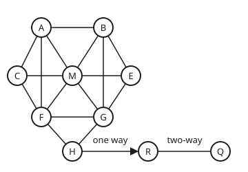

# Centrality: degree, betweenness and PageRank as rival ideas of "important"

[Syllabus](../../../SYLLABUS.md) → [Applied and computational](../README.md) → [Network Science and Spectral Graphs](../README.md#s07) → Centrality

---

## General Overview

A city's bike-share scheme has 1,200 stations. The operator wants to know which station is the real hub:

- where to put the biggest dock;
- where to park the repair van;
- which station must never close;
- where the rebalancing trucks (the vans that move bikes back to where riders need them) should call first.

A good place to learn the answer is one corner of the map: ten stations and the eighteen routes riders use between them. The data are synthetic: made up for this card, in the shape of a standard test network.

Seven stations sit in the old town on top of a hill: Arcade, Bus Station, Cathedral, Market, East Gate, Fountain and Guildhall. Hill Top is where the town meets a steep road down to the river. At the bottom are Riverside and, further along the flat river path, Quay. Riders take the steep road down. Almost nobody pedals back up, so in the trip logs that route runs one way.

Ask "which station is the hub?" four ways and get four different answers.

- **Market** has the most routes, 6.
- **Fountain** and **Guildhall** are closest to everything, 14 route-steps to all nine others.
- **Hill Top** has only 3 routes, yet 14 of the 36 station pairs that don't include it must ride through it.
- A bike that keeps being ridden ends up most often at **Riverside**, about 15% of the time, against a fair share of 10%.

Each answer is a **centrality**: a number that scores how important a station is. Each one is right about a different question.

**Degree counts a station's links, closeness measures how near it is to everyone, betweenness counts the shortest routes that must pass through it, and PageRank is where a wandering rider spends the long run; they answer different questions, so on the same map they crown different hubs.**

**What kind of fact this is:** four definitions, each one a choice of what "important" means. The facts used to compute them are theorems proved on this card in Why it works. That PageRank exists and is unique is proved on [Stationary distributions](../../11-Stochastic%20processes%20and%20calculus/03-Markov%20Chains/04-stationary-distributions.md).

### The picture: ten stations, eighteen routes

<p align="center"></p>

Schematic, not to scale. A Arcade, B Bus Station, C Cathedral, M Market, E East Gate, F Fountain, G Guildhall, H Hill Top, R Riverside, Q Quay. Every line is a route ridden both ways, except the arrow from Hill Top down to Riverside.

---

## The formula

Notation first, in words. The map has $n$ stations and $m$ routes, here 10 and 18. Its **adjacency matrix** $A$ is the square table with $A_{vw} = 1$ when a route joins stations $v$ and $w$, and 0 otherwise. The **distance** $d(v, w)$ is the fewest routes a rider needs to get from $v$ to $w$. For two stations $s$ and $t$ (start and target), $\sigma_{st}$ ("sigma") counts the shortest rides from $s$ to $t$, and $\sigma_{st}(v)$ counts those that pass through station $v$.

The four scores:

$$\deg(v) = \sum_w A_{vw}, \qquad c(v) = \frac{n-1}{\sum_w d(v, w)}, \qquad b(v) = \sum_{s < t,\; s, t \ne v} \frac{\sigma_{st}(v)}{\sigma_{st}},$$

$$\pi(j) = \frac{0.15}{n} + 0.85 \sum_i \pi(i)\, P_{ij}.$$

**Read it aloud:** degree counts the routes at a station. Closeness is one over the average distance to everyone else. Betweenness adds up, over every pair of other stations, the share of their shortest rides that pass through. PageRank is a station's share of the random jumps plus 85% of the share flowing in along the trips that end there.

PageRank is [Random walks on a graph](../../09-Probability%20and%20statistics/14-Random%20Graphs%20and%20the%20Probabilistic%20Method/05-random-walks-on-graphs-and-mixing.md)'s random surfer with jumps. Here it runs on the trip logs instead of web links, and its answer is written $\pi$, as in [Stationary distributions](../../11-Stochastic%20processes%20and%20calculus/03-Markov%20Chains/04-stationary-distributions.md). The 0.85 is the damping factor, which [PageRank by power iteration](02-power-iteration-and-the-damping-factor.md) names $\alpha$ and studies.

| Symbol | Plain meaning | In our example | Push it up and the answer… |
| --- | --- | --- | --- |
| $n$, $m$ | how many stations; how many routes | 10; 18 | more stations give more pairs to count; more routes shorten distances and share out betweenness |
| $A_{vw}$ | 1 if a route joins $v$ and $w$, else 0 | $A_{\text{FH}} = 1$ | a new 1 is a new route: degree rises at both ends |
| $\deg(v)$ | **degree**: routes at station $v$ | Market 6 | on a two-way map, PageRank rises with it |
| $d(v, w)$, $k$ | **distance**: fewest routes from $v$ to $w$; $k$ is a count of routes, as in layer $k$ of a search or the power $A^k$ | Fountain to Quay: 3 | closeness falls |
| $c(v)$ | **closeness**: $n - 1$ over the distance sum | Fountain 9/14 = 0.643 | — |
| $s$, $t$, $v$ | start, target, and a station that might lie between | Arcade, Riverside, Hill Top | — |
| $\sigma_{st}$, $\sigma_{st}(v)$ | shortest rides from $s$ to $t$; those through $v$ | Market to Hill Top: 2 rides, 1 through Fountain | more rides through $v$, more betweenness |
| $b(v)$, $\delta_s(v)$ | **betweenness**: summed shares of shortest rides through $v$; $\delta_s(v)$ ("delta") is the part collected from rides starting at $s$ | Hill Top 14 | — |
| $P_{ij}$ | chance the next trip from $i$ ends at $j$: 1 over the number of logged routes out of $i$, if riders go from $i$ to $j$ | $P_{\text{HR}} = 1/3$ | more routes out of $i$ give each a smaller share |
| $\pi(j)$ | **PageRank**: long-run share of a ridden bike's stops spent at $j$ | Riverside 0.151 | — |
| 0.85, $\alpha$ | the **damping factor**: chance a bike's next trip follows a logged route; the next card calls it $\alpha$ | 0.85 | nearer 1, the jumps fade and rank pools at the river |

### When it holds

- **Degree, closeness and betweenness read the street map, both ways.** The steep road can be ridden up, even if few do. Use the one-way trip graph for them and Riverside and Quay can no longer reach the town by riding, so their distances to it become infinite.
- **Closeness needs every station reachable.** If Hill Top closed, Riverside and Quay would be cut off, every station's distance sum would be infinite, and every closeness would be 0, so the score could no longer tell stations apart.
- **Betweenness counts only shortest rides, all of them, split evenly.** Riders who take a longer scenic route are invisible to it. Counting just one shortest ride per pair moves Fountain from 8.333 to 9 and Guildhall to 6.
- **PageRank needs the jumps.** Without the 15% chance of a bike starting its next trip somewhere unrelated (carried by a van, or wheeled by a walker), every bike ends up between Riverside and Quay and every other station, Hill Top included, scores 0.
- **Every route counts the same.** Real trip counts differ a lot between routes; a weighted version would divide by trip counts, not route counts.

---

## Why it works

### Step 0: four questions, so four answers

Each score answers a question a station operator asks.

- **Degree:** how many places can a rider reach in one hop? That sets how busy the dock is, so it decides the biggest dock.
- **Closeness:** how far, on average, to everywhere else? That decides where a repair van waits.
- **Betweenness:** how many trips need this station to get through? That decides which closure hurts most.
- **PageRank:** where do bikes drift to if riders keep riding? That decides where trucks collect.

Nothing forces these to agree. A station can have many links that all lead into the same crowd (Market), or few links that are the only way across (Hill Top). What *can* be proved is that each computation answers its own question exactly, and how much work it costs. The steps below do that.

### Step 1: degree counts the ends of routes

Degree is the row sum of $A$: Market's row has six 1s. Every route has two ends, so adding all degrees counts each route twice:

$$\sum_v \deg(v) = 2m = 36.$$

Dividing by $n - 1 = 9$, the most links a station could have, gives Market 6/9 = 0.667: it links to two thirds of the map. The check counts degree twice, once from the rows of $A$ and once down the list of eighteen routes.

### Step 2: distances come out in layers

Closeness needs every distance. **Breadth-first search** (spreading outward one route at a time) finds them. From Fountain: layer 0 is Fountain. Layer 1 is everything one route away: Arcade, Cathedral, Market, Guildhall, Hill Top. Layer 2 is everything new one route beyond that: Bus Station, East Gate, Riverside. Layer 3 is Quay.

Why the layers are exact distances: a station first reached in layer $k$ has a ride of $k$ routes, by the way it was reached. If it had a ride of fewer routes, the station before it on that ride would sit in an earlier layer, and the search would have reached it sooner. So layer number = distance.

A second road comes from [The adjacency matrix](../../04-Combinatorics%20and%20graphs/09-Graphs%20-%20Dots%20and%20Lines/07-adjacency-matrix-and-walk-counting.md): the entry $(A^k)_{vw}$ counts walks of exactly $k$ routes from $v$ to $w$. The distance is the first $k$ at which that count is above zero, because the shortest walk between two stations never repeats one. The check computes every distance both ways and they match.

Closeness is then $n - 1$ over the distance sum, which is one over the average distance. Fountain's distances add to 14, so its average distance is 14/9 and its closeness is 9/14 = 0.643.

### Step 3: shortest rides through a station multiply

Betweenness needs, for each pair, the number of shortest rides through $v$. Listing rides is slow, but there is a shortcut:

$$\sigma_{st}(v) = \sigma_{sv} \times \sigma_{vt} \quad \text{when } d(s, v) + d(v, t) = d(s, t), \text{ and } 0 \text{ otherwise.}$$

**Proof.** Cut a shortest ride from $s$ to $t$ at $v$. The first piece is a ride from $s$ to $v$. If a shorter one existed, swapping it in would give a ride from $s$ to $t$ shorter than the shortest, which is impossible. So the first piece is a shortest ride to $v$, and the same holds for the second piece.

Going the other way, any shortest $s$-to-$v$ ride followed by any shortest $v$-to-$t$ ride has $d(s, v) + d(v, t)$ routes. When that sum equals $d(s, t)$, the joined ride is a shortest one. Each choice of first and second piece gives a different ride, so the count multiplies. If the sum is bigger than $d(s, t)$, no shortest ride visits $v$.

Example: Market to Hill Top is 2 routes, by Fountain or by Guildhall, so $\sigma = 2$. Through Fountain: $1 \times 1$ ride. Fountain's share of that pair is 1/2.

### Step 4: Hill Top's 14 is a count of town-to-river pairs

There are 36 pairs of stations not including Hill Top. Every ride from one of the 7 town stations to Riverside or Quay must cross Hill Top, since it is the only station linked to both sides. That is $7 \times 2 = 14$ pairs, each giving Hill Top a share of 1.

No other pair uses it. Riverside and Quay are joined directly. Inside the town, Hill Top's only neighbours, Fountain and Guildhall, are already linked, so a detour through Hill Top is never shortest. So $b(\text{Hill Top}) = 14$, from only 3 routes.

Riverside scores 8 the same way: every ride to Quay from the other 8 stations passes through it.

### Step 5: one search per station is enough

Listing every shortest ride takes as long as there are rides, and on a city grid the number of rides between two corners grows exponentially with distance. The **backward-pass method**, published in 2001, avoids the list. From each start $s$ it does one breadth-first search that also counts rides, then walks back from the farthest stations, passing each station's share of credit to the stations just before it on shortest rides. Step 3 makes that bookkeeping exact.

<details>
<summary>Detailed proof: the backward pass</summary>

Fix a start $s$. Write $\delta_s(v)$ for the total share of shortest rides from $s$ that pass through $v$, summed over all targets $t$. Call $v$ a **predecessor** of $w$ when a route joins them and $d(s, w) = d(s, v) + 1$.

A shortest ride from $s$ to $t$ through $v$ leaves $v$ along one route, to some station $w$ that has $v$ as a predecessor. The share of shortest $s$-to-$w$ rides that use $v$ just before $w$ is $\sigma_{sv} / \sigma_{sw}$, by Step 3. So $v$ gets that fraction of $w$'s own credit, plus that fraction of the pair $(s, w)$ itself:

$$\delta_s(v) = \sum_{w:\ v \text{ a predecessor of } w} \frac{\sigma_{sv}}{\sigma_{sw}} \bigl(1 + \delta_s(w)\bigr).$$

The farthest stations have no successors, so their credit is 0. Walk backward through the layers and every $\delta_s(v)$ is known by the time it is needed. Summing $\delta_s(v)$ over all starts $s$ counts each unordered pair twice, once from each end, so $b(v)$ is half the total.

Each breadth-first search looks along each route twice, once from each end: $2m$ checks. There are $n$ searches, so the cost is $n \times 2m$ route checks. For the ten stations that is $10 \times 36 = 360$, and the check counts exactly 360. For the city's 1,200 stations it is 1,200 searches, each still looking along each route twice: the work grows like $n$ times $m$, while a full list of rides can grow far faster.

</details>

The check runs both roads: the backward pass, and a brute-force list of all 56 shortest rides between the 45 pairs. They agree on every station.

### Step 6: PageRank follows the bikes, and the hill decides it

Step 5 of [Random walks on a graph](../../09-Probability%20and%20statistics/14-Random%20Graphs%20and%20the%20Probabilistic%20Method/05-random-walks-on-graphs-and-mixing.md) defines PageRank and [Stationary distributions](../../11-Stochastic%20processes%20and%20calculus/03-Markov%20Chains/04-stationary-distributions.md) proves one answer exists. What is new here is how it differs from the other three.

**On a two-way map, PageRank is almost degree.** Without jumps, a walk on a two-way map spends $\deg(v)/2m$ of its time at $v$: Market 6/36 = 0.167. With the jumps, Market's PageRank is 0.147, pulled a little towards the fair 1/10, and Market still wins. On two-way routes, PageRank mostly repeats degree.

**One-way trips change it.** In the trip logs, Hill Top sends bikes to Fountain, Guildhall and Riverside, one third each. Riverside's only trips go to Quay, and Quay's only trips go back to Riverside. So a bike that reaches the river stays there, except for the 15% of trips that jump. Riverside's balance equation, the formula above with its two incoming trips, reads

$$\pi(\text{R}) = 0.015 + 0.85 \left( \frac{\pi(\text{H})}{3} + \pi(\text{Q}) \right).$$

Hill Top's third is small, but Quay sends back everything it gets. Riverside comes out at 0.151, the top score. Quay, fed only by Riverside, is just behind at 0.144. That is what the operator sees: bikes pile up at the bottom of the hill, and trucks must carry them back up.

The check finds $\pi$ three ways: by repeating the one-trip update 200 times, by solving the ten balance equations exactly, and by following 20,000 simulated bikes for 50 trips each, drawn from a SplitMix64 generator (a small, repeatable source of random numbers) started from seed 2026.

---

## Worked numbers, by hand

Fountain's betweenness, pair by pair. Only pairs whose shortest rides can pass through Fountain are listed; for every other pair Fountain is off every shortest ride.

| Step | Arithmetic | Value |
| --- | --- | --- |
| 1 | Arcade to Hill Top: only via Fountain (Arcade is not linked to Guildhall) | 1 |
| 2 | Cathedral to Hill Top: only via Fountain | 1 |
| 3 | Market to Hill Top: via Fountain or Guildhall, 1 ride of 2 | 0.500 |
| 4 | Arcade to Riverside, and Arcade to Quay: the ride of step 1, carried on | 1 each |
| 5 | Cathedral to Riverside, and to Quay: the ride of step 2, carried on | 1 each |
| 6 | Market to Riverside, and to Quay: the rides of step 3, carried on | 0.500 each |
| 7 | Arcade to Guildhall: via Market, Bus Station or Fountain, 1 ride of 3 | 0.333 |
| 8 | Cathedral to Guildhall: via Market or Fountain, 1 ride of 2 | 0.500 |
| 9 | Add the eleven shares | **8.333** |

Of the 36 pairs that don't include Fountain, it carries 8.333 pairs' worth of shortest rides: second only to Hill Top's 14, and tied with Guildhall by symmetry.

And Riverside's PageRank balance, from the solved shares $\pi(\text{H}) = 0.050318$ and $\pi(\text{Q}) = 0.143669$:

| Step | Arithmetic | Value |
| --- | --- | --- |
| 1 | Hill Top's third: $0.050318 / 3$ | 0.016773 |
| 2 | Plus all of Quay's: $0.016773 + 0.143669$ | 0.160442 |
| 3 | Times 0.85 | 0.136376 |
| 4 | Plus the jumps: $0.15 / 10 = 0.015$ | **0.151376** |

About 15 in every 100 bike stops end at Riverside, against a fair share of 10.

### What breaks if you drop a piece

| Mistake | Comes out at | What went wrong |
| --- | --- | --- |
| Count one shortest ride per pair, the first found | Fountain 9, Guildhall 6 | Ties split arbitrarily; two stations placed the same way get different scores |
| Rank by distance sum instead of its reciprocal | Quay on top, 29 | The biggest distance sum is the *most* remote station |
| Drop the jumps (0.85 → 1) | Riverside 0.500, Quay 0.500, every other station 0.000 | Bikes that reach the river never leave; the town vanishes from the ranking |
| Treat the hill as two-way for PageRank | Riverside 0.086, Market wins with 0.147 | The one-way flow that piles bikes up is erased; PageRank collapses towards degree |

---

## Code, from first principles, and it actually runs

The script builds the ten-station map and computes every score by at least two independent roads.

- Degree comes from the rows of $A$ and from counting down the route list.
- Distances come from breadth-first search and from powers of $A$.
- Betweenness comes from the backward pass and from listing all 56 shortest rides; the pass counts its own route checks against the promised $n \times 2m$.
- PageRank comes from repeated updates, an exact solve and 20,000 simulated bikes, with a tolerance of four standard errors on the simulation, and Riverside's balance equation is checked by hand arithmetic.

The Python and Rust programs print identical output.

### Python

```python
# Centrality and PageRank -- the check behind the card.  Standard library only.
# Ten bike stations (synthetic; the standard kite test network).  Four ideas of "hub",
# each reached by two roads; PageRank by three.  Nothing imported knows the answer.
NAMES = ["Arcade", "Bus Station", "Cathedral", "Market", "East Gate",
         "Fountain", "Guildhall", "Hill Top", "Riverside", "Quay"]
LINKS = "AB AC AM AF BM BE BG CM CF ME MF MG EG FG FH GH HR RQ".split()
ONE_WAY = ["HR"]                        # riders go down the hill, never up it
KEY = "ABCMEFGHRQ"
n, m = len(KEY), len(LINKS); pairs = [(KEY.index(l[0]), KEY.index(l[1])) for l in LINKS]
nbr = [[] for _ in range(n)]
for i, j in pairs:
    nbr[i].append(j); nbr[j].append(i)
f3 = lambda xs: " ".join(f"{x:6}" if type(x) is int else f"{x:6.3f}" for x in xs)
def row(label, xs): print(f"{label:<21}" + f3(xs))

def splitmix(state):                    # SplitMix64, seed 2026
    state[0] = (state[0] + 0x9E3779B97F4A7C15) & (2**64 - 1)
    z = state[0]
    z = ((z ^ (z >> 30)) * 0xBF58476D1CE4E5B9) & (2**64 - 1)
    z = ((z ^ (z >> 27)) * 0x94D049BB133111EB) & (2**64 - 1)
    return z ^ (z >> 31)

def trips(oneway):                      # where a bike can go next, by the trip logs
    out = [[] for _ in range(n)]
    for (i, j), l in zip(pairs, LINKS):
        out[i].append(j); out[j] += [] if l in oneway else [i]
    return out

def pagerank_iter(out, alpha, steps=200):
    p = [1 / n] * n
    for _ in range(steps):
        q = [(1 - alpha) / n] * n
        for i in range(n):
            for j in out[i]: q[j] += alpha * p[i] / len(out[i])
        p = q
    return p

def pagerank_solve(out, alpha):         # (I - alpha P^T) pi = (1-alpha)/n, last row: sum = 1
    M = [[(1.0 if i == j else 0.0) - (alpha / len(out[j]) if i in out[j] else 0.0)
          for j in range(n)] + [(1 - alpha) / n] for i in range(n)]
    M[n - 1] = [1.0] * n + [1.0]
    for c in range(n):
        p = max(range(c, n), key=lambda r: abs(M[r][c])); M[c], M[p] = M[p], M[c]
        for r in range(n):
            if r != c:
                k = M[r][c] / M[c][c]; M[r] = [a - k * b for a, b in zip(M[r], M[c])]
    return [M[i][n] / M[i][i] for i in range(n)]

print(f"{'station':<21}" + "".join(f"{c:>7}" for c in KEY))
# ---- degree: row sums of A, and a count down the link list ----
A = [[1 if j in nbr[i] else 0 for j in range(n)] for i in range(n)]; deg = [sum(r) for r in A]
assert deg == [sum(l.count(c) for l in LINKS) for c in KEY] and sum(deg) == 2 * m
row("degree", deg); row("degree / (n-1)", [d / (n - 1) for d in deg])

# ---- distances: breadth-first search, and powers of A ----
def bfs(s):
    d, order, sig, pred = [-1] * n, [s], [0] * n, [[] for _ in range(n)]; d[s], sig[s] = 0, 1
    for u in order:
        for v in nbr[u]:
            work[0] += 1
            if d[v] < 0: d[v] = d[u] + 1; order.append(v)
            if d[v] == d[u] + 1: sig[v] += sig[u]; pred[v].append(u)
    return d, order, sig, pred
work = [0]; dist = [bfs(s)[0] for s in range(n)]
dpow, Ak = [[0 if i == j else -1 for j in range(n)] for i in range(n)], A
for k in range(1, n):
    for i in range(n):
        for j in range(n):
            if dpow[i][j] < 0 and Ak[i][j] > 0: dpow[i][j] = k
    Ak = [[sum(Ak[i][t] * A[t][j] for t in range(n)) for j in range(n)] for i in range(n)]
assert dpow == dist
far = [sum(r) for r in dist]; clo = [(n - 1) / f for f in far]
row("distance sum", far); row("closeness", clo); print("distance from F:", " ".join(map(str, dist[5])), "; sigma M-H", bfs(3)[2][7])

# ---- betweenness: the backward pass, and every shortest route listed ----
def backward_pass():                          # each route's credit, passed back from its far end
    b = [0.0] * n
    for s in range(n):
        d, order, sig, pred = bfs(s); delta = [0.0] * n
        for w in reversed(order):
            for v in pred[w]: delta[v] += sig[v] / sig[w] * (1 + delta[w])
            if w != s: b[w] += delta[w] / 2
    return b
work[0] = 0; bet = backward_pass()
assert work[0] == n * 2 * m
def routes(s, t):                       # every shortest route s -> t, walked by distance
    if s == t: return [[t]]
    return [[s] + r for v in nbr[s] if dist[v][t] == dist[s][t] - 1 for r in routes(v, t)]
brute, first, listed, fparts = [0.0] * n, [0] * n, 0, []
for s in range(n):
    for t in range(s + 1, n):
        rs = routes(s, t); listed += len(rs)
        for v in range(n):
            x = sum(v in r[1:-1] for r in rs) / len(rs); brute[v] += x
            first[v] += v in rs[0][1:-1]
            if v == 5 and x: fparts.append(f"{KEY[s]}{KEY[t]} {x:.3f}")
assert max(abs(a - b) for a, b in zip(bet, brute)) < 1e-12
row("betweenness", bet); print("Fountain's pairs:", " ".join(fparts))
print("backward-pass route checks", work[0], "= n * 2m; shortest routes listed", listed)
print("n", n, "m", m, "n-1", n - 1, "2m", 2 * m, "pairs", n * (n - 1) // 2, "; without Hill Top", (n - 1) * (n - 2) // 2, "; town x river", 7 * 2)

# ---- PageRank: iterate, solve, and follow 20,000 bikes ----
out = trips(ONE_WAY); pr, prs = pagerank_iter(out, 0.85), pagerank_solve(out, 0.85)
assert max(abs(a - b) for a, b in zip(pr, prs)) < 1e-12 and abs(sum(pr) - 1) < 1e-12
st, count, bikes = [2026], [0] * n, 20000
for b in range(bikes):
    i = splitmix(st) % n
    for _ in range(50):
        if (splitmix(st) >> 11) / 2**53 < 0.85: i = out[i][splitmix(st) % len(out[i])]
        else: i = splitmix(st) % n
    count[i] += 1
sim = [c / bikes for c in count]
assert all(abs(s - p) < 4 * (p * (1 - p) / bikes) ** 0.5 for s, p in zip(sim, pr))
row("PageRank, one-way", pr); row("simulated bikes", sim)
h3, back = pr[7] / 3, 0.015 + 0.85 * (pr[7] / 3 + pr[9]); assert abs(back - pr[8]) < 1e-12
print(f"Riverside in: {pr[7]:.6f} / 3 = {h3:.6f}; 0.015 + 0.85 * ({h3:.6f} + {pr[9]:.6f})"
      f" = 0.015 + 0.85 * {h3 + pr[9]:.6f} = 0.015 + {0.85 * (h3 + pr[9]):.6f} = {back:.6f}")
two = pagerank_iter(trips([]), 0.85); row("PageRank, two-way", two); row("degree / 2m", [d / (2 * m) for d in deg])
assert max(range(n), key=lambda i: two[i]) == max(range(n), key=lambda i: deg[i])
win = lambda xs: " ".join(NAMES[i] for i in range(n) if abs(xs[i] - max(xs)) < 1e-9)
for lab, xs in [("degree", deg), ("closeness", clo), ("betweenness", bet), ("PageRank", pr)]:
    print(f"winner by {lab}: {win(xs)}")
assert win(deg) == "Market" and win(bet) == "Hill Top" and win(pr) == "Riverside"
assert win(clo) == "Fountain Guildhall" and abs(bet[7] - 14) < 1e-12

# ---- what breaks ----
row("one route per pair", first)
print("biggest distance sum:", win(far))
nod = pagerank_solve(out, 1.0); row("no jumps (0.85 -> 1)", nod)
assert abs(nod[8] - 0.5) < 1e-12 and max(nod[:8]) < 1e-12

# ---- try changing ----
LINKS.append("FR"); pairs.append((5, 8)); nbr[5].append(8); nbr[8].append(5)
row("betweenness + F-R", backward_pass())
row("PageRank + F-R", pagerank_iter(trips(ONE_WAY), 0.85))
LINKS.pop(); pairs.pop(); nbr[5].pop(); nbr[8].pop()
row("PageRank, 0.5", pagerank_iter(out, 0.5))
print("figure, A 60 40, B 150 40, C 25 110, M 105 110, E 190 110, F 60 170, "
      "G 150 170, H 105 220, R 215 220, Q 320 220")
print("ALL CHECKS PASS")
```

**Ran 2026-11-11 on macOS, Python 3.14.10, standard library only. All checks passed. Output, pasted from the run:**

```
station                    A      B      C      M      E      F      G      H      R      Q
degree                    4      4      3      6      3      5      5      3      2      1
degree / (n-1)        0.444  0.444  0.333  0.667  0.333  0.556  0.556  0.333  0.222  0.111
distance sum             17     17     18     15     18     14     14     15     21     29
closeness             0.529  0.529  0.500  0.600  0.500  0.643  0.643  0.600  0.429  0.310
distance from F: 1 2 1 1 2 0 1 1 2 3 ; sigma M-H 2
betweenness           0.833  0.833  0.000  3.667  0.000  8.333  8.333 14.000  8.000  0.000
Fountain's pairs: AG 0.333 AH 1.000 AR 1.000 AQ 1.000 CG 0.500 CH 1.000 CR 1.000 CQ 1.000 MH 0.500 MR 0.500 MQ 0.500
backward-pass route checks 360 = n * 2m; shortest routes listed 56
n 10 m 18 n-1 9 2m 36 pairs 45 ; without Hill Top 36 ; town x river 14
PageRank, one-way     0.090  0.090  0.070  0.128  0.070  0.104  0.104  0.050  0.151  0.144
simulated bikes       0.092  0.090  0.072  0.125  0.074  0.101  0.104  0.050  0.148  0.143
Riverside in: 0.050318 / 3 = 0.016773; 0.015 + 0.85 * (0.016773 + 0.143669) = 0.015 + 0.85 * 0.160442 = 0.015 + 0.136376 = 0.151376
PageRank, two-way     0.102  0.102  0.079  0.147  0.079  0.129  0.129  0.095  0.086  0.051
degree / 2m           0.111  0.111  0.083  0.167  0.083  0.139  0.139  0.083  0.056  0.028
winner by degree: Market
winner by closeness: Fountain Guildhall
winner by betweenness: Hill Top
winner by PageRank: Riverside
one route per pair        2      2      0      3      0      9      6     14      8      0
biggest distance sum: Quay
no jumps (0.85 -> 1)  0.000  0.000  0.000  0.000  0.000  0.000  0.000  0.000  0.500  0.500
betweenness + F-R     1.333  0.833  0.000  4.833  0.000 13.167  5.667  2.167  8.000  0.000
PageRank + F-R        0.102  0.099  0.080  0.144  0.076  0.160  0.117  0.058  0.105  0.059
PageRank, 0.5         0.097  0.097  0.083  0.124  0.083  0.109  0.109  0.072  0.116  0.108
figure, A 60 40, B 150 40, C 25 110, M 105 110, E 190 110, F 60 170, G 150 170, H 105 220, R 215 220, Q 320 220
ALL CHECKS PASS
```

### Rust

```rust
// Centrality and PageRank -- the check behind the card.  Rust std only, no crates.
// Ten bike stations (synthetic; the standard kite test network).  Four ideas of "hub",
// each reached by two roads; PageRank by three.  Nothing imported knows the answer.
const NAMES: [&str; 10] = ["Arcade", "Bus Station", "Cathedral", "Market", "East Gate",
    "Fountain", "Guildhall", "Hill Top", "Riverside", "Quay"];
const KEY: &str = "ABCMEFGHRQ"; const N: usize = 10;

fn splitmix(s: &mut u64) -> u64 { // SplitMix64, seed 2026
    *s = s.wrapping_add(0x9E3779B97F4A7C15);
    let z = (*s ^ (*s >> 30)).wrapping_mul(0xBF58476D1CE4E5B9);
    let z = (z ^ (z >> 27)).wrapping_mul(0x94D049BB133111EB);
    z ^ (z >> 31)
}
fn row(label: &str, xs: &[f64]) {
    println!("{:<21}{}", label, xs.iter().map(|x| format!("{:6.3}", x)).collect::<Vec<_>>().join(" "));
}
fn rowi(label: &str, xs: &[usize]) {
    println!("{:<21}{}", label, xs.iter().map(|x| format!("{:6}", x)).collect::<Vec<_>>().join(" "));
}
struct Net { links: Vec<String>, pairs: Vec<(usize, usize)>, nbr: Vec<Vec<usize>> }
impl Net {
    fn trips(&self, oneway: &[&str]) -> Vec<Vec<usize>> { // where a bike can go next
        let mut out = vec![vec![]; N];
        for (&(i, j), l) in self.pairs.iter().zip(&self.links) {
            out[i].push(j); if !oneway.contains(&l.as_str()) { out[j].push(i); }
        }
        out
    }
    fn bfs(&self, s: usize, work: &mut usize) -> (Vec<i64>, Vec<usize>, Vec<f64>, Vec<Vec<usize>>) {
        let (mut d, mut order, mut sig, mut pred) = (vec![-1i64; N], vec![s], vec![0.0; N], vec![vec![]; N]);
        d[s] = 0; sig[s] = 1.0; let mut k = 0;
        while k < order.len() {
            let u = order[k]; k += 1;
            for &v in &self.nbr[u] {
                *work += 1;
                if d[v] < 0 { d[v] = d[u] + 1; order.push(v); }
                if d[v] == d[u] + 1 { sig[v] += sig[u]; pred[v].push(u); }
            }
        }
        (d, order, sig, pred)
    }
    fn backward_pass(&self, work: &mut usize) -> Vec<f64> { // each route's credit, passed back from its far end
        let mut b = vec![0.0; N];
        for s in 0..N {
            let (_, order, sig, pred) = self.bfs(s, work); let mut delta = vec![0.0; N];
            for &w in order.iter().rev() {
                for &v in &pred[w] { delta[v] += sig[v] / sig[w] * (1.0 + delta[w]); }
                if w != s { b[w] += delta[w] / 2.0; }
            }
        }
        b
    }
}
fn pagerank_iter(out: &[Vec<usize>], alpha: f64) -> Vec<f64> {
    let mut p = vec![1.0 / N as f64; N]; for _ in 0..200 {
        let mut q = vec![(1.0 - alpha) / N as f64; N];
        for i in 0..N { for &j in &out[i] { q[j] += alpha * p[i] / out[i].len() as f64; } }
        p = q; }
    p
}
fn pagerank_solve(out: &[Vec<usize>], alpha: f64) -> Vec<f64> { // last row: sum = 1
    let mut m: Vec<Vec<f64>> = (0..N).map(|i| {
        let mut r: Vec<f64> = (0..N).map(|j| (if i == j { 1.0 } else { 0.0 })
            - if out[j].contains(&i) { alpha / out[j].len() as f64 } else { 0.0 }).collect();
        r.push((1.0 - alpha) / N as f64); r }).collect(); m[N - 1] = vec![1.0; N + 1];
    for c in 0..N {
        let mut p = c;
        for r in c..N { if m[r][c].abs() > m[p][c].abs() { p = r; } }
        m.swap(c, p);
        for r in 0..N {
            if r != c {
                let (k, pc) = (m[r][c] / m[c][c], m[c].clone());
                for (a, b) in m[r].iter_mut().zip(&pc) { *a -= k * b; }
            }
        }
    }
    (0..N).map(|i| m[i][N] / m[i][i]).collect()
}
fn win(xs: &[f64]) -> String { let mx = xs.iter().cloned().fold(f64::MIN, f64::max);
    (0..N).filter(|&i| (xs[i] - mx).abs() < 1e-9).map(|i| NAMES[i]).collect::<Vec<_>>().join(" ")
}
fn routes(s: usize, t: usize, nbr: &[Vec<usize>], dist: &[Vec<i64>]) -> Vec<Vec<usize>> {
    if s == t { return vec![vec![t]]; } // every shortest route s -> t, walked by distance
    nbr[s].iter().filter(|&&v| dist[v][t] == dist[s][t] - 1)
        .flat_map(|&v| routes(v, t, nbr, dist).into_iter().map(move |r| [vec![s], r].concat())).collect()
}
fn main() {
    let key: Vec<char> = KEY.chars().collect();
    let links: Vec<String> = "AB AC AM AF BM BE BG CM CF ME MF MG EG FG FH GH HR RQ"
        .split(' ').map(String::from).collect();
    let at = |c: char| key.iter().position(|&k| k == c).unwrap();
    let pairs: Vec<(usize, usize)> = links.iter().map(|l| { let c: Vec<char> = l.chars().collect(); (at(c[0]), at(c[1])) }).collect();
    let mut nbr = vec![vec![]; N]; for &(i, j) in &pairs { nbr[i].push(j); nbr[j].push(i); }
    let mut net = Net { links, pairs, nbr }; let m = net.links.len();
    println!("{:<21}{}", "station", key.iter().map(|c| format!("{:>7}", c)).collect::<String>());
    // ---- degree: row sums of A, and a count down the link list ----
    let a: Vec<Vec<usize>> = (0..N).map(|i| (0..N).map(|j| net.nbr[i].contains(&j) as usize).collect()).collect();
    let deg: Vec<usize> = a.iter().map(|r| r.iter().sum()).collect();
    let deg2: Vec<usize> = key.iter().map(|&c| net.links.iter().map(|l| l.matches(c).count()).sum()).collect();
    assert!(deg == deg2 && deg.iter().sum::<usize>() == 2 * m);
    rowi("degree", &deg); row("degree / (n-1)", &deg.iter().map(|&d| d as f64 / (N - 1) as f64).collect::<Vec<_>>());
    // ---- distances: breadth-first search, and powers of A ----
    let mut work = 0usize; let dist: Vec<Vec<i64>> = (0..N).map(|s| net.bfs(s, &mut work).0).collect();
    let mut dpow: Vec<Vec<i64>> = (0..N).map(|i| (0..N).map(|j| if i == j { 0 } else { -1 }).collect()).collect();
    let mut ak = a.clone(); for k in 1..N {
        for i in 0..N { for j in 0..N { if dpow[i][j] < 0 && ak[i][j] > 0 { dpow[i][j] = k as i64; } } }
        ak = (0..N).map(|i| (0..N).map(|j| (0..N).map(|t| ak[i][t] * a[t][j]).sum()).collect()).collect();
    }
    assert!(dpow == dist);
    let far: Vec<usize> = dist.iter().map(|r| r.iter().sum::<i64>() as usize).collect();
    let clo: Vec<f64> = far.iter().map(|&f| (N - 1) as f64 / f as f64).collect();
    rowi("distance sum", &far); row("closeness", &clo); println!("distance from F: {} ; sigma M-H {}", dist[5].iter().map(|d| d.to_string()).collect::<Vec<_>>().join(" "), net.bfs(3, &mut work).2[7] as usize);
    // ---- betweenness: the backward pass, and every shortest route listed ----
    work = 0; let bet = net.backward_pass(&mut work);
    assert!(work == N * 2 * m);
    let (mut brute, mut first, mut listed, mut fparts) = (vec![0.0; N], vec![0usize; N], 0, vec![]);
    for s in 0..N {
        for t in s + 1..N {
            let rs = routes(s, t, &net.nbr, &dist); listed += rs.len();
            for v in 0..N {
                let c = rs.iter().filter(|r| r[1..r.len() - 1].contains(&v)).count();
                let x = c as f64 / rs.len() as f64; brute[v] += x;
                if v == 5 && x > 0.0 { fparts.push(format!("{}{} {:.3}", key[s], key[t], x)); }
                first[v] += rs[0][1..rs[0].len() - 1].contains(&v) as usize;
            }
        }
    }
    assert!((0..N).all(|i| (bet[i] - brute[i]).abs() < 1e-12));
    row("betweenness", &bet); println!("Fountain's pairs: {}", fparts.join(" "));
    println!("backward-pass route checks {} = n * 2m; shortest routes listed {}", work, listed);
    println!("n {} m {} n-1 {} 2m {} pairs {} ; without Hill Top {} ; town x river {}",
        N, m, N - 1, 2 * m, N * (N - 1) / 2, (N - 1) * (N - 2) / 2, 7 * 2);
    // ---- PageRank: iterate, solve, and follow 20,000 bikes ----
    let out = net.trips(&["HR"]); let (pr, prs) = (pagerank_iter(&out, 0.85), pagerank_solve(&out, 0.85));
    assert!((0..N).all(|i| (pr[i] - prs[i]).abs() < 1e-12) && (pr.iter().sum::<f64>() - 1.0).abs() < 1e-12);
    let (mut st, mut count, bikes) = (2026u64, vec![0usize; N], 20000usize);
    for _ in 0..bikes {
        let mut i = (splitmix(&mut st) % N as u64) as usize;
        for _ in 0..50 {
            if (splitmix(&mut st) >> 11) as f64 / 9007199254740992.0 < 0.85 {
                i = out[i][(splitmix(&mut st) % out[i].len() as u64) as usize];
            } else { i = (splitmix(&mut st) % N as u64) as usize; } }
        count[i] += 1; }
    let sim: Vec<f64> = count.iter().map(|&c| c as f64 / bikes as f64).collect();
    assert!((0..N).all(|i| (sim[i] - pr[i]).abs() < 4.0 * (pr[i] * (1.0 - pr[i]) / bikes as f64).sqrt()));
    row("PageRank, one-way", &pr); row("simulated bikes", &sim);
    let (h3, back) = (pr[7] / 3.0, 0.015 + 0.85 * (pr[7] / 3.0 + pr[9])); assert!((back - pr[8]).abs() < 1e-12);
    println!("Riverside in: {:.6} / 3 = {:.6}; 0.015 + 0.85 * ({:.6} + {:.6}) = 0.015 + 0.85 * {:.6} = 0.015 + {:.6} = {:.6}",
        pr[7], h3, h3, pr[9], h3 + pr[9], 0.85 * (h3 + pr[9]), back);
    let two = pagerank_iter(&net.trips(&[]), 0.85); row("PageRank, two-way", &two);
    row("degree / 2m", &deg.iter().map(|&d| d as f64 / (2 * m) as f64).collect::<Vec<_>>());
    let degf: Vec<f64> = deg.iter().map(|&d| d as f64).collect(); assert!(win(&two) == win(&degf));
    for (lab, xs) in [("degree", &degf), ("closeness", &clo), ("betweenness", &bet), ("PageRank", &pr)] {
        println!("winner by {}: {}", lab, win(xs));
    }
    assert!(win(&degf) == "Market" && win(&bet) == "Hill Top" && win(&pr) == "Riverside");
    assert!(win(&clo) == "Fountain Guildhall" && (bet[7] - 14.0).abs() < 1e-12);
    // ---- what breaks ----
    rowi("one route per pair", &first);
    println!("biggest distance sum: {}", win(&far.iter().map(|&f| f as f64).collect::<Vec<_>>()));
    let nod = pagerank_solve(&out, 1.0); row("no jumps (0.85 -> 1)", &nod);
    assert!((nod[8] - 0.5).abs() < 1e-12 && nod[..8].iter().all(|x| x.abs() < 1e-12));
    // ---- try changing ----
    net.links.push("FR".to_string()); net.pairs.push((5, 8)); net.nbr[5].push(8); net.nbr[8].push(5);
    row("betweenness + F-R", &net.backward_pass(&mut work));
    row("PageRank + F-R", &pagerank_iter(&net.trips(&["HR"]), 0.85));
    row("PageRank, 0.5", &pagerank_iter(&out, 0.5));
    println!("figure, A 60 40, B 150 40, C 25 110, M 105 110, E 190 110, F 60 170, G 150 170, H 105 220, R 215 220, Q 320 220");
    println!("ALL CHECKS PASS");
}
```

**Ran 2026-11-11 on macOS, rustc 1.98.1, no crates. All checks passed. Output, pasted from the run:**

```
station                    A      B      C      M      E      F      G      H      R      Q
degree                    4      4      3      6      3      5      5      3      2      1
degree / (n-1)        0.444  0.444  0.333  0.667  0.333  0.556  0.556  0.333  0.222  0.111
distance sum             17     17     18     15     18     14     14     15     21     29
closeness             0.529  0.529  0.500  0.600  0.500  0.643  0.643  0.600  0.429  0.310
distance from F: 1 2 1 1 2 0 1 1 2 3 ; sigma M-H 2
betweenness           0.833  0.833  0.000  3.667  0.000  8.333  8.333 14.000  8.000  0.000
Fountain's pairs: AG 0.333 AH 1.000 AR 1.000 AQ 1.000 CG 0.500 CH 1.000 CR 1.000 CQ 1.000 MH 0.500 MR 0.500 MQ 0.500
backward-pass route checks 360 = n * 2m; shortest routes listed 56
n 10 m 18 n-1 9 2m 36 pairs 45 ; without Hill Top 36 ; town x river 14
PageRank, one-way     0.090  0.090  0.070  0.128  0.070  0.104  0.104  0.050  0.151  0.144
simulated bikes       0.092  0.090  0.072  0.125  0.074  0.101  0.104  0.050  0.148  0.143
Riverside in: 0.050318 / 3 = 0.016773; 0.015 + 0.85 * (0.016773 + 0.143669) = 0.015 + 0.85 * 0.160442 = 0.015 + 0.136376 = 0.151376
PageRank, two-way     0.102  0.102  0.079  0.147  0.079  0.129  0.129  0.095  0.086  0.051
degree / 2m           0.111  0.111  0.083  0.167  0.083  0.139  0.139  0.083  0.056  0.028
winner by degree: Market
winner by closeness: Fountain Guildhall
winner by betweenness: Hill Top
winner by PageRank: Riverside
one route per pair        2      2      0      3      0      9      6     14      8      0
biggest distance sum: Quay
no jumps (0.85 -> 1)  0.000  0.000  0.000  0.000  0.000  0.000  0.000  0.000  0.500  0.500
betweenness + F-R     1.333  0.833  0.000  4.833  0.000 13.167  5.667  2.167  8.000  0.000
PageRank + F-R        0.102  0.099  0.080  0.144  0.076  0.160  0.117  0.058  0.105  0.059
PageRank, 0.5         0.097  0.097  0.083  0.124  0.083  0.109  0.109  0.072  0.116  0.108
figure, A 60 40, B 150 40, C 25 110, M 105 110, E 190 110, F 60 170, G 150 170, H 105 220, R 215 220, Q 320 220
ALL CHECKS PASS
```

### Lean

Lean proves the facts of Steps 1, 2 and 3 for every finite two-way map, and checks the ten-station numbers.

- Take any two-way map. Then all the degrees add up to $2m$, twice the number of routes.
- Take stations $v$ and $w$ joined by some ride. Then $d(v, w)$ is the first $k$ at which $(A^k)_{vw}$ is above zero.
- Take a start $s$, target $t$ and station $v$ with $d(s, v) + d(v, t) = d(s, t)$. Then $\sigma_{st}(v) = \sigma_{sv} \times \sigma_{vt}$.
- Take $s$, $t$ and $v$ where that sum differs from $d(s, t)$. Then $\sigma_{st}(v) = 0$.
- The degrees from Arcade to Quay are 4, 4, 3, 6, 3, 5, 5, 3, 2 and 1. They add to 36, and the map has 18 routes.
- Market has more routes than any other station.
- From Fountain, the powers of $A$ give distances 1, 2, 1, 1, 2, 1, 1, 2 and 3 to the other nine stations. They add to 14.
- Market to Hill Top has two shortest rides of 2 routes, and one passes through Fountain.
- Arcade to Guildhall has three shortest rides of 2 routes, and one passes through Fountain.

Closeness, the betweenness scores such as Hill Top's 14, the backward pass and PageRank are left to the Python and Rust checks.

```lean
-- Centrality: in every finite two-way network the shortest rides from s to t through v number exactly the shortest rides from s to v times those from v to t when v lies on a shortest way and none otherwise, the distance is the first power of the adjacency matrix with a nonzero entry, the degrees add up to twice the routes, and the card's ten-station numbers check out.
import Mathlib.Combinatorics.SimpleGraph.AdjMatrix
import Mathlib.Combinatorics.SimpleGraph.DegreeSum
import Mathlib.Combinatorics.SimpleGraph.Metric
import Mathlib.Combinatorics.SimpleGraph.Walk.Counting

namespace CentralityAndPagerank

open SimpleGraph

variable {V : Type*} [Fintype V] [DecidableEq V]

/-- `σ s t`: the number of shortest rides from `s` to `t`, that is, walks from `s` to `t` whose
number of routes equals the distance `d(s, t)`. -/
noncomputable def numShortest (G : SimpleGraph V) [DecidableRel G.Adj] (s t : V) : ℕ :=
  (G.finsetWalkLength (G.dist s t) s t).card

/-- `σ s t (v)`: the number of shortest rides from `s` to `t` that pass through station `v`. -/
noncomputable def numShortestThrough (G : SimpleGraph V) [DecidableRel G.Adj] (s t v : V) : ℕ :=
  ((G.finsetWalkLength (G.dist s t) s t).filter (fun p => v ∈ p.support)).card

omit [Fintype V] [DecidableEq V] in
/-- Splitting a walk at a fixed length of its first part is injective. -/
theorem append_inj_of_length_eq {G : SimpleGraph V} {s v t : V} {q q' : G.Walk s v}
    {r r' : G.Walk v t} (hl : q.length = q'.length) (h : q.append r = q'.append r') :
    q = q' ∧ r = r' := by
  have e := congrArg Walk.support h
  rw [Walk.support_append, Walk.support_append] at e
  obtain ⟨h1, h2⟩ := List.append_inj e (by simp [Walk.length_support, hl])
  refine ⟨Walk.ext_support h1, Walk.ext_support ?_⟩
  rw [← r.cons_tail_support, ← r'.cons_tail_support, h2]

#print axioms append_inj_of_length_eq

/-- The card's main result (Step 3), the fact that makes betweenness exact and cheap. On any
finite two-way network (a simple graph `G`), for any start `s`, target `t` and station `v`: the
number of shortest rides from `s` to `t` that pass through `v` is the number of shortest rides
from `s` to `v` times the number from `v` to `t` when `d(s, v) + d(v, t) = d(s, t)`, and 0
otherwise. -/
theorem shortest_rides_through_eq_mul (G : SimpleGraph V) [DecidableRel G.Adj] (s t v : V) :
    numShortestThrough G s t v =
      if G.dist s v + G.dist v t = G.dist s t then numShortest G s v * numShortest G v t
      else 0 := by
  classical
  unfold numShortestThrough numShortest
  have hsplit : ∀ p : G.Walk s t, ∀ h : v ∈ p.support,
      p.length = G.dist s t → G.dist s v + G.dist v t = G.dist s t ∧
        (p.takeUntil v h).length = G.dist s v ∧ (p.dropUntil v h).length = G.dist v t := by
    intro p h hp
    have e := congrArg Walk.length (p.take_spec h)
    rw [Walk.length_append] at e
    have h1 := G.dist_le (p.takeUntil v h)
    have h2 := G.dist_le (p.dropUntil v h)
    obtain ⟨q0, hq0⟩ := (p.takeUntil v h).reachable.exists_walk_length_eq_dist
    obtain ⟨r0, hr0⟩ := (p.dropUntil v h).reachable.exists_walk_length_eq_dist
    have h3 := G.dist_le (q0.append r0)
    rw [Walk.length_append] at h3
    omega
  split_ifs with hc
  · rw [← Finset.card_product]
    symm
    refine Finset.card_bij (fun x _ => x.1.append x.2) ?_ ?_ ?_
    · rintro ⟨q, r⟩ hx
      simp only [Finset.mem_product, mem_finsetWalkLength_iff] at hx
      simp only [Finset.mem_filter, mem_finsetWalkLength_iff, Walk.length_append]
      refine ⟨by omega, ?_⟩
      rw [Walk.mem_support_append_iff]
      exact Or.inr r.start_mem_support
    · rintro ⟨q, r⟩ hx ⟨q', r'⟩ hx' heq
      simp only [Finset.mem_product, mem_finsetWalkLength_iff] at hx hx' heq
      obtain ⟨e1, e2⟩ := append_inj_of_length_eq (by omega) heq
      rw [e1, e2]
    · intro p hp
      simp only [Finset.mem_filter, mem_finsetWalkLength_iff] at hp
      obtain ⟨hp, h⟩ := hp
      obtain ⟨-, h1, h2⟩ := hsplit p h hp
      refine ⟨(p.takeUntil v h, p.dropUntil v h), ?_, p.take_spec h⟩
      simp only [Finset.mem_product, mem_finsetWalkLength_iff]
      exact ⟨h1, h2⟩
  · rw [Finset.card_eq_zero, Finset.filter_eq_empty_iff]
    intro p hp hv
    rw [mem_finsetWalkLength_iff] at hp
    exact hc (hsplit p hv hp).1

/-- Step 2: distances come out in layers. When `w` can be reached from `v`, the distance
`d(v, w)` is the first power `k` at which the entry in row `v`, column `w` of `A ^ k` (the
number of walks of exactly `k` routes) is above zero. -/
theorem dist_eq_first_nonzero_adjMatrix_power (G : SimpleGraph V) [DecidableRel G.Adj]
    {v w : V} (h : G.Reachable v w) :
    (G.adjMatrix ℕ ^ G.dist v w) v w ≠ 0 ∧ ∀ k < G.dist v w, (G.adjMatrix ℕ ^ k) v w = 0 := by
  constructor
  · obtain ⟨p, hp⟩ := h.exists_walk_length_eq_dist
    rw [adjMatrix_pow_apply_eq_card_walk, Nat.cast_id]
    exact (Fintype.card_pos_iff.mpr ⟨⟨p, hp⟩⟩).ne'
  · intro k hk
    rw [adjMatrix_pow_apply_eq_card_walk, Nat.cast_id, Fintype.card_eq_zero_iff]
    refine ⟨fun ⟨p, hp⟩ => ?_⟩
    have := G.dist_le p
    simp only [Set.mem_ofPred_eq] at hp
    omega

/-- Step 1: every route has two ends, so the degrees of all stations add up to twice the
number of routes, `∑ deg(v) = 2m`. -/
theorem sum_degree_eq_two_mul_routes (G : SimpleGraph V) [DecidableRel G.Adj] :
    ∑ v, G.degree v = 2 * G.edgeFinset.card := by
  exact G.sum_degrees_eq_twice_card_edges

/-! The card's ten stations: Arcade, Bus Station, Cathedral, Market, East Gate, Fountain,
Guildhall, Hill Top, Riverside and Quay are `0` to `9`. Degree, closeness and betweenness read
the street map with every route two-way. -/

/-- The eighteen routes: AB AC AM AF BM BE BG CM CF ME MF MG EG FG FH GH HR RQ. -/
def routes : List (Fin 10 × Fin 10) :=
  [(0, 1), (0, 2), (0, 3), (0, 5), (1, 3), (1, 4), (1, 6), (2, 3), (2, 5), (3, 4), (3, 5),
   (3, 6), (4, 6), (5, 6), (5, 7), (6, 7), (7, 8), (8, 9)]

/-- The street map as a simple graph. -/
def streets : SimpleGraph (Fin 10) where
  Adj x y := (x, y) ∈ routes ∨ (y, x) ∈ routes
  symm := ⟨fun _ _ h => h.symm⟩
  loopless := ⟨by decide⟩

instance : DecidableRel streets.Adj := fun _ _ => inferInstanceAs (Decidable (_ ∨ _))

-- Degrees A to Q are 4 4 3 6 3 5 5 3 2 1; they add to 36 = 2 × 18 routes.
example : (List.finRange 10).map (fun v => streets.degree v) = [4, 4, 3, 6, 3, 5, 5, 3, 2, 1] := by
  decide
example : ∑ v, streets.degree v = 36 ∧ streets.edgeFinset.card = 18 := by decide
-- Market has the most routes, 6: every other station has fewer.
example : ∀ v : Fin 10, v ≠ 3 → streets.degree v < streets.degree 3 := by decide

/-- The card's distances from Fountain to A, B, C, M, E, F, G, H, R, Q. -/
def fromFountain : Fin 10 → ℕ := ![1, 2, 1, 1, 2, 0, 1, 1, 2, 3]

-- Fountain's layers: each distance is the first power of `A` with a nonzero entry, and they add to 14.
example : ∀ w : Fin 10, (streets.adjMatrix ℕ ^ fromFountain w) 5 w ≠ 0 ∧
    ∀ k < fromFountain w, (streets.adjMatrix ℕ ^ k) 5 w = 0 := by decide
example : ∑ w, fromFountain w = 14 := by decide
-- Market to Hill Top: distance 2, two shortest rides, one of them through Fountain.
example : streets.adjMatrix ℕ 3 7 = 0 ∧ (streets.finsetWalkLength 2 3 7).card = 2 ∧
    ((streets.finsetWalkLength 2 3 7).filter (fun p => (5 : Fin 10) ∈ p.support)).card = 1 := by
  decide
-- Arcade to Guildhall: distance 2, three shortest rides (via Market, Bus Station or Fountain), one through Fountain.
example : streets.adjMatrix ℕ 0 6 = 0 ∧ (streets.finsetWalkLength 2 0 6).card = 3 ∧
    ((streets.finsetWalkLength 2 0 6).filter (fun p => (5 : Fin 10) ∈ p.support)).card = 1 := by
  decide

#print axioms shortest_rides_through_eq_mul
#print axioms dist_eq_first_nonzero_adjMatrix_power
#print axioms sum_degree_eq_two_mul_routes

end CentralityAndPagerank
```

**Checked 2026-11-14 on macOS, Lean 4.36.0-rc2, Mathlib v4.36.0-rc2. Every proof is complete and uses only Lean's standard axioms. Output, pasted from the run:**

```
'CentralityAndPagerank.append_inj_of_length_eq' depends on axioms: [propext, Classical.choice, Quot.sound]
'CentralityAndPagerank.shortest_rides_through_eq_mul' depends on axioms: [propext, Classical.choice, Quot.sound]
'CentralityAndPagerank.dist_eq_first_nonzero_adjMatrix_power' depends on axioms: [propext, Classical.choice, Quot.sound]
'CentralityAndPagerank.sum_degree_eq_two_mul_routes' depends on axioms: [propext, Classical.choice, Quot.sound]
```

> [!TIP]
> **Try changing**
> - **Build a flat cycle path from Fountain to Riverside.** Guess first: does Hill Top keep its betweenness of 14? Add `"FR"` to `LINKS` (the script already does this in "try changing"). Hill Top falls to 2.167 and Fountain becomes the bridge, 13.167. PageRank changes too: bikes can now leave the river, Riverside drops to 0.105 and Fountain leads with 0.160.
> - **Make bikes jump more often.** Guess first: does Riverside stay on top with damping 0.5? It does not: Market leads with 0.124, Riverside 0.116. More jumps mean less pooling.
> - **Let riders climb the hill.** Guess first: who wins PageRank if `ONE_WAY = []`? Market, with 0.147, and Riverside falls to 0.086: the two-way row of the output.

---

## The usual mistake

> [!warning]
> **Asking "which station is most important?" without saying important for what.** The four scores answer four different questions, and here they name four different winners: Market by degree, Fountain and Guildhall by closeness, Hill Top by betweenness, Riverside by PageRank. Closing Market for repairs costs the town its busiest dock but cuts no one off. Closing Hill Top, with only 3 routes, strands Riverside and Quay. Pick the question first, then the score.
>
> - **Splitting ties carelessly.** Betweenness shares each pair evenly among all its shortest rides. Count only the first ride found and Fountain scores 9 and Guildhall 6, though the map treats them identically.
> - **Reading closeness upside down.** The raw distance sum is a measure of remoteness. Ranked high-first, it crowns Quay, at 29.
> - **Running PageRank on the wrong graph.** On the two-way street map PageRank mostly repeats degree, and Riverside scores 0.086. Only the one-way trip logs show it at 0.151.
> - **Removing the jumps to make PageRank "purer".** With damping 1 all rank drains into the river pair, 0.500 each, and every other station scores 0.000.

---

## Where you meet it in real life

- **Bike-share and car-share operators.** Trip-flow rankings like PageRank show where vehicles pile up and where trucks must collect them; betweenness on the street map shows which station closures cut neighbourhoods off.
- **Transport planning.** Betweenness on a rail or road network flags the junctions and bridges whose closure diverts the most journeys.
- **Web search.** PageRank was the original ranking of a search engine: the long-run share of a random surfer with jumps, over the web's one-way links.
- **Disease control.** On a contact network, high-degree people meet many others and high-betweenness people link otherwise separate groups; both matter for who to vaccinate first, as [Epidemics on a network](05-epidemics-on-networks.md) works out.
- **Organisations.** In an advice network at work, the person with the most contacts is often not the one through whom information passes between departments. The kite-shaped test network on this card was built to show exactly that.

> **Say it back**
> A network has no single "most important" node: each centrality answers a different question. Degree counts links, closeness is one over the average distance, and betweenness adds up each pair's share of shortest routes through a node. PageRank is the long-run share of a wanderer who follows links and sometimes jumps. On the ten stations they pick Market, Fountain and Guildhall, Hill Top and Riverside, and each choice is right for its own job.

---

## What this builds on

- [The adjacency matrix](../../04-Combinatorics%20and%20graphs/09-Graphs%20-%20Dots%20and%20Lines/07-adjacency-matrix-and-walk-counting.md): the table $A$, and its powers counting walks, which gives the second road to every distance.
- [Stationary distributions](../../11-Stochastic%20processes%20and%20calculus/03-Markov%20Chains/04-stationary-distributions.md): the balance equations, and the proof that a chain where every state can reach every other has exactly one long-run mix $\pi$.
- [Random walks on a graph](../../09-Probability%20and%20statistics/14-Random%20Graphs%20and%20the%20Probabilistic%20Method/05-random-walks-on-graphs-and-mixing.md): the walk's degree-over-$2m$ shares, and PageRank as the same walk with jumps.

---

## Where this goes next

- [PageRank by power iteration](02-power-iteration-and-the-damping-factor.md): how to compute $\pi$ for millions of nodes by repeating one update, how fast it settles, and why the damping factor $\alpha$ = 0.85 is needed.
- [Small worlds and hubs](04-small-world-and-scale-free-models.md): what degree looks like across a whole network, and why real networks have a few nodes with far more links than the rest.

This card scored ten stations by hand-sized searches; it leaves open whether the full 1,200-station map can be ranked as cheaply, and what its scores say about how the city's network is built.

---

## Sources

Verified 2026-11-11: every link below resolves to the publisher's page, and each DOI's Crossref record matches the title and first author.

- Freeman, Linton C. "Centrality in Social Networks: Conceptual Clarification." *Social Networks* 1, no. 3 (1978): 215–239. [doi:10.1016/0378-8733(78)90021-7](https://doi.org/10.1016/0378-8733(78)90021-7). Degree, closeness and betweenness set side by side as three ideas of centrality.
- Krackhardt, David. "Assessing the Political Landscape: Structure, Cognition, and Power in Organizations." *Administrative Science Quarterly* 35, no. 2 (1990): 342–369. [doi:10.2307/2393394](https://doi.org/10.2307/2393394). The ten-node kite network whose shape this card's stations borrow, built so the three classic scores disagree.
- Brandes, Ulrik. "A Faster Algorithm for Betweenness Centrality." *Journal of Mathematical Sociology* 25, no. 2 (2001): 163–177. [doi:10.1080/0022250X.2001.9990249](https://doi.org/10.1080/0022250X.2001.9990249). The backward pass of Step 5 and its cost of one search per node.
- Brin, Sergey, and Lawrence Page. "The Anatomy of a Large-Scale Hypertextual Web Search Engine." *Computer Networks and ISDN Systems* 30 (1998): 107–117. [doi:10.1016/S0169-7552(98)00110-X](https://doi.org/10.1016/S0169-7552(98)00110-X). The random surfer with jumps and the damping factor 0.85.
