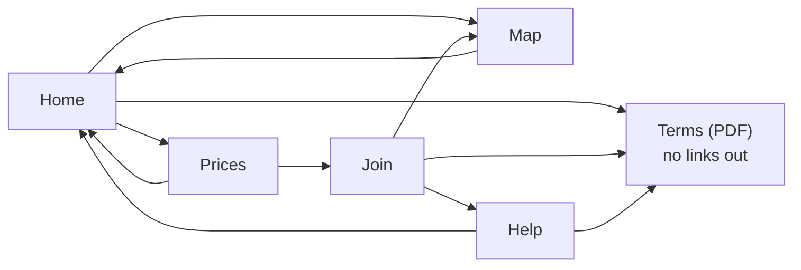
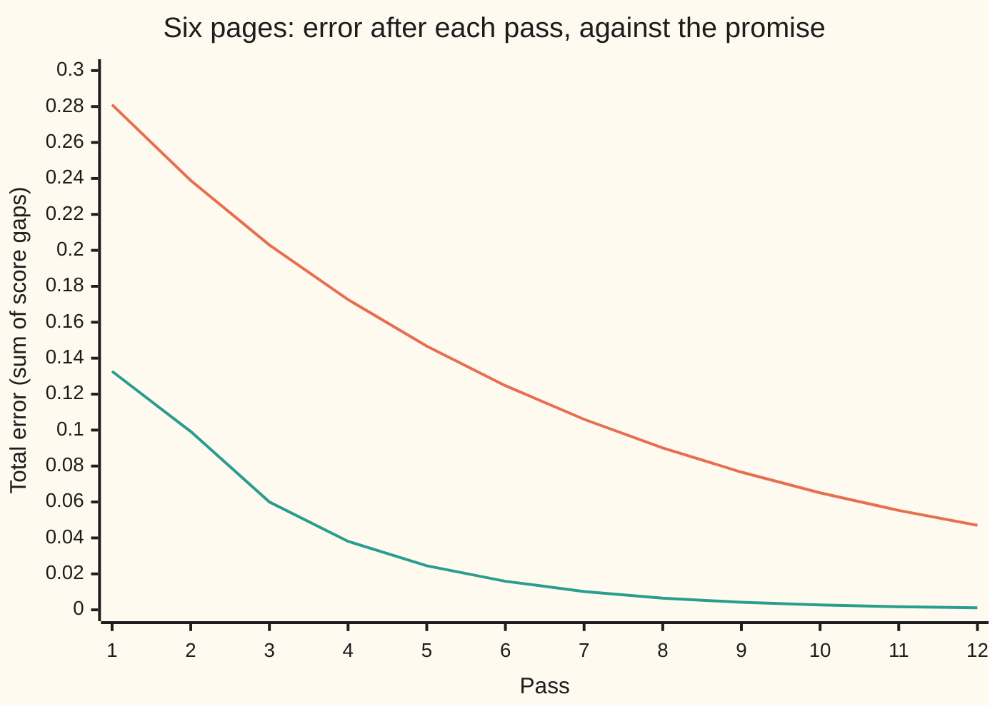

# PageRank by power iteration: multiply, normalise, repeat, and why damping is needed

[Syllabus](../../../SYLLABUS.md) → [Applied and computational](../README.md) → [Network Science and Spectral Graphs](../README.md#s07) → PageRank by power iteration

---

## General Overview

A city's bike-share scheme has a website of six pages: Home, Map, Prices, Join, Help and Terms. Eleven links join them, each one-way. Terms is a PDF of the rental conditions, and a PDF has no links out: three pages link into a page that leads nowhere.

The scheme's search box lists matching pages best first, so it wants its pages ranked by PageRank: the share of time a random surfer spends on each page, where the surfer follows a random link 85% of the time and jumps to a random page otherwise ([Centrality](01-centrality-and-pagerank.md) sets out what the rank means; [Random walks on a graph](../../09-Probability%20and%20statistics/14-Random%20Graphs%20and%20the%20Probabilistic%20Method/05-random-walks-on-graphs-and-mixing.md) builds it from a walk). This card is about *computing* it, and the computation never solves an equation. Give every page the same score, 1/6. Then repeat one pass: each page hands its score out along its links, and each page adds up what arrives. Pass after pass the scores settle.

After twelve passes the order is certified, not guessed: Home, Terms, Map, Prices, Join, Help. Terms comes second, though it links to nothing. The same loop computes the PageRank of a synthetic network of 5,000 people and 50,642 follows to within $10^{-6}$ in 16 passes, at 55,642 small additions a pass, where storing the full table of who-follows-whom would take 25,000,000 entries.

**PageRank is computed by passing every page's score along its links again and again; the damping step keeps the total at 1 and makes the error shrink by at least the damping factor, 0.85, on every pass, whatever the links.**

**What kind of fact this is:** a method with a guarantee: the shrink factor and the stopping rule are theorems, proved on this card in Why it works.

### The picture: the six-page site



Schematic. Each arrow is a link, followed one way only. Terms is a **dangling page**: a page with no links out.

---

## The formula

One pass of power iteration takes the scores $x_k$ after $k$ passes to the scores $x_{k+1}$:

$$x_{k+1}(j) \;=\; \alpha \sum_{i \to j} \frac{x_k(i)}{\operatorname{out}(i)} \;+\; \frac{\alpha D_k + (1-\alpha)}{n}, \qquad D_k = \sum_{i \text{ dangling}} x_k(i).$$

**Read it aloud:** a page's new score is 85% of the score flowing in along its links, plus an even share of everything that did not travel along a link: the 15% that jumps, and the 85% parked on pages with no links out.

The **damping factor** $\alpha$ (alpha) is the chance the surfer follows a link rather than jumping; [Random walks on a graph](../../09-Probability%20and%20statistics/14-Random%20Graphs%20and%20the%20Probabilistic%20Method/05-random-walks-on-graphs-and-mixing.md) writes it $d$. Two promises come with the pass, measured by the **error** $e_k$, the total size of the gaps between the scores and PageRank $\pi$, and the **change** $\delta_k$, the total size of the last pass's moves:

$$e_k \;\le\; \alpha^k\, e_0, \qquad\qquad e_k \;\le\; \frac{\alpha}{1-\alpha}\,\delta_k .$$

The first says the error shrinks by at least 0.85 a pass. The second turns the change, which the program can see, into a bound on the error, which it cannot. The **stopping rule**: stop when that bound is smaller than $g_k$, the smallest gap between two neighbouring scores. Then no page can still overtake another.

| Symbol | Plain meaning | In our example | Push it up and the answer… |
| --- | --- | --- | --- |
| $x_k(j)$, $y(j)$ | page $j$'s score after $k$ passes; $y$ is a second list compared with it in the proof, and $v = x - y$ | Home 0.3319 after one pass | — |
| $\pi(j)$ | PageRank: where the scores settle (wing 11's $\pi$) | Home 0.2918, Terms 0.2050 | — |
| $\alpha$ | damping factor: the chance of following a link | 0.85 | ranks follow the links more closely, and more passes are needed |
| $n$ | number of pages | 6 | each jump share, $(1-\alpha)/n$, gets thinner |
| $i \to j$, $\operatorname{out}(i)$ | page $i$ links to page $j$; how many links leave $i$ | Home has 3 links out | each link carries less of $i$'s score |
| $D_k$ | score parked on dangling pages after $k$ passes | Terms' 1/6 at the start | more is spread evenly over all pages |
| $k$ | passes so far | 12 to certify the order | the error shrinks |
| $e_k$ | error: $\sum_j \lvert x_k(j) - \pi(j)\rvert$ | 0.3306 at the start, 0.0011 after 12 | — |
| $\delta_k$ | change: $\sum_j \lvert x_k(j) - x_{k-1}(j)\rvert$ | 0.0028 at pass 12 | the guaranteed error grows with it |
| $g_k$ | smallest gap between neighbouring scores | 0.0249 at pass 12 | the order is certified sooner |
| $m$ | number of links | 11; 50,642 for the 5,000 people | a pass costs more |
| $\lambda_2$ | second-largest eigenvalue, in size, of the walk with no damping | about 0.7541 here | convergence slows |

### When it holds

- **Every page has somewhere to send its score.** A dangling page's score is spread evenly, as if it linked everywhere. Drop it instead and score leaks away: the six totals fall to 0.4675 after 12 passes.
- **$\alpha$ is below 1.** At $\alpha$ = 1 two pages that link only to each other swap their scores forever and the passes never settle.
- **The start is a list of non-negative scores adding to 1.** Both promises compare lists of that kind; the even start, 1/6 each, is one.
- **No two pages tie.** A tie leaves the smallest gap at 0 and the stopping rule never fires, so a program also caps the number of passes.
- **The links stay fixed during the run.** A web that changes mid-run is a different table each pass, and the promises are about one table.

---

## Why it works

### Step 0: two lists of scores are pulled together on every pass

Run the pass on two different lists of scores, both adding to 1. The jump share, $(1-\alpha)/n$, is the same for both, so it cancels from their difference. What is left of the difference is 85% of it, moved along links and spread from dangling pages. Moving amounts around can cancel some of it but cannot make it bigger. So the total difference shrinks by at least 0.85 a pass. PageRank is the list the pass leaves unchanged, so every start is pulled towards it.

### Step 1: one pass costs one visit per link

The pass reads each link once: page $i$ sends $\alpha\,x_k(i)/\operatorname{out}(i)$ along each of its links. It then adds the even share to each of the $n$ pages. That is $m + n$ additions, never the $n \times n$ table. On a sparse network (one with few links per node) the difference is enormous.

The synthetic network of 5,000 people (each follows between 0 and 20 others, drawn from a seeded generator, with low-numbered people more popular) has 50,642 links, and 223 people follow nobody: they are its dangling pages. One pass is 55,642 additions; the full table has 25,000,000 entries. The run took 16 passes, 890,272 additions in all, against 400,000,000 for the table done the slow way. Its three highest scores are people 0, 1 and 2, at 0.01008, 0.00480 and 0.00363, the most popular by construction.

The total stays exactly 1. Pages with links send out $\alpha$ times their scores; the dangling pages' score comes back as $\alpha D_k$ spread evenly; the jump adds $1-\alpha$. That is $\alpha \times 1 + (1 - \alpha) = 1$. This is the "normalise" in the title: the general power method divides by the total after each multiply, and the damping step does it automatically. The run prints a total of 1.000000 after twelve passes.

### Step 2: the error shrinks by at least α a pass

Write $y$ for a second list and take the difference $x_k(i) - y(i)$ on each page. After one pass, page $i$'s difference has been cut into pieces: $\alpha/\operatorname{out}(i)$ of it along each link, or $\alpha/n$ of it to every page if $i$ dangles. The pieces from page $i$ add up to $\alpha$ times its difference in size. Adding pieces of different signs at a page can only cancel, so the total size after the pass is at most $\alpha$ times the total before.

Take $y = \pi$. One pass leaves $\pi$ unchanged, so the error obeys $e_{k+1} \le \alpha\, e_k$, and after $k$ passes $e_k \le \alpha^k e_0$. Two different resting lists would have to pull together while standing still, so there is exactly one PageRank. This is the contraction argument (a map that shrinks every distance has exactly one resting point) in its simplest form.

<details>
<summary>Detailed proof: the pass shrinks every difference by α</summary>

Let $v = x - y$ with $\sum_i v(i) = 0$. After one pass, page $j$ receives
$$v'(j) = \alpha\sum_{i \to j}\frac{v(i)}{\operatorname{out}(i)} + \frac{\alpha}{n}\sum_{i\text{ dangling}} v(i),$$
because the jump terms $(1-\alpha)/n$ cancel. Bound each term by its size and add over $j$:
$$\sum_j \lvert v'(j)\rvert \le \alpha \sum_{i \text{ with links}} \sum_{j:\, i\to j}\frac{\lvert v(i)\rvert}{\operatorname{out}(i)} + \alpha \sum_{i\text{ dangling}} \lvert v(i)\rvert = \alpha\sum_i \lvert v(i)\rvert.$$
Each page with links appears $\operatorname{out}(i)$ times in the first sum, and each dangling page $n$ times in the second, each copy carrying $1/\operatorname{out}(i)$ or $1/n$ of it.

</details>

The chart shows both lines for the six pages: the measured error, and the promise $0.85^k e_0$ with $e_0$ = 0.3306.



Orange: the promise, $0.85^k \times 0.3306$. Teal: the measured error. The measured line always sits under the promise, and falls faster.

### Step 3: the change bounds the error, and the gap certifies the order

The error needs $\pi$, which the program does not have. The change $\delta_k$ it does have. Step 2 gives $e_k \le \alpha\,e_{k-1}$. The distance from the previous scores to $\pi$ is at most the distance to the new scores plus the distance on to $\pi$: $e_{k-1} \le \delta_k + e_k$. Together, $e_k \le \alpha(\delta_k + e_k)$. Rearranged:

$$e_k \le \frac{\alpha}{1-\alpha}\,\delta_k = 5.67\,\delta_k .$$

Now take two pages with scores $x_k(i) > x_k(j)$. Their two errors together are at most $e_k$. If the gap $x_k(i) - x_k(j)$ is bigger than $e_k$, PageRank keeps $i$ above $j$. So once the bound is below the smallest gap $g_k$, the whole order is final. On the six pages that first happens at pass 12: bound 0.0160, gap 0.0249. At pass 11 the bound, 0.0249, was still above the gap, 0.0241.

### Step 4: the real speed is α times the second eigenvalue

The promise is a worst case. Here the error actually shrinks by 0.6410 a pass, not 0.85. The reason is in the eigenvalues ([Eigenvalues and eigenvectors](../../03-Algebra/07-Eigenvalues%20and%20Symmetric%20Matrices/02-eigenvalues-and-eigenvectors.md): the directions a table only stretches, and the stretch factors).

Split the start into PageRank plus leftover patterns, as [Diagonalisation](../../03-Algebra/07-Eigenvalues%20and%20Symmetric%20Matrices/03-diagonalisation-and-matrix-powers.md) does for the two-city car fleet, where $A^n$ becomes a power of each stretch factor. Each leftover pattern adds to zero, and on a list adding to zero the jump cancels, so one pass is $\alpha$ times one click of the walk with no damping (dangling pages still spread evenly). The slowest pattern shrinks by $\alpha\lvert\lambda_2\rvert$ a pass: the damping factor times the walk's second-largest stretch factor in size. The undamped walk, which on this site settles to a slightly different list (Home 0.3103), shrinks its error by 0.7541 a pass. Damped, 0.6410. Their ratio is 0.8500, the damping factor exactly.

The 5,000-person network mixes much faster: its error shrank by 0.3471 on the last pass, so 16 passes did what the promise allows 90 for. The promise, $2 \times 0.85^k < 10^{-6}$ (2 is the largest possible starting error), holds on any network; the real count depends on $\lambda_2$, and [Random walks on a graph](../../09-Probability%20and%20statistics/14-Random%20Graphs%20and%20the%20Probabilistic%20Method/05-random-walks-on-graphs-and-mixing.md) reads the same rate off the same eigenvalue for an undamped walk.

### Step 5: why damping is needed

Without damping, $\lambda_2$ can have size 1, and then nothing shrinks. Two pages that link only to each other, started with all the score on the first, give (1, 0), (0, 1), (1, 0) for ever: at pass 100 the scores are 1.0000 and 0.0000, at pass 101 0.0000 and 1.0000. Their walk has the eigenvalue $-1$: the pattern "too much here, too little there" flips each click and never fades. With $\alpha$ = 0.85 that pattern is multiplied by $-0.85$ a pass, and by pass 30 the scores are 0.5038 and 0.4962. A real web has such loops, and closed groups that would swallow all the score; damping makes every one of them a pattern that shrinks by at least 0.85 a pass.

---

## Worked numbers, by hand

The first pass for Home, from the even start of 1/6 per page. Home receives from Map (one link out, all of its 1/6), Prices (two links, 1/12) and Help (two links, 1/12). Terms is dangling and spreads its 1/6.

| Step | Arithmetic | Value |
| --- | --- | --- |
| Score arriving along links | 1/6 + 1/12 + 1/12 | 0.3333 |
| Keep the 85% that follows links | 0.85 × 0.3333 | 0.2833 |
| Home's share of Terms' parked score | 0.85 × (1/6) ÷ 6 | 0.0236 |
| Home's share of the jumps | 0.15 ÷ 6 | 0.0250 |
| Home after pass 1 | 0.2833 + 0.0236 + 0.0250 | 0.3319 |
| Pass 11: bound against gap | 5.67 × 0.0044 = 0.0249, gap 0.0241 | not yet |
| Pass 12: bound against gap | 5.67 × 0.0028 ≈ 0.0160 (from the unrounded change), gap 0.0249 | certified |
| PageRank, solved directly | Home, Terms, Map, Prices, Join, Help | **0.2918, 0.2050, 0.1685, 0.1367, 0.1121, 0.0858** |

The scores after pass 12 are 0.2914, 0.2052, 0.1687, 0.1369, 0.1120, 0.0858, within 0.0011 in total of PageRank, and no page can still change places. Terms ranks second because three pages, Home among them, feed it; the score it collects goes back out evenly to all six.

### What breaks if you drop a piece

| Mistake | Comes out at | What went wrong |
| --- | --- | --- |
| Drop Terms' parked score instead of spreading it | after 12 passes the six scores total 0.4675 | 85% of Terms' score vanishes each pass; the scores stop being shares |
| "Fix" Terms by making it link to itself | Terms 0.6322 | Terms becomes a trap that keeps 85% of what it holds |
| No damping, two pages linking only to each other | 1.0000, 0.0000 at pass 100; 0.0000, 1.0000 at pass 101 | the eigenvalue $-1$ never shrinks |
| Help drops its link to Terms, so Map and Terms tie | both 0.1723; no certificate by pass 300 | a gap of 0 can never beat the bound |

---

## Code, from first principles, and it actually runs

Both programs run power iteration on the six pages and check it against two independent roads: the exact answer by Gaussian elimination (removing one unknown at a time) on the six equations $\pi = $ one pass of $\pi$, and a random surfer making 1,000,000 clicks, driven by a SplitMix64 generator written out in both languages with seed 2026. They check the two promises at every pass, measure the shrink with and without damping and confirm their ratio is $\alpha$, compute the three breaks and the experiments below, and then build the synthetic 5,000-person network (seed 7) and run the same pass on it, counting additions. Only the standard library is used in Python, nothing outside `std` in Rust.

### Python

```python
# PageRank by power iteration: one pass over the links per step, dangling pages
# folded into the jump, a stopping rule that certifies the ranking, at two sizes.
A = 0.85                                            # the damping factor, alpha
NAMES = ["Home", "Map", "Prices", "Join", "Help", "Terms"]
LINKS = [[1, 2, 5], [0], [0, 3], [1, 4, 5], [0, 5], []]   # Terms is a PDF: no links out

def step(x, links, a=A, fold=True):                 # one pass: touches each link once
    n, y, dang = len(x), [0.0] * len(x), 0.0
    for i in range(n):
        if links[i]:
            share = a * x[i] / len(links[i])
            for j in links[i]:
                y[j] += share
        else:
            dang += x[i]                            # rank parked on a dangling page
    extra = ((a * dang if fold else 0.0) + (1 - a)) / n
    return [v + extra for v in y]

def l1(x, y):                                       # total size of the differences
    return sum(abs(p - q) for p, q in zip(x, y))

def f4(x):
    return " ".join(f"{v:.4f}" for v in x)

def iterate(links, a, passes, x=None, fold=True):
    x = x or [1 / len(links)] * len(links)
    for _ in range(passes):
        x = step(x, links, a, fold)
    return x

def certify(links, a, cap=300):                     # stop when bound < smallest gap
    x, k = [1 / len(links)] * len(links), 0
    while k < cap:
        xn = step(x, links, a); k += 1
        bound, s = a / (1 - a) * l1(xn, x), sorted(xn, reverse=True)
        x = xn
        if bound < min(s[i] - s[i + 1] for i in range(len(s) - 1)):
            return k, " > ".join(NAMES[i] for i in sorted(range(len(x)), key=lambda i: -x[i]))
    return "none by", f"pass {cap}: {f4(x)}"        # a tie is never certified

def solve(links, a):                                # road 2: Gaussian elimination
    n = len(links)
    M = [[float(i == j) for j in range(n)] + [(1 - a) / n] for i in range(n)]
    for i in range(n):
        out = links[i] or list(range(n))            # dangling: spread evenly
        for j in out:
            M[j][i] -= a / len(out)
    for c in range(n):
        p = max(range(c, n), key=lambda r: abs(M[r][c]))
        M[c], M[p] = M[p], M[c]
        for r in range(n):
            if r != c:
                f = M[r][c] / M[c][c]
                M[r] = [u - f * v for u, v in zip(M[r], M[c])]
    return [M[i][n] / M[i][i] for i in range(n)]

def splitmix(s):                                    # SplitMix64, written out
    s = (s + 0x9E3779B97F4A7C15) & 0xFFFFFFFFFFFFFFFF
    z = ((s ^ (s >> 30)) * 0xBF58476D1CE4E5B9) & 0xFFFFFFFFFFFFFFFF
    z = ((z ^ (z >> 27)) * 0x94D049BB133111EB) & 0xFFFFFFFFFFFFFFFF
    return s, (z ^ (z >> 31)) >> 11                 # 53 random bits
n, pi = 6, solve(LINKS, A)
print("page              " + " ".join(f"{s:>6}" for s in NAMES))
print("pi, solved         " + f4(pi) + f"  links {sum(len(l) for l in LINKS)}")
inflow = 1 / 6 + 1 / 12 + 1 / 12                    # Map, Prices, Help into Home
print(f"by hand, Home: links in {inflow:.4f}, x alpha {A * inflow:.4f}, "
      f"Terms' share {A / 36:.4f}, jump {(1 - A) / 6:.4f}, total {A * inflow + A / 36 + (1 - A) / 6:.4f}")
x, hist, e0 = [1 / n] * n, [], l1([1 / n] * n, pi)
print(f"pass  0  {f4(x)}  error {e0:.4f}")
for k in range(1, 61):                              # road 1: power iteration
    xn = step(x, LINKS)
    d, e = l1(xn, x), l1(xn, pi)
    s = sorted(xn, reverse=True)
    hist.append((k, xn, d, e, A / (1 - A) * d, min(s[i] - s[i + 1] for i in range(n - 1))))
    assert e <= A / (1 - A) * d + 1e-15 and e <= A ** k * e0 + 1e-15   # the two promises
    x = xn
for k, xn, d, e, b, g in hist[:12]:
    print(f"pass {k:2d}  {f4(xn)}  change {d:.4f}  bound {b:.4f}  gap {g:.4f}  error {e:.4f}")
stop, order = certify(LINKS, A)
print(f"certified at pass {stop}: {order}, total {sum(hist[11][1]):.6f}, alpha/(1-alpha) {A / (1 - A):.2f}")
print("chart, error      " + " ".join(f"{h[3]:.4f}" for h in hist[:12]))
print("chart, 0.85^k e0  " + " ".join(f"{A ** h[0] * e0:.4f}" for h in hist[:12]))
pu = iterate(LINKS, 1.0, 400)                       # same site with no damping
eu = [l1(iterate(LINKS, 1.0, k), pu) for k in (39, 40)]
r_d, r_u = hist[39][3] / hist[38][3], eu[1] / eu[0]
print(f"error shrink per pass: damped {r_d:.4f}, undamped {r_u:.4f}, ratio {r_d / r_u:.4f}")
print("no damping, limit  " + f4(pu))
seed, page, visits = 2026, 0, [0] * n               # road 3: a random surfer
for t in range(1000000):
    seed, u = splitmix(seed)
    seed, v = splitmix(seed)
    if LINKS[page] and u < A * 2 ** 53:
        page = LINKS[page][v * len(LINKS[page]) >> 53]
    else:
        page = v * n >> 53
    visits[page] += 1
sim = [c / 1000000 for c in visits]
print("surfer, 1e6 clicks " + f4(sim))
y = iterate(LINKS, A, 12, fold=False)               # what breaks
print("wrong: Terms' rank dropped, 12 passes " + f4(y) + f"  total {sum(y):.4f}")
z = iterate(LINKS[:5] + [[5]], A, 300)
print("wrong: Terms links to itself          " + f4(z))
w = [iterate([[1], [0]], 1.0, k, [1.0, 0.0]) for k in (100, 101)] + [iterate([[1], [0]], A, 30, [1.0, 0.0])]
for lab, v in zip(("no damping, pass 100", "no damping, pass 101", "alpha 0.85, pass 30"), w):
    print("two-page loop, " + lab, f4(v))
for a in (0.99, 0.5):
    print(f"try: alpha {a}, certified at pass", *certify(LINKS, a))
print("try: Home drops Terms, certified at pass", *certify([[1, 2]] + LINKS[1:], A))
print("try: Help drops Terms, certified", *certify(LINKS[:4] + [[0], []], A))
N, seed, net = 5000, 7, []                          # at scale: 5,000 people, synthetic
for i in range(N):
    seed, u = splitmix(seed)
    fol = []
    while len(fol) < u % 21:                        # follows 0 to 20 people
        seed, v = splitmix(seed)
        j = ((v * v) >> 53) * N >> 53               # low numbers are more popular
        if j != i and j not in fol:
            fol.append(j)
    net.append(fol)
m = sum(len(f) for f in net)
print("people", N, " links", m, " follow nobody", sum(1 for f in net if not f))
ref = iterate(net, A, 250)
x, k, d, errs = [1 / N] * N, 0, 1.0, [l1([1 / N] * N, ref)]
while A / (1 - A) * d >= 1e-6:                      # stop: guaranteed error < 1e-6
    xn = step(x, net); k += 1
    d, x = l1(xn, x), xn
    errs.append(l1(x, ref))
kp = next(t for t in range(1, 999) if 2 * A ** t < 1e-6)
print("per pass: link visits", m + N, " full table", N * N)
print("passes:", k, " promised at most", kp, " total visits", k * (m + N), " full table", k * N * N)
print(f"error shrink per pass, last: {errs[-1] / errs[-2]:.4f}")
top = sorted(range(N), key=lambda i: -x[i])[:3]
print("top three people", *top, " ".join(f"{x[i]:.5f}" for i in top))
assert max(abs(p - q) for p, q in zip(hist[59][1], pi)) < 1e-11       # iteration = solve
assert max(abs(p - q) for p, q in zip(sim, pi)) < 0.002              # surfer = solve
assert abs(r_d / r_u - A) < 1e-3                    # damping scales the shrink by alpha
assert stop == 12 and abs(sum(hist[11][1]) - 1) < 1e-12
assert sum(y) < 0.9 and z[5] > 0.5 and l1(w[0], w[1]) > 1.99      # the three breaks
assert all(errs[t + 1] <= A * errs[t] + 1e-15 for t in range(k)) and k <= kp
print("ALL CHECKS PASS")
```

**Ran 2026-11-11 on macOS, Python 3.14.10, standard library only. All checks passed. Output, pasted from the run:**

```
page                Home    Map Prices   Join   Help  Terms
pi, solved         0.2918 0.1685 0.1367 0.1121 0.0858 0.2050  links 11
by hand, Home: links in 0.3333, x alpha 0.2833, Terms' share 0.0236, jump 0.0250, total 0.3319
pass  0  0.1667 0.1667 0.1667 0.1667 0.1667 0.1667  error 0.3306
pass  1  0.3319 0.1431 0.0958 0.1194 0.0958 0.2139  change 0.4250  bound 2.4083  gap 0.0000  error 0.1327
pass  2  0.2584 0.1832 0.1494 0.0960 0.0891 0.2239  change 0.2074  bound 1.1752  gap 0.0069  error 0.0992
pass  3  0.3138 0.1571 0.1299 0.1202 0.0839 0.1950  change 0.1592  bound 0.9022  gap 0.0097  error 0.0600
pass  4  0.2771 0.1756 0.1415 0.1078 0.0867 0.2113  change 0.0981  bound 0.5562  gap 0.0212  error 0.0381
pass  5  0.3012 0.1640 0.1334 0.1151 0.0855 0.2008  change 0.0627  bound 0.3551  gap 0.0184  error 0.0245
pass  6  0.2859 0.1714 0.1388 0.1102 0.0861 0.2077  change 0.0404  bound 0.2291  gap 0.0241  error 0.0159
pass  7  0.2957 0.1666 0.1354 0.1134 0.0856 0.2032  change 0.0261  bound 0.1477  gap 0.0220  error 0.0102
pass  8  0.2894 0.1697 0.1376 0.1113 0.0859 0.2061  change 0.0167  bound 0.0946  gap 0.0254  error 0.0065
pass  9  0.2934 0.1677 0.1362 0.1127 0.0857 0.2043  change 0.0107  bound 0.0606  gap 0.0235  error 0.0042
pass 10  0.2908 0.1690 0.1371 0.1118 0.0859 0.2054  change 0.0069  bound 0.0388  gap 0.0253  error 0.0027
pass 11  0.2925 0.1682 0.1365 0.1124 0.0858 0.2047  change 0.0044  bound 0.0249  gap 0.0241  error 0.0017
pass 12  0.2914 0.1687 0.1369 0.1120 0.0858 0.2052  change 0.0028  bound 0.0160  gap 0.0249  error 0.0011
certified at pass 12: Home > Terms > Map > Prices > Join > Help, total 1.000000, alpha/(1-alpha) 5.67
chart, error      0.1327 0.0992 0.0600 0.0381 0.0245 0.0159 0.0102 0.0065 0.0042 0.0027 0.0017 0.0011
chart, 0.85^k e0  0.2810 0.2389 0.2030 0.1726 0.1467 0.1247 0.1060 0.0901 0.0766 0.0651 0.0553 0.0470
error shrink per pass: damped 0.6410, undamped 0.7541, ratio 0.8500
no damping, limit  0.3103 0.1724 0.1379 0.1034 0.0690 0.2069
surfer, 1e6 clicks 0.2921 0.1678 0.1368 0.1121 0.0861 0.2050
wrong: Terms' rank dropped, 12 passes 0.1359 0.0792 0.0642 0.0521 0.0400 0.0961  total 0.4675
wrong: Terms links to itself          0.1350 0.0780 0.0633 0.0519 0.0397 0.6322
two-page loop, no damping, pass 100 1.0000 0.0000
two-page loop, no damping, pass 101 0.0000 1.0000
two-page loop, alpha 0.85, pass 30 0.5038 0.4962
try: alpha 0.99, certified at pass 26 Home > Terms > Map > Prices > Join > Help
try: alpha 0.5, certified at pass 5 Home > Terms > Map > Prices > Join > Help
try: Home drops Terms, certified at pass 23 Home > Map > Prices > Join > Terms > Help
try: Help drops Terms, certified none by pass 300: 0.3243 0.1723 0.1413 0.1095 0.0804 0.1723
people 5000  links 50642  follow nobody 223
per pass: link visits 55642  full table 25000000
passes: 16  promised at most 90  total visits 890272  full table 400000000
error shrink per pass, last: 0.3471
top three people 0 1 2 0.01008 0.00480 0.00363
ALL CHECKS PASS
```

### Rust

```rust
// PageRank by power iteration: one pass over the links per step, dangling pages
// folded into the jump, a stopping rule that certifies the ranking, at two sizes.
const A: f64 = 0.85; // the damping factor, alpha
const NAMES: [&str; 6] = ["Home", "Map", "Prices", "Join", "Help", "Terms"];

fn step(x: &[f64], links: &[Vec<usize>], a: f64, fold: bool) -> Vec<f64> {
    let (n, mut dang) = (x.len(), 0.0);
    let mut y = vec![0.0; n];
    for i in 0..n {
        if links[i].is_empty() { dang += x[i]; continue; } // rank parked on a dangling page
        let share = a * x[i] / links[i].len() as f64;
        for &j in &links[i] { y[j] += share; }
    }
    let extra = ((if fold { a * dang } else { 0.0 }) + (1.0 - a)) / n as f64;
    y.iter().map(|v| v + extra).collect()
}
fn l1(x: &[f64], y: &[f64]) -> f64 { x.iter().zip(y).fold(0.0, |s, (p, q)| s + (p - q).abs()) }
fn f4(x: &[f64]) -> String { x.iter().map(|v| format!("{:.4}", v)).collect::<Vec<_>>().join(" ") }
fn iterate(links: &[Vec<usize>], a: f64, passes: usize, x0: Option<Vec<f64>>, fold: bool) -> Vec<f64> {
    let mut x = x0.unwrap_or(vec![1.0 / links.len() as f64; links.len()]);
    for _ in 0..passes { x = step(&x, links, a, fold); }
    x
}
fn order(x: &[f64]) -> Vec<usize> {
    let mut idx: Vec<usize> = (0..x.len()).collect();
    idx.sort_by(|&i, &j| x[j].partial_cmp(&x[i]).unwrap());
    idx
}
fn min_gap(x: &[f64]) -> f64 {
    let o = order(x);
    (0..x.len() - 1).map(|i| x[o[i]] - x[o[i + 1]]).fold(f64::INFINITY, f64::min)
}
fn certify(links: &[Vec<usize>], a: f64) -> (String, String) { // stop when bound < smallest gap
    let (mut x, mut k, cap) = (vec![1.0 / links.len() as f64; links.len()], 0, 300);
    while k < cap {
        let xn = step(&x, links, a, true);
        let bound = a / (1.0 - a) * l1(&xn, &x);
        x = xn; k += 1;
        if bound < min_gap(&x) {
            let names: Vec<&str> = order(&x).iter().map(|&i| NAMES[i]).collect();
            return (k.to_string(), names.join(" > "));
        }
    }
    ("none by".to_string(), format!("pass {}: {}", cap, f4(&x))) // a tie is never certified
}
fn solve(links: &[Vec<usize>], a: f64) -> Vec<f64> { // road 2: Gaussian elimination
    let n = links.len();
    let mut m: Vec<Vec<f64>> = (0..n).map(|i| {
        let mut r: Vec<f64> = (0..n).map(|j| if i == j { 1.0 } else { 0.0 }).collect();
        r.push((1.0 - a) / n as f64); r }).collect();
    for i in 0..n {
        let out: Vec<usize> = if links[i].is_empty() { (0..n).collect() } else { links[i].clone() };
        for &j in &out { m[j][i] -= a / out.len() as f64; }
    }
    for c in 0..n {
        let mut p = c;
        for r in c..n { if m[r][c].abs() > m[p][c].abs() { p = r; } }
        m.swap(c, p);
        for r in (0..n).filter(|&r| r != c) {
            let (f, rowc) = (m[r][c] / m[c][c], m[c].clone());
            for (u, v) in m[r].iter_mut().zip(&rowc) { *u = *u - f * v; }
        }
    }
    (0..n).map(|i| m[i][n] / m[i][i]).collect()
}
fn splitmix(s: u64) -> (u64, u64) { // SplitMix64, written out
    let s = s.wrapping_add(0x9E3779B97F4A7C15);
    let z = (s ^ (s >> 30)).wrapping_mul(0xBF58476D1CE4E5B9);
    let z = (z ^ (z >> 27)).wrapping_mul(0x94D049BB133111EB);
    (s, (z ^ (z >> 31)) >> 11) // 53 random bits
}
fn main() {
    let links: Vec<Vec<usize>> = vec![vec![1, 2, 5], vec![0], vec![0, 3], vec![1, 4, 5], vec![0, 5], vec![]];
    let (n, pi) = (6, solve(&links, A));
    println!("page              {}", NAMES.iter().map(|s| format!("{:>6}", s)).collect::<Vec<_>>().join(" "));
    println!("pi, solved         {}  links {}", f4(&pi), links.iter().map(|l| l.len()).sum::<usize>());
    let inflow = 1.0 / 6.0 + 1.0 / 12.0 + 1.0 / 12.0; // Map, Prices, Help into Home
    println!("by hand, Home: links in {:.4}, x alpha {:.4}, Terms' share {:.4}, jump {:.4}, total {:.4}",
        inflow, A * inflow, A / 36.0, (1.0 - A) / 6.0, A * inflow + A / 36.0 + (1.0 - A) / 6.0);
    let (mut x, mut hist, e0) = (vec![1.0 / 6.0; n], Vec::new(), l1(&vec![1.0 / 6.0; n], &pi));
    println!("pass  0  {}  error {:.4}", f4(&x), e0);
    for k in 1..61 { // road 1: power iteration
        let xn = step(&x, &links, A, true);
        let (d, e) = (l1(&xn, &x), l1(&xn, &pi));
        assert!(e <= A / (1.0 - A) * d + 1e-15 && e <= A.powf(k as f64) * e0 + 1e-15); // the two promises
        hist.push((k, xn.clone(), d, e, A / (1.0 - A) * d, min_gap(&xn)));
        x = xn;
    }
    for (k, xn, d, e, b, g) in &hist[..12] {
        println!("pass {:2}  {}  change {:.4}  bound {:.4}  gap {:.4}  error {:.4}", k, f4(xn), d, b, g, e);
    }
    let (stop, ord) = certify(&links, A);
    let total12 = hist[11].1.iter().fold(0.0, |s, v| s + v);
    println!("certified at pass {}: {}, total {:.6}, alpha/(1-alpha) {:.2}", stop, ord, total12, A / (1.0 - A));
    println!("chart, error      {}", hist[..12].iter().map(|h| format!("{:.4}", h.3)).collect::<Vec<_>>().join(" "));
    println!("chart, 0.85^k e0  {}", hist[..12].iter().map(|h| format!("{:.4}", A.powf(h.0 as f64) * e0)).collect::<Vec<_>>().join(" "));
    let pu = iterate(&links, 1.0, 400, None, true); // same site with no damping
    let eu: Vec<f64> = [39, 40].iter().map(|&k| l1(&iterate(&links, 1.0, k, None, true), &pu)).collect();
    let (r_d, r_u) = (hist[39].3 / hist[38].3, eu[1] / eu[0]);
    println!("error shrink per pass: damped {:.4}, undamped {:.4}, ratio {:.4}", r_d, r_u, r_d / r_u);
    println!("no damping, limit  {}", f4(&pu));
    let (mut seed, mut page, mut visits) = (2026u64, 0usize, vec![0u64; n]); // road 3: a random surfer
    for _ in 0..1000000 {
        let (s1, u) = splitmix(seed);
        let (s2, v) = splitmix(s1);
        seed = s2;
        let out = &links[page];
        page = if !out.is_empty() && (u as f64) < A * 9007199254740992.0 {
            out[((v * out.len() as u64) >> 53) as usize] } else { ((v * n as u64) >> 53) as usize };
        visits[page] += 1;
    }
    let sim: Vec<f64> = visits.iter().map(|&c| c as f64 / 1000000.0).collect();
    println!("surfer, 1e6 clicks {}", f4(&sim));
    let y = iterate(&links, A, 12, None, false); // what breaks
    println!("wrong: Terms' rank dropped, 12 passes {}  total {:.4}", f4(&y), y.iter().fold(0.0, |s, v| s + v));
    let mut sl = links.clone(); sl[5] = vec![5];
    let z = iterate(&sl, A, 300, None, true);
    println!("wrong: Terms links to itself          {}", f4(&z));
    let lp = vec![vec![1], vec![0]];
    let w = vec![iterate(&lp, 1.0, 100, Some(vec![1.0, 0.0]), true), iterate(&lp, 1.0, 101, Some(vec![1.0, 0.0]), true),
                 iterate(&lp, A, 30, Some(vec![1.0, 0.0]), true)];
    for (lab, v) in ["no damping, pass 100", "no damping, pass 101", "alpha 0.85, pass 30"].iter().zip(&w) {
        println!("two-page loop, {} {}", lab, f4(v));
    }
    for a in [0.99, 0.5] {
        let (p, o) = certify(&links, a);
        println!("try: alpha {}, certified at pass {} {}", a, p, o);
    }
    for (lab, page, new) in [("Home drops Terms, certified at pass", 0, vec![1, 2]), ("Help drops Terms, certified", 4, vec![0])] {
        let mut l2 = links.clone(); l2[page] = new;
        let (p, o) = certify(&l2, A);
        println!("try: {} {} {}", lab, p, o);
    }
    let (nn, mut seed) = (5000usize, 7u64); // at scale: 5,000 people, synthetic
    let mut net: Vec<Vec<usize>> = Vec::new();
    for i in 0..nn {
        let (s, u) = splitmix(seed); seed = s;
        let mut fol: Vec<usize> = Vec::new();
        while (fol.len() as u64) < u % 21 { // follows 0 to 20 people
            let (s, v) = splitmix(seed); seed = s;
            let j = ((((v as u128 * v as u128) >> 53) * nn as u128) >> 53) as usize; // low numbers are more popular
            if j != i && !fol.contains(&j) { fol.push(j); }
        }
        net.push(fol);
    }
    let m: usize = net.iter().map(|f| f.len()).sum();
    println!("people {}  links {}  follow nobody {}", nn, m, net.iter().filter(|f| f.is_empty()).count());
    let refv = iterate(&net, A, 250, None, true);
    let mut x = vec![1.0 / nn as f64; nn];
    let (mut k, mut d, mut errs) = (0usize, 1.0, vec![l1(&x, &refv)]);
    while A / (1.0 - A) * d >= 1e-6 { // stop: guaranteed error < 1e-6
        let xn = step(&x, &net, A, true);
        d = l1(&xn, &x); x = xn; k += 1;
        errs.push(l1(&x, &refv));
    }
    let kp = (1..999).find(|&t| 2.0 * A.powf(t as f64) < 1e-6).unwrap();
    println!("per pass: link visits {}  full table {}", m + nn, nn * nn);
    println!("passes: {}  promised at most {}  total visits {}  full table {}", k, kp, k * (m + nn), k * nn * nn);
    println!("error shrink per pass, last: {:.4}", errs[k] / errs[k - 1]);
    let top: Vec<usize> = order(&x)[..3].to_vec();
    println!("top three people {} {} {} {}", top[0], top[1], top[2], top.iter().map(|&i| format!("{:.5}", x[i])).collect::<Vec<_>>().join(" "));
    assert!(hist[59].1.iter().zip(&pi).all(|(p, q)| (p - q).abs() < 1e-11)); // iteration = solve
    assert!(sim.iter().zip(&pi).all(|(p, q)| (p - q).abs() < 0.002)); // surfer = solve
    assert!((r_d / r_u - A).abs() < 1e-3); // damping scales the shrink by alpha
    assert!(stop == "12" && (total12 - 1.0).abs() < 1e-12);
    assert!(y.iter().sum::<f64>() < 0.9 && z[5] > 0.5 && l1(&w[0], &w[1]) > 1.99); // the three breaks
    assert!((0..k).all(|t| errs[t + 1] <= A * errs[t] + 1e-15) && k <= kp);
    println!("ALL CHECKS PASS");
}
```

**Ran 2026-11-11 on macOS, rustc 1.98.1, no crates. All checks passed. Output, pasted from the run:**

```
page                Home    Map Prices   Join   Help  Terms
pi, solved         0.2918 0.1685 0.1367 0.1121 0.0858 0.2050  links 11
by hand, Home: links in 0.3333, x alpha 0.2833, Terms' share 0.0236, jump 0.0250, total 0.3319
pass  0  0.1667 0.1667 0.1667 0.1667 0.1667 0.1667  error 0.3306
pass  1  0.3319 0.1431 0.0958 0.1194 0.0958 0.2139  change 0.4250  bound 2.4083  gap 0.0000  error 0.1327
pass  2  0.2584 0.1832 0.1494 0.0960 0.0891 0.2239  change 0.2074  bound 1.1752  gap 0.0069  error 0.0992
pass  3  0.3138 0.1571 0.1299 0.1202 0.0839 0.1950  change 0.1592  bound 0.9022  gap 0.0097  error 0.0600
pass  4  0.2771 0.1756 0.1415 0.1078 0.0867 0.2113  change 0.0981  bound 0.5562  gap 0.0212  error 0.0381
pass  5  0.3012 0.1640 0.1334 0.1151 0.0855 0.2008  change 0.0627  bound 0.3551  gap 0.0184  error 0.0245
pass  6  0.2859 0.1714 0.1388 0.1102 0.0861 0.2077  change 0.0404  bound 0.2291  gap 0.0241  error 0.0159
pass  7  0.2957 0.1666 0.1354 0.1134 0.0856 0.2032  change 0.0261  bound 0.1477  gap 0.0220  error 0.0102
pass  8  0.2894 0.1697 0.1376 0.1113 0.0859 0.2061  change 0.0167  bound 0.0946  gap 0.0254  error 0.0065
pass  9  0.2934 0.1677 0.1362 0.1127 0.0857 0.2043  change 0.0107  bound 0.0606  gap 0.0235  error 0.0042
pass 10  0.2908 0.1690 0.1371 0.1118 0.0859 0.2054  change 0.0069  bound 0.0388  gap 0.0253  error 0.0027
pass 11  0.2925 0.1682 0.1365 0.1124 0.0858 0.2047  change 0.0044  bound 0.0249  gap 0.0241  error 0.0017
pass 12  0.2914 0.1687 0.1369 0.1120 0.0858 0.2052  change 0.0028  bound 0.0160  gap 0.0249  error 0.0011
certified at pass 12: Home > Terms > Map > Prices > Join > Help, total 1.000000, alpha/(1-alpha) 5.67
chart, error      0.1327 0.0992 0.0600 0.0381 0.0245 0.0159 0.0102 0.0065 0.0042 0.0027 0.0017 0.0011
chart, 0.85^k e0  0.2810 0.2389 0.2030 0.1726 0.1467 0.1247 0.1060 0.0901 0.0766 0.0651 0.0553 0.0470
error shrink per pass: damped 0.6410, undamped 0.7541, ratio 0.8500
no damping, limit  0.3103 0.1724 0.1379 0.1034 0.0690 0.2069
surfer, 1e6 clicks 0.2921 0.1678 0.1368 0.1121 0.0861 0.2050
wrong: Terms' rank dropped, 12 passes 0.1359 0.0792 0.0642 0.0521 0.0400 0.0961  total 0.4675
wrong: Terms links to itself          0.1350 0.0780 0.0633 0.0519 0.0397 0.6322
two-page loop, no damping, pass 100 1.0000 0.0000
two-page loop, no damping, pass 101 0.0000 1.0000
two-page loop, alpha 0.85, pass 30 0.5038 0.4962
try: alpha 0.99, certified at pass 26 Home > Terms > Map > Prices > Join > Help
try: alpha 0.5, certified at pass 5 Home > Terms > Map > Prices > Join > Help
try: Home drops Terms, certified at pass 23 Home > Map > Prices > Join > Terms > Help
try: Help drops Terms, certified none by pass 300: 0.3243 0.1723 0.1413 0.1095 0.0804 0.1723
people 5000  links 50642  follow nobody 223
per pass: link visits 55642  full table 25000000
passes: 16  promised at most 90  total visits 890272  full table 400000000
error shrink per pass, last: 0.3471
top three people 0 1 2 0.01008 0.00480 0.00363
ALL CHECKS PASS
```

The three roads agree: iteration and elimination to eleven decimals after 60 passes, and the surfer, 0.2921 on Home against 0.2918, within the random wobble of a million clicks.

> [!TIP]
> **Try changing**
> - Guess first: does a damping factor of 0.99 certify the order faster or slower? The `try:` lines of the output run each experiment. Slower: pass 26, because the bound multiplies the change by 0.99/0.01 instead of 5.67. The order is the same.
> - Guess first: and 0.5? Pass 5. The jumps dominate, every pass forgets half the past, and the scores crowd towards 1/6.
> - Guess first: Home drops its link to Terms, so its links become `[1, 2]`. Where does Terms land? Fifth: Home > Map > Prices > Join > Terms > Help, certified at pass 23.
> - Guess first: Help drops its link to Terms instead, keeping only `[0]`. Map and Terms tie at 0.1723, and the certificate never fires; the program stops at its cap of 300 passes.

---

## The usual mistake

> [!warning]
> **Forgetting the dangling pages.** A page with no links out has no link to send its score along. Leave it out of the pass and its 85% simply disappears: on the six pages the scores total 0.4675 after 12 passes, so they are no longer shares of the surfer's time. The order happens to survive, Home > Terms > Map > Prices > Join > Help, because the lost score would have been spread evenly, just like the jumps: in the long run every score shrinks by the same factor. Spread the parked score evenly, as if the page linked everywhere, and the total stays exactly 1.
>
> - **Making a dangling page link to itself.** It looks like a tidy fix and turns the page into a trap: Terms jumps to 0.6322.
> - **Reading a small change as a small error.** At $\alpha$ = 0.85 the error can be 5.67 times the change, and far more as $\alpha$ nears 1. At pass 12 the change is 0.0028 and the guarantee is 0.0160.
> - **Taking the promise as a forecast.** The 5,000-person network needed 16 passes, not the 90 the promise allows. The promise answers "how many at most".
> - **Storing the full table.** For 5,000 people it has 25,000,000 entries, almost all zero; the pass needs only the 50,642 links.

---

## Where you meet it in real life

- **Web search.** The 1998 paper behind PageRank describes this surfer with damping 0.85, and the search engine it describes computed every page's score by repeating the pass over all its links.
- **Bike-share stations.** A city's 1,200 docking stations become the pages, and each link is weighted by the number of trips from one station to another, so a station sends its score in proportion to its trips. The pass is the same, and the scores say where riders tend to end up.
- **Social networks.** Influence scores on a follower network can be computed by the same pass over follows, with people who follow nobody as the dangling pages, as in the 5,000-person run.
- **Citations.** Some rankings of journals and papers run the pass over citations, so that a citation from a much-cited paper counts for more.

> **Say it back**
> PageRank is computed by power iteration: start every page at the same score, then repeatedly pass each score along its links and add up what arrives. Damping sends 15% of every score, and all of a dangling page's 85%, evenly to every page, so the total stays at 1. That makes the error shrink by at least the damping factor each pass, and the change between passes times 0.85/0.15 bounds the error. Stop when that bound is smaller than every gap between neighbouring scores: the six pages are certified after 12 passes. The real speed is the damping factor times the undamped walk's second eigenvalue, and without damping a two-page loop flips forever.

---

## What this builds on

- [Centrality](01-centrality-and-pagerank.md): what PageRank measures and how it compares with other ideas of "important".
- [Eigenvalues and eigenvectors](../../03-Algebra/07-Eigenvalues%20and%20Symmetric%20Matrices/02-eigenvalues-and-eigenvectors.md): the stretch factors that set how fast leftover patterns fade.
- [Diagonalisation](../../03-Algebra/07-Eigenvalues%20and%20Symmetric%20Matrices/03-diagonalisation-and-matrix-powers.md): a matrix power as a power of each stretch factor, the reason repetition finds the top pattern.
- [Random walks on a graph](../../09-Probability%20and%20statistics/14-Random%20Graphs%20and%20the%20Probabilistic%20Method/05-random-walks-on-graphs-and-mixing.md): the surfer, the damping, traps and dead ends, and the mixing rate read off the second eigenvalue.

## Where this goes next

- [The graph Laplacian](03-graph-laplacian-and-spectral-clustering.md): the next card, where other eigenvalues of a network's table count its pieces and cut it in two.
- Eigenvalues by iteration: power iteration as a general method for the largest eigenvalue of any big matrix, and its faster relatives.

The promise is 0.85 a pass on any network, but the real speed is set by $\lambda_2$, and which networks keep $\lambda_2$ small as they grow is left open here.

---

## Sources

Verified 2026-11-11: every link below resolves to the publisher's page.

- Brin, Sergey, and Lawrence Page. "The Anatomy of a Large-Scale Hypertextual Web Search Engine." *Computer Networks and ISDN Systems* 30 (1998): 107–117. [doi:10.1016/S0169-7552(98)00110-X](https://doi.org/10.1016/S0169-7552(98)00110-X). The random surfer, PageRank and the damping factor 0.85.
- Langville, Amy N., and Carl D. Meyer. "Deeper Inside PageRank." *Internet Mathematics* 1, no. 3 (2004): 335–380. [doi:10.1080/15427951.2004.10129091](https://doi.org/10.1080/15427951.2004.10129091). The power method on a sparse link table, the handling of dangling pages, and convergence at the rate of the damping factor.
- Kamvar, Sepandar D., Taher H. Haveliwala, Christopher D. Manning, and Gene H. Golub. "Extrapolation Methods for Accelerating PageRank Computations." *Proceedings of the Twelfth International Conference on World Wide Web* (2003): 261. [doi:10.1145/775152.775190](https://doi.org/10.1145/775152.775190). Convergence set by the second eigenvalue, at most the damping factor, and how to speed it up.
- Bianchini, Monica, Marco Gori, and Franco Scarselli. "Inside PageRank." *ACM Transactions on Internet Technology* 5, no. 1 (2005): 92–128. [doi:10.1145/1052934.1052938](https://doi.org/10.1145/1052934.1052938). How the damping factor and closed groups of pages shape the scores, and the stopping of the iteration.
