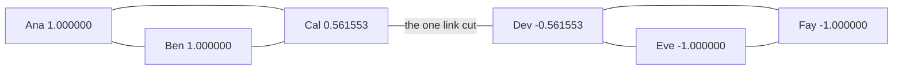
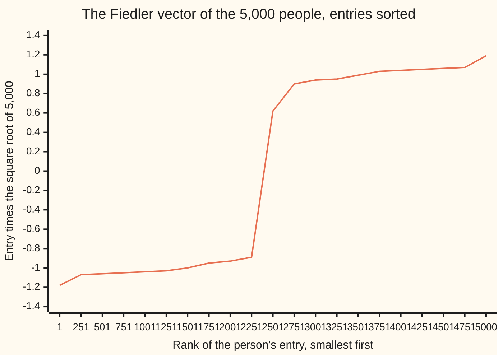

# The graph Laplacian: eigenvalues that count the pieces and cut the network in two

[Syllabus](../../../SYLLABUS.md) → [Applied and computational](../README.md) → [Network Science and Spectral Graphs](../README.md#s07) → The graph Laplacian

---

## General Overview

A messaging app has 5,000 users in two towns, 2,500 in each. The app never asks where anyone lives. It only sees who talks to whom: 51,250 friendships, 25,000 inside each town and 1,250 that cross between them. Can it find the two towns from the friendships alone?

Trying every way to split 5,000 people in half is hopeless. The method on this card skips the search. Write the friendships into one table of numbers, the **graph Laplacian**, and ask for one special list of 5,000 numbers that the table produces, one number per person. Put everyone with a positive number on one side and everyone with a negative number on the other.

On this network (synthetic, generated from a stated rule and seed in the code below) that split puts all 5,000 people in their right town. It cuts exactly the 1,250 links that cross, and no others. The same table also answers a simpler question for free: how many separate pieces the network falls into. Delete the 1,250 crossing links and the table reports two pieces by showing a second zero.

**The graph Laplacian scores any labelling of the people by how much friends disagree; its zero eigenvalues count the network's separate pieces, and the eigenvector of its smallest non-zero eigenvalue is the smoothest labelling that is not constant, whose signs cut the network into two well-separated halves.**

**What kind of fact this is:** two theorems, proved on this card in Why it works (zero eigenvalues count pieces; the second eigenvalue is a lower bound on every balanced cut), and one method, the sign split, which is a heuristic: it comes with no guarantee of finding the best cut, and a case where it fails is printed below.

### The picture: six friends, one bridge

Before the 5,000, a network small enough to do by hand. Ana, Ben and Cal all know each other. So do Dev, Eve and Fay. One friendship, Cal to Dev, links the two groups. Each person's number in the special list is shown beside their name.



Schematic. Positive numbers on the left, negative on the right: the signs cut only the bridge. Cal and Dev, who straddle it, get smaller numbers than their groupmates.

---

## The formula

Notation first, in words. The network is $G = (V, E)$, as on [Planar graphs](../../04-Combinatorics%20and%20graphs/12-Planarity%20and%20Colouring/01-planar-graphs-and-eulers-formula.md): $V$ the $n$ people, $E$ the links between them. The **adjacency matrix** $A$ has a 1 in row $u$, column $v$ when $u$ and $v$ are friends, and 0 otherwise. The **degree matrix** $D$ has each person's friend count (their **degree**) on its diagonal and zeros elsewhere. A **labelling** $x$ is a list of $n$ numbers, one per person; $x_u$ is person $u$'s number.

$$L = D - A, \qquad x^{\mathsf T} L\, x \;=\; \sum_{(u,v)\in E} (x_u - x_v)^2$$

**Read it aloud:** the Laplacian is degrees on the diagonal minus one for every friendship; fed a labelling, it returns the total squared disagreement across all links.

An **eigenvector** of $L$ is a labelling that $L$ only rescales, $L x = \lambda x$; the scale factor $\lambda$ is its **eigenvalue** (see [Eigenvalues and eigenvectors](../../03-Algebra/07-Eigenvalues%20and%20Symmetric%20Matrices/02-eigenvalues-and-eigenvectors.md)).

Its eigenvalues, sorted, are $0 = \lambda_1 \le \lambda_2 \le \dots \le \lambda_n$. Two facts follow:

$$\#\{k : \lambda_k = 0\} = \text{number of pieces}, \qquad \lambda_2 \;=\; \min_{x \ne 0,\ x \perp \mathbf 1}\ \frac{x^{\mathsf T} L\, x}{x^{\mathsf T} x} \;\le\; \frac{4\,\mathrm{cut}(S)}{n}\ \text{ for every half-and-half split } S$$

**Read it aloud:** count the zero eigenvalues and you have counted the pieces; the second eigenvalue is the least disagreement per unit of labelling among all labellings that add up to zero, and so it can never exceed four times the links cut by any even split, divided by the number of people.

The eigenvector that achieves that minimum is the **Fiedler vector** $v_2$, after Miroslav Fiedler, who in 1973 called $\lambda_2$ the **algebraic connectivity**. Reading its signs is **spectral clustering** in its plainest form.

| Symbol | Plain meaning | In our example | Push it up and the answer… |
| --- | --- | --- | --- |
| $n$ | number of people (vertices) | 5,000; six in the picture | — |
| $G = (V, E)$, $(u, v)$ | the network: its people, its list of friendships; one friendship, between $u$ and $v$ | 51,250 links | more links, larger $\lambda_2$ |
| $A$, $D$ | adjacency matrix (1 for friends, 0 otherwise); degree matrix (friend counts down the diagonal) | degrees 6 to 40, mean 20.5 | — |
| $L = D - A$ | the graph Laplacian | Cal's row: −1, −1, 3, −1, 0, 0 | — |
| $x$, $x_u$ | a labelling: one number per person; person $u$'s number | the Fiedler vector, Ana = 1 | — |
| $x^{\mathsf T} L\, x$ | total squared disagreement across links | 2.030310 for the six | rises when friends get different numbers |
| $\mathbf 1$, $x \perp \mathbf 1$ | the all-ones list (everyone labelled the same); "$x$ perpendicular to it": the labels add up to zero | $L\mathbf 1 = 0$ | — |
| $\lambda_1 \dots \lambda_n$, $\lambda_k$, $\lambda_{\max}$ | the eigenvalues, smallest first; the $k$-th; the largest | six friends: 0, 0.438447, 3, 3, 3, 4.561553 | — |
| $\lambda_2$ | algebraic connectivity: how hard the network is to cut | 0.438447 (six), 0.898010 (5,000) | harder to split in two |
| $v_2$; $v_k$, $a_k$ | the Fiedler vector, the labelling that achieves $\lambda_2$; in the proof, the $k$-th unit eigenvector and how much of it a labelling holds | signs give the two towns | — |
| $c$, $I$ | the shift in the power iteration; the identity matrix, which leaves every list alone | $c$ = 43.108260 | — |
| $\mathrm{cut}(S)$ | links from group $S$ to everyone else | 1 (six), 1,250 (5,000) | raises the bound $4\,\mathrm{cut}/n$ |

Notation clashes, in one line: $D$ here is the degree matrix, not the stretch-factor matrix of [The spectral theorem](../../03-Algebra/07-Eigenvalues%20and%20Symmetric%20Matrices/04-spectral-theorem.md); $L$ is not the queue length of wing 11; and $\lambda_2$ here counts from the bottom, the second-smallest eigenvalue of $L$, unlike the walk's $\lambda_2$ on [PageRank by power iteration](02-power-iteration-and-the-damping-factor.md), the second-largest in size.

### When it holds

- **Links run both ways, with weights zero or positive.** Then $L$ is symmetric and every eigenvalue is real and at least 0. For one-way links (who follows whom) $L$ is not symmetric, its eigenvalues can be complex, and the sum-of-squares identity is gone.
- **No small fringe hangs off by a thread.** Hang a chain of three people off person 0 and $\lambda_2$ falls from 0.898010 to 0.188124: the cheapest cut per person is now the chain, and the sign split stops following the towns (printed below).
- **The town split is the cheapest way to cut.** The method returns the labelling of least disagreement, whatever that follows. With 20,000 links across instead of 1,250, each town is still denser inside than across, but the town split now scores $4 \times 20000/5000 = 16.000000$ while some other labelling scores $\lambda_2 = 11.7903$. The vector follows that one, and only 2,757 of 5,000 people land in their right town, barely better than the 2,500 a coin would manage. The method still returns a split.
- **Zero is tested with a tolerance.** Computed "zeros" come out as tiny non-zero numbers, so the pieces count needs a threshold: an exact test counts 0 pieces where there are 2.
- **Two groups.** For more than two, take the first few eigenvectors and cluster their rows with [k-means](../06-Machine%20Learning%20Mathematics/06-k-means-and-clustering.md).

---

## Why it works

### Step 0: the Laplacian measures disagreement

Give every person a number. Friends with equal numbers agree; friends with different numbers disagree, and the squared gap measures by how much. The Laplacian adds up those squared gaps over every link. A labelling that makes friends agree, while still not giving everyone the same number, must change value mostly where friendships are scarce. That is where the communities divide. Everything below makes this precise.

### Step 1: the sum-of-squares identity

Expand one link's disagreement: $(x_u - x_v)^2 = x_u^2 + x_v^2 - 2x_u x_v$. Add over every link.

- The squares: person $u$ appears in one link per friend, so $x_u^2$ is counted degree-of-$u$ times. That total is $x^{\mathsf T} D\, x$.
- The cross terms: $x^{\mathsf T} A\, x$ counts each link twice, once as $(u,v)$ and once as $(v,u)$, giving $2x_u x_v$ per link.

Subtract: $x^{\mathsf T} D x - x^{\mathsf T} A x = x^{\mathsf T} L x = \sum (x_u - x_v)^2$. Three consequences:

1. A sum of squares is never negative, so no eigenvalue of $L$ is below 0.
2. $L\mathbf 1 = 0$: each row is a degree minus that many 1s. So 0 is always an eigenvalue, with the all-ones list as eigenvector.
3. $L$ is symmetric, so [The spectral theorem](../../03-Algebra/07-Eigenvalues%20and%20Symmetric%20Matrices/04-spectral-theorem.md) gives $n$ real eigenvalues with perpendicular eigenvectors.

For the six friends with their Fiedler vector, the five links that touch Cal or Dev contribute $4(1 - 0.561553)^2 + (2 \times 0.561553)^2$, the other two contribute 0, and the total is 2.030310.

### Step 2: zero eigenvalues count the pieces

Suppose $Lx = 0$. Then $x^{\mathsf T} L x = 0$, so every squared gap is 0: friends have equal numbers. Walk along links and the number never changes, so $x$ is constant on each piece of the network. It may take a different constant on each piece.

The other way round: the list that is 1 on one piece and 0 elsewhere has no link where it changes, so it gives 0 disagreement, and $L$ sends it to 0. There is one such list per piece, and they are independent (no two overlap), and every list $L$ sends to 0 is built from them. So the eigenvalue 0 has one independent eigenvector per piece, and, by the spectral theorem, 0 appears among $\lambda_1, \dots, \lambda_n$ once per piece.

Cut the bridge between Cal and Dev. The eigenvalues become 0, 0, 3, 3, 3, 3: two zeros, two pieces. A flood fill (start at one person, mark their friends, then their friends' friends, until no one new turns up; no eigenvalues at all) also finds 2. Do the same to the 5,000 by deleting the 1,250 crossing links: $\lambda_2$ drops to 0.000000, and the flood finds 2 pieces.

So $\lambda_2 > 0$ exactly when the network is in one piece. How far above 0 it sits says how close the network is to falling apart.

### Step 3: a cut is a disagreement score

Split the people into a group $S$ and the rest. Label $S$ with $+1$ and everyone else with $-1$. A link inside a group has gap 0. A link that crosses has gap 2, squared 4. So

$$x^{\mathsf T} L\, x = 4\,\mathrm{cut}(S).$$

If the split is half-and-half, the labels add up to zero, so $x \perp \mathbf 1$, and $x^{\mathsf T} x = n$. The best balanced cut is the $\pm 1$ labelling with the smallest disagreement. That is a search over all even splits, which is the hopeless part.

### Step 4: relax the labels, and the eigenvector answers

Drop the demand that labels be $\pm 1$. Allow any real numbers, as long as they add up to zero. Over that larger set, the smallest disagreement per unit of labelling is $\lambda_2$, reached at $v_2$. The fold has the two-line proof.

Every balanced $\pm 1$ labelling is in the larger set, so its ratio $4\,\mathrm{cut}/n$ is at least $\lambda_2$. For the towns: the true split cuts 1,250 links, ratio $4 \times 1250/5000 = 1.000000$, and $\lambda_2 = 0.898010$ sits just below it. For the six friends: the bridge split gives $4 \times 1/6 = 0.666667$, and $\lambda_2 = 0.438447$.

The relaxed answer has real numbers, not $\pm 1$. Round it back by its signs. When the communities are clear, $v_2$ is close to $+$ something on one and $-$ something on the other, and rounding loses little. The chart shows exactly that.



The one line is the 5,000 entries of $v_2$, sorted and scaled so a typical entry is near 1; every 250th is plotted. Two shelves, one near −1 and one near +1, with a jump between rank 2,500 and 2,501: the first 2,500 are one town, all negative, and the rest are the other, all positive. The sign split is reading that jump.

<details>
<summary>Detailed proof: the smallest ratio among labellings that add to zero is the second eigenvalue</summary>

Take perpendicular unit eigenvectors $v_1, \dots, v_n$ of $L$, with $v_1$ the all-ones list scaled to length 1. Write any labelling as $x = a_1 v_1 + \dots + a_n v_n$.

The labels add to zero exactly when $x$ is perpendicular to $v_1$, that is, when $a_1 = 0$.

Because the $v_k$ are perpendicular and $L v_k = \lambda_k v_k$: $x^{\mathsf T} x = a_2^2 + \dots + a_n^2$ and $x^{\mathsf T} L x = \lambda_2 a_2^2 + \dots + \lambda_n a_n^2$.

Every $\lambda_k$ with $k \ge 2$ is at least $\lambda_2$, so $x^{\mathsf T} L x \ge \lambda_2\, x^{\mathsf T} x$. Equality holds at $x = v_2$. So the minimum of the ratio is $\lambda_2$, and $v_2$ achieves it.

</details>

### Step 5: computing the Fiedler vector for 5,000 people

Nobody writes out a 5,000 by 5,000 table. The code stores each person's friend list and computes $Lx$ person by person: degree times own number, minus the friends' numbers.

To find $v_2$, it runs power iteration, the repeated multiplying of [PageRank by power iteration](02-power-iteration-and-the-damping-factor.md), on $cI - L$ ($I$ the identity, $c$ a shift), and subtracts the average label at every step. Multiplying by $cI - L$ turns each eigenvalue $\lambda$ into $c - \lambda$. With $c$ above $\lambda_{\max}$, the smallest $\lambda$ becomes the biggest $c - \lambda$, and repeated multiplying grows that direction fastest. Subtracting the average removes the all-ones direction, which would otherwise win with $c - 0$. What wins instead is $v_2$.

The code first estimates $\lambda_{\max}$ by 300 plain steps, at about 42.11 (an estimate, which can only fall short of the true value), then uses the estimate plus 1, $c = 43.108260$. Any $c$ above halfway between $\lambda_{\max}$ and $\lambda_2$ would do. After 400 steps the leftover, the length of $Lx - \lambda_2 x$, is below 1e-9.

The matrix-tree theorem of [Spanning trees](../../04-Combinatorics%20and%20graphs/10-Trees%20and%20Cheapest%20Routes/03-spanning-trees-and-cayleys-formula.md) reads the same table a third way. That card counts spanning trees as the determinant of $L$ with one row and its column cut; equivalently (Godsil and Royle, Sources), the count is the product of the non-zero eigenvalues divided by $n$. For the six friends, $(0.438447 \times 4.561553 \times 3 \times 3 \times 3)/6 = 9.000000$, and listing every choice of five links finds 9 trees.

---

## Worked numbers, by hand

The six friends. A labelling that respects the mirror symmetry is $(1, 1, b, -b, -1, -1)$ for Ana to Fay.

| Step | Arithmetic | Value |
| --- | --- | --- |
| degrees, Ana to Fay | count each person's friends | 2, 2, 3, 3, 2, 2 |
| Cal's row of $L$ | 3 on the diagonal, −1 for Ana, Ben, Dev | −1, −1, 3, −1, 0, 0 |
| Ana's row of $Lx = \lambda x$ | $2 \cdot 1 - 1 - b = \lambda \cdot 1$ | $b = 1 - \lambda$ |
| Cal's row of $Lx = \lambda x$ | $3b - 1 - 1 - (-b) = \lambda b$ | $4b - 2 = \lambda b$ |
| substitute $b = 1 - \lambda$ | $4(1 - \lambda) - 2 = \lambda(1 - \lambda)$ | $\lambda^2 - 5\lambda + 2 = 0$ |
| smaller root | $(5 - \sqrt{17})/2$ | **0.438447** |
| Cal's label | $1 - 0.438447$ | 0.561553 |
| disagreement $x^{\mathsf T}Lx$ | $4(1 - 0.561553)^2 + (2 \times 0.561553)^2$ | 2.030310 |
| length squared $x^{\mathsf T}x$ | $4 + 2 \times 0.561553^2$ | 4.630683 |
| ratio, the check | 2.030310 / 4.630683 | 0.438447 |
| sign split | Ana, Ben, Cal positive; Dev, Eve, Fay negative | **1 link cut** |
| bound from that split | $4 \times 1 / 6$ | 0.666667 |

The larger root, 4.561553, is the other mirror-image eigenvalue. A full numerical solve (Jacobi rotations in the code) finds all six: 0, 0.438447, 3, 3, 3, 4.561553. The smallest non-zero one, 0.438447, says the six hold together, but only just: one link is all that joins the halves.

The 5,000, by the code: $\lambda_2 = 0.898010$, below the 1.000000 the true split allows; signs split 2,500 against 2,500, all 5,000 in their right town, 1,250 links cut.

### What breaks if you drop a piece

| Mistake | Comes out at | What went wrong |
| --- | --- | --- |
| Skip subtracting the average in the iteration | disagreement 0.000000, everyone on one side: 0 against 5,000 | The all-ones list has eigenvalue 0 and wins the iteration. It says "one piece" and nothing else. |
| Use the eigenvector of the largest eigenvalue | 2,318 against 2,682; 2,950 right; 28,263 of 51,250 links cut, from a 300-step approximation of that vector | The true vector makes friends disagree as much as possible; even 300 steps towards it cut more than half the links instead of sparing them. |
| A chain of 3 people hangs off person 0 | $\lambda_2 = 0.188124$; 0.999368 of the vector's squared length on 4 people; split 16 against 4,987; 2,511 right | The "no thin fringe" assumption fails: chopping off 3 people by one link is cheaper per person than separating the towns. |
| Count zero eigenvalues with `== 0.0` (bridge cut) | 0 pieces, not 2 | Rounding leaves tiny non-zero numbers. Use a tolerance, such as 1e-9. |

---

## Code, from first principles, and it actually runs

The script builds the 5,000-person network from seed 2026 with a written-out SplitMix64 generator, so both languages build the same network. It never stores $L$: it computes $Lx$ from friend lists. It takes **three independent roads**. On the six friends:

- the closed form $(5 - \sqrt{17})/2$, a full Jacobi eigenvalue solve, and power iteration must agree;
- zero eigenvalues must match a flood-fill count of pieces;
- the product of eigenvalues must match a brute-force count of spanning trees.

On the 5,000:

- the sign split is scored against the towns the generator planted;
- $\lambda_2$ must sit below the planted split's bound $4\,\mathrm{cut}/n$;
- the flood fill must find 1 piece before the crossing links are deleted and 2 after.

The experiments at the end also run the normalised Laplacian: the same iteration, with each person's number divided by the square root of their degree before and after $L$ is applied.

### Python

```python
# The graph Laplacian and spectral clustering -- the check behind the card.  Standard library only.
# The network is synthetic, generated here from seed 2026 by SplitMix64.  Eigenvalues come from
# Jacobi rotations (six friends) and power iteration (5,000 people); pieces are counted by flooding.
from math import sqrt
MASK = (1 << 64) - 1

class SplitMix:                       # SplitMix64: the same stream in Python and Rust
    def __init__(self, seed): self.s = seed
    def next(self):
        self.s = (self.s + 0x9E3779B97F4A7C15) & MASK
        z = self.s
        z = ((z ^ (z >> 30)) * 0xBF58476D1CE4E5B9) & MASK
        z = ((z ^ (z >> 27)) * 0x94D049BB133111EB) & MASK
        return z ^ (z >> 31)

def towns(n, inside, across, seed):   # synthetic: two towns of n/2, random distinct pairs
    rng, half, seen, edges = SplitMix(seed), n // 2, set(), []
    def add(u, v):
        key = (min(u, v), max(u, v))
        if u == v or key in seen: return 0
        seen.add(key); edges.append(key); return 1
    for base in (0, half):
        made = 0
        while made < inside: made += add(base + rng.next() % half, base + rng.next() % half)
    while across > 0: across -= add(rng.next() % half, half + rng.next() % half)
    return edges

def neighbours(n, edges):
    nb = [[] for _ in range(n)]
    for u, v in edges: nb[u].append(v); nb[v].append(u)
    return nb

def lap(nb, x):                       # L x, never storing L: degree times own value minus neighbours'
    return [len(nb[i]) * x[i] - sum(x[j] for j in nb[i]) for i in range(len(nb))]

def rayleigh(edges, x):               # x.Lx / x.x, with x.Lx summed edge by edge
    return sum((x[u] - x[v]) ** 2 for u, v in edges) / sum(v * v for v in x)

def power(nb, c, steps, deflate, r=None):  # repeat x <- c x - L x, rescaled; deflate removes the average
    n, rng = len(nb), SplitMix(7); r = r or [1.0] * n  # r: square-root degrees, for the normalised Laplacian
    x = [(rng.next() >> 11) / 2.0 ** 53 - 0.5 for _ in range(n)]
    for _ in range(steps):
        if deflate: m = sum(a * b for a, b in zip(x, r)) / sum(b * b for b in r); x = [v - m * b for v, b in zip(x, r)]
        y = lap(nb, [a / b for a, b in zip(x, r)]); x = [c * a - b / q for a, b, q in zip(x, y, r)]
        s = sqrt(sum(v * v for v in x)); x = [v / s for v in x]
    return x

def residual(nb, x, lam): return sqrt(sum((a - lam * b) ** 2 for a, b in zip(lap(nb, x), x)))
def judge(edges, x, n):               # read signs: side sizes, people in their right town, links cut
    side = [v > 0 for v in x]
    right = sum(side[i] == (i < n // 2) for i in range(n))
    return sum(side), max(right, n - right), sum(side[u] != side[v] for u, v in edges)

def jacobi(a):                        # all eigenvalues of a small symmetric matrix, by rotations
    a, n = [row[:] for row in a], len(a)
    for _ in range(50):
        for p in range(n):
            for q in range(p + 1, n):
                if abs(a[p][q]) < 1e-300: continue
                th = (a[q][q] - a[p][p]) / (2 * a[p][q])
                t = (1 if th >= 0 else -1) / (abs(th) + sqrt(th * th + 1))
                c = 1 / sqrt(t * t + 1); s = t * c
                for k in range(n):
                    akp, akq = a[k][p], a[k][q]
                    a[k][p], a[k][q] = c * akp - s * akq, s * akp + c * akq
                for k in range(n):
                    apk, aqk = a[p][k], a[q][k]
                    a[p][k], a[q][k] = c * apk - s * aqk, s * apk + c * aqk
    return sorted(a[i][i] for i in range(n))

def pieces(nb):                       # count connected pieces by flooding, no eigenvalues at all
    seen, count = [False] * len(nb), 0
    for s in range(len(nb)):
        if seen[s]: continue
        count += 1; seen[s] = True; stack = [s]
        while stack:
            for w in nb[stack.pop()]:
                if not seen[w]: seen[w] = True; stack.append(w)
    return count

def f6(vs): return " ".join(f"{v:.6f}" if abs(v) > 5e-7 else "0.000000" for v in vs)
def matrix(n, edges):
    nb = neighbours(n, edges)
    return [[len(nb[i]) if i == j else -(j in nb[i]) for j in range(n)] for i in range(n)]

# ---- six friends: Ana Ben Cal | Dev Eve Fay, one bridge Cal-Dev ----
SIX = [(0, 1), (0, 2), (1, 2), (2, 3), (3, 4), (3, 5), (4, 5)]
ev = jacobi(matrix(6, SIX))
closed = (5 - sqrt(17)) / 2
f = power(neighbours(6, SIX), 6.0, 400, True); f = [v / f[0] for v in f]
print("six: degrees", [len(r) for r in neighbours(6, SIX)], " Cal's row", matrix(6, SIX)[2])
print("six: eigenvalues", f6(ev))
print(f"six: lambda2 Jacobi {ev[1]:.6f}  (5 - sqrt 17)/2 {closed:.6f}  Rayleigh {rayleigh(SIX, f):.6f}")
print("six: Fiedler vector, Ana = 1:", f6(f), " links cut", judge(SIX, f, 6)[2],
      f" edge sum {sum((f[u] - f[v]) ** 2 for u, v in SIX):.6f}  length^2 {sum(v * v for v in f):.6f}")
ev0 = jacobi(matrix(6, SIX[:3] + SIX[4:])); zeros = sum(abs(v) < 1e-9 for v in ev0)
print("six, bridge cut: eigenvalues", f6(ev0), f" zeros {zeros}  pieces by flood",
      pieces(neighbours(6, SIX[:3] + SIX[4:])), " exactly 0.0:", sum(v == 0.0 for v in ev0))
prod = ev[1] * ev[2] * ev[3] * ev[4] * ev[5]
trees = sum(pieces(neighbours(6, [e for i, e in enumerate(SIX) if i not in (a, b)])) == 1
            for a in range(7) for b in range(a + 1, 7))
print(f"six: product of nonzero eigenvalues / 6 = {prod / 6:.6f}  spanning trees by listing {trees}"
      f"  4 x cut / n for Ana Ben Cal | Dev Eve Fay {4 * 1 / 6:.6f}")
assert abs(ev[1] - closed) < 1e-9 and abs(rayleigh(SIX, f) - closed) < 1e-9 and judge(SIX, f, 6)[2] == 1
assert zeros == 2 == pieces(neighbours(6, SIX[:3] + SIX[4:])) and round(prod / 6) == trees == 9
# ---- 5,000 people in two towns of 2,500: 25,000 links inside each town, 1,250 across ----
N, IN, ACROSS = 5000, 25000, 1250
E = towns(N, IN, ACROSS, 2026); nb = neighbours(N, E)
deg = [len(r) for r in nb]
print(f"big: people {N}  links {len(E)} = 2 x {IN} inside + {ACROSS} across  degree min {min(deg)} mean {sum(deg) / N:.6f} max {max(deg)}")
top = power(nb, 0.0, 300, False); lmax = rayleigh(E, top); c = lmax + 1
x = power(nb, c, 400, True); lam2 = rayleigh(E, x); size, right, cut = judge(E, x, N); bound = 4 * ACROSS / N
print(f"big: largest eigenvalue, 300-step estimate {lmax:.6f}  shift c {c:.6f}")
print(f"big: lambda2 {lam2:.6f}  residual below 1e-9 {'yes' if residual(nb, x, lam2) < 1e-9 else 'no'}  bound 4 x 1250 / 5000 {bound:.6f}")
print(f"big: sign split {size} | {N - size}  in their right town {right}  links cut {cut}")
s = sorted(v * sqrt(N) for v in x)
print("chart, rank:entry x sqrt(n):", " ".join(f"{min(i * 250, N - 1) + 1}:{s[min(i * 250, N - 1)]:.2f}" for i in range(21)))
assert lam2 <= bound and right == N and cut == ACROSS and residual(nb, x, lam2) < 1e-6 and pieces(nb) == 1
Ecut = [e for e in E if (e[0] < N // 2) == (e[1] < N // 2)]
z = power(neighbours(N, Ecut), c, 200, True)
print(f"big, the 1250 across removed: lambda2 {f6([rayleigh(Ecut, z)])}  pieces by flood {pieces(neighbours(N, Ecut))}")
assert rayleigh(Ecut, z) < 1e-9 and pieces(neighbours(N, Ecut)) == 2
# ---- what breaks ----
w = power(nb, c, 400, False); ws = judge(E, w, N)[0]
print(f"mistake, average not removed: value {f6([rayleigh(E, w)])}  split {ws} | {N - ws}")
ts, tr, tc = judge(E, top, N)
print(f"mistake, top eigenvector after 300 steps: split {ts} | {N - ts}  in right town {tr}  links cut {tc} of {len(E)}")
Et = E + [(0, 5000), (5000, 5001), (5001, 5002)]
t = power(neighbours(N + 3, Et), c, 1000, True); weight = sum(v * v for v in t[N:]) + t[0] ** 2
ts, tr, tc = judge(Et, t, N)
print(f"tail of 3 on person 0: lambda2 {rayleigh(Et, t):.6f}  weight on the 4 {weight:.6f}  "
      f"split {ts} | {N + 3 - ts}  right town {tr}  links cut {tc}")
assert rayleigh(Et, t) < lam2 and weight > 0.5
for across in (10000, 20000):
    Ew = towns(N, IN, across, 2026); nw = neighbours(N, Ew); xw = power(nw, c, 400, True)
    xn = power(nw, 2.0, 400, True, [sqrt(len(a)) for a in nw]); (sw, rw, _), rn = judge(Ew, xw, N), judge(Ew, xn, N)[1]
    print(f"try: {across} across (each person: {2 * IN / (N / 2):.0f} home, {across / (N / 2):.0f} across), lambda2 {rayleigh(Ew, xw):.4f}  town split 4 x cut / n {4 * across / N:.6f}  sign split {sw} | {N - sw}  in their right town {rw}  normalised L {rn}")
x30 = power(nb, c, 30, True)
print(f"try: 30 steps only, in their right town {judge(E, x30, N)[1]}  lambda2 {rayleigh(E, x30):.6f}")
print("ALL CHECKS PASS")
```

**Ran 2026-11-11 on macOS, Python 3.14.10, standard library only. All checks passed. Output, pasted from the run:**

```
six: degrees [2, 2, 3, 3, 2, 2]  Cal's row [-1, -1, 3, -1, 0, 0]
six: eigenvalues 0.000000 0.438447 3.000000 3.000000 3.000000 4.561553
six: lambda2 Jacobi 0.438447  (5 - sqrt 17)/2 0.438447  Rayleigh 0.438447
six: Fiedler vector, Ana = 1: 1.000000 1.000000 0.561553 -0.561553 -1.000000 -1.000000  links cut 1  edge sum 2.030310  length^2 4.630683
six, bridge cut: eigenvalues 0.000000 0.000000 3.000000 3.000000 3.000000 3.000000  zeros 2  pieces by flood 2  exactly 0.0: 0
six: product of nonzero eigenvalues / 6 = 9.000000  spanning trees by listing 9  4 x cut / n for Ana Ben Cal | Dev Eve Fay 0.666667
big: people 5000  links 51250 = 2 x 25000 inside + 1250 across  degree min 6 mean 20.500000 max 40
big: largest eigenvalue, 300-step estimate 42.108260  shift c 43.108260
big: lambda2 0.898010  residual below 1e-9 yes  bound 4 x 1250 / 5000 1.000000
big: sign split 2500 | 2500  in their right town 5000  links cut 1250
chart, rank:entry x sqrt(n): 1:-1.18 251:-1.07 501:-1.06 751:-1.05 1001:-1.04 1251:-1.03 1501:-1.00 1751:-0.95 2001:-0.93 2251:-0.89 2501:0.62 2751:0.90 3001:0.94 3251:0.95 3501:0.99 3751:1.03 4001:1.04 4251:1.05 4501:1.06 4751:1.07 5000:1.19
big, the 1250 across removed: lambda2 0.000000  pieces by flood 2
mistake, average not removed: value 0.000000  split 0 | 5000
mistake, top eigenvector after 300 steps: split 2318 | 2682  in right town 2950  links cut 28263 of 51250
tail of 3 on person 0: lambda2 0.188124  weight on the 4 0.999368  split 16 | 4987  right town 2511  links cut 238
try: 10000 across (each person: 20 home, 4 across), lambda2 6.9551  town split 4 x cut / n 8.000000  sign split 2502 | 2498  in their right town 4996  normalised L 4996
try: 20000 across (each person: 20 home, 8 across), lambda2 11.7903  town split 4 x cut / n 16.000000  sign split 3969 | 1031  in their right town 2757  normalised L 4934
try: 30 steps only, in their right town 4999  lambda2 0.902299
ALL CHECKS PASS
```

### Rust

```rust
// The graph Laplacian and spectral clustering -- the check behind the card.  std only, no crates.
// The network is synthetic, generated here from seed 2026 by SplitMix64.  Eigenvalues come from
// Jacobi rotations (six friends) and power iteration (5,000 people); pieces are counted by flooding.
use std::collections::HashSet;

struct SplitMix(u64);
impl SplitMix {  // SplitMix64: the same stream in Python and Rust
    fn next(&mut self) -> u64 {
        self.0 = self.0.wrapping_add(0x9E3779B97F4A7C15);
        let mut z = self.0;
        z = (z ^ (z >> 30)).wrapping_mul(0xBF58476D1CE4E5B9);
        z = (z ^ (z >> 27)).wrapping_mul(0x94D049BB133111EB);
        z ^ (z >> 31)
    }
}
type Edges = Vec<(usize, usize)>;
fn towns(n: usize, inside: usize, across: usize, seed: u64) -> Edges {
    let (mut rng, half, mut seen, mut edges) = (SplitMix(seed), (n / 2) as u64, HashSet::new(), Vec::new());
    let mut add = |u: u64, v: u64, edges: &mut Edges| -> usize {
        let key = (u.min(v) as usize, u.max(v) as usize);
        if u == v || seen.contains(&key) { return 0; }
        seen.insert(key); edges.push(key); 1
    };
    for base in [0, half] {
        let mut made = 0;
        while made < inside { let u = base + rng.next() % half; let v = base + rng.next() % half; made += add(u, v, &mut edges); }
    }
    let mut left = across;
    while left > 0 { let u = rng.next() % half; let v = half + rng.next() % half; left -= add(u, v, &mut edges); }
    edges
}
fn neighbours(n: usize, edges: &Edges) -> Vec<Vec<usize>> {
    let mut nb = vec![Vec::new(); n];
    for &(u, v) in edges { nb[u].push(v); nb[v].push(u); }
    nb
}
fn lap(nb: &[Vec<usize>], x: &[f64]) -> Vec<f64> {
    (0..nb.len()).map(|i| nb[i].len() as f64 * x[i] - nb[i].iter().map(|&j| x[j]).sum::<f64>()).collect()
}
fn rayleigh(edges: &Edges, x: &[f64]) -> f64 {
    edges.iter().map(|&(u, v)| (x[u] - x[v]).powi(2)).sum::<f64>() / x.iter().map(|v| v * v).sum::<f64>()
}
fn power(nb: &[Vec<usize>], c: f64, steps: usize, deflate: bool) -> Vec<f64> { powerw(nb, c, steps, deflate, &vec![1.0; nb.len()]) }
fn powerw(nb: &[Vec<usize>], c: f64, steps: usize, deflate: bool, r: &[f64]) -> Vec<f64> { // r: square-root degrees, for the normalised Laplacian
    let (n, mut rng) = (nb.len(), SplitMix(7));
    let mut x: Vec<f64> = (0..n).map(|_| (rng.next() >> 11) as f64 / 9007199254740992.0 - 0.5).collect();
    for _ in 0..steps {
        if deflate { let m = x.iter().zip(r).map(|(a, b)| a * b).sum::<f64>() / r.iter().map(|b| b * b).sum::<f64>(); x = x.iter().zip(r).map(|(v, b)| v - m * b).collect(); }
        let xr: Vec<f64> = x.iter().zip(r).map(|(a, b)| a / b).collect();
        x = x.iter().zip(lap(nb, &xr).iter().zip(r)).map(|(a, (l, b))| c * a - l / b).collect();
        let s = x.iter().map(|v| v * v).sum::<f64>().sqrt();
        x = x.iter().map(|v| v / s).collect();
    }
    x
}
fn residual(nb: &[Vec<usize>], x: &[f64], lam: f64) -> f64 { lap(nb, x).iter().zip(x).map(|(a, b)| (a - lam * b).powi(2)).sum::<f64>().sqrt() }
fn judge(edges: &Edges, x: &[f64], n: usize) -> (usize, usize, usize) {
    let side: Vec<bool> = x.iter().map(|&v| v > 0.0).collect();
    let right = (0..n).filter(|&i| side[i] == (i < n / 2)).count();
    (side.iter().filter(|&&b| b).count(), right.max(n - right), edges.iter().filter(|&&(u, v)| side[u] != side[v]).count())
}
fn jacobi(m: &[Vec<f64>]) -> Vec<f64> {
    let (mut a, n) = (m.to_vec(), m.len());
    for _ in 0..50 {
        for p in 0..n {
            for q in p + 1..n {
                if a[p][q].abs() < 1e-300 { continue; }
                let th = (a[q][q] - a[p][p]) / (2.0 * a[p][q]);
                let t = (if th >= 0.0 { 1.0 } else { -1.0 }) / (th.abs() + (th * th + 1.0).sqrt());
                let c = 1.0 / (t * t + 1.0).sqrt(); let s = t * c;
                for k in 0..n { let (y, z) = (a[k][p], a[k][q]); a[k][p] = c * y - s * z; a[k][q] = s * y + c * z; }
                for k in 0..n { let (y, z) = (a[p][k], a[q][k]); a[p][k] = c * y - s * z; a[q][k] = s * y + c * z; }
            }
        }
    }
    let mut d: Vec<f64> = (0..n).map(|i| a[i][i]).collect();
    d.sort_by(|u, v| u.partial_cmp(v).unwrap());
    d
}
fn pieces(nb: &[Vec<usize>]) -> usize {
    let (mut seen, mut count) = (vec![false; nb.len()], 0);
    for s in 0..nb.len() {
        if seen[s] { continue; }
        let mut stack = vec![s];
        count += 1; seen[s] = true;
        while let Some(v) = stack.pop() {
            for &w in &nb[v] { if !seen[w] { seen[w] = true; stack.push(w); } }
        }
    }
    count
}
fn f6(vs: &[f64]) -> String {
    vs.iter().map(|v| if v.abs() > 5e-7 { format!("{:.6}", v) } else { "0.000000".to_string() }).collect::<Vec<_>>().join(" ")
}
fn matrix(n: usize, edges: &Edges) -> Vec<Vec<f64>> {
    let nb = neighbours(n, edges);
    (0..n).map(|i| (0..n).map(|j| if i == j { nb[i].len() as f64 } else if nb[i].contains(&j) { -1.0 } else { 0.0 }).collect()).collect()
}
fn main() {
    // ---- six friends: Ana Ben Cal | Dev Eve Fay, one bridge Cal-Dev ----
    let six: Edges = vec![(0, 1), (0, 2), (1, 2), (2, 3), (3, 4), (3, 5), (4, 5)];
    let ev = jacobi(&matrix(6, &six));
    let closed = (5.0 - 17f64.sqrt()) / 2.0;
    let f0 = power(&neighbours(6, &six), 6.0, 400, true);
    let f: Vec<f64> = f0.iter().map(|v| v / f0[0]).collect();
    println!("six: degrees {:?}  Cal's row {:?}", neighbours(6, &six).iter().map(|r| r.len()).collect::<Vec<_>>(),
             matrix(6, &six)[2].iter().map(|&v| v as i64).collect::<Vec<_>>());
    println!("six: eigenvalues {}", f6(&ev));
    println!("six: lambda2 Jacobi {:.6}  (5 - sqrt 17)/2 {:.6}  Rayleigh {:.6}", ev[1], closed, rayleigh(&six, &f));
    let esum: f64 = six.iter().map(|&(u, v)| (f[u] - f[v]).powi(2)).sum();
    println!("six: Fiedler vector, Ana = 1: {}  links cut {}  edge sum {:.6}  length^2 {:.6}", f6(&f), judge(&six, &f, 6).2, esum, f.iter().map(|v| v * v).sum::<f64>());
    let nobridge: Edges = six.iter().enumerate().filter(|&(i, _)| i != 3).map(|(_, &e)| e).collect();
    let ev0 = jacobi(&matrix(6, &nobridge));
    let zeros = ev0.iter().filter(|v| v.abs() < 1e-9).count();
    println!("six, bridge cut: eigenvalues {}  zeros {}  pieces by flood {}  exactly 0.0: {}", f6(&ev0), zeros,
             pieces(&neighbours(6, &nobridge)), ev0.iter().filter(|&&v| v == 0.0).count());
    let prod = ev[1] * ev[2] * ev[3] * ev[4] * ev[5];
    let trees = (0..49).filter(|k| k / 7 < k % 7).filter(|k| pieces(&neighbours(6, &six.iter().enumerate()
        .filter(|&(i, _)| i != k / 7 && i != k % 7).map(|(_, &e)| e).collect())) == 1).count();
    println!("six: product of nonzero eigenvalues / 6 = {:.6}  spanning trees by listing {}  4 x cut / n for Ana Ben Cal | Dev Eve Fay {:.6}", prod / 6.0, trees, 4.0 / 6.0);
    assert!((ev[1] - closed).abs() < 1e-9 && (rayleigh(&six, &f) - closed).abs() < 1e-9 && judge(&six, &f, 6).2 == 1);
    assert!(zeros == 2 && pieces(&neighbours(6, &nobridge)) == 2 && (prod / 6.0).round() as usize == trees && trees == 9);
    // ---- 5,000 people in two towns of 2,500: 25,000 links inside each town, 1,250 across ----
    let (n, inside, across) = (5000usize, 25000usize, 1250usize);
    let e = towns(n, inside, across, 2026);
    let (nb, sq) = (neighbours(n, &e), (n as f64).sqrt());
    let deg: Vec<usize> = nb.iter().map(|r| r.len()).collect();
    println!("big: people {}  links {} = 2 x {} inside + {} across  degree min {} mean {:.6} max {}", n, e.len(), inside, across, deg.iter().min().unwrap(),
             deg.iter().sum::<usize>() as f64 / n as f64, deg.iter().max().unwrap());
    let top = power(&nb, 0.0, 300, false);
    let (lmax, bound) = (rayleigh(&e, &top), 4.0 * across as f64 / n as f64);
    let (c, x) = (lmax + 1.0, power(&nb, lmax + 1.0, 400, true));
    let (lam2, (size, right, cut)) = (rayleigh(&e, &x), judge(&e, &x, n));
    let res = residual(&nb, &x, lam2);
    println!("big: largest eigenvalue, 300-step estimate {:.6}  shift c {:.6}", lmax, c);
    println!("big: lambda2 {:.6}  residual below 1e-9 {}  bound 4 x 1250 / 5000 {:.6}", lam2, if res < 1e-9 { "yes" } else { "no" }, bound);
    println!("big: sign split {} | {}  in their right town {}  links cut {}", size, n - size, right, cut);
    let mut s: Vec<f64> = x.iter().map(|v| v * sq).collect();
    s.sort_by(|u, v| u.partial_cmp(v).unwrap());
    let pts: Vec<String> = (0..21).map(|i| format!("{}:{:.2}", (i * 250).min(n - 1) + 1, s[(i * 250).min(n - 1)])).collect();
    println!("chart, rank:entry x sqrt(n): {}", pts.join(" "));
    assert!(lam2 <= bound && right == n && cut == across && res < 1e-6 && pieces(&nb) == 1);
    let ecut: Edges = e.iter().filter(|&&(u, v)| (u < n / 2) == (v < n / 2)).cloned().collect();
    let z = power(&neighbours(n, &ecut), c, 200, true);
    println!("big, the 1250 across removed: lambda2 {}  pieces by flood {}", f6(&[rayleigh(&ecut, &z)]), pieces(&neighbours(n, &ecut)));
    assert!(rayleigh(&ecut, &z) < 1e-9 && pieces(&neighbours(n, &ecut)) == 2);
    // ---- what breaks ----
    let w = power(&nb, c, 400, false);
    let ws = judge(&e, &w, n).0;
    println!("mistake, average not removed: value {}  split {} | {}", f6(&[rayleigh(&e, &w)]), ws, n - ws);
    let (ts, tr, tc) = judge(&e, &top, n);
    println!("mistake, top eigenvector after 300 steps: split {} | {}  in right town {}  links cut {} of {}", ts, n - ts, tr, tc, e.len());
    let et: Edges = e.iter().cloned().chain([(0, 5000), (5000, 5001), (5001, 5002)]).collect();
    let t = power(&neighbours(n + 3, &et), c, 1000, true);
    let weight = t[n..].iter().map(|v| v * v).sum::<f64>() + t[0] * t[0];
    let (ts, tr, tc) = judge(&et, &t, n);
    println!("tail of 3 on person 0: lambda2 {:.6}  weight on the 4 {:.6}  split {} | {}  right town {}  links cut {}",
             rayleigh(&et, &t), weight, ts, n + 3 - ts, tr, tc);
    assert!(rayleigh(&et, &t) < lam2 && weight > 0.5);
    for a in [10000usize, 20000] {
        let (ew, half) = (towns(n, inside, a, 2026), (n / 2) as f64); let nw = neighbours(n, &ew);
        let (xw, xn) = (power(&nw, c, 400, true), powerw(&nw, 2.0, 400, true, &nw.iter().map(|r| (r.len() as f64).sqrt()).collect::<Vec<_>>()));
        let ((sw, rw, _), rn) = (judge(&ew, &xw, n), judge(&ew, &xn, n).1);
        println!("try: {} across (each person: {:.0} home, {:.0} across), lambda2 {:.4}  town split 4 x cut / n {:.6}  sign split {} | {}  in their right town {}  normalised L {}",
                 a, 2.0 * inside as f64 / half, a as f64 / half, rayleigh(&ew, &xw), 4.0 * a as f64 / n as f64, sw, n - sw, rw, rn);
    }
    let x30 = power(&nb, c, 30, true);
    println!("try: 30 steps only, in their right town {}  lambda2 {:.6}", judge(&e, &x30, n).1, rayleigh(&e, &x30));
    println!("ALL CHECKS PASS");
}
```

**Ran 2026-11-11 on macOS, rustc 1.98.1, no crates. All checks passed. Output, pasted from the run:**

```
six: degrees [2, 2, 3, 3, 2, 2]  Cal's row [-1, -1, 3, -1, 0, 0]
six: eigenvalues 0.000000 0.438447 3.000000 3.000000 3.000000 4.561553
six: lambda2 Jacobi 0.438447  (5 - sqrt 17)/2 0.438447  Rayleigh 0.438447
six: Fiedler vector, Ana = 1: 1.000000 1.000000 0.561553 -0.561553 -1.000000 -1.000000  links cut 1  edge sum 2.030310  length^2 4.630683
six, bridge cut: eigenvalues 0.000000 0.000000 3.000000 3.000000 3.000000 3.000000  zeros 2  pieces by flood 2  exactly 0.0: 0
six: product of nonzero eigenvalues / 6 = 9.000000  spanning trees by listing 9  4 x cut / n for Ana Ben Cal | Dev Eve Fay 0.666667
big: people 5000  links 51250 = 2 x 25000 inside + 1250 across  degree min 6 mean 20.500000 max 40
big: largest eigenvalue, 300-step estimate 42.108260  shift c 43.108260
big: lambda2 0.898010  residual below 1e-9 yes  bound 4 x 1250 / 5000 1.000000
big: sign split 2500 | 2500  in their right town 5000  links cut 1250
chart, rank:entry x sqrt(n): 1:-1.18 251:-1.07 501:-1.06 751:-1.05 1001:-1.04 1251:-1.03 1501:-1.00 1751:-0.95 2001:-0.93 2251:-0.89 2501:0.62 2751:0.90 3001:0.94 3251:0.95 3501:0.99 3751:1.03 4001:1.04 4251:1.05 4501:1.06 4751:1.07 5000:1.19
big, the 1250 across removed: lambda2 0.000000  pieces by flood 2
mistake, average not removed: value 0.000000  split 0 | 5000
mistake, top eigenvector after 300 steps: split 2318 | 2682  in right town 2950  links cut 28263 of 51250
tail of 3 on person 0: lambda2 0.188124  weight on the 4 0.999368  split 16 | 4987  right town 2511  links cut 238
try: 10000 across (each person: 20 home, 4 across), lambda2 6.9551  town split 4 x cut / n 8.000000  sign split 2502 | 2498  in their right town 4996  normalised L 4996
try: 20000 across (each person: 20 home, 8 across), lambda2 11.7903  town split 4 x cut / n 16.000000  sign split 3969 | 1031  in their right town 2757  normalised L 4934
try: 30 steps only, in their right town 4999  lambda2 0.902299
ALL CHECKS PASS
```

### Lean

Lean proves the card's two theorems and the sum-of-squares identity for every network of two-way links, and checks the six friends' numbers.

- The number of eigenvalues of $L$ equal to 0, counted with repeats, is the number of pieces.
- Take any labelling $x$. Then $x^{\mathsf T} L\, x$ is the sum, over all links, of the squared gap $(x_u - x_v)^2$.
- Take any half-and-half split $S$ of the $n$ people. Then $\lambda_2 \le 4\,\mathrm{cut}(S)/n$.
- For the six friends, the degrees are 2, 2, 3, 3, 2, 2.
- Cal's row of $L$ is −1, −1, 3, −1, 0, 0.
- The sign split Ana, Ben, Cal against Dev, Eve, Fay cuts exactly 1 link.
- For the 5,000 people, $4 \times 1250/5000 = 1$, and with 20,000 links across, $4 \times 20000/5000 = 16$.

The eigenvalues themselves, the Fiedler vector, the power iteration and the 5,000-person runs are left to the Python and Rust checks.

```lean
-- The graph Laplacian: for a finite simple graph, the Laplacian's zero eigenvalues (with repeats) number exactly the connected pieces, it sums squared disagreement over links, and its second-smallest eigenvalue is at most four times the links cut by any half-and-half split divided by the number of vertices.
import Mathlib.Combinatorics.SimpleGraph.LapMatrix
import Mathlib.Analysis.Matrix.Spectrum

open Matrix Finset

variable {V : Type*} [Fintype V] [DecidableEq V] (G : SimpleGraph V) [DecidableRel G.Adj]

lemma isHermitian_real_eigenvalues₀_mul_le {A : Matrix V V ℝ} (hA : A.IsHermitian)
    (i : Fin (Fintype.card V)) (hi : (i : ℕ) + 2 = Fintype.card V) (v : V → ℝ)
    (hv : v ⬝ᵥ ⇑(hA.eigenvectorBasis
      (Fintype.equivOfCardEq (Fintype.card_fin _) (⟨(i : ℕ) + 1, by omega⟩ : Fin _))) = 0) :
    hA.eigenvalues₀ i * (v ⬝ᵥ v) ≤ v ⬝ᵥ (A *ᵥ v) := by
  set e : Fin (Fintype.card V) ≃ V := Fintype.equivOfCardEq (Fintype.card_fin _) with he
  set k : Fin (Fintype.card V) := ⟨(i : ℕ) + 1, by omega⟩ with hk
  set U : Matrix V V ℝ := (hA.eigenvectorUnitary : Matrix V V ℝ) with hU
  have hspec : A = U * diagonal (RCLike.ofReal ∘ hA.eigenvalues) * star U := by
    conv_lhs => rw [hA.spectral_theorem]
    rfl
  have hUU : U * star U = 1 := Unitary.coe_mul_star_self _
  have hsU : star U = Uᵀ := by rw [star_eq_conjTranspose, conjTranspose_eq_transpose_of_trivial]
  rw [hsU] at hspec hUU
  set c : V → ℝ := Uᵀ *ᵥ v with hc
  have hq : v ⬝ᵥ (A *ᵥ v) = ∑ j, hA.eigenvalues j * c j ^ 2 := by
    have hAv : A *ᵥ v = U *ᵥ (diagonal (RCLike.ofReal ∘ hA.eigenvalues) *ᵥ (Uᵀ *ᵥ v)) := by
      conv_lhs => rw [hspec]
      rw [← mulVec_mulVec, ← mulVec_mulVec]
    rw [hAv, dotProduct_mulVec, ← mulVec_transpose, ← hc]
    simp only [dotProduct, mulVec_diagonal, Function.comp_apply, RCLike.ofReal_real_eq_id, id]
    refine Finset.sum_congr rfl fun j _ => ?_
    ring
  have hn : v ⬝ᵥ v = ∑ j, c j ^ 2 := by
    have h1 : v ⬝ᵥ v = v ⬝ᵥ ((U * Uᵀ) *ᵥ v) := by rw [hUU, one_mulVec]
    rw [h1, ← mulVec_mulVec, dotProduct_mulVec, ← mulVec_transpose, ← hc]
    simp only [dotProduct, sq]
  have hc0 : c (e k) = 0 := by
    rw [← hv, hc]
    simp only [mulVec, dotProduct, transpose_apply, hU,
      Matrix.IsHermitian.eigenvectorUnitary_apply]
    refine Finset.sum_congr rfl fun a _ => ?_
    ring
  rw [hq, hn, Finset.mul_sum]
  refine Finset.sum_le_sum fun j _ => ?_
  by_cases hj : j = e k
  · subst hj; rw [hc0]; simp
  · refine mul_le_mul_of_nonneg_right ?_ (sq_nonneg _)
    have h1 : hA.eigenvalues j = hA.eigenvalues₀ (e.symm j) := rfl
    rw [h1]
    apply hA.eigenvalues₀_antitone
    have h2 : e.symm j ≠ k := fun h => hj (by rw [← h]; simp)
    have h3 : ((e.symm j : Fin _) : ℕ) ≠ (i : ℕ) + 1 := fun h => h2 (Fin.ext h)
    have h4 := (e.symm j).isLt
    rw [Fin.le_def]; omega

#print axioms isHermitian_real_eigenvalues₀_mul_le

lemma dotProduct_lapMatrix_mulVec_sign (S : Finset V) :
    (fun w => if w ∈ S then (1 : ℝ) else -1) ⬝ᵥ
        (G.lapMatrix ℝ *ᵥ (fun w => if w ∈ S then (1 : ℝ) else -1)) =
      4 * (((S ×ˢ Sᶜ).filter fun p : V × V => G.Adj p.1 p.2).card : ℝ) := by
  rw [← toLinearMap₂'_apply', SimpleGraph.lapMatrix_toLinearMap₂']
  have key : ∀ i j : V,
      (if G.Adj i j then ((if i ∈ S then (1 : ℝ) else -1) - (if j ∈ S then (1 : ℝ) else -1)) ^ 2
        else 0) =
      (if G.Adj i j ∧ i ∈ S ∧ j ∉ S then (4 : ℝ) else 0) +
        (if G.Adj j i ∧ j ∈ S ∧ i ∉ S then (4 : ℝ) else 0) := by
    intro i j
    by_cases hij : G.Adj i j <;> by_cases hi : i ∈ S <;> by_cases hj : j ∈ S <;>
      simp [hij, hi, hj, G.adj_comm j i] <;> norm_num
  simp_rw [key, sum_add_distrib]
  rw [Finset.sum_comm (f := fun i j => if G.Adj j i ∧ j ∈ S ∧ i ∉ S then (4 : ℝ) else 0)]
  have hcut : ∑ i, ∑ j, (if G.Adj i j ∧ i ∈ S ∧ j ∉ S then (4 : ℝ) else 0) =
      4 * (((S ×ˢ Sᶜ).filter fun p : V × V => G.Adj p.1 p.2).card : ℝ) := by
    rw [← Fintype.sum_prod_type' (fun i j => if G.Adj i j ∧ i ∈ S ∧ j ∉ S then (4 : ℝ) else 0),
      Finset.sum_ite, sum_const_zero, add_zero, sum_const, nsmul_eq_mul, mul_comm]
    congr 3
    ext p
    simp only [mem_filter, mem_univ, true_and, mem_product, mem_compl]
    tauto
  rw [hcut]; ring

#print axioms dotProduct_lapMatrix_mulVec_sign

/-- Zero eigenvalues count the pieces: the number of eigenvalues of the graph Laplacian
`L = D - A` that equal 0, counted with repeats, is the number of connected pieces
of the graph. -/
theorem card_zero_eigenvalues_lapMatrix_eq_card_connectedComponent :
    (univ.filter fun i : V => (G.isHermitian_lapMatrix ℝ).eigenvalues i = 0).card =
      Fintype.card G.ConnectedComponent := by
  classical
  have hr := (G.isHermitian_lapMatrix ℝ).rank_eq_card_non_zero_eigs
  have hk := G.card_connectedComponent_eq_finrank_ker_toLin'_lapMatrix
  have hf := (G.lapMatrix ℝ).mulVecLin.finrank_range_add_finrank_ker
  rw [Module.finrank_fintype_fun_eq_card] at hf
  rw [Matrix.toLin'_apply'] at hk
  rw [Matrix.rank] at hr
  rw [Fintype.card_subtype] at hr
  have hc := Finset.card_filter_add_card_filter_not
    (s := (univ : Finset V)) (fun i => (G.isHermitian_lapMatrix ℝ).eigenvalues i = 0)
  rw [card_univ] at hc
  simp only [ne_eq] at hr
  omega

/-- The sum-of-squares identity: fed a labelling `x`, the Laplacian returns the total squared
disagreement across the links, `xᵀ L x = ∑ over links {u, v} of (x u - x v)²`. -/
theorem dotProduct_lapMatrix_mulVec_eq_sum_edges (x : V → ℝ) :
    x ⬝ᵥ (G.lapMatrix ℝ *ᵥ x) =
      ∑ e ∈ G.edgeFinset,
        Sym2.lift ⟨fun u v => (x u - x v) ^ 2, fun u v => by ring⟩ e := by
  set f : Sym2 V → ℝ := Sym2.lift ⟨fun u v => (x u - x v) ^ 2, fun u v => by ring⟩ with hf
  have h1 : x ⬝ᵥ (G.lapMatrix ℝ *ᵥ x) =
      (∑ i, ∑ j, if G.Adj i j then (x i - x j) ^ 2 else 0) / 2 := by
    rw [← G.lapMatrix_toLinearMap₂' ℝ x, Matrix.toLinearMap₂'_apply']
  have h2 : (∑ i, ∑ j, if G.Adj i j then (x i - x j) ^ 2 else 0) = ∑ d : G.Dart, f d.edge := by
    rw [← Fintype.sum_prod_type' (fun i j => if G.Adj i j then (x i - x j) ^ 2 else 0),
      ← Finset.sum_filter]
    symm
    refine Finset.sum_bij' (fun d _ => d.toProd) (fun p hp => ⟨p, (mem_filter.1 hp).2⟩)
      ?_ ?_ ?_ ?_ ?_
    · intro d _; simp
    · intro p _; simp
    · intro d _; rfl
    · intro p _; rfl
    · intro d _; rfl
  have h3 : ∑ d : G.Dart, f d.edge = 2 * ∑ e ∈ G.edgeFinset, f e := by
    rw [← Finset.sum_fiberwise_of_maps_to (g := SimpleGraph.Dart.edge) (t := G.edgeFinset)
      (fun d _ => by rw [SimpleGraph.mem_edgeFinset]; exact d.edge_mem), Finset.mul_sum]
    refine Finset.sum_congr rfl fun e he => ?_
    rw [Finset.sum_congr rfl (g := fun _ => f e) (fun d hd => by rw [(mem_filter.1 hd).2]),
      sum_const, nsmul_eq_mul]
    rw [G.dart_edge_fiber_card e (SimpleGraph.mem_edgeFinset.1 he)]
    norm_num
  rw [h1, h2, h3]; ring

/-- The second eigenvalue bounds every balanced cut from below: for every half-and-half split
`S` of the `n` vertices, the second-smallest Laplacian eigenvalue `λ₂` is at most
`4 · cut(S) / n`, where `cut(S)` is the number of links from `S` to the rest.
(Mathlib's `eigenvalues₀` lists the eigenvalues largest first, so `λ₂` is the entry at
position `n - 2`.) -/
theorem second_eigenvalue_lapMatrix_le_four_mul_cut_div (S : Finset V)
    (hS : 2 * S.card = Fintype.card V)
    (i : Fin (Fintype.card V)) (hi : (i : ℕ) + 2 = Fintype.card V) :
    (G.isHermitian_lapMatrix ℝ).eigenvalues₀ i ≤
      4 * (((S ×ˢ Sᶜ).filter fun p : V × V => G.Adj p.1 p.2).card : ℝ) /
        (Fintype.card V : ℝ) := by
  set hA := G.isHermitian_lapMatrix ℝ with hhA
  set u : V → ℝ := ⇑(hA.eigenvectorBasis
      (Fintype.equivOfCardEq (Fintype.card_fin _) (⟨(i : ℕ) + 1, by omega⟩ : Fin _))) with hu
  set x : V → ℝ := fun w => if w ∈ S then (1 : ℝ) else -1 with hx
  set one : V → ℝ := 1 with hone
  set cut : ℝ := (((S ×ˢ Sᶜ).filter fun p : V × V => G.Adj p.1 p.2).card : ℝ) with hcut
  set n : ℝ := (Fintype.card V : ℝ) with hn
  have hnpos : 0 < n := by rw [hn]; exact_mod_cast (by omega : 0 < Fintype.card V)
  have hQ : x ⬝ᵥ (G.lapMatrix ℝ *ᵥ x) = 4 * cut := dotProduct_lapMatrix_mulVec_sign G S
  have hcut0 : 0 ≤ cut := by positivity
  have h1x : one ⬝ᵥ x = 0 := by
    have hc := Finset.card_filter_add_card_filter_not (s := (univ : Finset V)) (· ∈ S)
    rw [card_univ, Finset.filter_mem_eq_inter, univ_inter] at hc
    simp only [hone, hx, one_dotProduct, Finset.sum_ite, sum_const, nsmul_eq_mul, mul_one,
      mul_neg, Finset.filter_mem_eq_inter, univ_inter]
    have : ((univ.filter fun a => a ∉ S).card : ℝ) = (S.card : ℝ) := by
      have : (univ.filter fun a => a ∉ S).card = S.card := by omega
      exact_mod_cast this
    rw [this]; ring
  have h11 : one ⬝ᵥ one = n := by simp [hone, hn, dotProduct]
  have hxx : x ⬝ᵥ x = n := by
    simp only [hx, hn, dotProduct]
    rw [← card_univ, Finset.card_eq_sum_ones, Nat.cast_sum]
    refine Finset.sum_congr rfl fun w _ => ?_
    split_ifs <;> norm_num
  have hL1 : G.lapMatrix ℝ *ᵥ one = 0 := G.lapMatrix_mulVec_one_eq_zero (R := ℝ)
  have h1Lx : one ⬝ᵥ (G.lapMatrix ℝ *ᵥ x) = 0 := by
    rw [dotProduct_mulVec, ← mulVec_transpose, (G.isSymm_lapMatrix (R := ℝ)).eq, hL1,
      zero_dotProduct]
  obtain ⟨a, c, hac, hvu⟩ : ∃ a c : ℝ, (a ≠ 0 ∨ c ≠ 0) ∧ (a • one + c • x) ⬝ᵥ u = 0 := by
    by_cases hp : x ⬝ᵥ u = 0
    · exact ⟨0, 1, Or.inr one_ne_zero, by simp [hp]⟩
    · exact ⟨x ⬝ᵥ u, -(one ⬝ᵥ u), Or.inl hp, by
        simp only [add_dotProduct, smul_dotProduct, smul_eq_mul]; ring⟩
  have hlow := isHermitian_real_eigenvalues₀_mul_le hA i hi (a • one + c • x) hvu
  have hvv : (a • one + c • x) ⬝ᵥ (a • one + c • x) = n * (a ^ 2 + c ^ 2) := by
    simp only [add_dotProduct, dotProduct_add, smul_dotProduct, dotProduct_smul, smul_eq_mul,
      h11, hxx, h1x, dotProduct_comm x one]
    ring
  have hvLv : (a • one + c • x) ⬝ᵥ (G.lapMatrix ℝ *ᵥ (a • one + c • x)) = c ^ 2 * (4 * cut) := by
    simp only [mulVec_add, mulVec_smul, hL1, smul_zero, zero_add, add_dotProduct,
      dotProduct_smul, smul_dotProduct, smul_eq_mul, h1Lx, hQ]
    ring
  rw [hvv, hvLv] at hlow
  have hpos : 0 < a ^ 2 + c ^ 2 := by
    rcases hac with h | h
    · have := pow_pos (abs_pos.2 h) 2; rw [sq_abs] at this; positivity
    · have := pow_pos (abs_pos.2 h) 2; rw [sq_abs] at this; positivity
  rw [le_div_iff₀ hnpos]
  have h2 : c ^ 2 * (4 * cut) ≤ (a ^ 2 + c ^ 2) * (4 * cut) := by
    apply mul_le_mul_of_nonneg_right _ (by positivity); nlinarith [sq_nonneg a]
  have h3 : (hA.eigenvalues₀ i * n) * (a ^ 2 + c ^ 2) ≤ (4 * cut) * (a ^ 2 + c ^ 2) := by
    nlinarith
  exact le_of_mul_le_mul_right h3 hpos

/-! ## The card's six friends: Ana 0, Ben 1, Cal 2, Dev 3, Eve 4, Fay 5, one bridge Cal–Dev -/

/-- The seven links of the six friends. -/
def sixEdges : List (ℕ × ℕ) := [(0, 1), (0, 2), (1, 2), (2, 3), (3, 4), (3, 5), (4, 5)]

/-- The six friends as a simple graph on `Fin 6`. -/
def sixFriends : SimpleGraph (Fin 6) where
  Adj a b := (a.val, b.val) ∈ sixEdges ∨ (b.val, a.val) ∈ sixEdges
  symm := ⟨fun _ _ h => h.symm⟩
  loopless := ⟨by decide⟩

instance : DecidableRel sixFriends.Adj := fun a b =>
  inferInstanceAs (Decidable ((a.val, b.val) ∈ sixEdges ∨ (b.val, a.val) ∈ sixEdges))

-- Degrees, Ana to Fay: 2, 2, 3, 3, 2, 2.
example : (List.finRange 6).map (fun v => sixFriends.degree v) = [2, 2, 3, 3, 2, 2] := by
  decide

-- Cal's row of L: -1, -1, 3, -1, 0, 0.
example : (List.finRange 6).map (fun v => sixFriends.lapMatrix ℤ 2 v) = [-1, -1, 3, -1, 0, 0] := by
  decide

-- The sign split Ana, Ben, Cal | Dev, Eve, Fay cuts exactly 1 link.
example : ((({0, 1, 2} : Finset (Fin 6)) ×ˢ ({0, 1, 2} : Finset (Fin 6))ᶜ).filter
    (fun p => sixFriends.Adj p.1 p.2)).card = 1 := by
  decide

-- The 5,000 people: the planted town split cuts 1,250 links, so 4 · 1250 / 5000 = 1;
-- with 20,000 links across, 4 · 20000 / 5000 = 16.
example : (4 * 1250 : ℚ) / 5000 = 1 := by norm_num
example : (4 * 20000 : ℚ) / 5000 = 16 := by norm_num

#print axioms card_zero_eigenvalues_lapMatrix_eq_card_connectedComponent
#print axioms dotProduct_lapMatrix_mulVec_eq_sum_edges
#print axioms second_eigenvalue_lapMatrix_le_four_mul_cut_div
```

**Checked 2026-11-14 on macOS, Lean 4.36.0-rc2, Mathlib v4.36.0-rc2. Every proof is complete and uses only Lean's standard axioms. Output, pasted from the run:**

```
'isHermitian_real_eigenvalues₀_mul_le' depends on axioms: [propext, Classical.choice, Quot.sound]
'dotProduct_lapMatrix_mulVec_sign' depends on axioms: [propext, Classical.choice, Quot.sound]
'card_zero_eigenvalues_lapMatrix_eq_card_connectedComponent' depends on axioms: [propext, Classical.choice, Quot.sound]
'dotProduct_lapMatrix_mulVec_eq_sum_edges' depends on axioms: [propext, Classical.choice, Quot.sound]
'second_eigenvalue_lapMatrix_le_four_mul_cut_div' depends on axioms: [propext, Classical.choice, Quot.sound]
```

> [!TIP]
> **Try changing**
> - Guess first: does the split need 400 steps? Set the last run to `30` steps. It still puts 4,999 of 5,000 in their right town, with $\lambda_2$ estimated at 0.902299 instead of 0.898010. Signs settle long before the number does.
> - Guess first: how many crossing links before the sign split loses the towns? Set `across` to 10,000. $\lambda_2$ rises to 6.9551 and 4,996 people are still placed right.
> - Guess first: and at 20,000 crossing links? The towns are still there: each person has 20 friends at home and 8 across. But $\lambda_2$ is 11.7903, the sign split is lopsided, 3,969 against 1,031, and only 2,757 are placed right: close to a coin toss. The normalised Laplacian, on the same network, places 4,934 right.
> - Guess first: cut the six friends' bridge. The eigenvalues become 0, 0, 3, 3, 3, 3: two zeros for two pieces.

---

## The usual mistake

> [!warning]
> **Trusting a split without checking it.** Spectral clustering always returns two sides, and nothing in its output says whether they are the real groups. With 20,000 crossing links the two towns are still plainly there: each person has 20 friends at home and 8 across. Yet the plain Laplacian's labelling of least disagreement is lopsided, 3,969 against 1,031, and places only 2,757 of 5,000 people right, barely above the 2,500 of a coin.
>
> The normalised Laplacian of Shi and Malik (Sources), which weighs each person by their degree, places 4,934 right on the same network. Check any split against something: a known label, the bound $4\,\mathrm{cut}/n$, or the community score on [Communities](06-community-detection.md).
>
> The same check guards the opposite case: on a network with no groups at all, the method still hands back two sides.
>
> Smaller traps, each with the number it produces:
> - **Forgetting the all-ones direction.** Without subtracting the average each step, the iteration returns the constant labelling: 0 against 5,000.
> - **Reaching for the wrong end of the spectrum.** After 300 steps towards the largest eigenvalue's vector, its signs cut 28,263 of 51,250 links, more than half. That end of the spectrum rewards disagreement.
> - **Ignoring a thin fringe.** A chain of 3 people drops $\lambda_2$ to 0.188124 and drags the split to 16 against 4,987. The normalised Laplacian above, which divides each cut by the links on each side, is the usual repair.
> - **Testing for exact zero.** The bridge-cut six friends have 2 zero eigenvalues, but `== 0.0` counts 0.

---

## Where you meet it in real life

- **Image segmentation.** Normalised-cut methods treat pixels as people and similar neighbouring colours as friendships, then split the picture with a normalised version of this Laplacian.
- **Social networks.** Researchers split friendship networks into communities this way before reading what each side posts.
- **Chip layout.** Splitting a circuit's components between two areas of a chip with few wires crossing is a balanced cut; the Fiedler vector gives a fast first answer.
- **Bike-share planning.** Treat a city's 1,200 docking stations as people and frequent trips as links: the signs of $v_2$ suggest where to split the fleet between two depots.
- **Network resilience.** Engineers watch $\lambda_2$ of a power grid or a data-centre network: a small value warns that a few failed links could split it.

> **Say it back**
> The graph Laplacian is degrees minus friendships, $L = D - A$. Fed a labelling, it returns the total squared disagreement between friends. Its zero eigenvalues count the separate pieces, because only labellings constant on each piece give zero disagreement. The second eigenvalue is the least disagreement any non-constant labelling can reach, and it is a lower bound on every balanced cut. Reading the signs of its eigenvector, the Fiedler vector, split 5,000 people into their two towns, cutting exactly the 1,250 links between them.

---

## What this builds on

- [PageRank by power iteration](02-power-iteration-and-the-damping-factor.md): repeated multiplying, which finds the Fiedler vector here once the matrix is shifted and the all-ones direction removed.
- [k-means](../06-Machine%20Learning%20Mathematics/06-k-means-and-clustering.md): grouping points by nearest centre; with more than two groups, it clusters the rows of several eigenvectors.
- [The spectral theorem](../../03-Algebra/07-Eigenvalues%20and%20Symmetric%20Matrices/04-spectral-theorem.md): a symmetric matrix has real eigenvalues with perpendicular eigenvectors, which the proof of the minimum uses.
- [Eigenvalues and eigenvectors](../../03-Algebra/07-Eigenvalues%20and%20Symmetric%20Matrices/02-eigenvalues-and-eigenvectors.md): what an eigenvalue and an eigenvector are.
- [Planar graphs](../../04-Combinatorics%20and%20graphs/12-Planarity%20and%20Colouring/01-planar-graphs-and-eulers-formula.md): the language of vertices, edges and connected pieces.
- [Spanning trees](../../04-Combinatorics%20and%20graphs/10-Trees%20and%20Cheapest%20Routes/03-spanning-trees-and-cayleys-formula.md): the same degree-minus-adjacency table, used there to count spanning trees by a determinant.

## Where this goes next

- [Communities](06-community-detection.md): more than two groups, and a score (modularity) that says whether a split is better than chance.
- [Expanders](07-expanders-and-mixing.md): networks whose $\lambda_2$ stays large, so they have no cheap cut, and random walks on them mix fast.

This card leaves open how close the sign split comes to the best possible cut: $\lambda_2$ bounds every balanced cut from below, and Cheeger's inequality bounds from above the best cut that can be read off the Fiedler vector.

---

## Sources

Verified 2026-11-11: every link below resolves to the publisher's page.

- Fiedler, Miroslav. "Algebraic connectivity of graphs." *Czechoslovak Mathematical Journal* 23, no. 2 (1973): 298–305. [doi:10.21136/CMJ.1973.101168](https://doi.org/10.21136/CMJ.1973.101168). Names $\lambda_2$ the algebraic connectivity and proves it is positive exactly when the graph is in one piece.
- von Luxburg, Ulrike. "A tutorial on spectral clustering." *Statistics and Computing* 17, no. 4 (2007): 395–416. [doi:10.1007/s11222-007-9033-z](https://doi.org/10.1007/s11222-007-9033-z). The sum-of-squares identity, the pieces count, and the relaxation of the balanced cut, all in one place.
- Shi, Jianbo, and Jitendra Malik. "Normalized cuts and image segmentation." *IEEE Transactions on Pattern Analysis and Machine Intelligence* 22, no. 8 (2000): 888–905. [doi:10.1109/34.868688](https://doi.org/10.1109/34.868688). The normalised cut that repairs the thin-fringe failure, used on images.
- Newman, Mark. *Networks*, 2nd ed. Oxford University Press, 2018. [doi:10.1093/oso/9780198805090.001.0001](https://doi.org/10.1093/oso/9780198805090.001.0001). The graph Laplacian and spectral partitioning in a network-science setting.
- Godsil, Chris, and Gordon Royle. *Algebraic Graph Theory*. Springer, 2001. [doi:10.1007/978-1-4613-0163-9](https://doi.org/10.1007/978-1-4613-0163-9). The Laplacian's eigenvalues, the matrix-tree theorem used in Step 5, and full proofs.
