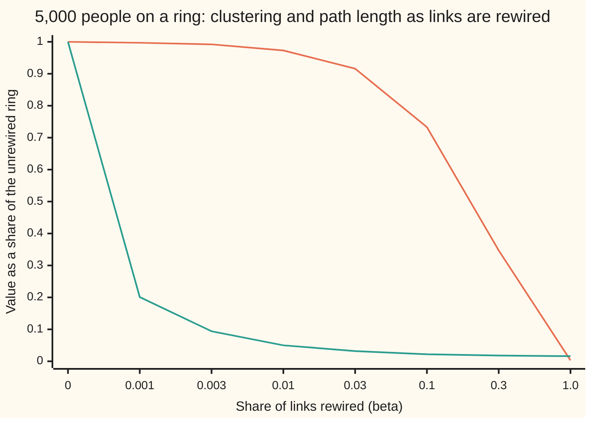

# Small worlds and hubs: three models, and the real networks they imitate

[Syllabus](../../../SYLLABUS.md) → [Applied and computational](../README.md) → [Network Science and Spectral Graphs](../README.md#s07) → Small worlds and hubs

---

## General Overview

Take a community of 5,000 people where each person has about 10 friends. Pick two people at random. How many handshakes does it take to pass a message from one to the other, friend to friend? In 1969 a letter-passing experiment across the United States found that chains which arrived were about six handshakes long. "Six degrees of separation" stuck as a phrase.

That is a puzzle, because real friendships are local. Your friends mostly know each other. If everyone knew only the people next door, a message would crawl: on a ring of 5,000 people, each friends with the 5 neighbours on either side, the average message needs **250.45** handshakes. Yet if friendships were pure chance, your friends would almost never know each other. Real networks have both things at once: tight local groups *and* short chains.

This card builds three rival recipes for a network of 5,000 people with about 10 friends each, and measures each one on three things. **Degrees**: how friend counts are spread, and whether there are hubs (people with far more friends than average). **Clustering**: how often two of your friends are friends with each other. **Path length**: the average number of handshakes between two people. All three networks here are synthetic, drawn from a stated rule and a seeded random-number generator.

- **Pure chance** (the Erdős–Rényi model): short paths, 3.954 handshakes, but almost no clustering, 0.0021.
- **A ring with a few long links** (the Watts–Strogatz model): move 10 percent of the ring's links to random people and the path length falls from 250.45 to 5.601, while clustering stays high at 0.4887.
- **Growth with "the rich get richer"** (preferential attachment, the Barabási–Albert model): newcomers prefer popular people, so hubs appear. The best-connected person has 273 friends, against at most 23 under pure chance.

**A handful of random long links makes a clustered network small, and growth that favours the already popular makes hubs; pure chance gives short paths but neither clustering nor hubs.**

**What kind of fact this is:** three models, not laws: each is a rule for drawing a network, judged by how well it imitates real ones. Inside each model the formulas on this card are theorems or standard approximations, and the code prints every one beside a seeded run and asserts most of them.

### The picture: rewiring a ring



Orange: clustering, as a share of the ring's 0.6667. Green: path length, as a share of the ring's 250.45. The steps along the bottom are not evenly spaced: each is about three times the last. Rewire one link in a thousand ($\beta = 0.001$) and paths shrink to 0.201 of their length, to 50.42 handshakes, while clustering has barely moved. By $\beta = 0.1$ the network is a **small world**: it keeps 0.733 of the ring's clustering, and its 5.60 handshakes are close to pure chance's 3.954.

---

## The formula

Notation, in words first. This shelf's notation for degrees starts here. A person's **degree** $k$ is their friend count. The **mean degree** $\langle k\rangle$, read "average k", is the average friend count. The **degree distribution** $p_k$ is the share of people with exactly $k$ friends. Clustering $C$ and path length $L$ are defined in the table. Each model then predicts these three things.

**Pure chance**, Erdős–Rényi: $n$ people, links placed at random, so each pair is linked with chance $p = \langle k\rangle/(n-1)$.

$$p_k \approx e^{-\langle k\rangle}\frac{\langle k\rangle^k}{k!}, \qquad C \approx p, \qquad L \approx \frac{\ln n - \gamma}{\ln \langle k\rangle} + \frac12$$

**Read it aloud:** friend counts follow the Poisson law (the count law for many small, independent chances) with average $\langle k\rangle$; two of your friends are linked only with the background chance $p$; and the path length grows like the logarithm of the population divided by the logarithm of the average degree.

**Ring with rewiring**, Watts–Strogatz: start from a ring where each person is linked to the $h$ nearest on each side, so $\langle k\rangle = 2h$. Then move the far end of each link to a random person with chance $\beta$.

$$C_0 = \frac{3(h-1)}{2(2h-1)}, \qquad L_0 \approx \frac{n}{4h}, \qquad C(\beta) \approx C_0\,(1-\beta)^3$$

**Read it aloud:** the ring's clustering is three times h minus one over twice two h minus one; its path length is about n over four h; and after rewiring, clustering shrinks by the chance that all three links of a triangle survive.

**Preferential attachment**, Barabási–Albert: people join one at a time, and each newcomer links to $m$ existing people, picking each one with chance proportional to their current degree. So $\langle k\rangle = 2m$.

$$p_k = \frac{2m(m+1)}{k(k+1)(k+2)} \quad (k \ge m), \qquad \text{share with } k \text{ or more friends} = \frac{m(m+1)}{k(k+1)}$$

**Read it aloud:** the share of people with k friends falls like one over k cubed, so the share with at least k falls only like one over k squared: a power-law tail.

| Symbol | Plain meaning | In our example | Push it up and the answer… |
| --- | --- | --- | --- |
| $n$ | number of people (vertices) | 5,000 | paths lengthen, but only like $\ln n$ outside the ring |
| $k$, $j$ | one person's friend count (degree); $j$ is the same count used as a running index in a sum | 10 on the ring | — |
| $\langle k\rangle$ | mean degree: the average friend count | 10 (9.994 for growth) | paths shorten |
| $p_k$ | degree distribution: share of people with exactly $k$ friends | Poisson for chance, power law for growth | — |
| $C$, $C_0$ | clustering: for each person, the share of their friend pairs who are friends; averaged over everyone. $C_0$ is the unrewired ring's | 0.0021, 0.4887, 0.0126; ring 0.6667 | more closed triangles |
| $L$, $L_0$, $d$ | path length: average handshakes on the shortest chain between two people. $L_0$ is the unrewired ring's; $d$ is a number of handshakes | 3.954, 5.601, 3.447; ring 250.45 | slower spread |
| $p$ | chance that a given pair is linked, pure chance | 0.0020 | more links, more clustering |
| $\gamma$ | Euler's constant, a fixed number, about 0.5772 | 0.5772 | — |
| $h$ | ring neighbours on each side | 5 | more clustering, shorter ring paths |
| $\beta$ | rewiring chance per ring link (say "beta") | 0.01 and 0.1 | clustering falls slowly, paths fall fast |
| $t$, $N_k$ | inside the fold: people joined so far, and how many of them have exactly $k$ friends | 5,000 at the end | — |
| $m$ | links each newcomer brings, preferential attachment | 5 | more hubs, shorter paths |

Notation clashes on this shelf, in one line: $L$ here is path length, not the Laplacian $L = D - A$ of [The graph Laplacian](03-graph-laplacian-and-spectral-clustering.md), and $m$ here is links per newcomer, not the total number of links it counts on [Centrality](01-centrality-and-pagerank.md) and [PageRank by power iteration](02-power-iteration-and-the-damping-factor.md).

### When it holds

- **Pure chance needs independent links.** Real friendships are not independent: a friend of a friend is far likelier to be a friend. Ignore that and the model predicts clustering of 0.0021 where the ring keeps 0.6667.
- **Short paths need a connected network.** Path length is averaged over pairs who *can* reach each other. With only 4 friends each on average, pure chance leaves some pairs with no chain at all, about 1 in 18 of the pairs searched (try changing, below), and "average handshakes" stops describing everybody.
- **The rewiring formula counts surviving triangles only.** It ignores new triangles formed by chance, so it slightly underestimates: 0.6469 predicted against 0.6488 measured at $\beta = 0.01$.
- **The power law needs growth *and* preference.** Drop the preference and newcomers pick uniformly: the tail becomes exponential (shrinks by a fixed factor per extra friend), and the network has 1 person with 50 or more friends instead of 64.
- **The power law is a large-network limit.** At 5,000 people the tail is cut off near the top: no one can have more friends than people have joined. The best-connected person has 273.

---

## Why it works

### Step 0: clustering is local, path length is global

Clustering asks about one person's own circle. Path length asks about the whole network. A change that touches only a few links barely moves the first, because almost every circle is untouched. But one long link can shorten the chain for thousands of pairs at once, because every pair whose shortest route can use it benefits. That mismatch is the whole small-world effect. Hubs do the same job for preferential attachment: one person with 273 friends is a shortcut for everyone near them.

### Step 1: pure chance gives short paths but no clustering

The [Random graphs](../../09-Probability%20and%20statistics/14-Random%20Graphs%20and%20the%20Probabilistic%20Method/01-random-graphs-erdos-renyi.md) card proves that in this model one person's degree is binomial: a count of 4,999 separate yes-or-no chances, one per possible friend. It is close to Poisson when $p$ is small. The code here uses Erdős and Rényi's own version: exactly 25,000 links, each a uniformly random new pair. That is the same model to the precision that matters.

**Clustering.** Take two of your friends. Whether they are linked is decided by their own random draw, which knows nothing about you. So the chance is just $p = 10/4999 = 0.0020$. Measured: 0.0021.

**Path length.** Start from one person. They have about 10 friends, those have about 10 each, and so on. Within $d$ handshakes they reach roughly $\langle k\rangle^d$ people. That covers all $n$ when $\langle k\rangle^d = n$, so $d = \ln n / \ln\langle k\rangle = 3.6990$. This rough count ignores that the circles overlap near the end and that the first step is special. A careful version, by Fronczak, Fronczak and Hołyst, adds the $-\gamma$ and $+\tfrac12$ corrections and gives 3.9483. The search over the network measures 3.9544.

### Step 2: the ring has clustering but long paths

**Clustering, by counting.** Number one person's ring friends by their offsets: $-h, \dots, -1$ on one side and $1, \dots, h$ on the other. Two friends are linked when their offsets differ by $h$ or less. On one side, every pair is that close: $h(h-1)/2$ pairs, twice over for both sides. Across the person, offsets $-i$ and $+j$ are linked when $i + j \le h$, which gives $h(h-1)/2$ more. That is $3h(h-1)/2 = 30$ linked pairs out of $h(2h-1) = 45$ pairs of friends. Clustering is $30/45 = 0.6667$, the same for everyone.

**Path length, by counting.** Each handshake moves at most $h$ places round the ring. So a person's distance in places, divided by $h$ and rounded up, is their distance in handshakes. Distances run from 1 place to half the ring, so the average is about a quarter of the ring divided by $h$: $5000/20 = 250$. The exact average over every offset is 250.4501, and the search over the network gives the same 250.4501.

### Step 3: rewiring keeps the clustering and kills the distance

**Clustering.** A triangle of friends on the ring survives if none of its three links was moved. Each link stays with chance $1-\beta$, separately, so the triangle survives with chance $(1-\beta)^3$. Clustering falls by that factor: $0.6667 \times 0.729 = 0.4860$ at $\beta = 0.1$, against 0.4887 measured. At $\beta = 0.01$ it falls by under 3 percent.

**Path length.** The ring has $nh = 25{,}000$ links, so $\beta = 0.01$ moves about 250 of them. Each moved link is a shortcut across the ring. A message now walks to the nearest shortcut, jumps, and walks again. With 250 shortcuts the nearest one is rarely far, and the path length drops from 250.45 to 12.634. At $\beta = 0.1$, 2,500 shortcuts, it is 5.601, and 84 percent of pairs are within six handshakes. No formula as simple as Step 1's exists for this middle region; the chart and the code measure it.

**Degrees.** Rewiring moves only the far end of a link, so each person keeps the 5 links that start at them, and friend counts stay close to 10: the most anyone has is 12 at $\beta = 0.01$ and 15 at $\beta = 0.1$. The rewired ring has no hubs.

### Step 4: preference makes the rich richer, and the tail a power law

When a newcomer picks a person with chance proportional to degree, someone with 40 friends is four times as likely to gain a friend as someone with 10. Early arrivals start ahead and stay ahead.

Count the people with each degree as the network grows. A person of degree $k$ gains a link at a rate proportional to $k$. In the long run the share $p_k$ settles where people arriving at degree $k$ balance people leaving it. That balance gives

$$p_k = p_{k-1}\,\frac{k-1}{k+2}, \qquad p_m = \frac{2}{m+2}.$$

Multiply the ratios from $m$ up to $k$ and almost everything cancels, leaving $p_k = 2m(m+1)/\big(k(k+1)(k+2)\big)$. For the share with $k$ or more, write each term as a difference:

$$\frac{2m(m+1)}{j(j+1)(j+2)} = m(m+1)\left[\frac{1}{j(j+1)} - \frac{1}{(j+1)(j+2)}\right].$$

Adding these from $j = k$ upwards, each bracket cancels half of the next, and only $m(m+1)/\big(k(k+1)\big)$ remains. With $m = 5$ that is $30/420 = 0.0714$ for 20 or more friends, about 357 people. The run has 359. Bollobás, Riordan, Spencer and Tusnády proved this law rigorously for a precisely stated version of the model.

<details>
<summary>The balance equation, step by step</summary>

At time $t$ there are about $t$ people and $mt$ links, so the degrees add to $2mt$. A newcomer's $m$ picks land on one given person of degree $k$ with total chance $m \cdot k/(2mt) = k/(2t)$.

Let $N_k$ be the number of people with degree $k$. When one newcomer joins, the expected change is

$$\Delta N_k = \frac{k-1}{2t}N_{k-1} - \frac{k}{2t}N_k \quad (k > m), \qquad \Delta N_m = 1 - \frac{m}{2t}N_m.$$

The first term counts people moving up from $k-1$, the second people leaving $k$. In the long run $N_k \approx p_k t$, so $\Delta N_k \approx p_k$. Substituting: $p_k = \tfrac{k-1}{2}p_{k-1} - \tfrac{k}{2}p_k$, which rearranges to $p_k = p_{k-1}(k-1)/(k+2)$. The same step for $k = m$ gives $p_m = 1 - \tfrac m2 p_m$, so $p_m = 2/(m+2)$. This is the mean-field (average-behaviour) argument; the rigorous proof controls the random fluctuations around it.

</details>

**Without preference** the same balance has every person gaining at the same rate, and each extra friend multiplies the share by $m/(m+1)$: an exponential tail. In the long run the share with 15 or more friends above the minimum, 20 or more in all, is $(5/6)^{15}$, so about 324.5274 of the 5,000 people. The run has 326.

Further out, this long-run law does not apply at 5,000 people, because no one has been around long enough. Even the oldest person starts with 5 friends and is picked by each newcomer with chance 5 over the number already joined. So they expect only 39.0549 friends. Reaching 50 takes a lucky draw, and the run has 1.

**Clustering and path length.** Hubs touch many people, so paths are short: 3.447, shorter than pure chance. But newcomers pick their friends independently, so clustering stays low, 0.0126. Preferential attachment explains hubs, not tight circles.

---

## Worked numbers, by hand

The example: 5,000 people, 10 friends each on average.

| Step | Arithmetic | Value |
| --- | --- | --- |
| links | $5000 \times 10 / 2$ | 25,000 |
| chance a pair is linked, $p$ | $10 / 4999$ | 0.0020 |
| pure chance, clustering | $C \approx p$ | 0.0020 |
| $\ln n$ and $\ln\langle k\rangle$ | $\ln 5000$, $\ln 10$ | 8.5172 and 2.3026 |
| pure chance, rough path length | $8.5172 / 2.3026$ | 3.6990 |
| ring, clustering $C_0$ | $30 / 45$ | 0.6667 |
| ring, path length $L_0$ | $5000 / (4 \times 5)$ | 250 |
| rewired 0.1, clustering | $0.6667 \times 0.9^3 = 0.6667 \times 0.729$ | 0.4860 |
| growth, share with 20+ friends | $5 \times 6 / (20 \times 21) = 30/420$ | 0.0714 |
| growth, people with 50+ friends | $5000 \times 30 / (50 \times 51)$ | 58.8235 |
| **pure chance, path length** | $(8.5172 - 0.5772)/2.3026 + 0.5$ | **3.9483** |

So two random people among the 5,000 are about four handshakes apart if friendships were pure chance: six degrees is, if anything, generous for a network this size.

### What breaks if you drop a piece

| Mistake | Comes out at | What went wrong |
| --- | --- | --- |
| Model friendships as pure chance | clustering 0.0021, against 0.4887 for the rewired ring | Independent links almost never close a triangle |
| Keep the ring, no long links | path length 250.45, against 5.601 at $\beta = 0.1$ | Every handshake moves at most 5 places |
| Use the rough $\ln n/\ln\langle k\rangle$ for path length | 3.6990, against 3.9544 measured | Ignores that the circles overlap and the first step is special |
| Grow the network without preference | best-connected 54, people with 50+ friends 1 | No rich-get-richer, so no power law: against 273 and 64 |
| Take $m$ as the average degree | 5, against 9.994 | Every link has two ends, so $\langle k\rangle = 2m$ |

---

## Code, from first principles, and it actually runs

The script draws every network itself from SplitMix64, a small random-number generator written out in both languages, so Python and Rust draw the same networks. It measures clustering by counting triangles at every person, and path length by **breadth-first search** (spreading outward from a person one handshake at a time) from every 10th person, 500 searches in all. Except on the ring, where every person looks the same, that path length is a sample, not every pair.

It takes **three roads**: closed forms (the formulas above), exact counts (the ring's clustering and its path length summed over every offset), and the seeded runs. The asserts check the runs against the formulas, with tolerances of a few standard errors (the typical size of chance variation between runs) where chance is involved.

In the output, ER is pure chance (Erdős–Rényi), WS is the ring with rewiring (Watts–Strogatz), and BA is growth with preference (Barabási–Albert). The column `<=6` is the share of pairs within six handshakes.

### Python

```python
# Small worlds and hubs -- the check behind the card.  Standard library only.
# Synthetic networks of 5,000 people with about 10 friends each, drawn from
# SplitMix64 written out below.  Roads: closed forms, exact counts, seeded runs.
from math import log, exp
MASK, N, H, M = (1 << 64) - 1, 5000, 5, 5     # people; ring neighbours each side; links per newcomer
GAMMA = 0.5772156649015329                    # Euler's constant, for the path-length formula
st = [0]
def rnd():                                    # SplitMix64: a uniform number in [0, 1)
    st[0] = (st[0] + 0x9E3779B97F4A7C15) & MASK
    z = st[0]
    z = ((z ^ (z >> 30)) * 0xBF58476D1CE4E5B9) & MASK
    z = ((z ^ (z >> 27)) * 0x94D049BB133111EB) & MASK
    return ((z ^ (z >> 31)) >> 11) * 2.0 ** -53
def pick(n): return int(rnd() * n)            # a whole number from 0 to n - 1
def link(adj, a, b): adj[a].add(b); adj[b].add(a)

def ring(n, h):                               # everyone joined to the h nearest on each side
    adj = [set() for _ in range(n)]
    for i in range(n):
        for j in range(1, h + 1): link(adj, i, (i + j) % n)
    return adj
def watts_strogatz(n, h, beta, seed):         # ring, then each link's far end moved with chance beta
    st[0] = seed; adj = ring(n, h)
    for i in range(n):
        for j in range(1, h + 1):
            if rnd() < beta:
                t = pick(n)
                while t == i or t in adj[i]: t = pick(n)
                old = (i + j) % n
                adj[i].discard(old); adj[old].discard(i); link(adj, i, t)
    return adj
def erdos_renyi(n, m, seed):                  # exactly m links, each a uniformly random new pair
    st[0] = seed; adj = [set() for _ in range(n)]; made = 0
    while made < m:
        a, b = pick(n), pick(n)
        if a != b and b not in adj[a]: link(adj, a, b); made += 1
    return adj
def grow(n, m, seed, by_degree):              # newcomers bring m links each
    st[0] = seed; adj = [set() for _ in range(n)]; ends = []
    for a in range(m + 1):                    # start: m + 1 people, all friends
        for b in range(a): link(adj, a, b); ends += [a, b]
    for v in range(m + 1, n):
        chosen = []
        while len(chosen) < m:                # a random link end picks a person in proportion to degree
            t = ends[pick(len(ends))] if by_degree else pick(v)
            if t not in chosen: chosen.append(t)
        for t in chosen: link(adj, v, t); ends += [v, t]
    return adj

def clustering(adj):                          # average share of a person's friend pairs who are friends
    total = 0.0
    for v in range(len(adj)):
        k = len(adj[v])
        if k < 2: continue
        tri = sum(len(adj[u] & adj[v]) for u in adj[v]) // 2
        total += tri / (k * (k - 1) / 2)
    return total / len(adj)
def paths(adj, step=10):                      # breadth-first search from every 10th person
    tot = cnt = near = srcs = 0
    for s in range(0, len(adj), step):
        dist = [-1] * len(adj); dist[s] = 0; q = [s]; i = 0; srcs += 1
        while i < len(q):
            u = q[i]; i += 1
            for w in adj[u]:
                if dist[w] < 0: dist[w] = dist[u] + 1; q.append(w)
        for d in dist:
            if d > 0: tot += d; cnt += 1; near += d <= 6
    return tot / cnt, near / cnt, cnt / (srcs * (len(adj) - 1))
def measure(adj):
    deg = [len(a) for a in adj]
    L, six, reach = paths(adj)
    return dict(k=sum(deg) / len(deg), C=clustering(adj), L=L, six=six, reach=reach, mx=max(deg),
                k20=sum(d >= 20 for d in deg), k50=sum(d >= 50 for d in deg), deg=deg)

er, ba, un = measure(erdos_renyi(N, 25000, 1)), measure(grow(N, M, 2, True)), measure(grow(N, M, 2, False))
sweep = [0, 0.001, 0.003, 0.01, 0.03, 0.1, 0.3, 1.0]
ws = {b: measure(watts_strogatz(N, H, b, 3)) for b in sweep}
print("5,000 synthetic people; paths from every 10th person (500 searches)")
print(f"{'model':<24}{'mean k':>7}{'C':>8}{'L':>9}{'<=6':>8}{'max k':>6}{'k>=20':>6}{'k>=50':>6}")
for name, r in (("ER, 25,000 links", er), ("WS ring, beta = 0", ws[0]), ("WS beta = 0.01", ws[0.01]),
                ("WS beta = 0.1", ws[0.1]), ("BA, m = 5", ba), ("growth, no preference", un)):
    print(f"{name:<24}{r['k']:7.3f}{r['C']:8.4f}{r['L']:9.3f}{r['six']:8.4f}{r['mx']:6d}{r['k20']:6d}{r['k50']:6d}")

c0 = 3 * (H - 1) / (2 * (2 * H - 1))                              # ring clustering, by counting triangles
l0 = sum((min(d, N - d) + H - 1) // H for d in range(1, N)) / (N - 1)   # ring path length, every offset
p = 2 * 25000 / (N * (N - 1))                                       # ER: chance a given pair is linked
kbar = 2 * 25000 / N
l_er = (log(N) - GAMMA) / log(kbar) + 0.5                          # ER path-length formula
pois, term = 0.0, exp(-kbar)                                       # Poisson(10): chance of under 20
for k in range(20): pois += term; term *= kbar / (k + 1)
tail = lambda k: M * (M + 1) / (k * (k + 1))                       # BA: share with k or more friends
fr = lambda r: sum(d * d for d in r['deg']) / sum(r['deg'])         # average friend's friend count
rows = [("by hand: links n<k>/2", N * kbar / 2), ("by hand: ln n", log(N)), ("by hand: ln<k>", log(kbar)), ("by hand: gamma", GAMMA),
        ("ring linked friend pairs", 3 * H * (H - 1) / 2), ("ring friend pairs h(2h-1)", H * (2 * H - 1)),
        ("shortcuts n h beta, 0.01", N * H * 0.01), ("shortcuts n h beta, 0.1", N * H * 0.1), ("(1-beta)^3 at 0.1", 0.9 ** 3),
        ("ring C, counted", ws[0]['C']), ("  3(h-1)/(2(2h-1))", c0),
        ("ring L, by search", ws[0]['L']), ("  exact sum over offsets", l0), ("  rough n/(4h)", N / (4 * H)),
        ("WS 0.01 C", ws[0.01]['C']), ("  C0 (1-beta)^3", c0 * 0.99 ** 3),
        ("WS 0.1 C", ws[0.1]['C']), ("  C0 (1-beta)^3", c0 * 0.9 ** 3),
        ("ER C", er['C']), ("  p = <k>/(n-1)", p),
        ("ER L", er['L']), ("  (ln n - gamma)/ln<k> + 1/2", l_er), ("  wrong: ln n / ln<k>", log(N) / log(kbar)),
        ("ER people with k>=20", er['k20']), ("  Poisson(10) expects", N * (1 - pois)),
        ("BA share k>=20", ba['k20'] / N), ("  m(m+1)/(k(k+1))", tail(20)), ("  n m(m+1)/(k(k+1))", N * tail(20)),
        ("BA people with k>=50", ba['k50']), ("  n m(m+1)/(k(k+1))", N * tail(50)),
        ("no-preference people k>=20", un['k20']), ("  long run n (m/(m+1))^15", N * (M / (M + 1)) ** 15),
        ("no-preference people k>=50", un['k50']), ("  oldest expects m + sum m/v", M + sum(M / v for v in range(M + 1, N))),
        ("BA average friend's k", fr(ba)), ("ER average friend's k", fr(er)),
        ("wrong: BA mean k taken as m", M)]
for name, v in rows: print(f"{name:<32}{v:12.4f}")
print("chart, beta      " + " ".join(f"{b:>6}" for b in sweep))
print("chart, C/C0      " + " ".join(f"{ws[b]['C'] / ws[0]['C']:6.3f}" for b in sweep))
print("chart, L/L0      " + " ".join(f"{ws[b]['L'] / ws[0]['L']:6.3f}" for b in sweep))
print("chart, L         " + " ".join(f"{ws[b]['L']:6.2f}" for b in sweep))
t1, t2, t3 = measure(erdos_renyi(N, 10000, 4)), measure(grow(N, 2, 5, True)), measure(watts_strogatz(N, 2, 0.01, 6))
print(f"try: ER 10,000 links   L {t1['L']:.3f}  formula {(log(N) - GAMMA) / log(4) + 0.5:.3f}  reached {t1['reach']:.4f}")
print(f"try: BA m = 2          L {t2['L']:.3f}  max k {t2['mx']}  k>=50 {t2['k50']}")
print(f"try: WS h = 2, 0.01    L {t3['L']:.3f}  C {t3['C']:.4f}  <=6 {t3['six']:.4f}")

assert abs(ws[0]['C'] - 2 / 3) < 1e-12, "ring clustering must be exactly 2/3"
assert abs(ws[0]['L'] - l0) < 1e-9, "ring search must equal the exact offset sum"
assert abs(ws[0.1]['C'] - c0 * 0.9 ** 3) < 0.02, "rewired clustering vs triangles surviving"
assert abs(er['C'] - p) < 0.0005, "ER clustering vs p"
assert abs(er['L'] - l_er) < 0.1, "ER path length vs formula"
assert abs(ba['k20'] / N - tail(20)) < 0.015, "BA degree tail vs m(m+1)/(k(k+1))"
assert abs(ba['k50'] - N * tail(50)) < 20, "BA hub count vs the tail formula"
assert ws[0.1]['C'] > 100 * er['C'] and ws[0.1]['L'] < 1.5 * er['L'], "small world: clustered and short"
assert er['reach'] == 1.0 and ba['reach'] == 1.0, "networks must be in one piece"
print("ALL CHECKS PASS")
```

**Ran 2026-11-11 on macOS, Python 3.14.10, standard library only. All checks passed. Output, pasted from the run:**

```
5,000 synthetic people; paths from every 10th person (500 searches)
model                    mean k       C        L     <=6 max k k>=20 k>=50
ER, 25,000 links         10.000  0.0021    3.954  1.0000    23    21     0
WS ring, beta = 0        10.000  0.6667  250.450  0.0120    10     0     0
WS beta = 0.01           10.000  0.6488   12.634  0.0411    12     0     0
WS beta = 0.1            10.000  0.4887    5.601  0.8357    15     0     0
BA, m = 5                 9.994  0.0126    3.447  1.0000   273   359    64
growth, no preference     9.994  0.0031    3.898  1.0000    54   326     1
by hand: links n<k>/2             25000.0000
by hand: ln n                         8.5172
by hand: ln<k>                        2.3026
by hand: gamma                        0.5772
ring linked friend pairs             30.0000
ring friend pairs h(2h-1)            45.0000
shortcuts n h beta, 0.01            250.0000
shortcuts n h beta, 0.1            2500.0000
(1-beta)^3 at 0.1                     0.7290
ring C, counted                       0.6667
  3(h-1)/(2(2h-1))                    0.6667
ring L, by search                   250.4501
  exact sum over offsets            250.4501
  rough n/(4h)                      250.0000
WS 0.01 C                             0.6488
  C0 (1-beta)^3                       0.6469
WS 0.1 C                              0.4887
  C0 (1-beta)^3                       0.4860
ER C                                  0.0021
  p = <k>/(n-1)                       0.0020
ER L                                  3.9544
  (ln n - gamma)/ln<k> + 1/2          3.9483
  wrong: ln n / ln<k>                 3.6990
ER people with k>=20                 21.0000
  Poisson(10) expects                17.2717
BA share k>=20                        0.0718
  m(m+1)/(k(k+1))                     0.0714
  n m(m+1)/(k(k+1))                 357.1429
BA people with k>=50                 64.0000
  n m(m+1)/(k(k+1))                  58.8235
no-preference people k>=20          326.0000
  long run n (m/(m+1))^15           324.5274
no-preference people k>=50            1.0000
  oldest expects m + sum m/v         39.0549
BA average friend's k                25.8683
ER average friend's k                10.9802
wrong: BA mean k taken as m           5.0000
chart, beta           0  0.001  0.003   0.01   0.03    0.1    0.3    1.0
chart, C/C0       1.000  0.997  0.992  0.973  0.916  0.733  0.347  0.003
chart, L/L0       1.000  0.201  0.094  0.050  0.032  0.022  0.018  0.016
chart, L         250.45  50.42  23.58  12.63   8.05   5.60   4.46   3.97
try: ER 10,000 links   L 6.231  formula 6.227  reached 0.9453
try: BA m = 2          L 4.708  max k 212  k>=50 13
try: WS h = 2, 0.01    L 38.915  C 0.4845  <=6 0.0066
ALL CHECKS PASS
```

The ring's searched path length equals the offset sum to every digit. Each seeded run lands near its formula: clustering 0.0021 against 0.0020, path length 3.9544 against 3.9483, 359 people with 20 or more friends against 357.1429.

### Rust

```rust
// Small worlds and hubs -- the same check as small_world_and_scale_free_models_check.py.
// Standard library only, no crates.  Synthetic networks of 5,000 people with about
// 10 friends each, drawn from SplitMix64 written out below.
// Compile: rustc --edition 2021 -O small_world_and_scale_free_models_check.rs -o /tmp/swsf
const N: usize = 5000; const H: usize = 5; const M: usize = 5;
const GAMMA: f64 = 0.5772156649015329;            // Euler's constant, for the path-length formula
type Adj = Vec<Vec<usize>>;

struct Rng(u64);
impl Rng {
    fn rnd(&mut self) -> f64 {                    // SplitMix64: a uniform number in [0, 1)
        self.0 = self.0.wrapping_add(0x9E3779B97F4A7C15);
        let mut z = self.0;
        z = (z ^ (z >> 30)).wrapping_mul(0xBF58476D1CE4E5B9);
        z = (z ^ (z >> 27)).wrapping_mul(0x94D049BB133111EB);
        ((z ^ (z >> 31)) >> 11) as f64 * (2.0f64).powi(-53)
    }
    fn pick(&mut self, n: usize) -> usize { (self.rnd() * n as f64) as usize }
}
fn link(adj: &mut Adj, a: usize, b: usize) { adj[a].push(b); adj[b].push(a); }
fn unlink(adj: &mut Adj, a: usize, b: usize) { adj[a].retain(|&x| x != b); adj[b].retain(|&x| x != a); }

fn ring(n: usize, h: usize) -> Adj {              // everyone joined to the h nearest on each side
    let mut adj = vec![Vec::new(); n];
    for i in 0..n { for j in 1..=h { link(&mut adj, i, (i + j) % n); } }
    adj
}
fn watts_strogatz(n: usize, h: usize, beta: f64, seed: u64) -> Adj {
    let mut g = Rng(seed); let mut adj = ring(n, h);
    for i in 0..n { for j in 1..=h {
        if g.rnd() < beta {
            let mut t = g.pick(n);
            while t == i || adj[i].contains(&t) { t = g.pick(n); }
            unlink(&mut adj, i, (i + j) % n); link(&mut adj, i, t);
        }
    } }
    adj
}
fn erdos_renyi(n: usize, m: usize, seed: u64) -> Adj {   // exactly m links, each a random new pair
    let mut g = Rng(seed); let mut adj = vec![Vec::new(); n]; let mut made = 0;
    while made < m {
        let (a, b) = (g.pick(n), g.pick(n));
        if a != b && !adj[a].contains(&b) { link(&mut adj, a, b); made += 1; }
    }
    adj
}
fn grow(n: usize, m: usize, seed: u64, by_degree: bool) -> Adj {   // newcomers bring m links each
    let mut g = Rng(seed); let mut adj = vec![Vec::new(); n]; let mut ends: Vec<usize> = Vec::new();
    for a in 0..=m { for b in 0..a { link(&mut adj, a, b); ends.push(a); ends.push(b); } }
    for v in (m + 1)..n {
        let mut chosen: Vec<usize> = Vec::new();
        while chosen.len() < m {
            let t = if by_degree { ends[g.pick(ends.len())] } else { g.pick(v) };
            if !chosen.contains(&t) { chosen.push(t); }
        }
        for &t in &chosen { link(&mut adj, v, t); ends.push(v); ends.push(t); }
    }
    adj
}

struct R { k: f64, c: f64, l: f64, six: f64, reach: f64, mx: usize, k20: usize, k50: usize, sq: f64, sum: f64 }
fn clustering(adj: &Adj) -> f64 {                 // average share of a person's friend pairs who are friends
    let mut mark = vec![false; adj.len()]; let mut total = 0.0;
    for v in 0..adj.len() {
        let k = adj[v].len();
        if k < 2 { continue; }
        for &u in &adj[v] { mark[u] = true; }
        let mut tri = 0usize;
        for &u in &adj[v] { for &w in &adj[u] { if mark[w] { tri += 1; } } }
        for &u in &adj[v] { mark[u] = false; }
        total += (tri / 2) as f64 / ((k * (k - 1)) as f64 / 2.0);
    }
    total / adj.len() as f64
}
fn measure(adj: &Adj) -> R {
    let n = adj.len(); let (mut tot, mut cnt, mut near, mut srcs) = (0u64, 0u64, 0u64, 0u64);
    for s in (0..n).step_by(10) {                 // breadth-first search from every 10th person
        let mut dist = vec![-1i64; n]; dist[s] = 0; let mut q = vec![s]; let mut i = 0; srcs += 1;
        while i < q.len() {
            let u = q[i]; i += 1;
            for &w in &adj[u] { if dist[w] < 0 { dist[w] = dist[u] + 1; q.push(w); } }
        }
        for &d in &dist { if d > 0 { tot += d as u64; cnt += 1; if d <= 6 { near += 1; } } }
    }
    let deg: Vec<usize> = adj.iter().map(|a| a.len()).collect();
    let sum: usize = deg.iter().sum();
    R { k: sum as f64 / n as f64, c: clustering(adj), l: tot as f64 / cnt as f64, six: near as f64 / cnt as f64,
        reach: cnt as f64 / (srcs * (n as u64 - 1)) as f64, mx: *deg.iter().max().unwrap(),
        k20: deg.iter().filter(|&&d| d >= 20).count(), k50: deg.iter().filter(|&&d| d >= 50).count(),
        sq: deg.iter().map(|&d| (d * d) as f64).sum(), sum: sum as f64 }
}

fn main() {
    let (er, ba, un) = (measure(&erdos_renyi(N, 25000, 1)), measure(&grow(N, M, 2, true)), measure(&grow(N, M, 2, false)));
    let sweep = [0.0, 0.001, 0.003, 0.01, 0.03, 0.1, 0.3, 1.0];
    let labels = ["0", "0.001", "0.003", "0.01", "0.03", "0.1", "0.3", "1.0"];
    let ws: Vec<R> = sweep.iter().map(|&b| measure(&watts_strogatz(N, H, b, 3))).collect();
    println!("5,000 synthetic people; paths from every 10th person (500 searches)");
    println!("{:<24}{:>7}{:>8}{:>9}{:>8}{:>6}{:>6}{:>6}", "model", "mean k", "C", "L", "<=6", "max k", "k>=20", "k>=50");
    for (name, r) in [("ER, 25,000 links", &er), ("WS ring, beta = 0", &ws[0]), ("WS beta = 0.01", &ws[3]),
                      ("WS beta = 0.1", &ws[5]), ("BA, m = 5", &ba), ("growth, no preference", &un)] {
        println!("{:<24}{:7.3}{:8.4}{:9.3}{:8.4}{:6}{:6}{:6}", name, r.k, r.c, r.l, r.six, r.mx, r.k20, r.k50);
    }
    let c0 = 3.0 * (H - 1) as f64 / (2.0 * (2 * H - 1) as f64);   // ring clustering, by counting triangles
    let l0 = (1..N).map(|d| (d.min(N - d) + H - 1) / H).sum::<usize>() as f64 / (N - 1) as f64;
    let p = 2.0 * 25000.0 / (N * (N - 1)) as f64;                 // ER: chance a given pair is linked
    let kbar = 2.0 * 25000.0 / N as f64;
    let l_er = ((N as f64).ln() - GAMMA) / kbar.ln() + 0.5;       // ER path-length formula
    let (mut pois, mut term) = (0.0f64, (-kbar).exp());           // Poisson(10): chance of under 20
    for k in 0..20 { pois += term; term *= kbar / (k + 1) as f64; }
    let tail = |k: f64| (M * (M + 1)) as f64 / (k * (k + 1.0));   // BA: share with k or more friends
    let rows: Vec<(&str, f64)> = vec![
        ("by hand: links n<k>/2", N as f64 * kbar / 2.0), ("by hand: ln n", (N as f64).ln()), ("by hand: ln<k>", kbar.ln()), ("by hand: gamma", GAMMA),
        ("ring linked friend pairs", (3 * H * (H - 1)) as f64 / 2.0), ("ring friend pairs h(2h-1)", (H * (2 * H - 1)) as f64),
        ("shortcuts n h beta, 0.01", (N * H) as f64 * 0.01), ("shortcuts n h beta, 0.1", (N * H) as f64 * 0.1),
        ("(1-beta)^3 at 0.1", 0.9f64.powf(3.0)),
        ("ring C, counted", ws[0].c), ("  3(h-1)/(2(2h-1))", c0),
        ("ring L, by search", ws[0].l), ("  exact sum over offsets", l0), ("  rough n/(4h)", N as f64 / (4 * H) as f64),
        ("WS 0.01 C", ws[3].c), ("  C0 (1-beta)^3", c0 * 0.99f64.powf(3.0)),
        ("WS 0.1 C", ws[5].c), ("  C0 (1-beta)^3", c0 * 0.9f64.powf(3.0)),
        ("ER C", er.c), ("  p = <k>/(n-1)", p),
        ("ER L", er.l), ("  (ln n - gamma)/ln<k> + 1/2", l_er), ("  wrong: ln n / ln<k>", (N as f64).ln() / kbar.ln()),
        ("ER people with k>=20", er.k20 as f64), ("  Poisson(10) expects", N as f64 * (1.0 - pois)),
        ("BA share k>=20", ba.k20 as f64 / N as f64), ("  m(m+1)/(k(k+1))", tail(20.0)), ("  n m(m+1)/(k(k+1))", N as f64 * tail(20.0)),
        ("BA people with k>=50", ba.k50 as f64), ("  n m(m+1)/(k(k+1))", N as f64 * tail(50.0)),
        ("no-preference people k>=20", un.k20 as f64), ("  long run n (m/(m+1))^15", N as f64 * (M as f64 / (M + 1) as f64).powf(15.0)),
        ("no-preference people k>=50", un.k50 as f64), ("  oldest expects m + sum m/v", M as f64 + ((M + 1)..N).map(|v| M as f64 / v as f64).sum::<f64>()),
        ("BA average friend's k", ba.sq / ba.sum), ("ER average friend's k", er.sq / er.sum),
        ("wrong: BA mean k taken as m", M as f64)];
    for (name, v) in &rows { println!("{:<32}{:12.4}", name, v); }
    println!("chart, beta      {}", labels.iter().map(|b| format!("{:>6}", b)).collect::<Vec<_>>().join(" "));
    println!("chart, C/C0      {}", ws.iter().map(|r| format!("{:6.3}", r.c / ws[0].c)).collect::<Vec<_>>().join(" "));
    println!("chart, L/L0      {}", ws.iter().map(|r| format!("{:6.3}", r.l / ws[0].l)).collect::<Vec<_>>().join(" "));
    println!("chart, L         {}", ws.iter().map(|r| format!("{:6.2}", r.l)).collect::<Vec<_>>().join(" "));
    let (t1, t2, t3) = (measure(&erdos_renyi(N, 10000, 4)), measure(&grow(N, 2, 5, true)), measure(&watts_strogatz(N, 2, 0.01, 6)));
    println!("try: ER 10,000 links   L {:.3}  formula {:.3}  reached {:.4}", t1.l, ((N as f64).ln() - GAMMA) / 4f64.ln() + 0.5, t1.reach);
    println!("try: BA m = 2          L {:.3}  max k {}  k>=50 {}", t2.l, t2.mx, t2.k50);
    println!("try: WS h = 2, 0.01    L {:.3}  C {:.4}  <=6 {:.4}", t3.l, t3.c, t3.six);

    assert!((ws[0].c - 2.0 / 3.0).abs() < 1e-12, "ring clustering must be exactly 2/3");
    assert!((ws[0].l - l0).abs() < 1e-9, "ring search must equal the exact offset sum");
    assert!((ws[5].c - c0 * 0.9f64.powf(3.0)).abs() < 0.02, "rewired clustering vs triangles surviving");
    assert!((er.c - p).abs() < 0.0005, "ER clustering vs p");
    assert!((er.l - l_er).abs() < 0.1, "ER path length vs formula");
    assert!((ba.k20 as f64 / N as f64 - tail(20.0)).abs() < 0.015, "BA degree tail vs m(m+1)/(k(k+1))");
    assert!((ba.k50 as f64 - N as f64 * tail(50.0)).abs() < 20.0, "BA hub count vs the tail formula");
    assert!(ws[5].c > 100.0 * er.c && ws[5].l < 1.5 * er.l, "small world: clustered and short");
    assert!(er.reach == 1.0 && ba.reach == 1.0, "networks must be in one piece");
    println!("ALL CHECKS PASS");
}
```

**Ran 2026-11-11 on macOS, rustc 1.98.1, no crates. All checks passed. Output, pasted from the run:**

```
5,000 synthetic people; paths from every 10th person (500 searches)
model                    mean k       C        L     <=6 max k k>=20 k>=50
ER, 25,000 links         10.000  0.0021    3.954  1.0000    23    21     0
WS ring, beta = 0        10.000  0.6667  250.450  0.0120    10     0     0
WS beta = 0.01           10.000  0.6488   12.634  0.0411    12     0     0
WS beta = 0.1            10.000  0.4887    5.601  0.8357    15     0     0
BA, m = 5                 9.994  0.0126    3.447  1.0000   273   359    64
growth, no preference     9.994  0.0031    3.898  1.0000    54   326     1
by hand: links n<k>/2             25000.0000
by hand: ln n                         8.5172
by hand: ln<k>                        2.3026
by hand: gamma                        0.5772
ring linked friend pairs             30.0000
ring friend pairs h(2h-1)            45.0000
shortcuts n h beta, 0.01            250.0000
shortcuts n h beta, 0.1            2500.0000
(1-beta)^3 at 0.1                     0.7290
ring C, counted                       0.6667
  3(h-1)/(2(2h-1))                    0.6667
ring L, by search                   250.4501
  exact sum over offsets            250.4501
  rough n/(4h)                      250.0000
WS 0.01 C                             0.6488
  C0 (1-beta)^3                       0.6469
WS 0.1 C                              0.4887
  C0 (1-beta)^3                       0.4860
ER C                                  0.0021
  p = <k>/(n-1)                       0.0020
ER L                                  3.9544
  (ln n - gamma)/ln<k> + 1/2          3.9483
  wrong: ln n / ln<k>                 3.6990
ER people with k>=20                 21.0000
  Poisson(10) expects                17.2717
BA share k>=20                        0.0718
  m(m+1)/(k(k+1))                     0.0714
  n m(m+1)/(k(k+1))                 357.1429
BA people with k>=50                 64.0000
  n m(m+1)/(k(k+1))                  58.8235
no-preference people k>=20          326.0000
  long run n (m/(m+1))^15           324.5274
no-preference people k>=50            1.0000
  oldest expects m + sum m/v         39.0549
BA average friend's k                25.8683
ER average friend's k                10.9802
wrong: BA mean k taken as m           5.0000
chart, beta           0  0.001  0.003   0.01   0.03    0.1    0.3    1.0
chart, C/C0       1.000  0.997  0.992  0.973  0.916  0.733  0.347  0.003
chart, L/L0       1.000  0.201  0.094  0.050  0.032  0.022  0.018  0.016
chart, L         250.45  50.42  23.58  12.63   8.05   5.60   4.46   3.97
try: ER 10,000 links   L 6.231  formula 6.227  reached 0.9453
try: BA m = 2          L 4.708  max k 212  k>=50 13
try: WS h = 2, 0.01    L 38.915  C 0.4845  <=6 0.0066
ALL CHECKS PASS
```

Line for line the same as Python, though the two store the networks differently: sets against lists.

### Lean

Lean proves the ring's clustering for every big enough ring, and preferential attachment's degree law and tail for every $m \ge 1$.

- Take a ring of $n$ people, each linked to the $h$ nearest on each side, with $h \ge 1$ and $n > 3h$. Then every person has $2h$ friends, and clustering $C_0 = 3(h-1)/(2(2h-1))$.
- Suppose the shares $p_k$ satisfy Step 4's balance, starting from $p_m = 2/(m+2)$, with $m \ge 1$. Then $p_k = 2m(m+1)/(k(k+1)(k+2))$ for every $k \ge m$.
- Take $k \ge m \ge 1$. Then the degree law's terms for every $j \ge k$ add up to exactly $m(m+1)/(k(k+1))$.
- The ring with $h = 5$ has 30 linked friend pairs out of 45, so its clustering is $2/3$.
- Summed over every offset from one person, the ring's handshakes total exactly 1,252,000.
- At $\beta = 0.1$, the rewiring formula gives $C_0 (1-\beta)^3 = 243/500$, which is 0.486.
- With $m = 5$, the share with 20 or more friends is $30/420 = 1/14$, about 357 of 5,000 people.

Lean does not draw random networks, so the seeded runs and the approximate formulas are left to the Python and Rust checks.

```lean
-- Small worlds and hubs: the ring's clustering is 3(h-1)/(2(2h-1)) at every person, and preferential attachment's degree law is 2m(m+1)/(k(k+1)(k+2)) with tail m(m+1)/(k(k+1)).
import Mathlib.Combinatorics.SimpleGraph.Circulant
import Mathlib.Combinatorics.SimpleGraph.Finite
import Mathlib.Data.ZMod.Defs
import Mathlib.Topology.Algebra.InfiniteSum.Real
import Mathlib.Algebra.Order.Field.Basic
import Mathlib.Tactic.NormNum
import Mathlib

open scoped Classical


lemma sw_zmod_cast_eq_zero_iff {n : ℕ} (y : ℤ) (h1 : -(n:ℤ) < y) (h2 : y < n) :
    ((y : ZMod n) = 0 ↔ y = 0) := by
  rw [ZMod.intCast_zmod_eq_zero_iff_dvd]
  constructor
  · rintro ⟨k, rfl⟩
    have hn : (0:ℤ) < n := by omega
    rcases lt_trichotomy k 0 with hk | hk | hk
    · nlinarith
    · simp [hk]
    · nlinarith
  · rintro rfl; simp

lemma sw_mem_jumps_iff {n h : ℕ} (hn : 3 * h < n) (x : ℤ) (hx1 : -(2 * (h:ℤ)) ≤ x)
    (hx2 : x ≤ 2 * h) :
    ((x : ZMod n) ∈ ((fun j : ℕ => (j : ZMod n)) '' Set.Icc 1 h)) ↔ (1 ≤ x ∧ x ≤ h) := by
  constructor
  · rintro ⟨j, ⟨hj1, hj2⟩, hj⟩
    simp only at hj
    have h0 : (((x - j : ℤ)) : ZMod n) = 0 := by push_cast; rw [hj, sub_self]
    rw [sw_zmod_cast_eq_zero_iff _ (by omega) (by omega)] at h0
    omega
  · rintro ⟨h1, h2⟩
    obtain ⟨j, rfl⟩ := Int.eq_ofNat_of_zero_le (by omega : (0:ℤ) ≤ x)
    exact ⟨j, ⟨by omega, by omega⟩, by simp⟩

lemma sw_ring_adj_iff {n h : ℕ} (hn : 3 * h < n) (v : ZMod n) (a b : ℤ)
    (ha1 : -(h:ℤ) ≤ a) (ha2 : a ≤ h) (hb1 : -(h:ℤ) ≤ b) (hb2 : b ≤ h) :
    (SimpleGraph.circulantGraph ((fun j : ℕ => (j : ZMod n)) '' Set.Icc 1 h)).Adj
      (v + (a : ZMod n)) (v + (b : ZMod n)) ↔ (a ≠ b ∧ a - b ≤ h ∧ b - a ≤ h) := by
  rw [SimpleGraph.circulantGraph_adj]
  have e1 : v + (a : ZMod n) - (v + (b : ZMod n)) = ((a - b : ℤ) : ZMod n) := by push_cast; ring
  have e2 : v + (b : ZMod n) - (v + (a : ZMod n)) = ((b - a : ℤ) : ZMod n) := by push_cast; ring
  have hne : ¬ v + (a : ZMod n) = v + (b : ZMod n) ↔ ¬ a = b := by
    rw [← sub_eq_zero, e1, sw_zmod_cast_eq_zero_iff _ (by omega) (by omega),
      sub_eq_zero]
  rw [hne, e1, e2, sw_mem_jumps_iff hn _ (by omega) (by omega),
    sw_mem_jumps_iff hn _ (by omega) (by omega)]
  omega

lemma sw_abs_sum (h : ℕ) : ∑ a ∈ Finset.Icc (-(h:ℤ)) h, |a| = (h:ℤ) * (h + 1) := by
  induction h with
  | zero => simp
  | succ h ih =>
    have hs : Finset.Icc (-((h + 1 : ℕ) : ℤ)) ((h + 1 : ℕ) : ℤ) =
        insert ((h:ℤ) + 1) (insert (-((h:ℤ) + 1)) (Finset.Icc (-(h:ℤ)) h)) := by
      ext x; simp; omega
    rw [hs, Finset.sum_insert (by simp; omega), Finset.sum_insert (by simp), ih,
      abs_of_pos (show (0:ℤ) < (h:ℤ) + 1 by positivity),
      abs_of_neg (show -((h:ℤ) + 1) < 0 by omega)]
    push_cast; ring

lemma sw_inner_card (h : ℕ) (a : ℤ) (ha : a ∈ (Finset.Icc (-(h:ℤ)) h).erase 0) :
    ((((Finset.Icc (-(h:ℤ)) h).erase 0).filter
      (fun b : ℤ => a ≠ b ∧ a - b ≤ h ∧ b - a ≤ h)).card : ℤ) = 2 * h - 1 - |a| := by
  simp only [Finset.mem_erase, Finset.mem_Icc] at ha
  rcases lt_or_gt_of_ne ha.1 with hneg | hpos
  · have hs : ((Finset.Icc (-(h:ℤ)) h).erase 0).filter
        (fun b : ℤ => a ≠ b ∧ a - b ≤ h ∧ b - a ≤ h) =
        ((Finset.Icc (-(h:ℤ)) (a + h)).erase 0).erase a := by
      ext b; simp; omega
    rw [hs, Finset.card_erase_of_mem (by simp; omega), Finset.card_erase_of_mem (by simp; omega),
      Int.card_Icc, abs_of_neg hneg]
    have := Int.toNat_of_nonneg (show (0:ℤ) ≤ a + h + 1 - -(h:ℤ) by omega)
    omega
  · have hs : ((Finset.Icc (-(h:ℤ)) h).erase 0).filter
        (fun b : ℤ => a ≠ b ∧ a - b ≤ h ∧ b - a ≤ h) =
        ((Finset.Icc (a - h) (h:ℤ)).erase 0).erase a := by
      ext b; simp; omega
    rw [hs, Finset.card_erase_of_mem (by simp; omega), Finset.card_erase_of_mem (by simp; omega),
      Int.card_Icc, abs_of_pos hpos]
    have := Int.toNat_of_nonneg (show (0:ℤ) ≤ (h:ℤ) + 1 - (a - h) by omega)
    omega

lemma sw_T_card (h : ℕ) : ((Finset.Icc (-(h:ℤ)) h).erase 0).card = 2 * h := by
  rw [Finset.card_erase_of_mem (by simp), Int.card_Icc]
  omega

lemma sw_pair_count (h : ℕ) :
    (((((Finset.Icc (-(h:ℤ)) h).erase 0) ×ˢ ((Finset.Icc (-(h:ℤ)) h).erase 0)).filter
      (fun p : ℤ × ℤ => p.1 ≠ p.2 ∧ p.1 - p.2 ≤ h ∧ p.2 - p.1 ≤ h)).card : ℤ) =
      3 * h * (h - 1) := by
  have hsplit : ((((Finset.Icc (-(h:ℤ)) h).erase 0) ×ˢ ((Finset.Icc (-(h:ℤ)) h).erase 0)).filter
      (fun p : ℤ × ℤ => p.1 ≠ p.2 ∧ p.1 - p.2 ≤ h ∧ p.2 - p.1 ≤ h)).card =
      ∑ a ∈ (Finset.Icc (-(h:ℤ)) h).erase 0, (((Finset.Icc (-(h:ℤ)) h).erase 0).filter
        (fun b : ℤ => a ≠ b ∧ a - b ≤ h ∧ b - a ≤ h)).card := by
    rw [Finset.card_filter, Finset.sum_product]
    refine Finset.sum_congr rfl (fun a _ => ?_)
    rw [Finset.card_filter]
  rw [hsplit]
  push_cast
  rw [Finset.sum_congr rfl (fun a ha => sw_inner_card h a ha), Finset.sum_sub_distrib,
    Finset.sum_const, sw_T_card, Finset.sum_erase _ (by simp), sw_abs_sum]
  ring

#print axioms sw_zmod_cast_eq_zero_iff
#print axioms sw_mem_jumps_iff
#print axioms sw_ring_adj_iff
#print axioms sw_abs_sum
#print axioms sw_inner_card
#print axioms sw_T_card
#print axioms sw_pair_count

/-- The ring's clustering, by counting. Put `n` people on a ring (`ZMod n`) and link each person to
the `h` nearest on each side: the circulant graph with jumps `1, …, h`. Then every person has
`2h` friends, and the share of pairs of their friends who are themselves friends is
`3(h-1)/(2(2h-1))`, the same for everyone. Pairs are counted in order on both sides of the
fraction, which gives the same share as unordered pairs. The card's counting assumes the ring is
big enough that friends' offsets never wrap round the ring (`3h < n`; at `n = 3h` the friends at
offsets `h` and `-h` would be linked the short way), and at least one neighbour each side. -/
theorem ring_clustering_eq (n h : ℕ) [NeZero n] (hh : 1 ≤ h) (hn : 3 * h < n)
    (G : SimpleGraph (ZMod n))
    (hG : G = SimpleGraph.circulantGraph ((fun j : ℕ => (j : ZMod n)) '' Set.Icc 1 h))
    (v : ZMod n) :
    G.degree v = 2 * h ∧
      ((((G.neighborFinset v ×ˢ G.neighborFinset v).filter (fun p => G.Adj p.1 p.2)).card : ℚ) /
          ((G.degree v : ℚ) * ((G.degree v : ℚ) - 1)) =
        3 * ((h : ℚ) - 1) / (2 * (2 * (h : ℚ) - 1))) := by
  have hadjG : ∀ a b : ℤ, -(h:ℤ) ≤ a → a ≤ h → -(h:ℤ) ≤ b → b ≤ h →
      (G.Adj (v + (a : ZMod n)) (v + (b : ZMod n)) ↔ (a ≠ b ∧ a - b ≤ h ∧ b - a ≤ h)) := by
    intro a b ha1 ha2 hb1 hb2
    rw [hG]
    exact sw_ring_adj_iff hn v a b ha1 ha2 hb1 hb2
  obtain ⟨T, hTdef⟩ : ∃ T : Finset ℤ, T = (Finset.Icc (-(h:ℤ)) h).erase 0 := ⟨_, rfl⟩
  have hT : ∀ a, a ∈ T ↔ (-(h:ℤ) ≤ a ∧ a ≤ h ∧ a ≠ 0) := by
    intro a; rw [hTdef]; simp only [Finset.mem_erase, Finset.mem_Icc]; tauto
  have hinj : ∀ a ∈ T, ∀ b ∈ T, v + (a : ZMod n) = v + (b : ZMod n) → a = b := by
    intro a ha b hb hab
    rw [hT] at ha hb
    have h0 : ((a - b : ℤ) : ZMod n) = 0 := by
      have : (v + (a : ZMod n)) - (v + (b : ZMod n)) = ((a - b : ℤ) : ZMod n) := by
        push_cast; ring
      rw [← this, hab, sub_self]
    rw [sw_zmod_cast_eq_zero_iff _ (by omega) (by omega)] at h0
    omega
  have hN : G.neighborFinset v
      = T.image (fun d : ℤ => v + (d : ZMod n)) := by
    ext w
    rw [SimpleGraph.mem_neighborFinset, Finset.mem_image]
    constructor
    · intro hw
      rw [hG, SimpleGraph.circulantGraph_adj] at hw
      rcases hw.2 with ⟨j, ⟨hj1, hj2⟩, hj⟩ | ⟨j, ⟨hj1, hj2⟩, hj⟩
      · refine ⟨-(j:ℤ), (hT _).2 ⟨by omega, by omega, by omega⟩, ?_⟩
        simp only at hj
        push_cast
        rw [hj]; ring
      · refine ⟨(j:ℤ), (hT _).2 ⟨by omega, by omega, by omega⟩, ?_⟩
        simp only at hj
        push_cast
        rw [hj]; ring
    · rintro ⟨a, ha, rfl⟩
      rw [hT] at ha
      have := (hadjG 0 a (by omega) (by omega) (by omega) (by omega)).2
        ⟨by omega, by omega, by omega⟩
      simpa using this
  have hdeg : G.degree v
      = 2 * h := by
    rw [← SimpleGraph.card_neighborFinset_eq_degree, hN,
      Finset.card_image_of_injOn (fun a ha b hb hab => hinj a ha b hb hab), hTdef, sw_T_card]
  have hpair : ((G.neighborFinset v ×ˢ
      G.neighborFinset v).filter
      (fun p => G.Adj p.1 p.2)).card
      = ((T ×ˢ T).filter (fun p : ℤ × ℤ => p.1 ≠ p.2 ∧ p.1 - p.2 ≤ h ∧ p.2 - p.1 ≤ h)).card := by
    rw [hN]
    symm
    apply Finset.card_bij (fun p _ => (v + (p.1 : ZMod n), v + (p.2 : ZMod n)))
    · rintro ⟨a, b⟩ hab
      simp only [Finset.mem_filter, Finset.mem_product] at hab ⊢
      refine ⟨⟨Finset.mem_image_of_mem _ hab.1.1, Finset.mem_image_of_mem _ hab.1.2⟩, ?_⟩
      have ha := (hT a).1 hab.1.1
      have hb := (hT b).1 hab.1.2
      exact (hadjG a b (by omega) (by omega) (by omega) (by omega)).2 hab.2
    · rintro ⟨a, b⟩ hab ⟨c, d⟩ hcd heq
      simp only [Finset.mem_filter, Finset.mem_product] at hab hcd
      simp only [Prod.mk.injEq] at heq
      rw [hinj a hab.1.1 c hcd.1.1 heq.1, hinj b hab.1.2 d hcd.1.2 heq.2]
    · rintro ⟨x, y⟩ hxy
      simp only [Finset.mem_filter, Finset.mem_product, Finset.mem_image] at hxy
      obtain ⟨⟨⟨a, ha, rfl⟩, ⟨b, hb, rfl⟩⟩, hadj⟩ := hxy
      refine ⟨(a, b), ?_, rfl⟩
      have ha' := (hT a).1 ha
      have hb' := (hT b).1 hb
      simp only [Finset.mem_filter, Finset.mem_product]
      exact ⟨⟨ha, hb⟩,
        (hadjG a b (by omega) (by omega) (by omega) (by omega)).1 hadj⟩
  have hQ := sw_pair_count h
  rw [← hTdef] at hQ
  have hQ' : (((T ×ˢ T).filter
      (fun p : ℤ × ℤ => p.1 ≠ p.2 ∧ p.1 - p.2 ≤ h ∧ p.2 - p.1 ≤ h)).card : ℚ) =
      3 * h * ((h:ℚ) - 1) := by
    have := congrArg (fun z : ℤ => (z : ℚ)) hQ
    push_cast at this
    exact this
  refine ⟨hdeg, ?_⟩
  rw [hpair, hdeg, hQ']
  have hh' : (1:ℚ) ≤ h := by exact_mod_cast hh
  push_cast
  rw [div_eq_div_iff (by nlinarith) (by linarith)]
  ring

/-- Preferential attachment, the balance equation solved. If the long-run degree shares satisfy
the card's balance `p_m = 2/(m+2)` and `p_k = p_{k-1} (k-1)/(k+2)` for `k > m`, then multiplying
the ratios gives `p_k = 2m(m+1)/(k(k+1)(k+2))` for every `k ≥ m`. Each newcomer brings `m ≥ 1`
links. -/
theorem pref_attachment_degree_law (m : ℕ) (hm : 1 ≤ m) (p : ℕ → ℝ)
    (h0 : p m = 2 / ((m : ℝ) + 2))
    (hrec : ∀ k : ℕ, m < k → p k = p (k - 1) * ((k : ℝ) - 1) / ((k : ℝ) + 2)) :
    ∀ k : ℕ, m ≤ k →
      p k = 2 * (m : ℝ) * ((m : ℝ) + 1) / ((k : ℝ) * ((k : ℝ) + 1) * ((k : ℝ) + 2)) := by
  intro k hk
  induction k, hk using Nat.le_induction with
  | base =>
    rw [h0]
    have hm' : (0:ℝ) < m := by exact_mod_cast hm
    rw [div_eq_div_iff (by positivity) (mul_pos (mul_pos hm' (by linarith)) (by linarith)).ne']
    ring
  | succ k hmk ih =>
    rw [hrec (k + 1) (by omega), Nat.add_sub_cancel, ih]
    have hk' : (1:ℝ) ≤ k := by exact_mod_cast (le_trans hm hmk)
    push_cast
    field_simp
    ring

/-- Preferential attachment, the power-law tail. Adding the degree law
`2m(m+1)/(j(j+1)(j+2))` over every `j ≥ k` telescopes to `m(m+1)/(k(k+1))`: the share of people
with `k` or more friends. Here `k ≥ m ≥ 1`, as for the degree law; with `k = m` the shares add to 1. -/
theorem pref_attachment_tail_sum (m k : ℕ) (hm : 1 ≤ m) (hk : m ≤ k) :
    HasSum
      (fun i : ℕ => 2 * (m : ℝ) * ((m : ℝ) + 1) /
        (((k + i : ℕ) : ℝ) * (((k + i : ℕ) : ℝ) + 1) * (((k + i : ℕ) : ℝ) + 2)))
      ((m : ℝ) * ((m : ℝ) + 1) / ((k : ℝ) * ((k : ℝ) + 1))) := by
  have hk1 : (1:ℝ) ≤ k := by exact_mod_cast (le_trans hm hk)
  let g : ℕ → ℝ := fun i => (m : ℝ) * ((m : ℝ) + 1) / (((k + i : ℕ) : ℝ) * (((k + i : ℕ) : ℝ) + 1))
  have hterm : ∀ i : ℕ, 2 * (m : ℝ) * ((m : ℝ) + 1) /
      (((k + i : ℕ) : ℝ) * (((k + i : ℕ) : ℝ) + 1) * (((k + i : ℕ) : ℝ) + 2)) = g i - g (i + 1) := by
    intro i
    simp only [g]
    have hi : (0:ℝ) ≤ i := by positivity
    push_cast
    have hki : (1:ℝ) ≤ k + i := by linarith
    field_simp
    ring
  have hnonneg : ∀ i : ℕ, 0 ≤ 2 * (m : ℝ) * ((m : ℝ) + 1) /
      (((k + i : ℕ) : ℝ) * (((k + i : ℕ) : ℝ) + 1) * (((k + i : ℕ) : ℝ) + 2)) := by
    intro i; positivity
  rw [hasSum_iff_tendsto_nat_of_nonneg hnonneg]
  simp_rw [hterm, Finset.sum_range_sub']
  have hlim : Filter.Tendsto g Filter.atTop (nhds 0) := by
    apply Filter.Tendsto.div_atTop tendsto_const_nhds
    apply Filter.tendsto_atTop_mono _ tendsto_natCast_atTop_atTop
    intro i
    push_cast
    have hi : (0:ℝ) ≤ i := by positivity
    nlinarith
  have h0 : g 0 = (m : ℝ) * ((m : ℝ) + 1) / ((k : ℝ) * ((k : ℝ) + 1)) := by
    simp [g]
  rw [← h0]
  simpa using (tendsto_const_nhds (x := g 0)).sub hlim

-- The card's worked numbers, exactly: 5,000 people, 10 friends each, h = 5, m = 5.

-- links: 5000 × 10 / 2
example : 5000 * 10 / 2 = 25000 := by norm_num
-- chance a pair is linked under pure chance: 2 × 25,000 / (5000 × 4999) = 10/4999
example : (2 * 25000 : ℚ) / (5000 * 4999) = 10 / 4999 := by norm_num
-- ring, h = 5: 3h(h-1)/2 = 30 linked friend pairs out of h(2h-1) = 45
example : 3 * 5 * (5 - 1) / 2 = 30 ∧ 5 * (2 * 5 - 1) = 45 := by norm_num
-- ring clustering: 30/45 = 3(h-1)/(2(2h-1)) = 2/3
example : (30 : ℚ) / 45 = 2 / 3 ∧ (3 * (5 - 1) : ℚ) / (2 * (2 * 5 - 1)) = 2 / 3 := by norm_num
-- ring path length, rough: 5000/(4 × 5) = 250
example : (5000 : ℚ) / (4 * 5) = 250 := by norm_num
-- ring path length, exact sum over every offset: 1,252,000 / 4999 (about 250.4501)
example : (Finset.Ico 1 5000).sum (fun d => (min d (5000 - d) + 5 - 1) / 5) = 1252000 := by
  decide +kernel
-- shortcuts: n h β = 25,000 × 1/100 = 250 and 25,000 × 1/10 = 2,500
example : (5000 * 5 : ℚ) * (1 / 100) = 250 ∧ (5000 * 5 : ℚ) * (1 / 10) = 2500 := by norm_num
-- rewired at β = 1/10: (9/10)^3 = 729/1000, and C₀ (1-β)^3 = 2/3 × 729/1000 = 243/500
example : ((9 : ℚ) / 10) ^ 3 = 729 / 1000 ∧ (2 / 3 : ℚ) * (9 / 10) ^ 3 = 243 / 500 := by norm_num
-- growth, m = 5: p_m = 2/(m+2) = 2/7 agrees with 2m(m+1)/(m(m+1)(m+2))
example : (2 : ℚ) / (5 + 2) = 2 * 5 * 6 / (5 * 6 * 7) := by norm_num
-- growth, share with 20 or more friends: 5 × 6 / (20 × 21) = 30/420 = 1/14
example : (5 * 6 : ℚ) / (20 * 21) = 30 / 420 ∧ (30 : ℚ) / 420 = 1 / 14 := by norm_num
-- growth, expected people with 20 or more: 5000/14 = 2500/7 (about 357.1429)
example : (5000 : ℚ) * (1 / 14) = 2500 / 7 := by norm_num
-- growth, expected people with 50 or more: 5000 × 30 / (50 × 51) = 1000/17 (about 58.8235)
example : (5000 : ℚ) * 30 / (50 * 51) = 1000 / 17 := by norm_num
-- mean degree under growth is 2m, not m
example : 2 * 5 = 10 := by norm_num

#print axioms ring_clustering_eq
#print axioms pref_attachment_degree_law
#print axioms pref_attachment_tail_sum
```

**Checked 2026-11-14 on macOS, Lean 4.36.0-rc2, Mathlib v4.36.0-rc2. Every proof is complete and uses only Lean's standard axioms. Output, pasted from the run:**

```
'sw_zmod_cast_eq_zero_iff' depends on axioms: [propext, Classical.choice, Quot.sound]
'sw_mem_jumps_iff' depends on axioms: [propext, Classical.choice, Quot.sound]
'sw_ring_adj_iff' depends on axioms: [propext, Classical.choice, Quot.sound]
'sw_abs_sum' depends on axioms: [propext, Classical.choice, Quot.sound]
'sw_inner_card' depends on axioms: [propext, Classical.choice, Quot.sound]
'sw_T_card' depends on axioms: [propext, Classical.choice, Quot.sound]
'sw_pair_count' depends on axioms: [propext, Classical.choice, Quot.sound]
'ring_clustering_eq' depends on axioms: [propext, Classical.choice, Quot.sound]
'pref_attachment_degree_law' depends on axioms: [propext, Classical.choice, Quot.sound]
'pref_attachment_tail_sum' depends on axioms: [propext, Classical.choice, Quot.sound]
```

> [!TIP]
> **Try changing**
> - Guess first: halve the friends under pure chance. Set the links to `10000`, 4 friends each. The path length rises to **6.231**, and the formula gives 6.227. But only 0.9453 of the pairs searched (from every 10th person) are connected at all: about 1 in 18 has no chain.
> - Guess first: fewer links per newcomer. Set `m = 2`. Hubs survive: the best-connected person has **212** friends and 13 people have 50 or more. Paths lengthen to 4.708.
> - Guess first: a thinner ring. Set `h = 2` with $\beta = 0.01$. Clustering is 0.4845 but paths are **38.915**, and only 0.0066 of pairs are within six handshakes: 4 friends each and 1 percent shortcuts are not a small world at this size.
> - Guess first: rewire everything. Read the last chart point, $\beta = 1$: path length 3.97, clustering 0.003 of the ring's. Fully rewired, the ring is close to pure chance, though not exactly: each person keeps the 5 links that start at them.

---

## The usual mistake

> [!warning]
> **Thinking "small world" just means short paths.** Pure chance already gives short paths: 3.954 handshakes among 5,000 people. The surprise in real networks is short paths *together with* high clustering, which pure chance cannot give (0.0021). A small world is judged against both: clustering far above the random network's, path length close to it. The rewired ring at $\beta = 0.1$ has 0.4887 and 5.601.
>
> Smaller traps:
> - **Your friends are not typical.** Pick a friendship at random and look at one end: you are picking people in proportion to their friend count. Under growth with preference, that friend has on average **25.8683** friends, while the average person has 9.994. Under pure chance the gap is small: 10.9802.
> - **The newcomer's link count is not the average degree.** Each newcomer brings $m = 5$ links, but each link adds a friend at both ends, so the average is 9.994, not 5.
> - **The rough path-length count runs short.** $\ln n / \ln\langle k\rangle$ gives 3.6990; the run gives 3.9544.
> - **Judging hubs by a near cutoff.** Growth without preference already gives 326 people with 20 or more friends, close to the 359 with preference. The two differ further out: 1 person against 64 with 50 or more. A tail is read far from the average, never near it.

---

## Where you meet it in real life

- **The 1969 letter chains.** People in Nebraska and Boston passed letters to acquaintances, aiming at a target in Massachusetts. The chains that arrived were about six handshakes long: the experiment behind "six degrees".
- **Film actors, a power grid and a worm's nerves.** The 1998 paper that introduced the rewired ring found all three clustered far above chance with paths close to chance: small worlds.
- **The web and citations.** Pages and papers gain new links partly because they already have many. Link counts have long, power-law-like tails, the pattern preferential attachment was built to explain.
- **Epidemics and hubs.** On a network with hubs, a disease reaches the best-connected people early and spreads through them. Testing the friends of random people finds hubs sooner, by the friendship effect above. [Epidemics on a network](05-epidemics-on-networks.md) works this out.
- **A city's bike-share stations.** Link two stations when riders travel between them. Most links then join nearby stations and a few join distant ones, which is the rewired ring's shape: local clusters, plus long hops that make the city small.

> **Say it back**
> Three recipes build networks with the same average friend count. Pure chance gives short paths but almost no clustering. A ring gives clustering but long paths; moving a few of its links to random people keeps the clustering and collapses the distance, because clustering is local and distance is global. Growth where newcomers prefer popular people gives hubs and a power-law tail, $m(m+1)/(k(k+1))$, and short paths, but little clustering. Real social networks need both tricks.

---

## What this builds on

- [Centrality](01-centrality-and-pagerank.md): degree as one measure of importance; here the whole spread of degrees is the object.
- [Random graphs](../../09-Probability%20and%20statistics/14-Random%20Graphs%20and%20the%20Probabilistic%20Method/01-random-graphs-erdos-renyi.md): the pure-chance model and its binomial-then-Poisson degree law, stated here in one line.
- [Heavy tails](../../09-Probability%20and%20statistics/04-Continuous%20Distributions/08-heavy-tails-pareto-and-cauchy.md): power-law tails and why they make averages unstable; preferential attachment is one way to grow one.
- [Graphs](../../04-Combinatorics%20and%20graphs/09-Graphs%20-%20Dots%20and%20Lines/01-graphs-vertices-and-edges.md): vertices, edges and degree, the language of every count on this card.

## Where this goes next

- [Epidemics on a network](05-epidemics-on-networks.md): how a disease spreads on these three networks, and why the hubs decide whether it takes off.
- [Communities](06-community-detection.md): finding the tight groups that high clustering hints at.
- [Expanders](07-expanders-and-mixing.md): networks with no bottlenecks, where short paths are guaranteed rather than typical.

Left open: which simple growth rule gives hubs *and* high clustering together, as real social networks have?

---

## Sources

Verified 2026-11-11: every link below resolves to the publisher's page.

- Travers, Jeffrey, and Stanley Milgram. "An Experimental Study of the Small World Problem." *Sociometry* 32, no. 4 (1969): 425–443. [doi:10.2307/2786545](https://doi.org/10.2307/2786545). The letter-chain experiment behind "six degrees".
- Watts, Duncan J., and Steven H. Strogatz. "Collective dynamics of 'small-world' networks." *Nature* 393 (1998): 440–442. [doi:10.1038/30918](https://doi.org/10.1038/30918). The rewired ring, clustering and path length, and the chart on this card.
- Barabási, Albert-László, and Réka Albert. "Emergence of Scaling in Random Networks." *Science* 286 (1999): 509–512. [doi:10.1126/science.286.5439.509](https://doi.org/10.1126/science.286.5439.509). Growth with preferential attachment and its power-law degrees.
- Bollobás, Béla, Oliver Riordan, Joel Spencer, and Gábor Tusnády. "The degree sequence of a scale-free random graph process." *Random Structures & Algorithms* 18, no. 3 (2001): 279–290. [doi:10.1002/rsa.1009](https://doi.org/10.1002/rsa.1009). The rigorous proof of the degree law $2m(m+1)/(k(k+1)(k+2))$.
- Fronczak, Agata, Piotr Fronczak, and Janusz A. Hołyst. "Average path length in random networks." *Physical Review E* 70 (2004): 056110. [doi:10.1103/PhysRevE.70.056110](https://doi.org/10.1103/PhysRevE.70.056110). The path-length formula with the $\gamma$ and $\tfrac12$ corrections.
