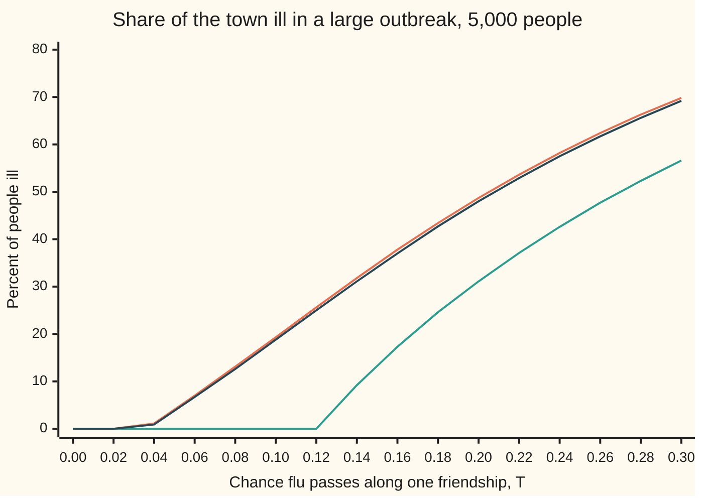

# Epidemics on a network: the threshold, and why the hubs decide the outcome

[Syllabus](../../../SYLLABUS.md) → [Applied and computational](../README.md) → [Network Science and Spectral Graphs](../README.md#s07) → Epidemics on a network

---

## General Overview

A town of 5,000 people, joined by 17,134 friendships. The network is synthetic: each person's number of friends is drawn from a stated rule with seed 2026, and the friendships are then wired at random. The average person has 6.85 friends. A few people are hubs (people with far more friends than average): the busiest has 270.

Flu arrives with one person. Over a whole illness, it passes along any one friendship with chance 1 in 10. A health officer wants to know two things. Will it spread? And if there are only 50 doses, who should get them?

The quick answer says it cannot spread. One ill person has 6.85 friends and infects each with chance 0.1, so 0.69 new cases on average. Less than one case per case means the flu dies out. That answer is wrong. In 2,000 simulated introductions, 19.15% took off and made about 977 people ill.

The reason is who catches it next. Every case after the first was reached along a friendship, and friendships lead to hubs far more often than a random pick does. On average each later case has 27.36 friends besides the one who infected them, so each passes the flu to 2.74 others.

The same reason picks the doses. Vaccinate the 50 busiest people, 1% of the town, and each later case infects 0.83 others: below one, so no large outbreak can form. Vaccinate 50 at random and 929 fall ill instead of 967. Random doses would need 3,173 people to match.

**On a network, an outbreak is a chain of friendships, and the chain runs through the busy people, so the threshold is set by the average of friends-squared over the average of friends, not by the average alone; remove the hubs and the chain breaks.**

**What kind of fact this is:** a model, the SIR model (each person is susceptible, then infected, then removed by recovery) on a network wired at random apart from each person's number of friends. Inside it, the threshold and the outbreak-size formula are exact for an endlessly large network, derived on this card in Why it works by the branching argument. At 5,000 people they are approximations, checked here against simulation.

### The picture: how many fall ill, against how easily flu passes



Orange: nobody vaccinated. Green: the 50 busiest vaccinated. Dark blue: 50 vaccinated at random, almost on top of orange. Each line is the formula below on the town's actual list of friend counts; with doses given, the share is of the 4,950 left. Orange leaves zero at T = 0.0365, green only at T = 0.1205, so at the flu's T = 0.10 green is flat.

---

## The formula

Notation, in words first. $k$ is a person's number of friends, their **degree**. $p_k$ is the share of the town with exactly $k$ friends, the **degree distribution**, and $\langle k \rangle$ is the mean degree, both from [Small worlds and hubs](04-small-world-and-scale-free-models.md). Angle brackets mean "the average over all people", so $\langle k^2 \rangle$ is the average of each person's degree squared. $T$ is the **transmissibility**: the chance that an ill person passes the flu along one given friendship over their whole illness. (On shelf 02, $T$ was an annealing temperature; here it is only this chance.)

The **mean excess degree** $\kappa$ (the Greek letter kappa) is the average number of *other* friends of a person you reach by following a friendship.

$$\kappa = \frac{\langle k^2\rangle - \langle k\rangle}{\langle k\rangle}, \qquad R_0 = T\,\kappa, \qquad T_c = \frac{1}{\kappa} = \frac{\langle k\rangle}{\langle k^2\rangle - \langle k\rangle}$$

**Read it aloud:** a case reached along a friendship passes the flu on to T times kappa others, and a large outbreak is possible exactly when that number is above one, that is, when T is above one over kappa.

The share of the town ill in a large outbreak comes from two averages over the degree list, called **generating functions** (a list of chances packed into one polynomial):

$$G_0(x) = \sum_k p_k\,x^k, \qquad G_1(x) = \frac{1}{\langle k\rangle}\sum_k k\,p_k\,x^{k-1}$$

$$u = G_1(1 - T + T u), \qquad z = 1 - G_0(1 - T + T u)$$

**Read it aloud:** u is the chance that one friendship does not lead into the big outbreak, it is the smallest number that solves its own equation, and z, the share of the town ill, is one minus the chance that none of a person's friendships leads in.

| Symbol | Plain meaning | In our example | Push it up and the answer… |
| --- | --- | --- | --- |
| $k$, $k'$ | a person's number of friends (degree); $k'$ counts only friends left unvaccinated | 3 to 300 by the rule; 270 at most in the town | — |
| $p_k$ | share of people with exactly $k$ friends; here proportional to $k^{-2.5}$ | falls fast, with a long tail of hubs | a fatter tail raises $\kappa$ |
| $\langle k\rangle$ | mean number of friends | 6.8536 | more spreading, but slowly |
| $\langle k^2\rangle$ | mean of each person's friends squared; hubs dominate it | 194.3964 | $\kappa$ rises sharply |
| $\kappa$ | mean excess degree: other friends of a person reached along a friendship | 27.3641 | lower threshold, bigger outbreak |
| $T$ | transmissibility: chance flu passes along one friendship over a whole illness | 0.10 | bigger outbreak |
| $R_0$ | new cases caused by a case reached along a friendship, $T\kappa$ | 2.7364 | bigger outbreak; at most 1 means none |
| $T_c$ | threshold: the transmissibility at which $R_0 = 1$ | 0.0365 | harder to start an outbreak |
| $G_0$, $G_1$, $x$ | the generating functions of the degrees, and of the onward friendships from a person reached along one; $x$ is the number fed in | $G_0(1) = G_1(1) = 1$ | — |
| $u$, $h$ | chance one friendship does not lead into the large outbreak; $h(u)$ is the right side of its equation | solved for in the code | — |
| $z$ | share of the town ill in a large outbreak; also the chance one introduction takes off | 0.1933, 967 people | — |
| $f$ | share of the town vaccinated at random | 0.01 for 50 doses; 0.6346 to reach the threshold | $\kappa$ shrinks by $1 - f$ |

[The SIR model](../../08-Differential%20equations%20and%20dynamics/06-Nonlinear%20Dynamics%20in%20the%20Plane/07-the-sir-epidemic-model.md) mixes the town evenly, sets $R_0$ to the contact rate over the recovery rate, and its final size solves $z = 1 - e^{-R_0 z}$. On a network, $T$ folds that card's contact rate and illness length into one chance per friendship, and $\kappa$ replaces "everyone meets everyone".

### When it holds

- **Friendships wired at random, given each person's degree.** This is the configuration model (shuffle all friendship ends and pair them off). Real friends share friends. Wire the same 5,000 people as a ring, each linked to the 3 nearest on each side: the formula says 74.62% fall ill at T = 0.30, but no simulated outbreak passed 100 people. The ring breaks two things at once. Friends share friends, so infections are wasted on people already ill. And the ring is a thin chain: only 6 friendships cross any point of it, so an outbreak stops at the first point where all 6 fail.
- **A large network.** The formula describes an endlessly large network. At 5,000 people, with the 50 busiest vaccinated and the flu below the threshold, 0.15% of 2,000 introductions still passed 100 people, 133 on average, before dying out.
- **One fixed chance per friendship, independent of the others.** If illness length varies from person to person, one long illness raises the chance on all of that person's friendships at once. Then fewer introductions take off than $z$ says, though a large outbreak's size stays close to the formula.
- **Immunity lasts.** This is SIR: recovered people cannot catch it again. If they can, the disease can settle in for good and the threshold changes.
- **Hubs can be found.** Targeting needs the degree list. Without it, a known trick reaches hubs anyway (see Where you meet it).

---

## Why it works

### Step 0: an outbreak is a family tree that grows along friendships

The giant-component argument from [The giant component](../../09-Probability%20and%20statistics/14-Random%20Graphs%20and%20the%20Probabilistic%20Method/02-the-giant-component.md) carries over. There, the **giant component** is one connected group of people that holds a fixed share of everyone in a large network. Explore outward from patient zero: their infections, then those people's infections, generation by generation. While few people are ill, this is a **branching process**, a family tree where each member independently has a random number of children. It dies out for certain if the average number of children is at most 1, and can run on for ever if it is above 1.

The new step is who the children are. Patient zero is a random person. Everyone after them was reached by following a friendship. Following a friendship picks people in proportion to their number of friends, so the children are a different, busier crowd.

### Step 1: patient zero infects T times the mean degree

Patient zero has $k$ friends with chance $p_k$, and infects each with chance $T$. So patient zero infects $T\langle k\rangle$ = 0.1 × 6.8536 = 0.6854 on average. The simulation agrees: across 2,000 introductions, patient zero infected 0.6625 on average.

This is the number the quick answer used. It is right, but only for the first generation.

### Step 2: a person reached along a friendship is busier than average

Pick a friendship end at random. There are 34,268 ends, two per friendship. A person with $k$ friends owns $k$ of them. So the chance the end belongs to someone with $k$ friends is $k\,p_k / \langle k\rangle$, not $p_k$. A person with 270 friends is found this way in proportion to 270, a person with 3 friends in proportion to 3.

That person arrived along one friendship, the one from whoever infected them. They have $k - 1$ others. The average over this busier crowd is

$$\kappa = \sum_k \frac{k\,p_k}{\langle k\rangle}\,(k - 1) = \frac{\langle k^2\rangle - \langle k\rangle}{\langle k\rangle} = \frac{194.3964 - 6.8536}{6.8536} = 27.3641 .$$

Each passes the flu on with chance $T$, so every case after patient zero causes $T\kappa$ = 2.7364 more. In the simulation, the second generation was 2.4385 times the first. That is a sample average leaning on the rare runs that reach a hub, so it scatters around 2.7364; the checks allow 0.45 either way, about three times the scatter expected from 2,000 introductions.

The code reaches $\kappa$ a second way, without squaring anything: it walks along every friendship from both ends, counts the far person's other friends, and averages. It lands on 27.3641 to every printed digit. This is the **friendship paradox** (on average, your friends have more friends than you do), turned into a number.

### Step 3: the threshold

From the second generation on, the tree has $T\kappa$ children per member on average. By the branching-process result, it dies out for certain when $T\kappa \le 1$ and can grow without end when $T\kappa > 1$. Patient zero only sets how many trees start, not whether they grow. So the threshold is

$$T_c = \frac{1}{\kappa} = \frac{6.8536}{194.3964 - 6.8536} = 0.0365 .$$

Any flu with T above 0.0365 can cause a large outbreak in this town. The well-mixed reading puts the line where $T\langle k\rangle = 1$, and $T\langle k\rangle$ was 0.6854, which is why it called T = 0.10 safe.

The square is what gives the hubs their power. One person with 270 friends counts 270 in the sum behind $\langle k\rangle$ but 270 × 270 in the sum behind $\langle k^2\rangle$. When the degree distribution falls like $k^{-2.5}$ with no cap, $\langle k^2\rangle$ grows without limit as the town grows, and $T_c$ sinks toward zero: an endless network of this kind has no threshold. At 5,000 people, with degrees capped at 300, it is 0.0365.

### Step 4: how many fall ill

Keep each friendship with chance $T$ and delete it otherwise. Whether flu would cross a friendship is decided once, so the people who ever fall ill are exactly those patient zero can reach along kept friendships. A large outbreak is the giant component of this thinned network.

Now follow one friendship to a person with $k$ friends, chosen with chance $k\,p_k/\langle k\rangle$ as in Step 2. Call $u$ the chance this friendship does not lead into the giant. That happens when each of the person's $k - 1$ onward friendships either was deleted (chance $1 - T$) or was kept but leads to another dead end (chance $T u$). Averaging over $k$:

$$u = \sum_k \frac{k\,p_k}{\langle k\rangle}\,(1 - T + T u)^{k-1} = G_1(1 - T + T u).$$

A random person stays out of the giant when all $k$ of their friendships fail the same way, so the share inside is $z = 1 - G_0(1 - T + T u)$. Solving for the town's list at T = 0.10 gives $z$ = 0.1933: 967 people. The simulated large outbreaks averaged 977.4 people, 0.1955 of the town.

The same $z$ is the chance that one introduction takes off, since that happens exactly when patient zero sits inside the giant: about 1 in 5. In the simulation 19.15% did.

<details>
<summary>Why the smallest root, and why it exists only above the threshold</summary>

Write $h(u) = G_1(1 - T + Tu)$. It is a sum of powers with positive weights, so it rises and bends upward on 0 to 1, and $h(1) = G_1(1) = 1$. So $u = 1$ always solves the equation; it means no friendship leads into a giant, so no giant.

The slope of $h$ at $u = 1$ is $T\,G_1'(1)$. Differentiating, $G_1'(1) = \sum_k k(k-1)p_k/\langle k\rangle = \kappa$, so the slope is $T\kappa$.

- If $T\kappa \le 1$, a curve bending upward and meeting the diagonal at 1 with slope at most 1 lies above the diagonal everywhere to its left. The only root is $u = 1$, and $z = 1 - G_0(1) = 0$.
- If $T\kappa > 1$, the curve meets the diagonal at 1 steeper than the diagonal, so just left of 1 it is below. At 0 it is above, since $h(0) > 0$. So it crosses once in between, at some $u < 1$, and $z > 0$.

The right root is the smallest, as on the giant-component card: applying $h$ again and again from $u = 0$ climbs to it and never passes it. The code solves it that way. This is Step 3's threshold reached a second way.

</details>

### Step 5: what a dose does

To the flu, a vaccinated person and their friendships are gone. Delete them, recount everyone's friends, and the same formula applies to the remaining degree list.

**Hubs first.** The 50 busiest people hold 5,062 of the 34,268 friendship ends: 14.8% of all friendship ends in 1% of the people. Removing them drops $\langle k\rangle$ from 6.8536 to 5.0081, a modest fall. But $\langle k^2\rangle$ falls from 194.3964 to 46.5774, because the square was carried by those 50. So $\kappa$ falls from 27.3641 to 8.3004, $R_0$ from 2.7364 to 0.8300, and the threshold rises from 0.0365 to 0.1205. Flu at T = 0.10 is now below it.

**At random.** A random dose usually lands on someone with few friends. Vaccinating a share $f$ at random deletes each friend of a reached person with chance $f$, so on average $\kappa$ shrinks by the factor $1 - f$. With 50 doses, $f$ = 1%. The town's one draw of 50 took $\kappa$ from 27.3641 to 26.8779, a little more than the 1% the average predicts, since one draw scatters around it.

Pushing $R_0$ below 1 needs $(1 - f) \times 2.7364 \le 1$, that is $f \ge 1 - 1/2.7364$ = 0.6346: 3,173 people. Over 40 random draws of 3,173 doses, $R_0$ averaged 0.9873. A single draw ranged from 0.6093 to 1.4174, depending on how many hubs it happened to hit.

<details>
<summary>Why random doses shrink kappa by exactly 1 − f, on average</summary>

A remaining person who had $k$ friends now has $k'$, the number of those friends not vaccinated. Each friend survives with chance $1 - f$, independently, so $k'$ is binomial with $k$ trials and chance $1 - f$. Then the average of $k'$ is $(1-f)k$, and the average of $k'(k'-1)$ is $(1-f)^2 k(k-1)$, since it counts ordered pairs of surviving friends. Averaging over people, the top of $\kappa$, $\langle k'^2\rangle - \langle k'\rangle$, shrinks by $(1-f)^2$, and the bottom, $\langle k'\rangle$, by $(1-f)$. The ratio shrinks by $1 - f$.

</details>

---

## Worked numbers, by hand

| Step | Arithmetic | Value |
| --- | --- | --- |
| mean friends | 34,268 ends ÷ 5,000 people | 6.8536 |
| mean friends squared | from the degree list | 194.3964 |
| mean excess degree $\kappa$ | (194.3964 − 6.8536) ÷ 6.8536 | 27.3641 |
| patient zero's cases | 0.1 × 6.8536 | 0.6854 |
| each later case's cases, $R_0$ | 0.1 × 27.3641 | **2.7364** |
| threshold $T_c$ | 1 ÷ 27.3641 | 0.0365 |
| ill in a large outbreak | solve for $u$, then $z$ | 0.1933: **967 people** |
| 50 busiest vaccinated | 0.1 × 8.3004 | $R_0$ = **0.8300**, no large outbreak |
| 50 at random vaccinated | 0.1 × 26.8779 | $R_0$ = 2.6878: 929 people |
| random doses to match | 1 − 1 ÷ 2.7364, of 5,000 | 0.6346: 3,173 people |

Flu at 1 chance in 10 per friendship spreads in this town because each case after the first meets the busy crowd, and 50 doses aimed at the busiest people stop it where 50 random doses leave 929 ill.

### What breaks if you drop a piece

| Mistake | Comes out at | What went wrong |
| --- | --- | --- |
| $R_0$ from the mean degree, $T\langle k\rangle$ | 0.6854, "no outbreak"; truly 967 ill, 19.15% of introductions take off | Later cases are reached along friendships, so they are busier than average |
| Drop the −1 in $\kappa$: $T\langle k^2\rangle/\langle k\rangle$ | 2.8364 instead of 2.7364 | It counts the friendship the infection arrived on |
| Random-wiring formula on a clustered ring, T = 0.30 | 74.62% ill predicted; 0 of 2,000 outbreaks passed 100 | Neighbours share neighbours, and the ring is a thin chain: an outbreak stops wherever all 6 friendships across one point fail |
| 50 doses at random instead of to the busiest | 929 ill instead of 0 | A random dose rarely lands on a hub |

The code prints all four.

---

## Code, from first principles, and it actually runs

The script builds the town from its rule: it draws 5,000 degrees, shuffles the friendship ends with SplitMix64 (a small random-number generator written out in both languages, seed 2026) and pairs them, dropping self-friendships and repeats.

Then it takes **three independent roads**. Road one is the formula: the degree list's averages, then $u$ by repeated substitution from 0. Road two walks every friendship and counts the far person's other friends, reaching $\kappa$ without squaring anything. Road three runs 2,000 seeded SIR outbreaks on the network, one generation per step, for each vaccination plan. It also runs the ring, and 40 random draws of 3,173 doses.

### Python

```python
# Epidemics on a network -- the check behind the card.  Standard library only.
# A synthetic town of 5,000 people: degrees drawn from p_k proportional to k^-2.5
# (k = 3 to 300), wired at random (configuration model), seed 2026.  Flu passes
# along each friendship with chance T = 0.10 over a whole illness.  Road one: the
# degree list's formula.  Road two: a count along every friendship.  Road three:
# seeded SIR outbreaks run on the network itself.
N, T, VAX, RUNS, BIG = 5000, 0.10, 50, 2000, 100
M64 = (1 << 64) - 1
class SplitMix64:                                  # the wing's generator, written out
    def __init__(self, seed): self.x = seed
    def next(self):
        self.x = (self.x + 0x9E3779B97F4A7C15) & M64
        z = self.x
        z = ((z ^ (z >> 30)) * 0xBF58476D1CE4E5B9) & M64
        z = ((z ^ (z >> 27)) * 0x94D049BB133111EB) & M64
        return z ^ (z >> 31)
    def uniform(self): return (self.next() >> 11) * 2.0 ** -53
    def below(self, m): return self.next() % m
rng = SplitMix64(2026)
weights = [k ** -2.5 for k in range(3, 301)]
total, cdf, run = 0.0, [], 0.0
for w in weights: total += w                       # plain left-to-right sums, as in Rust
for w in weights:
    run += w / total; cdf.append(run)
deg = []
for _ in range(N):                                 # draw each person's planned degree
    r, k = rng.uniform(), 0
    while k < len(cdf) - 1 and cdf[k] < r: k += 1
    deg.append(k + 3)
if sum(deg) % 2: deg[-1] += 1
stubs = [i for i in range(N) for _ in range(deg[i])]
for i in range(len(stubs) - 1, 0, -1):             # shuffle the friendship ends, pair them off
    j = rng.below(i + 1); stubs[i], stubs[j] = stubs[j], stubs[i]
adj, edges = [[] for _ in range(N)], 0
for a in range(0, len(stubs) - 1, 2):
    u, v = stubs[a], stubs[a + 1]
    if u == v or v in adj[u]: continue             # drop self-loops and repeats
    adj[u].append(v); adj[v].append(u); edges += 1
ring = [[(i + s) % N for s in (-3, -2, -1, 1, 2, 3)] for i in range(N)]   # what breaks: a ring
def degrees(nbrs, out):                            # degree of each person still in play
    return [sum(1 for v in nbrs[i] if v not in out) for i in range(N) if i not in out]
def moments(ds):                                   # <k>, <k^2> and kappa from the degree list
    n = len(ds); m1 = sum(ds) / n; m2 = sum(d * d for d in ds) / n
    return n, m1, m2, (m2 - m1) / m1
def formula(ds, t):                                # road one: moments and the fixed point
    n, m1, m2, kappa = moments(ds)
    hist = [0] * (max(ds) + 1)
    for d in ds: hist[d] += 1
    if t * kappa <= 1: return m1, m2, kappa, 0.0
    u = 0.0
    for _ in range(200000):                        # u = G1(1 - t + t u), from 0 upward
        x = 1 - t + t * u
        new = 0.0
        for d in range(1, len(hist)): new += hist[d] * d * x ** (d - 1)
        new /= m1 * n
        if abs(new - u) < 1e-14: u = new; break
        u = new
    x, g0 = 1 - t + t * u, 0.0
    for d in range(len(hist)): g0 += hist[d] * x ** d
    return m1, m2, kappa, 1 - g0 / n
def edge_walk(nbrs, out):                          # road two: friends of a friend, minus one
    ends = tot = 0
    for i in range(N):
        if i in out: continue
        for v in nbrs[i]:
            if v not in out: ends += 1; tot += sum(1 for w in nbrs[v] if w not in out) - 1
    return tot / ends
def outbreaks(nbrs, out, t, g):                    # road three: SIR, one generation per step
    sizes, gen1, gen2 = [], 0, 0
    for _ in range(RUNS):
        z = g.below(N)
        while z in out: z = g.below(N)
        state, wave, size, step = {z}, [z], 1, 0
        while wave:
            step += 1; nxt = []
            for u in wave:
                for v in nbrs[u]:
                    if v not in out and v not in state and g.uniform() < t:
                        state.add(v); nxt.append(v)
            if step == 1: gen1 += len(nxt)
            if step == 2: gen2 += len(nxt)
            size += len(nxt); wave = nxt
        sizes.append(size)
    big = [s for s in sizes if s > BIG]
    return len(big) / RUNS, (sum(big) / len(big) if big else 0.0), gen1 / RUNS, gen2 / max(gen1, 1)
d = degrees(adj, set())
hubs = set(sorted(range(N), key=lambda i: (-d[i], i))[:VAX])
rand = set()
while len(rand) < VAX: rand.add(rng.below(N))
print(f"network: {N} people, {edges} friendships, busiest has {max(d)} friends")
print(f"the {VAX} busiest hold {sum(d[i] for i in hubs)} of {sum(d)} friendship ends: {100 * sum(d[i] for i in hubs) / sum(d):.1f}%")
res = {}
for name, out in (("nobody", set()), ("50 busiest", hubs), ("50 at random", rand)):
    ds = degrees(adj, out); m1, m2, kappa, zf = formula(ds, T)
    walk = edge_walk(adj, out); p_big, s_big, g1, ratio = outbreaks(adj, out, T, SplitMix64(7))
    res[name] = (m1, m2, kappa, zf, walk, p_big, s_big, g1, ratio, len(ds))
    print(f"vaccinate {name}: <k> {m1:.4f}  <k^2> {m2:.4f}  kappa {kappa:.4f}  edge walk {walk:.4f}")
    print(f"  T<k> {T * m1:.4f}  R0 = T kappa {T * kappa:.4f}  threshold T_c {1 / kappa:.4f}  formula share {zf:.4f} = {zf * len(ds):.0f} people")
    print(f"  simulated: big share {p_big:.4f}  big size {s_big:.1f} = {s_big / len(ds):.4f}  gen1 {g1:.4f}  gen2/gen1 {ratio:.4f}")
rd = degrees(ring, set()); rm1, rm2, rk, rz = formula(rd, 0.30)
rp, rs, _, _ = outbreaks(ring, set(), 0.30, SplitMix64(11))
print(f"ring of 6 neighbours, T = 0.30: kappa {rk:.4f}  formula share {rz:.4f}  simulated big share {rp:.4f}  big size {rs:.1f}")
m1, m2, kappa = res["nobody"][:3]
need, g, r0s = 1 - 1 / (T * kappa), SplitMix64(13), []
for _ in range(40):                                # 40 random draws of that many doses
    many = set()
    while len(many) < round(need * N): many.add(g.below(N))
    r0s.append(T * moments(degrees(adj, many))[3])
km = 0.0
for r in r0s: km += r / 40
print(f"random doses to reach threshold: 1 - 1/(T kappa) = {need:.4f} = {len(many)} people")
print(f"  R0 after them, 40 draws: mean {km:.4f}  lowest {min(r0s):.4f}  highest {max(r0s):.4f}")
print(f"wrong: R0 from mean degree T<k> = {T * m1:.4f}; from <k^2>/<k> without the -1: {T * m2 / m1:.4f}")
print("chart T:", " ".join(f"{t / 100:.2f}" for t in range(0, 31, 2)))
for name, out in (("nobody", set()), ("50 busiest", hubs), ("50 at random", rand)):
    ds = degrees(adj, out)
    print(f"chart % ill, {name}:", " ".join(f"{100 * formula(ds, t / 100)[3]:.1f}" for t in range(0, 31, 2)))
for t in (0.15, 0.20):
    print(f"try: T = {t:.2f}, 50 busiest vaccinated: formula share {formula(degrees(adj, hubs), t)[3]:.4f}")
a, b, c = res["nobody"], res["50 busiest"], res["50 at random"]
assert abs(a[4] - a[2]) < 1e-9, "edge walk must equal (<k^2>-<k>)/<k>"
assert abs(a[5] - a[3]) < 3 * (a[3] * (1 - a[3]) / RUNS) ** 0.5, "share of big outbreaks vs formula"
assert abs(a[6] / a[9] - a[3]) < 0.006, "size of a big outbreak vs formula"
assert abs(a[7] - T * a[0]) < 0.1, "first generation vs T<k>"
assert abs(a[8] - T * a[2]) < 0.45, "later generations vs T kappa"
assert b[5] < 0.02, "hub vaccination puts the town below threshold"
assert abs(km - 1) < 0.1, "random doses at 1 - 1/R0 land on the threshold"
assert abs(c[5] - c[3]) < 3 * (c[3] * (1 - c[3]) / RUNS) ** 0.5, "random vaccination vs formula"
assert rz > 0.3, "ring: the random-wiring formula predicts a big outbreak"
assert rp < 0.05, "ring: the outbreaks stay small"
print("ALL CHECKS PASS")
```

**Ran 2026-11-11 on macOS, Python 3.14.10, standard library only. All checks passed. Output, pasted from the run:**

```
network: 5000 people, 17134 friendships, busiest has 270 friends
the 50 busiest hold 5062 of 34268 friendship ends: 14.8%
vaccinate nobody: <k> 6.8536  <k^2> 194.3964  kappa 27.3641  edge walk 27.3641
  T<k> 0.6854  R0 = T kappa 2.7364  threshold T_c 0.0365  formula share 0.1933 = 967 people
  simulated: big share 0.1915  big size 977.4 = 0.1955  gen1 0.6625  gen2/gen1 2.4385
vaccinate 50 busiest: <k> 5.0081  <k^2> 46.5774  kappa 8.3004  edge walk 8.3004
  T<k> 0.5008  R0 = T kappa 0.8300  threshold T_c 0.1205  formula share 0.0000 = 0 people
  simulated: big share 0.0015  big size 133.0 = 0.0269  gen1 0.5025  gen2/gen1 0.8259
vaccinate 50 at random: <k> 6.7515  <k^2> 188.2178  kappa 26.8779  edge walk 26.8779
  T<k> 0.6752  R0 = T kappa 2.6878  threshold T_c 0.0372  formula share 0.1876 = 929 people
  simulated: big share 0.1855  big size 939.0 = 0.1897  gen1 0.6705  gen2/gen1 2.5570
ring of 6 neighbours, T = 0.30: kappa 5.0000  formula share 0.7462  simulated big share 0.0000  big size 0.0
random doses to reach threshold: 1 - 1/(T kappa) = 0.6346 = 3173 people
  R0 after them, 40 draws: mean 0.9873  lowest 0.6093  highest 1.4174
wrong: R0 from mean degree T<k> = 0.6854; from <k^2>/<k> without the -1: 2.8364
chart T: 0.00 0.02 0.04 0.06 0.08 0.10 0.12 0.14 0.16 0.18 0.20 0.22 0.24 0.26 0.28 0.30
chart % ill, nobody: 0.0 0.0 1.1 7.0 13.1 19.3 25.6 31.8 37.8 43.4 48.7 53.6 58.2 62.4 66.3 69.8
chart % ill, 50 busiest: 0.0 0.0 0.0 0.0 0.0 0.0 0.0 9.2 17.3 24.6 31.1 37.1 42.6 47.7 52.3 56.6
chart % ill, 50 at random: 0.0 0.0 0.9 6.7 12.6 18.8 25.0 31.1 37.0 42.7 48.0 52.9 57.5 61.7 65.6 69.2
try: T = 0.15, 50 busiest vaccinated: formula share 0.1339
try: T = 0.20, 50 busiest vaccinated: formula share 0.3114
ALL CHECKS PASS
```

The formula said 0.1933 of the town and the simulated large outbreaks averaged 0.1955; it said 0.1933 of introductions take off and 0.1915 did. The walk along friendships matches $\kappa$ to the last digit in all three plans.

### Rust

The same checks with the same inputs and the same generator, so the outputs match line for line. No crates.

```rust
// Epidemics on a network -- the same check as epidemics_on_networks_check.py, in Rust.
// Standard library only, no crates.  A synthetic town of 5,000 people: degrees drawn
// from p_k proportional to k^-2.5 (k = 3 to 300), wired at random (configuration
// model), seed 2026.  Flu passes along each friendship with chance T = 0.10 over a
// whole illness.  Road one: the degree list's formula.  Road two: a count along every
// friendship.  Road three: seeded SIR outbreaks run on the network itself.
const N: usize = 5000; const T: f64 = 0.10; const VAX: usize = 50; const RUNS: usize = 2000; const BIG: usize = 100;
struct SplitMix64 { x: u64 }                       // the wing's generator, written out
impl SplitMix64 {
    fn next(&mut self) -> u64 {
        self.x = self.x.wrapping_add(0x9E3779B97F4A7C15);
        let mut z = self.x;
        z = (z ^ (z >> 30)).wrapping_mul(0xBF58476D1CE4E5B9);
        z = (z ^ (z >> 27)).wrapping_mul(0x94D049BB133111EB);
        z ^ (z >> 31)
    }
    fn uniform(&mut self) -> f64 { (self.next() >> 11) as f64 * 2f64.powi(-53) }
    fn below(&mut self, m: usize) -> usize { (self.next() % m as u64) as usize }
}
fn degrees(nbrs: &[Vec<usize>], out: &[bool]) -> Vec<usize> {   // degree of each person still in play
    (0..N).filter(|&i| !out[i]).map(|i| nbrs[i].iter().filter(|&&v| !out[v]).count()).collect()
}
fn moments(ds: &[usize]) -> (f64, f64, f64, f64) {            // <k>, <k^2> and kappa from the degree list
    let n = ds.len() as f64;
    let m1 = ds.iter().sum::<usize>() as f64 / n;
    let m2 = ds.iter().map(|d| d * d).sum::<usize>() as f64 / n;
    (n, m1, m2, (m2 - m1) / m1)
}
fn formula(ds: &[usize], t: f64) -> (f64, f64, f64, f64) {      // road one: moments and the fixed point
    let (n, m1, m2, kappa) = moments(ds);
    let mut hist = vec![0usize; ds.iter().max().unwrap() + 1];
    for &d in ds { hist[d] += 1; }
    if t * kappa <= 1.0 { return (m1, m2, kappa, 0.0); }
    let mut u = 0.0;
    for _ in 0..200000 {                           // u = G1(1 - t + t u), from 0 upward
        let x = 1.0 - t + t * u;
        let mut new = 0.0;
        for d in 1..hist.len() { new += (hist[d] * d) as f64 * x.powf((d - 1) as f64); }
        new /= m1 * n;
        if (new - u).abs() < 1e-14 { u = new; break; }
        u = new;
    }
    let x = 1.0 - t + t * u;
    let mut g0 = 0.0;
    for d in 0..hist.len() { g0 += hist[d] as f64 * x.powf(d as f64); }
    (m1, m2, kappa, 1.0 - g0 / n)
}
fn edge_walk(nbrs: &[Vec<usize>], out: &[bool]) -> f64 {       // road two: friends of a friend, minus one
    let (mut ends, mut tot) = (0usize, 0usize);
    for i in 0..N {
        if out[i] { continue; }
        for &v in &nbrs[i] {
            if !out[v] { ends += 1; tot += nbrs[v].iter().filter(|&&w| !out[w]).count() - 1; }
        }
    }
    tot as f64 / ends as f64
}
fn outbreaks(nbrs: &[Vec<usize>], out: &[bool], t: f64, g: &mut SplitMix64) -> (f64, f64, f64, f64) {
    let (mut sizes, mut gen1, mut gen2) = (Vec::new(), 0usize, 0usize);   // road three: SIR by generations
    for _ in 0..RUNS {
        let mut z = g.below(N);
        while out[z] { z = g.below(N); }
        let mut state = vec![false; N]; state[z] = true;
        let (mut wave, mut size, mut step) = (vec![z], 1usize, 0);
        while !wave.is_empty() {
            step += 1;
            let mut nxt = Vec::new();
            for &u in &wave {
                for &v in &nbrs[u] {
                    if !out[v] && !state[v] && g.uniform() < t { state[v] = true; nxt.push(v); }
                }
            }
            if step == 1 { gen1 += nxt.len(); }
            if step == 2 { gen2 += nxt.len(); }
            size += nxt.len(); wave = nxt;
        }
        sizes.push(size);
    }
    let big: Vec<usize> = sizes.into_iter().filter(|&s| s > BIG).collect();
    let s_big = if big.is_empty() { 0.0 } else { big.iter().sum::<usize>() as f64 / big.len() as f64 };
    (big.len() as f64 / RUNS as f64, s_big, gen1 as f64 / RUNS as f64, gen2 as f64 / gen1.max(1) as f64)
}
fn main() {
    let mut rng = SplitMix64 { x: 2026 };
    let weights: Vec<f64> = (3..301).map(|k| (k as f64).powf(-2.5)).collect();
    let (mut total, mut cdf, mut run) = (0.0, Vec::new(), 0.0);
    for w in &weights { total += w; }
    for w in &weights { run += w / total; cdf.push(run); }
    let mut deg: Vec<usize> = Vec::new();
    for _ in 0..N {                                // draw each person's planned degree
        let (r, mut k) = (rng.uniform(), 0);
        while k < cdf.len() - 1 && cdf[k] < r { k += 1; }
        deg.push(k + 3);
    }
    if deg.iter().sum::<usize>() % 2 == 1 { deg[N - 1] += 1; }
    let mut stubs: Vec<usize> = (0..N).flat_map(|i| std::iter::repeat(i).take(deg[i])).collect();
    for i in (1..stubs.len()).rev() { let j = rng.below(i + 1); stubs.swap(i, j); }
    let (mut adj, mut edges) = (vec![Vec::new(); N], 0);
    for a in (0..stubs.len() - 1).step_by(2) {
        let (u, v) = (stubs[a], stubs[a + 1]);
        if u == v || adj[u].contains(&v) { continue; }   // drop self-loops and repeats
        adj[u].push(v); adj[v].push(u); edges += 1;
    }
    let ring: Vec<Vec<usize>> = (0..N).map(|i| [N - 3, N - 2, N - 1, 1, 2, 3].iter().map(|s| (i + s) % N).collect()).collect();
    let none = vec![false; N];
    let d = degrees(&adj, &none);
    let mut order: Vec<usize> = (0..N).collect();
    order.sort_by(|&a, &b| d[b].cmp(&d[a]).then(a.cmp(&b)));
    let mut hubs = vec![false; N];
    for &i in &order[..VAX] { hubs[i] = true; }
    let (mut rand, mut count) = (vec![false; N], 0);
    while count < VAX { let i = rng.below(N); if !rand[i] { rand[i] = true; count += 1; } }
    let hub_ends: usize = (0..N).filter(|&i| hubs[i]).map(|i| d[i]).sum();
    let all_ends: usize = d.iter().sum();
    println!("network: {} people, {} friendships, busiest has {} friends", N, edges, d.iter().max().unwrap());
    println!("the {} busiest hold {} of {} friendship ends: {:.1}%", VAX, hub_ends, all_ends, 100.0 * hub_ends as f64 / all_ends as f64);
    let mut res = Vec::new();
    for (name, out) in [("nobody", &none), ("50 busiest", &hubs), ("50 at random", &rand)] {
        let ds = degrees(&adj, out);
        let (m1, m2, kappa, zf) = formula(&ds, T);
        let walk = edge_walk(&adj, out);
        let (p_big, s_big, g1, ratio) = outbreaks(&adj, out, T, &mut SplitMix64 { x: 7 });
        let n = ds.len() as f64;
        res.push((m1, m2, kappa, zf, walk, p_big, s_big, g1, ratio, n));
        println!("vaccinate {}: <k> {:.4}  <k^2> {:.4}  kappa {:.4}  edge walk {:.4}", name, m1, m2, kappa, walk);
        println!("  T<k> {:.4}  R0 = T kappa {:.4}  threshold T_c {:.4}  formula share {:.4} = {:.0} people", T * m1, T * kappa, 1.0 / kappa, zf, zf * n);
        println!("  simulated: big share {:.4}  big size {:.1} = {:.4}  gen1 {:.4}  gen2/gen1 {:.4}", p_big, s_big, s_big / n, g1, ratio);
    }
    let rd = degrees(&ring, &none);
    let (_, _, rk, rz) = formula(&rd, 0.30);
    let (rp, rs, _, _) = outbreaks(&ring, &none, 0.30, &mut SplitMix64 { x: 11 });
    println!("ring of 6 neighbours, T = 0.30: kappa {:.4}  formula share {:.4}  simulated big share {:.4}  big size {:.1}", rk, rz, rp, rs);
    let (m1, m2, kappa) = (res[0].0, res[0].1, res[0].2);
    let need = 1.0 - 1.0 / (T * kappa);
    let (mut g, mut r0s, mut cnt) = (SplitMix64 { x: 13 }, Vec::new(), 0usize);
    for _ in 0..40 {                               // 40 random draws of that many doses
        let mut many = vec![false; N]; cnt = 0;
        while cnt < (need * N as f64).round() as usize { let i = g.below(N); if !many[i] { many[i] = true; cnt += 1; } }
        r0s.push(T * moments(&degrees(&adj, &many)).3);
    }
    let mut km = 0.0;
    for r in &r0s { km += r / 40.0; }
    let (lo, hi) = (r0s.iter().cloned().fold(f64::MAX, f64::min), r0s.iter().cloned().fold(f64::MIN, f64::max));
    println!("random doses to reach threshold: 1 - 1/(T kappa) = {:.4} = {} people", need, cnt);
    println!("  R0 after them, 40 draws: mean {:.4}  lowest {:.4}  highest {:.4}", km, lo, hi);
    println!("wrong: R0 from mean degree T<k> = {:.4}; from <k^2>/<k> without the -1: {:.4}", T * m1, T * m2 / m1);
    let ts: Vec<String> = (0..31).step_by(2).map(|t| format!("{:.2}", t as f64 / 100.0)).collect();
    println!("chart T: {}", ts.join(" "));
    for (name, out) in [("nobody", &none), ("50 busiest", &hubs), ("50 at random", &rand)] {
        let ds = degrees(&adj, out);
        let v: Vec<String> = (0..31).step_by(2).map(|t| format!("{:.1}", 100.0 * formula(&ds, t as f64 / 100.0).3)).collect();
        println!("chart % ill, {}: {}", name, v.join(" "));
    }
    for t in [0.15, 0.20] {
        println!("try: T = {:.2}, 50 busiest vaccinated: formula share {:.4}", t, formula(&degrees(&adj, &hubs), t).3);
    }
    let (a, b, c) = (res[0], res[1], res[2]);
    assert!((a.4 - a.2).abs() < 1e-9, "edge walk must equal (<k^2>-<k>)/<k>");
    assert!((a.5 - a.3).abs() < 3.0 * (a.3 * (1.0 - a.3) / RUNS as f64).sqrt(), "share of big outbreaks vs formula");
    assert!((a.6 / a.9 - a.3).abs() < 0.006, "size of a big outbreak vs formula");
    assert!((a.7 - T * a.0).abs() < 0.1, "first generation vs T<k>");
    assert!((a.8 - T * a.2).abs() < 0.45, "later generations vs T kappa");
    assert!(b.5 < 0.02, "hub vaccination puts the town below threshold");
    assert!((km - 1.0).abs() < 0.1, "random doses at 1 - 1/R0 land on the threshold");
    assert!((c.5 - c.3).abs() < 3.0 * (c.3 * (1.0 - c.3) / RUNS as f64).sqrt(), "random vaccination vs formula");
    assert!(rz > 0.3, "ring: the random-wiring formula predicts a big outbreak");
    assert!(rp < 0.05, "ring: the outbreaks stay small");
    println!("ALL CHECKS PASS");
}
```

**Ran 2026-11-11 on macOS, rustc 1.98.1, no crates. All checks passed. Output, pasted from the run:**

```
network: 5000 people, 17134 friendships, busiest has 270 friends
the 50 busiest hold 5062 of 34268 friendship ends: 14.8%
vaccinate nobody: <k> 6.8536  <k^2> 194.3964  kappa 27.3641  edge walk 27.3641
  T<k> 0.6854  R0 = T kappa 2.7364  threshold T_c 0.0365  formula share 0.1933 = 967 people
  simulated: big share 0.1915  big size 977.4 = 0.1955  gen1 0.6625  gen2/gen1 2.4385
vaccinate 50 busiest: <k> 5.0081  <k^2> 46.5774  kappa 8.3004  edge walk 8.3004
  T<k> 0.5008  R0 = T kappa 0.8300  threshold T_c 0.1205  formula share 0.0000 = 0 people
  simulated: big share 0.0015  big size 133.0 = 0.0269  gen1 0.5025  gen2/gen1 0.8259
vaccinate 50 at random: <k> 6.7515  <k^2> 188.2178  kappa 26.8779  edge walk 26.8779
  T<k> 0.6752  R0 = T kappa 2.6878  threshold T_c 0.0372  formula share 0.1876 = 929 people
  simulated: big share 0.1855  big size 939.0 = 0.1897  gen1 0.6705  gen2/gen1 2.5570
ring of 6 neighbours, T = 0.30: kappa 5.0000  formula share 0.7462  simulated big share 0.0000  big size 0.0
random doses to reach threshold: 1 - 1/(T kappa) = 0.6346 = 3173 people
  R0 after them, 40 draws: mean 0.9873  lowest 0.6093  highest 1.4174
wrong: R0 from mean degree T<k> = 0.6854; from <k^2>/<k> without the -1: 2.8364
chart T: 0.00 0.02 0.04 0.06 0.08 0.10 0.12 0.14 0.16 0.18 0.20 0.22 0.24 0.26 0.28 0.30
chart % ill, nobody: 0.0 0.0 1.1 7.0 13.1 19.3 25.6 31.8 37.8 43.4 48.7 53.6 58.2 62.4 66.3 69.8
chart % ill, 50 busiest: 0.0 0.0 0.0 0.0 0.0 0.0 0.0 9.2 17.3 24.6 31.1 37.1 42.6 47.7 52.3 56.6
chart % ill, 50 at random: 0.0 0.0 0.9 6.7 12.6 18.8 25.0 31.1 37.0 42.7 48.0 52.9 57.5 61.7 65.6 69.2
try: T = 0.15, 50 busiest vaccinated: formula share 0.1339
try: T = 0.20, 50 busiest vaccinated: formula share 0.3114
ALL CHECKS PASS
```

### Lean

Lean proves the threshold, the friendship paradox as a number, and the random-dose factor, for every finite network and degree list.

- Suppose $T\kappa$ is above one. Then $u = h(u)$ has a root below 1, and the share ill $z$ is above 0.
- Suppose $T\kappa$ is at most one, and $T$ is below 1 or someone has exactly one friend. Then the only root from 0 to 1 is $u = 1$.
- Take $T = 1$, with everyone who has friends having exactly 2. Then every $u$ is a root, so the extra condition, which gives $h(0) > 0$, is needed.
- Take any finite network, and walk along every friendship from both ends. Then the average of the far person's other friends is exactly $\kappa$.
- Suppose a share $f$ is vaccinated at random, so each friend survives with chance $1 - f$. Then the new degree list, averaged over the doses, has exactly $(1 - f)$ times the old $\kappa$.
- Take the ring, where everyone has 6 friends. Then $\kappa = (36 - 6)/6 = 5$.
- The hand counts check too: 34,268 friendship ends, a mean of 6.8536 friends, and 50 doses as 1% of 5,000.

The town's own numbers, the simulated outbreaks and the ring's failure are left to the Python and Rust checks.

```lean
-- Epidemics on a network: a large outbreak is possible exactly when T times the mean excess degree kappa = (<k^2> - <k>)/<k> is above one, kappa is the average of a friend's other friends, and random doses shrink kappa by 1 - f.
import Mathlib.Combinatorics.SimpleGraph.DegreeSum
import Mathlib.Data.Nat.Choose.Sum
import Mathlib.Data.Real.Basic
import Mathlib.Order.Interval.Set.Basic
import Mathlib.Topology.Order.IntermediateValue
import Mathlib.Topology.Algebra.Ring.Real
import Mathlib.Tactic.LinearCombination

open Finset

/-- An upper bound for `(1 - s)^n` on `0 ≤ s ≤ 1`. -/
lemma epi_pow_le_quad (s : ℝ) (hs0 : 0 ≤ s) (hs1 : s ≤ 1) (n : ℕ) :
    (1 - s) ^ n ≤ 1 - (n : ℝ) * s + (n : ℝ) ^ 2 * s ^ 2 := by
  induction n with
  | zero => simp
  | succ n ih =>
    rw [pow_succ]
    push_cast
    have h1 : 0 ≤ 1 - s := by linarith
    have h2 := mul_le_mul_of_nonneg_right ih h1
    have h3 : 0 ≤ (n : ℝ) := Nat.cast_nonneg n
    nlinarith [mul_nonneg (mul_nonneg (sq_nonneg (n : ℝ)) (sq_nonneg s)) hs0,
      mul_nonneg (by linarith : (0 : ℝ) ≤ n + 1) (sq_nonneg s)]

/-- Strict Bernoulli inequality for exponents at least 2. -/
lemma epi_pow_gt_lin (y : ℝ) (hy0 : 0 < y) (hy1 : y ≤ 1) (n : ℕ) :
    1 - ((n : ℝ) + 2) * y < (1 - y) ^ (n + 2) := by
  induction n with
  | zero => norm_num; nlinarith
  | succ n ih =>
    rw [pow_succ]
    push_cast
    have h1 : 0 ≤ 1 - y := by linarith
    have h2 := mul_le_mul_of_nonneg_right ih.le h1
    have h3 : 0 ≤ (n : ℝ) := Nat.cast_nonneg n
    nlinarith [mul_pos (by linarith : (0 : ℝ) < n + 2) (mul_pos hy0 hy0)]

/-- Weak Bernoulli inequality in the form used below. -/
lemma epi_pow_ge_lin (y : ℝ) (hy0 : 0 ≤ y) (hy1 : y ≤ 1) (n : ℕ) :
    1 - (n : ℝ) * y ≤ (1 - y) ^ n := by
  have := one_add_mul_le_pow (a := -y) (by linarith) n
  simpa [sub_eq_add_neg] using this

/-- `Σ k p_k (k - 1) = m₂ - m₁`, with `k - 1` taken in `ℕ`. -/
lemma epi_sum_pred (K : ℕ) (p : ℕ → ℝ) :
    ∑ k ∈ range (K + 1), (k : ℝ) * p k * ((k - 1 : ℕ) : ℝ) =
      ∑ k ∈ range (K + 1), (k : ℝ) ^ 2 * p k - ∑ k ∈ range (K + 1), (k : ℝ) * p k := by
  rw [← sum_sub_distrib]
  refine sum_congr rfl fun k _ => ?_
  rcases k with _ | k
  · simp
  · simp only [Nat.add_sub_cancel]
    push_cast
    ring

/-- The binomial weights sum to one. -/
lemma epi_binom_m0 (q f : ℝ) (h : q + f = 1) (n : ℕ) :
    ∑ j ∈ range (n + 1), ((n.choose j : ℝ) * q ^ j * f ^ (n - j)) = 1 := by
  have := add_pow q f n
  rw [h, one_pow] at this
  rw [this]
  exact sum_congr rfl fun j _ => by ring

/-- Shifting a binomial sum weighted by `j`. -/
lemma epi_binom_shift (q f : ℝ) (a : ℕ → ℝ) (n : ℕ) :
    ∑ j ∈ range (n + 2), (j : ℝ) * a j * (((n + 1).choose j : ℝ) * q ^ j * f ^ (n + 1 - j)) =
      ((n : ℝ) + 1) * q * ∑ j ∈ range (n + 1), a (j + 1) * ((n.choose j : ℝ) * q ^ j * f ^ (n - j)) := by
  rw [sum_range_succ']
  simp only [Nat.cast_zero, zero_mul, add_zero]
  rw [mul_sum]
  refine sum_congr rfl fun j _ => ?_
  have hc := congrArg (Nat.cast (R := ℝ)) (Nat.add_one_mul_choose_eq n j)
  push_cast at hc
  rw [show n + 1 - (j + 1) = n - j by omega, pow_succ]
  push_cast
  linear_combination (-(a (j + 1) * q ^ j * q * f ^ (n - j))) * hc

lemma epi_binom_m1 (q f : ℝ) (h : q + f = 1) (n : ℕ) :
    ∑ j ∈ range (n + 1), (j : ℝ) * ((n.choose j : ℝ) * q ^ j * f ^ (n - j)) = (n : ℝ) * q := by
  rcases n with _ | n
  · simp
  · have := epi_binom_shift q f (fun _ => 1) n
    simp only [mul_one, one_mul] at this
    rw [this, epi_binom_m0 q f h n]
    push_cast; ring

lemma epi_binom_m2 (q f : ℝ) (h : q + f = 1) (n : ℕ) :
    ∑ j ∈ range (n + 1), (j : ℝ) ^ 2 * ((n.choose j : ℝ) * q ^ j * f ^ (n - j)) =
      (n : ℝ) * q + (n : ℝ) * ((n : ℝ) - 1) * q ^ 2 := by
  rcases n with _ | n
  · simp
  · have := epi_binom_shift q f (fun j => (j : ℝ)) n
    have e : ∑ j ∈ range (n + 1 + 1), (j : ℝ) ^ 2 * (((n + 1).choose j : ℝ) * q ^ j * f ^ (n + 1 - j))
        = ∑ j ∈ range (n + 2), (j : ℝ) * (j : ℝ) * (((n + 1).choose j : ℝ) * q ^ j * f ^ (n + 1 - j)) :=
      sum_congr rfl fun j _ => by ring
    rw [e, this]
    have e2 : ∑ j ∈ range (n + 1), ((j + 1 : ℕ) : ℝ) * ((n.choose j : ℝ) * q ^ j * f ^ (n - j)) =
        ∑ j ∈ range (n + 1), (j : ℝ) * ((n.choose j : ℝ) * q ^ j * f ^ (n - j)) +
        ∑ j ∈ range (n + 1), ((n.choose j : ℝ) * q ^ j * f ^ (n - j)) := by
      rw [← sum_add_distrib]
      exact sum_congr rfl fun j _ => by push_cast; ring
    rw [e2, epi_binom_m1 q f h n, epi_binom_m0 q f h n]
    push_cast; ring

/-- Binomial sums over a longer range: the extra terms vanish. -/
lemma epi_binom_extend (q f : ℝ) (g : ℕ → ℝ) (k K : ℕ) (hk : k ≤ K) :
    ∑ j ∈ range (K + 1), g j * ((k.choose j : ℝ) * q ^ j * f ^ (k - j)) =
      ∑ j ∈ range (k + 1), g j * ((k.choose j : ℝ) * q ^ j * f ^ (k - j)) := by
  symm
  apply sum_subset
  · intro j hj
    simp only [mem_range] at hj ⊢
    omega
  · intro j _ hj'
    simp only [mem_range, not_lt] at hj'
    rw [Nat.choose_eq_zero_of_lt (by omega)]
    simp

/-- Summing a function of the far end of each dart. -/
lemma epi_sum_dart_snd {V : Type*} [Fintype V] [DecidableEq V]
    (G : SimpleGraph V) [DecidableRel G.Adj] (g : V → ℝ) :
    ∑ d : G.Dart, g d.snd = ∑ v, (G.degree v : ℝ) * g v := by
  have e1 : ∑ d : G.Dart, g d.snd = ∑ d : G.Dart, g d.fst :=
    Fintype.sum_equiv (SimpleGraph.Dart.symm_involutive.toPerm _) _ _ (fun d => rfl)
  rw [e1, ← Finset.sum_fiberwise Finset.univ (fun d : G.Dart => d.fst) (fun d => g d.fst)]
  refine sum_congr rfl fun v _ => ?_
  rw [sum_congr rfl (g := fun _ => g v) (fun d hd => by rw [(mem_filter.1 hd).2]), sum_const,
    nsmul_eq_mul, G.dart_fst_fiber_card_eq_degree v]

#print axioms epi_pow_le_quad
#print axioms epi_pow_gt_lin
#print axioms epi_pow_ge_lin
#print axioms epi_sum_pred
#print axioms epi_binom_m0
#print axioms epi_binom_shift
#print axioms epi_binom_m1
#print axioms epi_binom_m2
#print axioms epi_binom_extend
#print axioms epi_sum_dart_snd

/-- The threshold. Take a degree distribution `p k` (the share of people with `k` friends,
`k = 0 … K`) with mean `⟨k⟩ > 0`, its mean excess degree `κ = (⟨k²⟩ - ⟨k⟩)/⟨k⟩`, and a
transmissibility `T` between 0 and 1. Let `h u = G₁(1 - T + T u)`, where
`G₁ x = (1/⟨k⟩) Σ k p_k x^(k-1)`, and `G₀ x = Σ p_k x^k`.
If `T κ > 1`, the equation `u = h u` has a root `u` below 1, and the share ill
`z = 1 - G₀(1 - T + T u)` is positive: a large outbreak is possible.
If `T κ ≤ 1`, the only root in 0 to 1 is `u = 1` (so `z = 0`: no large outbreak). This second
part needs `h 0 > 0`, which the card's argument uses: `T < 1` or some people have exactly one
friend. The one case it rules out is `T = 1` with every person who has friends having exactly 2;
there `h u = u` for every `u`. -/
theorem large_outbreak_iff_T_kappa_above_one (K : ℕ) (p : ℕ → ℝ) (T : ℝ)
    (hp : ∀ k, 0 ≤ p k) (hsum : ∑ k ∈ range (K + 1), p k = 1)
    (hmean : 0 < ∑ k ∈ range (K + 1), (k : ℝ) * p k)
    (hT0 : 0 ≤ T) (hT1 : T ≤ 1) :
    let m1 := ∑ k ∈ range (K + 1), (k : ℝ) * p k
    let m2 := ∑ k ∈ range (K + 1), (k : ℝ) ^ 2 * p k
    let κ := (m2 - m1) / m1
    let G₀ := fun x : ℝ => ∑ k ∈ range (K + 1), p k * x ^ k
    let G₁ := fun x : ℝ => (1 / m1) * ∑ k ∈ range (K + 1), (k : ℝ) * p k * x ^ (k - 1)
    let h := fun u : ℝ => G₁ (1 - T + T * u)
    (1 < T * κ → ∃ u ∈ Set.Ico (0 : ℝ) 1, h u = u ∧ 0 < 1 - G₀ (1 - T + T * u)) ∧
    (T * κ ≤ 1 → (T < 1 ∨ 0 < p 1) → ∀ u ∈ Set.Icc (0 : ℝ) 1, h u = u → u = 1) := by
  intro m1 m2 κ G₀ G₁ h
  have hm1 : 0 < m1 := hmean
  have hsub : ∑ k ∈ range (K + 1), (k : ℝ) * p k * ((k - 1 : ℕ) : ℝ) = m2 - m1 := epi_sum_pred K p
  have hκdef : κ = (m2 - m1) / m1 := rfl
  have hG₁ : ∀ x, m1 * G₁ x = ∑ k ∈ range (K + 1), (k : ℝ) * p k * x ^ (k - 1) := by
    intro x
    show m1 * ((1 / m1) * _) = _
    rw [← mul_assoc, mul_one_div_cancel hm1.ne', one_mul]
  have hterm_nn : ∀ k : ℕ, 0 ≤ (k : ℝ) * p k := fun k => mul_nonneg (Nat.cast_nonneg k) (hp k)
  constructor
  · intro hTk
    have hT : 0 < T := by
      rcases hT0.lt_or_eq with hT | hT
      · exact hT
      · rw [← hT, zero_mul] at hTk; linarith
    have hδ : m1 < T * (m2 - m1) := by
      rw [hκdef, mul_div_assoc', lt_div_iff₀ hm1, one_mul] at hTk
      exact hTk
    obtain ⟨B, hBdef⟩ : ∃ B, B = ∑ k ∈ range (K + 1), (k : ℝ) * p k * ((k - 1 : ℕ) : ℝ) ^ 2 :=
      ⟨_, rfl⟩
    have hB : 0 ≤ B := by
      rw [hBdef]; exact sum_nonneg fun k _ => mul_nonneg (hterm_nn k) (sq_nonneg _)
    have hup : ∀ s, 0 ≤ s → s ≤ 1 → m1 * G₁ (1 - s) ≤ m1 - s * (m2 - m1) + s ^ 2 * B := by
      intro s hs0 hs1
      rw [hG₁]
      calc ∑ k ∈ range (K + 1), (k : ℝ) * p k * (1 - s) ^ (k - 1)
          ≤ ∑ k ∈ range (K + 1), (k : ℝ) * p k *
              (1 - ((k - 1 : ℕ) : ℝ) * s + ((k - 1 : ℕ) : ℝ) ^ 2 * s ^ 2) :=
            sum_le_sum fun k _ =>
              mul_le_mul_of_nonneg_left (epi_pow_le_quad s hs0 hs1 _) (hterm_nn k)
        _ = m1 - s * (m2 - m1) + s ^ 2 * B := by
            rw [← hsub, hBdef, show m1 = ∑ k ∈ range (K + 1), (k : ℝ) * p k from rfl,
              mul_sum, mul_sum, ← sum_sub_distrib, ← sum_add_distrib]
            exact sum_congr rfl fun k _ => by ring
    obtain ⟨δ, hδdef⟩ : ∃ δ, δ = T * (m2 - m1) - m1 := ⟨_, rfl⟩
    have hδpos : 0 < δ := by rw [hδdef]; linarith
    obtain ⟨D, hDdef⟩ : ∃ D, D = T ^ 2 * B := ⟨_, rfl⟩
    have hD : 0 ≤ D := by rw [hDdef]; positivity
    obtain ⟨ε, hεdef⟩ : ∃ ε, ε = δ / (δ + D) := ⟨_, rfl⟩
    have hεpos : 0 < ε := by rw [hεdef]; exact div_pos hδpos (by linarith)
    have hε1 : ε ≤ 1 := by rw [hεdef, div_le_one (by linarith)]; linarith
    have hεD : ε * D < δ := by
      rw [hεdef, div_mul_eq_mul_div, div_lt_iff₀ (by linarith)]
      nlinarith
    have hneg : h (1 - ε) < 1 - ε := by
      have hs0 : 0 ≤ T * ε := by positivity
      have hs1 : T * ε ≤ 1 := by nlinarith
      have hx : 1 - T + T * (1 - ε) = 1 - T * ε := by ring
      have h1 := hup (T * ε) hs0 hs1
      have h2 : m1 * h (1 - ε) = m1 * G₁ (1 - T * ε) := by
        show m1 * G₁ (1 - T + T * (1 - ε)) = _
        rw [hx]
      have h3 : m1 * h (1 - ε) < m1 * (1 - ε) := by
        rw [h2]
        have h4 : 0 < ε * (δ - ε * D) := mul_pos hεpos (by linarith)
        calc m1 * G₁ (1 - T * ε) ≤ m1 - T * ε * (m2 - m1) + (T * ε) ^ 2 * B := h1
          _ = m1 * (1 - ε) - ε * (δ - ε * D) := by rw [hδdef, hDdef]; ring
          _ < m1 * (1 - ε) := by linarith
      exact lt_of_mul_lt_mul_left h3 hm1.le
    have hcont : Continuous h := by
      show Continuous fun u : ℝ =>
        (1 / m1) * ∑ k ∈ range (K + 1), (k : ℝ) * p k * (1 - T + T * u) ^ (k - 1)
      fun_prop
    have h0 : 0 ≤ h 0 := by
      show 0 ≤ (1 / m1) * ∑ k ∈ range (K + 1), (k : ℝ) * p k * (1 - T + T * 0) ^ (k - 1)
      exact mul_nonneg (one_div_pos.mpr hm1).le
        (sum_nonneg fun k _ => mul_nonneg (hterm_nn k) (pow_nonneg (by linarith) _))
    have hu0 : (0 : ℝ) ≤ 1 - ε := by linarith
    obtain ⟨u, ⟨hu0', hu1'⟩, hu⟩ : (0 : ℝ) ∈ (fun u => h u - u) '' Set.Icc 0 (1 - ε) :=
      intermediate_value_Icc' hu0 ((hcont.sub continuous_id).continuousOn)
        ⟨show h (1 - ε) - (1 - ε) ≤ 0 by linarith, show 0 ≤ h 0 - 0 by linarith⟩
    simp only at hu
    refine ⟨u, ⟨hu0', by linarith⟩, by linarith, ?_⟩
    have hx0 : 0 ≤ 1 - T + T * u := by nlinarith [mul_nonneg hT0 hu0']
    have hx1 : 1 - T + T * u < 1 := by
      nlinarith [mul_lt_mul_of_pos_left (show u < 1 by linarith) hT]
    obtain ⟨k0, hk0, hk0pos⟩ : ∃ k ∈ range (K + 1), 0 < (k : ℝ) * p k := by
      by_contra hcon
      simp only [not_exists, not_and, not_lt] at hcon
      have := sum_nonpos hcon
      linarith
    have hk0ne : k0 ≠ 0 := by rintro rfl; simp at hk0pos
    have hpk0 : 0 < p k0 := by
      rcases (hp k0).lt_or_eq with h' | h'
      · exact h'
      · rw [← h', mul_zero] at hk0pos; exact absurd hk0pos (lt_irrefl 0)
    have hlt : G₀ (1 - T + T * u) < 1 := by
      show ∑ k ∈ range (K + 1), p k * (1 - T + T * u) ^ k < 1
      refine (sum_lt_sum (f := fun k => p k * (1 - T + T * u) ^ k) (g := p) (fun k _ => mul_le_of_le_one_right (hp k) (pow_le_one₀ hx0 hx1.le))
        ⟨k0, hk0, mul_lt_of_lt_one_right hpk0 (pow_lt_one₀ hx0 hx1 hk0ne)⟩).trans_eq hsum
    linarith
  · intro hTk hcase u hu hfix
    by_contra hne
    have hu1 : u < 1 := lt_of_le_of_ne hu.2 hne
    have hδ : T * (m2 - m1) ≤ m1 := by
      rw [hκdef, mul_div_assoc', div_le_iff₀ hm1, one_mul] at hTk
      exact hTk
    obtain ⟨y, hy⟩ : ∃ y, y = T * (1 - u) := ⟨_, rfl⟩
    have hy0 : 0 ≤ y := by rw [hy]; exact mul_nonneg hT0 (by linarith)
    have hy1 : y ≤ 1 := by rw [hy]; nlinarith [hu.1, mul_nonneg hT0 hu.1]
    have hx : 1 - T + T * u = 1 - y := by rw [hy]; ring
    have hS : ∑ k ∈ range (K + 1), (k : ℝ) * p k * (1 - y) ^ (k - 1) = m1 * u := by
      rw [← hG₁, ← hx]
      show m1 * h u = m1 * u
      rw [hfix]
    have hDnn : ∀ k ∈ range (K + 1),
        0 ≤ (k : ℝ) * p k * ((1 - y) ^ (k - 1) - (1 - ((k - 1 : ℕ) : ℝ) * y)) :=
      fun k _ => mul_nonneg (hterm_nn k) (by linarith [epi_pow_ge_lin y hy0 hy1 (k - 1)])
    have hDsum : ∑ k ∈ range (K + 1),
        (k : ℝ) * p k * ((1 - y) ^ (k - 1) - (1 - ((k - 1 : ℕ) : ℝ) * y)) =
        (1 - u) * (T * (m2 - m1) - m1) := by
      have : ∑ k ∈ range (K + 1),
          (k : ℝ) * p k * ((1 - y) ^ (k - 1) - (1 - ((k - 1 : ℕ) : ℝ) * y)) =
          ∑ k ∈ range (K + 1), (k : ℝ) * p k * (1 - y) ^ (k - 1) -
            ∑ k ∈ range (K + 1), (k : ℝ) * p k +
            y * ∑ k ∈ range (K + 1), (k : ℝ) * p k * ((k - 1 : ℕ) : ℝ) := by
        rw [mul_sum, ← sum_sub_distrib, ← sum_add_distrib]
        exact sum_congr rfl fun k _ => by ring
      rw [this, hS, hsub, hy]
      show m1 * u - m1 + T * (1 - u) * (m2 - m1) = _
      ring
    have hsumnn := sum_nonneg hDnn
    have heq : T * (m2 - m1) = m1 := by
      rw [hDsum] at hsumnn
      by_contra hne'
      have hlt : T * (m2 - m1) - m1 < 0 := by
        rcases lt_or_eq_of_le hδ with h' | h'
        · linarith
        · exact absurd h' hne'
      nlinarith [mul_pos (sub_pos.2 hu1) (neg_pos.2 hlt)]
    have hsum0 : ∑ k ∈ range (K + 1),
        (k : ℝ) * p k * ((1 - y) ^ (k - 1) - (1 - ((k - 1 : ℕ) : ℝ) * y)) = 0 := by
      rw [hDsum, heq, sub_self, mul_zero]
    have hT : 0 < T := by
      rcases hT0.lt_or_eq with hT | hT
      · exact hT
      · rw [← hT, zero_mul] at heq; linarith
    have hypos : 0 < y := by rw [hy]; exact mul_pos hT (by linarith)
    have hzero := (sum_eq_zero_iff_of_nonneg hDnn).mp hsum0
    have hbig : ∀ k ∈ range (K + 1), 3 ≤ k → p k = 0 := by
      intro k hk hk3
      have h1 := hzero k hk
      obtain ⟨n, rfl⟩ : ∃ n, k = n + 3 := ⟨k - 3, by omega⟩
      have hpos : 0 < (1 - y) ^ (n + 3 - 1) - (1 - ((n + 3 - 1 : ℕ) : ℝ) * y) := by
        rw [show n + 3 - 1 = n + 2 by omega]
        have := epi_pow_gt_lin y hypos hy1 n
        push_cast
        linarith
      rcases mul_eq_zero.mp h1 with h2 | h2
      · rcases mul_eq_zero.mp h2 with h3 | h3
        · exact absurd h3 (by positivity)
        · exact h3
      · linarith
    have hlin : ∑ k ∈ range (K + 1), (k : ℝ) * p k * (1 - T * ((k - 1 : ℕ) : ℝ)) = 0 := by
      have : ∑ k ∈ range (K + 1), (k : ℝ) * p k * (1 - T * ((k - 1 : ℕ) : ℝ)) =
          ∑ k ∈ range (K + 1), (k : ℝ) * p k -
            T * ∑ k ∈ range (K + 1), (k : ℝ) * p k * ((k - 1 : ℕ) : ℝ) := by
        rw [mul_sum, ← sum_sub_distrib]
        exact sum_congr rfl fun k _ => by ring
      rw [this, hsub]
      show m1 - T * (m2 - m1) = 0
      linarith
    have hlin_nn : ∀ k ∈ range (K + 1), 0 ≤ (k : ℝ) * p k * (1 - T * ((k - 1 : ℕ) : ℝ)) := by
      intro k hk
      by_cases hk3 : 3 ≤ k
      · rw [hbig k hk hk3]; simp
      · have hc : ((k - 1 : ℕ) : ℝ) ≤ 1 := by exact_mod_cast (by omega : k - 1 ≤ 1)
        apply mul_nonneg (hterm_nn k)
        nlinarith [mul_le_mul_of_nonneg_left hc hT0]
    have hzero2 := (sum_eq_zero_iff_of_nonneg hlin_nn).mp hlin
    rcases hcase with hT1' | hp1
    · have hall : ∀ k ∈ range (K + 1), (k : ℝ) * p k = 0 := by
        intro k hk
        by_cases hk3 : 3 ≤ k
        · rw [hbig k hk hk3, mul_zero]
        · have hc : ((k - 1 : ℕ) : ℝ) ≤ 1 := by exact_mod_cast (by omega : k - 1 ≤ 1)
          have hpos : 0 < 1 - T * ((k - 1 : ℕ) : ℝ) := by
            nlinarith [mul_le_mul_of_nonneg_left hc hT0]
          rcases mul_eq_zero.mp (hzero2 k hk) with h1 | h1
          · exact h1
          · linarith
      have : m1 = 0 := sum_eq_zero hall
      linarith
    · rcases Nat.eq_zero_or_pos K with hK | hK
      · subst hK
        have : m1 = 0 := by
          show ∑ k ∈ range (0 + 1), (k : ℝ) * p k = 0
          simp
        linarith
      · have h1 := hzero2 1 (by simp; omega)
        simp at h1
        linarith

/-- The friendship paradox as a number. On any finite friendship network, walk along every
friendship from both ends and count the far person's other friends: the average equals
`κ = (⟨k²⟩ - ⟨k⟩)/⟨k⟩`, built from the mean degree and the mean squared degree. -/
theorem edge_walk_average_eq_mean_excess_degree {V : Type*} [Fintype V] [DecidableEq V]
    (G : SimpleGraph V) [DecidableRel G.Adj] :
    let n : ℝ := Fintype.card V
    let m1 := (∑ v, (G.degree v : ℝ)) / n
    let m2 := (∑ v, (G.degree v : ℝ) ^ 2) / n
    (∑ d : G.Dart, ((G.degree d.snd : ℝ) - 1)) / Fintype.card G.Dart = (m2 - m1) / m1 := by
  intro n m1 m2
  have hA : ∑ d : G.Dart, ((G.degree d.snd : ℝ) - 1) =
      ∑ v, (G.degree v : ℝ) ^ 2 - ∑ v, (G.degree v : ℝ) := by
    rw [epi_sum_dart_snd G (fun v => (G.degree v : ℝ) - 1), ← sum_sub_distrib]
    exact sum_congr rfl fun v _ => by ring
  have hB : (Fintype.card G.Dart : ℝ) = ∑ v, (G.degree v : ℝ) := by
    rw [G.dart_card_eq_sum_degrees]; push_cast; rfl
  rw [hA, hB]
  rcases eq_or_ne n 0 with hn | hn
  · have h0 : Fintype.card V = 0 := Nat.cast_eq_zero.mp hn
    have : IsEmpty V := Fintype.card_eq_zero_iff.mp h0
    simp [m1, m2]
  · simp only [m1, m2]
    rw [← sub_div, div_div_div_cancel_right₀ hn]

/-- Random doses. Vaccinate a share `f` at random: a person with `k` friends keeps `j` of them
with the binomial chance `C(k, j) (1-f)^j f^(k-j)`. The new degree distribution `p'` has mean
excess degree exactly `(1 - f)` times the old one. -/
theorem random_doses_shrink_kappa (K : ℕ) (p : ℕ → ℝ) (f : ℝ)
    (hp : ∀ k, 0 ≤ p k) (hsum : ∑ k ∈ range (K + 1), p k = 1)
    (hf0 : 0 ≤ f) (hf1 : f ≤ 1) :
    let p' := fun j : ℕ => ∑ k ∈ range (K + 1),
      p k * (k.choose j : ℝ) * (1 - f) ^ j * f ^ (k - j)
    let κ := fun r : ℕ → ℝ =>
      ((∑ k ∈ range (K + 1), (k : ℝ) ^ 2 * r k) - ∑ k ∈ range (K + 1), (k : ℝ) * r k) /
        ∑ k ∈ range (K + 1), (k : ℝ) * r k
    κ p' = (1 - f) * κ p := by
  intro p' κ
  have hqf : (1 - f) + f = 1 := by ring
  have e1 : ∑ j ∈ range (K + 1), (j : ℝ) * p' j =
      (1 - f) * ∑ k ∈ range (K + 1), (k : ℝ) * p k := by
    simp only [p', mul_sum]
    rw [sum_comm]
    refine sum_congr rfl fun k hk => ?_
    have hkK : k ≤ K := by simp only [mem_range] at hk; omega
    have h1 : ∑ j ∈ range (K + 1), (j : ℝ) * ((k.choose j : ℝ) * (1 - f) ^ j * f ^ (k - j)) =
        (k : ℝ) * (1 - f) :=
      (epi_binom_extend (1 - f) f (fun j => (j : ℝ)) k K hkK).trans (epi_binom_m1 (1 - f) f hqf k)
    calc ∑ j ∈ range (K + 1), (j : ℝ) * (p k * (k.choose j : ℝ) * (1 - f) ^ j * f ^ (k - j))
        = p k * ∑ j ∈ range (K + 1), (j : ℝ) * ((k.choose j : ℝ) * (1 - f) ^ j * f ^ (k - j)) := by
          rw [mul_sum]; exact sum_congr rfl fun j _ => by ring
      _ = (1 - f) * ((k : ℝ) * p k) := by rw [h1]; ring
  have e2 : ∑ j ∈ range (K + 1), (j : ℝ) ^ 2 * p' j =
      ∑ k ∈ range (K + 1), p k * ((k : ℝ) * (1 - f) + (k : ℝ) * ((k : ℝ) - 1) * (1 - f) ^ 2) := by
    simp only [p', mul_sum]
    rw [sum_comm]
    refine sum_congr rfl fun k hk => ?_
    have hkK : k ≤ K := by simp only [mem_range] at hk; omega
    have h2 : ∑ j ∈ range (K + 1), (j : ℝ) ^ 2 * ((k.choose j : ℝ) * (1 - f) ^ j * f ^ (k - j)) =
        (k : ℝ) * (1 - f) + (k : ℝ) * ((k : ℝ) - 1) * (1 - f) ^ 2 :=
      (epi_binom_extend (1 - f) f (fun j => (j : ℝ) ^ 2) k K hkK).trans
        (epi_binom_m2 (1 - f) f hqf k)
    calc ∑ j ∈ range (K + 1), (j : ℝ) ^ 2 * (p k * (k.choose j : ℝ) * (1 - f) ^ j * f ^ (k - j))
        = p k * ∑ j ∈ range (K + 1),
            (j : ℝ) ^ 2 * ((k.choose j : ℝ) * (1 - f) ^ j * f ^ (k - j)) := by
          rw [mul_sum]; exact sum_congr rfl fun j _ => by ring
      _ = _ := by rw [h2]
  have e3 : ∑ k ∈ range (K + 1), p k * ((k : ℝ) * (1 - f) + (k : ℝ) * ((k : ℝ) - 1) * (1 - f) ^ 2) =
      (1 - f) * ∑ k ∈ range (K + 1), (k : ℝ) * p k + (1 - f) ^ 2 *
        (∑ k ∈ range (K + 1), (k : ℝ) ^ 2 * p k - ∑ k ∈ range (K + 1), (k : ℝ) * p k) := by
    rw [← sum_sub_distrib, mul_sum, mul_sum, ← sum_add_distrib]
    exact sum_congr rfl fun k _ => by ring
  show (∑ k ∈ range (K + 1), (k : ℝ) ^ 2 * p' k - ∑ k ∈ range (K + 1), (k : ℝ) * p' k) /
      ∑ k ∈ range (K + 1), (k : ℝ) * p' k =
    (1 - f) * ((∑ k ∈ range (K + 1), (k : ℝ) ^ 2 * p k - ∑ k ∈ range (K + 1), (k : ℝ) * p k) /
      ∑ k ∈ range (K + 1), (k : ℝ) * p k)
  rw [e1, e2, e3]
  generalize ∑ k ∈ range (K + 1), (k : ℝ) * p k = A
  generalize ∑ k ∈ range (K + 1), (k : ℝ) ^ 2 * p k = B
  rcases eq_or_ne (1 - f) 0 with hq | hq
  · rw [hq]; simp
  rcases eq_or_ne A 0 with hA | hA
  · rw [hA]; simp
  field_simp
  ring

-- 17,134 friendships have 34,268 ends, two each.
example : 2 * 17134 = 34268 := by norm_num

-- The mean number of friends: 34,268 ends over 5,000 people.
example : (34268 : ℚ) / 5000 = 8567 / 1250 := by norm_num

-- 50 doses are 1% of 5,000 people, and 4,950 are left.
example : 5000 / 100 = 50 ∧ 5000 - 50 = 4950 := by decide

-- The ring: everyone has 6 friends, so <k> = 6, <k^2> = 36 and kappa = (36 - 6)/6 = 5.
example : ((36 : ℚ) - 6) / 6 = 5 := by norm_num

-- On the ring, 3 neighbours on each side means 3 + 2 + 1 = 6 friendships cross any point.
example : 3 + 2 + 1 = 6 := by decide

#print axioms large_outbreak_iff_T_kappa_above_one
#print axioms edge_walk_average_eq_mean_excess_degree
#print axioms random_doses_shrink_kappa
```

**Checked 2026-11-14 on macOS, Lean 4.36.0-rc2, Mathlib v4.36.0-rc2. Every proof is complete and uses only Lean's standard axioms. Output, pasted from the run:**

```
'epi_pow_le_quad' depends on axioms: [propext, Classical.choice, Quot.sound]
'epi_pow_gt_lin' depends on axioms: [propext, Classical.choice, Quot.sound]
'epi_pow_ge_lin' depends on axioms: [propext, Classical.choice, Quot.sound]
'epi_sum_pred' depends on axioms: [propext, Classical.choice, Quot.sound]
'epi_binom_m0' depends on axioms: [propext, Classical.choice, Quot.sound]
'epi_binom_shift' depends on axioms: [propext, Classical.choice, Quot.sound]
'epi_binom_m1' depends on axioms: [propext, Classical.choice, Quot.sound]
'epi_binom_m2' depends on axioms: [propext, Classical.choice, Quot.sound]
'epi_binom_extend' depends on axioms: [propext, Classical.choice, Quot.sound]
'epi_sum_dart_snd' depends on axioms: [propext, Classical.choice, Quot.sound]
'large_outbreak_iff_T_kappa_above_one' depends on axioms: [propext, Classical.choice, Quot.sound]
'edge_walk_average_eq_mean_excess_degree' depends on axioms: [propext, Classical.choice, Quot.sound]
'random_doses_shrink_kappa' depends on axioms: [propext, Classical.choice, Quot.sound]
```

> [!TIP]
> **Try changing**
> - Guess first: set `T = 0.15` with the 50 busiest vaccinated. Does the vaccination still hold? No: 0.15 is above the new threshold 0.1205, and 0.1339 of the remaining town falls ill (the first `try:` line).
> - Guess first: set `T = 0.20`, hubs vaccinated. 31.1% of the remaining town falls ill, against 48.7% with nobody vaccinated: targeting still helps, but once the threshold is crossed it no longer stops the outbreak.
> - Guess first: set `T = 0.04`, just above the threshold 0.0365, nobody vaccinated. Only 1.1% fall ill (the `chart % ill, nobody` line): near the threshold a large outbreak is possible but small.
> - Guess first: change the seed `SplitMix64(13)` and draw 3,173 random doses again. Does every draw stop the flu? No: over the 40 draws printed, $R_0$ ran from 0.6093 to 1.4174, depending on which hubs were hit.

---

## The usual mistake

> [!warning]
> **Judging an outbreak by the average number of contacts.** The first case meets an average person's 6.85 friends, but every later case was reached along a friendship and so meets a busier crowd: 27.36 other friends on average here. Use $T\langle k\rangle$ = 0.6854 and the flu looks safe; use $T\kappa$ = 2.7364 and it is not. The hubs, and the square in $\langle k^2\rangle$, decide it.
>
> Smaller traps:
> - **Dropping the −1.** The flu cannot go back along the friendship it arrived on. Counting it gives 2.8364 instead of 2.7364, and far worse when degrees are small.
> - **Treating 1% of doses as 1% of protection.** 50 random doses leave 929 ill; 50 to the busiest put the town below threshold. Random doses match that only at 3,173 people.
> - **The random-wiring formula on a clustered network.** On the ring it predicts 74.62% ill at T = 0.30, and nothing large happens: friends who share friends waste infections on people already ill, and the thin ring is cut wherever all 6 friendships across one point fail.
> - **Reading the outbreak size as a certainty.** Only 19.15% of introductions took off. The size 0.1933 is what happens when one does.

---

## Where you meet it in real life

- **Vaccination priorities.** Putting health workers, school children and other high-contact groups first aims doses at high degree, where each removes the most onward chains.
- **Vaccinating a friend.** With no map of the network, ask random people to name a friend and vaccinate the friend. By Step 2 the named friend is busier than average, so doses drift toward hubs.
- **Sexually transmitted infections.** Partner counts have long tails, so a few people with many partners keep a disease alive at low transmissibility.
- **Computer viruses.** Email and software networks have hubs too, and a virus with a tiny chance per link can persist in them.
- **Superspreading.** A small share of cases often causes most onward infections; a long tail of contacts is one reason.

> **Say it back**
> The first case meets an average person's friends, but every later case was reached along a friendship, so it is busier than average. That busier crowd has $\kappa = (\langle k^2\rangle - \langle k\rangle)/\langle k\rangle$ other friends, so each later case infects $T\kappa$ more. A large outbreak can happen only when $T\kappa$ is above one. Hubs carry the square, so a long-tailed network has a low threshold, and removing the 50 busiest people cut $\kappa$ from 27.36 to 8.30 and stopped the flu. The outbreak size is the giant component of the network with each friendship kept with chance $T$.

---

## What this builds on

- [Small worlds and hubs](04-small-world-and-scale-free-models.md): the degree distribution $p_k$, the mean degree $\langle k\rangle$, and networks with long tails of hubs, which is where this card's threshold drops.
- [The SIR model](../../08-Differential%20equations%20and%20dynamics/06-Nonlinear%20Dynamics%20in%20the%20Plane/07-the-sir-epidemic-model.md): susceptible, infected and removed, $R_0$ as contact rate over recovery rate, and the final-size equation, all for a town that mixes evenly. This card keeps the three boxes and replaces the mixing with friendships.
- [Random graphs](../../09-Probability%20and%20statistics/14-Random%20Graphs%20and%20the%20Probabilistic%20Method/01-random-graphs-erdos-renyi.md): the network where every pair is a coin toss. Its degrees are Poisson, for which $\kappa$ equals $\langle k\rangle$ and the quick answer happens to be right.
- [The giant component](../../09-Probability%20and%20statistics/14-Random%20Graphs%20and%20the%20Probabilistic%20Method/02-the-giant-component.md): the branching-process argument and the switch at one child per member, used here with the busier crowd's offspring.

## Where this goes next

- [Communities](06-community-detection.md): finding the tight groups whose shared friends break this card's random-wiring assumption.
- [Expanders](07-expanders-and-mixing.md): networks that are hard to cut, where anything that spreads reaches everyone quickly.
- [Centrality](01-centrality-and-pagerank.md): other ways to rank who matters; degree is the one this card's vaccination used.

This card treats every friendship as equally likely to carry flu and every person as equally likely to catch it; how the threshold moves when friendships cluster into communities is the question it leaves open.

---

## Sources

Verified 2026-11-11: every link below resolves to the publisher's page.

- Newman, M. E. J. "Spread of epidemic disease on networks." *Physical Review E* 66, no. 1 (2002): 016128. [doi:10.1103/PhysRevE.66.016128](https://doi.org/10.1103/PhysRevE.66.016128). The SIR model on a configuration-model network as bond percolation, with transmissibility $T$ and the generating-function outbreak size used here.
- Callaway, Duncan S., M. E. J. Newman, Steven H. Strogatz, and Duncan J. Watts. "Network Robustness and Fragility: Percolation on Random Graphs." *Physical Review Letters* 85, no. 25 (2000): 5468–5471. [doi:10.1103/PhysRevLett.85.5468](https://doi.org/10.1103/PhysRevLett.85.5468). Percolation on random graphs with any degree distribution, including removing the highest-degree vertices first.
- Pastor-Satorras, Romualdo, and Alessandro Vespignani. "Epidemic Spreading in Scale-Free Networks." *Physical Review Letters* 86, no. 14 (2001): 3200–3203. [doi:10.1103/PhysRevLett.86.3200](https://doi.org/10.1103/PhysRevLett.86.3200). The finding that networks with long-tailed degrees have a vanishing threshold.
- Pastor-Satorras, Romualdo, and Alessandro Vespignani. "Immunization of complex networks." *Physical Review E* 65, no. 3 (2002): 036104. [doi:10.1103/PhysRevE.65.036104](https://doi.org/10.1103/PhysRevE.65.036104). Random against targeted immunization: why random doses fail on such networks and hub-first doses work.
- Cohen, Reuven, Shlomo Havlin, and Daniel ben-Avraham. "Efficient Immunization Strategies for Computer Networks and Populations." *Physical Review Letters* 91, no. 24 (2003): 247901. [doi:10.1103/PhysRevLett.91.247901](https://doi.org/10.1103/PhysRevLett.91.247901). Vaccinating a random friend of a random person, the strategy that reaches hubs without knowing the network.
