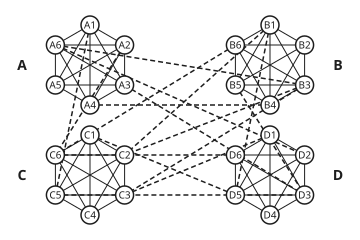
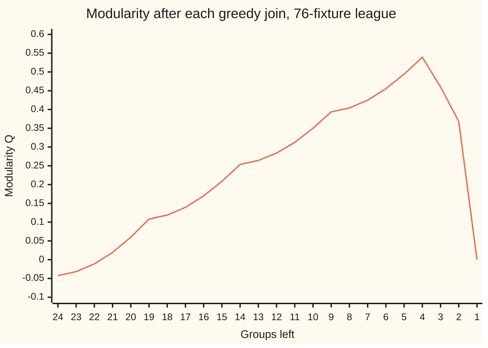

# Communities: modularity, and the algorithms that chase it

[Syllabus](../../../SYLLABUS.md) → [Applied and computational](../README.md) → [Network Science and Spectral Graphs](../README.md#s07) → Communities

---

## General Overview

A county football league has 24 clubs in four divisions, A to D, six clubs each. Inside a division every club plays every other club once: 15 fixtures per division, 60 in all. On top of that, a cup draw adds 16 ties between clubs from different divisions. That makes 76 fixtures. The league is synthetic: built for this card from a stated rule and seed 2026.

Now hide the division names and hand someone only the fixture list. Can they get the divisions back? Inside a division the clubs form a **clique**: a set of clubs where every pair has played. Between divisions only the scattered cup ties appear. So the groups are there in the data. The task is to find them without being told.

This card does it in two moves. First, a score called **modularity** rates any split of the clubs into groups. It counts the fixtures that fall inside groups and subtracts the number that would fall inside them by chance. Second, a **greedy merge** (one choice at a time, never undone) starts with every club alone and keeps joining the two groups whose union raises the score most.

On this league it ends with exactly the four divisions, at a modularity of 0.5391. Then the card tests the method honestly: with more cup ties it starts to fail, and on a fixture list with no divisions at all it still reports groups.

**Modularity scores a split by how many more of the network's lines fall inside its groups than chance would put there, and a greedy merge climbs that score one join at a time, with no promise of reaching the top.**

**What kind of fact this is:** modularity is a definition, a score measured against a chance model. The merge-gain formula is a theorem, proved on this card in Why it works. The greedy merge is a heuristic with no guarantee. Finding the highest-scoring split is NP-hard (at least as hard as every problem in NP, the class of problems whose answers can be checked quickly, so no fast method is known; Brandes and others, 2008); that fact is stated here, not proved.

### The picture: 24 clubs, four cliques, 16 cup ties

<p align="center"></p>

Schematic, not to scale. Solid lines are division fixtures, so each hexagon is a clique. Dashed lines are the 16 cup ties. The eye finds the four groups at once; the card turns that judgement into a number a program can climb.

---

## The formula

Notation first, in words. The network has clubs $i$ and $j$ and **adjacency** $A_{ij}$: 1 if $i$ and $j$ played, 0 if not ([Bipartite graphs](../../04-Combinatorics%20and%20graphs/09-Graphs%20-%20Dots%20and%20Lines/05-bipartite-graphs-and-odd-cycles.md) and its shelf set up graphs). Club $i$'s **degree** $k_i$ is how many fixtures it played. The network has $m$ lines in all.

A split puts club $i$ in group $c_i$, and $\delta(c_i, c_j)$ is 1 when $i$ and $j$ share a group, 0 when they don't. This card introduces **modularity**, written $Q$. (On other shelves $Q$ is an order size or a queue; here it is only modularity.)

$$Q \;=\; \frac{1}{2m}\sum_{i,j}\Big[A_{ij} - \frac{k_i k_j}{2m}\Big]\,\delta(c_i, c_j) \;=\; \sum_{c}\Big[\frac{L_c}{m} - \Big(\frac{d_c}{2m}\Big)^2\Big]$$

**Read it aloud:** for every pair of clubs in the same group, take "did they play" minus "how often would they play by chance", and add it up; equivalently, for each group, the share of all fixtures that sit inside it minus the share chance would put inside it.

The second form uses two counts per group $c$: $L_c$, the fixtures inside it, and $d_c$, the total degree of its clubs. The greedy merge needs one more formula. When groups $a$ and $b$ are joined, with $l_{ab}$ fixtures between them, the score changes by

$$\Delta Q_{ab} \;=\; \frac{l_{ab}}{m} \;-\; \frac{d_a\, d_b}{2m^2}$$

**Read it aloud:** joining two groups gains the share of fixtures that run between them, and loses what chance would have run between them anyway.

| Symbol | Plain meaning | In our example | Push it up and the answer… |
| --- | --- | --- | --- |
| $i$, $j$ | two clubs | A1 and A5 | — |
| $A_{ij}$ | 1 if clubs $i$ and $j$ played, 0 if not | A1 and A5: 1 | more lines inside groups, $Q$ rises |
| $k_i$ | club $i$'s degree: its fixtures | A1: 6, A5: 5 | busier clubs are expected to meet more by chance |
| $m$ | fixtures in the whole network | 76 | — |
| $c_i$ | the group the split puts club $i$ in | A1 in group A | — |
| $\delta(c_i, c_j)$ | 1 if $i$ and $j$ share a group, else 0 | A1, C5: 0 | — |
| $Q$ | modularity: inside share minus chance share | 0.5391 for the divisions | higher means a sharper split |
| $c$ | one group of the split | division C | — |
| $L_c$ | fixtures inside group $c$ | 15 in each division | $Q$ rises by $1/m$ per extra inside line |
| $d_c$ | total degree of group $c$'s clubs | A 36, B 38, C 40, D 38 | a bigger group pays a bigger chance charge |
| $a$, $b$ | two groups about to be joined | A1 alone, A5 alone | — |
| $l_{ab}$, $\Delta Q_{ab}$ | lines between $a$ and $b$; the change in $Q$ if they join | 1; 0.0106 | more lines between, a bigger gain |

### When it holds

- **Plain lines, one per pair, no direction.** The formula above counts a fixture as present or absent. Repeat fixtures, home-and-away arrows or trip counts need the weighted or directed versions, which change the chance term.
- **The chance model keeps each club's degree.** That is the baseline $Q$ beats. If the real "chance" is different, say clubs only ever play nearby clubs, then a high $Q$ may just be geography, not structure.
- **Groups big enough to see.** Modularity has a **resolution limit**: in a ring of 30 five-club cliques, each joined to the next by one line, merging the cliques in pairs scores 0.8879 against 0.8758 for the cliques alone. Small, real groups get swallowed.
- **A high score is not proof of groups.** 76 fixtures placed at random among 24 clubs, with no divisions at all, still give a greedy split with $Q$ = 0.2326.
- **Greedy promises nothing.** It reaches a split no single join can improve. With 24 cup ties instead of 16 it misses the divisions: 0.4347 against 0.4630.

---

## Why it works

### Step 0: count what is inside, then subtract what chance would put there

A good split should have many fixtures inside its groups and few between them. So the first idea is to score a split by the share of fixtures inside its groups. That fails at once. Put all 24 clubs into one group and every fixture is inside: a perfect score of 1, and no information.

The fix is to compare against a baseline. Ask how many fixtures *would* fall inside these groups if the same clubs, each with its same number of fixtures, were paired at random. Score only the excess. One big group then scores 0: everything is inside, but chance would put everything inside too.

### Step 1: how often two clubs meet by chance

Cut every fixture into two halves, one held by each club. There are $2m$ halves, 152 here, and club $i$ holds $k_i$ of them. Now shuffle and re-pair the halves at random. This is the **configuration model**: a random network in which every club keeps its degree.

Take one of club $i$'s halves. It pairs with one of the other halves, and $k_j$ of them belong to club $j$, so the chance it lands on club $j$ is about $k_j / 2m$. Club $i$ has $k_i$ halves, so the expected number of fixtures between $i$ and $j$ is

$$\frac{k_i\, k_j}{2m}.$$

That is the subtracted term. For A1 (6 fixtures) and A5 (5 fixtures), chance expects $30/152$ of a fixture, well under one. They actually met once. (The exact chance uses $2m - 1$ in the bottom; for large networks the difference vanishes, and the standard definition uses $2m$.)

### Step 2: the pair sum becomes a sum over groups

Add $A_{ij} - k_i k_j / 2m$ over every ordered pair $i, j$ that share group $c$. The $A_{ij}$ part counts each inside fixture twice, once from each end: $2L_c$. The $k_i k_j$ part factors as $(\sum k_i)(\sum k_j) = d_c^2$. So group $c$ contributes $2L_c - d_c^2 / 2m$, and dividing by $2m$ gives

$$\frac{L_c}{m} - \Big(\frac{d_c}{2m}\Big)^2.$$

The first term is the share of fixtures inside $c$. The second is the share that chance would put inside $c$: a random half lands in $c$ with probability $d_c / 2m$, and both halves of a fixture do so with that probability squared. That proves the two forms of the formula agree. The check computes both on the divisions and gets the same integer, exactly.

### Step 3: what one merge changes

Join groups $a$ and $b$. The new group has $L_a + L_b + l_{ab}$ fixtures inside and total degree $d_a + d_b$. Every other group is untouched. So

$$\Delta Q_{ab} = \frac{L_a + L_b + l_{ab}}{m} - \frac{(d_a + d_b)^2}{4m^2} - \frac{L_a}{m} + \frac{d_a^2}{4m^2} - \frac{L_b}{m} + \frac{d_b^2}{4m^2} = \frac{l_{ab}}{m} - \frac{2\,d_a d_b}{4m^2}.$$

That is the merge formula. Two things follow. A join of two groups with no fixtures between them always lowers $Q$, so only touching pairs need checking. And the gain depends only on four numbers, $l_{ab}$, $d_a$, $d_b$ and $m$, so each step is cheap to evaluate. The check recomputes $Q$ from scratch after each of the 23 merges and confirms the change equals this formula exactly.

### Step 4: the greedy merge

The method from [Greedy](../01-Algorithms%20and%20Growth/08-greedy-algorithms-and-matroids.md), applied to groups:

1. Start with every club in a group of its own. Then $L_c = 0$ for every group and $Q = -\sum_i k_i^2 / 4m^2$, here −0.0425.
2. For every pair of touching groups, compute $\Delta Q_{ab}$.
3. Join the pair with the biggest gain; ties go to the pair listed first.
4. Repeat until one group is left, recording $Q$ after each join.
5. Report the split where $Q$ peaked.

Here the peak comes at four groups, at the same moment the best available gain first drops to zero or below.

### Step 5: what greedy cannot promise

A merge is never undone, so an early mistake stays. Greedy finds a split that no single join improves, and nothing more.

On a 9-club mini league, three divisions of three plus three cup ties, the check scores all 21147 ways to split 9 clubs into groups: the best is 0.4132, and greedy finds 0.4132 too. On the main league with 24 cup ties, greedy stops at 0.4347 while the true divisions score 0.4630. The problem is NP-hard (Brandes and others, 2008), so no fast method is known that always finds the top score; the theory of such problems belongs to wing 24, Computability and complexity.

---

## Worked numbers, by hand

The divisions as a split, and the first greedy join. Each division has $L_c = 15$ inside fixtures.

| Step | Arithmetic | Value |
| --- | --- | --- |
| total degree | $36 + 38 + 40 + 38$ | 152, which is $2m$ |
| inside share | $(15 + 15 + 15 + 15) / 76$ | 0.7895 |
| chance share | $(36^2 + 38^2 + 40^2 + 38^2) / 152^2 = 5784 / 23104$ | 0.2503 |
| $Q$ of the divisions | $60/76 - 5784/23104$, unrounded | **0.5391** |
| $Q$ with every club alone | $-\sum k_i^2 / 152^2$ | −0.0425 |
| first join, A1 + A5 | $1/76 - (6 \times 5)/(2 \times 76^2)$ | 0.0106 |

So 79% of fixtures sit inside the divisions where chance would put 25% there: the divisions beat chance by 0.5391 of all fixtures. The first join goes to A1 and A5. They met once, and their degree product, 6 × 5 = 30, is the smallest of any pair that met, so their meeting is the least explained by chance. Several pairs share that product; ties go to the pair listed first.

### The climb and the drop



The one line is $Q$ after each join, read left to right as groups disappear. It climbs for 20 joins, peaks at 0.5391 with four groups, then falls: joining two divisions to make three groups gives 0.4602, two groups 0.3681, one group 0.

The four groups at the peak are exactly A1 to A6, B1 to B6, C1 to C6 and D1 to D6. All 24 clubs are grouped with exactly their division-mates. As a last check, the best single move of one club to another group, C2 to division B, would lower $Q$ by 0.0425: the answer is a local peak.

### Testing against planted divisions

One league could be luck. So the check builds 20 leagues, seeds 1 to 20, for each number of cup ties, and counts how often greedy returns exactly the four divisions.

```
cup ties  leagues where greedy recovers all four divisions, of 20
     8    ████████████████████  20
    16    █████████████████     17
    24    ████████████          12
    32    ████████               8
    40    ███████                7
    48    ███                    3
```

With 8 cup ties the divisions always come back. At 16, the main example's number, 17 of 20. As cup ties pile up, a club with three ties into another division looks as if it belongs there, and greedy takes it.

### What breaks if you drop a piece

| Mistake | Comes out at | What went wrong |
| --- | --- | --- |
| Drop the chance term: score only the inside share | one big group 1.0000, the divisions 0.7895 | Lumping everything together always wins; the score cannot see groups |
| Chance term $k_i k_j / m$ instead of $k_i k_j / 2m$ | the divisions 0.2888 | Chance is charged double, so every group looks weak |
| Trust greedy with 24 cup ties | greedy 0.4347, divisions 0.4630 | C2 has 3 cup ties into division B; greedy joins it there and never undoes it. Moving C2 back gives 0.4630 |
| Read a positive $Q$ as proof of groups | 76 random fixtures: 4 groups, $Q$ 0.2326 | Random networks have chance clumps, and greedy finds them |
| Trust the peak on many small groups | ring of 30 cliques: pairs 0.8879, singles 0.8758 | The resolution limit: the chance charge shrinks as $m$ grows, so merging small groups pays |

---

## Code, from first principles, and it actually runs

The script builds the league from a written-out SplitMix64 generator, so Python and Rust print the same numbers. It keeps $Q$ as an exact integer over $4m^2$, so no rounding can blur a comparison.

It reaches the answers by four independent roads. First, $Q$ by the pair sum against $Q$ by the group sum. Second, the merge formula against a fresh count of $Q$ after every join, plus the first join worked by hand from the degrees. Third, greedy against brute force over all 21147 splits of a 9-club mini league. Fourth, greedy against the planted divisions, on the main league and on 120 seeded leagues. Then it prints every "what breaks" number.

### Python

```python
# Communities: modularity and a greedy merge, checked.  Python standard library only.
# Synthetic league: 4 divisions of 6 clubs, each division a round robin, plus cup ties
# drawn across divisions by SplitMix64.  Q is kept exact as an integer over 4m^2.
M64 = (1 << 64) - 1
def rng(state):                                   # SplitMix64: returns (new state, 64-bit draw)
    state = (state + 0x9E3779B97F4A7C15) & M64
    z = state
    z = ((z ^ (z >> 30)) * 0xBF58476D1CE4E5B9) & M64
    z = ((z ^ (z >> 27)) * 0x94D049BB133111EB) & M64
    return state, z ^ (z >> 31)
def league(seed, ties, divs=4, size=6):           # round robins plus random cross-division ties
    n, edges = divs * size, []
    for g in range(divs):
        edges += [(g * size + i, g * size + j) for i in range(size) for j in range(i + 1, size)]
    st, added = seed, 0
    while added < ties:
        st, r = rng(st); u = r % n
        st, r = rng(st); v = r % n
        e = (min(u, v), max(u, v))
        if u // size != v // size and e not in edges:
            edges.append(e); added += 1
    return n, edges
def degrees(n, edges, lab):                       # total degree d_c and inside lines L_c per group
    d, inside = [0] * n, [0] * n
    for u, v in edges:
        d[lab[u]] += 1; d[lab[v]] += 1
        if lab[u] == lab[v]: inside[lab[u]] += 1
    return d, inside
def qnum(n, edges, lab):                          # 4m^2 Q, community form: sum of 4m L_c - d_c^2
    m = len(edges); d, inside = degrees(n, edges, lab)
    return sum(4 * m * inside[c] - d[c] * d[c] for c in range(n))
def qnum_pairs(n, edges, lab):                    # 4m^2 Q, pair form: sum over i, j of 2m A_ij - k_i k_j
    m, A, k = len(edges), [[0] * n for _ in range(n)], [0] * n
    for u, v in edges: A[u][v] = A[v][u] = 1; k[u] += 1; k[v] += 1
    return sum(2 * m * A[i][j] - k[i] * k[j] for i in range(n) for j in range(n) if lab[i] == lab[j])
def greedy(n, edges):                             # merge the pair with the biggest gain until one group
    m, lab = len(edges), list(range(n))
    q = qnum(n, edges, lab); curve, best, stop = [q], (q, lab[:]), None
    for groups in range(n, 1, -1):
        d, _ = degrees(n, edges, lab); between = {}
        for u, v in edges:
            a, b = min(lab[u], lab[v]), max(lab[u], lab[v])
            if a != b: between[(a, b)] = between.get((a, b), 0) + 1
        pick = None
        for (a, b) in sorted(between):            # gain in units of 1/(2m^2): 2m l_ab - d_a d_b
            gain = 2 * m * between[(a, b)] - d[a] * d[b]
            if pick is None or gain > pick[0]: pick = (gain, a, b)
        if pick is None: break
        gain, a, b = pick
        if gain <= 0 and stop is None: stop = groups
        lab = [a if c == b else c for c in lab]
        new = qnum(n, edges, lab)
        assert new - q == 2 * gain, "merge formula disagrees with a fresh count"
        q = new; curve.append(q)
        if q > best[0]: best = (q, lab[:])
    return best, curve, stop
def best_move(n, edges, lab):                     # biggest gain from moving one club to another group
    base, top = qnum(n, edges, lab), None
    for i in range(n):
        for g in sorted(set(lab)):
            if g != lab[i]:
                trial = lab[:]; trial[i] = g
                gain = qnum(n, edges, trial) - base
                if top is None or gain > top[0]: top = (gain, i, g)
    return top
name = lambda i: "ABCD"[i // 6] + str(i % 6 + 1)
same = lambda lab, n: sum(all((lab[i] == lab[j]) == (i // 6 == j // 6) for j in range(n)) for i in range(n))
f = lambda num, m: num / (4 * m * m)
SEED, TIES = 2026, 16; n, E = league(SEED, TIES); m = len(E); planted = [i // 6 * 6 for i in range(n)]
print(f"league: {n} clubs, 60 division fixtures + {TIES} cup ties = {m} fixtures, seed {SEED}")
print("cup ties:", " ".join(name(u) + "-" + name(v) for u, v in E[60:]))
d, inside = degrees(n, E, planted)
print("division degree totals d_c:", " ".join(f"{name(c)[0]} {d[c]}" for c in range(0, n, 6)), "sum", sum(d))
qa, qb = qnum(n, E, planted), qnum_pairs(n, E, planted)
assert qa == qb, "two forms of Q disagree"
print(f"Q of the divisions: community form {f(qa, m):.4f}, pair form {f(qb, m):.4f}")
print(f"  inside share {sum(inside)}/{m} = {sum(inside) / m:.4f}, expected by chance {sum(x * x for x in d)}/{(2 * m) ** 2} = {sum(x * x for x in d) / (2 * m) ** 2:.4f}")
(qg, lab), curve, stop = greedy(n, E)
k = degrees(n, E, list(range(n)))[0]
g1, u1, v1 = max((2 * m - k[u] * k[v], -u, -v) for u, v in E); u1, v1 = -u1, -v1
print(f"first merge {name(u1)}+{name(v1)}: gain (2*{m}*1 - {k[u1]}*{k[v1]})/(2*{m}^2) = {g1 / (2 * m * m):.4f}")
assert curve[1] - curve[0] == 2 * g1, "first merge disagrees with the hand formula"
print("Q by number of groups, 24 down to 1:")
print(" ".join(f"{f(x, m):.4f}" for x in curve[:12])); print(" ".join(f"{f(x, m):.4f}" for x in curve[12:]))
peak = n - curve.index(max(curve))
print(f"greedy best: {len(set(lab))} groups, Q {f(qg, m):.4f}; peak at {peak} groups; first gain <= 0 at {stop} groups")
assert stop == peak == 4, "stop rule and peak disagree"
print("greedy groups:", " | ".join(" ".join(name(i) for i in range(n) if lab[i] == g) for g in sorted(set(lab))))
print(f"clubs grouped exactly as their division: {same(lab, n)} of {n}")
assert same(lab, n) == n, "planted divisions not recovered"
mv = best_move(n, E, lab)
print(f"best single move: {name(mv[1])} to {name(mv[2])}'s group, change in Q {f(mv[0], m):+.4f}")
assert mv[0] < 0, "greedy answer is not a local peak"
n9, E9 = league(2026, 3, 3, 3)                    # mini league: 3 divisions of 3, every partition
def every(lab, mx):                               # each partition once: the next club joins an old group or opens one
    if len(lab) == n9: yield lab; return
    for g in range(mx + 2): yield from every(lab + [g], max(mx, g))
qs = [qnum(n9, E9, lab) for lab in every([0], 0)]; count, top = len(qs), max(qs)
(q9, _), _, _ = greedy(n9, E9)
print(f"mini league, 9 clubs, 12 fixtures: {count} partitions, best Q {f(top, 12):.4f}, greedy {f(q9, 12):.4f}")
assert count == 21147 and top == q9, "brute force disagrees with greedy"
row = []
for ties in (8, 16, 24, 32, 40, 48):
    ok = 0
    for s in range(1, 21):
        nn, EE = league(s, ties); (_, lb), _, _ = greedy(nn, EE); ok += same(lb, nn) == nn
    row.append(ok)
print("planted test, 20 seeds each: cup ties -> divisions recovered exactly\n  " + "  ".join(f"{t}:{k}" for t, k in zip((8, 16, 24, 32, 40, 48), row)))
assert row[0] == 20 and all(row[i] >= row[i + 1] for i in range(5)), "recovery should fall as ties rise"
print(f"what breaks:\n  no chance term: one big group {1:.4f}, the divisions {sum(inside) / m:.4f}")
print(f"  k_i k_j / m instead of / 2m: the divisions {sum(2 * m * inside[c] - d[c] ** 2 for c in range(n)) / (2 * m * m):.4f}")
n4, E4 = league(2026, 24); m4 = len(E4); (q4, lab4), _, _ = greedy(n4, E4); p4 = qnum(n4, E4, planted)
mv4 = best_move(n4, E4, lab4)
print(f"  24 cup ties: greedy {f(q4, m4):.4f}, divisions {f(p4, m4):.4f}, misplaced",
      " ".join(name(i) for i in range(n4) if lab4[i] != lab4[i // 6 * 6]) + " with " + str(sum(lab4[u] == lab4[v] and u // 6 != v // 6 for u, v in E4)) + " cup ties into its new group" +
      f"; moving {name(mv4[1])} back gives {f(q4 + mv4[0], m4):.4f}")
assert p4 > q4 and q4 + mv4[0] == p4, "greedy should miss here and one move should repair it"
st, R = 2026, []
while len(R) < 76:
    st, r = rng(st); u = r % 24
    st, r = rng(st); v = r % 24
    if u != v and (min(u, v), max(u, v)) not in R: R.append((min(u, v), max(u, v)))
(qr, labr), _, _ = greedy(24, R)
print(f"  76 fixtures at random, no divisions: greedy still finds {len(set(labr))} groups, Q {f(qr, 76):.4f}")
assert qr > 0.15, "random network should still score well"
def ring_q(R):                                    # ring of R five-club cliques: Q with each clique alone, then in pairs
    ring = [(c * 5 + i, c * 5 + j) for c in range(R) for i in range(5) for j in range(i + 1, 5)] + [(c * 5, (c + 1) % R * 5 + 1) for c in range(R)]
    return [f(qnum(5 * R, ring, [i // s for i in range(5 * R)]), len(ring)) for s in (5, 10)]
RING = 30; q1, q2 = ring_q(RING)
print(f"  ring of {RING} five-club cliques: each clique alone {q1:.4f}, in pairs {q2:.4f}")
assert q2 > q1, "resolution limit should show"
hexagon = [(i, (i + 1) % 6) for i in range(6)]; qh = qnum(6, hexagon, [i % 2 for i in range(6)])
print(f"  a 6-cycle split into its two bipartite sides: Q {f(qh, 6):.4f}"); assert qh == -2 * 6 * 6, "sides should score -1/2"
print("figure, division centres (90,65) (270,65) (90,175) (270,175), club ring radius 40")
for s, t in ((8, 16), (2026, 8)):                 # the two other leagues in "Try changing"
    nt, Et = league(s, t); mt = len(Et); (qt, lt), _, _ = greedy(nt, Et)
    mis = [name(i) for i in range(nt) if lt[i] != lt[i // 6 * 6]]; pull = sum(lt[u] == lt[v] and u // 6 != v // 6 for u, v in Et)
    print(f"try: seed {s}, {t} cup ties: greedy {f(qt, mt):.4f}, divisions {f(qnum(nt, Et, planted), mt):.4f}, misplaced {' '.join(mis) or 'none'}, cup ties inside groups {pull}")
print("try: ring of 20 five-club cliques: each clique alone {:.4f}, in pairs {:.4f}".format(*ring_q(20)))
print("ALL CHECKS PASS")
```

**Ran 2026-11-11 on macOS, Python 3.14.10, standard library only. All checks passed. Output, pasted from the run:**

```
league: 24 clubs, 60 division fixtures + 16 cup ties = 76 fixtures, seed 2026
cup ties: A6-D2 C3-D1 A4-B4 B1-C2 A3-D3 B3-C2 A2-C6 C5-D3 B5-D3 A1-C5 C1-D5 C6-D6 B6-C6 B3-C3 B1-D5 A6-B3
division degree totals d_c: A 36 B 38 C 40 D 38 sum 152
Q of the divisions: community form 0.5391, pair form 0.5391
  inside share 60/76 = 0.7895, expected by chance 5784/23104 = 0.2503
first merge A1+A5: gain (2*76*1 - 6*5)/(2*76^2) = 0.0106
Q by number of groups, 24 down to 1:
-0.0425 -0.0319 -0.0113 0.0193 0.0600 0.1082 0.1188 0.1394 0.1700 0.2087 0.2537 0.2643
0.2839 0.3125 0.3500 0.3936 0.4042 0.4248 0.4554 0.4941 0.5391 0.4602 0.3681 0.0000
greedy best: 4 groups, Q 0.5391; peak at 4 groups; first gain <= 0 at 4 groups
greedy groups: A1 A2 A3 A4 A5 A6 | B1 B2 B3 B4 B5 B6 | C1 C2 C3 C4 C5 C6 | D1 D2 D3 D4 D5 D6
clubs grouped exactly as their division: 24 of 24
best single move: C2 to B1's group, change in Q -0.0425
mini league, 9 clubs, 12 fixtures: 21147 partitions, best Q 0.4132, greedy 0.4132
planted test, 20 seeds each: cup ties -> divisions recovered exactly
  8:20  16:17  24:12  32:8  40:7  48:3
what breaks:
  no chance term: one big group 1.0000, the divisions 0.7895
  k_i k_j / m instead of / 2m: the divisions 0.2888
  24 cup ties: greedy 0.4347, divisions 0.4630, misplaced C2 with 3 cup ties into its new group; moving C2 back gives 0.4630
  76 fixtures at random, no divisions: greedy still finds 4 groups, Q 0.2326
  ring of 30 five-club cliques: each clique alone 0.8758, in pairs 0.8879
  a 6-cycle split into its two bipartite sides: Q -0.5000
figure, division centres (90,65) (270,65) (90,175) (270,175), club ring radius 40
try: seed 8, 16 cup ties: greedy 0.5055, divisions 0.5387, misplaced D4, cup ties inside groups 3
try: seed 2026, 8 cup ties: greedy 0.6322, divisions 0.6322, misplaced none, cup ties inside groups 0
try: ring of 20 five-club cliques: each clique alone 0.8591, in pairs 0.8545
ALL CHECKS PASS
```

### Rust

```rust
// Communities: modularity and a greedy merge, checked.  Rust std only, no crates.
// Synthetic league: 4 divisions of 6 clubs, each division a round robin, plus cup ties
// drawn across divisions by SplitMix64.  Q is kept exact as an integer over 4m^2.
type Edges = Vec<(usize, usize)>;
fn rng(state: u64) -> (u64, u64) {
    let s = state.wrapping_add(0x9E3779B97F4A7C15);
    let z = (s ^ (s >> 30)).wrapping_mul(0xBF58476D1CE4E5B9);
    let z = (z ^ (z >> 27)).wrapping_mul(0x94D049BB133111EB);
    (s, z ^ (z >> 31))
}
fn league(seed: u64, ties: usize, divs: usize, size: usize) -> (usize, Edges) {
    let (n, mut e): (usize, Edges) = (divs * size, Vec::new());
    for g in 0..divs { for i in 0..size { for j in i + 1..size { e.push((g * size + i, g * size + j)); } } }
    let (mut st, mut added) = (seed, 0);
    while added < ties {
        let (s1, r1) = rng(st); let (s2, r2) = rng(s1); st = s2;
        let (u, v) = ((r1 % n as u64) as usize, (r2 % n as u64) as usize); let p = (u.min(v), u.max(v));
        if u / size != v / size && !e.contains(&p) { e.push(p); added += 1; }
    }
    (n, e)
}
fn degrees(n: usize, e: &Edges, lab: &[usize]) -> (Vec<i64>, Vec<i64>) {
    let (mut d, mut inside) = (vec![0i64; n], vec![0i64; n]);
    for &(u, v) in e { d[lab[u]] += 1; d[lab[v]] += 1; if lab[u] == lab[v] { inside[lab[u]] += 1; } }
    (d, inside)
}
fn qnum(n: usize, e: &Edges, lab: &[usize]) -> i64 {
    let (m, (d, inside)) = (e.len() as i64, degrees(n, e, lab));
    (0..n).map(|c| 4 * m * inside[c] - d[c] * d[c]).sum()
}
fn qnum_pairs(n: usize, e: &Edges, lab: &[usize]) -> i64 {
    let m = e.len() as i64;
    let (mut a, mut k) = (vec![vec![0i64; n]; n], vec![0i64; n]);
    for &(u, v) in e { a[u][v] = 1; a[v][u] = 1; k[u] += 1; k[v] += 1; }
    (0..n).map(|i| (0..n).filter(|&j| lab[i] == lab[j]).map(|j| 2 * m * a[i][j] - k[i] * k[j]).sum::<i64>()).sum()
}

// returns (best Q numerator, its labels), the Q curve, and where the first gain <= 0 appeared
fn greedy(n: usize, e: &Edges) -> (i64, Vec<usize>, Vec<i64>, usize) {
    let (m, mut lab): (i64, Vec<usize>) = (e.len() as i64, (0..n).collect());
    let mut q = qnum(n, e, &lab);
    let (mut curve, mut best, mut blab, mut stop) = (vec![q], q, lab.clone(), 0);
    for groups in (2..=n).rev() {
        let (d, _) = degrees(n, e, &lab);
        let mut between = vec![vec![0i64; n]; n];
        for &(u, v) in e { let (a, b) = (lab[u].min(lab[v]), lab[u].max(lab[v])); if a != b { between[a][b] += 1; } }
        let mut pick: Option<(i64, usize, usize)> = None;
        for a in 0..n { for b in a + 1..n { if between[a][b] > 0 {
            let gain = 2 * m * between[a][b] - d[a] * d[b];
            if pick.map_or(true, |p| gain > p.0) { pick = Some((gain, a, b)); }
        } } }
        let Some((gain, a, b)) = pick else { break };
        if gain <= 0 && stop == 0 { stop = groups; }
        for c in lab.iter_mut() { if *c == b { *c = a; } }
        let new = qnum(n, e, &lab);
        assert!(new - q == 2 * gain, "merge formula disagrees with a fresh count");
        q = new; curve.push(q);
        if q > best { best = q; blab = lab.clone(); }
    }
    (best, blab, curve, stop)
}
fn best_move(n: usize, e: &Edges, lab: &[usize]) -> (i64, usize, usize) {
    let base = qnum(n, e, lab);
    let mut top: Option<(i64, usize, usize)> = None;
    for i in 0..n { for g in 0..n {
        if g != lab[i] && lab.contains(&g) {
            let mut t = lab.to_vec(); t[i] = g;
            let gain = qnum(n, e, &t) - base;
            if top.map_or(true, |p| gain > p.0) { top = Some((gain, i, g)); }
        }
    } }
    top.unwrap()
}
fn name(i: usize) -> String { format!("{}{}", ["A", "B", "C", "D"][i / 6], i % 6 + 1) }
fn same(lab: &[usize], n: usize) -> usize { (0..n).filter(|&i| (0..n).all(|j| (lab[i] == lab[j]) == (i / 6 == j / 6))).count() }
fn f(num: i64, m: i64) -> f64 { num as f64 / (4 * m * m) as f64 }
fn groups_of(lab: &[usize], n: usize) -> usize { (0..n).filter(|g| lab.contains(g)).count() }
fn every(n9: usize, e9: &Edges, lab: &mut Vec<usize>, mx: usize, qs: &mut Vec<i64>) {   // Q of each partition, once
    if lab.len() == n9 { qs.push(qnum(n9, e9, lab)); return; }
    for g in 0..mx + 2 { lab.push(g); every(n9, e9, lab, mx.max(g), qs); lab.pop(); }
}
fn ring_q(rn: usize) -> (f64, f64) {               // ring of rn five-club cliques: Q with each clique alone, then in pairs
    let mut ring: Edges = Vec::new();
    for c in 0..rn { for i in 0..5 { for j in i + 1..5 { ring.push((c * 5 + i, c * 5 + j)); } } ring.push((c * 5, (c + 1) % rn * 5 + 1)); }
    let q = |s: usize| f(qnum(5 * rn, &ring, &(0..5 * rn).map(|i| i / s).collect::<Vec<_>>()), ring.len() as i64); (q(5), q(10))
}

fn main() {
    let (seed, ties) = (2026u64, 16usize); let (n, e) = league(seed, ties, 4, 6); let m = e.len() as i64;
    let planted: Vec<usize> = (0..n).map(|i| i / 6 * 6).collect();
    println!("league: {} clubs, 60 division fixtures + {} cup ties = {} fixtures, seed {}", n, ties, m, seed);
    let ties: Vec<String> = e[60..].iter().map(|&(u, v)| format!("{}-{}", name(u), name(v))).collect(); println!("cup ties: {}", ties.join(" "));
    let (d, inside) = degrees(n, &e, &planted);
    let dl: Vec<String> = (0..n).step_by(6).map(|c| format!("{} {}", &name(c)[..1], d[c])).collect(); println!("division degree totals d_c: {} sum {}", dl.join(" "), d.iter().sum::<i64>());
    let (qa, qb) = (qnum(n, &e, &planted), qnum_pairs(n, &e, &planted));
    assert!(qa == qb, "two forms of Q disagree");
    println!("Q of the divisions: community form {:.4}, pair form {:.4}", f(qa, m), f(qb, m));
    let ins: i64 = inside.iter().sum(); let dsq: i64 = d.iter().map(|x| x * x).sum();
    println!("  inside share {}/{} = {:.4}, expected by chance {}/{} = {:.4}", ins, m, ins as f64 / m as f64, dsq, (2 * m) * (2 * m), dsq as f64 / ((2 * m) * (2 * m)) as f64);
    let (qg, lab, curve, stop) = greedy(n, &e);
    let (k, _) = degrees(n, &e, &(0..n).collect::<Vec<_>>());
    let mut fm = (i64::MIN, 0, 0);
    for &(u, v) in &e {
        let g = 2 * m - k[u] * k[v];
        if g > fm.0 || (g == fm.0 && (u, v) < (fm.1, fm.2)) { fm = (g, u, v); }
    }
    println!("first merge {}+{}: gain (2*{}*1 - {}*{})/(2*{}^2) = {:.4}", name(fm.1), name(fm.2), m, k[fm.1], k[fm.2], m, fm.0 as f64 / (2 * m * m) as f64);
    assert!(curve[1] - curve[0] == 2 * fm.0, "first merge disagrees with the hand formula");
    println!("Q by number of groups, 24 down to 1:");
    let cs: Vec<String> = curve.iter().map(|&x| format!("{:.4}", f(x, m))).collect();
    println!("{}", cs[..12].join(" ")); println!("{}", cs[12..].join(" "));
    let mut pi = 0; for i in 0..curve.len() { if curve[i] > curve[pi] { pi = i; } } let peak = n - pi;
    println!("greedy best: {} groups, Q {:.4}; peak at {} groups; first gain <= 0 at {} groups", groups_of(&lab, n), f(qg, m), peak, stop);
    assert!(stop == 4 && peak == 4, "stop rule and peak disagree");
    let gs: Vec<String> = (0..n).filter(|g| lab.contains(g))
        .map(|g| (0..n).filter(|&i| lab[i] == g).map(name).collect::<Vec<_>>().join(" ")).collect();
    println!("greedy groups: {}", gs.join(" | "));
    println!("clubs grouped exactly as their division: {} of {}", same(&lab, n), n);
    assert!(same(&lab, n) == n, "planted divisions not recovered");
    let mv = best_move(n, &e, &lab);
    println!("best single move: {} to {}'s group, change in Q {:+.4}", name(mv.1), name(mv.2), f(mv.0, m));
    assert!(mv.0 < 0, "greedy answer is not a local peak");
    let (n9, e9) = league(2026, 3, 3, 3); let mut qs = Vec::new();
    every(n9, &e9, &mut vec![0], 0, &mut qs);
    let (q9, _, _, _) = greedy(n9, &e9); let (count, top) = (qs.len(), *qs.iter().max().unwrap());
    println!("mini league, 9 clubs, 12 fixtures: {} partitions, best Q {:.4}, greedy {:.4}", count, f(top, 12), f(q9, 12));
    assert!(count == 21147 && top == q9, "brute force disagrees with greedy");
    let tl = [8usize, 16, 24, 32, 40, 48]; let mut row = Vec::new();
    for &t in &tl {
        let mut ok = 0;
        for s in 1..=20u64 { let (nn, ee) = league(s, t, 4, 6); let (_, lb, _, _) = greedy(nn, &ee); if same(&lb, nn) == nn { ok += 1; } }
        row.push(ok);
    }
    let rs: Vec<String> = tl.iter().zip(&row).map(|(t, k)| format!("{}:{}", t, k)).collect();
    println!("planted test, 20 seeds each: cup ties -> divisions recovered exactly\n  {}", rs.join("  "));
    assert!(row[0] == 20 && (0..5).all(|i| row[i] >= row[i + 1]), "recovery should fall as ties rise");
    println!("what breaks:\n  no chance term: one big group {:.4}, the divisions {:.4}", 1.0, ins as f64 / m as f64);
    let wrong: i64 = (0..n).map(|c| 2 * m * inside[c] - d[c] * d[c]).sum();
    println!("  k_i k_j / m instead of / 2m: the divisions {:.4}", wrong as f64 / (2 * m * m) as f64);
    let (n4, e4) = league(2026, 24, 4, 6); let m4 = e4.len() as i64;
    let (q4, lab4, _, _) = greedy(n4, &e4); let p4 = qnum(n4, &e4, &planted);
    let mv4 = best_move(n4, &e4, &lab4);
    let mis: Vec<String> = (0..n4).filter(|&i| lab4[i] != lab4[i / 6 * 6]).map(name).collect();
    let pulled = e4.iter().filter(|&&(u, v)| lab4[u] == lab4[v] && u / 6 != v / 6).count();
    println!("  24 cup ties: greedy {:.4}, divisions {:.4}, misplaced {} with {} cup ties into its new group; moving {} back gives {:.4}", f(q4, m4), f(p4, m4), mis.join(" "), pulled, name(mv4.1), f(q4 + mv4.0, m4));
    assert!(p4 > q4 && q4 + mv4.0 == p4, "greedy should miss here and one move should repair it");
    let (mut st, mut r): (u64, Edges) = (2026, Vec::new());
    while r.len() < 76 {
        let (s1, r1) = rng(st); let (s2, r2) = rng(s1); st = s2;
        let (u, v) = ((r1 % 24) as usize, (r2 % 24) as usize);
        if u != v && !r.contains(&(u.min(v), u.max(v))) { r.push((u.min(v), u.max(v))); }
    }
    let (qr, labr, _, _) = greedy(24, &r);
    println!("  76 fixtures at random, no divisions: greedy still finds {} groups, Q {:.4}", groups_of(&labr, 24), f(qr, 76));
    assert!(f(qr, 76) > 0.15, "random network should still score well");
    let rn = 30; let (q1, q2) = ring_q(rn);
    println!("  ring of {} five-club cliques: each clique alone {:.4}, in pairs {:.4}", rn, q1, q2);
    assert!(q2 > q1, "resolution limit should show");
    let hex: Edges = (0..6).map(|i| (i, (i + 1) % 6)).collect(); let qh = qnum(6, &hex, &(0..6).map(|i| i % 2).collect::<Vec<_>>());
    println!("  a 6-cycle split into its two bipartite sides: Q {:.4}", f(qh, 6)); assert!(qh == -2 * 6 * 6, "sides should score -1/2");
    println!("figure, division centres (90,65) (270,65) (90,175) (270,175), club ring radius 40");
    for (s, t) in [(8u64, 16usize), (2026, 8)] {   // the two other leagues in "Try changing"
        let (nt, et) = league(s, t, 4, 6); let mt = et.len() as i64; let (qt, lt, _, _) = greedy(nt, &et);
        let mis: Vec<String> = (0..nt).filter(|&i| lt[i] != lt[i / 6 * 6]).map(name).collect();
        let pull = et.iter().filter(|&&(u, v)| lt[u] == lt[v] && u / 6 != v / 6).count();
        println!("try: seed {}, {} cup ties: greedy {:.4}, divisions {:.4}, misplaced {}, cup ties inside groups {}", s, t, f(qt, mt), f(qnum(nt, &et, &planted), mt), if mis.is_empty() { "none".to_string() } else { mis.join(" ") }, pull);
    }
    let (r1, r2) = ring_q(20); println!("try: ring of 20 five-club cliques: each clique alone {:.4}, in pairs {:.4}", r1, r2);
    println!("ALL CHECKS PASS");
}
```

**Ran 2026-11-11 on macOS, rustc 1.98.1, no crates. All checks passed. Output, pasted from the run:**

```
league: 24 clubs, 60 division fixtures + 16 cup ties = 76 fixtures, seed 2026
cup ties: A6-D2 C3-D1 A4-B4 B1-C2 A3-D3 B3-C2 A2-C6 C5-D3 B5-D3 A1-C5 C1-D5 C6-D6 B6-C6 B3-C3 B1-D5 A6-B3
division degree totals d_c: A 36 B 38 C 40 D 38 sum 152
Q of the divisions: community form 0.5391, pair form 0.5391
  inside share 60/76 = 0.7895, expected by chance 5784/23104 = 0.2503
first merge A1+A5: gain (2*76*1 - 6*5)/(2*76^2) = 0.0106
Q by number of groups, 24 down to 1:
-0.0425 -0.0319 -0.0113 0.0193 0.0600 0.1082 0.1188 0.1394 0.1700 0.2087 0.2537 0.2643
0.2839 0.3125 0.3500 0.3936 0.4042 0.4248 0.4554 0.4941 0.5391 0.4602 0.3681 0.0000
greedy best: 4 groups, Q 0.5391; peak at 4 groups; first gain <= 0 at 4 groups
greedy groups: A1 A2 A3 A4 A5 A6 | B1 B2 B3 B4 B5 B6 | C1 C2 C3 C4 C5 C6 | D1 D2 D3 D4 D5 D6
clubs grouped exactly as their division: 24 of 24
best single move: C2 to B1's group, change in Q -0.0425
mini league, 9 clubs, 12 fixtures: 21147 partitions, best Q 0.4132, greedy 0.4132
planted test, 20 seeds each: cup ties -> divisions recovered exactly
  8:20  16:17  24:12  32:8  40:7  48:3
what breaks:
  no chance term: one big group 1.0000, the divisions 0.7895
  k_i k_j / m instead of / 2m: the divisions 0.2888
  24 cup ties: greedy 0.4347, divisions 0.4630, misplaced C2 with 3 cup ties into its new group; moving C2 back gives 0.4630
  76 fixtures at random, no divisions: greedy still finds 4 groups, Q 0.2326
  ring of 30 five-club cliques: each clique alone 0.8758, in pairs 0.8879
  a 6-cycle split into its two bipartite sides: Q -0.5000
figure, division centres (90,65) (270,65) (90,175) (270,175), club ring radius 40
try: seed 8, 16 cup ties: greedy 0.5055, divisions 0.5387, misplaced D4, cup ties inside groups 3
try: seed 2026, 8 cup ties: greedy 0.6322, divisions 0.6322, misplaced none, cup ties inside groups 0
try: ring of 20 five-club cliques: each clique alone 0.8591, in pairs 0.8545
ALL CHECKS PASS
```

The two outputs match line for line.

### Lean

Lean proves the merge formula and both forms of $Q$ for every network of plain lines and every split, and checks the league's numbers.

- Take any network of plain lines, any split, and two different groups $a$ and $b$. Then joining them changes $Q$ by exactly $\Delta Q_{ab} = l_{ab}/m - d_a d_b/(2m^2)$.
- Take any network of plain lines and any split. Then the pair sum for $Q$ equals the sum over groups of $L_c/m - (d_c/2m)^2$.
- Put all the clubs in one big group. Then $Q = 0$, in any network of plain lines.
- Take the league. Then $m = 76$, each division has $L_c = 15$, and the $d_c$ are 36, 38, 40 and 38.
- Take the divisions as the split. Then $Q = 60/76 - 5784/23104 = 1557/2888$, which is 0.5391.
- Take every club alone. Then $\sum_i k_i^2 = 982$, so $Q = -982/23104$, which is −0.0425.
- Take the first join, A1 and A5. Then they met once, with degrees 6 and 5, and $\Delta Q = 61/5776$, which is 0.0106.
- As arithmetic, the halved denominator gives 0.2888 and the 6-cycle split gives −0.5000.
- There are 21147 ways to split 9 clubs into groups. In the ring of 30 cliques pairs beat singles; in a ring of 20, singles win.

The greedy merge, the search over 21147 splits, the 120 seeded leagues and the random fixtures are left to the Python and Rust checks.

```lean
-- Communities: for every finite simple graph and every split of its nodes into groups, joining two groups changes the modularity by the share of lines between them minus d_a d_b / 2m^2, the pair form of modularity equals the group form, one big group scores 0, and the card's league numbers check out.
import Mathlib.Combinatorics.SimpleGraph.AdjMatrix
import Mathlib.Combinatorics.SimpleGraph.DegreeSum
import Mathlib.Combinatorics.Enumerative.Bell
import Mathlib.Data.Rat.Defs
import Mathlib.Tactic.NormNum
import Mathlib.Tactic.FieldSimp
import Mathlib.Tactic.Ring

namespace CommunityDetection

open SimpleGraph Finset

variable {V ι : Type*} [Fintype V] [DecidableEq V] [DecidableEq ι]

/-- Modularity `Q` of the split `c` (node `i` goes to group `c i`), by the card's pair form:
`Q = (1 / 2m) · Σ_{i,j} [A_ij - k_i k_j / 2m] · δ(c_i, c_j)`, where `A` is the adjacency
matrix, `k_i` the degree of `i`, and `m` the number of lines. -/
def modularity (G : SimpleGraph V) [DecidableRel G.Adj] (c : V → ι) : ℚ :=
  let m : ℚ := G.edgeFinset.card
  (1 / (2 * m)) * ∑ i, ∑ j,
    if c i = c j then G.adjMatrix ℚ i j - (G.degree i : ℚ) * G.degree j / (2 * m) else 0

/-- `L_g`: the lines with both ends in group `g`. -/
def insideLines (G : SimpleGraph V) [DecidableRel G.Adj] (c : V → ι) (g : ι) : ℕ :=
  (G.edgeFinset.filter (fun e => e.map c = s(g, g))).card

/-- `d_g`: the total degree of the nodes in group `g`. -/
def groupDegree (G : SimpleGraph V) [DecidableRel G.Adj] (c : V → ι) (g : ι) : ℕ :=
  ∑ v ∈ univ.filter (fun v => c v = g), G.degree v

/-- `l_ab`: the lines with one end in group `a` and the other in group `b`. -/
def linesBetween (G : SimpleGraph V) [DecidableRel G.Adj] (c : V → ι) (a b : ι) : ℕ :=
  (G.edgeFinset.filter (fun e => e.map c = s(a, b))).card

/-- The split after joining group `b` into group `a`: every node of `b` moves to `a`. -/
def mergeGroups (c : V → ι) (a b : ι) : V → ι :=
  fun v => if c v = b then a else c v

/-- Summing over ordered pairs of adjacent nodes counts each line twice. -/
theorem sum_adj_sym2 (G : SimpleGraph V) [DecidableRel G.Adj] (f : Sym2 V → ℚ) :
    ∑ i, ∑ j, (if G.Adj i j then f s(i, j) else 0) = 2 * ∑ e ∈ G.edgeFinset, f e := by
  have h1 : ∑ i, ∑ j, (if G.Adj i j then f s(i, j) else 0) = ∑ d : G.Dart, f d.edge := by
    rw [← Finset.sum_product', ← Finset.sum_filter]
    refine Finset.sum_bij' (fun p hp => ⟨p, (mem_filter.1 hp).2⟩) (fun d _ => d.toProd)
      ?_ ?_ ?_ ?_ ?_ <;> simp
  rw [h1, ← Finset.sum_fiberwise_of_maps_to (g := Dart.edge) (t := G.edgeFinset)
    (fun d _ => by simp), Finset.mul_sum]
  refine Finset.sum_congr rfl fun e he => ?_
  rw [Finset.sum_congr rfl (g := fun _ => f e) (fun d hd => by rw [(mem_filter.1 hd).2]),
    sum_const, nsmul_eq_mul, G.dart_edge_fiber_card e (by simpa using he)]
  norm_num

/-- The ordered pairs of adjacent nodes whose groups are `{a, b}` number `2 l_ab`. -/
theorem sum_adj_pair_groups (G : SimpleGraph V) [DecidableRel G.Adj] (c : V → ι) (a b : ι) :
    ∑ i, ∑ j, (if s(c i, c j) = s(a, b) then (if G.Adj i j then (1 : ℚ) else 0) else 0) =
      2 * (linesBetween G c a b : ℚ) := by
  have := sum_adj_sym2 G (fun e => if e.map c = s(a, b) then (1 : ℚ) else 0)
  simp only [Sym2.map_mk] at this
  refine Eq.trans ?_ (this.trans ?_)
  · refine Finset.sum_congr rfl fun i _ => Finset.sum_congr rfl fun j _ => ?_
    split_ifs <;> simp_all
  rw [linesBetween, Finset.sum_ite, sum_const_zero, add_zero, sum_const, nsmul_eq_mul,
    mul_one]

omit [DecidableEq V] in
/-- The degree products over ordered pairs from groups `a` and `b` add up to `d_a d_b`. -/
theorem sum_deg_pair_groups (G : SimpleGraph V) [DecidableRel G.Adj] (c : V → ι) (a b : ι) :
    ∑ i, ∑ j, (if c i = a ∧ c j = b then (G.degree i : ℚ) * G.degree j else 0) =
      (groupDegree G c a : ℚ) * groupDegree G c b := by
  simp only [groupDegree, Nat.cast_sum, Finset.sum_filter, Finset.sum_mul_sum]
  refine Finset.sum_congr rfl fun i _ => Finset.sum_congr rfl fun j _ => ?_
  split_ifs <;> simp_all

/-- The card's merge formula. In any finite network of plain lines (a simple graph with `m`
lines), for any split into groups and any two different groups `a` and `b`, joining them changes
the modularity by `ΔQ_ab = l_ab / m - d_a d_b / (2 m^2)`: the share of lines running between them,
minus what chance would run between them anyway. -/
theorem merge_gain_eq (G : SimpleGraph V) [DecidableRel G.Adj] (c : V → ι) (a b : ι)
    (hab : a ≠ b) :
    modularity G (mergeGroups c a b) - modularity G c =
      (linesBetween G c a b : ℚ) / G.edgeFinset.card -
        (groupDegree G c a : ℚ) * groupDegree G c b / (2 * (G.edgeFinset.card : ℚ) ^ 2) := by
  simp only [modularity, adjMatrix_apply]
  generalize (G.edgeFinset.card : ℚ) = M
  have key : ∀ i j, (if mergeGroups c a b i = mergeGroups c a b j then
      (if G.Adj i j then (1 : ℚ) else 0) - (G.degree i : ℚ) * G.degree j / (2 * M) else 0) =
      (if c i = c j then (if G.Adj i j then (1 : ℚ) else 0) - (G.degree i : ℚ) * G.degree j / (2 * M) else 0) +
      ((if s(c i, c j) = s(a, b) then (if G.Adj i j then (1 : ℚ) else 0) else 0) -
        (1 / (2 * M)) * ((if c i = a ∧ c j = b then (G.degree i : ℚ) * G.degree j else 0) +
          (if c i = b ∧ c j = a then (G.degree i : ℚ) * G.degree j else 0))) := by
    intro i j
    unfold mergeGroups
    by_cases hi : c i = b <;> by_cases hj : c j = b <;> by_cases hi' : c i = a <;>
      by_cases hj' : c j = a <;> simp_all [eq_comm] <;> ring
  simp_rw [key, Finset.sum_add_distrib, Finset.sum_sub_distrib, ← Finset.mul_sum,
    Finset.sum_add_distrib, sum_adj_pair_groups, sum_deg_pair_groups]
  ring

/-- The two forms of modularity agree: the pair sum equals the sum over groups of
`L_c / m - (d_c / 2m)^2`, the share of lines inside each group minus the share chance would put
there. -/
theorem modularity_eq_sum_over_groups (G : SimpleGraph V) [DecidableRel G.Adj] (c : V → ι) :
    modularity G c =
      ∑ g ∈ univ.image c,
        ((insideLines G c g : ℚ) / G.edgeFinset.card -
          ((groupDegree G c g : ℚ) / (2 * G.edgeFinset.card)) ^ 2) := by
  simp only [modularity, insideLines, adjMatrix_apply]
  generalize (G.edgeFinset.card : ℚ) = M
  have key : ∀ i j, (if c i = c j then
      (if G.Adj i j then (1 : ℚ) else 0) - (G.degree i : ℚ) * G.degree j / (2 * M) else 0) =
      ∑ g ∈ univ.image c, ((if s(c i, c j) = s(g, g) then (if G.Adj i j then (1 : ℚ) else 0) else 0) -
        (1 / (2 * M)) * (if c i = g ∧ c j = g then (G.degree i : ℚ) * G.degree j else 0)) := by
    intro i j
    rw [Finset.sum_eq_single (c i)]
    · by_cases h : c i = c j <;> simp [h, eq_comm]; ring
    · intro g _ hg
      have : ¬ (c i = g) := fun h => hg h.symm
      simp [this]
    · intro h
      exact absurd (mem_image_of_mem c (mem_univ i)) h
  simp_rw [key]
  rw [Finset.sum_comm]
  simp_rw [Finset.sum_comm (s := univ) (t := univ.image c)]
  rw [Finset.mul_sum]
  refine Finset.sum_congr rfl fun g _ => ?_
  rw [Finset.sum_comm]
  simp_rw [Finset.sum_sub_distrib, ← Finset.mul_sum]
  rw [sum_adj_pair_groups, sum_deg_pair_groups, linesBetween]
  ring

/-- Step 0 of the card: put every node in one big group and the score is 0. Every line is
inside, but chance would put every line inside too. -/
theorem modularity_one_group_eq_zero (G : SimpleGraph V) [DecidableRel G.Adj] (g : ι) :
    modularity G (fun _ : V => g) = 0 := by
  have h := sum_adj_sym2 G (fun _ => 1)
  simp only [sum_const, nsmul_eq_mul, mul_one] at h
  have hd : ∑ i, (G.degree i : ℚ) = 2 * G.edgeFinset.card := by
    rw [← Nat.cast_sum, G.sum_degrees_eq_twice_card_edges]
    push_cast; ring
  simp only [modularity, adjMatrix_apply, ite_true]
  generalize (G.edgeFinset.card : ℚ) = M at h hd
  have hr : ∀ i j, (if G.Adj i j then (1 : ℚ) else 0) - (G.degree i : ℚ) * G.degree j / (2 * M) =
      (if G.Adj i j then (1 : ℚ) else 0) - (1 / (2 * M)) * ((G.degree i : ℚ) * G.degree j) := by
    intro i j; ring
  simp_rw [hr, Finset.sum_sub_distrib, ← Finset.mul_sum]
  simp only [h, hd, ← Finset.sum_mul]
  by_cases hm : M = 0
  · simp [hm]
  · field_simp
    ring

/-! The card's league: clubs A1 to A6 are `0` to `5`, B1 to B6 are `6` to `11`, C1 to C6 are
`12` to `17`, D1 to D6 are `18` to `23`. Club `i` is in division `i / 6`. -/

/-- The 16 cup ties: A6-D2 C3-D1 A4-B4 B1-C2 A3-D3 B3-C2 A2-C6 C5-D3 B5-D3 A1-C5 C1-D5 C6-D6
B6-C6 B3-C3 B1-D5 A6-B3. -/
def cupTies : List (Fin 24 × Fin 24) :=
  [(5, 19), (14, 18), (3, 9), (6, 13), (2, 20), (8, 13), (1, 17), (16, 20), (10, 20), (0, 16),
   (12, 22), (17, 23), (11, 17), (8, 14), (6, 22), (5, 8)]

/-- The league: every pair of clubs in one division played, plus the cup ties. -/
def league : SimpleGraph (Fin 24) where
  Adj x y := x ≠ y ∧ (x.val / 6 = y.val / 6 ∨ (x, y) ∈ cupTies ∨ (y, x) ∈ cupTies)
  symm := ⟨fun _ _ h => ⟨h.1.symm, h.2.elim (fun e => Or.inl e.symm)
    (fun h' => Or.inr h'.symm)⟩⟩
  loopless := ⟨fun _ h => h.1 rfl⟩

instance : DecidableRel league.Adj := fun _ _ => inferInstanceAs (Decidable (_ ∧ _))

/-- The divisions as a split: club `i` goes to group `i / 6`. -/
def division (i : Fin 24) : ℕ := i.val / 6

-- 15 fixtures per division, 76 fixtures in all, and the total degree 152 is 2m.
example : Nat.choose 6 2 = 15 ∧ 4 * 15 + 16 = 76 := by decide
example : league.edgeFinset.card = 76 := by decide
example : (List.range 4).map (insideLines league division) = [15, 15, 15, 15] := by decide
example : (List.range 4).map (groupDegree league division) = [36, 38, 40, 38] := by decide
example : 36 + 38 + 40 + 38 = 152 ∧ 152 = 2 * 76 := by norm_num
-- Q of the divisions: 60/76 - 5784/23104 = 1557/2888 (0.5391).
example : 36 ^ 2 + 38 ^ 2 + 40 ^ 2 + 38 ^ 2 = 5784 ∧ 152 ^ 2 = 23104 := by norm_num
example : (60 : ℚ) / 76 - 5784 / 23104 = 1557 / 2888 := by norm_num
-- Every club alone: Q = -Σ k_i^2 / 152^2 = -982/23104 (-0.0425).
example : ∑ i, league.degree i ^ 2 = 982 := by decide
-- The first join, A1 + A5: they met once, degrees 6 and 5, gain 1/76 - 30/(2·76^2) = 61/5776.
example : league.Adj 0 4 ∧ league.degree 0 = 6 ∧ league.degree 4 = 5 := by decide
example : (1 : ℚ) / 76 - 6 * 5 / (2 * 76 ^ 2) = 61 / 5776 := by norm_num
-- What breaks: the chance term k_i k_j / m instead of / 2m gives (2·76·60 - 5784)/(2·76^2) (0.2888).
example : ((2 * 76 * 60 - 5784 : ℚ)) / (2 * 76 ^ 2) = 417 / 1444 := by norm_num
-- The mini league of 9 clubs has 21147 splits into groups (the Bell number of 9).
example : Nat.bell 9 = 21147 := by
  norm_num [Nat.bell_succ', Finset.Nat.antidiagonal_succ, Nat.choose]
-- Resolution limit, ring of 30 five-club cliques (m = 330): in pairs beats each clique alone.
example : (30 : ℚ) * (10 / 330 - (22 / 660) ^ 2) < 15 * (21 / 330 - (44 / 660) ^ 2) := by norm_num
-- Ring of 20 (m = 220): now each clique alone wins.
example : (10 : ℚ) * (21 / 220 - (44 / 440) ^ 2) < 20 * (10 / 220 - (22 / 440) ^ 2) := by norm_num
-- A 6-cycle split into its two sides: no line inside, each side has degree 6, Q = -1/2.
example : (2 : ℚ) * (0 / 6 - (6 / 12) ^ 2) = -1 / 2 := by norm_num

#print axioms sum_adj_sym2
#print axioms sum_adj_pair_groups
#print axioms sum_deg_pair_groups
#print axioms merge_gain_eq
#print axioms modularity_eq_sum_over_groups
#print axioms modularity_one_group_eq_zero

end CommunityDetection
```

**Checked 2026-11-14 on macOS, Lean 4.36.0-rc2, Mathlib v4.36.0-rc2. Every proof is complete and uses only Lean's standard axioms. Output, pasted from the run:**

```
'CommunityDetection.sum_adj_sym2' depends on axioms: [propext, Classical.choice, Quot.sound]
'CommunityDetection.sum_adj_pair_groups' depends on axioms: [propext, Classical.choice, Quot.sound]
'CommunityDetection.sum_deg_pair_groups' depends on axioms: [propext, Classical.choice, Quot.sound]
'CommunityDetection.merge_gain_eq' depends on axioms: [propext, Classical.choice, Quot.sound]
'CommunityDetection.modularity_eq_sum_over_groups' depends on axioms: [propext, Classical.choice, Quot.sound]
'CommunityDetection.modularity_one_group_eq_zero' depends on axioms: [propext, Classical.choice, Quot.sound]
```

> [!TIP]
> **Try changing**
> Guess first, then run it. The asserts are pinned to this league, so some changes stop the program on purpose.
> - **Guess first: does greedy survive a different cup draw?** Set `SEED, TIES = 8, 16`. No. D4 drew three cup ties against division B, and greedy puts it there: $Q$ 0.5055 against 0.5387 for the true divisions (the first `try:` line), and the planted-divisions assert stops the run.
> - **Guess first: what do fewer cup ties do to $Q$?** Set `SEED, TIES = 2026, 8`. The divisions now score 0.6322, and greedy still finds all four (the second `try:` line).
> - **Guess first: does a shorter ring of cliques still get merged?** Set `RING = 20`. No: each clique alone scores 0.8591, pairs 0.8545 (the last `try:` line), and the resolution-limit assert stops the run. The limit only bites once the network is big enough.

---

## The usual mistake

> [!warning]
> **Treating the highest-$Q$ split as the true groups.** Modularity measures excess over one chance model, and greedy only climbs it. Random fixtures with no divisions still score 0.2326, and a ring of 30 clean cliques scores higher, 0.8879 against 0.8758, when the cliques are wrongly paired. Believe a split when it beats what the method finds on random networks with the same degrees, and survives small changes to the data.
>
> - **Leaving out the chance term.** The inside share alone gives one big group a score of 1.0000, above the divisions' 0.7895.
> - **Halving the denominator.** Writing $k_i k_j / m$ for the chance term drops the divisions from 0.5391 to 0.2888.
> - **Assuming greedy found the best split.** With 24 cup ties it stops at 0.4347; the divisions score 0.4630. A cleanup pass that tries moving single clubs repairs this case.
> - **Reading the two sides of a bipartite network as communities.** No line lies inside either side, so a 6-cycle split into its two sides scores $Q$ = −0.5000: the opposite of a community.

---

## Where you meet it in real life

- **Sports schedules.** Girvan and Newman tested their community method on the US college football Division I schedule for the 2000 season, where conferences of around 8 to 12 teams play each other more often. Their method found the conferences with high accuracy: the real version of this card's league.
- **Bike-share systems.** A city's 1,200 stations, joined by the number of trips between them, split the same way into zones whose stations trade riders mostly with each other. The weighted version of $Q$ counts trips instead of single lines.
- **Social networks.** In a network of 5,000 people, the communities are friend circles, workplaces and clubs: dense inside, thin between.
- **Science and nature.** Girvan and Newman also split a network of scientists who wrote papers together, and a food web of who eats whom, and found informative divisions in both.

> **Say it back**
> Modularity scores a split of a network into groups. It takes the share of lines that fall inside the groups and subtracts the share that would fall inside by chance, if every node kept its degree and partners were paired at random. Joining two groups changes the score by the share of lines between them minus $d_a d_b / 2m^2$, so a greedy merge can climb it cheaply, one join at a time. On a synthetic 24-club league it recovers the four divisions at $Q$ = 0.5391, but with more cross-division ties it can lock in a wrong join, it finds groups in random networks, and it swallows small groups in big networks.

---

## What this builds on

- [The graph Laplacian](03-graph-laplacian-and-spectral-clustering.md): the other road to groups, cutting the network by an eigenvector instead of climbing a score.
- [Greedy](../01-Algorithms%20and%20Growth/08-greedy-algorithms-and-matroids.md): one best-looking step at a time, never undone, and why that needs an argument; here no argument exists, so the card tests instead.
- [Bipartite graphs](../../04-Combinatorics%20and%20graphs/09-Graphs%20-%20Dots%20and%20Lines/05-bipartite-graphs-and-odd-cycles.md): graphs, degrees and the two-sided split, which scores −1/2 here.

## Where this goes next

- [Expanders](07-expanders-and-mixing.md): the next card, on networks built to have no communities at all, where every split cuts many lines.
- [Small worlds and hubs](04-small-world-and-scale-free-models.md): random-network models to hold a real network up against, as this card holds the league up against chance.

How should a score for groups be built so that it does not swallow small groups and does not find groups in pure noise?

---

## Sources

Verified 2026-11-11: every link below resolves to the publisher's page.

- Girvan, M., and M. E. J. Newman. "Community structure in social and biological networks." *Proceedings of the National Academy of Sciences* 99 (2002): 7821–7826. [doi:10.1073/pnas.122653799](https://doi.org/10.1073/pnas.122653799). Community detection tested on networks with known groups, including the college football schedule.
- Newman, M. E. J., and M. Girvan. "Finding and evaluating community structure in networks." *Physical Review E* 69 (2004): 026113. [doi:10.1103/PhysRevE.69.026113](https://doi.org/10.1103/PhysRevE.69.026113). The definition of modularity $Q$.
- Newman, M. E. J. "Fast algorithm for detecting community structure in networks." *Physical Review E* 69 (2004): 066133. [doi:10.1103/PhysRevE.69.066133](https://doi.org/10.1103/PhysRevE.69.066133). The greedy merge and its gain formula.
- Fortunato, S., and M. Barthélemy. "Resolution limit in community detection." *Proceedings of the National Academy of Sciences* 104 (2007): 36–41. [doi:10.1073/pnas.0605965104](https://doi.org/10.1073/pnas.0605965104). The resolution limit and the ring of cliques.
- Brandes, U., and others. "On modularity clustering." *IEEE Transactions on Knowledge and Data Engineering* 20 (2008): 172–188. [doi:10.1109/TKDE.2007.190689](https://doi.org/10.1109/TKDE.2007.190689). Finding the split with the highest modularity is NP-hard.
