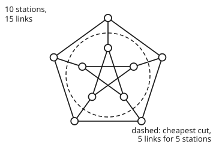
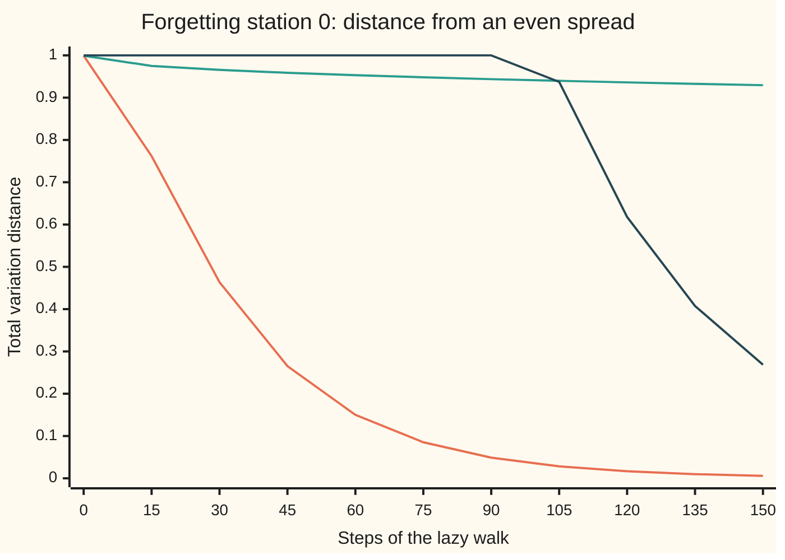

# Expanders: sparse networks that are hard to cut and quick to mix

[Syllabus](../../../SYLLABUS.md) → [Applied and computational](../README.md) → [Network Science and Spectral Graphs](../README.md#s07) → Expanders

---

## General Overview

A city runs 1,200 bike-share stations. Each station has exactly 3 bike lanes to other stations: 1,800 lanes in all. Two layouts are on the table, both synthetic.

**The ladder:** two riverside loops of 600 stations each, one on each bank of a ring-shaped river, with a bridge between facing stations. Each loop closes on itself, so every station has a lane on each side and a bridge.

**The random design:** each station's 3 lanes go to stations picked at random (a fixed seed, 2026, so the run can be repeated).

The planners want two things. First, no small set of lane closures should split the city. On the ladder, closing 4 lanes cuts it into two halves of 600 stations. On the random design, the best split the computer found costs 216 lanes to cut off 590 stations. A theorem goes further: every possible split, not just the ones tried, costs at least 0.0822 lanes per station on the smaller side.

Second, an inspector tours the stations and records what she sees. Each turn she tosses a coin: heads, she stays put; tails, she rides one of the 3 lanes, picked at random. Does that cheap tour give a fair picture of the whole city?

Starting at station 0 on the random design, she has forgotten her start after 47 turns. On the ladder, after 1,000 turns, her chances are still at distance 0.8387 from an even spread, where 0 is even and 1 is as far as possible.

A network that is sparse (few links per station) yet has no cheap cut is an **expander**. Its links let you neither split it cheaply nor stay stuck in one part of it.

**A network with few links per station can still be expensive to cut everywhere; one eigenvalue, the spectral gap, certifies that, and the same number caps how long a random walk takes to forget its start and how far its averages can stray.**

**What kind of fact this is:** two theorems. Cheeger's inequality (the gap and the cheapest cut bound each other) is proved on this card in Why it works. The mixing bound is proved on [Random walks on a graph](../../09-Probability%20and%20statistics/14-Random%20Graphs%20and%20the%20Probabilistic%20Method/05-random-walks-on-graphs-and-mixing.md) and applied here in Step 5. That a random 3-link network has a gap near 3 − 2√2 is a theorem about large networks, quoted with its source, and checked here on one network.

### The picture: a 10-station pilot where every cut is expensive

Before building 1,200 stations the city tests a 10-station pilot: an outer ring of 5, an inner five-pointed star of 5, and 5 spokes joining them. Every station has 3 lanes. (Mathematicians call it the Petersen graph.) The drawing is schematic.

<p align="center"></p>

The computer checked all 637 ways to pick 1 to 5 of the 10 stations. Cutting off any group costs at least one lane per station in it. The dashed circle shows one cheapest cut: 5 spokes to separate the 5 inner stations. Every loop of five stations ties with it.

---

## The formula

Notation first, in words. The network has $n$ stations, each with $d$ links (here $d$ = 3). Pick a set $S$ of stations; $|S|$ is how many are in it, and $\partial S$ (read "the boundary of S") is the set of links with one end inside $S$ and one outside. Closing those links cuts $S$ off.

The **edge expansion** $h$ is the cheapest cut, priced per station cut off:

$$h = \min_{1 \le |S| \le n/2} \frac{|\partial S|}{|S|}, \qquad \frac{\lambda_2}{2} \;\le\; h \;\le\; \sqrt{2d\,\lambda_2}, \qquad t_{\text{mix}} \;\le\; \frac{2d}{\lambda_2}\,\ln\bigl(2\sqrt{n}\bigr).$$

**Read it aloud:** the expansion is the fewest links per station you must close to cut off at most half the network; it is at least half the spectral gap and at most the square root of 2d times the gap; and a walker who waits half the time forgets her start within 2d over the gap, times the log of 2 root n, steps.

The **spectral gap** $\lambda_2$ comes from the graph Laplacian $L = D - A$ of [The graph Laplacian](03-graph-laplacian-and-spectral-clustering.md): $A$ is the adjacency table (1 where two stations share a link), $D$ the table of degrees. An eigenvalue of $L$ is a number $\lambda$ for which some nonzero list $f$, one number per station, gives $Lf = \lambda f$; that list is its eigenvector. $\lambda_2$ is the second-smallest eigenvalue of $L$ (the smallest is 0). Here it is called the gap because it is the distance from that 0.

The limit $|S| \le n/2$ is needed: cutting off all 1,200 stations costs nothing, and cutting off 1,199 is the same cut as cutting off 1.

The walk is the **lazy walk**: at each step, toss a coin; heads, stay put; tails, ride one of the $d$ lanes, each equally likely. The mixing time $t_{\text{mix}}$ is the number of steps after which, from the worst start, the walker's spread of chances is within a quarter of even, measured by total variation distance (the largest chance any set of stations has too much of). Both are defined on [Random walks on a graph](../../09-Probability%20and%20statistics/14-Random%20Graphs%20and%20the%20Probabilistic%20Method/05-random-walks-on-graphs-and-mixing.md).

| Symbol | Plain meaning | In our example | Push it up and the answer… |
| --- | --- | --- | --- |
| $n$ | stations | 1,200 (pilot 10) | mixing bound grows only like $\ln n$ |
| $d$ | links per station | 3 | gap can grow |
| $S$, $\lvert S \rvert$, $s$ | a set of stations; how many ($s$ in the proofs) | the inner star, 5 | — |
| $\partial S$ | links leaving $S$ | 5 spokes | — |
| $h$ | edge expansion: cheapest links per station cut off | pilot 1; random design 0.0822 to 0.3661 | harder to cut |
| $A$, $D$, $L$, $I$, $J$ | adjacency table; degree table; $L = D - A$; identity (1 on the diagonal); all-ones table | $D$ is 3 on the diagonal | — |
| $\lambda_2$ | spectral gap: second-smallest eigenvalue of $L$ | pilot 2; random 0.164347; ladder 0.000110 | faster mixing, harder to cut |
| $f$, $f_i$, $g$, $\theta$, $\mu$ | a pattern: one number per station; its positive part; a cut-off level; an eigenvalue of $A$ | in the proofs; pilot $\mu$ = 1 or −2 | — |
| $t$, $k$, $t_{\text{mix}}$ | steps of the walk; steps apart (or stations in a sweep); steps to forget the start | random design: 82 from the worst start (47 from station 0), 155 guaranteed | — |
| $P$, $\lambda_*$ | the lazy walk's table of chances; its slowest fade per step, $1 - \lambda_2/(2d)$ | random design 1 − 0.164347/6 | slower mixing |
| $\sigma$ | spread (standard deviation) of an estimate over repeated runs | 0.0127 for 1,000 independent picks | — |

### When it holds

- **Every station has the same number of links, $d$.** The proofs use it. With uneven degrees the same results hold for the Laplacian rescaled by degree (the normalised Laplacian), not for $L$ as written.
- **The network is connected.** A city in two pieces has $\lambda_2 = 0$ and $h = 0$, and the walker never leaves her piece.
- **The walk waits half the time.** A cube of 8 stations, 3 links each, has a gap of 2, yet a walker who always moves sits at distance 0.5000 from even after 60 steps and after 61. The cube's stations split into two colours with every link joining different colours, so she alternates colours forever. The lazy walk on the same cube reaches 0.0000. Without waiting, a network with no two-colouring still forgets its start eventually, but how fast also depends on the most negative eigenvalue of $A$, not on the gap alone.
- **The gap is computed, not assumed.** "Random 3-link networks have a gap near 3 − 2√2 = 0.171573" is true as the network grows. This particular 1,200-station network has 0.164347, just below. A guarantee needs the gap of the network you built.

---

## Why it works

### Step 0: a walker gets stuck only behind a cheap cut

Picture the inspector inside one district. Each ride leaves the district only along a boundary link. If the district has few such links compared with its size, she stays a long time, and her record over-reports that district. So slow mixing and cheap cuts are the same problem.

But $h$ is a minimum over all $2^{1200}$ sets, which nobody can check. The gap $\lambda_2$ is one eigenvalue, computed in a second. Cheeger's inequality says the gap and the cheapest cut always bound each other, so the computable number certifies the uncomputable one.

### Step 1: the gap is the smoothest pattern that is not flat

Give each station a number $f_i$ (a pattern). The Laplacian measures how much the pattern changes across links: $f^{\mathsf T} L f = \sum_{\text{links } ij} (f_i - f_j)^2$. The flat pattern, all ones, changes nowhere; it has eigenvalue 0. Among patterns that add to zero, the smoothest one has eigenvalue $\lambda_2$ (the Rayleigh quotient form of the spectral theorem; see [The graph Laplacian](03-graph-laplacian-and-spectral-clustering.md)):

$$\lambda_2 = \min_{f \ne 0,\ \sum_i f_i = 0} \frac{\sum_{\text{links } ij} (f_i - f_j)^2}{\sum_i f_i^2}.$$

So a small gap means some non-flat pattern barely changes across links.

### Step 2: a cheap cut makes a smooth pattern, so $h \ge \lambda_2 / 2$

Take any set $S$ with $|S| = s \le n/2$. Build the pattern "1 inside $S$, 0 outside", then subtract its average $s/n$ so it adds to zero. Across a link inside $S$, or inside the rest, the pattern does not change. Across a boundary link it changes by exactly 1. So the top of the fraction is $|\partial S|$.

The bottom is $s(1 - s/n)^2 + (n - s)(s/n)^2 = s(n - s)/n$. Step 1 says $\lambda_2$ is at most this fraction:

$$\lambda_2 \le \frac{|\partial S|\, n}{s (n - s)} \le \frac{2\,|\partial S|}{s},$$

since $n - s \ge n/2$. At $s = n/2$ the first form is $4|\partial S|/n$, the half-and-half bound of [The graph Laplacian](03-graph-laplacian-and-spectral-clustering.md). Every allowed set gives $|\partial S|/s \ge \lambda_2/2$, so the cheapest does: $h \ge \lambda_2/2$.

On the random design that is $h \ge 0.0822$: every district of up to 600 stations has at least 0.0822 boundary links per station. The first inequality is sharper: a district of 240 stations must have at least $\lambda_2 \cdot 240 \cdot 960 / 1200$ = 31.55 links out. The one around station 0 has 220.

### Step 3: a smooth pattern makes a cheap cut, so $h \le \sqrt{2d\,\lambda_2}$

Go the other way. Take the smoothest pattern $f$, the eigenvector for $\lambda_2$ (the Fiedler vector of [The graph Laplacian](03-graph-laplacian-and-spectral-clustering.md)). Line the stations up from smallest $f$ to largest. Try every cut of the form "the first $k$ stations" from either end of the line, for $k$ up to $n/2$, and keep the cheapest per station. This is a **sweep cut**.

The proof shows that one of these cuts, swept from whichever end holds fewer stations, costs at most $\sqrt{2d\lambda_2}$ per station. The code sweeps both ends, so it always includes that one.

On the random design the sweep finds 216 links around 590 stations: 0.3661 per station. Cheeger's upper bound is 0.9930. So the true $h$ is pinned between 0.0822 and 0.3661, without checking $2^{1200}$ sets.

<details>
<summary>Detailed proof: the sweep cut costs at most the square root of 2d times the gap</summary>

Let $f$ be an eigenvector, $Lf = \lambda_2 f$, with the sign chosen so that at most $n/2$ stations have $f_i > 0$. Let $g_i = \max(f_i, 0)$.

**$g$ is at least as smooth as $f$.** At a station with $g_i > 0$: $(Lg)_i = d g_i - \sum_{j \sim i} g_j \le d f_i - \sum_{j \sim i} f_j = \lambda_2 g_i$, because $g_i = f_i$ there and $g_j \ge f_j$ for the neighbours $j$. Multiply by $g_i$ and add up (stations with $g_i = 0$ add nothing): $\sum_{\text{links}} (g_i - g_j)^2 = \sum_i g_i (Lg)_i \le \lambda_2 \sum_i g_i^2$.

**Cauchy–Schwarz.** $\sum_{\text{links}} \lvert g_i^2 - g_j^2 \rvert = \sum \lvert g_i - g_j \rvert (g_i + g_j)$ is at most $\sqrt{\sum (g_i - g_j)^2}\sqrt{\sum (g_i + g_j)^2}$. The first root is at most $\sqrt{\lambda_2 \sum g_i^2}$. For the second, $(g_i + g_j)^2 \le 2g_i^2 + 2g_j^2$, and each station sits on $d$ links, so it is at most $\sqrt{2d \sum g_i^2}$. Together: $\sum_{\text{links}} \lvert g_i^2 - g_j^2 \rvert \le \sqrt{2d\lambda_2}\, \sum_i g_i^2$.

**Sweep.** For each level $\theta > 0$ let $S_\theta$ be the stations with $g_i^2 > \theta$; each has at most $n/2$ stations, so $|\partial S_\theta| \ge h\,|S_\theta|$. A link $ij$ is in $\partial S_\theta$ exactly for $\theta$ between $g_i^2$ and $g_j^2$, so integrating over $\theta$: $\int_0^\infty |\partial S_\theta|\, d\theta = \sum_{\text{links}} \lvert g_i^2 - g_j^2 \rvert$, and $\int_0^\infty |S_\theta|\, d\theta = \sum_i g_i^2$. Hence $h \sum g_i^2 \le \sqrt{2d\lambda_2} \sum g_i^2$, which is $h \le \sqrt{2d\lambda_2}$. Some $S_\theta$, a sweep cut, does at least as well as the average, which is why the sweep finds a cut this cheap.

</details>

### Step 4: on the pilot every number is exact

In the pilot, two stations either share a link or share exactly one neighbour, never both. Counting two-step routes gives the table $A^2$: 3 on the diagonal (out and back along each lane), 0 between linked stations, 1 between unlinked ones. That is $A^2 + A - 2I = J$, with $I$ the identity and $J$ the table of all ones. The code checks every entry.

On a pattern adding to zero, $J$ gives zero, so each eigenvalue $\mu$ of $A$ satisfies $\mu^2 + \mu - 2 = 0$: $\mu = 1$ or $\mu = -2$. Since $L = 3I - A$, the gap is $3 - 1 = 2$. Cheeger then says $1 \le h \le 3.464102$, and the brute-force count says $h = 1$. On the pilot the lower bound is exact.

### Step 5: the gap sets the speed of forgetting

The lazy walk moves chances by the table $P = \tfrac12 I + \tfrac{1}{2d} A = I - \tfrac{1}{2d} L$. Its eigenvalues are $1 - \lambda/(2d)$, one for each eigenvalue $\lambda$ of $L$, all between 0 and 1. The largest below 1 is $\lambda_* = 1 - \lambda_2/(2d)$.

[Random walks on a graph](../../09-Probability%20and%20statistics/14-Random%20Graphs%20and%20the%20Probabilistic%20Method/05-random-walks-on-graphs-and-mixing.md) proves that from any start the distance after $t$ steps is at most $\tfrac12 \lambda_*^t \sqrt{n - 1}$, since each station's long-run share is $1/n$. (That card calls $1 - \lambda_*$ the spectral gap; here it equals $\lambda_2/(2d)$, the same idea rescaled.) Use $\lambda_* \le e^{-\lambda_2/(2d)}$ and solve for the distance to reach a quarter:

$$t \ge \frac{2d}{\lambda_2} \ln\bigl(2\sqrt{n}\bigr) \quad\Longrightarrow\quad \text{distance} \le \tfrac14 .$$

The $\ln n$ is the point. On a family of networks whose gap stays put as they grow, mixing time grows like $\ln n$. The random design's gap barely moves: 0.222661 at 120 stations, 0.164347 at 1,200. The ladder's falls a hundredfold, from 0.010956 to 0.000110, because a long ladder has a smooth pattern that rises slowly around the loop. For the random design the guarantee is 155 steps; the ladder's is 231888.

[Convergence to equilibrium](../../11-Stochastic%20processes%20and%20calculus/03-Markov%20Chains/05-convergence-to-equilibrium.md) gets the same kind of guarantee by coupling instead of eigenvalues.

### Step 6: why an expander walk is a good sampler

The inspector wants the share of stations in a district: the 240 stations nearest station 0, so the true answer is 0.2. Her estimate is the share of her 1,000 stops that fall inside it.

Two stops $k$ steps apart are correlated, but on the lazy walk every part of the pattern except the flat part fades by at least $\lambda_*$ per step, so the correlation is at most $\lambda_*^k$. Adding up these correlations, the spread of the walk's estimate is at most

$$\sigma_{\text{walk}} \le \sqrt{\frac{1 + \lambda_*}{1 - \lambda_*}}\;\sigma_{\text{independent}},$$

when the walk starts at a station picked evenly. The factor depends on the gap, not on $n$. For the random design it is 8.49, so 1,000 stops promise a spread of at most 0.1073. Over 200 runs the measured spread is 0.0713. Independent picks give 0.0127, against the textbook $\sqrt{0.2 \times 0.8 / 1000}$ = 0.0126.

The plain reason is Step 2. A district on an expander has many links out: from a station picked evenly inside the 240, one lazy step leaves with chance 0.1528. On the ladder the same district has 6 links out and the chance is 0.0042. The ladder walk's 200 estimates have spread 0.3992: most runs are almost entirely inside the district or almost entirely outside it.

What the walk saves is randomness. Independent picks cost $\log_2 1200$ random bits each, 10229 bits for 1,000. The walk costs one pick to start, then at most a coin and a choice of 3 per step: 2595 bits.

Here that does not pay, because the walk needs more stops for the same spread. It pays when the space is enormous, such as all $2^{100}$ settings of a 100-bit key, where a fresh pick costs 100 bits and a step on a 3-link expander still costs under 3.

---

## Worked numbers, by hand

On the pilot: 10 stations, 3 lanes each.

| Step | Arithmetic | Value |
| --- | --- | --- |
| sets to check | 10 + 45 + 120 + 210 + 252 sets of 1 to 5 stations | 637 |
| one station alone | 3 lanes out, 1 station | 3 per station |
| inner star alone | 5 spokes, 5 stations | 1 per station |
| any loop of five | 15 lane-ends, 10 used inside: 5 out, 5 stations | 1 per station |
| two-step routes | $A^2$: 3 on diagonal, 0 if linked, 1 if not | $A^2 + A - 2I = J$ |
| eigenvalues off the flat pattern | $\mu^2 + \mu - 2 = 0$ | 1 and −2 |
| gap | 3 − 1 | 2 |
| Cheeger | 2/2 ≤ h ≤ √(2 × 3 × 2) | 1 ≤ h ≤ 3.464102 |
| mixing guarantee | (6/2) × ln(2√10), rounded up | 6 steps |
| **edge expansion** | brute force over 637 sets, 12 tie | **h = 1** |

Every way of cutting off up to half the pilot costs at least one lane per station cut off, and the gap alone proves it.

### What breaks if you drop a piece

| Mistake | Comes out at | What went wrong |
| --- | --- | --- |
| Plain walk, no waiting, on a two-colour network (the cube) | distance 0.5000 at step 60 and step 61, though the gap is 2 | Eigenvalue −1 of the plain walk; the gap bound is for the lazy walk |
| A sparse network with a bottleneck (the ladder) | guarantee 231888 steps; still 0.8387 after 1,000 | 4 lanes cut 600 stations off: $h \le$ 0.0067, gap 0.000110 |
| Reading the easy side as the value of $h$ | 0.0822, when a cut of 0.3661 is the best found | $\lambda_2/2$ is a floor; the true $h$ lies between 0.0822 and 0.3661 |
| Sampling by walking the ladder | spread 0.3992 against 0.0713 on the random design | The walk stays in whichever district it starts in |

The code prints all four.

---

## How the walker forgets her start, step by step

Both designs give every station 3 lanes and the inspector picks lanes the same way, yet only one lets her forget her start. The difference is where the lanes go.

| Step | Random design | Ladder | Random design's guarantee |
| --- | --- | --- | --- |
| 0 | 0.9992 | 0.9992 | 1.0000 |
| 15 | 0.7618 | 0.9750 | 1.0000 |
| 30 | 0.4637 | 0.9658 | 1.0000 |
| 45 | 0.2653 | 0.9588 | 1.0000 |
| 60 | 0.1501 | 0.9532 | 1.0000 |
| 90 | 0.0489 | 0.9437 | 1.0000 |
| 120 | 0.0166 | 0.9361 | 0.6180 |
| 150 | 0.0058 | 0.9295 | 0.2686 |

The distance is from the even spread, starting at station 0, computed exactly by pushing chances along lanes, not simulated. The guarantee is capped at 1, since no distance exceeds 1.

On the random design the set of stations she could be at grows fast, because the lanes keep leading somewhere new. On the ladder she spreads around the loop like a drop of ink in a pipe: after $t$ steps she has covered a stretch about $\sqrt t$ stations long.



Orange: the random design, under a quarter from step 47. Teal: the ladder, barely moving. Dark: the gap's guarantee for the random design, which promises a quarter by step 155 and is overtaken by the truth long before. A guarantee is a ceiling, not a forecast.

---

## Code, from first principles, and it actually runs

The script builds the pilot, a random 3-link network from SplitMix64 (a small pseudo-random number generator written into the script) with seed 2026, and the ladder. It takes three roads to the expansion and the gap: brute force over all 637 sets of the pilot, the exact identity $A^2 + A - 2I = J$, and power iteration (repeatedly applying $3I + A$ and removing the flat part) on the pilot, the cube and both random networks.

The ladder's gap comes from its closed form, $2 - 2\cos(2\pi/600)$ at 1,200 stations. Power iteration confirms the same closed form on the 120-station ladder. At 1,200 stations the gap is too small for power iteration to settle in time, so there the code only checks that the cosine pattern around the loop reaches it.

Two roads lead to mixing: the exact spread of chances step by step, from station 0 and from every start, against the gap's guarantee. The sampler is a seeded simulation of 200 runs, checked against the independent-pick formula and the gap's spread bound.

### Python

```python
# Expanders: a 10-station pilot (every cut checked) and two synthetic 1,200-station networks with 3 links
# per station: a random one (SplitMix64, seed 2026) and a ladder (two loops of 600 joined by rungs).
import math, functools
M64 = (1 << 64) - 1
class SplitMix64:
    def __init__(self, seed): self.x = seed
    def next(self):
        self.x = (self.x + 0x9E3779B97F4A7C15) & M64
        z = ((self.x ^ (self.x >> 30)) * 0xBF58476D1CE4E5B9) & M64
        z = ((z ^ (z >> 27)) * 0x94D049BB133111EB) & M64
        return z ^ (z >> 31)
    def below(self, k): return self.next() % k
tot = lambda xs: functools.reduce(lambda a, b: a + b, xs, 0.0)   # plain left-to-right sum, as in the Rust
def ball(adj, start, k):                      # first k stations met by breadth-first search
    seen, order, i = {start}, [start], 0
    while i < len(order) and len(order) < k:
        for w in adj[order[i]]:
            if w not in seen and len(order) < k: seen.add(w); order.append(w)
        i += 1
    return order
def random_cubic(n, rng):                     # pair up 3n link-ends at random; retry until simple, connected
    while True:
        ends = [v for v in range(n) for _ in range(3)]
        for i in range(len(ends) - 1, 0, -1):
            j = rng.below(i + 1); ends[i], ends[j] = ends[j], ends[i]
        adj, ok = [[] for _ in range(n)], True
        for k in range(0, 3 * n, 2):
            a, b = ends[k], ends[k + 1]
            if a == b or b in adj[a]: ok = False; break
            adj[a].append(b); adj[b].append(a)
        if ok and len(ball(adj, 0, n)) == n: return adj
def ladder(n):
    m = n // 2
    return [[(i + 1) % m + r * m, (i - 1) % m + r * m, i + (1 - r) * m] for r in (0, 1) for i in range(m)]
def boundary(adj, inS): return sum(1 for v in range(len(adj)) if inS[v] for w in adj[v] if not inS[w])
def rayleigh(adj, f):                         # sum over links of (f_i - f_j)^2, over sum of f_i^2
    return tot((f[i] - f[j]) ** 2 for i in range(len(adj)) for j in adj[i] if i < j) / tot(x * x for x in f)
def lam2(adj, iters):                         # power iteration on 6I - L = 3I + A, at right angles to all-ones
    n, rng = len(adj), SplitMix64(7)
    f = [(rng.next() >> 11) / 2.0 ** 53 - 0.5 for _ in range(n)]
    for it in range(iters + 1):
        mean = tot(f) / n; f = [x - mean for x in f]
        if it == iters: return rayleigh(adj, f), f
        g = [3.0 * f[i] + f[adj[i][0]] + f[adj[i][1]] + f[adj[i][2]] for i in range(n)]
        s = math.sqrt(tot(x * x for x in g)); f = [x / s for x in g]
def sweep(adj, f):                            # best cut among "the k stations with smallest f", k <= n/2
    n = len(adj); order = sorted(range(n), key=lambda i: f[i]); inS = [False] * n
    cut, best = 0, (9, 1)
    for k, v in enumerate(order[: n // 2]):
        inS[v] = True; cut += sum(-1 if inS[w] else 1 for w in adj[v])
        if cut * best[1] < best[0] * (k + 1): best = (cut, k + 1)
    return best
def tv_trace(adj, steps, lazy=True, start=0, stop=-1.0):   # exact spread of the walk from start; distance from even
    n = len(adj); p = [0.0] * n; p[start] = 1.0; out = []
    while len(out) <= steps and (not out or out[-1] > stop):   # ends early once the distance is down to stop
        out.append(0.5 * tot(abs(x - 1.0 / n) for x in p))
        nb = [p[adj[i][0]] + p[adj[i][1]] + p[adj[i][2]] for i in range(n)]
        p = [0.5 * p[i] + nb[i] / 6.0 for i in range(n)] if lazy else [x / 3.0 for x in nb]
    return out
def walk_share(adj, inS, steps, rng):         # lazy walk from a random station; share of steps inside S
    v, hits = rng.below(len(adj)), 0
    for _ in range(steps):
        if rng.below(2) == 1: v = adj[v][rng.below(3)]
        hits += inS[v]
    return hits / steps
def spread(xs):
    m = tot(xs) / len(xs); return m, math.sqrt(tot((x - m) ** 2 for x in xs) / (len(xs) - 1))
# ---- the pilot: outer ring of 5, inner star of 5, 5 spokes (the Petersen network) ----
P = [[(i + 1) % 5, (i + 4) % 5, i + 5] for i in range(5)] + [[5 + (i + 2) % 5, 5 + (i + 3) % 5, i] for i in range(5)]
best, nbest, cuts = 9.0, 0, 0
for mask in range(1, 1 << 10):
    S = [(mask >> v) & 1 == 1 for v in range(10)]
    if sum(S) > 5: continue
    cuts += 1; r = boundary(P, S) / sum(S)
    if r < best - 1e-12: best, nbest = r, 0
    if abs(r - best) < 1e-12: nbest += 1
A2 = [[sum(1 for k in range(10) if i in P[k] and j in P[k]) for j in range(10)] for i in range(10)]
identity = all(A2[i][j] + (j in P[i]) - 2 * (i == j) == 1 for i in range(10) for j in range(10))
lp = lam2(P, 200)[0]
print(f"pilot: sets of 1-5 stations checked {cuts}; edge expansion h {best:.6f}, reached by {nbest} sets")
print(f"pilot: A^2 + A - 2I = J at every entry: {identity}; gap by power iteration {lp:.6f}")
print(f"pilot: lam2/2 {lp / 2:.6f} <= h {best:.6f} <= sqrt(2 d lam2) {math.sqrt(6 * lp):.6f}; mixes within {math.ceil(6 / lp * math.log(2 * math.sqrt(10)))} steps")
# ---- 1,200 stations, 1,800 links: random against ladder ----
rng = SplitMix64(2026)
E120, E, L = random_cubic(120, rng), random_cubic(1200, rng), ladder(1200)
lad = lambda n: 2.0 - 2.0 * math.cos(2.0 * math.pi / (n // 2))
(le, fe), le_half, l120 = lam2(E, 3000), lam2(E, 1500)[0], lam2(E120, 3000)[0]
ll, ll_rq, ll120 = lad(1200), rayleigh(L, [math.cos(2.0 * math.pi * (i % 600) / 600) for i in range(1200)]), lam2(ladder(120), 3000)[0]
cut, size = min(sweep(E, fe), sweep(E, [-x for x in fe]), key=lambda c: c[0] / c[1])   # sweep from both ends
print(f"gap, random  n=120, 1200:   {l120:.6f} {le:.6f}   (1500 iterations: {le_half:.6f})")
print(f"gap, ladder  n=120, 1200:   {lad(120):.6f} {ll:.6f}   (closed form; power iteration n=120: {ll120:.6f}; Rayleigh check: {ll_rq:.6f})")
print(f"large-network limit 3 - 2 sqrt 2:             {3 - 2 * math.sqrt(2):.6f}")
print(f"random: h >= lam2/2 = {le / 2:.4f}; sweep cut {cut} links / {size} stations = {cut / size:.4f}; h <= {math.sqrt(6 * le):.4f}")
print(f"ladder: h >= lam2/2 = {ll / 2:.7f}; half cut 4 links / 600 stations = {4 / 600:.4f}; h <= {math.sqrt(6 * ll):.4f}")
lnn = math.log(2 * math.sqrt(1200))
tb_e, tb_l = math.ceil(6 / le * lnn), math.ceil(6 / ll * lnn)
print(f"guaranteed mixing, (2d/lam2) ln(2 sqrt n): random {tb_e} steps, ladder {tb_l} steps")
te, tl = tv_trace(E, 150), tv_trace(L, 1000)
bound = lambda lam, t: 0.5 * (1 - lam / 6) ** t * math.sqrt(1199)
tmix = next(t for t, d in enumerate(te) if d <= 0.25)
tmix_w = max(len(tv_trace(E, 400, start=s, stop=0.25)) - 1 for s in range(1200))   # every start; t_mix is the worst
print("step   distance: random  ladder   random's guarantee")
for t in range(0, 151, 15): print(f"{t:4d}            {te[t]:.4f}  {tl[t]:.4f}   {min(1.0, bound(le, t)):.4f}")
print(f"random: first step with distance <= 1/4: {tmix} from station 0, {tmix_w} from the worst start;  ladder at step 1000: {tl[1000]:.4f}")
# ---- sampling: share of stations in a 240-station district around station 0 (truth 0.2) ----
res, dist = {}, {}
for name, g in (("random", E), ("ladder", L)):
    inS = [False] * 1200
    for v in ball(g, 0, 240): inS[v] = True
    b, dist[name] = boundary(g, inS), inS
    res[name] = [walk_share(g, inS, 1000, SplitMix64(s + 1)) for s in range(200)]
    lam = le if name == "random" else ll
    print(f"district on {name}: {b} links out (at least {lam * 240 * 960 / 1200:.2f}); a lazy step leaves with chance {b / 1440:.4f}")
indep = []
for s in range(200):
    r = SplitMix64(10_000 + s); indep.append(sum(1 for _ in range(1000) if r.below(1200) < 240) / 1000)
(m_i, s_i), (m_e, s_e), (m_l, s_l) = spread(indep), spread(res["random"]), spread(res["ladder"])
for name, m, sd in (("independent picks", m_i, s_i), ("walk, random", m_e, s_e), ("walk, ladder", m_l, s_l)): print(f"200 runs x 1000 picks, {name:<17} mean {m:.4f}  spread {sd:.4f}")
s_th, ls = math.sqrt(0.16 / 1000), 1 - le / 6
s_g = s_th * math.sqrt((1 + ls) / (1 - ls))
print(f"theory: independent spread sqrt(0.2 x 0.8 / 1000) = {s_th:.4f}; walk guarantee x {s_g / s_th:.2f} = {s_g:.4f}")
print(f"random bits per run: independent {1000 * math.log2(1200):.0f}, walk {math.log2(1200) + 1000 * (1 + math.log2(3)):.0f}")
s_short = spread([walk_share(E, dist["random"], 250, SplitMix64(500 + s)) for s in range(200)])[1]
print(f"try: walk of 250 steps on random network, spread {s_short:.4f}")
# ---- what breaks: the cube (8 stations, 3 links, two colours) walked without waiting ----
Q = [[i ^ 1, i ^ 2, i ^ 4] for i in range(8)]
qn, ql = tv_trace(Q, 61, lazy=False), tv_trace(Q, 61)
print(f"cube: gap {lam2(Q, 200)[0]:.6f}; plain walk distance at 60, 61: {qn[60]:.4f} {qn[61]:.4f}; lazy: {ql[60]:.4f}")
pts = [(180 + rad * math.cos(math.radians(-90 + 72 * k)), 125 + rad * math.sin(math.radians(-90 + 72 * k))) for rad in (95, 45) for k in range(5)]
print("figure, " + " ".join(f"{x:.1f},{y:.1f}" for x, y in pts))
assert abs(best - 1.0) < 1e-12 and nbest == 12, "pilot: every set checked, cheapest is 5 links for 5 stations"
assert identity and abs(lp - 2.0) < 1e-9, "pilot: power iteration lands on the gap the identity forces"
assert abs(ll - ll_rq) < 1e-12 and abs(ll120 - lad(120)) < 1e-9, "ladder: closed form vs its cosine pattern, and vs power iteration at 120"
assert le / 2 <= cut / size <= math.sqrt(6 * le) and abs(le - le_half) < 1e-6, "random: sweep cut inside Cheeger"
assert all(te[t] <= bound(le, t) for t in range(151)) and all(tl[t] <= bound(ll, t) for t in range(1001)), "gap bound"
assert tmix <= tmix_w <= tb_e and tl[1000] > 0.5, "random mixes inside its guarantee from every start; ladder is still far off"
assert abs(s_i / s_th - 1) < 0.2 and abs(m_e - 0.2) < 4 * s_e / math.sqrt(200) and s_e <= s_g, "samplers"
assert s_l > 5 * s_e, "ladder walk's estimate swings far more than the random network's"
assert abs(qn[60] - 0.5) < 1e-12 and abs(qn[61] - 0.5) < 1e-12 and ql[60] < 1e-6, "two-colour trap"
print("ALL CHECKS PASS")
```

**Ran 2026-11-11 on macOS, Python 3.14.10, standard library only. All checks passed. Output, pasted from the run:**

```
pilot: sets of 1-5 stations checked 637; edge expansion h 1.000000, reached by 12 sets
pilot: A^2 + A - 2I = J at every entry: True; gap by power iteration 2.000000
pilot: lam2/2 1.000000 <= h 1.000000 <= sqrt(2 d lam2) 3.464102; mixes within 6 steps
gap, random  n=120, 1200:   0.222661 0.164347   (1500 iterations: 0.164347)
gap, ladder  n=120, 1200:   0.010956 0.000110   (closed form; power iteration n=120: 0.010956; Rayleigh check: 0.000110)
large-network limit 3 - 2 sqrt 2:             0.171573
random: h >= lam2/2 = 0.0822; sweep cut 216 links / 590 stations = 0.3661; h <= 0.9930
ladder: h >= lam2/2 = 0.0000548; half cut 4 links / 600 stations = 0.0067; h <= 0.0257
guaranteed mixing, (2d/lam2) ln(2 sqrt n): random 155 steps, ladder 231888 steps
step   distance: random  ladder   random's guarantee
   0            0.9992  0.9992   1.0000
  15            0.7618  0.9750   1.0000
  30            0.4637  0.9658   1.0000
  45            0.2653  0.9588   1.0000
  60            0.1501  0.9532   1.0000
  75            0.0852  0.9482   1.0000
  90            0.0489  0.9437   1.0000
 105            0.0283  0.9398   0.9373
 120            0.0166  0.9361   0.6180
 135            0.0098  0.9326   0.4074
 150            0.0058  0.9295   0.2686
random: first step with distance <= 1/4: 47 from station 0, 82 from the worst start;  ladder at step 1000: 0.8387
district on random: 220 links out (at least 31.55); a lazy step leaves with chance 0.1528
district on ladder: 6 links out (at least 0.02); a lazy step leaves with chance 0.0042
200 runs x 1000 picks, independent picks mean 0.1999  spread 0.0127
200 runs x 1000 picks, walk, random      mean 0.1998  spread 0.0713
200 runs x 1000 picks, walk, ladder      mean 0.2211  spread 0.3992
theory: independent spread sqrt(0.2 x 0.8 / 1000) = 0.0126; walk guarantee x 8.49 = 0.1073
random bits per run: independent 10229, walk 2595
try: walk of 250 steps on random network, spread 0.1290
cube: gap 2.000000; plain walk distance at 60, 61: 0.5000 0.5000; lazy: 0.0000
figure, 180.0,30.0 270.4,95.6 235.8,201.9 124.2,201.9 89.6,95.6 180.0,80.0 222.8,111.1 206.5,161.4 153.5,161.4 137.2,111.1
ALL CHECKS PASS
```

### Rust

```rust
// Expanders: a 10-station pilot (every cut checked) and two synthetic 1,200-station networks with 3 links
// per station: a random one (SplitMix64, seed 2026) and a ladder (two loops of 600 joined by rungs).
type Adj = Vec<Vec<usize>>;
struct SplitMix64 { x: u64 }
impl SplitMix64 {
    fn next(&mut self) -> u64 {
        self.x = self.x.wrapping_add(0x9E3779B97F4A7C15);
        let z = (self.x ^ (self.x >> 30)).wrapping_mul(0xBF58476D1CE4E5B9);
        let z = (z ^ (z >> 27)).wrapping_mul(0x94D049BB133111EB); z ^ (z >> 31)
    }
    fn below(&mut self, k: usize) -> usize { (self.next() % k as u64) as usize }
}
fn sm(seed: u64) -> SplitMix64 { SplitMix64 { x: seed } }
fn tot<I: Iterator<Item = f64>>(xs: I) -> f64 { xs.fold(0.0, |a, b| a + b) }
fn ball(adj: &Adj, start: usize, k: usize) -> Vec<usize> {
    let (mut seen, mut order, mut i) = (vec![false; adj.len()], vec![start], 0);
    seen[start] = true;
    while i < order.len() && order.len() < k {
        for &w in &adj[order[i]] { if !seen[w] && order.len() < k { seen[w] = true; order.push(w); } }
        i += 1;
    }
    order
}
fn random_cubic(n: usize, rng: &mut SplitMix64) -> Adj {
    loop {
        let mut ends: Vec<usize> = (0..3 * n).map(|k| k / 3).collect();
        for i in (1..ends.len()).rev() { let j = rng.below(i + 1); ends.swap(i, j); }
        let (mut adj, mut ok): (Adj, bool) = (vec![vec![]; n], true);
        for k in (0..3 * n).step_by(2) {
            let (a, b) = (ends[k], ends[k + 1]);
            if a == b || adj[a].contains(&b) { ok = false; break; }
            adj[a].push(b); adj[b].push(a);
        }
        if ok && ball(&adj, 0, n).len() == n { return adj; }
    }
}
fn ladder(n: usize) -> Adj {
    let m = n / 2;
    (0..n).map(|v| { let (r, i) = (v / m, v % m); vec![(i + 1) % m + r * m, (i + m - 1) % m + r * m, i + (1 - r) * m] }).collect()
}
fn boundary(adj: &Adj, ins: &[bool]) -> usize {
    (0..adj.len()).filter(|&v| ins[v]).map(|v| adj[v].iter().filter(|&&w| !ins[w]).count()).sum()
}
fn rayleigh(adj: &Adj, f: &[f64]) -> f64 {
    let num = tot((0..adj.len()).flat_map(|i| adj[i].iter().filter(move |&&j| i < j).map(move |&j| (f[i] - f[j]) * (f[i] - f[j]))));
    num / tot(f.iter().map(|x| x * x))
}
fn lam2(adj: &Adj, iters: usize) -> (f64, Vec<f64>) {
    let (n, mut rng) = (adj.len(), sm(7));
    let mut f: Vec<f64> = (0..n).map(|_| (rng.next() >> 11) as f64 / 9007199254740992.0 - 0.5).collect();
    for it in 0..=iters {
        let mean = tot(f.iter().cloned()) / n as f64; f = f.iter().map(|x| x - mean).collect();
        if it == iters { return (rayleigh(adj, &f), f); }
        let g: Vec<f64> = (0..n).map(|i| 3.0 * f[i] + f[adj[i][0]] + f[adj[i][1]] + f[adj[i][2]]).collect();
        let s = tot(g.iter().map(|x| x * x)).sqrt(); f = g.iter().map(|x| x / s).collect();
    }
    unreachable!()
}
fn sweep(adj: &Adj, f: &[f64]) -> (i64, i64) {
    let (n, mut order): (usize, Vec<usize>) = (adj.len(), (0..adj.len()).collect());
    order.sort_by(|&a, &b| f[a].partial_cmp(&f[b]).unwrap());
    let (mut ins, mut cut, mut best) = (vec![false; n], 0i64, (9i64, 1i64));
    for (k, &v) in order[..n / 2].iter().enumerate() {
        ins[v] = true; cut += adj[v].iter().map(|&w| if ins[w] { -1 } else { 1 }).sum::<i64>();
        if cut * best.1 < best.0 * (k as i64 + 1) { best = (cut, k as i64 + 1); }
    }
    best
}
fn tv_trace(adj: &Adj, steps: usize, lazy: bool, start: usize, stop: f64) -> Vec<f64> {
    let (n, mut out) = (adj.len(), vec![]);
    let mut p: Vec<f64> = (0..n).map(|i| if i == start { 1.0 } else { 0.0 }).collect();
    while out.len() <= steps && out.last().map_or(true, |&d: &f64| d > stop) {   // ends early once the distance is down to stop
        out.push(0.5 * tot(p.iter().map(|x| (x - 1.0 / n as f64).abs())));
        let nb: Vec<f64> = (0..n).map(|i| p[adj[i][0]] + p[adj[i][1]] + p[adj[i][2]]).collect();
        p = if lazy { (0..n).map(|i| 0.5 * p[i] + nb[i] / 6.0).collect() } else { nb.iter().map(|x| x / 3.0).collect() };
    }
    out
}
fn walk_share(adj: &Adj, ins: &[bool], steps: usize, rng: &mut SplitMix64) -> f64 {
    let (mut v, mut hits) = (rng.below(adj.len()), 0);
    for _ in 0..steps {
        if rng.below(2) == 1 { v = adj[v][rng.below(3)]; } if ins[v] { hits += 1; }
    }
    hits as f64 / steps as f64
}
fn spread(xs: &[f64]) -> (f64, f64) {
    let m = tot(xs.iter().cloned()) / xs.len() as f64;
    (m, (tot(xs.iter().map(|x| (x - m) * (x - m))) / (xs.len() - 1) as f64).sqrt())
}
fn main() {
    // ---- the pilot: outer ring of 5, inner star of 5, 5 spokes (the Petersen network) ----
    let mut p: Adj = (0..5).map(|i| vec![(i + 1) % 5, (i + 4) % 5, i + 5]).collect();
    for i in 0..5 { p.push(vec![5 + (i + 2) % 5, 5 + (i + 3) % 5, i]); }
    let (mut best, mut nbest, mut cuts) = (9.0f64, 0, 0);
    for mask in 1u32..(1 << 10) {
        let s: Vec<bool> = (0..10).map(|v| (mask >> v) & 1 == 1).collect();
        let k = s.iter().filter(|&&b| b).count();
        if k > 5 { continue; }
        cuts += 1; let r = boundary(&p, &s) as f64 / k as f64;
        if r < best - 1e-12 { best = r; nbest = 0; }
        if (r - best).abs() < 1e-12 { nbest += 1; }
    }
    let a2 = |i: usize, j: usize| (0..10).filter(|&k| p[k].contains(&i) && p[k].contains(&j)).count() as i64;
    let identity = (0..10).all(|i| (0..10).all(|j| a2(i, j) + p[i].contains(&j) as i64 - 2 * (i == j) as i64 == 1));
    let lp = lam2(&p, 200).0;
    let tf = |b: bool| if b { "True" } else { "False" };
    println!("pilot: sets of 1-5 stations checked {}; edge expansion h {:.6}, reached by {} sets", cuts, best, nbest);
    println!("pilot: A^2 + A - 2I = J at every entry: {}; gap by power iteration {:.6}", tf(identity), lp);
    println!("pilot: lam2/2 {:.6} <= h {:.6} <= sqrt(2 d lam2) {:.6}; mixes within {} steps", lp / 2.0, best, (6.0 * lp).sqrt(), (6.0 / lp * (2.0 * 10f64.sqrt()).ln()).ceil());
    // ---- 1,200 stations, 1,800 links: random against ladder ----
    let (mut rng, pi) = (sm(2026), std::f64::consts::PI);
    let e120 = random_cubic(120, &mut rng);
    let (e, l) = (random_cubic(1200, &mut rng), ladder(1200));
    let lad = |n: usize| 2.0 - 2.0 * (2.0 * pi / (n / 2) as f64).cos();
    let ((le, fe), le_half, l120) = (lam2(&e, 3000), lam2(&e, 1500).0, lam2(&e120, 3000).0);
    let fl: Vec<f64> = (0..1200).map(|i| (2.0 * pi * (i % 600) as f64 / 600.0).cos()).collect();
    let (ll, ll_rq, ll120) = (lad(1200), rayleigh(&l, &fl), lam2(&ladder(120), 3000).0);
    let (c1, c2) = (sweep(&e, &fe), sweep(&e, &fe.iter().map(|x| -x).collect::<Vec<f64>>()));   // sweep from both ends
    let (cut, size) = if c1.0 * c2.1 <= c2.0 * c1.1 { c1 } else { c2 }; let cs = cut as f64 / size as f64;
    println!("gap, random  n=120, 1200:   {:.6} {:.6}   (1500 iterations: {:.6})", l120, le, le_half);
    println!("gap, ladder  n=120, 1200:   {:.6} {:.6}   (closed form; power iteration n=120: {:.6}; Rayleigh check: {:.6})", lad(120), ll, ll120, ll_rq);
    println!("large-network limit 3 - 2 sqrt 2:             {:.6}", 3.0 - 2.0 * 2f64.sqrt());
    println!("random: h >= lam2/2 = {:.4}; sweep cut {} links / {} stations = {:.4}; h <= {:.4}", le / 2.0, cut, size, cs, (6.0 * le).sqrt());
    println!("ladder: h >= lam2/2 = {:.7}; half cut 4 links / 600 stations = {:.4}; h <= {:.4}", ll / 2.0, 4.0 / 600.0, (6.0 * ll).sqrt());
    let lnn = (2.0 * 1200f64.sqrt()).ln();
    let (tb_e, tb_l) = ((6.0 / le * lnn).ceil() as usize, (6.0 / ll * lnn).ceil() as usize);
    println!("guaranteed mixing, (2d/lam2) ln(2 sqrt n): random {} steps, ladder {} steps", tb_e, tb_l);
    let (te, tl) = (tv_trace(&e, 150, true, 0, -1.0), tv_trace(&l, 1000, true, 0, -1.0));
    let bound = |lam: f64, t: usize| 0.5 * (1.0 - lam / 6.0).powf(t as f64) * 1199f64.sqrt();
    let tmix = te.iter().position(|&d| d <= 0.25).unwrap();
    let tmix_w = (0..1200).map(|s| tv_trace(&e, 400, true, s, 0.25).len() - 1).max().unwrap();   // every start; t_mix is the worst
    println!("step   distance: random  ladder   random's guarantee");
    for t in (0..151).step_by(15) { println!("{:4}            {:.4}  {:.4}   {:.4}", t, te[t], tl[t], bound(le, t).min(1.0)); }
    println!("random: first step with distance <= 1/4: {} from station 0, {} from the worst start;  ladder at step 1000: {:.4}", tmix, tmix_w, tl[1000]);
    // ---- sampling: share of stations in a 240-station district around station 0 (truth 0.2) ----
    let (mut res, mut dist): (Vec<Vec<f64>>, Vec<Vec<bool>>) = (vec![], vec![]);
    for (name, g, lam) in [("random", &e, le), ("ladder", &l, ll)] {
        let mut ins = vec![false; 1200];
        for v in ball(g, 0, 240) { ins[v] = true; }
        let b = boundary(g, &ins);
        res.push((0..200).map(|s| walk_share(g, &ins, 1000, &mut sm(s + 1))).collect()); dist.push(ins);
        println!("district on {}: {} links out (at least {:.2}); a lazy step leaves with chance {:.4}", name, b, lam * 240.0 * 960.0 / 1200.0, b as f64 / 1440.0);
    }
    let indep: Vec<f64> = (0..200).map(|s| { let mut r = sm(10_000 + s); (0..1000).filter(|_| r.below(1200) < 240).count() as f64 / 1000.0 }).collect();
    let ((m_i, s_i), (m_e, s_e), (m_l, s_l)) = (spread(&indep), spread(&res[0]), spread(&res[1]));
    for (name, m, sd) in [("independent picks", m_i, s_i), ("walk, random", m_e, s_e), ("walk, ladder", m_l, s_l)] { println!("200 runs x 1000 picks, {:<17} mean {:.4}  spread {:.4}", name, m, sd); }
    let (s_th, ls) = ((0.16f64 / 1000.0).sqrt(), 1.0 - le / 6.0);
    let s_g = s_th * ((1.0 + ls) / (1.0 - ls)).sqrt();
    println!("theory: independent spread sqrt(0.2 x 0.8 / 1000) = {:.4}; walk guarantee x {:.2} = {:.4}", s_th, s_g / s_th, s_g);
    println!("random bits per run: independent {:.0}, walk {:.0}", 1000.0 * 1200f64.log2(), 1200f64.log2() + 1000.0 * (1.0 + 3f64.log2()));
    let short: Vec<f64> = (0..200).map(|s| walk_share(&e, &dist[0], 250, &mut sm(500 + s))).collect();
    println!("try: walk of 250 steps on random network, spread {:.4}", spread(&short).1);
    // ---- what breaks: the cube (8 stations, 3 links, two colours) walked without waiting ----
    let q: Adj = (0..8).map(|i: usize| vec![i ^ 1, i ^ 2, i ^ 4]).collect();
    let (qn, ql) = (tv_trace(&q, 61, false, 0, -1.0), tv_trace(&q, 61, true, 0, -1.0));
    println!("cube: gap {:.6}; plain walk distance at 60, 61: {:.4} {:.4}; lazy: {:.4}", lam2(&q, 200).0, qn[60], qn[61], ql[60]);
    let mut pts = vec![];
    for rad in [95.0f64, 45.0] { for k in 0..5 { let a = (-90.0 + 72.0 * k as f64).to_radians(); pts.push(format!("{:.1},{:.1}", 180.0 + rad * a.cos(), 125.0 + rad * a.sin())); } }
    println!("figure, {}", pts.join(" "));
    assert!((best - 1.0).abs() < 1e-12 && nbest == 12, "pilot: every set checked, cheapest is 5 links for 5 stations");
    assert!(identity && (lp - 2.0).abs() < 1e-9, "pilot: power iteration lands on the gap the identity forces");
    assert!((ll - ll_rq).abs() < 1e-12 && (ll120 - lad(120)).abs() < 1e-9, "ladder: closed form vs its cosine pattern, and vs power iteration at 120");
    assert!(le / 2.0 <= cs && cs <= (6.0 * le).sqrt() && (le - le_half).abs() < 1e-6, "random: sweep cut inside Cheeger");
    assert!((0..151).all(|t| te[t] <= bound(le, t)) && (0..1001).all(|t| tl[t] <= bound(ll, t)), "gap bound");
    assert!(tmix <= tmix_w && tmix_w <= tb_e && tl[1000] > 0.5, "random mixes inside its guarantee from every start; ladder is still far off");
    assert!((s_i / s_th - 1.0).abs() < 0.2 && (m_e - 0.2).abs() < 4.0 * s_e / 200f64.sqrt() && s_e <= s_g, "samplers");
    assert!(s_l > 5.0 * s_e, "ladder walk's estimate swings far more than the random network's");
    assert!((qn[60] - 0.5).abs() < 1e-12 && (qn[61] - 0.5).abs() < 1e-12 && ql[60] < 1e-6, "two-colour trap");
    println!("ALL CHECKS PASS");
}
```

**Ran 2026-11-11 on macOS, rustc 1.98.1, no crates. All checks passed. Output, pasted from the run:**

```
pilot: sets of 1-5 stations checked 637; edge expansion h 1.000000, reached by 12 sets
pilot: A^2 + A - 2I = J at every entry: True; gap by power iteration 2.000000
pilot: lam2/2 1.000000 <= h 1.000000 <= sqrt(2 d lam2) 3.464102; mixes within 6 steps
gap, random  n=120, 1200:   0.222661 0.164347   (1500 iterations: 0.164347)
gap, ladder  n=120, 1200:   0.010956 0.000110   (closed form; power iteration n=120: 0.010956; Rayleigh check: 0.000110)
large-network limit 3 - 2 sqrt 2:             0.171573
random: h >= lam2/2 = 0.0822; sweep cut 216 links / 590 stations = 0.3661; h <= 0.9930
ladder: h >= lam2/2 = 0.0000548; half cut 4 links / 600 stations = 0.0067; h <= 0.0257
guaranteed mixing, (2d/lam2) ln(2 sqrt n): random 155 steps, ladder 231888 steps
step   distance: random  ladder   random's guarantee
   0            0.9992  0.9992   1.0000
  15            0.7618  0.9750   1.0000
  30            0.4637  0.9658   1.0000
  45            0.2653  0.9588   1.0000
  60            0.1501  0.9532   1.0000
  75            0.0852  0.9482   1.0000
  90            0.0489  0.9437   1.0000
 105            0.0283  0.9398   0.9373
 120            0.0166  0.9361   0.6180
 135            0.0098  0.9326   0.4074
 150            0.0058  0.9295   0.2686
random: first step with distance <= 1/4: 47 from station 0, 82 from the worst start;  ladder at step 1000: 0.8387
district on random: 220 links out (at least 31.55); a lazy step leaves with chance 0.1528
district on ladder: 6 links out (at least 0.02); a lazy step leaves with chance 0.0042
200 runs x 1000 picks, independent picks mean 0.1999  spread 0.0127
200 runs x 1000 picks, walk, random      mean 0.1998  spread 0.0713
200 runs x 1000 picks, walk, ladder      mean 0.2211  spread 0.3992
theory: independent spread sqrt(0.2 x 0.8 / 1000) = 0.0126; walk guarantee x 8.49 = 0.1073
random bits per run: independent 10229, walk 2595
try: walk of 250 steps on random network, spread 0.1290
cube: gap 2.000000; plain walk distance at 60, 61: 0.5000 0.5000; lazy: 0.0000
figure, 180.0,30.0 270.4,95.6 235.8,201.9 124.2,201.9 89.6,95.6 180.0,80.0 222.8,111.1 206.5,161.4 153.5,161.4 137.2,111.1
ALL CHECKS PASS
```

The power iteration gives the same gap, 0.164347, after 1,500 and after 3,000 rounds. Its answer can only err upward, so the 0.0822 floor rests on that agreement.

### Lean

Lean proves Cheeger's inequality and the mixing bound for every connected network with $d$ links per station, and the pilot's exact numbers.

- Take a connected network with $d$ links per station. Then every set of 1 to $n/2$ stations has at least $\lambda_2/2$ boundary links per station.
- Take the same network. Then some set of 1 to $n/2$ stations has at most $\sqrt{2d\,\lambda_2}$ boundary links per station.
- Take the same network, any start and any $t \ge \frac{2d}{\lambda_2}\ln(2\sqrt{n})$. Then after $t$ steps the lazy walk is within a quarter of even.
- Take the 10-station pilot. Then its gap $\lambda_2$ is exactly 2.
- Take the pilot's 637 sets of 1 to 5 stations. Then each has at least one lane out per station, and 12 have exactly one, so $h = 1$.
- Take the pilot's adjacency table $A$. Then $A^2 + A - 2I = J$ at every entry.
- The pilot's worked numbers also check: 3 lanes each, 637 sets, and 5 lanes out of the inner star and of the outer loop.

Every number about the 1,200-station designs, the cube and the sampler is left to the Python and Rust checks.

```lean
-- Expanders: on every connected network where each station has the same number d of links, the cheapest cut per station cut off lies between half the spectral gap and the square root of 2d times the gap, the lazy walk is within a quarter of an even spread after (2d / gap) ln(2 sqrt n) steps, and the card's 10-station pilot has gap 2 and cheapest cut 1 per station.
import Mathlib.Combinatorics.SimpleGraph.LapMatrix
import Mathlib.Analysis.Matrix.Spectrum
import Mathlib.Analysis.SpecialFunctions.Log.Basic
import Mathlib.Analysis.SpecialFunctions.Sqrt
import Mathlib.Algebra.Order.Chebyshev
import Mathlib.Analysis.Matrix.PosDef

namespace ExpandersAndMixing

open Matrix Finset

variable {V : Type*} [Fintype V] [DecidableEq V]

/-- `|∂S|`: the number of links with one end in `S` and the other outside `S`.
Each such link is counted once, as the ordered pair (end inside, end outside). -/
def edgeBoundary (G : SimpleGraph V) [DecidableRel G.Adj] (S : Finset V) : ℕ :=
  ((S ×ˢ Sᶜ).filter fun p : V × V => G.Adj p.1 p.2).card

/-- The lazy walk's table of chances, `P = ½ I + (1 / 2d) A`: stay put with chance `1/2`,
otherwise ride one of the `d` links, each with the same chance. -/
noncomputable def lazyWalk (G : SimpleGraph V) [DecidableRel G.Adj] (d : ℕ) : Matrix V V ℝ :=
  (1 / 2 : ℝ) • (1 : Matrix V V ℝ) + (1 / (2 * d : ℝ)) • G.adjMatrix ℝ

/-! ## Helper lemmas -/

theorem spec_U {M : Matrix V V ℝ} (hM : M.IsHermitian) :
    M = (hM.eigenvectorUnitary : Matrix V V ℝ) * diagonal hM.eigenvalues *
      (hM.eigenvectorUnitary : Matrix V V ℝ)ᵀ := by
  conv_lhs => rw [hM.spectral_theorem]
  rw [Unitary.conjStarAlgAut_apply]
  simp [Matrix.star_eq_conjTranspose, conjTranspose_eq_transpose_of_trivial]

theorem UtU {M : Matrix V V ℝ} (hM : M.IsHermitian) :
    (hM.eigenvectorUnitary : Matrix V V ℝ)ᵀ * (hM.eigenvectorUnitary : Matrix V V ℝ) = 1 := by
  have := Unitary.coe_star_mul_self hM.eigenvectorUnitary
  simpa [Matrix.star_eq_conjTranspose, conjTranspose_eq_transpose_of_trivial] using this

theorem UUt {M : Matrix V V ℝ} (hM : M.IsHermitian) :
    (hM.eigenvectorUnitary : Matrix V V ℝ) * (hM.eigenvectorUnitary : Matrix V V ℝ)ᵀ = 1 := by
  have := Unitary.coe_mul_star_self hM.eigenvectorUnitary
  simpa [Matrix.star_eq_conjTranspose, conjTranspose_eq_transpose_of_trivial] using this

theorem MU {M : Matrix V V ℝ} (hM : M.IsHermitian) :
    M * (hM.eigenvectorUnitary : Matrix V V ℝ) =
      (hM.eigenvectorUnitary : Matrix V V ℝ) * diagonal hM.eigenvalues := by
  have h := congrArg (· * (hM.eigenvectorUnitary : Matrix V V ℝ)) (spec_U hM)
  rw [h, Matrix.mul_assoc, UtU hM, Matrix.mul_one]

theorem col_eigen {M : Matrix V V ℝ} (hM : M.IsHermitian) (k : V) :
    M *ᵥ (fun v => (hM.eigenvectorUnitary : Matrix V V ℝ) v k) =
      fun v => hM.eigenvalues k * (hM.eigenvectorUnitary : Matrix V V ℝ) v k := by
  funext v
  have := congrFun (congrFun (MU hM) v) k
  rw [Matrix.mul_apply, Matrix.mul_diagonal] at this
  rw [Matrix.mulVec, dotProduct, this, mul_comm]

theorem col_orth {M : Matrix V V ℝ} (hM : M.IsHermitian) (k l : V) :
    ∑ v, (hM.eigenvectorUnitary : Matrix V V ℝ) v k * (hM.eigenvectorUnitary : Matrix V V ℝ) v l =
      if k = l then 1 else 0 := by
  have := congrFun (congrFun (UtU hM) k) l
  rw [Matrix.mul_apply, Matrix.one_apply] at this
  simpa [Matrix.transpose_apply] using this

theorem row_orth {M : Matrix V V ℝ} (hM : M.IsHermitian) (u v : V) :
    ∑ k, (hM.eigenvectorUnitary : Matrix V V ℝ) u k * (hM.eigenvectorUnitary : Matrix V V ℝ) v k =
      if u = v then 1 else 0 := by
  have := congrFun (congrFun (UUt hM) u) v
  rw [Matrix.mul_apply, Matrix.one_apply] at this
  simpa [Matrix.transpose_apply] using this

theorem dot_U {M : Matrix V V ℝ} (hM : M.IsHermitian) (x z : V → ℝ) :
    x ⬝ᵥ ((hM.eigenvectorUnitary : Matrix V V ℝ) *ᵥ z) =
      ((hM.eigenvectorUnitary : Matrix V V ℝ)ᵀ *ᵥ x) ⬝ᵥ z := by
  rw [dotProduct_mulVec, mulVec_transpose]

theorem quad_U {M : Matrix V V ℝ} (hM : M.IsHermitian) (x : V → ℝ) :
    x ⬝ᵥ (M *ᵥ x) = ∑ k, hM.eigenvalues k *
      ((hM.eigenvectorUnitary : Matrix V V ℝ)ᵀ *ᵥ x) k ^ 2 := by
  conv_lhs => rw [spec_U hM, ← mulVec_mulVec, ← mulVec_mulVec, dot_U hM]
  simp only [dotProduct, mulVec_diagonal]
  refine Finset.sum_congr rfl fun k _ => by ring

theorem norm_U {M : Matrix V V ℝ} (hM : M.IsHermitian) (x : V → ℝ) :
    x ⬝ᵥ x = ∑ k, ((hM.eigenvectorUnitary : Matrix V V ℝ)ᵀ *ᵥ x) k ^ 2 := by
  have h : ((hM.eigenvectorUnitary : Matrix V V ℝ) * (hM.eigenvectorUnitary : Matrix V V ℝ)ᵀ) *ᵥ x = x := by
    rw [UUt hM, one_mulVec]
  calc x ⬝ᵥ x = x ⬝ᵥ (((hM.eigenvectorUnitary : Matrix V V ℝ) *
        (hM.eigenvectorUnitary : Matrix V V ℝ)ᵀ) *ᵥ x) := by rw [h]
    _ = _ := by
      rw [← mulVec_mulVec, dot_U hM, dotProduct]
      exact Finset.sum_congr rfl fun k _ => by ring

theorem sorted_facts {M : Matrix V V ℝ} (hM : M.IsHermitian) (i : Fin (Fintype.card V))
    (hi : (i : ℕ) + 2 = Fintype.card V) :
    ∃ k₀ k₁ : V, k₁ ≠ k₀ ∧ hM.eigenvalues k₁ = hM.eigenvalues₀ i ∧
      hM.eigenvalues k₀ ≤ hM.eigenvalues₀ i ∧ ∀ k, k ≠ k₀ → hM.eigenvalues₀ i ≤ hM.eigenvalues k := by
  set e := (Fintype.equivOfCardEq (Fintype.card_fin (Fintype.card V)) : Fin (Fintype.card V) ≃ V)
  let j : Fin (Fintype.card V) := ⟨(i : ℕ) + 1, by omega⟩
  have hij : i ≤ j := by simp [Fin.le_def, j]
  refine ⟨e j, e i, ?_, ?_, ?_, ?_⟩
  · intro h
    have := e.injective h
    simp [Fin.ext_iff, j] at this
  · simp [Matrix.IsHermitian.eigenvalues, e]
  · simp only [Matrix.IsHermitian.eigenvalues, e, Equiv.symm_apply_apply]
    exact hM.eigenvalues₀_antitone hij
  · intro k hk
    simp only [Matrix.IsHermitian.eigenvalues]
    apply hM.eigenvalues₀_antitone
    have h1 : (Fintype.equivOfCardEq (Fintype.card_fin (Fintype.card V))).symm k ≠ j := by
      intro h; apply hk; rw [← h]; simp [e]
    have h2 := ((Fintype.equivOfCardEq (Fintype.card_fin (Fintype.card V))).symm k).isLt
    rw [Fin.le_def]
    rw [Ne, Fin.ext_iff] at h1
    simp only [j] at h1
    omega


section Lap
variable (G : SimpleGraph V) [DecidableRel G.Adj]

theorem lap_quad (x : V → ℝ) :
    x ⬝ᵥ (G.lapMatrix ℝ *ᵥ x) = (∑ i, ∑ j, if G.Adj i j then (x i - x j) ^ 2 else 0) / 2 := by
  rw [← Matrix.toLinearMap₂'_apply', SimpleGraph.lapMatrix_toLinearMap₂']

theorem lap_eig_nonneg (k : V) : 0 ≤ (G.isHermitian_lapMatrix ℝ).eigenvalues k :=
  Matrix.PosSemidef.eigenvalues_nonneg (SimpleGraph.posSemidef_lapMatrix ℝ G) k

theorem reg_sum_left {d : ℕ} (hreg : G.IsRegularOfDegree d) (x : V → ℝ) :
    (∑ i, ∑ j, if G.Adj i j then x i else 0) = d * ∑ i, x i := by
  rw [Finset.mul_sum]
  refine Finset.sum_congr rfl fun i _ => ?_
  rw [← Finset.sum_filter, Finset.sum_const, nsmul_eq_mul]
  have : (Finset.univ.filter (G.Adj i)).card = d := by
    rw [← hreg i, ← SimpleGraph.card_neighborFinset_eq_degree, SimpleGraph.neighborFinset_eq_filter]
  rw [this]

theorem reg_sum_right {d : ℕ} (hreg : G.IsRegularOfDegree d) (x : V → ℝ) :
    (∑ i, ∑ j, if G.Adj i j then x j else 0) = d * ∑ i, x i := by
  rw [Finset.sum_comm, ← reg_sum_left G hreg x]
  refine Finset.sum_congr rfl fun i _ => Finset.sum_congr rfl fun j _ => ?_
  simp only [G.adj_comm]

theorem lap_quad_le {d : ℕ} (hreg : G.IsRegularOfDegree d) (x : V → ℝ) :
    (∑ i, ∑ j, if G.Adj i j then (x i - x j) ^ 2 else 0) ≤ 4 * d * ∑ i, x i ^ 2 := by
  have h1 := reg_sum_left G hreg (fun i => x i ^ 2)
  have h2 := reg_sum_right G hreg (fun i => x i ^ 2)
  have h3 : (∑ i, ∑ j, if G.Adj i j then (x i - x j) ^ 2 else 0) ≤
      ∑ i, ∑ j, ((2 * if G.Adj i j then x i ^ 2 else 0) + (2 * if G.Adj i j then x j ^ 2 else 0)) := by
    refine Finset.sum_le_sum fun i _ => Finset.sum_le_sum fun j _ => ?_
    split_ifs
    · nlinarith [sq_nonneg (x i + x j)]
    · simp
  simp only [Finset.sum_add_distrib, ← Finset.mul_sum] at h3
  linarith

variable {G}

theorem col_quad (k : V) :
    let U := ((G.isHermitian_lapMatrix ℝ).eigenvectorUnitary : Matrix V V ℝ)
    (fun v => U v k) ⬝ᵥ (G.lapMatrix ℝ *ᵥ fun v => U v k) =
      (G.isHermitian_lapMatrix ℝ).eigenvalues k := by
  intro U
  rw [col_eigen, dotProduct]
  have := col_orth (G.isHermitian_lapMatrix ℝ) k k
  simp only [↓reduceIte] at this
  calc ∑ v, U v k * ((G.isHermitian_lapMatrix ℝ).eigenvalues k * U v k)
      = (G.isHermitian_lapMatrix ℝ).eigenvalues k * ∑ v, U v k * U v k := by
        rw [Finset.mul_sum]; exact Finset.sum_congr rfl fun v _ => by ring
    _ = _ := by rw [this, mul_one]

theorem lap_eig_le {d : ℕ} (hreg : G.IsRegularOfDegree d) (k : V) :
    (G.isHermitian_lapMatrix ℝ).eigenvalues k ≤ 2 * d := by
  have h := col_quad (G := G) k
  simp only at h
  rw [← h, lap_quad]
  have h2 := lap_quad_le G hreg (fun v => ((G.isHermitian_lapMatrix ℝ).eigenvectorUnitary : Matrix V V ℝ) v k)
  have h3 := col_orth (G.isHermitian_lapMatrix ℝ) k k
  simp only [↓reduceIte] at h3
  simp only [sq] at h2 ⊢
  rw [h3] at h2
  linarith

theorem gap_pos (hconn : G.Connected)
    (i : Fin (Fintype.card V)) (hi : (i : ℕ) + 2 = Fintype.card V) :
    0 < (G.isHermitian_lapMatrix ℝ).eigenvalues₀ i := by
  obtain ⟨k₀, k₁, hne, h1, h0, -⟩ := sorted_facts (G.isHermitian_lapMatrix ℝ) i hi
  by_contra hneg
  push Not at hneg
  obtain ⟨U, hU⟩ : ∃ U, U = ((G.isHermitian_lapMatrix ℝ).eigenvectorUnitary : Matrix V V ℝ) :=
    ⟨_, rfl⟩
  have e0 : (G.isHermitian_lapMatrix ℝ).eigenvalues k₀ = 0 :=
    le_antisymm (h0.trans hneg) (lap_eig_nonneg G k₀)
  have e1 : (G.isHermitian_lapMatrix ℝ).eigenvalues k₁ = 0 :=
    le_antisymm (h1 ▸ hneg) (lap_eig_nonneg G k₁)
  have hconst : ∀ k, (G.isHermitian_lapMatrix ℝ).eigenvalues k = 0 → ∀ v w, U v k = U w k := by
    intro k hk v w
    have hz : G.lapMatrix ℝ *ᵥ (fun v => U v k) = 0 := by
      rw [hU, col_eigen, hk]; funext v; simp
    exact (SimpleGraph.lapMatrix_mulVec_eq_zero_iff_forall_reachable G).1 hz v w (hconn.preconnected v w)
  obtain ⟨w⟩ : Nonempty V := ⟨k₀⟩
  have c0 := hconst k₀ e0
  have c1 := hconst k₁ e1
  have o01 := col_orth (G.isHermitian_lapMatrix ℝ) k₀ k₁
  have o00 := col_orth (G.isHermitian_lapMatrix ℝ) k₀ k₀
  have o11 := col_orth (G.isHermitian_lapMatrix ℝ) k₁ k₁
  rw [← hU] at o01 o00 o11
  simp only [hne.symm, ↓reduceIte] at o01 o00 o11
  simp only [c0 _ w, c1 _ w, Finset.sum_const, Finset.card_univ, nsmul_eq_mul] at o01 o00 o11
  have : ((Fintype.card V : ℝ) * (U w k₀ * U w k₁)) ^ 2 =
      ((Fintype.card V : ℝ) * (U w k₀ * U w k₀)) * ((Fintype.card V : ℝ) * (U w k₁ * U w k₁)) := by ring
  rw [o01, o00, o11] at this
  norm_num at this

end Lap

#print axioms spec_U
#print axioms UtU
#print axioms UUt
#print axioms MU
#print axioms col_eigen
#print axioms col_orth
#print axioms row_orth
#print axioms dot_U
#print axioms quad_U
#print axioms norm_U
#print axioms sorted_facts
#print axioms lap_quad
#print axioms lap_eig_nonneg
#print axioms reg_sum_left
#print axioms reg_sum_right
#print axioms lap_quad_le
#print axioms col_quad
#print axioms lap_eig_le
#print axioms gap_pos

section Lap2
variable {G : SimpleGraph V} [DecidableRel G.Adj]

theorem ker_col (k₀ : V) (lam : ℝ) (hlam : 0 < lam)
    (hk : ∀ k, k ≠ k₀ → lam ≤ (G.isHermitian_lapMatrix ℝ).eigenvalues k) :
    (G.isHermitian_lapMatrix ℝ).eigenvalues k₀ = 0 ∧ ∃ c : ℝ,
      (∀ v, ((G.isHermitian_lapMatrix ℝ).eigenvectorUnitary : Matrix V V ℝ) v k₀ = c) ∧
        c ^ 2 * Fintype.card V = 1 := by
  have hq := quad_U (G.isHermitian_lapMatrix ℝ) 1
  have hn := norm_U (G.isHermitian_lapMatrix ℝ) 1
  have hUy : ((G.isHermitian_lapMatrix ℝ).eigenvectorUnitary : Matrix V V ℝ) *ᵥ
      (((G.isHermitian_lapMatrix ℝ).eigenvectorUnitary : Matrix V V ℝ)ᵀ *ᵥ 1) = 1 := by
    rw [mulVec_mulVec, UUt, one_mulVec]
  obtain ⟨U, hU⟩ : ∃ U, U = ((G.isHermitian_lapMatrix ℝ).eigenvectorUnitary : Matrix V V ℝ) :=
    ⟨_, rfl⟩
  obtain ⟨μ, hμ⟩ : ∃ μ, μ = (G.isHermitian_lapMatrix ℝ).eigenvalues := ⟨_, rfl⟩
  rw [← hU, ← hμ] at hq
  rw [← hU] at hn hUy
  rw [← hμ] at hk ⊢
  rw [← hU]
  obtain ⟨y, hy⟩ : ∃ y, y = Uᵀ *ᵥ (1 : V → ℝ) := ⟨_, rfl⟩
  rw [← hy] at hq hn hUy
  rw [SimpleGraph.lapMatrix_mulVec_one_eq_zero, dotProduct_zero] at hq
  have hnn : ∀ k ∈ Finset.univ, 0 ≤ μ k * y k ^ 2 := fun k _ => by
    rw [hμ]; exact mul_nonneg (lap_eig_nonneg G k) (sq_nonneg _)
  have hz := (Finset.sum_eq_zero_iff_of_nonneg hnn).1 hq.symm
  have hy0 : ∀ k, k ≠ k₀ → y k = 0 := by
    intro k hk'
    have := hz k (Finset.mem_univ _)
    have hpos : 0 < μ k := lt_of_lt_of_le hlam (hk k hk')
    rcases mul_eq_zero.1 this with h | h
    · linarith
    · exact pow_eq_zero_iff (n := 2) (by norm_num) |>.1 h
  have hsum : ∑ k, y k ^ 2 = y k₀ ^ 2 :=
    Finset.sum_eq_single k₀ (fun k _ hk' => by rw [hy0 k hk']; ring) (by simp)
  have hone : (1 : V → ℝ) ⬝ᵥ 1 = Fintype.card V := by simp [dotProduct]
  rw [hone, hsum] at hn
  have hv : ∀ v, U v k₀ * y k₀ = 1 := by
    intro v
    have := congrFun hUy v
    rw [Matrix.mulVec, dotProduct, Finset.sum_eq_single k₀ (fun k _ hk' => by rw [hy0 k hk']; ring)
      (by simp)] at this
    simpa using this
  have hyne : y k₀ ≠ 0 := by
    intro h; have := hv k₀; rw [h, mul_zero] at this; exact zero_ne_one this
  refine ⟨?_, 1 / y k₀, fun v => by field_simp; exact hv v, ?_⟩
  · have := hz k₀ (Finset.mem_univ _)
    rcases mul_eq_zero.1 this with h | h
    · exact h
    · exact absurd (pow_eq_zero_iff (n := 2) (by norm_num) |>.1 h) hyne
  · rw [hn]; field_simp

theorem rayleigh_lower (k₀ : V) (lam c : ℝ)
    (hk : ∀ k, k ≠ k₀ → lam ≤ (G.isHermitian_lapMatrix ℝ).eigenvalues k)
    (hc : ∀ v, ((G.isHermitian_lapMatrix ℝ).eigenvectorUnitary : Matrix V V ℝ) v k₀ = c)
    (x : V → ℝ) (hx : ∑ v, x v = 0) :
    lam * (x ⬝ᵥ x) ≤ x ⬝ᵥ (G.lapMatrix ℝ *ᵥ x) := by
  rw [quad_U (G.isHermitian_lapMatrix ℝ), norm_U (G.isHermitian_lapMatrix ℝ), Finset.mul_sum]
  refine Finset.sum_le_sum fun k _ => ?_
  by_cases hk' : k = k₀
  · subst hk'
    have : (((G.isHermitian_lapMatrix ℝ).eigenvectorUnitary : Matrix V V ℝ)ᵀ *ᵥ x) k = 0 := by
      simp only [Matrix.mulVec, dotProduct, Matrix.transpose_apply, hc, ← Finset.mul_sum, hx,
        mul_zero]
    rw [this]; simp
  · exact mul_le_mul_of_nonneg_right (hk k hk') (sq_nonneg _)

theorem boundary_sum (S : Finset V) :
    (∑ i, ∑ j, if G.Adj i j ∧ i ∈ S ∧ j ∉ S then (1 : ℝ) else 0) = edgeBoundary G S := by
  classical
  rw [edgeBoundary, Finset.card_filter, Nat.cast_sum, Finset.sum_product]
  rw [← Finset.sum_filter_add_sum_filter_not Finset.univ (· ∈ S)]
  have h1 : ∑ x ∈ Finset.univ.filter (· ∉ S), ∑ j, (if G.Adj x j ∧ x ∈ S ∧ j ∉ S then (1 : ℝ) else 0)
      = 0 := by
    refine Finset.sum_eq_zero fun i hi => Finset.sum_eq_zero fun j _ => ?_
    simp only [Finset.mem_filter] at hi
    simp [hi.2]
  rw [h1, add_zero, Finset.filter_mem_eq_inter, Finset.univ_inter]
  refine Finset.sum_congr rfl fun i hi => ?_
  rw [← Finset.sum_filter_add_sum_filter_not Finset.univ (· ∉ S)]
  have h2 : ∑ x ∈ Finset.univ.filter (fun j => ¬ j ∉ S), (if G.Adj i x ∧ i ∈ S ∧ x ∉ S then (1 : ℝ) else 0)
      = 0 := by
    refine Finset.sum_eq_zero fun j hj => ?_
    simp only [Finset.mem_filter] at hj
    simp [hj.2]
  rw [h2, add_zero]
  have : Finset.univ.filter (fun j => j ∉ S) = Sᶜ := by ext; simp
  rw [this]
  refine Finset.sum_congr rfl fun j hj => ?_
  rw [Finset.mem_compl] at hj
  simp [hi, hj]

theorem cut_sum (S : Finset V) (a b : ℝ) (φ : ℝ → ℝ) (h0 : φ 0 = 0) (hab : φ (b - a) = φ (a - b)) :
    (∑ i, ∑ j, if G.Adj i j then
        φ ((if i ∈ S then a else b) - (if j ∈ S then a else b)) else 0) =
      2 * φ (a - b) * edgeBoundary G S := by
  rw [← boundary_sum]
  have : ∀ i j, (if G.Adj i j then
        φ ((if i ∈ S then a else b) - (if j ∈ S then a else b)) else 0) =
      φ (a - b) * (if G.Adj i j ∧ i ∈ S ∧ j ∉ S then (1 : ℝ) else 0) +
      φ (a - b) * (if G.Adj j i ∧ j ∈ S ∧ i ∉ S then (1 : ℝ) else 0) := by
    intro i j
    by_cases hij : G.Adj i j <;> by_cases hi : i ∈ S <;> by_cases hj : j ∈ S <;>
      simp [hij, hi, hj, G.adj_comm, h0, hab]
  simp only [this, Finset.sum_add_distrib, ← Finset.mul_sum]
  rw [Finset.sum_comm (f := fun i j => if G.Adj j i ∧ j ∈ S ∧ i ∉ S then (1 : ℝ) else 0)]
  ring

end Lap2


theorem split_abs (p q m : ℝ) (hm : 0 < m) (hp : p = 0 ∨ m ≤ p) (hq : q = 0 ∨ m ≤ q) :
    |p - q| = m * |(if p ≠ 0 then (1 : ℝ) else 0) - (if q ≠ 0 then 1 else 0)| +
      |max (p - m) 0 - max (q - m) 0| := by
  rcases hp with rfl | hp <;> rcases hq with rfl | hq
  · simp
  · have hq0 : q ≠ 0 := by intro h; linarith
    rw [max_eq_right (by linarith : (0:ℝ) - m ≤ 0), max_eq_left (by linarith : 0 ≤ q - m)]
    simp only [hq0, ne_eq, not_true_eq_false, not_false_eq_true, ↓reduceIte]
    rw [abs_of_nonpos (by linarith), abs_of_nonpos (by linarith), abs_of_nonpos (by linarith)]
    ring
  · have hp0 : p ≠ 0 := by intro h; linarith
    rw [max_eq_right (by linarith : (0:ℝ) - m ≤ 0), max_eq_left (by linarith : 0 ≤ p - m)]
    simp only [hp0, ne_eq, not_true_eq_false, not_false_eq_true, ↓reduceIte]
    rw [abs_of_nonneg (by linarith), abs_of_nonneg (by linarith), abs_of_nonneg (by linarith)]
    ring
  · have hp0 : p ≠ 0 := by intro h; linarith
    have hq0 : q ≠ 0 := by intro h; linarith
    rw [max_eq_left (by linarith : 0 ≤ p - m), max_eq_left (by linarith : 0 ≤ q - m)]
    simp only [hp0, hq0, ne_eq, not_false_eq_true, ↓reduceIte, sub_self, abs_zero, mul_zero,
      zero_add]
    congr 1; ring

section Sweep
variable {G : SimpleGraph V} [DecidableRel G.Adj]

theorem sweep (c : ℝ) (_hc : 0 ≤ c) : ∀ (N : ℕ) (h : V → ℝ),
    (Finset.univ.filter (fun v => h v ≠ 0)).card ≤ N → (∀ v, 0 ≤ h v) → (∃ v, h v ≠ 0) →
    (∑ i, ∑ j, if G.Adj i j then |h i - h j| else 0) ≤ 2 * c * ∑ v, h v →
    ∃ S ⊆ Finset.univ.filter (fun v => h v ≠ 0), S.Nonempty ∧
      (edgeBoundary G S : ℝ) ≤ c * S.card := by
  classical
  intro N
  induction N with
  | zero =>
    intro h hcard _ hex _
    obtain ⟨v, hv⟩ := hex
    have : v ∈ Finset.univ.filter (fun v => h v ≠ 0) := by simp [hv]
    rw [Finset.card_eq_zero.1 (Nat.le_zero.1 hcard)] at this
    simp at this
  | succ N ih =>
    intro h hcard hnn hex hB
    set T := Finset.univ.filter (fun v => h v ≠ 0) with hTdef
    obtain ⟨v₀, hv₀⟩ := hex
    have hT : T.Nonempty := ⟨v₀, by simp [T, hv₀]⟩
    by_cases hgood : (edgeBoundary G T : ℝ) ≤ c * T.card
    · exact ⟨T, subset_refl _, hT, hgood⟩
    push Not at hgood
    obtain ⟨vmin, hvminT, hvmin⟩ := Finset.exists_mem_eq_inf' hT h
    set m := T.inf' hT h with hmdef
    have hmle : ∀ v ∈ T, m ≤ h v := fun v hv => Finset.inf'_le h hv
    have hvmin0 : h vmin ≠ 0 := by simpa [T] using hvminT
    have hmpos : 0 < m := by rw [hvmin]; exact lt_of_le_of_ne (hnn vmin) (Ne.symm hvmin0)
    have hcase : ∀ v, h v = 0 ∨ m ≤ h v := by
      intro v
      by_cases hv : h v = 0
      · exact Or.inl hv
      · exact Or.inr (hmle v (by simp [T, hv]))
    set h' : V → ℝ := fun v => max (h v - m) 0 with hh'
    have hmemT : ∀ v, (v ∈ T) = (h v ≠ 0) := fun v => by simp [T]
    -- boundary decomposition
    have hsplit : ∀ i j, (if G.Adj i j then |h i - h j| else 0) =
        m * (if G.Adj i j then |(if i ∈ T then (1:ℝ) else 0) - (if j ∈ T then 1 else 0)| else 0) +
        (if G.Adj i j then |h' i - h' j| else 0) := by
      intro i j
      by_cases hij : G.Adj i j
      · simp only [hij, ↓reduceIte]
        have ei : (if i ∈ T then (1:ℝ) else 0) = if h i ≠ 0 then 1 else 0 := by simp [T]
        have ej : (if j ∈ T then (1:ℝ) else 0) = if h j ≠ 0 then 1 else 0 := by simp [T]
        rw [ei, ej]; exact split_abs _ _ _ hmpos (hcase i) (hcase j)
      · simp [hij]
    have hcut := cut_sum (G := G) T 1 0 (fun t => |t|) (by simp) (by simp)
    have hBsplit : (∑ i, ∑ j, if G.Adj i j then |h i - h j| else 0) =
        m * (2 * edgeBoundary G T) + ∑ i, ∑ j, if G.Adj i j then |h' i - h' j| else 0 := by
      simp only [hsplit, Finset.sum_add_distrib, ← Finset.mul_sum, hcut]
      norm_num
    have hsumsplit : ∑ v, h v = m * T.card + ∑ v, h' v := by
      have : ∀ v, h v = m * (if v ∈ T then (1:ℝ) else 0) + h' v := by
        intro v
        have ev : (if v ∈ T then (1:ℝ) else 0) = if h v ≠ 0 then 1 else 0 := by simp [T]
        rw [ev]
        rcases hcase v with hv | hv
        · simp [hh', hv, hmpos.le]
        · have hv0 : h v ≠ 0 := by intro h0; linarith
          simp only [hv0, ne_eq, not_false_eq_true, ↓reduceIte, mul_one, hh']
          rw [max_eq_left (by linarith)]; ring
      rw [Finset.sum_congr rfl fun v _ => this v, Finset.sum_add_distrib, ← Finset.mul_sum,
        Finset.sum_boole]
      simp [T]
    have hB' : (∑ i, ∑ j, if G.Adj i j then |h' i - h' j| else 0) < 2 * c * ∑ v, h' v := by
      rw [hBsplit, hsumsplit] at hB
      nlinarith [mul_lt_mul_of_pos_left hgood hmpos]
    have hnn' : ∀ v, 0 ≤ h' v := fun v => le_max_right _ _
    have hex' : ∃ v, h' v ≠ 0 := by
      by_contra hall
      push Not at hall
      simp [hall] at hB'
    have hsub : Finset.univ.filter (fun v => h' v ≠ 0) ⊆ T.erase vmin := by
      intro v hv
      simp only [Finset.mem_filter, Finset.mem_univ, true_and, hh'] at hv
      have hpos : m < h v := by
        by_contra hle; push Not at hle; apply hv; rw [max_eq_right (by linarith)]
      refine Finset.mem_erase.2 ⟨?_, by simp [T]; intro h0; linarith⟩
      intro hveq; rw [hveq] at hpos; linarith
    have hcard' : (Finset.univ.filter (fun v => h' v ≠ 0)).card ≤ N := by
      have := Finset.card_le_card hsub
      rw [Finset.card_erase_of_mem hvminT] at this
      omega
    obtain ⟨S, hS, hSne, hSb⟩ := ih h' hcard' hnn' hex' hB'.le
    exact ⟨S, hS.trans (hsub.trans (Finset.erase_subset _ _)), hSne, hSb⟩

end Sweep


section Upper
variable {G : SimpleGraph V} [DecidableRel G.Adj]

theorem cs_step {d : ℕ} (hreg : G.IsRegularOfDegree d) (lam : ℝ) (hlam : 0 ≤ lam)
    (a : V → ℝ) (ha : ∀ v, 0 ≤ a v)
    (hQ : (∑ i, ∑ j, if G.Adj i j then (a i - a j) ^ 2 else 0) ≤ 2 * lam * ∑ v, a v ^ 2) :
    (∑ i, ∑ j, if G.Adj i j then |a i ^ 2 - a j ^ 2| else 0) ≤
      2 * Real.sqrt (2 * d * lam) * ∑ v, a v ^ 2 := by
  classical
  set A := ∑ v, a v ^ 2
  have hA : 0 ≤ A := Finset.sum_nonneg fun v _ => sq_nonneg _
  have hB0 : 0 ≤ ∑ i, ∑ j, (if G.Adj i j then |a i ^ 2 - a j ^ 2| else 0) :=
    Finset.sum_nonneg fun i _ => Finset.sum_nonneg fun j _ => by split_ifs <;> positivity
  have hBeq : (∑ i, ∑ j, if G.Adj i j then |a i ^ 2 - a j ^ 2| else 0) =
      ∑ p : V × V, (if G.Adj p.1 p.2 then |a p.1 - a p.2| else 0) *
        (if G.Adj p.1 p.2 then a p.1 + a p.2 else 0) := by
    simp only [Fintype.sum_prod_type]
    refine Finset.sum_congr rfl fun i _ => Finset.sum_congr rfl fun j _ => ?_
    split_ifs
    · rw [show a i ^ 2 - a j ^ 2 = (a i - a j) * (a i + a j) by ring, abs_mul,
        abs_of_nonneg (add_nonneg (ha i) (ha j))]
    · simp
  have hF : ∑ p : V × V, (if G.Adj p.1 p.2 then |a p.1 - a p.2| else 0) ^ 2 =
      ∑ i, ∑ j, if G.Adj i j then (a i - a j) ^ 2 else 0 := by
    simp only [Fintype.sum_prod_type]
    refine Finset.sum_congr rfl fun i _ => Finset.sum_congr rfl fun j _ => ?_
    split_ifs <;> simp [sq_abs]
  have hH : ∑ p : V × V, (if G.Adj p.1 p.2 then a p.1 + a p.2 else 0) ^ 2 ≤ 4 * d * A := by
    simp only [Fintype.sum_prod_type]
    have h1 := reg_sum_left G hreg (fun i => a i ^ 2)
    have h2 := reg_sum_right G hreg (fun i => a i ^ 2)
    have h3 : (∑ i, ∑ j, (if G.Adj i j then a i + a j else 0) ^ 2) ≤
        ∑ i, ∑ j, ((2 * if G.Adj i j then a i ^ 2 else 0) +
          (2 * if G.Adj i j then a j ^ 2 else 0)) := by
      refine Finset.sum_le_sum fun i _ => Finset.sum_le_sum fun j _ => ?_
      split_ifs
      · nlinarith [sq_nonneg (a i - a j)]
      · simp
    simp only [Finset.sum_add_distrib, ← Finset.mul_sum] at h3
    linarith
  have hcs := Finset.sum_mul_sq_le_sq_mul_sq Finset.univ
    (fun p : V × V => if G.Adj p.1 p.2 then |a p.1 - a p.2| else 0)
    (fun p : V × V => if G.Adj p.1 p.2 then a p.1 + a p.2 else 0)
  rw [← hBeq, hF] at hcs
  have hQ0 : 0 ≤ ∑ i, ∑ j, (if G.Adj i j then (a i - a j) ^ 2 else 0) :=
    Finset.sum_nonneg fun i _ => Finset.sum_nonneg fun j _ => by split_ifs <;> positivity
  have hsq : (2 * Real.sqrt (2 * d * lam) * A) ^ 2 = 8 * d * lam * A ^ 2 := by
    rw [mul_pow, mul_pow, Real.sq_sqrt (by positivity)]; ring
  have key : (∑ i, ∑ j, if G.Adj i j then |a i ^ 2 - a j ^ 2| else 0) ^ 2 ≤
      (2 * Real.sqrt (2 * d * lam) * A) ^ 2 := by
    rw [hsq]
    calc _ ≤ _ := hcs
      _ ≤ (2 * lam * A) * (4 * d * A) :=
          mul_le_mul hQ hH (Finset.sum_nonneg fun p _ => sq_nonneg _) (by positivity)
      _ = 8 * d * lam * A ^ 2 := by ring
  exact (pow_le_pow_iff_left₀ hB0 (by positivity) (by norm_num)).1 key

theorem exists_median [Nonempty V] (f : V → ℝ) : ∃ m : ℝ,
    2 * (Finset.univ.filter (fun v => m < f v)).card ≤ Fintype.card V ∧
      2 * (Finset.univ.filter (fun v => f v < m)).card ≤ Fintype.card V := by
  classical
  set M := (Finset.univ.image f).filter
    (fun x => 2 * (Finset.univ.filter (fun v => x < f v)).card ≤ Fintype.card V)
  have himg : (Finset.univ.image f).Nonempty := Finset.univ_nonempty.image f
  have hM : M.Nonempty := by
    refine ⟨(Finset.univ.image f).max' himg, ?_⟩
    simp only [M, Finset.mem_filter]
    refine ⟨Finset.max'_mem _ _, ?_⟩
    have : Finset.univ.filter (fun v => (Finset.univ.image f).max' himg < f v) = ∅ := by
      ext v
      simp only [Finset.mem_filter, Finset.mem_univ, true_and, Finset.notMem_empty, iff_false,
        not_lt]
      exact Finset.le_max' _ _ (Finset.mem_image_of_mem f (Finset.mem_univ v))
    rw [this]; simp
  refine ⟨M.min' hM, (Finset.mem_filter.1 (M.min'_mem hM)).2, ?_⟩
  by_contra hbad
  push Not at hbad
  set m := M.min' hM
  set L := Finset.univ.filter (fun v => f v < m)
  have hL : L.Nonempty := by
    rw [← Finset.card_pos]; omega
  set m' := (L.image f).max' (hL.image f)
  obtain ⟨w, hwL, hw⟩ := Finset.mem_image.1 ((L.image f).max'_mem (hL.image f))
  have hw' : f w = m' := hw
  have hm'lt : m' < m := by
    rw [← hw']; simpa [L] using hwL
  have hm'M : m' ∈ M := by
    simp only [M, Finset.mem_filter]
    refine ⟨by rw [← hw']; exact Finset.mem_image_of_mem f (Finset.mem_univ w), ?_⟩
    have hsub : Finset.univ.filter (fun v => m' < f v) ⊆ Lᶜ := by
      intro v hv
      simp only [Finset.mem_filter, Finset.mem_univ, true_and] at hv
      rw [Finset.mem_compl]
      intro hvL
      have := (L.image f).le_max' (f v) (Finset.mem_image_of_mem f hvL)
      linarith
    have := Finset.card_le_card hsub
    rw [Finset.card_compl] at this
    have hLle : L.card ≤ Fintype.card V := Finset.card_le_univ L
    omega
  have := M.min'_le m' hm'M
  linarith

end Upper


theorem pos_neg_sq_le (x y : ℝ) :
    (max x 0 - max y 0) ^ 2 + (max (-x) 0 - max (-y) 0) ^ 2 ≤ (x - y) ^ 2 := by
  rcases le_total 0 x with hx | hx <;> rcases le_total 0 y with hy | hy
  · rw [max_eq_left hx, max_eq_left hy, max_eq_right (by linarith), max_eq_right (by linarith)]
    nlinarith
  · rw [max_eq_left hx, max_eq_right hy, max_eq_right (by linarith), max_eq_left (by linarith)]
    nlinarith
  · rw [max_eq_right hx, max_eq_left hy, max_eq_left (by linarith), max_eq_right (by linarith)]
    nlinarith
  · rw [max_eq_right hx, max_eq_right hy, max_eq_left (by linarith), max_eq_left (by linarith)]
    nlinarith

theorem pos_neg_sq (x : ℝ) : x ^ 2 = max x 0 ^ 2 + max (-x) 0 ^ 2 := by
  rcases le_total 0 x with hx | hx
  · rw [max_eq_left hx, max_eq_right (by linarith)]; ring
  · rw [max_eq_right hx, max_eq_left (by linarith)]; ring

theorem pos_neg_eq (x : ℝ) : x = max x 0 - max (-x) 0 := by
  rcases le_total 0 x with hx | hx
  · rw [max_eq_left hx, max_eq_right (by linarith)]; ring
  · rw [max_eq_right hx, max_eq_left (by linarith)]; ring

section Upper2
variable {G : SimpleGraph V} [DecidableRel G.Adj]

theorem upper_from_vector {d : ℕ} (hreg : G.IsRegularOfDegree d) (lam : ℝ) (hlam : 0 ≤ lam)
    (f : V → ℝ) (hf0 : ∃ v, f v ≠ 0) (hfs : ∑ v, f v = 0)
    (hQ : (∑ i, ∑ j, if G.Adj i j then (f i - f j) ^ 2 else 0) ≤ 2 * lam * ∑ v, f v ^ 2) :
    ∃ S : Finset V, S.Nonempty ∧ 2 * S.card ≤ Fintype.card V ∧
      (edgeBoundary G S : ℝ) / (S.card : ℝ) ≤ Real.sqrt (2 * d * lam) := by
  classical
  have : Nonempty V := ⟨hf0.choose⟩
  let Q : (V → ℝ) → ℝ := fun x => ∑ i, ∑ j, if G.Adj i j then (x i - x j) ^ 2 else 0
  have hQnn : ∀ x, 0 ≤ Q x := fun x =>
    Finset.sum_nonneg fun i _ => Finset.sum_nonneg fun j _ => by split_ifs <;> positivity
  obtain ⟨m, hm1, hm2⟩ := exists_median f
  let g : V → ℝ := fun v => f v - m
  have hQg : Q g = Q f := by
    simp only [Q, g, sub_sub_sub_cancel_right]
  have hgsq : ∑ v, g v ^ 2 = ∑ v, f v ^ 2 + Fintype.card V * m ^ 2 := by
    have : ∀ v, g v ^ 2 = f v ^ 2 + (m ^ 2 - 2 * m * f v) := fun v => by simp only [g]; ring
    simp only [this, Finset.sum_add_distrib, Finset.sum_sub_distrib, ← Finset.mul_sum, hfs,
      Finset.sum_const, Finset.card_univ, nsmul_eq_mul]
    ring
  have hQg' : Q g ≤ 2 * lam * ∑ v, g v ^ 2 := by
    rw [hQg, hgsq]
    have : 0 ≤ 2 * lam * (Fintype.card V * m ^ 2) := by positivity
    have hQ' : Q f ≤ 2 * lam * ∑ v, f v ^ 2 := hQ
    nlinarith
  let gp : V → ℝ := fun v => max (g v) 0
  let gm : V → ℝ := fun v => max (-g v) 0
  have hQsplit : Q gp + Q gm ≤ Q g := by
    simp only [Q, ← Finset.sum_add_distrib]
    refine Finset.sum_le_sum fun i _ => Finset.sum_le_sum fun j _ => ?_
    split_ifs
    · exact pos_neg_sq_le (g i) (g j)
    · simp
  have hsqsplit : ∑ v, g v ^ 2 = ∑ v, gp v ^ 2 + ∑ v, gm v ^ 2 := by
    rw [← Finset.sum_add_distrib]
    exact Finset.sum_congr rfl fun v _ => pos_neg_sq (g v)
  have hQzero : ∀ x : V → ℝ, (∀ v, x v = 0) → Q x = 0 ∧ ∑ v, x v ^ 2 = 0 := by
    intro x hx
    simp [Q, hx]
  obtain ⟨a, ha0, hane, hQa, hsupp⟩ : ∃ a : V → ℝ, (∀ v, 0 ≤ a v) ∧ (∃ v, a v ≠ 0) ∧
      Q a ≤ 2 * lam * ∑ v, a v ^ 2 ∧
        2 * (Finset.univ.filter (fun v => a v ≠ 0)).card ≤ Fintype.card V := by
    have hsp : 2 * (Finset.univ.filter (fun v => gp v ≠ 0)).card ≤ Fintype.card V := by
      refine le_trans (Nat.mul_le_mul_left 2 (Finset.card_le_card ?_)) hm1
      intro v hv
      simp only [Finset.mem_filter, Finset.mem_univ, true_and, gp, g] at hv ⊢
      by_contra hle; push Not at hle; exact hv (max_eq_right (by linarith))
    have hsm : 2 * (Finset.univ.filter (fun v => gm v ≠ 0)).card ≤ Fintype.card V := by
      refine le_trans (Nat.mul_le_mul_left 2 (Finset.card_le_card ?_)) hm2
      intro v hv
      simp only [Finset.mem_filter, Finset.mem_univ, true_and, gm, g] at hv ⊢
      by_contra hle; push Not at hle; exact hv (max_eq_right (by linarith))
    by_cases hp : (∃ v, gp v ≠ 0) ∧ Q gp ≤ 2 * lam * ∑ v, gp v ^ 2
    · exact ⟨gp, fun v => le_max_right _ _, hp.1, hp.2, hsp⟩
    refine ⟨gm, fun v => le_max_right _ _, ?_, ?_, hsm⟩
    · by_contra hall
      push Not at hall
      by_cases hpz : ∃ v, gp v ≠ 0
      · have h1 := hQzero gm hall
        have : Q gp > 2 * lam * ∑ v, gp v ^ 2 := by
          by_contra h; push Not at h; exact hp ⟨hpz, h⟩
        rw [hsqsplit, h1.2] at hQg'
        linarith [h1.1, h1.2]
      · push Not at hpz
        obtain ⟨v, hv⟩ := hf0
        have hall' : ∀ v, f v = m := by
          intro v
          have := pos_neg_eq (g v)
          have e1 : max (g v) 0 = 0 := hpz v
          have e2 : max (-g v) 0 = 0 := hall v
          rw [e1, e2] at this
          simp only [g] at this
          linarith
        have hm0 : m = 0 := by
          simp only [hall', Finset.sum_const, Finset.card_univ, nsmul_eq_mul] at hfs
          have hpos : (0 : ℝ) < Fintype.card V := by exact_mod_cast Fintype.card_pos
          rcases mul_eq_zero.1 hfs with h | h
          · linarith
          · exact h
        exact hv (by rw [hall' v, hm0])
    · by_cases hpz : ∃ v, gp v ≠ 0
      · have : Q gp > 2 * lam * ∑ v, gp v ^ 2 := by
          by_contra h; push Not at h; exact hp ⟨hpz, h⟩
        rw [hsqsplit] at hQg'
        linarith
      · push Not at hpz
        have h1 := hQzero gp hpz
        rw [hsqsplit, h1.2] at hQg'
        linarith [h1.1, h1.2]
  have hcs := cs_step hreg lam hlam a ha0 hQa
  set c := Real.sqrt (2 * d * lam)
  have hc : 0 ≤ c := Real.sqrt_nonneg _
  have hsuppeq : Finset.univ.filter (fun v => a v ^ 2 ≠ 0) =
      Finset.univ.filter (fun v => a v ≠ 0) := by
    ext v; simp
  obtain ⟨S, hS, hSne, hSb⟩ := sweep (G := G) c hc _ (fun v => a v ^ 2) le_rfl
    (fun v => sq_nonneg _) (by obtain ⟨v, hv⟩ := hane; exact ⟨v, pow_ne_zero 2 hv⟩) hcs
  refine ⟨S, hSne, ?_, ?_⟩
  · have := Finset.card_le_card hS
    rw [hsuppeq] at this
    omega
  · have hpos : (0 : ℝ) < S.card := by exact_mod_cast hSne.card_pos
    rw [div_le_iff₀ hpos]; exact hSb

end Upper2

#print axioms ker_col
#print axioms rayleigh_lower
#print axioms boundary_sum
#print axioms cut_sum
#print axioms split_abs
#print axioms sweep
#print axioms cs_step
#print axioms exists_median
#print axioms pos_neg_sq_le
#print axioms pos_neg_sq
#print axioms pos_neg_eq
#print axioms upper_from_vector

theorem conj_mul (U : Matrix V V ℝ) (hU : Uᵀ * U = 1) (a b : V → ℝ) :
    (U * diagonal a * Uᵀ) * (U * diagonal b * Uᵀ) = U * diagonal (fun k => a k * b k) * Uᵀ := by
  calc (U * diagonal a * Uᵀ) * (U * diagonal b * Uᵀ)
      = U * diagonal a * (Uᵀ * U) * diagonal b * Uᵀ := by simp only [Matrix.mul_assoc]
    _ = U * (diagonal a * diagonal b) * Uᵀ := by
        rw [hU, Matrix.mul_one, Matrix.mul_assoc U]
    _ = _ := by rw [diagonal_mul_diagonal]

theorem conj_pow (U : Matrix V V ℝ) (hU : Uᵀ * U = 1) (hU' : U * Uᵀ = 1) (a : V → ℝ) (t : ℕ) :
    (U * diagonal a * Uᵀ) ^ t = U * diagonal (fun k => a k ^ t) * Uᵀ := by
  induction t with
  | zero =>
    simp only [pow_zero]
    have : diagonal (fun _ : V => (1 : ℝ)) = 1 := diagonal_one
    rw [this, Matrix.mul_one, hU']
  | succ t ih =>
    rw [pow_succ, ih, conj_mul U hU]
    simp only [pow_succ]

theorem lazyWalk_eq (G : SimpleGraph V) [DecidableRel G.Adj] (d : ℕ) (hd : (d : ℝ) ≠ 0)
    (hreg : G.IsRegularOfDegree d) :
    lazyWalk G d = 1 - (1 / (2 * d : ℝ)) • G.lapMatrix ℝ := by
  have hA : G.adjMatrix ℝ = G.degMatrix ℝ - G.lapMatrix ℝ := by
    simp [SimpleGraph.lapMatrix]
  rw [lazyWalk, hA, SimpleGraph.IsRegularOfDegree.degMatrix_eq (G := G) ℝ hreg]
  ext u v
  simp only [Matrix.add_apply, Matrix.smul_apply, Matrix.sub_apply, Matrix.one_apply,
    Matrix.natCast_apply, smul_eq_mul]
  split_ifs
  · field_simp; ring
  · simp

#print axioms conj_mul
#print axioms conj_pow
#print axioms lazyWalk_eq

theorem lap_cast (G : SimpleGraph V) [DecidableRel G.Adj]
    (a b : V) : G.lapMatrix ℝ a b = (G.lapMatrix ℤ a b : ℝ) := by
  simp only [SimpleGraph.lapMatrix, SimpleGraph.degMatrix, Matrix.sub_apply, Matrix.diagonal_apply,
    SimpleGraph.adjMatrix_apply]
  split_ifs <;> simp

theorem fin_combo (N : ℕ) (hN : N = 10) (e : Fin N → ℝ) (hanti : Antitone e)
    (hval : ∀ j, e j = 0 ∨ e j = 2 ∨ e j = 5) (hs1 : ∑ j, e j = 30) (hs2 : ∑ j, e j ^ 2 = 120)
    (i : Fin N) (hi : (i : ℕ) + 2 = N) : e i = 2 := by
  subst hN
  have hi8 : i = 8 := Fin.ext (by simp; omega)
  subst hi8
  have hA : ∑ j, (e j - 2) * (e j - 5) = 10 := by
    have : ∀ j, (e j - 2) * (e j - 5) = e j ^ 2 - 7 * e j + 10 := fun j => by ring
    simp only [this, Finset.sum_add_distrib, Finset.sum_sub_distrib, ← Finset.mul_sum,
      Finset.sum_const, Finset.card_univ, Fintype.card_fin, hs1, hs2]
    norm_num
  have hB : ∑ j, e j * (e j - 2) = 60 := by
    have : ∀ j, e j * (e j - 2) = e j ^ 2 - 2 * e j := fun j => by ring
    simp only [this, Finset.sum_sub_distrib, ← Finset.mul_sum, hs1, hs2]
    norm_num
  have hAnn : ∀ j, 0 ≤ (e j - 2) * (e j - 5) := by
    intro j; rcases hval j with h | h | h <;> rw [h] <;> norm_num
  have hBnn : ∀ j, 0 ≤ e j * (e j - 2) := by
    intro j; rcases hval j with h | h | h <;> rw [h] <;> norm_num
  rcases hval 8 with h8 | h8 | h8
  · exfalso
    have h9 : e 9 = 0 := by
      have := hanti (show (8 : Fin 10) ≤ 9 by decide)
      rcases hval 9 with h | h | h <;> rw [h] at this ⊢ <;> linarith
    have hsub := Finset.sum_le_sum_of_subset_of_nonneg (f := fun j => (e j - 2) * (e j - 5))
      (Finset.subset_univ ({8, 9} : Finset (Fin 10))) (fun j _ _ => hAnn j)
    rw [Finset.sum_pair (by decide), h8, h9, hA] at hsub
    norm_num at hsub
  · exact h8
  · exfalso
    have hle : ∑ j : Fin 10, (if j ≤ 8 then (15 : ℝ) else 0) ≤ ∑ j, e j * (e j - 2) := by
      refine Finset.sum_le_sum fun j _ => ?_
      split_ifs with hj
      · have h1 := hanti hj
        rw [h8] at h1
        have : e j = 5 := by rcases hval j with h | h | h <;> rw [h] at h1 ⊢ <;> linarith
        rw [this]; norm_num
      · exact hBnn j
    rw [hB, Finset.sum_ite, Finset.sum_const, Finset.sum_const_zero, add_zero,
      nsmul_eq_mul] at hle
    have : (Finset.univ.filter (fun j : Fin 10 => j ≤ 8)).card = 9 := by decide
    rw [this] at hle
    norm_num at hle

#print axioms lap_cast
#print axioms fin_combo


/-- Cheeger's inequality, the card's main claim. Let `G` be a connected network in which every
station has exactly `d` links, with `n` stations, and let `λ₂` be the second-smallest eigenvalue
of its Laplacian `L = D - A` (Mathlib's `eigenvalues₀` lists the eigenvalues largest first, so
`λ₂` is the entry at position `n - 2`). Then the edge expansion
`h = min over 1 ≤ |S| ≤ n/2 of |∂S| / |S|` satisfies `λ₂ / 2 ≤ h ≤ √(2 d λ₂)`. Written out:
every set `S` of at least one and at most half the stations has `|∂S| / |S| ≥ λ₂ / 2`, and some
such set has `|∂S| / |S| ≤ √(2 d λ₂)`. -/
theorem cheeger_inequality (G : SimpleGraph V) [DecidableRel G.Adj] (d : ℕ)
    (hreg : G.IsRegularOfDegree d) (hconn : G.Connected)
    (i : Fin (Fintype.card V)) (hi : (i : ℕ) + 2 = Fintype.card V) :
    (∀ S : Finset V, S.Nonempty → 2 * S.card ≤ Fintype.card V →
        (G.isHermitian_lapMatrix ℝ).eigenvalues₀ i / 2 ≤
          (edgeBoundary G S : ℝ) / (S.card : ℝ)) ∧
      ∃ S : Finset V, S.Nonempty ∧ 2 * S.card ≤ Fintype.card V ∧
        (edgeBoundary G S : ℝ) / (S.card : ℝ) ≤
          Real.sqrt (2 * d * (G.isHermitian_lapMatrix ℝ).eigenvalues₀ i) := by
  obtain ⟨k₀, k₁, hne, h1, h0, hk⟩ := sorted_facts (G.isHermitian_lapMatrix ℝ) i hi
  have hpos := gap_pos hconn i hi
  obtain ⟨hμ0, c, hc, hcn⟩ := ker_col k₀ _ hpos hk
  set lam := (G.isHermitian_lapMatrix ℝ).eigenvalues₀ i with hlam
  constructor
  · intro S hS h2
    set n : ℝ := (Fintype.card V : ℝ) with hn
    set s : ℝ := (S.card : ℝ) with hs
    have hsn : S.card ≤ Fintype.card V := Finset.card_le_univ S
    have hspos : 0 < s := by rw [hs]; exact_mod_cast hS.card_pos
    have hnpos : 0 < n := by rw [hn]; exact_mod_cast Fintype.card_pos_iff.2 ⟨hS.choose⟩
    have h2' : 2 * s ≤ n := by rw [hs, hn]; exact_mod_cast h2
    have hite : ∀ a b : ℝ, ∑ v, (if v ∈ S then a else b) = s * a + (n - s) * b := by
      intro a b
      rw [Finset.sum_ite, Finset.sum_const, Finset.sum_const, Finset.filter_mem_eq_inter,
        Finset.univ_inter, nsmul_eq_mul, nsmul_eq_mul]
      have : Finset.univ.filter (fun v => v ∉ S) = Sᶜ := by ext; simp
      rw [this, Finset.card_compl, Nat.cast_sub hsn]
    let x : V → ℝ := fun v => if v ∈ S then n - s else -s
    have hx : ∑ v, x v = 0 := by
      show ∑ v, (if v ∈ S then n - s else -s) = 0
      rw [hite]; ring
    have hray := rayleigh_lower k₀ lam c hk hc x hx
    have hxx : x ⬝ᵥ x = s * (n - s) ^ 2 + (n - s) * s ^ 2 := by
      rw [dotProduct]
      have : ∀ v, x v * x v = if v ∈ S then (n - s) ^ 2 else s ^ 2 := by
        intro v
        show (if v ∈ S then n - s else -s) * (if v ∈ S then n - s else -s) = _
        split_ifs <;> ring
      simp only [this]; rw [hite]
    have hxLx : x ⬝ᵥ (G.lapMatrix ℝ *ᵥ x) = n ^ 2 * edgeBoundary G S := by
      rw [lap_quad]
      have := cut_sum (G := G) S (n - s) (-s) (fun t => t ^ 2) (by simp) (by ring)
      show (∑ i, ∑ j, if G.Adj i j then
        ((if i ∈ S then n - s else -s) - (if j ∈ S then n - s else -s)) ^ 2 else 0) / 2 = _
      rw [this]; ring
    rw [hxx, hxLx] at hray
    have e1 : (lam * s * (n - s)) * n ≤ (n * edgeBoundary G S) * n := by
      have : lam * (s * (n - s) ^ 2 + (n - s) * s ^ 2) = (lam * s * (n - s)) * n := by ring
      have h' : n ^ 2 * (edgeBoundary G S : ℝ) = (n * edgeBoundary G S) * n := by ring
      linarith
    have e2 := le_of_mul_le_mul_right e1 hnpos
    have e3 : lam * s * (n / 2) ≤ lam * s * (n - s) :=
      mul_le_mul_of_nonneg_left (by linarith) (by positivity)
    rw [le_div_iff₀ hspos]
    nlinarith
  · obtain ⟨U, hU⟩ : ∃ U, U = ((G.isHermitian_lapMatrix ℝ).eigenvectorUnitary : Matrix V V ℝ) :=
      ⟨_, rfl⟩
    have o01 := col_orth (G.isHermitian_lapMatrix ℝ) k₀ k₁
    have o11 := col_orth (G.isHermitian_lapMatrix ℝ) k₁ k₁
    have hq := col_quad (G := G) k₁
    simp only at hq
    rw [← hU] at o01 o11 hc hq
    simp only [hne.symm, ↓reduceIte, hc] at o01 o11
    rw [← Finset.mul_sum] at o01
    have hc0 : c ≠ 0 := by intro h; rw [h] at hcn; simp at hcn
    have hfs : ∑ v, U v k₁ = 0 := by
      rcases mul_eq_zero.1 o01 with h | h
      · exact absurd h hc0
      · exact h
    have hf0 : ∃ v, U v k₁ ≠ 0 := by
      by_contra hall; push Not at hall
      simp [hall] at o11
    apply upper_from_vector hreg lam hpos.le (fun v => U v k₁) hf0 hfs
    rw [lap_quad] at hq
    simp only [sq] at hq ⊢
    rw [o11]
    rw [h1] at hq
    linarith

/-- The mixing guarantee. On a connected network where every station has exactly `d` links,
with `n` stations and spectral gap `λ₂`, the lazy walk started at any station `u` is within
total variation distance `1/4` of the even spread `1/n` after any number of steps
`t ≥ (2d / λ₂) ln(2 √n)`. The distance is `½ Σ_v |Pᵗ(u, v) - 1/n|`. -/
theorem lazy_walk_mixes_within_spectral_bound (G : SimpleGraph V) [DecidableRel G.Adj] (d : ℕ)
    (hreg : G.IsRegularOfDegree d) (hconn : G.Connected)
    (i : Fin (Fintype.card V)) (hi : (i : ℕ) + 2 = Fintype.card V)
    (u : V) (t : ℕ)
    (ht : 2 * (d : ℝ) / (G.isHermitian_lapMatrix ℝ).eigenvalues₀ i *
        Real.log (2 * Real.sqrt (Fintype.card V)) ≤ t) :
    (1 / 2 : ℝ) * ∑ v, |(lazyWalk G d ^ t) u v - 1 / (Fintype.card V : ℝ)| ≤ 1 / 4 := by
  obtain ⟨k₀, k₁, hne, h1, h0, hk⟩ := sorted_facts (G.isHermitian_lapMatrix ℝ) i hi
  have hpos := gap_pos hconn i hi
  obtain ⟨hμ0, c, hc, hcn⟩ := ker_col k₀ _ hpos hk
  have hle := lap_eig_le hreg k₁
  have hall_le := fun k => lap_eig_le hreg k (G := G)
  have hnn := fun k => lap_eig_nonneg G k
  have hspec := spec_U (G.isHermitian_lapMatrix ℝ)
  have hUtU := UtU (G.isHermitian_lapMatrix ℝ)
  have hUUt := UUt (G.isHermitian_lapMatrix ℝ)
  have hrow := row_orth (G.isHermitian_lapMatrix ℝ) u u
  generalize (G.isHermitian_lapMatrix ℝ).eigenvalues₀ i = lam at *
  generalize ((G.isHermitian_lapMatrix ℝ).eigenvectorUnitary : Matrix V V ℝ) = U at *
  generalize (G.isHermitian_lapMatrix ℝ).eigenvalues = μ at *
  rw [h1] at hle
  have hdpos : (0 : ℝ) < d := by linarith
  set n : ℝ := (Fintype.card V : ℝ) with hn
  have hnpos : 0 < n := by rw [hn]; exact_mod_cast Fintype.card_pos_iff.2 ⟨u⟩
  set ρ : ℝ := 1 - lam / (2 * d) with hρ
  have hρ0 : 0 ≤ ρ := by
    rw [hρ, sub_nonneg, div_le_one (by positivity)]; exact hle
  -- the walk in the eigenbasis
  set ν : V → ℝ := fun k => 1 - (1 / (2 * d : ℝ)) * μ k with hν
  have hP : lazyWalk G d = U * diagonal ν * Uᵀ := by
    rw [lazyWalk_eq G d hdpos.ne' hreg]
    have : diagonal ν = 1 - (1 / (2 * d : ℝ)) • diagonal μ := by
      ext a b
      simp only [ν, diagonal_apply, Matrix.sub_apply, Matrix.one_apply, Matrix.smul_apply,
        smul_eq_mul]
      split_ifs <;> ring
    rw [this, Matrix.mul_sub, Matrix.sub_mul, Matrix.mul_one, hUUt, Matrix.mul_smul,
      Matrix.smul_mul, ← hspec]
  set δ : V → ℝ := Pi.single k₀ 1 with hδ
  have hJ : (Matrix.of fun _ _ => 1 / n : Matrix V V ℝ) = U * diagonal δ * Uᵀ := by
    ext a b
    rw [Matrix.mul_apply, Finset.sum_eq_single k₀]
    · simp only [Matrix.mul_diagonal, Matrix.transpose_apply, δ, Pi.single_eq_same, mul_one,
        hc, Matrix.of_apply]
      field_simp
      linarith [hcn]
    · intro k _ hk'
      simp [Matrix.mul_diagonal, δ, Pi.single_eq_of_ne hk']
    · simp
  set ε : V → ℝ := fun k => ν k ^ t - δ k with hε
  have hM : lazyWalk G d ^ t - (Matrix.of fun _ _ => 1 / n : Matrix V V ℝ) = U * diagonal ε * Uᵀ := by
    rw [hP, conj_pow U hUtU hUUt, hJ, ← Matrix.sub_mul, ← Matrix.mul_sub, diagonal_sub]
  set Mx := lazyWalk G d ^ t - (Matrix.of fun _ _ => 1 / n : Matrix V V ℝ) with hMx
  have hentry : ∀ v, (lazyWalk G d ^ t) u v - 1 / n = Mx u v := fun v => by simp [Mx]
  have hsymm : ∀ a b, Mx a b = Mx b a := by
    intro a b
    rw [hM, Matrix.mul_apply, Matrix.mul_apply]
    simp only [Matrix.mul_diagonal, Matrix.transpose_apply]
    exact Finset.sum_congr rfl fun k _ => by ring
  have hsq : ∑ v, Mx u v ^ 2 = ∑ k, U u k * (ε k * ε k) * U u k := by
    have h2 : Mx * Mx = U * diagonal (fun k => ε k * ε k) * Uᵀ := by
      rw [hM, conj_mul U hUtU]
    have := congrFun (congrFun h2 u) u
    rw [Matrix.mul_apply, Matrix.mul_apply] at this
    simp only [Matrix.mul_diagonal, Matrix.transpose_apply] at this
    rw [← this]
    exact Finset.sum_congr rfl fun v _ => by rw [hsymm v u]; ring
  have hεle : ∀ k, ε k * ε k ≤ (ρ ^ t) ^ 2 := by
    intro k
    by_cases hk' : k = k₀
    · subst hk'
      have : ε k = 0 := by simp [ε, ν, δ, hμ0]
      rw [this, mul_zero]; positivity
    · have hδk : δ k = 0 := by simp [δ, Pi.single_eq_of_ne hk']
      have hν0 : 0 ≤ ν k := by
        simp only [ν]
        have := hall_le k
        rw [sub_nonneg, one_div, inv_mul_le_iff₀ (by positivity)]; linarith
      have hνρ : ν k ≤ ρ := by
        simp only [ν, hρ]
        have := hk k hk'
        have : lam / (2 * d) ≤ 1 / (2 * d) * μ k := by
          rw [div_eq_mul_one_div, mul_comm]
          exact mul_le_mul_of_nonneg_left this (by positivity)
        linarith
      simp only [ε, hδk, sub_zero]
      rw [← sq]
      exact pow_le_pow_left₀ (pow_nonneg hν0 t) (pow_le_pow_left₀ hν0 hνρ t) 2
  have hsum2 : ∑ v, Mx u v ^ 2 ≤ (ρ ^ t) ^ 2 := by
    rw [hsq]
    calc ∑ k, U u k * (ε k * ε k) * U u k ≤ ∑ k, (ρ ^ t) ^ 2 * (U u k * U u k) :=
          Finset.sum_le_sum fun k _ => by
            have := hεle k
            nlinarith [mul_self_nonneg (U u k)]
      _ = (ρ ^ t) ^ 2 := by rw [← Finset.mul_sum, hrow]; simp
  -- Cauchy-Schwarz
  have hcs : (∑ v, |Mx u v|) ^ 2 ≤ n * ∑ v, |Mx u v| ^ 2 := by
    have := sq_sum_le_card_mul_sum_sq (s := Finset.univ) (f := fun v => |Mx u v|)
    simpa [hn] using this
  simp only [sq_abs] at hcs
  have hsum1 : ∑ v, |Mx u v| ≤ Real.sqrt n * ρ ^ t := by
    have hnn' : 0 ≤ ∑ v, |Mx u v| := Finset.sum_nonneg fun v _ => abs_nonneg _
    rw [← pow_le_pow_iff_left₀ hnn' (by positivity) (by norm_num : (2:ℕ) ≠ 0), mul_pow,
      Real.sq_sqrt hnpos.le]
    calc _ ≤ n * ∑ v, Mx u v ^ 2 := hcs
      _ ≤ n * (ρ ^ t) ^ 2 := mul_le_mul_of_nonneg_left hsum2 hnpos.le
  -- the exponential bound
  have hsqrt : 0 < Real.sqrt n := Real.sqrt_pos.2 hnpos
  have hlog : Real.log (2 * Real.sqrt n) ≤ t * (lam / (2 * d)) := by
    have hx : 0 < lam / (2 * d) := by positivity
    have := mul_le_mul_of_nonneg_right ht hx.le
    have e : 2 * (d : ℝ) / lam * Real.log (2 * Real.sqrt n) * (lam / (2 * d)) =
        Real.log (2 * Real.sqrt n) := by field_simp
    rw [e] at this; exact this
  have hρexp : ρ ^ t ≤ 1 / (2 * Real.sqrt n) := by
    calc ρ ^ t ≤ Real.exp (-(lam / (2 * d))) ^ t := by
          apply pow_le_pow_left₀ hρ0
          have := Real.add_one_le_exp (-(lam / (2 * d)))
          rw [hρ]; linarith
      _ = Real.exp (-(t * (lam / (2 * d)))) := by
          rw [← Real.exp_nat_mul]; ring_nf
      _ ≤ Real.exp (-(Real.log (2 * Real.sqrt n))) := Real.exp_le_exp.2 (by linarith)
      _ = 1 / (2 * Real.sqrt n) := by
          rw [Real.exp_neg, Real.exp_log (by positivity), one_div]
  simp only [hentry]
  calc (1 / 2 : ℝ) * ∑ v, |Mx u v| ≤ 1 / 2 * (Real.sqrt n * (1 / (2 * Real.sqrt n))) := by
        apply mul_le_mul_of_nonneg_left _ (by norm_num)
        exact hsum1.trans (mul_le_mul_of_nonneg_left hρexp hsqrt.le)
    _ = 1 / 4 := by field_simp; ring

/-! ## The 10-station pilot (the Petersen graph)

Stations `0`–`4` are the outer ring, `5`–`9` the inner five-pointed star; station `i` on the ring
has a spoke to station `i + 5`. These are the card's lists:
outer `i` links to `i ± 1 (mod 5)` and `i + 5`; inner `5 + i` links to `5 + (i ± 2 mod 5)` and `i`. -/

/-- The pilot's links, as a yes/no table. -/
def pilotAdj (a b : Fin 10) : Bool :=
  if a.val < 5 then
    b.val = (a.val + 1) % 5 || b.val = (a.val + 4) % 5 || b.val = a.val + 5
  else
    b.val = 5 + (a.val + 2) % 5 || b.val = 5 + (a.val + 3) % 5 || b.val + 5 = a.val

/-- The pilot network. -/
def pilot : SimpleGraph (Fin 10) where
  Adj a b := pilotAdj a b = true
  symm := ⟨by decide⟩
  loopless := ⟨by decide⟩

instance : DecidableRel pilot.Adj := fun a b =>
  inferInstanceAs (Decidable (pilotAdj a b = true))

theorem pilot_lap_sq_int : ∀ a b : Fin 10,
    (pilot.lapMatrix ℤ * pilot.lapMatrix ℤ) a b =
      7 * pilot.lapMatrix ℤ a b - 10 * (if a = b then 1 else 0) + 1 := by
  decide +kernel

theorem pilot_trace_int : ∑ a, pilot.lapMatrix ℤ a a = 30 := by decide +kernel

#print axioms pilot_lap_sq_int
#print axioms pilot_trace_int

/-- Step 4 of the card: on the pilot every number is exact. Its spectral gap, the
second-smallest eigenvalue of `L = D - A`, is exactly `2`. -/
theorem pilot_spectral_gap_eq_two (i : Fin (Fintype.card (Fin 10)))
    (hi : (i : ℕ) + 2 = Fintype.card (Fin 10)) :
    (pilot.isHermitian_lapMatrix ℝ).eigenvalues₀ i = 2 := by
  have hL := pilot.isHermitian_lapMatrix ℝ
  have hLL : ∀ a b, (pilot.lapMatrix ℝ * pilot.lapMatrix ℝ) a b =
      7 * pilot.lapMatrix ℝ a b - 10 * (if a = b then 1 else 0) + 1 := by
    intro a b
    have := pilot_lap_sq_int a b
    rw [Matrix.mul_apply] at this ⊢
    simp only [lap_cast]
    exact_mod_cast this
  -- every eigenvalue is 0, 2 or 5
  have heig : ∀ k, (pilot.isHermitian_lapMatrix ℝ).eigenvalues k = 0 ∨
      (pilot.isHermitian_lapMatrix ℝ).eigenvalues k = 2 ∨
      (pilot.isHermitian_lapMatrix ℝ).eigenvalues k = 5 := by
    intro k
    have hb := col_eigen (pilot.isHermitian_lapMatrix ℝ) k
    have hnorm := col_orth (pilot.isHermitian_lapMatrix ℝ) k k
    simp only [↓reduceIte] at hnorm
    generalize ((pilot.isHermitian_lapMatrix ℝ).eigenvectorUnitary : Matrix (Fin 10) (Fin 10) ℝ)
      = U at hb hnorm
    generalize (pilot.isHermitian_lapMatrix ℝ).eigenvalues k = μ at hb ⊢
    set b : Fin 10 → ℝ := fun v => U v k with hbdef
    have hcol : ∀ w, ∑ v, pilot.lapMatrix ℝ v w = 0 := by
      intro w
      have := congrFun (SimpleGraph.lapMatrix_mulVec_one_eq_zero (G := pilot) ℝ) w
      simp only [Matrix.mulVec, dotProduct, Pi.one_apply, mul_one, Pi.zero_apply] at this
      rw [← this]
      exact Finset.sum_congr rfl fun v _ => (SimpleGraph.isSymm_lapMatrix ℝ pilot).apply w v
    have hsum : μ * ∑ v, b v = 0 := by
      have h1 : ∑ v, (pilot.lapMatrix ℝ *ᵥ b) v = 0 := by
        simp only [Matrix.mulVec, dotProduct]
        rw [Finset.sum_comm]
        simp only [← Finset.sum_mul, hcol, zero_mul, Finset.sum_const_zero]
      rw [hb] at h1
      rw [Finset.mul_sum]; exact h1
    have hquad : ∀ v, μ ^ 2 * b v = 7 * μ * b v - 10 * b v + ∑ w, b w := by
      intro v
      have e1 : ((pilot.lapMatrix ℝ * pilot.lapMatrix ℝ) *ᵥ b) v = μ ^ 2 * b v := by
        rw [← Matrix.mulVec_mulVec, hb]
        have : (pilot.lapMatrix ℝ *ᵥ fun v => μ * b v) = μ • (pilot.lapMatrix ℝ *ᵥ b) := by
          rw [← Matrix.mulVec_smul]; rfl
        rw [this, hb]; simp only [Pi.smul_apply, smul_eq_mul]; ring
      have e2 : ((pilot.lapMatrix ℝ * pilot.lapMatrix ℝ) *ᵥ b) v =
          7 * (pilot.lapMatrix ℝ *ᵥ b) v - 10 * b v + ∑ w, b w := by
        simp only [Matrix.mulVec, dotProduct, hLL, add_mul, sub_mul, Finset.sum_add_distrib,
          Finset.sum_sub_distrib, mul_assoc, ← Finset.mul_sum, one_mul, ite_mul, zero_mul,
          Finset.sum_ite_eq, Finset.mem_univ, ↓reduceIte, one_mul]
      rw [← e1, e2, hb]; simp only [hbdef]; ring
    by_cases hμ : μ = 0
    · exact Or.inl hμ
    · right
      have hs0 : ∑ v, b v = 0 := by
        rcases mul_eq_zero.1 hsum with h | h
        · exact absurd h hμ
        · exact h
      obtain ⟨v, hv⟩ : ∃ v, b v ≠ 0 := by
        by_contra hall; push Not at hall
        simp [b, hall] at hnorm
      have := hquad v
      rw [hs0, add_zero] at this
      have h2 : (μ - 2) * (μ - 5) * b v = 0 := by linarith
      rcases mul_eq_zero.1 h2 with h | h
      · rcases mul_eq_zero.1 h with h | h
        · left; linarith
        · right; linarith
      · exact absurd h hv
  -- trace facts
  have hs1 : ∑ k, (pilot.isHermitian_lapMatrix ℝ).eigenvalues k = 30 := by
    have := (pilot.isHermitian_lapMatrix ℝ).trace_eq_sum_eigenvalues
    simp only [RCLike.ofReal_real_eq_id, id] at this
    rw [← this, Matrix.trace]
    simp only [Matrix.diag_apply, lap_cast]
    exact_mod_cast pilot_trace_int
  have hs2 : ∑ k, (pilot.isHermitian_lapMatrix ℝ).eigenvalues k ^ 2 = 120 := by
    have hsq : pilot.lapMatrix ℝ * pilot.lapMatrix ℝ =
        ((pilot.isHermitian_lapMatrix ℝ).eigenvectorUnitary : Matrix (Fin 10) (Fin 10) ℝ) *
          diagonal (fun k => (pilot.isHermitian_lapMatrix ℝ).eigenvalues k *
            (pilot.isHermitian_lapMatrix ℝ).eigenvalues k) *
          ((pilot.isHermitian_lapMatrix ℝ).eigenvectorUnitary : Matrix (Fin 10) (Fin 10) ℝ)ᵀ := by
      conv_lhs => rw [spec_U (pilot.isHermitian_lapMatrix ℝ)]
      rw [conj_mul _ (UtU _)]
    have htr : Matrix.trace (pilot.lapMatrix ℝ * pilot.lapMatrix ℝ) = 120 := by
      rw [Matrix.trace]
      simp only [Matrix.diag_apply, hLL]
      have : ∑ a : Fin 10, pilot.lapMatrix ℝ a a = 30 := by
        simp only [lap_cast]; exact_mod_cast pilot_trace_int
      simp only [Finset.sum_add_distrib, Finset.sum_sub_distrib, ← Finset.mul_sum, this,
        ↓reduceIte, Finset.sum_const, Finset.card_univ, Fintype.card_fin]
      norm_num
    rw [hsq, Matrix.trace_mul_comm, ← Matrix.mul_assoc, UtU, Matrix.one_mul,
      Matrix.trace_diagonal] at htr
    rw [← htr]
    exact Finset.sum_congr rfl fun k _ => sq _
  -- move to the sorted list
  set e := (Fintype.equivOfCardEq (Fintype.card_fin (Fintype.card (Fin 10))) :
    Fin (Fintype.card (Fin 10)) ≃ Fin 10)
  have hev : ∀ j, (pilot.isHermitian_lapMatrix ℝ).eigenvalues₀ j =
      (pilot.isHermitian_lapMatrix ℝ).eigenvalues (e j) := by
    intro j; simp [Matrix.IsHermitian.eigenvalues, e]
  apply fin_combo (Fintype.card (Fin 10)) (Fintype.card_fin 10)
    (pilot.isHermitian_lapMatrix ℝ).eigenvalues₀
    (pilot.isHermitian_lapMatrix ℝ).eigenvalues₀_antitone
  · intro j; rw [hev]; exact heig _
  · rw [← hs1]
    simp only [hev]
    exact Equiv.sum_comp e (fun k => (pilot.isHermitian_lapMatrix ℝ).eigenvalues k)
  · rw [← hs2]
    simp only [hev]
    exact Equiv.sum_comp e (fun k => (pilot.isHermitian_lapMatrix ℝ).eigenvalues k ^ 2)
  · exact hi

-- Every station has 3 lanes; 15 lanes in all.
example : pilot.IsRegularOfDegree 3 := by
  intro v; revert v; decide

-- Sets to check: 10 + 45 + 120 + 210 + 252 = 637 sets of 1 to 5 stations.
example : (Finset.univ.filter fun S : Finset (Fin 10) => 1 ≤ S.card ∧ S.card ≤ 5).card = 637 := by
  decide +kernel

-- One station alone: 3 lanes out.
example : edgeBoundary pilot {0} = 3 := by decide

-- The inner star alone: 5 spokes out of 5 stations.
example : edgeBoundary pilot {5, 6, 7, 8, 9} = 5 := by decide

-- The outer loop of five: also 5 lanes out.
example : edgeBoundary pilot {0, 1, 2, 3, 4} = 5 := by decide

-- Brute force: every set of 1 to 5 stations has at least one lane out per station (h ≥ 1) ...
example : ∀ S : Finset (Fin 10), 1 ≤ S.card → S.card ≤ 5 → S.card ≤ edgeBoundary pilot S := by
  decide +kernel

-- ... and exactly 12 of the 637 sets tie at one lane per station (so h = 1).
example : (Finset.univ.filter fun S : Finset (Fin 10) =>
    1 ≤ S.card ∧ S.card ≤ 5 ∧ edgeBoundary pilot S = S.card).card = 12 := by
  decide +kernel

-- Two-step routes: A² + A - 2I = J at every entry.
example : pilot.adjMatrix ℤ * pilot.adjMatrix ℤ + pilot.adjMatrix ℤ - 2 • (1 : Matrix (Fin 10) (Fin 10) ℤ) =
    Matrix.of fun _ _ => 1 := by
  decide +kernel

-- The eigenvalues off the flat pattern solve μ² + μ - 2 = 0: μ = 1 or μ = -2; gap 3 - 1 = 2.
example : (1 : ℤ) ^ 2 + 1 - 2 = 0 ∧ (-2 : ℤ) ^ 2 + (-2) - 2 = 0 ∧ (3 : ℤ) - 1 = 2 := by decide

-- Cheeger on the pilot: 2 / 2 = 1, and 2 × 3 × 2 = 12 under the square root.
example : (2 : ℚ) / 2 = 1 ∧ 2 * 3 * 2 = 12 := by norm_num

#print axioms cheeger_inequality
#print axioms lazy_walk_mixes_within_spectral_bound
#print axioms pilot_spectral_gap_eq_two

end ExpandersAndMixing
```

**Checked 2026-11-14 on macOS, Lean 4.36.0-rc2, Mathlib v4.36.0-rc2. Every proof is complete and uses only Lean's standard axioms. Output, pasted from the run:**

```
'ExpandersAndMixing.spec_U' depends on axioms: [propext, Classical.choice, Quot.sound]
'ExpandersAndMixing.UtU' depends on axioms: [propext, Classical.choice, Quot.sound]
'ExpandersAndMixing.UUt' depends on axioms: [propext, Classical.choice, Quot.sound]
'ExpandersAndMixing.MU' depends on axioms: [propext, Classical.choice, Quot.sound]
'ExpandersAndMixing.col_eigen' depends on axioms: [propext, Classical.choice, Quot.sound]
'ExpandersAndMixing.col_orth' depends on axioms: [propext, Classical.choice, Quot.sound]
'ExpandersAndMixing.row_orth' depends on axioms: [propext, Classical.choice, Quot.sound]
'ExpandersAndMixing.dot_U' depends on axioms: [propext, Classical.choice, Quot.sound]
'ExpandersAndMixing.quad_U' depends on axioms: [propext, Classical.choice, Quot.sound]
'ExpandersAndMixing.norm_U' depends on axioms: [propext, Classical.choice, Quot.sound]
'ExpandersAndMixing.sorted_facts' depends on axioms: [propext, Classical.choice, Quot.sound]
'ExpandersAndMixing.lap_quad' depends on axioms: [propext, Classical.choice, Quot.sound]
'ExpandersAndMixing.lap_eig_nonneg' depends on axioms: [propext, Classical.choice, Quot.sound]
'ExpandersAndMixing.reg_sum_left' depends on axioms: [propext, Classical.choice, Quot.sound]
'ExpandersAndMixing.reg_sum_right' depends on axioms: [propext, Classical.choice, Quot.sound]
'ExpandersAndMixing.lap_quad_le' depends on axioms: [propext, Classical.choice, Quot.sound]
'ExpandersAndMixing.col_quad' depends on axioms: [propext, Classical.choice, Quot.sound]
'ExpandersAndMixing.lap_eig_le' depends on axioms: [propext, Classical.choice, Quot.sound]
'ExpandersAndMixing.gap_pos' depends on axioms: [propext, Classical.choice, Quot.sound]
'ExpandersAndMixing.ker_col' depends on axioms: [propext, Classical.choice, Quot.sound]
'ExpandersAndMixing.rayleigh_lower' depends on axioms: [propext, Classical.choice, Quot.sound]
'ExpandersAndMixing.boundary_sum' depends on axioms: [propext, Classical.choice, Quot.sound]
'ExpandersAndMixing.cut_sum' depends on axioms: [propext, Classical.choice, Quot.sound]
'ExpandersAndMixing.split_abs' depends on axioms: [propext, Classical.choice, Quot.sound]
'ExpandersAndMixing.sweep' depends on axioms: [propext, Classical.choice, Quot.sound]
'ExpandersAndMixing.cs_step' depends on axioms: [propext, Classical.choice, Quot.sound]
'ExpandersAndMixing.exists_median' depends on axioms: [propext, Classical.choice, Quot.sound]
'ExpandersAndMixing.pos_neg_sq_le' depends on axioms: [propext, Classical.choice, Quot.sound]
'ExpandersAndMixing.pos_neg_sq' depends on axioms: [propext, Classical.choice, Quot.sound]
'ExpandersAndMixing.pos_neg_eq' depends on axioms: [propext, Classical.choice, Quot.sound]
'ExpandersAndMixing.upper_from_vector' depends on axioms: [propext, Classical.choice, Quot.sound]
'ExpandersAndMixing.conj_mul' depends on axioms: [propext, Classical.choice, Quot.sound]
'ExpandersAndMixing.conj_pow' depends on axioms: [propext, Classical.choice, Quot.sound]
'ExpandersAndMixing.lazyWalk_eq' depends on axioms: [propext, Classical.choice, Quot.sound]
'ExpandersAndMixing.lap_cast' depends on axioms: [propext, Classical.choice, Quot.sound]
'ExpandersAndMixing.fin_combo' depends on axioms: [propext, Classical.choice, Quot.sound]
'ExpandersAndMixing.pilot_lap_sq_int' depends on axioms: [propext, Classical.choice, Quot.sound]
'ExpandersAndMixing.pilot_trace_int' depends on axioms: [propext, Classical.choice, Quot.sound]
'ExpandersAndMixing.cheeger_inequality' depends on axioms: [propext, Classical.choice, Quot.sound]
'ExpandersAndMixing.lazy_walk_mixes_within_spectral_bound' depends on axioms: [propext, Classical.choice, Quot.sound]
'ExpandersAndMixing.pilot_spectral_gap_eq_two' depends on axioms: [propext, Classical.choice, Quot.sound]
```

> [!TIP]
> **Try changing**
> - Guess first: shrink both designs to 120 stations. Which gap moves more? The script's size table prints both: the random design's gap is 0.222661, the ladder's 0.010956. The ladder's gap shrinks a hundredfold as it grows tenfold; the random one hardly changes.
> - Guess first: cut the inspector's tour from 1,000 stops to 250. Does the spread double? The `try:` line runs it: 0.1290, a little under double 0.0713.
> - Guess first: let the walker on the cube always move. The `cube:` line runs it: distance 0.5000 at steps 60 and 61. Waiting half the time brings it to 0.0000.
> - Guess first: how long does the gap promise for the ladder? 231888 steps, against 155 for the random design.

---

## The usual mistake

> [!warning]
> **Judging a network by how many links it has.** Both designs have 1,800 lanes and 3 per station, and isolating any one station costs 3 lanes on either. What separates them is the cheapest cut priced per station: 4 lanes cut 600 stations off the ladder, while every cut of the random design costs at least 0.0822 lanes per station. Count links per station cut off, not links.
>
> - **Expecting the gap to speed up a walk that never waits.** The cube has gap 2 and the plain walk still sits at 0.5000 forever. The bound is for the lazy walk.
> - **Quoting 3 − 2√2 as this network's gap.** The large-network value is 0.171573; the network built here has 0.164347. Compute the gap of the network you have.
> - **Taking a guarantee as a forecast.** The gap promises 155 steps; the worst start needs 82, and station 0 needs 47.
> - **Calling $\lambda_2/2$ the expansion.** It is a floor, 0.0822 here, under a found cut of 0.3661.

---

## Where you meet it in real life

- **Communication networks.** Switching networks and data-centre wiring are built from expanders so that a few failed links cannot cut off a large group of machines; Hoory, Linial and Wigderson survey the constructions.
- **Error-correcting codes.** Expander codes place parity checks on an expander so that each error touches many checks and can be found and fixed fast.
- **Sampling with little randomness.** A walk on an expander replaces many independent random picks with one pick and a few bits per step, with Gillman's bound on the error.
- **Crawling a social network.** To estimate a share among 5,000 people you can only reach by following friend links, a walk is the only tool, and its estimate is trustworthy only when the network has no cheap cut.
- **MCMC (Markov chain Monte Carlo).** A Markov chain sampler is slow exactly when its state network has a cheap cut, such as a bottleneck between two likely regions.

> **Say it back**
> The edge expansion is the fewest links per station needed to cut off at most half a network.
> It cannot be checked directly, but the spectral gap, one eigenvalue, pins it: at least half the gap, at most the square root of 2d times the gap.
> The same gap caps the mixing time of the lazy walk at 2d over the gap times the log of 2 root n, so a family with a steady gap mixes in logarithmic time.
> A walk on such a network leaves every district quickly, so its averages stray at most a gap-set factor more than independent picks.
> A random 3-link network of 1,200 stations is such an expander; a ladder with the same 1,800 links is not.

---

## What this builds on

- [The graph Laplacian](03-graph-laplacian-and-spectral-clustering.md): defines $L = D - A$, its eigenvalue $\lambda_2$ and the Fiedler vector, and proves that $\lambda_2$ is the smoothest non-flat pattern.
- [MCMC as a tool](../02-Randomised%20and%20Approximate%20Algorithms/08-markov-chain-monte-carlo-for-computation.md): runs a Markov chain to sample what cannot be sampled directly; the gap is what makes that chain fast.
- [Random walks on a graph](../../09-Probability%20and%20statistics/14-Random%20Graphs%20and%20the%20Probabilistic%20Method/05-random-walks-on-graphs-and-mixing.md): defines total variation and the mixing time, introduces the lazy walk, and proves the eigenvalue bound used in Step 5.
- [Convergence to equilibrium](../../11-Stochastic%20processes%20and%20calculus/03-Markov%20Chains/05-convergence-to-equilibrium.md): proves that a connected chain that is not locked in a cycle forgets its start, by coupling.

---

## Where this goes next

- [Random walks as circuits](08-random-walks-and-electrical-networks.md): treats each link as a one-ohm resistor and reads hitting and commute times off the resistance; on an expander they stay short.

This card leaves open how to build expanders without randomness, with a gap as large as the theory allows for every size.

---

## Sources

Verified 2026-11-11: every link below resolves to the publisher's page.

- Hoory, Linial and Wigderson, [Expander graphs and their applications](https://doi.org/10.1090/S0273-0979-06-01126-8), Bulletin of the AMS, 2006: the survey; edge expansion, Cheeger's inequality with the sweep proof, and the applications above.
- Alon, [Eigenvalues and expanders](https://doi.org/10.1007/BF02579166), Combinatorica, 1986: the graph form of Cheeger's inequality, linking the gap to expansion.
- Friedman, [A proof of Alon's second eigenvalue conjecture and related problems](https://doi.org/10.1090/memo/0910), Memoirs of the AMS, 2008: a large random $d$-link network has gap close to $d - 2\sqrt{d-1}$, the source of 3 − 2√2.
- Gillman, [A Chernoff bound for random walks on expander graphs](https://doi.org/10.1137/S0097539794268765), SIAM Journal on Computing, 1998: an expander walk's averages obey a tail bound like independent samples, with the gap in the exponent.
- Levin and Peres, [Markov Chains and Mixing Times](https://doi.org/10.1090/mbk/107), second edition, AMS, 2017: the eigenvalue mixing bound and the variance of walk averages for reversible chains.
