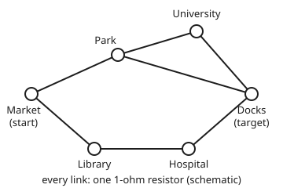

# Random walks as circuits: hitting times, resistance and commute times

[Syllabus](../../../SYLLABUS.md) → [Applied and computational](../README.md) → [Network Science and Spectral Graphs](../README.md#s07) → Random walks as circuits

---

## General Overview

A small bike-share scheme has six stations: Market, Park, Library, Hospital, University and Docks. Seven two-way cycle lanes join them. One bike starts at Market. Each rider who picks it up rides it along one lane to a neighbouring station, chosen at random, and leaves it there. The network is synthetic: made up for this card.

The operator wants to know two things. How many trips, on average, until that bike first reaches Docks, where the repair van waits? And how many trips for it to reach Docks and then drift back to Market? The first is a **hitting time**: the number of trips until the bike first arrives at a chosen station. The second is a **commute time**: the hitting time there plus the hitting time back.

Here is the surprise. Replace every lane with a 1-ohm resistor and the network becomes an electrical circuit. Measure the circuit's resistance between Market and Docks: it comes out at 15/14 ohm, about 1.07. Double the number of lanes, 7, to get 14, and multiply: 14 × 15/14 = **15 trips** for the round trip. The walk does not have to be simulated at all. The two legs are uneven, **6 trips** out and **9 trips** back, and the circuit gives those too, as voltages. A city's 1,200 stations obey the same rule; only the circuit gets bigger.

**A random walk on a network and an electrical current through the same network obey the same equation at every node, so hitting times are voltages and the round-trip time between two nodes is twice the number of links times the effective resistance between them.**

**What kind of fact this is:** a theorem, proved on this card in Why it works; the riders' random choices are a model, an assumption about how the bike moves, not a law.

### The picture: six stations, seven lanes, seven resistors

<p align="center"></p>

Schematic: the lane lengths are not to scale, and they do not matter. Only who is joined to whom counts. The upper side runs Market to Park, then on to Docks either directly or through University. The lower side runs Market, Library, Hospital, Docks.

---

## The formula

$$E_a[\tau_b] + E_b[\tau_a] = 2\,m\,R_{\text{eff}}(a, b)$$

**Read it aloud:** the average number of trips to go from station a to station b and back equals twice the number of links times the effective resistance between a and b.

The second half of the card's result says where each leg comes from. Feed $d(x)$ amps into every station $x$, let all $2m$ amps leave at $b$, and hold $b$ at 0 volts. Then the voltage at each station is its hitting time:

$$v(x) = E_x[\tau_b].$$

**Read it aloud:** with each station fed as many amps as it has links, and the target grounded, the voltage at a station is the average number of trips from there to the target.

| Symbol | Plain meaning | In our example | Push it up and the answer… |
| --- | --- | --- | --- |
| $a$, $b$ | the start station and the target station | Market, Docks | — |
| $x$, $y$ | any station, and one of its neighbours | — | — |
| $n$ | the number of stations | 6 | nothing directly; $m$ is what counts |
| $m$ | the number of links (lanes), each a 1-ohm resistor | 7 | commute time rises, in proportion |
| $d(x)$ | the **degree** of $x$: how many links meet there | Park 3, Market 2 | — |
| $\tau_b$ | "tau b": the number of trips until the bike first reaches $b$, a random count | — | — |
| $E_a[\tau_b]$ | the **hitting time**: the average of $\tau_b$ for a bike that starts at $a$ | 6 trips | — |
| $R_{\text{eff}}(a, b)$ | the **effective resistance**: the single resistor that could replace the whole network between $a$ and $b$, in ohms | 15/14 ≈ 1.0714 Ω | commute time rises, in proportion |
| $E_a[\tau_b] + E_b[\tau_a]$ | the **commute time**: out and back | 6 + 9 = 15 trips | — |
| $v(x)$, $w(x)$ | the voltage at station $x$ in the circuit fed $d(x)$ amps everywhere, grounded at $b$ (for $v$) or at $a$ (for $w$) | Market 6 V, Docks 9 V | — |
| $s(x)$ | the current fed in at $x$, current taken out counting as negative; $s_1$ and $s_2$ in the two runs of Step 2 | Park 3 A | — |

Effective resistance is the measure of how well connected two stations are: many short, separate routes between them make it small, one long thin route makes it large. That is exactly what makes a bike find its way across quickly or slowly.

### When it holds

- **Every lane can be ridden both ways, and a rider picks among the lanes at a station with equal chances.** Make the Market–Park lane one-way (Market to Park only) and the round trip becomes 31.5 trips, while the circuit still says 15. The identity needs a walk that looks the same run backwards; one-way lanes break that.
- **The next rider's choice depends only on where the bike is now.** If riders tend to bring a bike back where it came from, the walk has memory. The first-step equation behind the proof fails, and so does the answer.
- **The network is connected.** If Docks cannot be reached, the hitting time is infinite and so is the resistance; the formula then reads infinity equals infinity, which says nothing useful.
- **All lanes count the same.** If riders favour some lanes, give each lane a weight in proportion to how often it is picked, use a resistor of one over that weight in ohms, and replace $m$ by the total weight. Using plain $m$ on a weighted network gives the wrong number.

---

## Why it works

### Step 0: the bike and the current obey the same rule

The [Absorption](../../11-Stochastic%20processes%20and%20calculus/03-Markov%20Chains/06-absorption-and-first-step-analysis.md) card finds hitting times by **first-step analysis**: the average trips from a station is one trip, plus the average of the averages from wherever that trip lands. [Kirchhoff's laws](../../13-Engineering%20mathematics/06-Circuits%20and%20Electromagnetism/01-kirchhoffs-laws-and-equivalent-circuits.md) find voltages by the current law: the current flowing into a junction equals the current flowing out. The two rules have the same shape: "the value here is set by the average of the neighbours, plus a fixed amount". Feed exactly the right current into each station and they become the same equation. Two equations with the same solution give the same numbers.

### Step 1: hitting times are voltages

With every link a 1-ohm resistor, the current from $x$ to a neighbour $y$ is $v(x) - v(y)$ (Ohm's law: current = voltage drop ÷ resistance). Feed $d(x)$ amps into every station $x$. The current law at each $x$ other than $b$ says that what is fed in flows out along the links:

$$\sum_{y \text{ next to } x} \big(v(x) - v(y)\big) = d(x).$$

There are $d(x)$ terms on the left. Divide both sides by $d(x)$ and rearrange:

$$v(x) = 1 + \frac{1}{d(x)} \sum_{y \text{ next to } x} v(y).$$

That is first-step analysis word for word: one trip, plus the average over the $d(x)$ equally likely next stations. At the target, $v(b) = 0$ because $b$ is grounded, and the hitting time from $b$ to itself is also 0. The Absorption card shows these equations have exactly one solution when the target can be reached. So $v(x) = E_x[\tau_b]$ at every station.

All the current fed in, $d(x)$ at every station, adds up to $2m$, since each link is counted once at each end. It all leaves at $b$.

### Step 2: the round trip is one current from a to b

Run the same circuit twice. In the first run, all the current leaves at $b$; the voltages are $v(x) = E_x[\tau_b]$. In the second, all of it leaves at $a$; the voltages are $w(x) = E_x[\tau_a]$.

Circuits are linear: subtract one run from the other and the result is again a valid circuit, carrying the difference of the currents. The $d(x)$ amps fed in at each station cancel. What is left is $2m$ amps going in at $a$ and $2m$ amps coming out at $b$. By the definition of effective resistance and Ohm's law, the voltage between $a$ and $b$ in that circuit is $2m \times R_{\text{eff}}(a, b)$.

Read the same voltage off the two runs: it is $\big(v(a) - w(a)\big) - \big(v(b) - w(b)\big)$. Here $w(a) = 0$ and $v(b) = 0$, because each is a hitting time from a station to itself. So the voltage is $v(a) + w(b) = E_a[\tau_b] + E_b[\tau_a]$, and

$$E_a[\tau_b] + E_b[\tau_a] = 2m\,R_{\text{eff}}(a, b).$$

<details>
<summary>The subtraction, station by station</summary>

Write $s_1(x)$ for the current fed in at $x$ in the first run and $s_2(x)$ in the second. In the first run, $s_1(x) = d(x)$ everywhere except $b$, where $s_1(b) = d(b) - 2m$. In the second, $s_2(x) = d(x)$ everywhere except $a$, where $s_2(a) = d(a) - 2m$.

The difference $s_1 - s_2$ is 0 at every station except two: at $a$ it is $d(a) - (d(a) - 2m) = 2m$, and at $b$ it is $(d(b) - 2m) - d(b) = -2m$.

The current law is a set of linear equations in the voltages: the sum over neighbours $y$ of the drops $v(x) - v(y)$ equals $s(x)$. Subtract the second run's equations from the first's, and the differences $v(x) - w(x)$ solve the same law with currents $s_1 - s_2$. A circuit carrying $2m$ amps from $a$ to $b$ has a voltage drop of $2m R_{\text{eff}}(a, b)$, by the meaning of $R_{\text{eff}}$: the one resistor that passes the same current for the same drop.

</details>

### Step 3: what the circuit view buys

The circuit view brings the electrician's rules with it. Resistors end to end (**in series**) add. Two side by side (**in parallel**) combine as their product over their sum, smaller than either. And adding a lane never raises the resistance, because the current gains a route and loses none. So:

- The resistance is at most the length of the shortest route, here 2 lanes. The commute time is therefore at most $2m$ times the shortest route: $14 \times 2 = 28$ trips here, against the true 15.
- A new lane can still slow the bike down, because it raises $m$. A dead-end station hung off Park leaves the resistance at 15/14 and pushes the round trip from 15 to 17.14 trips: the bike now wastes trips going down the dead end and back.

---

## Worked numbers, by hand

Reduce the circuit between Market and Docks, then multiply.

| Step | Arithmetic | Value |
| --- | --- | --- |
| Park to Docks: direct lane, side by side with Park–University–Docks | $1 \times 2 / (1 + 2)$ | 2/3 Ω |
| add Market–Park, end to end | $1 + 2/3$ | 5/3 Ω |
| lower side: Market–Library–Hospital–Docks, end to end | $1 + 1 + 1$ | 3 Ω |
| the two sides side by side | $(5/3 \times 3)/(5/3 + 3) = 5 / (14/3)$ | 15/14 ≈ 1.0714 Ω |
| links, doubled | $2 \times 7$ | 14 |
| **commute time** | $14 \times 15/14$ | **15 trips** |
| check the out leg at Market (first step, using Park 4 and Library 6 from the code) | $1 + (4 + 6)/2$ | 6 trips |
| check the back leg at Docks (Park 7, Hospital 8, University 9) | $1 + (7 + 8 + 9)/3$ | 9 trips |
| out plus back | $6 + 9$ | 15 trips |

A bike leaving Market reaches the repair van at Docks after 6 rides on average, and a bike leaving Docks drifts back to Market after 9: the two legs differ, but their sum is fixed by the circuit at 15.

The back leg is longer because every neighbour of Docks is itself far from Market (Park 7, Hospital 8, University 9 trips), while both neighbours of Market are close to Docks (Park 4, Library 6).

### What breaks if you drop a piece

| Mistake | Comes out at | What went wrong |
| --- | --- | --- |
| $n$ stations used for $m$ links: $2 \times 6 \times 15/14$ | 12.86 trips | the formula counts lanes, not stations |
| the 2 dropped: $7 \times 15/14$ | 7.5 trips | each lane is counted at both its ends, so the current fed in totals $2m$ |
| the shortest route, 2 lanes, used as the resistance | 28 trips | that is only an upper bound; the parallel routes cut resistance to 15/14 |
| round trip taken as twice the out leg, or twice the back leg | 12 or 18 trips | hitting times are not symmetric; only their sum is fixed |
| a one-way lane, Market to Park only (hypothesis fails) | 31.5 trips (4.5 out, 27 back) | the walk is no longer the same run backwards; the circuit still says 15 |

The one-way lane is the instructive case. The out leg gets shorter, 4.5 trips, because riders at Park can no longer drift back to Market. The back leg balloons to 27 trips, because the only ways into Market are now from Library. No circuit of two-way resistors can model that.

---

## Code, from first principles, and it actually runs

The script builds the network, writes Kirchhoff's current law at every station and solves it with its own Gaussian elimination. It reaches the commute time by **four independent roads**: (1) the circuit solved with 1 amp from Market to Docks, giving $R_{\text{eff}}$; (2) the series and parallel rules from the table above; (3) the walk's own first-step equations, written with transition chances rather than resistors, solved for both legs; (4) 20,000 simulated round trips, with riders' choices drawn from a SplitMix64 generator seeded at 2026. It also checks that the voltages of Step 1 equal the hitting times station by station, computes every wrong answer in the table, and solves the one-way lane, where the identity must fail.

### Python

```python
# Random walks as circuits -- the check behind the card.  Standard library only.
# Six bike stations, seven two-way links.  A bike's trips are a random walk:
# each rider takes it to a neighbouring station picked at random.  Road 1 solves
# the circuit (every link a 1-ohm resistor) by Gaussian elimination; road 2
# reduces it by series and parallel rules; road 3 solves the first-step
# equations of the walk itself; road 4 rides the bike with a seeded generator.
NAMES = ["Market", "Park", "Library", "Hospital", "University", "Docks"]
LINKS = [(0, 1), (1, 5), (0, 2), (2, 3), (3, 5), (1, 4), (4, 5)]
M, D = 0, 5                                       # start station a, target b

def neighbours(n, links):
    nb = [[] for _ in range(n)]
    for x, y in links:
        nb[x].append(y); nb[y].append(x)
    return nb

def solve(A, rhs):                                # Gaussian elimination, partial pivoting
    k = len(rhs); A = [row[:] + [rhs[i]] for i, row in enumerate(A)]
    for c in range(k):
        p = max(range(c, k), key=lambda r: abs(A[r][c])); A[c], A[p] = A[p], A[c]
        for r in range(k):
            if r != c:
                f = A[r][c] / A[c][c]
                A[r] = [u - f * v for u, v in zip(A[r], A[c])]
    return [A[i][k] / A[i][i] for i in range(k)]

def voltages(nb, inject, ground):
    # Kirchhoff's current law at every node but the grounded one:
    # sum over links of (v_x - v_y) = current fed in at x.  Each link is 1 ohm.
    idx = [x for x in range(len(nb)) if x != ground]
    A = [[0.0] * len(idx) for _ in idx]
    for r, x in enumerate(idx):
        A[r][r] = float(len(nb[x]))
        for y in nb[x]:
            if y != ground: A[r][idx.index(y)] -= 1.0
    v = solve(A, [float(inject[x]) for x in idx])
    out = [0.0] * len(nb)
    for r, x in enumerate(idx): out[x] = v[r]
    return out

def r_eff(nb, a, b):                              # road 1: 1 amp in at a, out at b
    inject = [0] * len(nb); inject[a] = 1
    return voltages(nb, inject, b)[a]

def first_step(out, target):                      # road 3: t_x = 1 + average of t_y
    idx = [x for x in range(len(out)) if x != target]
    A = [[0.0] * len(idx) for _ in idx]
    for r, x in enumerate(idx):
        A[r][r] = 1.0
        for y in out[x]:
            if y != target: A[r][idx.index(y)] -= 1.0 / len(out[x])
    t = solve(A, [1.0] * len(idx))
    res = [0.0] * len(out)
    for r, x in enumerate(idx): res[x] = t[r]
    return res

MASK = (1 << 64) - 1
class SplitMix64:
    def __init__(self, seed): self.s = seed
    def next(self):
        self.s = (self.s + 0x9E3779B97F4A7C15) & MASK
        z = self.s
        z = ((z ^ (z >> 30)) * 0xBF58476D1CE4E5B9) & MASK
        z = ((z ^ (z >> 27)) * 0x94D049BB133111EB) & MASK
        return z ^ (z >> 31)

def ride(nb, rng, start, target):                 # trips until the bike first reaches target
    x, trips = start, 0
    while x != target:
        x = nb[x][rng.next() % len(nb[x])]; trips += 1
    return trips

nb = neighbours(6, LINKS)
m = len(LINKS)
R = r_eff(nb, M, D)
par = lambda r1, r2: r1 * r2 / (r1 + r2)
R_sp = par(1 + par(1, 1 + 1), 1 + 1 + 1)         # road 2: Park side, then Library side
deg = [len(z) for z in nb]
v_hit = voltages(nb, [deg[x] for x in range(6)], D)   # feed d(x) amps in everywhere, ground Docks
t_to_D = first_step(nb, D)
t_to_M = first_step(nb, M)
commute = t_to_D[M] + t_to_M[D]

N = 20000
rng = SplitMix64(2026)
s1 = s2 = q = 0
for _ in range(N):
    a = ride(nb, rng, M, D); b = ride(nb, rng, D, M)
    s1 += a; s2 += b; q += (a + b) ** 2
sim_go, sim_back, sim_c = s1 / N, s2 / N, (s1 + s2) / N
se = ((q / N - sim_c ** 2) / N) ** 0.5

# what breaks: a one-way lane, Market to Park only (no rider may go Park -> Market)
oneway = [z[:] for z in nb]; oneway[1].remove(M)
ow_go, ow_back = first_step(oneway, D)[M], first_step(oneway, M)[D]
# try changing: a dead-end station off Park; a direct Market-Docks link; no University-Docks link
spur = LINKS + [(1, 6)]
direct = LINKS + [(0, 5)]
cut = [e for e in LINKS if e != (4, 5)]

assert abs(R - 15 / 14) < 1e-12, "circuit solve vs the hand fraction 15/14"
assert abs(R_sp - R) < 1e-12, "series and parallel vs circuit solve"
assert abs(commute - 2 * m * R) < 1e-9, "walk commute time vs 2 m R_eff"
assert all(abs(v_hit[x] - t_to_D[x]) < 1e-9 for x in range(6)), "voltages vs hitting times"
assert abs(sim_c - commute) < 4 * se, "simulated round trip vs exact commute time"
assert abs((ow_go + ow_back) - 2 * m * R) > 10, "a one-way lane should break the identity"

f4 = lambda x: f"{x:.4f}"
print("stations n", 6, " links m", m)
print("degrees d(x)", " ".join(f"{NAMES[x]}={deg[x]}" for x in range(6)))
print("1 R_eff Market-Docks, circuit solve  ", f4(R))
print("2 R_eff by series and parallel       ", f4(R_sp), " (= 15/14 ohm)")
print("3 trips Market->Docks, first step    ", f4(t_to_D[M]))
print("3 trips Docks->Market, first step    ", f4(t_to_M[D]))
print("  commute time, sum of the two       ", f4(commute))
print("  commute time, 2 m R_eff            ", f4(2 * m * R))
print("voltages, d(x) amps in, Docks at 0 V:", " ".join(f"{NAMES[x][:3]} {v_hit[x]:.4f}" for x in range(6)))
print("hitting times to Docks, first step:  ", " ".join(f"{NAMES[x][:3]} {t_to_D[x]:.4f}" for x in range(6)))
print("hitting times to Market, first step: ", " ".join(f"{NAMES[x][:3]} {t_to_M[x]:.4f}" for x in range(6)))
print(f"4 simulated, {N} round trips, seed 2026")
print("  mean trips Market->Docks           ", f4(sim_go))
print("  mean trips Docks->Market           ", f4(sim_back))
print("  mean round trip                    ", f4(sim_c), " standard error", f4(se))
print("wrong: n stations for m links, 2nR   ", f4(2 * 6 * R))
print("wrong: drop the 2, m R               ", f4(m * R))
print("wrong: shortest route 2 links, 2m*2  ", f4(2 * m * 2))
print("wrong: twice Market->Docks           ", f4(2 * t_to_D[M]))
print("wrong: twice Docks->Market           ", f4(2 * t_to_M[D]))
print("broken: one-way lane, Market->Docks  ", f4(ow_go))
print("broken: one-way lane, Docks->Market  ", f4(ow_back))
print("broken: one-way lane, commute        ", f4(ow_go + ow_back), " circuit still says", f4(2 * m * R))
for label, (L, n) in zip(["dead-end station off Park", "direct Market-Docks link ", "no University-Docks link "],
                           [(spur, 7), (direct, 6), (cut, 6)]):
    nbt = neighbours(n, L); Rt = r_eff(nbt, M, D)
    c = first_step(nbt, D)[M] + first_step(nbt, M)[D]
    assert abs(c - 2 * len(L) * Rt) < 1e-9, "try network: walk commute time vs 2 m R_eff"
    print("try:", label, " m", len(L), " R_eff", f4(Rt), " commute", f4(c))
print("figure, Market 40 120, Park 150 70, University 250 40, Docks 320 120, Library 120 190, Hospital 240 190")
print("ALL CHECKS PASS")
```

**Ran 2026-11-11 on macOS, Python 3.14.10, standard library only. All checks passed. Output, pasted from the run:**

```
stations n 6  links m 7
degrees d(x) Market=2 Park=3 Library=2 Hospital=2 University=2 Docks=3
1 R_eff Market-Docks, circuit solve   1.0714
2 R_eff by series and parallel        1.0714  (= 15/14 ohm)
3 trips Market->Docks, first step     6.0000
3 trips Docks->Market, first step     9.0000
  commute time, sum of the two        15.0000
  commute time, 2 m R_eff             15.0000
voltages, d(x) amps in, Docks at 0 V: Mar 6.0000 Par 4.0000 Lib 6.0000 Hos 4.0000 Uni 3.0000 Doc 0.0000
hitting times to Docks, first step:   Mar 6.0000 Par 4.0000 Lib 6.0000 Hos 4.0000 Uni 3.0000 Doc 0.0000
hitting times to Market, first step:  Mar 0.0000 Par 7.0000 Lib 5.0000 Hos 8.0000 Uni 9.0000 Doc 9.0000
4 simulated, 20000 round trips, seed 2026
  mean trips Market->Docks            6.0019
  mean trips Docks->Market            8.9786
  mean round trip                     14.9805  standard error 0.0606
wrong: n stations for m links, 2nR    12.8571
wrong: drop the 2, m R                7.5000
wrong: shortest route 2 links, 2m*2   28.0000
wrong: twice Market->Docks            12.0000
wrong: twice Docks->Market            18.0000
broken: one-way lane, Market->Docks   4.5000
broken: one-way lane, Docks->Market   27.0000
broken: one-way lane, commute         31.5000  circuit still says 15.0000
try: dead-end station off Park  m 8  R_eff 1.0714  commute 17.1429
try: direct Market-Docks link   m 8  R_eff 0.5172  commute 8.2759
try: no University-Docks link   m 6  R_eff 1.2000  commute 14.4000
figure, Market 40 120, Park 150 70, University 250 40, Docks 320 120, Library 120 190, Hospital 240 190
ALL CHECKS PASS
```

The voltages and the first-step hitting times agree at every station, as Step 1 says. The simulation lands at 14.98 trips against an exact 15, well inside one of its standard errors of 0.06.

### Rust

Same network, same four roads, same generator, same output.

```rust
// Random walks as circuits -- the check behind the card.  std only, no crates.
// Same network, same four roads, same output as the Python check.
const NAMES: [&str; 6] = ["Market", "Park", "Library", "Hospital", "University", "Docks"];
const LINKS: [(usize, usize); 7] = [(0, 1), (1, 5), (0, 2), (2, 3), (3, 5), (1, 4), (4, 5)];
const M: usize = 0;
const D: usize = 5;

fn neighbours(n: usize, links: &[(usize, usize)]) -> Vec<Vec<usize>> {
    let mut nb = vec![Vec::new(); n];
    for &(x, y) in links { nb[x].push(y); nb[y].push(x); }
    nb
}

fn solve(mut a: Vec<Vec<f64>>, rhs: Vec<f64>) -> Vec<f64> {
    // Gaussian elimination with partial pivoting
    let k = rhs.len();
    for (i, row) in a.iter_mut().enumerate() { row.push(rhs[i]); }
    for c in 0..k {
        let p = (c..k).fold(c, |p, r| if a[r][c].abs() > a[p][c].abs() { r } else { p });
        a.swap(c, p);
        for r in 0..k {
            if r != c {
                let f = a[r][c] / a[c][c];
                for j in 0..=k { a[r][j] -= f * a[c][j]; }
            }
        }
    }
    (0..k).map(|i| a[i][k] / a[i][i]).collect()
}

fn index_without(n: usize, skip: usize) -> Vec<usize> {
    (0..n).filter(|&x| x != skip).collect()
}

fn voltages(nb: &[Vec<usize>], inject: &[f64], ground: usize) -> Vec<f64> {
    // Kirchhoff's current law: sum over links of (v_x - v_y) = current fed in at x
    let idx = index_without(nb.len(), ground);
    let pos = |y: usize| idx.iter().position(|&z| z == y).unwrap();
    let mut a = vec![vec![0.0; idx.len()]; idx.len()];
    for (r, &x) in idx.iter().enumerate() {
        a[r][r] = nb[x].len() as f64;
        for &y in &nb[x] {
            if y != ground { a[r][pos(y)] -= 1.0; }
        }
    }
    let v = solve(a, idx.iter().map(|&x| inject[x]).collect());
    let mut out = vec![0.0; nb.len()];
    for (r, &x) in idx.iter().enumerate() { out[x] = v[r]; }
    out
}

fn r_eff(nb: &[Vec<usize>], a: usize, b: usize) -> f64 {
    let mut inject = vec![0.0; nb.len()];
    inject[a] = 1.0;
    voltages(nb, &inject, b)[a]
}

fn first_step(out: &[Vec<usize>], target: usize) -> Vec<f64> {
    // t_x = 1 + average of t_y over the stations a rider at x may go to
    let idx = index_without(out.len(), target);
    let pos = |y: usize| idx.iter().position(|&z| z == y).unwrap();
    let mut a = vec![vec![0.0; idx.len()]; idx.len()];
    for (r, &x) in idx.iter().enumerate() {
        a[r][r] = 1.0;
        for &y in &out[x] {
            if y != target { a[r][pos(y)] -= 1.0 / out[x].len() as f64; }
        }
    }
    let t = solve(a, vec![1.0; idx.len()]);
    let mut res = vec![0.0; out.len()];
    for (r, &x) in idx.iter().enumerate() { res[x] = t[r]; }
    res
}

struct SplitMix64(u64);
impl SplitMix64 {
    fn next(&mut self) -> u64 {
        self.0 = self.0.wrapping_add(0x9E3779B97F4A7C15);
        let mut z = self.0;
        z = (z ^ (z >> 30)).wrapping_mul(0xBF58476D1CE4E5B9);
        z = (z ^ (z >> 27)).wrapping_mul(0x94D049BB133111EB);
        z ^ (z >> 31)
    }
}

fn ride(nb: &[Vec<usize>], rng: &mut SplitMix64, start: usize, target: usize) -> u64 {
    let (mut x, mut trips) = (start, 0u64);
    while x != target { x = nb[x][(rng.next() % nb[x].len() as u64) as usize]; trips += 1; }
    trips
}

fn row(label: &str, v: &[f64]) -> String {
    let parts: Vec<String> = (0..6).map(|x| format!("{} {:.4}", &NAMES[x][..3], v[x])).collect();
    format!("{} {}", label, parts.join(" "))
}

fn main() {
    let nb = neighbours(6, &LINKS);
    let m = LINKS.len() as f64;
    let r = r_eff(&nb, M, D);
    let par = |r1: f64, r2: f64| r1 * r2 / (r1 + r2);
    let r_sp = par(1.0 + par(1.0, 1.0 + 1.0), 1.0 + 1.0 + 1.0);
    let deg: Vec<f64> = nb.iter().map(|z| z.len() as f64).collect();
    let v_hit = voltages(&nb, &deg, D);
    let (t_to_d, t_to_m) = (first_step(&nb, D), first_step(&nb, M));
    let commute = t_to_d[M] + t_to_m[D];

    let n = 20000u64;
    let mut rng = SplitMix64(2026);
    let (mut s1, mut s2, mut q) = (0u64, 0u64, 0u64);
    for _ in 0..n {
        let (a, b) = (ride(&nb, &mut rng, M, D), ride(&nb, &mut rng, D, M));
        s1 += a; s2 += b; q += (a + b) * (a + b);
    }
    let nf = n as f64;
    let (sim_go, sim_back, sim_c) = (s1 as f64 / nf, s2 as f64 / nf, (s1 + s2) as f64 / nf);
    let se = ((q as f64 / nf - sim_c * sim_c) / nf).sqrt();

    let mut oneway = nb.clone();
    oneway[1].retain(|&y| y != M); // no rider may go Park -> Market
    let (ow_go, ow_back) = (first_step(&oneway, D)[M], first_step(&oneway, M)[D]);

    assert!((r - 15.0 / 14.0).abs() < 1e-12, "circuit solve vs the hand fraction 15/14");
    assert!((r_sp - r).abs() < 1e-12, "series and parallel vs circuit solve");
    assert!((commute - 2.0 * m * r).abs() < 1e-9, "walk commute time vs 2 m R_eff");
    assert!((0..6).all(|x| (v_hit[x] - t_to_d[x]).abs() < 1e-9), "voltages vs hitting times");
    assert!((sim_c - commute).abs() < 4.0 * se, "simulated round trip vs exact commute time");
    assert!(((ow_go + ow_back) - 2.0 * m * r).abs() > 10.0, "a one-way lane should break the identity");

    println!("stations n 6  links m {}", LINKS.len());
    let degs: Vec<String> = (0..6).map(|x| format!("{}={}", NAMES[x], nb[x].len())).collect();
    println!("degrees d(x) {}", degs.join(" "));
    println!("1 R_eff Market-Docks, circuit solve   {:.4}", r);
    println!("2 R_eff by series and parallel        {:.4}  (= 15/14 ohm)", r_sp);
    println!("3 trips Market->Docks, first step     {:.4}", t_to_d[M]);
    println!("3 trips Docks->Market, first step     {:.4}", t_to_m[D]);
    println!("  commute time, sum of the two        {:.4}", commute);
    println!("  commute time, 2 m R_eff             {:.4}", 2.0 * m * r);
    println!("{}", row("voltages, d(x) amps in, Docks at 0 V:", &v_hit));
    println!("{}", row("hitting times to Docks, first step:  ", &t_to_d));
    println!("{}", row("hitting times to Market, first step: ", &t_to_m));
    println!("4 simulated, {} round trips, seed 2026", n);
    println!("  mean trips Market->Docks            {:.4}", sim_go);
    println!("  mean trips Docks->Market            {:.4}", sim_back);
    println!("  mean round trip                     {:.4}  standard error {:.4}", sim_c, se);
    println!("wrong: n stations for m links, 2nR    {:.4}", 2.0 * 6.0 * r);
    println!("wrong: drop the 2, m R                {:.4}", m * r);
    println!("wrong: shortest route 2 links, 2m*2   {:.4}", 2.0 * m * 2.0);
    println!("wrong: twice Market->Docks            {:.4}", 2.0 * t_to_d[M]);
    println!("wrong: twice Docks->Market            {:.4}", 2.0 * t_to_m[D]);
    println!("broken: one-way lane, Market->Docks   {:.4}", ow_go);
    println!("broken: one-way lane, Docks->Market   {:.4}", ow_back);
    println!("broken: one-way lane, commute         {:.4}  circuit still says {:.4}", ow_go + ow_back, 2.0 * m * r);
    let spur = [&LINKS[..], &[(1, 6)]].concat(); // a dead-end station 6 hung off Park
    let direct = [&LINKS[..], &[(0, 5)]].concat();
    let cut: Vec<(usize, usize)> = LINKS.iter().copied().filter(|&e| e != (4, 5)).collect();
    let tries = [("dead-end station off Park", spur, 7), ("direct Market-Docks link ", direct, 6), ("no University-Docks link ", cut, 6)];
    for (label, links, nn) in tries.iter() {
        let nbt = neighbours(*nn, links);
        let rt = r_eff(&nbt, M, D);
        let c = first_step(&nbt, D)[M] + first_step(&nbt, M)[D];
        assert!((c - 2.0 * links.len() as f64 * rt).abs() < 1e-9, "try network: walk commute time vs 2 m R_eff");
        println!("try: {}  m {}  R_eff {:.4}  commute {:.4}", label, links.len(), rt, c);
    }
    println!("figure, Market 40 120, Park 150 70, University 250 40, Docks 320 120, Library 120 190, Hospital 240 190");
    println!("ALL CHECKS PASS");
}
```

**Ran 2026-11-11 on macOS, rustc 1.98.1, no crates. All checks passed. Output, pasted from the run:**

```
stations n 6  links m 7
degrees d(x) Market=2 Park=3 Library=2 Hospital=2 University=2 Docks=3
1 R_eff Market-Docks, circuit solve   1.0714
2 R_eff by series and parallel        1.0714  (= 15/14 ohm)
3 trips Market->Docks, first step     6.0000
3 trips Docks->Market, first step     9.0000
  commute time, sum of the two        15.0000
  commute time, 2 m R_eff             15.0000
voltages, d(x) amps in, Docks at 0 V: Mar 6.0000 Par 4.0000 Lib 6.0000 Hos 4.0000 Uni 3.0000 Doc 0.0000
hitting times to Docks, first step:   Mar 6.0000 Par 4.0000 Lib 6.0000 Hos 4.0000 Uni 3.0000 Doc 0.0000
hitting times to Market, first step:  Mar 0.0000 Par 7.0000 Lib 5.0000 Hos 8.0000 Uni 9.0000 Doc 9.0000
4 simulated, 20000 round trips, seed 2026
  mean trips Market->Docks            6.0019
  mean trips Docks->Market            8.9786
  mean round trip                     14.9805  standard error 0.0606
wrong: n stations for m links, 2nR    12.8571
wrong: drop the 2, m R                7.5000
wrong: shortest route 2 links, 2m*2   28.0000
wrong: twice Market->Docks            12.0000
wrong: twice Docks->Market            18.0000
broken: one-way lane, Market->Docks   4.5000
broken: one-way lane, Docks->Market   27.0000
broken: one-way lane, commute         31.5000  circuit still says 15.0000
try: dead-end station off Park  m 8  R_eff 1.0714  commute 17.1429
try: direct Market-Docks link   m 8  R_eff 0.5172  commute 8.2759
try: no University-Docks link   m 6  R_eff 1.2000  commute 14.4000
figure, Market 40 120, Park 150 70, University 250 40, Docks 320 120, Library 120 190, Hospital 240 190
ALL CHECKS PASS
```

The two outputs are identical line for line, simulation included, because both use the same seeded generator.

> [!TIP]
> **Try changing**
> - Guess first: hang a dead-end station off Park (`spur` in the code). Does the round trip go up or down? The resistance stays at **1.0714** Ω, the links rise to 8, and the round trip goes **up**, to **17.14** trips.
> - Guess first: add a lane straight from Market to Docks (`direct`). The resistance falls to **0.5172** Ω, and even with 8 links the round trip drops to **8.28** trips.
> - Guess first: close the University–Docks lane (`cut`). The resistance rises to **1.2** Ω, but with only 6 links the round trip falls to **14.4** trips: losing a lane removed a place for the bike to waste trips.

---

## The usual mistake

> [!warning]
> **Treating the hitting time as symmetric.** The circuit gives the round trip, not each leg. Market to Docks is 6 trips and Docks to Market is 9, so halving the round trip, 7.5, is wrong both ways, and doubling a leg gives 12 or 18 instead of 15. Each leg needs its own circuit: feed $d(x)$ amps everywhere and ground the target.
>
> Smaller traps:
> - **Using the shortest route as the distance.** Two lanes gives 28 trips. Parallel routes lower the resistance, and the bike uses all of them.
> - **Counting stations instead of lanes.** $2 \times 6 \times 15/14$ gives 12.86 trips. The factor is the number of links, and in a dense network the two differ hugely.
> - **Ignoring dead ends.** A spur station leaves the resistance untouched but raises the round trip from 15 to 17.14 trips, because $m$ counts every lane, even ones off the route.
> - **Applying it to one-way streets.** With one lane made one-way the true round trip is 31.5 trips; the circuit's 15 is wrong there.

---

## Where you meet it in real life

- **Bike-share and car-share planning.** As a first model of how bikes drift, the circuit gives how many rides until a bike reaches a depot, from one linear solve over the city's 1,200 stations instead of a long simulation.
- **Recommendations and link prediction.** In a social network of 5,000 people, commute time serves as a distance: two people joined by many short, separate paths are close even if they are not directly linked. It is a better guide than the shortest path, for the same reason as the 28-trip trap.
- **Testing whether a network is connected with little memory.** A random walk that keeps only its current position reaches any target in a connected network in at most $2m(n - 1)$ average steps, since the resistance is at most the length of the shortest route, and no shortest route is longer than $n - 1$ links.
- **Visiting everything.** The time for a walk to visit every node, the cover time, is bounded above and below by $m$ times the largest resistance in the network, up to a logarithm. That is the main result of the paper by Chandra and co-authors below.
- **Chemistry.** The resistance between two atoms in a molecule's bond network is used as a distance between them, called the resistance distance.

> **Say it back**
> Make every link a 1-ohm resistor. The average number of steps for a random walk to go from a to b and back is twice the number of links times the effective resistance between a and b. The proof is that hitting times solve the same equation as voltages when each node is fed as many amps as it has links. Subtracting two such circuits leaves one current from a to b, whose voltage is the round trip. The legs differ, the sum does not, and it all needs two-way links.

---

## What this builds on

- [Expanders](07-expanders-and-mixing.md): how fast a random walk on a network forgets where it started. Hitting times are the other side of that question: how long until it arrives somewhere.
- [Simple random walk](../../11-Stochastic%20processes%20and%20calculus/01-Random%20Walks%20and%20Filtrations/02-simple-random-walk.md): the walk on a line, plus one or minus one each step. A random walk on a network is the same idea with the line replaced by lanes.
- [Gambler's ruin](../../11-Stochastic%20processes%20and%20calculus/01-Random%20Walks%20and%20Filtrations/04-gamblers-ruin.md): the walk on a line of resistors. The fair game's expected length, chips held times chips still to win, is this card's hitting-time circuit on a path with both ends grounded.
- [Absorption](../../11-Stochastic%20processes%20and%20calculus/03-Markov%20Chains/06-absorption-and-first-step-analysis.md): first-step equations for hitting times, and why they have exactly one solution. Step 1 of this card is those equations written as a circuit.
- [Kirchhoff's laws](../../13-Engineering%20mathematics/06-Circuits%20and%20Electromagnetism/01-kirchhoffs-laws-and-equivalent-circuits.md): node voltages, the current law and equivalent resistance, which this card uses to compute $R_{\text{eff}}$.

## Where this goes next

- [The graph Laplacian](03-graph-laplacian-and-spectral-clustering.md): the matrix of this card's node equations: degrees on the diagonal, minus one for each link. Effective resistance is a diagonal entry of its inverse once the target's row and column are struck out.
- [PageRank by power iteration](02-power-iteration-and-the-damping-factor.md): a random walk that sometimes jumps to a random page. The jumps make it one-way, so this card's identity no longer applies.
- [Centrality](01-centrality-and-pagerank.md): ranking nodes. Short commute times to everyone else are one way to call a node central.

The open question this card leaves: how long until the bike has visited every station? Resistance bounds that cover time from both sides but does not fix it.

---

## Sources

Verified 2026-11-11: every link below resolves to the publisher's page.

- Doyle, Peter G., and J. Laurie Snell. *Random Walks and Electric Networks*. Carus Mathematical Monographs 22, Mathematical Association of America, 1984. [doi:10.5948/UPO9781614440222](https://doi.org/10.5948/UPO9781614440222); the authors' free version is [arXiv:math/0001057](https://arxiv.org/abs/math/0001057). The classic account of walks as circuits: voltages as probabilities, series and parallel rules, adding a link never raises resistance.
- Chandra, Ashok K., Prabhakar Raghavan, Walter L. Ruzzo, Roman Smolensky, and Prasoon Tiwari. "The Electrical Resistance of a Graph Captures Its Commute and Cover Times." *Computational Complexity* 6, no. 4 (1996): 312–340. [doi:10.1007/BF01270385](https://doi.org/10.1007/BF01270385). The commute-time identity $2mR_{\text{eff}}$ and the cover-time bounds.
- Lyons, Russell, and Yuval Peres. *Probability on Trees and Networks*. Cambridge University Press, 2016. [doi:10.1017/9781316672815](https://doi.org/10.1017/9781316672815). Chapter 2 develops random walks and electric networks in full, including the commute-time identity and weighted links.
