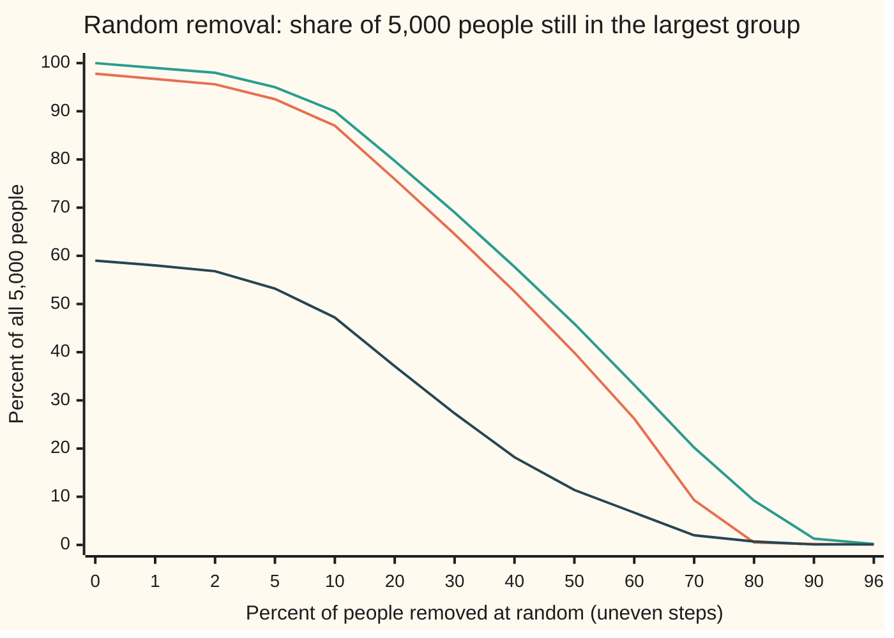
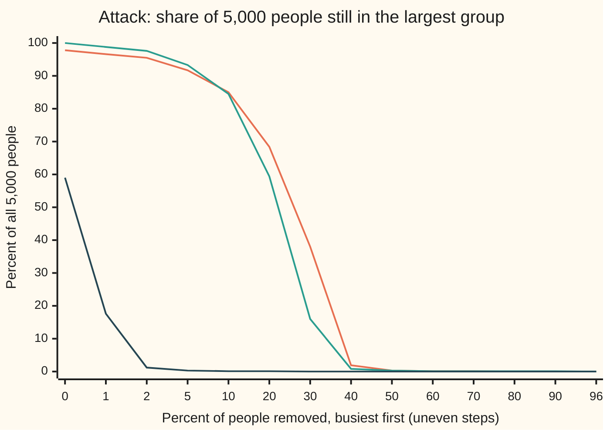

# Robustness: random failures barely hurt, attacks on hubs break the network

[Syllabus](../../../SYLLABUS.md) → [Applied and computational](../README.md) → [Network Science and Spectral Graphs](../README.md#s07) → Robustness

---

## General Overview

A social network of 5,000 people, joined by 9,958 friendships. Each person's number of friends follows the Poisson law (the count law for many small, independent chances) with mean 4, and nobody has more than 14. The network is synthetic: friend counts are drawn from that rule with seed 4, then the friendships are wired at random.

Almost everyone, 97.80%, sits in one connected crowd: a message passed friend to friend can reach any of them. Now people start leaving. The question is how many can go before the crowd falls into small, separate groups.

It depends on who leaves. If people leave at random, the crowd survives until three quarters of them are gone: the formula says 1 − 1/4 = 0.75. If the people with the most friends leave first, it breaks after 36.22%.

Hubs (people with far more friends than average) widen the gap. The town of 5,000 from [Epidemics on a network](05-epidemics-on-networks.md) has one person with 270 friends. By the formula, random removal must take 96.35% of the town before the crowd breaks. Recounted on the actual network as people leave, the Molloy–Reed sum (below) reaches zero at 94.48% on average, and by 90% removed the largest group already holds only 1.3% of the 5,000. Removing the busiest people first breaks it at 31.18%.

Build the same kind of town but let people have as few as 1 friend. Then removing the busiest 81 people, 1.62%, is enough.

**A giant connected crowd exists while each friendship leads on to more than one other; random removal thins all friendships evenly, but an attack removes the hubs that carry them.**

**What kind of fact this is:** a theorem about randomly wired networks, plus measurements. The Molloy–Reed condition is a theorem (Molloy and Reed, 1995) for networks that grow without limit. This card derives it by the branching argument and leaves the full proof to the source.

The sizes and thresholds below are limits for an endless network. At 5,000 people they are approximations, checked here against networks actually taken apart.

### The picture: people leaving at random



Orange: the Poisson network. Green: the town with hubs. Dark blue: the thin town, where people may have 1 friend. Each point averages 5 random removal orders on the actual network, and the steps along the bottom are uneven.

The town's line follows "100 minus the share removed" for a long way: almost everyone who is left stays connected. The Poisson line reaches zero near 75%, the town's only near 96%.

---

## The formula

Notation, in words first. A person's **degree** $`k`$ is their number of friends. The **degree distribution** $`p_k`$ is the share of people with exactly $`k`$ friends, and $`\langle k\rangle`$ is the mean degree ([Small worlds and hubs](04-small-world-and-scale-free-models.md)).

The **mean excess degree** is $`\kappa = (\langle k^2\rangle - \langle k\rangle)/\langle k\rangle`$. It is the average number of *other* friends of a person reached by following a friendship ([Epidemics on a network](05-epidemics-on-networks.md)). The **giant component** is one connected group holding a fixed share of everyone ([The giant component](../../09-Probability%20and%20statistics/14-Random%20Graphs%20and%20the%20Probabilistic%20Method/02-the-giant-component.md)).

The **configuration model** is the network built by giving each person their number of friendship ends, shuffling all the ends, and pairing them off. Every network on this card except the ring is built that way.

**The Molloy–Reed condition.** A giant component exists exactly when

```math
\sum_k k\,(k-2)\,p_k > 0, \quad\text{that is}\quad \langle k^2\rangle - 2\langle k\rangle > 0, \quad\text{that is}\quad \kappa > 1 .
```

**Read it aloud:** add up k times k minus two over all people; a giant exists when the total is positive.

**Removal.** Let $`\phi_k`$ be the chance that a person with $`k`$ friends stays. Pack the survivors into two **generating functions** (a list of chances packed into one polynomial):

```math
F_0(x) = \sum_k p_k\,\phi_k\,x^k, \qquad F_1(x) = \frac{1}{\langle k\rangle}\sum_k k\,p_k\,\phi_k\,x^{k-1}
```

```math
u = 1 - F_1(1) + F_1(u), \qquad S = F_0(1) - F_0(u), \qquad \text{giant exists} \iff F_1'(1) = \frac{1}{\langle k\rangle}\sum_k k(k-1)\,p_k\,\phi_k > 1
```

**Read it aloud:** u is the chance that one friendship does not lead into the giant. S, the share of all the original people in the giant, is the chance a person stayed minus the chance they stayed but were cut off.

The two kinds of removal are two choices of $`\phi_k`$:

- **Random failure:** every person stays with the same chance $`\phi = 1 - f`$. Then $`F_1'(1) = \phi\kappa`$, so the giant ends when the share removed reaches

```math
f_c = 1 - \frac{1}{\kappa}, \qquad \text{and for Poisson degrees with mean } c,\quad f_c = 1 - \frac{1}{c} .
```

- **Attack:** the people with the most friends go first. Then $`\phi_k = 0`$ for the top degrees and 1 below, and the giant ends where $`F_1'(1)`$ falls to 1.

| Symbol | Plain meaning | In our example | Push it up and the answer… |
| --- | --- | --- | --- |
| $`k`$ | a person's number of friends (degree) | 0 to 14 (Poisson); 2 to 270 (town, whose rule starts at 3) | — |
| $`p_k`$ | share of people with exactly $`k`$ friends | Poisson with mean 4; or proportional to $`k^{-2.5}`$ | a fatter tail of hubs raises $`\kappa`$ |
| $`\langle k\rangle`$, $`c`$ | mean degree; $`c`$ is the Poisson rule's mean | 3.9832 (rule: 4); town 6.8536 | larger giant, later breakdown |
| $`\langle k^2\rangle`$ | mean of each person's degree squared; hubs dominate it | 19.9012; town 194.3964 | $`\kappa`$ rises sharply |
| $`\kappa`$ | mean excess degree: other friends of a person reached along a friendship | 3.9963; town 27.3641 | random failure needs a larger share |
| $`G_0`$, $`G_1`$, $`x`$ | generating functions of the intact network ($`\phi_k = 1`$); $`x`$ is the number fed in | $`G_0(1) = G_1(1) = 1`$ | — |
| $`\phi_k`$, $`\phi`$ | chance a person with $`k`$ friends stays; $`\phi`$ when it is the same for all | 0.5 when half leave at random | larger giant |
| $`f`$, $`f_c`$ | share of the 5,000 removed; $`f_c`$ the share at which the giant ends | $`f_c`$ = 0.7498 (random), 0.3622 (attack) | — |
| $`F_0`$, $`F_1`$ | generating functions of the survivors | $`F_0(1)`$ = share who stayed | — |
| $`u`$ | chance one friendship does not lead into the giant | solved for in the code | — |
| $`S`$, $`s`$ | share of the original 5,000 in the giant; $`s`$ the same share among survivors only | 0.9775 intact; 0.3984 and 0.7968 at half removed | — |

### When it holds

- **Friendships wired at random, given each person's degree.** Real friends share friends. Put the 5,000 people on a ring, each linked to the 3 nearest on each side. Everyone has 6 friends, so the formula says 79.99% stay in the giant after 20% leave at random. The run gives 10.53%. On a ring, three neighbours in a row leaving cut it, and at 20% that happens many times.
- **A large network.** The thresholds are sharp only in an endless network. In the town, recounting the Molloy–Reed sum over 40 random orders put its zero anywhere from 89.26% to 98.94% removed, mean 94.48%, against the formula's 96.35%. Near the end only a few hundred people remain, and whether the biggest hubs are among them decides it. The formula marks where the sum's average over all orders reaches zero, and near the end that average is held up by the rare orders in which a big hub is still present. In a typical order the big hubs are already gone, so the recount usually reaches zero early. The checks therefore allow the town 6 standard errors (se: the spread of a 40-order average) and the Poisson network, without big hubs, 3. And the crowd is small well before the zero: at 90% removed, the largest group holds 1.3% of the 5,000.
- **The attacker knows every degree and ranks once.** The attack here removes people in order of their original friend counts. An attacker who cannot see the degrees is back to random removal, unless they use the friend-of-a-friend trick from the epidemics card. An attacker who re-ranks after each removal is not modelled.
- **"Robust" means "a giant survives".** The formula says nothing about how long the paths in the giant get, or how much traffic a hub was carrying.

---

## Why it works

### Step 0: a giant is a family tree that never dies out

From [The giant component](../../09-Probability%20and%20statistics/14-Random%20Graphs%20and%20the%20Probabilistic%20Method/02-the-giant-component.md): explore outward from one person, friends, then friends of friends. While few people are found, this is a **branching process**, a family tree where each member has a random number of children. It can run on for ever only if each member has more than one child on average.

From [Epidemics on a network](05-epidemics-on-networks.md): everyone after the first person was reached along a friendship, so they are picked in proportion to their degree. Their onward friendships average $`\kappa`$.

Removing people does one thing to this tree: some branches lead to someone who is gone. Random removal prunes every branch with the same chance. An attack prunes exactly the branches that led to the biggest families.

### Step 1: the size of the giant

Follow a friendship. Its far end belongs to a person with $`k`$ friends with chance $`k\,p_k/\langle k\rangle`$. That friendship fails to reach the giant if the person is gone, or if they stayed but all $`k - 1`$ of their other friendships fail too.

Averaging over $`k`$ gives the equation for $`u`$. A person is in the giant if they stayed and not all $`k`$ friendships fail, which gives $`S`$. The fold writes both out.

Write $`G_0`$ and $`G_1`$ for $`F_0`$ and $`F_1`$ with nobody removed. For the intact Poisson network, $`G_0(x) = G_1(x) = e^{c(x-1)}`$ (the Poisson law packed into one function).

Then $`u = e^{c(u-1)}`$ and $`S = 1 - u`$, which is the giant-component card's equation, in this card's letters $`S = 1 - e^{-cS}`$. With $`c = 4`$ the root is 0.9802. The network's actual degree list gives 0.9775, and a search of the network finds 0.9780.

<details>
<summary>The two equations, written out</summary>

A friendship end lands on a person with $`k`$ friends with chance $`k\,p_k/\langle k\rangle`$. That person is gone with chance $`1 - \phi_k`$. If they stayed, each of their $`k - 1`$ other friendships independently fails to reach the giant with chance $`u`$. So

$`\displaystyle u = \sum_k \frac{k\,p_k}{\langle k\rangle}\Big[(1 - \phi_k) + \phi_k\,u^{k-1}\Big] = 1 - F_1(1) + F_1(u).`$

A random person has $`k`$ friends with chance $`p_k`$, stays with chance $`\phi_k`$, and is cut off if all $`k`$ friendships fail:

$`\displaystyle S = \sum_k p_k\,\phi_k\,\big(1 - u^k\big) = F_0(1) - F_0(u).`$

The right side of the $`u`$ equation rises and bends upward on 0 to 1. It equals 1 at $`u = 1`$, where its slope is $`F_1'(1)`$.

As on the epidemics card, a root below 1 exists exactly when that slope is above 1, and repeated substitution from $`u = 0`$ climbs to the smallest root. The code solves it that way.

</details>

### Step 2: why k(k − 2) decides it

Set every $`\phi_k = 1`$. The slope test says the giant exists when $`\kappa > 1`$: a person reached along a friendship has more than one onward friendship on average. Multiply out:

```math
\frac{\langle k^2\rangle - \langle k\rangle}{\langle k\rangle} > 1 \iff \langle k^2\rangle - 2\langle k\rangle > 0 \iff \sum_k k\,(k-2)\,p_k > 0 .
```

Each person adds $`k(k-2)`$ to the sum. A person with 1 friend adds −1: they are a dead end. A person with 2 friends adds 0: they pass the chain along and nothing more. A person with 3 or more adds a positive amount: they branch. The giant exists when branching outweighs dead ends.

For the Poisson network the sum is 11.9348, and for the town 180.6892: both have a giant. The mean degree alone cannot decide it. A network where 90% of people have 1 friend and 10% have 3 has mean degree 1.2000, above 1, but its sum is −0.6000. Built and searched, its largest group holds 24 people.

### Step 3: random failure

Every person stays with chance $`\phi`$. A person reached along a friendship keeps each other friend with chance $`\phi`$, so their onward count shrinks from $`\kappa`$ to $`\phi\kappa`$. The giant ends when $`\phi\kappa = 1`$:

```math
f_c = 1 - \frac{1}{\kappa} .
```

For Poisson degrees, $`\kappa = c`$, so $`f_c = 1 - 1/4 = 0.7500`$. The network's own list has $`\kappa`$ = 3.9963, giving 0.7498.

A second road removes people one at a time in a random order, recounts the friend counts of everyone left, and stops when the Molloy–Reed sum reaches zero. Over 40 orders it stopped at 0.7512 on average.

For the town, $`\kappa`$ = 27.3641, so $`f_c`$ = 0.9635. The square in $`\langle k^2\rangle`$ is the reason. A random removal usually hits someone with 3 or 4 friends. The hubs, which carry the square, survive in proportion, so $`\kappa`$ falls only by the factor $`\phi`$.

<details>
<summary>The Poisson case in closed form</summary>

With $`G_1(x) = e^{c(x-1)}`$ and every $`\phi_k = \phi`$, the $`u`$ equation reads $`u = 1 - \phi + \phi\,e^{c(u-1)}`$. Write $`s = (1 - u)/\phi`$. Then

$`\displaystyle s = 1 - e^{-c\phi s}, \qquad S = \phi\,s .`$

So random failure turns a Poisson network with mean $`c`$ into a Poisson network of the survivors with mean $`c\phi`$: each survivor loses each friend with chance $`1 - \phi`$.

The giant among survivors ends when $`c\phi = 1`$, which is $`f_c = 1 - 1/c`$ again. With $`c = 4`$ and half removed, $`c\phi = 2`$, so $`s = 1 - e^{-2s}`$ = 0.7968 and $`S`$ = 0.5 × 0.7968 = 0.3984.

</details>

### Step 4: an attack

Now $`\phi_k = 0`$ for the highest degrees. The slope $`F_1'(1)`$ sums $`k(k-1)`$ over the people left, so each hub removed takes away roughly the square of its degree. A random removal takes away an average person's share.

The code removes the busiest people one at a time and finds where $`F_1'(1)`$ first falls to 1. A second road does the same on the actual network: it deletes each person, lowers each neighbour's count by one, and stops when the Molloy–Reed sum reaches zero.

| Network | Random failure, $`1 - 1/\kappa`$ | Attack, formula | Attack, recounted |
| --- | --- | --- | --- |
| Poisson, mean 4 | 0.7498 | 0.3622 (1,811 people) | 0.3640 (1,820 people) |
| Town, 2 to 270 friends | 0.9635 | 0.3118 (1,559 people) | 0.3086 (1,543 people) |
| Thin town, 1 to 233 friends | 0.9458 | 0.0162 (81 people) | 0.0156 (78 people) |

The thin town follows the same $`k^{-2.5}`$ rule as the town, but starting at 1 friend. Its mean degree is 1.8772 and its giant holds only 0.5860 of people even before anyone leaves.

Most people there have 1 friend, and each adds −1 to the Molloy–Reed sum. The giant is held together by the hubs alone, so removing 81 of them ends it.

In the town almost everyone has at least 3 friends, and each of them adds at least +3; the few who end with 2, after repeats are dropped, add 0. Strip out the hubs and the people left still branch, so an attack needs 31.18% of the town. That is close to the Poisson network's 36.22%.

So the hubs explain why random failure barely hurts. The people with one or two friends explain why an attack breaks a network fast.

### The picture: removing the busiest first



Orange: Poisson. Green: the town. Dark blue: the thin town. Same networks and steps as the first picture. The thin town falls from 59.0% to 17.6% when the busiest 1% go, and to 1.2% at 2%.

---

## Worked numbers, by hand

The Poisson network, using the rule's mean $`c = 4`$.

| Step | Arithmetic | Value |
| --- | --- | --- |
| Molloy–Reed sum | $`\langle k^2\rangle - 2\langle k\rangle`$; for Poisson $`\langle k^2\rangle = c + c^2`$ = 20, so 20 − 8 | 12 > 0: a giant; the list gives 11.9348 |
| mean excess degree $`\kappa`$ | (20 − 4) ÷ 4 | 4; the list gives 3.9963 |
| giant, intact | solve $`S = 1 - e^{-4S}`$ | 0.9802; the run finds 0.9780 |
| random-failure threshold | 1 − 1 ÷ 4 | **0.7500** |
| half removed: survivors' mean | 4 × 0.5 | 2.0 |
| giant among survivors | solve $`s = 1 - e^{-2s}`$ | 0.7968 |
| giant, as a share of all 5,000 | 0.5 × 0.7968 | **0.3984**; the run finds 39.9% |

With half the people gone at random, about 4 in 10 of the original 5,000 are still in one connected crowd. The giant only ends once three quarters have left.

### What breaks if you drop a piece

| Mistake | Comes out at | What went wrong |
| --- | --- | --- |
| "A giant exists when the mean degree is above 1", on the network with 90% at 1 friend and 10% at 3 | mean 1.2000 says giant; largest group is 24 people | The Molloy–Reed sum is −0.6000: dead ends outweigh branches |
| Town threshold from the mean degree, $`1 - 1/\langle k\rangle`$ | 0.8541 instead of 0.9635 | It ignores the hubs, which carry the square in $`\kappa`$ |
| Drop the $`\phi`$ in $`S = \phi s`$ at half removed | 0.7968 instead of 0.3984 | That is the share of survivors, not of the original 5,000 |
| Random-wiring formula on the ring of 6 neighbours, 20% removed | 0.7999 predicted; the run gives 0.1053 | Neighbours share neighbours, and a ring is cut wherever 3 neighbours in a row leave |

The code prints all four.

---

## Code, from first principles, and it actually runs

The script builds three networks of 5,000 people by the configuration model, using SplitMix64 (a small random-number generator written out in both languages) with stated seeds. The town is rebuilt exactly as on the epidemics card. Then it uses three methods:

1. **The formula:** the degree list's generating functions, with $`u`$ found by repeated substitution.
2. **The recount:** remove people from the actual network one at a time, lower each neighbour's degree, and stop when the Molloy–Reed sum reaches zero.
3. **The search:** delete people and search the network for its largest connected group.

That gives two independent roads to each answer: the formula and the recount for the thresholds, the formula and the search for the giant's size. The Poisson numbers also meet their closed forms. The ring and the 90/10 network show the formula failing where its assumptions fail.

### Python

```python
# Robustness -- the check behind the card.  Standard library only.  Three synthetic networks of
# 5,000 people wired at random: Poisson, mean 4, seed 4; the epidemics card's town, p_k ~ k^-2.5,
# k = 3..300, seed 2026; the thin town, the same rule from k = 1.  Roads: formula, recount, search.
import math
N, RUNS, ORDERS = 5000, 5, 40
M64 = (1 << 64) - 1
class SplitMix64:                                  # the wing's generator, written out
    def __init__(self, seed): self.x = seed
    def next(self):
        self.x = (self.x + 0x9E3779B97F4A7C15) & M64; z = self.x
        z = ((z ^ (z >> 30)) * 0xBF58476D1CE4E5B9) & M64
        z = ((z ^ (z >> 27)) * 0x94D049BB133111EB) & M64
        return z ^ (z >> 31)
    def uniform(self): return (self.next() >> 11) * 2.0 ** -53
    def below(self, m): return self.next() % m
def shuffle(o, g):                                 # Fisher-Yates with the generator
    for i in range(len(o) - 1, 0, -1):
        j = g.below(i + 1); o[i], o[j] = o[j], o[i]
    return o
def wire(deg, rng):                                # configuration model: pair shuffled ends
    if sum(deg) % 2: deg[-1] += 1
    stubs, adj = shuffle([i for i in range(len(deg)) for _ in range(deg[i])], rng), [[] for _ in deg]
    for a in range(0, len(stubs) - 1, 2):
        u, v = stubs[a], stubs[a + 1]
        if u == v or v in adj[u]: continue         # drop self-loops and repeats
        adj[u].append(v); adj[v].append(u)
    return adj
def poisson(c, seed):                              # degrees by inversion of the Poisson law
    rng, deg = SplitMix64(seed), []
    for _ in range(N):
        r, k, p = rng.uniform(), 0, math.exp(-c); cum = p
        while r > cum and k < 60: k += 1; p *= c / k; cum += p
        deg.append(k)
    return wire(deg, rng)
def power(kmin, seed):                             # p_k proportional to k^-2.5, kmin to 300
    rng, w, total, cdf, run, deg = SplitMix64(seed), [k ** -2.5 for k in range(kmin, 301)], 0.0, [], 0.0, []
    for x in w: total += x
    for x in w: run += x / total; cdf.append(run)
    for _ in range(N):
        r, k = rng.uniform(), 0
        while k < len(cdf) - 1 and cdf[k] < r: k += 1
        deg.append(k + kmin)
    return wire(deg, rng)
def largest(adj, alive):                           # road three: biggest component, by search
    seen, best = [False] * N, 0
    for s in range(N):
        if not alive[s] or seen[s]: continue
        seen[s], stack, size = True, [s], 0
        while stack:
            u = stack.pop(); size += 1
            for v in adj[u]:
                if alive[v] and not seen[v]: seen[v] = True; stack.append(v)
        best = max(best, size)
    return best
def removed(adj, order, m):                        # delete the first m people of the order
    alive = [True] * N
    for v in order[:m]: alive[v] = False
    return largest(adj, alive)
def hist_of(ds): return [sum(1 for d in ds if d == k) for k in range(max(ds) + 1)]
def slope(h, keep):                                # F1'(1): the giant needs this above 1
    ends, s = sum(k * h[k] for k in range(len(h))), 0.0
    for k in range(2, len(h)): s += k * (k - 1) * h[k] * keep[k] / ends
    return s
def giant(h, keep):                                # road one: u = 1 - F1(1) + F1(u), S = F0(1) - F0(u)
    if slope(h, keep) <= 1: return 0.0
    ends, f11, u = sum(k * h[k] for k in range(len(h))), 0.0, 0.0
    for k in range(1, len(h)): f11 += k * h[k] * keep[k] / ends
    for _ in range(100000):
        new = 1 - f11
        for k in range(1, len(h)): new += k * h[k] * keep[k] * u ** (k - 1) / ends
        if abs(new - u) < 1e-14: u = new; break
        u = new
    s = 0.0
    for k in range(len(h)): s += h[k] * keep[k] * (1 - u ** k) / N
    return s
def keep_random(h, f): return [1 - f] * len(h)
def keep_attack(h, m):                             # the m highest degrees are gone
    keep = [0.0] * len(h)
    for k in range(len(h) - 1, -1, -1):
        take = min(m, h[k]); m -= take
        if h[k]: keep[k] = (h[k] - take) / h[k]
    return keep
def molloy_reed(adj, order):                       # road two: remove in order, recount, stop at sum k(k-2) <= 0
    d, alive = [len(a) for a in adj], [True] * N; s1, s2 = sum(d), sum(x * x for x in d)
    for m, v in enumerate(order):
        if s2 - 2 * s1 <= 0: return m
        s1 -= d[v]; s2 -= d[v] * d[v]; alive[v] = False
        for w in adj[v]:
            if alive[w]: s1 -= 1; s2 -= 2 * d[w] - 1; d[w] -= 1
    return N
FS = [0, 1, 2, 5, 10, 20, 30, 40, 50, 60, 70, 80, 90, 96]; print("chart % removed:", " ".join(str(f) for f in FS))
res = {}
for name, adj in (("Poisson", poisson(4.0, 4)), ("town", power(3, 2026)), ("thin town", power(1, 2026))):
    ds = [len(a) for a in adj]; h = hist_of(ds)
    m1 = sum(ds) / N; m2 = sum(d * d for d in ds) / N; kappa = (m2 - m1) / m1
    print(f"{name}: {sum(ds) // 2} links, <k> {m1:.4f}, <k^2> {m2:.4f}, degrees {min(ds)} to {max(ds)}, kappa {kappa:.4f}")
    print(f"  Molloy-Reed <k^2> - 2<k> = {m2 - 2 * m1:.4f}; intact giant: formula {giant(h, keep_random(h, 0)):.4f}, run {largest(adj, [True] * N) / N:.4f}")
    g = SplitMix64(7); orders = [shuffle(list(range(N)), g) for _ in range(ORDERS)]
    att = sorted(range(N), key=lambda i: (-ds[i], i))
    mr = [molloy_reed(adj, o) for o in orders]; mean, var = sum(mr) / N / ORDERS, 0.0
    for x in mr: var += (x / N - mean) ** 2 / (ORDERS - 1)
    ma = next(m for m in range(N) if slope(h, keep_attack(h, m)) <= 1); mra = molloy_reed(adj, att)
    print(f"  random failure threshold: 1 - 1/kappa {1 - 1 / kappa:.4f}; recounted, {ORDERS} orders: mean {mean:.4f} (se {(var / ORDERS) ** 0.5:.4f}), {min(mr) / N:.4f} to {max(mr) / N:.4f}")
    print(f"  attack threshold: formula {ma / N:.4f} ({ma} people); recounted {mra / N:.4f} ({mra} people)")
    rf = [giant(h, keep_random(h, f / 100)) for f in FS]
    rr = [sum(removed(adj, o, round(f * N / 100)) for o in orders[:RUNS]) / N / RUNS for f in FS]
    af = [giant(h, keep_attack(h, round(f * N / 100))) for f in FS]
    ar = [removed(adj, att, round(f * N / 100)) / N for f in FS]
    for lab, xs in (("random, formula", rf), ("random, run", rr), ("attack, formula", af), ("attack, run", ar)):
        print(f"  {lab} %:", " ".join(f"{100 * x:.1f}" for x in xs))
    res[name] = (m1, kappa, mean, var, ma, mra, rf, rr, af, ar, h, adj)
p, t, th = res["Poisson"], res["town"], res["thin town"]; s = s4 = 0.5  # Poisson by hand: S = 1 - e^(-4S); half removed s = 1 - e^(-2s)
for _ in range(200): s, s4 = 1 - math.exp(-2.0 * s), 1 - math.exp(-4.0 * s4)
print(f"by hand: Poisson c = 4: <k^2> = c + c^2 = {4 + 4 ** 2}, <k^2> - 2<k> = {4 + 4 ** 2 - 2 * 4}, kappa = {(4 + 4 ** 2 - 4) // 4}; intact S = 1 - e^(-4S) = {s4:.4f}")
print(f"  half removed: survivors' mean c phi = {4 * 0.5:.1f}, s = 1 - e^(-2s) = {s:.4f}, S = phi s = {0.5 * s:.4f}")
ring, g, rr = [[(i + j) % N for j in (-3, -2, -1, 1, 2, 3)] for i in range(N)], SplitMix64(11), [0, 0]
for i, f in enumerate((0.2, 0.5)):
    for _ in range(RUNS): rr[i] += removed(ring, shuffle(list(range(N)), g), round(f * N))
rr = [x / N / RUNS for x in rr]
rh = hist_of([6] * N); rf = [giant(rh, keep_random(rh, f)) for f in (0.2, 0.5)]
print(f"ring of 6 neighbours: formula 20% {rf[0]:.4f} 50% {rf[1]:.4f}; run 20% {rr[0]:.4f} 50% {rr[1]:.4f}")
skew = wire([3 if i % 10 == 0 else 1 for i in range(N)], SplitMix64(5))
sd = [len(a) for a in skew]; sm1 = sum(sd) / N; sm2 = sum(d * d for d in sd) / N
print(f"mean-degree rule: 90% with 1 friend, 10% with 3: <k> {sm1:.4f} > 1 but <k^2> - 2<k> = {sm2 - 2 * sm1:.4f}; largest {largest(skew, [True] * N)} people")
print(f"wrong: town threshold from its mean degree, 1 - 1/<k> = {1 - 1 / t[0]:.4f}; drop phi at half removed: {s:.4f}")
for c in (2.0, 4.0, 8.0): print(f"try: Poisson mean {c:.0f}: random threshold 1 - 1/c = {1 - 1 / c:.4f}")
print(f"try: the 50 busiest removed: town giant {giant(t[10], keep_attack(t[10], 50)):.4f}, thin town giant {giant(th[10], keep_attack(th[10], 50)):.4f}")
assert abs(1 - 1 / p[1] - 0.75) < 0.01 and abs(p[6][0] - s4) < 0.005, "Poisson: kappa close to c = 4, threshold close to 1 - 1/4"
assert abs(p[2] - (1 - 1 / p[1])) < 3 * (p[3] / ORDERS) ** 0.5, "Poisson: recounted random threshold within 3 se of 1 - 1/kappa"
assert 0 < 1 - 1 / t[1] - t[2] < 6 * (t[3] / ORDERS) ** 0.5, "town: recount lands below 1 - 1/kappa (hubs go early), within 6 se"
for r in (p, t, th): assert abs(r[4] - r[5]) < 0.1 * r[5] + 5, "attack threshold: formula against recount"
assert th[4] / N < 0.03, "thin town: removing under 3% of people, the busiest, ends the giant"
assert t[4] / N < 0.5 * (1 - 1 / t[1]), "town: an attack needs under half the random-failure share"
for r in (p, t):
    for i in (1, 4, 5, 7, 9): assert abs(r[6][i] - r[7][i]) < 0.02, f"random removal {FS[i]}%: formula vs run"
    for i in (1, 2, 3, 4): assert abs(r[8][i] - r[9][i]) < 0.03, f"attack {FS[i]}%: formula vs run"
assert abs(p[6][8] - 0.5 * s) < 0.005, "Poisson half removed: generating function vs closed form"
assert rr[0] < 0.2 * rf[0], "ring: the random-wiring formula overstates robustness"
assert largest(skew, [True] * N) < 0.02 * N, "mean degree above 1 yet no giant"
print("ALL CHECKS PASS")
```

**Ran 2026-11-23 on macOS, Python 3.14.10, standard library only. All checks passed. Output, pasted from the run:**

```
chart % removed: 0 1 2 5 10 20 30 40 50 60 70 80 90 96
Poisson: 9958 links, <k> 3.9832, <k^2> 19.9012, degrees 0 to 14, kappa 3.9963
  Molloy-Reed <k^2> - 2<k> = 11.9348; intact giant: formula 0.9775, run 0.9780
  random failure threshold: 1 - 1/kappa 0.7498; recounted, 40 orders: mean 0.7512 (se 0.0020), 0.7230 to 0.7802
  attack threshold: formula 0.3622 (1811 people); recounted 0.3640 (1820 people)
  random, formula %: 97.8 96.7 95.6 92.4 87.0 75.9 64.5 52.5 39.7 25.6 9.4 0.0 0.0 0.0
  random, run %: 97.8 96.7 95.6 92.5 87.0 75.9 64.5 52.6 39.9 26.2 9.3 0.5 0.2 0.1
  attack, formula %: 97.8 96.5 95.3 91.5 84.8 68.2 40.5 0.0 0.0 0.0 0.0 0.0 0.0 0.0
  attack, run %: 97.8 96.6 95.5 91.7 85.0 68.4 38.0 1.9 0.3 0.1 0.1 0.0 0.0 0.0
town: 17134 links, <k> 6.8536, <k^2> 194.3964, degrees 2 to 270, kappa 27.3641
  Molloy-Reed <k^2> - 2<k> = 180.6892; intact giant: formula 1.0000, run 1.0000
  random failure threshold: 1 - 1/kappa 0.9635; recounted, 40 orders: mean 0.9448 (se 0.0038), 0.8926 to 0.9894
  attack threshold: formula 0.3118 (1559 people); recounted 0.3086 (1543 people)
  random, formula %: 100.0 99.0 98.0 95.0 90.0 79.7 69.0 57.7 45.8 33.3 20.9 9.7 1.9 0.0
  random, run %: 100.0 99.0 98.0 95.0 90.0 79.7 69.0 57.7 45.9 33.2 20.2 9.2 1.3 0.2
  attack, formula %: 100.0 98.9 97.6 93.4 85.2 61.3 10.2 0.0 0.0 0.0 0.0 0.0 0.0 0.0
  attack, run %: 100.0 98.8 97.6 93.3 84.5 59.4 16.0 0.8 0.3 0.1 0.1 0.1 0.1 0.0
thin town: 4693 links, <k> 1.8772, <k^2> 36.5284, degrees 1 to 233, kappa 18.4590
  Molloy-Reed <k^2> - 2<k> = 32.7740; intact giant: formula 0.5860, run 0.5900
  random failure threshold: 1 - 1/kappa 0.9458; recounted, 40 orders: mean 0.8645 (se 0.0116), 0.7002 to 0.9816
  attack threshold: formula 0.0162 (81 people); recounted 0.0156 (78 people)
  random, formula %: 58.6 57.4 56.1 52.6 46.8 36.3 27.1 19.2 12.6 7.5 3.7 1.3 0.2 0.0
  random, run %: 59.0 58.0 56.8 53.2 47.2 37.1 27.3 18.2 11.4 6.7 2.0 0.7 0.1 0.1
  attack, formula %: 58.6 19.8 0.0 0.0 0.0 0.0 0.0 0.0 0.0 0.0 0.0 0.0 0.0 0.0
  attack, run %: 59.0 17.6 1.2 0.3 0.1 0.1 0.0 0.0 0.0 0.0 0.0 0.0 0.0 0.0
by hand: Poisson c = 4: <k^2> = c + c^2 = 20, <k^2> - 2<k> = 12, kappa = 4; intact S = 1 - e^(-4S) = 0.9802
  half removed: survivors' mean c phi = 2.0, s = 1 - e^(-2s) = 0.7968, S = phi s = 0.3984
ring of 6 neighbours: formula 20% 0.7999 50% 0.4903; run 20% 0.1053 50% 0.0090
mean-degree rule: 90% with 1 friend, 10% with 3: <k> 1.2000 > 1 but <k^2> - 2<k> = -0.6000; largest 24 people
wrong: town threshold from its mean degree, 1 - 1/<k> = 0.8541; drop phi at half removed: 0.7968
try: Poisson mean 2: random threshold 1 - 1/c = 0.5000
try: Poisson mean 4: random threshold 1 - 1/c = 0.7500
try: Poisson mean 8: random threshold 1 - 1/c = 0.8750
try: the 50 busiest removed: town giant 0.9885, thin town giant 0.1983
ALL CHECKS PASS
```

The formula and the run agree closely away from each threshold and drift apart near it, where a finite network rounds the corner. The recounted attack thresholds land close to the formula's in all three networks.

### Rust

The same checks with the same inputs and the same generator, so the outputs match line for line. No crates.

```rust
// Robustness -- the same check as configuration_model_and_network_robustness_check.py, in Rust.
// Standard library only, no crates.  Three synthetic networks of 5,000 people wired at random:
// Poisson, mean 4, seed 4; the epidemics card's town, p_k ~ k^-2.5, k = 3..300, seed 2026; the
// thin town, the same rule from k = 1.  Roads: formula, recount, search.
const N: usize = 5000; const RUNS: usize = 5; const ORDERS: usize = 40;
struct SplitMix64 { x: u64 }
impl SplitMix64 {
    fn next(&mut self) -> u64 {
        self.x = self.x.wrapping_add(0x9E3779B97F4A7C15); let mut z = self.x;
        z = (z ^ (z >> 30)).wrapping_mul(0xBF58476D1CE4E5B9);
        z = (z ^ (z >> 27)).wrapping_mul(0x94D049BB133111EB);
        z ^ (z >> 31)
    }
    fn uniform(&mut self) -> f64 { (self.next() >> 11) as f64 * 2f64.powi(-53) }
    fn below(&mut self, m: usize) -> usize { (self.next() % m as u64) as usize }
}
fn shuffle(mut o: Vec<usize>, g: &mut SplitMix64) -> Vec<usize> {
    for i in (1..o.len()).rev() { let j = g.below(i + 1); o.swap(i, j); }
    o
}
fn wire(mut deg: Vec<usize>, rng: &mut SplitMix64) -> Vec<Vec<usize>> {
    if deg.iter().sum::<usize>() % 2 == 1 { let l = deg.len() - 1; deg[l] += 1; }
    let stubs = shuffle((0..deg.len()).flat_map(|i| std::iter::repeat(i).take(deg[i])).collect(), rng);
    let mut adj = vec![Vec::new(); deg.len()];
    for a in (0..stubs.len() - 1).step_by(2) {
        let (u, v) = (stubs[a], stubs[a + 1]);
        if u == v || adj[u].contains(&v) { continue; }      // drop self-loops and repeats
        adj[u].push(v); adj[v].push(u);
    }
    adj
}
fn poisson(c: f64, seed: u64) -> Vec<Vec<usize>> {          // degrees by inversion of the Poisson law
    let (mut rng, mut deg) = (SplitMix64 { x: seed }, Vec::new());
    for _ in 0..N {
        let (r, mut k, mut p) = (rng.uniform(), 0usize, (-c).exp()); let mut cum = p;
        while r > cum && k < 60 { k += 1; p *= c / k as f64; cum += p; }
        deg.push(k);
    }
    wire(deg, &mut rng)
}
fn power(kmin: usize, seed: u64) -> Vec<Vec<usize>> {       // p_k proportional to k^-2.5, kmin to 300
    let mut rng = SplitMix64 { x: seed }; let w: Vec<f64> = (kmin..301).map(|k| (k as f64).powf(-2.5)).collect();
    let (mut total, mut run, mut cdf, mut deg) = (0.0, 0.0, Vec::new(), Vec::new());
    for x in &w { total += x; }
    for x in &w { run += x / total; cdf.push(run); }
    for _ in 0..N {
        let (r, mut k) = (rng.uniform(), 0);
        while k < cdf.len() - 1 && cdf[k] < r { k += 1; }
        deg.push(k + kmin);
    }
    wire(deg, &mut rng)
}
fn largest(adj: &[Vec<usize>], alive: &[bool]) -> usize {   // road three: biggest component, by search
    let (mut seen, mut best) = (vec![false; N], 0);
    for s in 0..N {
        if !alive[s] || seen[s] { continue; }
        let (mut stack, mut size) = (vec![s], 0); seen[s] = true;
        while let Some(u) = stack.pop() {
            size += 1; for &v in &adj[u] { if alive[v] && !seen[v] { seen[v] = true; stack.push(v); } }
        }
        best = best.max(size);
    }
    best
}
fn removed(adj: &[Vec<usize>], order: &[usize], m: usize) -> usize {
    let mut alive = vec![true; N]; for &v in &order[..m] { alive[v] = false; } largest(adj, &alive)
}
fn hist_of(ds: &[usize]) -> Vec<usize> {
    let mut h = vec![0; ds.iter().max().unwrap() + 1]; for &d in ds { h[d] += 1; } h
}
fn ends_of(h: &[usize]) -> f64 { (0..h.len()).map(|k| k * h[k]).sum::<usize>() as f64 }
fn slope(h: &[usize], keep: &[f64]) -> f64 {                // F1'(1): the giant needs this above 1
    let (ends, mut s) = (ends_of(h), 0.0);
    for k in 2..h.len() { s += (k * (k - 1) * h[k]) as f64 * keep[k] / ends; } s
}
fn giant(h: &[usize], keep: &[f64]) -> f64 {                // road one: u = 1 - F1(1) + F1(u), S = F0(1) - F0(u)
    if slope(h, keep) <= 1.0 { return 0.0; }
    let (ends, mut f11, mut u) = (ends_of(h), 0.0, 0.0f64);
    for k in 1..h.len() { f11 += (k * h[k]) as f64 * keep[k] / ends; }
    for _ in 0..100000 {
        let mut new = 1.0 - f11;
        for k in 1..h.len() { new += (k * h[k]) as f64 * keep[k] * u.powf((k - 1) as f64) / ends; }
        if (new - u).abs() < 1e-14 { u = new; break; }
        u = new;
    }
    let mut s = 0.0;
    for k in 0..h.len() { s += h[k] as f64 * keep[k] * (1.0 - u.powf(k as f64)) / N as f64; } s
}
fn keep_random(h: &[usize], f: f64) -> Vec<f64> { vec![1.0 - f; h.len()] }
fn keep_attack(h: &[usize], mut m: usize) -> Vec<f64> {     // the m highest degrees are gone
    let mut keep = vec![0.0; h.len()];
    for k in (0..h.len()).rev() { let take = m.min(h[k]); m -= take; if h[k] > 0 { keep[k] = (h[k] - take) as f64 / h[k] as f64; } }
    keep
}
fn molloy_reed(adj: &[Vec<usize>], order: &[usize]) -> usize { // road two: remove, recount, stop at sum k(k-2) <= 0
    let (mut d, mut alive): (Vec<i64>, _) = (adj.iter().map(|a| a.len() as i64).collect(), vec![true; N]);
    let (mut s1, mut s2): (i64, i64) = (d.iter().sum(), d.iter().map(|x| x * x).sum());
    for (m, &v) in order.iter().enumerate() {
        if s2 - 2 * s1 <= 0 { return m; }
        s1 -= d[v]; s2 -= d[v] * d[v]; alive[v] = false;
        for &w in &adj[v] { if alive[w] { s1 -= 1; s2 -= 2 * d[w] - 1; d[w] -= 1; } }
    }
    N
}
fn pct(xs: &[f64]) -> String { xs.iter().map(|x| format!("{:.1}", 100.0 * x)).collect::<Vec<_>>().join(" ") }
fn main() {
    let fs = [0usize, 1, 2, 5, 10, 20, 30, 40, 50, 60, 70, 80, 90, 96];
    println!("chart % removed: {}", fs.iter().map(|f| f.to_string()).collect::<Vec<_>>().join(" "));
    let nets = [("Poisson", poisson(4.0, 4)), ("town", power(3, 2026)), ("thin town", power(1, 2026))];
    let (nf, mut res) = (N as f64, Vec::new());                                   // (m1, kappa, mean, ma, mra, rf, rr, af, ar, h, se)
    for (name, adj) in nets.iter() {
        let ds: Vec<usize> = adj.iter().map(|a| a.len()).collect(); let h = hist_of(&ds);
        let m1 = ds.iter().sum::<usize>() as f64 / nf;
        let m2 = ds.iter().map(|d| d * d).sum::<usize>() as f64 / nf; let kappa = (m2 - m1) / m1;
        println!("{}: {} links, <k> {:.4}, <k^2> {:.4}, degrees {} to {}, kappa {:.4}", name, ds.iter().sum::<usize>() / 2, m1, m2, ds.iter().min().unwrap(), ds.iter().max().unwrap(), kappa);
        println!("  Molloy-Reed <k^2> - 2<k> = {:.4}; intact giant: formula {:.4}, run {:.4}", m2 - 2.0 * m1, giant(&h, &keep_random(&h, 0.0)), largest(adj, &vec![true; N]) as f64 / nf);
        let mut g = SplitMix64 { x: 7 };
        let orders: Vec<Vec<usize>> = (0..ORDERS).map(|_| shuffle((0..N).collect(), &mut g)).collect();
        let mut att: Vec<usize> = (0..N).collect(); att.sort_by(|&a, &b| ds[b].cmp(&ds[a]).then(a.cmp(&b)));
        let mr: Vec<usize> = orders.iter().map(|o| molloy_reed(adj, o)).collect();
        let (mean, mut var) = (mr.iter().sum::<usize>() as f64 / nf / ORDERS as f64, 0.0);
        for &x in &mr { var += (x as f64 / nf - mean).powf(2.0) / (ORDERS - 1) as f64; }
        let (ma, mra, se) = ((0..N).find(|&m| slope(&h, &keep_attack(&h, m)) <= 1.0).unwrap(), molloy_reed(adj, &att), (var / ORDERS as f64).powf(0.5));
        println!("  random failure threshold: 1 - 1/kappa {:.4}; recounted, {} orders: mean {:.4} (se {:.4}), {:.4} to {:.4}", 1.0 - 1.0 / kappa, ORDERS, mean, se, *mr.iter().min().unwrap() as f64 / nf, *mr.iter().max().unwrap() as f64 / nf);
        println!("  attack threshold: formula {:.4} ({} people); recounted {:.4} ({} people)", ma as f64 / nf, ma, mra as f64 / nf, mra);
        let rf: Vec<f64> = fs.iter().map(|&f| giant(&h, &keep_random(&h, f as f64 / 100.0))).collect();
        let rr: Vec<f64> = fs.iter().map(|&f| orders[..RUNS].iter().map(|o| removed(adj, o, f * N / 100)).sum::<usize>() as f64 / nf / RUNS as f64).collect();
        let af: Vec<f64> = fs.iter().map(|&f| giant(&h, &keep_attack(&h, f * N / 100))).collect();
        let ar: Vec<f64> = fs.iter().map(|&f| removed(adj, &att, f * N / 100) as f64 / nf).collect();
        for (lab, xs) in [("random, formula", &rf), ("random, run", &rr), ("attack, formula", &af), ("attack, run", &ar)] { println!("  {} %: {}", lab, pct(xs)); }
        res.push((m1, kappa, mean, ma, mra, rf, rr, af, ar, h, se));
    }
    let (p, t, th) = (&res[0], &res[1], &res[2]);
    let (mut s, mut s4) = (0.5f64, 0.5f64);                    // Poisson by hand: S = 1 - e^(-4S); half removed s = 1 - e^(-2s)
    for _ in 0..200 { s = 1.0 - (-2.0 * s).exp(); s4 = 1.0 - (-4.0 * s4).exp(); }
    println!("by hand: Poisson c = 4: <k^2> = c + c^2 = {}, <k^2> - 2<k> = {}, kappa = {}; intact S = 1 - e^(-4S) = {:.4}", 4 + 4 * 4, 4 + 4 * 4 - 2 * 4, (4 + 4 * 4 - 4) / 4, s4);
    println!("  half removed: survivors' mean c phi = {:.1}, s = 1 - e^(-2s) = {:.4}, S = phi s = {:.4}", 4.0 * 0.5, s, 0.5 * s);
    let ring: Vec<Vec<usize>> = (0..N).map(|i| [N - 3, N - 2, N - 1, 1, 2, 3].iter().map(|j| (i + j) % N).collect()).collect();
    let (mut g, mut rri) = (SplitMix64 { x: 11 }, [0usize, 0]);
    for (i, f) in [0.2f64, 0.5].iter().enumerate() {
        for _ in 0..RUNS { let o = shuffle((0..N).collect(), &mut g); rri[i] += removed(&ring, &o, (f * nf).round() as usize); }
    }
    let rr: Vec<f64> = rri.iter().map(|&x| x as f64 / nf / RUNS as f64).collect();
    let rh = hist_of(&vec![6; N]); let rf: Vec<f64> = [0.2, 0.5].iter().map(|&f| giant(&rh, &keep_random(&rh, f))).collect();
    println!("ring of 6 neighbours: formula 20% {:.4} 50% {:.4}; run 20% {:.4} 50% {:.4}", rf[0], rf[1], rr[0], rr[1]);
    let skew = wire((0..N).map(|i| if i % 10 == 0 { 3 } else { 1 }).collect(), &mut SplitMix64 { x: 5 });
    let sd: Vec<usize> = skew.iter().map(|a| a.len()).collect();
    let (sm1, sm2) = (sd.iter().sum::<usize>() as f64 / nf, sd.iter().map(|d| d * d).sum::<usize>() as f64 / nf);
    let sl = largest(&skew, &vec![true; N]);
    println!("mean-degree rule: 90% with 1 friend, 10% with 3: <k> {:.4} > 1 but <k^2> - 2<k> = {:.4}; largest {} people", sm1, sm2 - 2.0 * sm1, sl);
    println!("wrong: town threshold from its mean degree, 1 - 1/<k> = {:.4}; drop phi at half removed: {:.4}", 1.0 - 1.0 / t.0, s);
    for c in [2.0f64, 4.0, 8.0] { println!("try: Poisson mean {:.0}: random threshold 1 - 1/c = {:.4}", c, 1.0 - 1.0 / c); }
    println!("try: the 50 busiest removed: town giant {:.4}, thin town giant {:.4}", giant(&t.9, &keep_attack(&t.9, 50)), giant(&th.9, &keep_attack(&th.9, 50)));
    assert!((1.0 - 1.0 / p.1 - 0.75).abs() < 0.01 && (p.5[0] - s4).abs() < 0.005, "Poisson: kappa close to c = 4, threshold close to 1 - 1/4");
    assert!((p.2 - (1.0 - 1.0 / p.1)).abs() < 3.0 * p.10, "Poisson: recounted random threshold within 3 se of 1 - 1/kappa");
    assert!(0.0 < 1.0 - 1.0 / t.1 - t.2 && 1.0 - 1.0 / t.1 - t.2 < 6.0 * t.10, "town: recount lands below 1 - 1/kappa (hubs go early), within 6 se");
    for r in [p, t, th] { assert!((r.3 as f64 - r.4 as f64).abs() < 0.1 * r.4 as f64 + 5.0, "attack threshold: formula against recount"); }
    assert!((th.3 as f64) / nf < 0.03, "thin town: removing under 3% of people, the busiest, ends the giant");
    assert!((t.3 as f64) / nf < 0.5 * (1.0 - 1.0 / t.1), "town: an attack needs under half the random-failure share");
    for r in [p, t] {
        for i in [1, 4, 5, 7, 9] { assert!((r.5[i] - r.6[i]).abs() < 0.02, "random removal: formula vs run"); }
        for i in [1, 2, 3, 4] { assert!((r.7[i] - r.8[i]).abs() < 0.03, "attack: formula vs run"); }
    }
    assert!((p.5[8] - 0.5 * s).abs() < 0.005, "Poisson half removed: generating function vs closed form");
    assert!(rr[0] < 0.2 * rf[0], "ring: the random-wiring formula overstates robustness");
    assert!((sl as f64) < 0.02 * nf, "mean degree above 1 yet no giant");
    println!("ALL CHECKS PASS");
}
```

**Ran 2026-11-23 on macOS, rustc 1.98.1, no crates. All checks passed. Output, pasted from the run:**

```
chart % removed: 0 1 2 5 10 20 30 40 50 60 70 80 90 96
Poisson: 9958 links, <k> 3.9832, <k^2> 19.9012, degrees 0 to 14, kappa 3.9963
  Molloy-Reed <k^2> - 2<k> = 11.9348; intact giant: formula 0.9775, run 0.9780
  random failure threshold: 1 - 1/kappa 0.7498; recounted, 40 orders: mean 0.7512 (se 0.0020), 0.7230 to 0.7802
  attack threshold: formula 0.3622 (1811 people); recounted 0.3640 (1820 people)
  random, formula %: 97.8 96.7 95.6 92.4 87.0 75.9 64.5 52.5 39.7 25.6 9.4 0.0 0.0 0.0
  random, run %: 97.8 96.7 95.6 92.5 87.0 75.9 64.5 52.6 39.9 26.2 9.3 0.5 0.2 0.1
  attack, formula %: 97.8 96.5 95.3 91.5 84.8 68.2 40.5 0.0 0.0 0.0 0.0 0.0 0.0 0.0
  attack, run %: 97.8 96.6 95.5 91.7 85.0 68.4 38.0 1.9 0.3 0.1 0.1 0.0 0.0 0.0
town: 17134 links, <k> 6.8536, <k^2> 194.3964, degrees 2 to 270, kappa 27.3641
  Molloy-Reed <k^2> - 2<k> = 180.6892; intact giant: formula 1.0000, run 1.0000
  random failure threshold: 1 - 1/kappa 0.9635; recounted, 40 orders: mean 0.9448 (se 0.0038), 0.8926 to 0.9894
  attack threshold: formula 0.3118 (1559 people); recounted 0.3086 (1543 people)
  random, formula %: 100.0 99.0 98.0 95.0 90.0 79.7 69.0 57.7 45.8 33.3 20.9 9.7 1.9 0.0
  random, run %: 100.0 99.0 98.0 95.0 90.0 79.7 69.0 57.7 45.9 33.2 20.2 9.2 1.3 0.2
  attack, formula %: 100.0 98.9 97.6 93.4 85.2 61.3 10.2 0.0 0.0 0.0 0.0 0.0 0.0 0.0
  attack, run %: 100.0 98.8 97.6 93.3 84.5 59.4 16.0 0.8 0.3 0.1 0.1 0.1 0.1 0.0
thin town: 4693 links, <k> 1.8772, <k^2> 36.5284, degrees 1 to 233, kappa 18.4590
  Molloy-Reed <k^2> - 2<k> = 32.7740; intact giant: formula 0.5860, run 0.5900
  random failure threshold: 1 - 1/kappa 0.9458; recounted, 40 orders: mean 0.8645 (se 0.0116), 0.7002 to 0.9816
  attack threshold: formula 0.0162 (81 people); recounted 0.0156 (78 people)
  random, formula %: 58.6 57.4 56.1 52.6 46.8 36.3 27.1 19.2 12.6 7.5 3.7 1.3 0.2 0.0
  random, run %: 59.0 58.0 56.8 53.2 47.2 37.1 27.3 18.2 11.4 6.7 2.0 0.7 0.1 0.1
  attack, formula %: 58.6 19.8 0.0 0.0 0.0 0.0 0.0 0.0 0.0 0.0 0.0 0.0 0.0 0.0
  attack, run %: 59.0 17.6 1.2 0.3 0.1 0.1 0.0 0.0 0.0 0.0 0.0 0.0 0.0 0.0
by hand: Poisson c = 4: <k^2> = c + c^2 = 20, <k^2> - 2<k> = 12, kappa = 4; intact S = 1 - e^(-4S) = 0.9802
  half removed: survivors' mean c phi = 2.0, s = 1 - e^(-2s) = 0.7968, S = phi s = 0.3984
ring of 6 neighbours: formula 20% 0.7999 50% 0.4903; run 20% 0.1053 50% 0.0090
mean-degree rule: 90% with 1 friend, 10% with 3: <k> 1.2000 > 1 but <k^2> - 2<k> = -0.6000; largest 24 people
wrong: town threshold from its mean degree, 1 - 1/<k> = 0.8541; drop phi at half removed: 0.7968
try: Poisson mean 2: random threshold 1 - 1/c = 0.5000
try: Poisson mean 4: random threshold 1 - 1/c = 0.7500
try: Poisson mean 8: random threshold 1 - 1/c = 0.8750
try: the 50 busiest removed: town giant 0.9885, thin town giant 0.1983
ALL CHECKS PASS
```

### Lean

Lean proves the algebra behind the thresholds, for any degree list with a largest degree and for any Poisson mean.

- Take any degree list with $`\langle k\rangle > 0`$. Then $`\kappa > 1`$ exactly when the Molloy–Reed sum is positive, in both of its forms.
- Suppose $`\langle k\rangle > 0`$, $`\kappa > 0`$, and everyone stays with the same chance $`\phi = 1 - f`$. Then $`F_1'(1) = \phi\kappa`$, and it is above 1 exactly when $`f < 1 - 1/\kappa`$.
- Take Poisson degrees with mean $`c`$. Then $`S = 1 - e^{-cS}`$ has a root with $`S > 0`$ exactly when $`c > 1`$.
- The worked numbers for $`c = 4`$ come out as in the table: 20, 12, 4, 0.75 and 2.
- The network with 90% at 1 friend and 10% at 3 has mean degree 1.2 but Molloy–Reed sum −0.6.
- The mean degree 3.9832 from 9,958 friendships, and 81 of 5,000 as 1.62%, also check.

Building the networks, taking them apart, the giant's size and the attack thresholds are left to the Python and Rust checks.

```lean
-- Robustness: a degree list has mean excess degree above 1 exactly when its Molloy–Reed sum is positive, random failure keeps the branching slope above 1 exactly while the share removed is below 1 − 1/κ, and the Poisson giant-component equation S = 1 − e^(−cS) has a positive root exactly when c > 1.
import Mathlib.Analysis.SpecialFunctions.Exp
import Mathlib.Algebra.BigOperators.Group.Finset.Basic
import Mathlib.Algebra.Order.Field.Basic

open Finset

/-- **The Molloy–Reed condition, as arithmetic on the degree list.** Let `p k` be the share of
people with exactly `k` friends, nobody having more than `K`, and write
`⟨k⟩ = ∑ k p_k` and `⟨k²⟩ = ∑ k² p_k`, with `⟨k⟩ > 0`. Then the mean excess degree
`κ = (⟨k²⟩ − ⟨k⟩)/⟨k⟩` is above 1 exactly when `⟨k²⟩ − 2⟨k⟩ > 0`, and that holds exactly when
`∑ k (k − 2) p_k > 0`. -/
theorem molloy_reed_condition (p : ℕ → ℝ) (K : ℕ)
    (hmean : 0 < ∑ k ∈ range (K + 1), (k : ℝ) * p k) :
    (1 < ((∑ k ∈ range (K + 1), (k : ℝ) ^ 2 * p k) - ∑ k ∈ range (K + 1), (k : ℝ) * p k) /
          ∑ k ∈ range (K + 1), (k : ℝ) * p k ↔
        0 < (∑ k ∈ range (K + 1), (k : ℝ) ^ 2 * p k) - 2 * ∑ k ∈ range (K + 1), (k : ℝ) * p k) ∧
    (0 < (∑ k ∈ range (K + 1), (k : ℝ) ^ 2 * p k) - 2 * ∑ k ∈ range (K + 1), (k : ℝ) * p k ↔
        0 < ∑ k ∈ range (K + 1), (k : ℝ) * ((k : ℝ) - 2) * p k) := by
  set A := ∑ k ∈ range (K + 1), (k : ℝ) ^ 2 * p k
  set B := ∑ k ∈ range (K + 1), (k : ℝ) * p k
  have hsum : ∑ k ∈ range (K + 1), (k : ℝ) * ((k : ℝ) - 2) * p k = A - 2 * B := by
    simp only [A, B, mul_sum, ← sum_sub_distrib]
    refine sum_congr rfl fun k _ => ?_
    ring
  refine ⟨?_, ?_⟩
  · rw [lt_div_iff₀ hmean]
    constructor <;> intro h <;> linarith
  · rw [hsum]

/-- **Random failure: the threshold `f_c = 1 − 1/κ`.** Every person stays with the same chance
`φ = 1 − f`. The branching slope of the survivors, `F₁'(1) = (1/⟨k⟩) ∑ k (k − 1) p_k φ`, equals
`φ κ`; and when `⟨k⟩ > 0` and `κ > 0` it is above 1 exactly when the share removed `f` is below
`1 − 1/κ`. -/
theorem random_failure_threshold (p : ℕ → ℝ) (K : ℕ) (f : ℝ)
    (hmean : 0 < ∑ k ∈ range (K + 1), (k : ℝ) * p k)
    (hkappa : 0 < ((∑ k ∈ range (K + 1), (k : ℝ) ^ 2 * p k) - ∑ k ∈ range (K + 1), (k : ℝ) * p k) /
          ∑ k ∈ range (K + 1), (k : ℝ) * p k) :
    (∑ k ∈ range (K + 1), (k : ℝ) * ((k : ℝ) - 1) * p k * (1 - f)) /
          ∑ k ∈ range (K + 1), (k : ℝ) * p k =
        (1 - f) * (((∑ k ∈ range (K + 1), (k : ℝ) ^ 2 * p k) - ∑ k ∈ range (K + 1), (k : ℝ) * p k) /
          ∑ k ∈ range (K + 1), (k : ℝ) * p k) ∧
    (1 < (∑ k ∈ range (K + 1), (k : ℝ) * ((k : ℝ) - 1) * p k * (1 - f)) /
          ∑ k ∈ range (K + 1), (k : ℝ) * p k ↔
        f < 1 - 1 / (((∑ k ∈ range (K + 1), (k : ℝ) ^ 2 * p k) - ∑ k ∈ range (K + 1), (k : ℝ) * p k) /
          ∑ k ∈ range (K + 1), (k : ℝ) * p k)) := by
  set A := ∑ k ∈ range (K + 1), (k : ℝ) ^ 2 * p k
  set B := ∑ k ∈ range (K + 1), (k : ℝ) * p k
  have hsum : ∑ k ∈ range (K + 1), (k : ℝ) * ((k : ℝ) - 1) * p k * (1 - f) =
      (1 - f) * (A - B) := by
    simp only [A, B, mul_sum, ← sum_sub_distrib]
    refine sum_congr rfl fun k _ => ?_
    ring
  have h1 : (∑ k ∈ range (K + 1), (k : ℝ) * ((k : ℝ) - 1) * p k * (1 - f)) / B =
      (1 - f) * ((A - B) / B) := by
    rw [hsum, mul_div_assoc]
  refine ⟨h1, ?_⟩
  rw [h1]
  set κ := (A - B) / B
  have e : 1 - 1 / κ - f = ((1 - f) * κ - 1) / κ := by
    field_simp
    ring
  constructor
  · intro h
    have : 0 < 1 - 1 / κ - f := by rw [e]; exact div_pos (by linarith) hkappa
    linarith
  · intro h
    have h2 : 0 < ((1 - f) * κ - 1) / κ := by rw [← e]; linarith
    have := (div_pos_iff_of_pos_right hkappa).1 h2
    linarith

/-- **The Poisson giant: `S = 1 − e^(−cS)` has a positive root exactly when `c > 1`.** For Poisson
degrees with mean `c`, the share `S` of people in the giant solves `S = 1 − e^(−cS)`. A root with
`S > 0` (a giant) exists exactly when `c > 1`; for `c ≤ 1` the only root is `S = 0`. -/
theorem poisson_giant_root_iff (c : ℝ) :
    (∃ S : ℝ, 0 < S ∧ S = 1 - Real.exp (-(c * S))) ↔ 1 < c := by
  constructor
  · rintro ⟨S, hS, hroot⟩
    have hcS : -(c * S) ≠ 0 := by
      intro h0
      rw [h0, Real.exp_zero] at hroot
      linarith
    have := Real.add_one_lt_exp hcS
    have hlt : S < c * S := by linarith
    by_contra hc
    have hc' : c ≤ 1 := not_lt.mp hc
    nlinarith
  · intro hc
    have hc0 : 0 < c := by linarith
    set ε := (c - 1) / (2 * c) with hε
    have hεpos : 0 < ε := div_pos (by linarith) (by linarith)
    have hεle : ε ≤ 1 := by
      rw [hε, div_le_one (by linarith)]
      linarith
    set g : ℝ → ℝ := fun S => 1 - Real.exp (-(c * S)) - S with hg
    have hgc : Continuous g := by
      simp only [hg]; fun_prop
    have hg1 : g 1 < 0 := by
      simp only [hg]
      have := Real.exp_pos (-(c * 1))
      linarith
    have hgε : 0 < g ε := by
      simp only [hg]
      have hx : 0 < c * ε := mul_pos hc0 hεpos
      have hle := Real.add_one_le_exp (c * ε)
      have hexp : Real.exp (-(c * ε)) = 1 / Real.exp (c * ε) := by
        rw [Real.exp_neg, one_div]
      have hbound : Real.exp (-(c * ε)) ≤ 1 / (c * ε + 1) := by
        rw [hexp]
        exact one_div_le_one_div_of_le (by linarith) hle
      have hcε : c * ε = (c - 1) / 2 := by
        rw [hε]; field_simp
      rw [hcε] at hbound ⊢
      have key : 1 / ((c - 1) / 2 + 1) < 1 - ε := by
        rw [hε, div_lt_iff₀ (by linarith)]
        field_simp
        nlinarith
      linarith
    obtain ⟨S, hSmem, hS0⟩ :=
      intermediate_value_Icc' hεle hgc.continuousOn ⟨hg1.le, hgε.le⟩
    refine ⟨S, lt_of_lt_of_le hεpos hSmem.1, ?_⟩
    simp only [hg] at hS0
    linarith

-- Worked numbers, by hand, Poisson with c = 4: ⟨k²⟩ = c + c² = 20, the Molloy–Reed sum
-- 20 − 2·4 = 12, κ = (20 − 4)/4 = 4, the random-failure threshold 1 − 1/4 = 3/4,
-- and with half removed the survivors' mean is 4 × 1/2 = 2.
example : (4 : ℚ) + 4 ^ 2 = 20 := by norm_num
example : (20 : ℚ) - 2 * 4 = 12 := by norm_num
example : ((20 : ℚ) - 4) / 4 = 4 := by norm_num
example : (1 : ℚ) - 1 / 4 = 3 / 4 := by norm_num
example : (4 : ℚ) * (1 / 2) = 2 := by norm_num

-- Each person adds k(k − 2): 1 friend adds −1, 2 friends add 0, 3 friends add 3.
example : (1 : ℤ) * (1 - 2) = -1 ∧ (2 : ℤ) * (2 - 2) = 0 ∧ (3 : ℤ) * (3 - 2) = 3 := by decide

-- 90% with 1 friend, 10% with 3: mean degree 6/5 (above 1) but Molloy–Reed sum −3/5.
example :
    let p : ℕ → ℚ := fun k => if k = 1 then 9 / 10 else if k = 3 then 1 / 10 else 0
    (∑ k ∈ range 4, (k : ℚ) * p k = 6 / 5) ∧
      ∑ k ∈ range 4, (k : ℚ) * ((k : ℚ) - 2) * p k = -3 / 5 := by
  norm_num [Finset.sum_range_succ]

-- The Poisson network: 9,958 friendships among 5,000 people give mean degree 2·9958/5000 = 3.9832.
example : (2 * 9958 : ℚ) / 5000 = 39832 / 10000 := by norm_num

-- The thin town's attack threshold: 81 of 5,000 people is 1.62%.
example : (81 : ℚ) / 5000 = 162 / 10000 := by norm_num

#print axioms molloy_reed_condition
#print axioms random_failure_threshold
#print axioms poisson_giant_root_iff
```

**Checked 2026-11-23 on macOS, Lean 4.36.0-rc2, Mathlib v4.36.0-rc2. Every proof is complete and uses only Lean's standard axioms. Output, pasted from the run:**

```
'molloy_reed_condition' depends on axioms: [propext, Classical.choice, Quot.sound]
'random_failure_threshold' depends on axioms: [propext, Classical.choice, Quot.sound]
'poisson_giant_root_iff' depends on axioms: [propext, Classical.choice, Quot.sound]
```

> [!TIP]
> **Try changing**
> - Guess first: with only 2 friends each on average, what share must leave at random to break the crowd? The formula $`1 - 1/c`$ gives $`1 - 1/2`$ = 0.5000; the `try:` lines are this arithmetic, not new networks.
> - Guess first: with 8 friends each? By the same formula the threshold rises to 0.8750. Doubling the friends does not double the safety margin.
> - Guess first: remove the 50 busiest people from the town. The giant still holds 0.9885 of all 5,000.
> - Guess first: remove the same 50 from the thin town. The giant falls from 0.5860 to 0.1983.

---

## The usual mistake

> [!warning]
> **Calling a network robust because it survives random failure.** By the formula, the town's giant survives the random loss of 96.35% of its people. An attack breaks it at 31.18%. The thin town survives 94.58% at random by the formula (the recounted sum reaches zero at 86.45% on average), but only 1.62% chosen by an attacker. Random-failure tolerance and attack tolerance are different numbers, and the second can be dozens of times smaller.
>
> Smaller traps:
> - **Judging by the mean degree.** A mean above 1 does not guarantee a giant. The 90/10 network has mean 1.2000, and its largest group is 24 people. The Molloy–Reed sum, −0.6000 there, decides.
> - **"Hub-heavy networks always break after a few percent."** That needs many people hanging on by one friend. The town has hubs but almost no one with fewer than 3 friends, and an attack needs 31.18%.
> - **Mixing up the two shares.** At half removed, 0.7968 of the survivors are in the giant, but only 0.3984 of the original 5,000.
> - **Reading the threshold as exact at 5,000 people.** Over 40 random orders, the town's recounted breaking point ranged from 89.26% to 98.94%.

---

## Where you meet it in real life

- **The internet.** Most routers have few links and a few exchange points have thousands. Random router failures rarely split it; a deliberate attack on the biggest exchange points is the case engineers plan for.
- **Vaccination.** Vaccinating the busiest people first is an attack on the virus's network. The [Epidemics on a network](05-epidemics-on-networks.md) card compares 50 doses aimed at hubs with 50 random doses; this card follows the removal of people all the way to the end of the giant. The mathematics is the same family.
- **Airline and freight routes.** A storm closing a random small airport barely changes who can reach whom. Closing one major hub strands many routes at once.

> **Say it back**
> A giant connected group exists when a person reached along a friendship has, on average, more than one other friend. That is the Molloy–Reed sum of k(k − 2) being positive. Random removal keeps each friend with the same chance, so the giant lasts until a share of 1 − 1/κ is gone. That is 75% for Poisson degrees with mean 4, and 96.35% in the hub-heavy town. An attack removes the people who carry the square in κ, so it breaks the giant far sooner: at 36.22%, at 31.18%, and at just 1.62% where most people have one friend. Hubs make a network tolerant of accidents; dead ends make it fragile to attacks.

---

## What this builds on

- [Epidemics on a network](05-epidemics-on-networks.md): the configuration model, the mean excess degree $`\kappa`$, and the generating functions $`G_0`$ and $`G_1`$ for a network where each friendship passes the flu with a fixed chance, and vaccination as the removal of people. This card follows that removal to the giant's end, and adds the giant's size and the attack curve.
- [Small worlds and hubs](04-small-world-and-scale-free-models.md): degree, the degree distribution $`p_k`$, and networks with long tails of hubs.
- [Communities](06-community-detection.md): the tight groups whose shared friends break the random-wiring assumption. The ring breaks it another way: it is a chain, cut wherever 3 neighbours in a row leave.
- [The giant component](../../09-Probability%20and%20statistics/14-Random%20Graphs%20and%20the%20Probabilistic%20Method/02-the-giant-component.md): the branching-process argument, the equation written here as $`S = 1 - e^{-cS}`$, and the switch at one child per member.

## Where this goes next

- [The stochastic block model](10-stochastic-block-model-and-detectability.md): random networks wired by group instead of by degree, and when the groups can be found at all.

This card ranks the busiest people once. The question it leaves open: how much faster does a network fall when the attacker re-ranks after every removal, and how is a network built to resist both kinds of loss?

---

## Sources

Verified 2026-11-23: every link below resolves to the publisher's page.

- Molloy, Michael, and Bruce Reed. "A critical point for random graphs with a given degree sequence." *Random Structures & Algorithms* 6, no. 2–3 (1995): 161–180. [doi:10.1002/rsa.3240060204](https://doi.org/10.1002/rsa.3240060204). The condition on the sum of k(k − 2), proved for networks with a given degree list.
- Newman, M. E. J., S. H. Strogatz, and D. J. Watts. "Random graphs with arbitrary degree distributions and their applications." *Physical Review E* 64, no. 2 (2001): 026118. [doi:10.1103/PhysRevE.64.026118](https://doi.org/10.1103/PhysRevE.64.026118). The generating functions $`G_0`$ and $`G_1`$ and the giant component's size.
- Callaway, Duncan S., M. E. J. Newman, Steven H. Strogatz, and Duncan J. Watts. "Network Robustness and Fragility: Percolation on Random Graphs." *Physical Review Letters* 85, no. 25 (2000): 5468–5471. [doi:10.1103/PhysRevLett.85.5468](https://doi.org/10.1103/PhysRevLett.85.5468). The $`F_0`$, $`F_1`$ equations with a degree-dependent chance of staying, for random and targeted removal.
- Albert, Réka, Hawoong Jeong, and Albert-László Barabási. "Error and attack tolerance of complex networks." *Nature* 406 (2000): 378–382. [doi:10.1038/35019019](https://doi.org/10.1038/35019019). The first measurements of the gap between random failure and attacks on hubs.
- Cohen, Reuven, Keren Erez, Daniel ben-Avraham, and Shlomo Havlin. "Resilience of the Internet to Random Breakdowns." *Physical Review Letters* 85, no. 21 (2000): 4626–4628. [doi:10.1103/PhysRevLett.85.4626](https://doi.org/10.1103/PhysRevLett.85.4626). The random-failure threshold $`1 - 1/\kappa`$, and why it approaches 100% for long-tailed degree lists.
