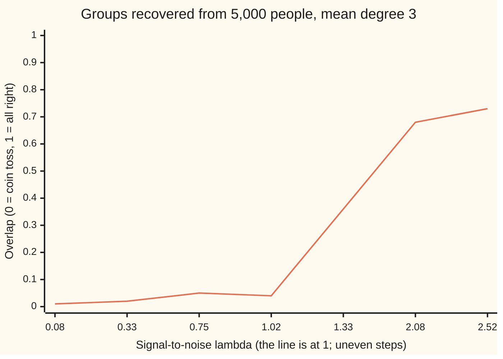

# The stochastic block model: planted groups, and the point below which no method can find them

[Syllabus](../../../SYLLABUS.md) → [Applied and computational](../README.md) → [Network Science and Spectral Graphs](../README.md#s07) → The stochastic block model

---

## General Overview

A messaging app has 5,000 users in two towns, 2,500 in each. On [The graph Laplacian](03-graph-laplacian-and-spectral-clustering.md) the app saw about 20 contacts per user and found both towns without a single mistake. Now the app is new. It sees only about 3 contacts per user. Can it still find the towns?

The **stochastic block model** describes how such contacts arise. Each user belongs to a hidden group. Every pair of users becomes friends by a coin toss, and the coin's chance depends only on whether the two share a group. The groups are "planted" in the network, and the task is to dig them back out.

Here the chance is 5 in 5,000 for two people in the same town and 1 in 5,000 across; call 5 and 1 the two **rates**. A method run on this card puts 3,407 of the 5,000 users in the right town, where a coin would get about 2,500. With rates 4 and 2, the same method gets 2,538 right. The towns are still there, and friendships are still twice as likely inside a town. Yet once the network is large, no method of any kind can find them.

The dividing line is one inequality. Square the gap between the two rates and compare it with twice their sum. For 5 and 1: $`(5 - 1)^2 = 16`$ beats $`2(5 + 1) = 12`$, so the towns can be found. For 4 and 2: $`4 < 12`$, and nothing does better than guessing.

**A sparse network built from two hidden groups gives up its groups only when the squared gap between the in-group and out-group rates beats twice their sum; below that line, called the Kesten–Stigum threshold, every method does no better than a coin.**

**What kind of fact this is:** the block model is a model: a rule for drawing random networks, not a law about real ones. The threshold is a theorem, stated here with its sources and not proved: Mossel, Neeman and Sly (2015) proved that no method works below it, and Massoulié (2014) proved that a fast method works above it. This card proves the threshold for the tree census (the sum of labels at one depth, Step 2) in Why it works, and the checks test the graph version on networks of 5,000 people.

### The picture: a cliff at the line



The one line is the overlap reached by the non-backtracking method of this card, on one synthetic network per point (seed 2026). Every network has the same mean degree, 3; only the split between the in-group and out-group rates changes. Below the line the overlap stays near 0. Above it the groups appear. At 1.02, just over the line, a network of 5,000 is still too small to show them: the threshold is a statement about large networks.

---

## The formula

Notation first, in words. There are $`n`$ people, split into two equal groups. Person $`v`$'s hidden group label is $`g_v`$: $`+1`$ for one town, $`-1`$ for the other.

Two numbers set the model. The **in-group rate** $`c_{\text{in}}`$ and the **out-group rate** $`c_{\text{out}}`$ fix the coin chances: two people in the same group are friends with chance $`p_{\text{in}} = c_{\text{in}}/n`$, and two people in different groups with chance $`p_{\text{out}} = c_{\text{out}}/n`$. Every pair gets its own coin, as in [Random graphs](../../09-Probability%20and%20statistics/14-Random%20Graphs%20and%20the%20Probabilistic%20Method/01-random-graphs-erdos-renyi.md).

A rate is not a friend count. Only half the people are in a person's group, so a person has about $`c_{\text{in}}/2`$ friends inside and $`c_{\text{out}}/2`$ across. The **mean degree** (average number of friends) is $`c = (c_{\text{in}} + c_{\text{out}})/2`$, written $`\langle k \rangle`$ on [Small worlds and hubs](04-small-world-and-scale-free-models.md).

```math
\lambda \;=\; \frac{(c_{\text{in}} - c_{\text{out}})^2}{2\,(c_{\text{in}} + c_{\text{out}})} \;=\; c\,\theta^2, \qquad \theta = \frac{c_{\text{in}} - c_{\text{out}}}{c_{\text{in}} + c_{\text{out}}}, \qquad \text{groups detectable} \iff \lambda > 1
```

**Read it aloud:** the signal-to-noise ratio lambda is the squared gap between the two rates over twice their sum; it equals the mean degree times theta squared, where theta is how much more likely a friend is to be on your side than the other; the groups can be found when lambda is above 1, and not when it is below.

Here $`\theta`$ is the chance that a friend shares your group, minus the chance that they do not. With rates 5 and 1, a friend is on your side with chance $`5/6`$ and on the other with chance $`1/6`$, so $`\theta = 4/6`$.

**Detectable** means: some method labels the people so that, as $`n`$ grows, the share it gets right stays above one half by a fixed margin. The **overlap** measures that margin: twice the share right, minus 1, under whichever naming of the two groups fits better. A coin scores about 0, a perfect answer 1.

The method uses one matrix. The **non-backtracking matrix** $`B`$ has a row and a column for each friendship read in one direction, $`u \to v`$, so 7,522 friendships give twice as many rows. The entry from $`u \to v`$ to $`v \to w`$ is 1 when $`w \neq u`$, and every other entry is 0. So $`B`$ counts walks that move on along the network but never step straight back. Its largest **eigenvalue** (a scale factor $`\mu`$ with $`Bx = \mu x`$, as on the Laplacian card) is $`\mu_1`$, and the next is $`\mu_2`$.

| Symbol | Plain meaning | In our example | Push it up and the answer… |
| --- | --- | --- | --- |
| $`n`$ | number of people | 5,000 | the threshold result becomes sharper |
| $`g_v`$ | person $`v`$'s hidden group: $`+1`$ or $`-1`$ | the first 2,500 are $`+1`$ | — |
| $`c_{\text{in}}`$, $`c_{\text{out}}`$ | in-group and out-group rates: $`n`$ times the coin chances | 5 and 1; or 4 and 2 | a wider gap raises $`\lambda`$ |
| $`p_{\text{in}}`$, $`p_{\text{out}}`$ | chance of a friendship inside a group, across groups | 0.0010 and 0.0002 | — |
| $`c`$ | mean degree, $`(c_{\text{in}} + c_{\text{out}})/2`$ | 3 | at a fixed $`\theta`$, raises $`\lambda`$ |
| $`\theta`$ | chance a friend is on your side, minus chance they are not | 0.6667; or 0.3333 | raises $`\lambda`$ fastest: it is squared |
| $`\lambda`$ | signal-to-noise ratio, $`c\,\theta^2`$ | 1.3333; or 0.3333 | above 1, groups detectable |
| $`B`$, $`u \to v`$, $`x`$ | the non-backtracking matrix; one friendship read in one direction; a list with one number per row of $`B`$ | two rows per friendship | — |
| $`\mu_1`$, $`\mu_2`$ | largest and second eigenvalue of $`B`$ | about 3 and 2 | $`\mu_2`$ above $`\sqrt{\mu_1}`$ means detectable |
| overlap | twice the share placed right, minus 1 | 0.3628 (3,407 right) | 1 means everyone right |
| $`t`$, $`S_t`$; $`D`$, $`\eta_i`$ | depth in the family tree; the census, the sum of labels at depth $`t`$ with the root's label $`+1`$; in the proof, the root's number of children and child $`i`$'s label | depths 1 to 12 | — |
| $`m_t`$, $`M_t`$, $`r_t`$ | average census; average squared census; census signal-to-noise, $`m_t^2/(M_t - m_t^2)`$ | $`r_{12}`$ = 0.3442 | above the line, settles at $`\lambda - 1`$ |

On this card $`\lambda`$ is the signal-to-noise ratio. It is not the Laplacian eigenvalue $`\lambda_2`$ of [The graph Laplacian](03-graph-laplacian-and-spectral-clustering.md); this card writes eigenvalues as $`\mu`$.

### When it holds

- **The network is sparse.** The rates stay fixed as $`n`$ grows, so each person has a handful of friends. If degrees grow with $`n`$, the groups become easy. The Laplacian card's network is easy for another reason, at a fixed size: about 20 friends each, nearly all inside a town, put it far above the line, and its method placed all 5,000 right.
- **Two groups of equal size, with the same rates for both.** With five or more groups, the line has a many-group version, and a band opens below it: there the groups can be found in principle, by searching all labellings, but no known fast method finds them (Decelle and others, 2011). Above the line, fast methods work for any number of groups (Abbe and Sandon, 2018). Whether any fast method works inside the band is open.
- **$`n`$ is large.** The threshold is a limit as $`n`$ grows. At 5,000 people, $`\lambda = 1.02`$ gives an overlap of 0.0392: far below the 0.3628 at $`\lambda = 4/3`$, and close to a coin.
- **The model is the truth.** Real networks have hubs and many triangles that the block model lacks. The threshold only says what the model allows.

---

## Why it works

### Step 0: information about your group travels along friendships, and fades

The only evidence about person $`v`$'s group is who $`v`$ knows, who they know, and so on outwards. Each step outwards does two things.

- **It weakens the signal.** A friend is on $`v`$'s side with chance $`(1 + \theta)/2`$, so each step keeps only a factor $`\theta`$ of the agreement. After $`t`$ steps, one chain of friends carries agreement $`\theta^t`$.
- **It multiplies the chains.** Each person has about $`c`$ further friends, so there are about $`c^t`$ chains of length $`t`$.

Add the labels at distance $`t`$. The signal adds up along every chain: $`c^t \theta^t`$. The noise is $`c^t`$ independent-looking random signs, which add up to about $`\sqrt{c^t}`$, as for any sum of random signs. Signal beats noise as $`t`$ grows only if $`c\,\theta > \sqrt{c}`$, that is, $`c\,\theta^2 > 1`$. That is the whole threshold. Steps 1 to 3 make it exact.

### Step 1: near any one person, the network is a tree

With 5,000 people and about 3 friends each, a person's friends rarely know each other: closing a triangle needs one particular coin out of thousands to land "friends". So the neighbourhood of a person, out to a few steps, is a **tree**: a branching family with no loops.

In that tree, each person has a number of further friends that is close to Poisson with mean $`c = 3`$ (Poisson: the count law of many rare, independent chances; see [Random graphs](../../09-Probability%20and%20statistics/14-Random%20Graphs%20and%20the%20Probabilistic%20Method/01-random-graphs-erdos-renyi.md)). Each further friend is on the same side as their parent with chance $`(1 + \theta)/2`$. That is a branching process, as on [Branching processes](../../11-Stochastic%20processes%20and%20calculus/02-Martingales/09-galton-watson-branching-processes.md), whose members carry a label that flips with chance $`(1 - \theta)/2`$ at each birth.

### Step 2: the census on the tree, done exactly

Put the root's label at $`+1`$. Let $`S_t`$ be the **census** at depth $`t`$: the sum of the labels of everyone $`t`$ steps from the root. Its average and its spread follow two short rules.

```math
m_{t+1} = c\,\theta\, m_t, \qquad M_{t+1} = c\, M_t + (c\,\theta\, m_t)^2, \qquad m_0 = M_0 = 1
```

**Read it aloud:** the average census grows by c theta per generation; the average squared census grows by c, plus the square of the next average.

Here $`m_t`$ is the average of $`S_t`$ and $`M_t`$ the average of its square. The signal-to-noise ratio of the census is $`r_t = m_t^2 / (M_t - m_t^2)`$: the squared signal over the variance. The fold solves the rules exactly:

```math
r_t = \frac{\lambda - 1}{1 - \lambda^{-t}}
```

For rates 5 and 1 ($`\lambda = 4/3`$) the census keeps a signal: $`r_t`$ runs 1.3333, 0.7619, 0.4876, 0.3704, 0.3442 at depths 1, 2, 4, 8, 12, and settles at $`\lambda - 1 = 0.3333`$. For rates 4 and 2 ($`\lambda = 1/3`$) it dies: 0.3333, 0.0833, 0.0083, 0.0001, then 0.0000. Below the line the census at depth 12 says nothing about the root.

Kesten and Stigum proved this census threshold in 1966 for branching processes, in their paper "Additional limit theorems for indecomposable multidimensional Galton–Watson processes". It is a different result from their limit theorem on [Branching processes](../../11-Stochastic%20processes%20and%20calculus/02-Martingales/09-galton-watson-branching-processes.md). For two groups, nothing else computed from the tree does better below the line, and Mossel, Neeman and Sly carried that impossibility from the tree to the whole graph (Sources).

<details>
<summary>Detailed proof: the census rules and their exact solution</summary>

Write the root's children as $`i = 1, \dots, D`$, where $`D`$ is Poisson with mean $`c`$. Child $`i`$ has label $`\eta_i`$ relative to the root: $`+1`$ with chance $`(1 + \theta)/2`$, so the average of $`\eta_i`$ is $`\theta`$. Child $`i`$'s own subtree has census $`S^{(i)}_t`$, counted relative to child $`i`$, with the same law as $`S_t`$. The census of the root at depth $`t + 1`$ is

$`\displaystyle S_{t+1} = \sum_{i=1}^{D} \eta_i\, S^{(i)}_t.`$

The children, their labels and their subtrees are independent. Take averages. Each term has average $`\theta m_t`$, and there are $`c`$ terms on average, so $`m_{t+1} = c\,\theta\, m_t`$.

Square and take averages. Each square term $`(\eta_i S^{(i)}_t)^2 = (S^{(i)}_t)^2`$ has average $`M_t`$, and there are $`c`$ of them on average. Each cross term $`i \neq j`$ has average $`(\theta m_t)^2`$, and a Poisson count has $`D(D - 1)`$ averaging $`c^2`$. So

$`\displaystyle M_{t+1} = c\, M_t + c^2 \theta^2 m_t^2.`$

Now solve. With $`\lambda = c\,\theta^2 \neq 1`$, try

$`\displaystyle M_t = \frac{\lambda}{\lambda - 1}\,(c\,\theta)^{2t} - \frac{1}{\lambda - 1}\,c^t.`$

At $`t = 0`$ it gives 1. Put it into the right-hand side of the rule: the $`c^t`$ part becomes $`-c^{t+1}/(\lambda - 1)`$, as needed, and the $`(c\theta)^{2t}`$ part has coefficient $`c\,\lambda/(\lambda - 1) + c^2\theta^2`$, which equals $`c^2\theta^2 \cdot \lambda/(\lambda - 1)`$ because $`\lambda/(\lambda-1) + \lambda = \lambda^2/(\lambda - 1)`$. So the guess satisfies the rule.

Since $`m_t = (c\theta)^t`$, the variance is

$`\displaystyle M_t - m_t^2 = \frac{(c\theta)^{2t} - c^t}{\lambda - 1},`$

and dividing $`m_t^2`$ by it gives $`r_t = (\lambda - 1)/(1 - \lambda^{-t})`$, since $`c^t / (c\theta)^{2t} = \lambda^{-t}`$. If $`\lambda > 1`$ then $`\lambda^{-t} \to 0`$ and $`r_t \to \lambda - 1`$. If $`\lambda < 1`$ then $`r_t = (1 - \lambda)/(\lambda^{-t} - 1)`$, which falls to 0 like $`\lambda^t`$. The checks run the rules and compare them with this formula at every depth from 1 to 12.

</details>

### Step 3: on the graph, the census is a walk that never steps back

On a tree, a chain of friends going outwards never returns to the person it just left. The non-backtracking matrix $`B`$ counts exactly those walks. Multiplying a list of labels by $`B`$ once moves the census one generation outwards, on every friendship at once.

So the census rules turn into eigenvalues of $`B`$:

- $`\mu_1 \approx c`$: the number of walks grows by $`c`$ per step.
- $`\mu_2 \approx c\,\theta = (c_{\text{in}} - c_{\text{out}})/2`$: the group signal grows by $`c\,\theta`$ per step.
- Every other eigenvalue lies within about $`\sqrt{c}`$ of zero: the noise grows by $`\sqrt{c}`$ per step. This bound is the **noise edge**; the code calls it the bulk edge.

The group signal stands out from the noise exactly when $`c\,\theta > \sqrt{c}`$, the same inequality as Step 0. Krzakala and others (2013) proposed this method and gave strong evidence that it works all the way down to the line; Bordenave, Lelarge and Massoulié proved that it does (*Annals of Probability*, 2018).

The checks measure these eigenvalues on the two networks of 5,000 people.

```
rates 5 and 1 (above the line)
top eigenvalue, measured      ██████████████████████████████  2.9828
second eigenvalue, measured   ████████████████████            1.9776
noise edge sqrt(c)            █████████████████               1.7321
rates 4 and 2 (below the line)
top eigenvalue, measured      ██████████████████████████████  2.9565
group signal c theta          ██████████                      1.0000
next growth, measured         █████████████████               1.7264
```

Above the line the second eigenvalue, 1.9776, sits near its prediction of 2 and clears the noise edge, 1.7321. Below the line the group signal would be 1.0000, inside the noise. The next-largest growth the iteration finds, 1.7264, is just the noise edge again.

### Step 4: from the eigenvector to a label for each person

The method, run on each network:

1. Find $`B`$'s top eigenvector by **power iteration** (multiply by $`B`$ again and again, rescaling each time, as on [PageRank by power iteration](02-power-iteration-and-the-damping-factor.md)). Forty steps give $`\mu_1`$ = 2.9828.
2. Start again from random signs. After every multiplication, remove the part along the top eigenvector. $`B`$ is not symmetric, so "the part along it" needs the left eigenvector. Reading every friendship backwards turns the right eigenvector into the left one.
3. After 100 steps, give each person a score: the sum of the entries on the friendships that point into them.
4. Label by sign: positive scores in one group, the rest in the other.

On rates 5 and 1 this places 3,407 of 5,000 right, an overlap of 0.3628. It stays far from 1 mainly because $`\lambda = 4/3`$ is close to the line: with the same mean degree, $`\lambda = 2.5208`$ reaches 0.7340 (the `sweep` lines below). The 245 people with no friends at all matter less. Nothing about them is visible, so they are placed by chance, and about half of them land right.

### Step 5: below the line, nothing works

Mossel, Neeman and Sly proved more than "this method fails". Below the line, no test can even tell the network with groups from a plain random network with the same mean degree, with success growing to certainty. They also proved, separately, that no method recovers the labels better than a coin. The proof is long and is not given here.

---

## Worked numbers, by hand

The 5,000 people with rates 5 and 1.

| Step | Arithmetic | Value |
| --- | --- | --- |
| chance inside a town | $`5/5000`$ | 0.0010 |
| chance across | $`1/5000`$ | 0.0002 |
| friends inside, on average | $`2499 \times 0.0010`$ | 2.4990 |
| friends across, on average | $`2500 \times 0.0002`$ | 0.5000 |
| mean degree $`c`$ | $`(5 + 1)/2`$ | 3 |
| $`\theta`$ | $`(5 - 1)/(5 + 1)`$ | 0.6667 |
| $`\lambda`$ | $`3 \times 0.6667^2`$, or $`16/12`$ | 1.3333 |
| group signal against noise | $`c\,\theta = 2`$ against $`\sqrt 3`$ | 2 > 1.7321 |
| verdict | $`\lambda > 1`$ | **detectable** |

The same steps for rates 4 and 2: chances 0.0008 and 0.0004, 1.9992 friends inside and 1.0000 across, $`c = 3`$, $`\theta = 0.3333`$, $`\lambda = 4/12 = 0.3333`$, and a group signal of 1 against a noise edge of 1.7321. **Undetectable.**

Same 3 friends per person, opposite answers. With rates 5 and 1, five in six friendships stay inside a town, and the method places 3,407 people right. With rates 4 and 2, two in three do, and it places 2,538: a coin's result.

### What breaks if you drop a piece

| Mistake | Comes out at | What went wrong |
| --- | --- | --- |
| Assume any gap between the rates can be found | rates 4 and 2: 2,538 of 5,000 right, overlap 0.0152 | Friendships are twice as likely inside, but $`\lambda = 0.3333`$ is below the line. |
| Use 100 power steps on the plain adjacency matrix, aimed at its second eigenvector | rates 5 and 1: 2,699 right, overlap 0.0796 | Walks that step back and forth pile up around the busiest people (here 12 friends) and drown the group signal. |
| Use the Laplacian's Fiedler vector | 262 separate pieces, so 262 zero eigenvalues and $`\lambda_2 = 0`$ | A sparse network falls apart. The Fiedler vector marks a small piece, not a town. |
| Forget to remove the top eigenvector | growth 2.9828, 2,562 right, overlap 0.0248 | The iteration returns how connected each person is, not which side they are on. |
| Read the line exactly at $`n = 5000`$ | $`\lambda = 1.02`$: overlap 0.0392 | The threshold is a limit; just above it, a finite network hides the groups. |

---

## Code, from first principles, and it actually runs

The script draws each network from a written-out SplitMix64 generator with seed 2026, so Python and Rust build the same networks. It tosses one coin per pair, but jumps straight to the next pair whose coin lands "friends", so it never visits the empty pairs one by one. It never stores $`B`$; it computes $`Bx`$ from the friendship list.

It takes **three independent roads** to the threshold:

- **Formula and tree.** The threshold arithmetic, and the census rules run step by step against their exact solution at every depth.
- **Eigenvalues.** The measured $`\mu_1`$ must sit within 0.1 of $`c`$. Above the line $`\mu_2`$ must sit within 0.1 of $`(c_{\text{in}} - c_{\text{out}})/2`$. Below it, the next growth must sit within 0.1 of the noise edge $`\sqrt{c}`$.
- **Simulation.** The overlap must be above 0.2 above the line and below 0.05 below it. Across seven networks it must jump from under 0.07 to over 0.2 between $`\lambda = 0.75`$ and $`\lambda = 1.33`$.

It also ties each network to its rates: the friendships counted inside and across must sit within 4 standard errors of the counts the rates predict. Then it runs the three failing methods and prints their numbers.

### Python

```python
# The stochastic block model: plant two groups, find them, and test the Kesten-Stigum line.
# Python standard library only.  Every graph is synthetic, drawn by SplitMix64 from a stated seed.
import math
M64 = (1 << 64) - 1
def rng(s):                                       # SplitMix64: returns (new state, 64-bit draw)
    s = (s + 0x9E3779B97F4A7C15) & M64; z = s
    z = ((z ^ (z >> 30)) * 0xBF58476D1CE4E5B9) & M64
    z = ((z ^ (z >> 27)) * 0x94D049BB133111EB) & M64
    return s, z ^ (z >> 31)
def sbm(n, cin, cout, seed):                      # one coin per pair: c_in/n inside a group, c_out/n across
    h, st, E = n // 2, seed, []
    for i in range(n):
        for p, lo, hi in ((cin / n, i + 1, i // h * h + h), (cout / n if i < h else 0.0, h, n)):
            if p <= 0.0: continue
            lq, j = math.log(1.0 - p), lo - 1
            while True:                           # jump straight to the next pair whose coin lands "friends"
                st, r = rng(st); j += 1 + int(math.log(((r >> 11) + 1) / 2.0**53) / lq)
                if j >= hi: break
                E.append((i, j))
    return E
def dot(a, b):                                    # plain left-to-right sum (Python's sum() compensates rounding; Rust's does not)
    t = 0.0
    for u, v in zip(a, b): t += u * v
    return t
def norm(x): return math.sqrt(dot(x, x))
def nb(x, src, dst, n):                           # non-backtracking step: walk on, never straight back
    s = [0.0] * n
    for e in range(len(x)): s[src[e]] += x[e]
    return [s[dst[e]] - x[e ^ 1] for e in range(len(x))]
def detect(n, E, seed, deflate=True):             # spectral method on the non-backtracking matrix B
    src = [a for e in E for a in e]; dst = [b for a, b in E for b in (b, a)]
    x = [1.0] * len(src)
    for t in range(40):                           # top eigenvalue of B: about the mean degree c
        y = nb(x, src, dst, n); r = norm(y); lam1 = r / norm(x); x = [v / r for v in y]
    R, Lf = x, [x[e ^ 1] for e in range(len(x))]  # B's left eigenvector is its right one, edges flipped
    LR = dot(Lf, R)
    def defl(v):
        if not deflate: return v
        k = dot(Lf, v) / LR; return [a - k * b for a, b in zip(v, R)]
    st, x = seed + 1, []
    for e in range(len(src)): st, r = rng(st); x.append(1.0 if r >> 63 else -1.0)
    x = defl(x); r = norm(x); x = [v / r for v in x]; logs = []
    for t in range(100):                          # second eigenvector: power steps with the top one removed
        y = defl(nb(x, src, dst, n)); r = norm(y); logs.append(math.log(r)); x = [v / r for v in y]
    mu = math.exp(dot(logs[-20:], [1.0] * 20) / 20)           # growth per step over the last 20 steps
    z = [0.0] * n
    for e in range(len(x)): z[dst[e]] += x[e]     # each person's score: what flows in along their edges
    return lam1, mu, overlap(n, z)
def overlap(n, z):                                # 0 = coin toss, 1 = everyone right (either naming of the groups)
    right = sum((z[v] >= 0.0) == (v < n // 2) for v in range(n)); right = max(right, n - right)
    return 2 * right / n - 1, right
def adjacency_split(n, E, seed):                  # plain spectral: 100 power steps toward the adjacency second eigenvector
    nbr = [[] for _ in range(n)]
    for a, b in E: nbr[a].append(b); nbr[b].append(a)
    Ax = lambda x: [dot([x[w] for w in nbr[v]], [1.0] * len(nbr[v])) for v in range(n)]
    u = [1.0] * n
    for t in range(100): y = Ax(u); r = norm(y); u = [v / r for v in y]
    st, x = seed + 2, []
    for v in range(n): st, r = rng(st); x.append(1.0 if r >> 63 else -1.0)
    for t in range(100):
        y = Ax(x); k = dot(u, y); y = [a - k * b for a, b in zip(y, u)]
        r = norm(y); x = [v / r for v in y]
    return max(len(l) for l in nbr), overlap(n, x)
def pieces(n, E):                                 # flood fill: number of separate pieces, size of the largest
    nbr = [[] for _ in range(n)]
    for a, b in E: nbr[a].append(b); nbr[b].append(a)
    seen, count, big = [False] * n, 0, 0
    for s in range(n):
        if seen[s]: continue
        count += 1; seen[s] = True; stack, size = [s], 0
        while stack:
            v = stack.pop(); size += 1
            for w in nbr[v]:
                if not seen[w]: seen[w] = True; stack.append(w)
        big = max(big, size)
    return count, big
def census(cin, cout, T):                         # tree road: signal-to-noise of the depth-t census, exact recursion
    c, th = (cin + cout) / 2, (cin - cout) / (cin + cout); m, M2, out = 1.0, 1.0, []
    for t in range(T):
        M2, m = c * M2 + (c * th * m) * (c * th * m), c * th * m; out.append(m * m / (M2 - m * m))
    return out
N, SEED = 5000, 2026
print(f"people {N} in two groups of {N // 2}, seed {SEED}")
for cin, cout in ((5, 1), (4, 2)):
    snr = (cin - cout) ** 2 / (2 * (cin + cout))
    print(f"c_in {cin} c_out {cout}: (c_in - c_out)^2 = {(cin - cout) ** 2}  2(c_in + c_out) = {2 * (cin + cout)}  "
          f"lambda = {snr:.4f}  {'detectable' if snr > 1 else 'undetectable'}")
    print(f"  p_in {cin / N:.4f}  p_out {cout / N:.4f}  friends inside {(N // 2 - 1) * cin / N:.4f}  across {N // 2 * cout / N:.4f}"
          f"  theta {(cin - cout) / (cin + cout):.4f}  c theta^2 {(cin + cout) / 2 * ((cin - cout) / (cin + cout)) ** 2:.4f}")
    print(f"  predicted eigenvalues of B: c {(cin + cout) / 2:.4f}  community {(cin - cout) / 2:.4f}  bulk edge sqrt(c) {math.sqrt((cin + cout) / 2):.4f}")
    E = sbm(N, cin, cout, SEED); inside = sum((a < N // 2) == (b < N // 2) for a, b in E)
    lam1, mu, (q, right) = detect(N, E, SEED)
    alone = N - len(set(v for e in E for v in e))
    print(f"  graph: {len(E)} friendships, {inside} inside, {len(E) - inside} across, mean degree {2 * len(E) / N:.4f}, {alone} with none")
    ein, eout = (N // 2) * (N // 2 - 1) * cin / N, (N // 2) ** 2 * cout / N   # friendships the rates predict inside, across
    assert abs(inside - ein) < 4 * ein ** 0.5 and abs(len(E) - inside - eout) < 4 * eout ** 0.5, "friendship counts should match the rates"
    print(f"  measured: top eigenvalue {lam1:.4f}  next growth {mu:.4f}  right {right} of {N}  overlap {q:.4f}")
    t = census(cin, cout, 12)
    print(f"  tree census signal-to-noise, depth 1 2 4 8 12: " + " ".join(f"{t[i - 1]:.4f}" for i in (1, 2, 4, 8, 12)) + f"  limit {max(snr - 1, 0):.4f}")
    assert abs(lam1 - (cin + cout) / 2) < 0.1, "top eigenvalue should sit near the mean degree c"
    assert all(abs(t[i] - (snr - 1) / (1 - snr ** -(i + 1))) < 1e-9 for i in range(12)), "census recursion disagrees with its closed form"
    if snr > 1:
        assert abs(mu - (cin - cout) / 2) < 0.1 and q > 0.2, "above the line the community eigenvalue and the groups should show"
        E51, q51 = E, q
    else:
        assert abs(mu - math.sqrt((cin + cout) / 2)) < 0.1 and q < 0.05, "below the line only the bulk and a coin toss should show"
sweep = []
for cin in (3.5, 4.0, 4.5, 4.75, 5.0, 5.5, 5.75):  # mean degree 3 throughout; only the split between in and out moves
    cout = 6.0 - cin; snr = (cin - cout) * (cin - cout) / 12; _, mu, (q, _) = detect(N, sbm(N, cin, cout, SEED), SEED)
    sweep.append((snr, q)); print(f"sweep c_in {cin:.2f} c_out {cout:.2f}: lambda {snr:.4f}  next growth {mu:.4f}  overlap {q:.4f}")
assert max(q for s, q in sweep if s < 0.9) < 0.07 and 0.2 < min(q for s, q in sweep if s > 1.2), "a cliff near lambda = 1"
print("chart, lambda:overlap " + " ".join(f"{s:.2f}:{q:.2f}" for s, q in sweep))
print("what breaks, at c_in 5, c_out 1:")
dmax, (qa, ra) = adjacency_split(N, E51, SEED)
print(f"  plain adjacency eigenvector, 100 steps: right {ra} of {N}, overlap {qa:.4f}; busiest person {dmax} friends")
assert qa < 0.1 < q51, "plain adjacency should fail where non-backtracking succeeds"
cnt, big = pieces(N, E51)
print(f"  Laplacian: the network falls into {cnt} pieces (largest {big}), so {cnt} zero eigenvalues and lambda_2 = 0")
_, mu0, (q0, r0) = detect(N, E51, SEED, deflate=False)
print(f"  top eigenvector left in: growth {mu0:.4f}, right {r0} of {N}, overlap {q0:.4f}")
assert cnt > 1 and abs(mu0 - 3) < 0.1 and q0 < 0.1, "these mistakes should fail"
for n, seed in ((10000, SEED), (N, 7)):            # the "Try changing" runs
    lam1, mu, (q, right) = detect(n, sbm(n, 5, 1, seed), seed)
    print(f"try: c_in 5 c_out 1, {n} people, seed {seed}: top {lam1:.4f}  next growth {mu:.4f}  right {right} of {n}  overlap {q:.4f}")
print("ALL CHECKS PASS")
```

**Ran 2026-11-23 on macOS, Python 3.14.10, standard library only. All checks passed. Output, pasted from the run:**

```
people 5000 in two groups of 2500, seed 2026
c_in 5 c_out 1: (c_in - c_out)^2 = 16  2(c_in + c_out) = 12  lambda = 1.3333  detectable
  p_in 0.0010  p_out 0.0002  friends inside 2.4990  across 0.5000  theta 0.6667  c theta^2 1.3333
  predicted eigenvalues of B: c 3.0000  community 2.0000  bulk edge sqrt(c) 1.7321
  graph: 7522 friendships, 6259 inside, 1263 across, mean degree 3.0088, 245 with none
  measured: top eigenvalue 2.9828  next growth 1.9776  right 3407 of 5000  overlap 0.3628
  tree census signal-to-noise, depth 1 2 4 8 12: 1.3333 0.7619 0.4876 0.3704 0.3442  limit 0.3333
c_in 4 c_out 2: (c_in - c_out)^2 = 4  2(c_in + c_out) = 12  lambda = 0.3333  undetectable
  p_in 0.0008  p_out 0.0004  friends inside 1.9992  across 1.0000  theta 0.3333  c theta^2 0.3333
  predicted eigenvalues of B: c 3.0000  community 1.0000  bulk edge sqrt(c) 1.7321
  graph: 7478 friendships, 5019 inside, 2459 across, mean degree 2.9912, 261 with none
  measured: top eigenvalue 2.9565  next growth 1.7264  right 2538 of 5000  overlap 0.0152
  tree census signal-to-noise, depth 1 2 4 8 12: 0.3333 0.0833 0.0083 0.0001 0.0000  limit 0.0000
sweep c_in 3.50 c_out 2.50: lambda 0.0833  next growth 1.8165  overlap 0.0052
sweep c_in 4.00 c_out 2.00: lambda 0.3333  next growth 1.7264  overlap 0.0152
sweep c_in 4.50 c_out 1.50: lambda 0.7500  next growth 1.7490  overlap 0.0512
sweep c_in 4.75 c_out 1.25: lambda 1.0208  next growth 1.7325  overlap 0.0392
sweep c_in 5.00 c_out 1.00: lambda 1.3333  next growth 1.9776  overlap 0.3628
sweep c_in 5.50 c_out 0.50: lambda 2.0833  next growth 2.4651  overlap 0.6764
sweep c_in 5.75 c_out 0.25: lambda 2.5208  next growth 2.6956  overlap 0.7340
chart, lambda:overlap 0.08:0.01 0.33:0.02 0.75:0.05 1.02:0.04 1.33:0.36 2.08:0.68 2.52:0.73
what breaks, at c_in 5, c_out 1:
  plain adjacency eigenvector, 100 steps: right 2699 of 5000, overlap 0.0796; busiest person 12 friends
  Laplacian: the network falls into 262 pieces (largest 4718), so 262 zero eigenvalues and lambda_2 = 0
  top eigenvector left in: growth 2.9828, right 2562 of 5000, overlap 0.0248
try: c_in 5 c_out 1, 10000 people, seed 2026: top 3.0081  next growth 2.0469  right 6948 of 10000  overlap 0.3896
try: c_in 5 c_out 1, 5000 people, seed 7: top 2.9485  next growth 1.9476  right 3472 of 5000  overlap 0.3888
ALL CHECKS PASS
```

### Rust

```rust
// The stochastic block model: plant two groups, find them, and test the Kesten-Stigum line.
// Rust std only, no crates.  Every graph is synthetic, drawn by SplitMix64 from a stated seed.
type Edges = Vec<(usize, usize)>;
fn rng(state: u64) -> (u64, u64) {
    let s = state.wrapping_add(0x9E3779B97F4A7C15);
    let z = (s ^ (s >> 30)).wrapping_mul(0xBF58476D1CE4E5B9);
    let z = (z ^ (z >> 27)).wrapping_mul(0x94D049BB133111EB);
    (s, z ^ (z >> 31))
}
fn sbm(n: usize, cin: f64, cout: f64, seed: u64) -> Edges {
    // one coin per pair: c_in/n inside a group, c_out/n across
    let (h, mut st, mut e) = (n / 2, seed, Vec::new());
    for i in 0..n {
        let runs = [(cin / n as f64, i + 1, i / h * h + h), (if i < h { cout / n as f64 } else { 0.0 }, h, n)];
        for &(p, lo, hi) in &runs {
            if p <= 0.0 { continue; }
            let (lq, mut j) = ((1.0 - p).ln(), lo as i64 - 1);
            loop {
                // jump straight to the next pair whose coin lands "friends"
                let (s, r) = rng(st); st = s;
                j += 1 + ((((r >> 11) + 1) as f64 / 9007199254740992.0).ln() / lq) as i64;
                if j >= hi as i64 { break; }
                e.push((i, j as usize));
            }
        }
    }
    e
}
fn dot(a: &[f64], b: &[f64]) -> f64 { let mut t = 0.0; for (u, v) in a.iter().zip(b) { t += u * v; } t }
fn norm(x: &[f64]) -> f64 { dot(x, x).sqrt() }
fn scale(x: &[f64], r: f64) -> Vec<f64> { x.iter().map(|v| v / r).collect() }
fn nb(x: &[f64], src: &[usize], dst: &[usize], n: usize) -> Vec<f64> {
    // non-backtracking step: walk on, never straight back
    let mut s = vec![0.0; n];
    for e in 0..x.len() { s[src[e]] += x[e]; }
    (0..x.len()).map(|e| s[dst[e]] - x[e ^ 1]).collect()
}
fn signs(n: usize, seed: u64) -> Vec<f64> {
    let mut st = seed; (0..n).map(|_| { let (s, r) = rng(st); st = s; if r >> 63 == 1 { 1.0 } else { -1.0 } }).collect()
}
fn overlap(n: usize, z: &[f64]) -> (f64, usize) {
    // 0 = coin toss, 1 = everyone right (either naming of the groups)
    let r = (0..n).filter(|&v| (z[v] >= 0.0) == (v < n / 2)).count(); let r = r.max(n - r);
    (2.0 * r as f64 / n as f64 - 1.0, r)
}
fn detect(n: usize, e: &Edges, seed: u64, deflate: bool) -> (f64, f64, (f64, usize)) {
    // spectral method on the non-backtracking matrix B
    let src: Vec<usize> = e.iter().flat_map(|&(a, b)| [a, b]).collect();
    let dst: Vec<usize> = e.iter().flat_map(|&(a, b)| [b, a]).collect();
    let (mut x, mut lam1) = (vec![1.0; src.len()], 0.0);
    for _ in 0..40 { let y = nb(&x, &src, &dst, n); let r = norm(&y); lam1 = r / norm(&x); x = scale(&y, r); }
    let rv = x.clone(); let lf: Vec<f64> = (0..rv.len()).map(|i| rv[i ^ 1]).collect();
    let lr = dot(&lf, &rv);
    let defl = |v: Vec<f64>| -> Vec<f64> {
        if !deflate { return v; }
        let k = dot(&lf, &v) / lr; v.iter().zip(&rv).map(|(a, b)| a - k * b).collect()
    };
    let x0 = defl(signs(src.len(), seed + 1)); let r = norm(&x0); let mut x = scale(&x0, r); let mut logs = Vec::new();
    for _ in 0..100 { let y = defl(nb(&x, &src, &dst, n)); let r = norm(&y); logs.push(r.ln()); x = scale(&y, r); }
    let mu = (dot(&logs[logs.len() - 20..], &[1.0; 20]) / 20.0).exp();
    let mut z = vec![0.0; n];
    for i in 0..x.len() { z[dst[i]] += x[i]; }
    (lam1, mu, overlap(n, &z))
}
fn neighbours(n: usize, e: &Edges) -> Vec<Vec<usize>> {
    let mut nbr = vec![Vec::new(); n];
    for &(a, b) in e { nbr[a].push(b); nbr[b].push(a); }
    nbr
}
fn adjacency_split(n: usize, e: &Edges, seed: u64) -> (usize, (f64, usize)) {
    // plain spectral: 100 power steps toward the adjacency second eigenvector
    let nbr = neighbours(n, e);
    let ax = |x: &[f64]| -> Vec<f64> { (0..n).map(|v| dot(&nbr[v].iter().map(|&w| x[w]).collect::<Vec<_>>(), &vec![1.0; nbr[v].len()])).collect() };
    let mut u = vec![1.0; n];
    for _ in 0..100 { let y = ax(&u); let r = norm(&y); u = scale(&y, r); }
    let mut x = signs(n, seed + 2);
    for _ in 0..100 {
        let y = ax(&x); let k = dot(&u, &y); let y: Vec<f64> = y.iter().zip(&u).map(|(a, b)| a - k * b).collect();
        let r = norm(&y); x = scale(&y, r);
    }
    (nbr.iter().map(|l| l.len()).max().unwrap(), overlap(n, &x))
}
fn pieces(n: usize, e: &Edges) -> (usize, usize) {
    // flood fill: number of separate pieces, size of the largest
    let nbr = neighbours(n, e); let (mut seen, mut count, mut big) = (vec![false; n], 0, 0);
    for s in 0..n {
        if seen[s] { continue; }
        count += 1; seen[s] = true; let (mut stack, mut size) = (vec![s], 0);
        while let Some(v) = stack.pop() {
            size += 1;
            for &w in &nbr[v] { if !seen[w] { seen[w] = true; stack.push(w); } }
        }
        big = big.max(size);
    }
    (count, big)
}
fn census(cin: f64, cout: f64, t: usize) -> Vec<f64> {
    // tree road: signal-to-noise of the depth-t census, exact recursion
    let (c, th) = ((cin + cout) / 2.0, (cin - cout) / (cin + cout)); let (mut m, mut m2, mut out) = (1.0, 1.0, Vec::new());
    for _ in 0..t { m2 = c * m2 + (c * th * m) * (c * th * m); m = c * th * m; out.push(m * m / (m2 - m * m)); }
    out
}
fn main() {
    let (n, seed) = (5000usize, 2026u64);
    println!("people {} in two groups of {}, seed {}", n, n / 2, seed);
    let nf = n as f64; let mut keep: Option<(Edges, f64)> = None;
    for &(ci, co) in &[(5i64, 1i64), (4, 2)] {
        let (cin, cout) = (ci as f64, co as f64);
        let snr = ((ci - co) * (ci - co)) as f64 / (2 * (ci + co)) as f64;
        println!("c_in {} c_out {}: (c_in - c_out)^2 = {}  2(c_in + c_out) = {}  lambda = {:.4}  {}", ci, co, (ci - co) * (ci - co), 2 * (ci + co), snr, if snr > 1.0 { "detectable" } else { "undetectable" });
        println!("  p_in {:.4}  p_out {:.4}  friends inside {:.4}  across {:.4}  theta {:.4}  c theta^2 {:.4}", cin / nf, cout / nf, (n / 2 - 1) as f64 * cin / nf, (n / 2) as f64 * cout / nf,
            (cin - cout) / (cin + cout), (cin + cout) / 2.0 * ((cin - cout) / (cin + cout)).powi(2));
        println!("  predicted eigenvalues of B: c {:.4}  community {:.4}  bulk edge sqrt(c) {:.4}", (cin + cout) / 2.0, (cin - cout) / 2.0, ((cin + cout) / 2.0).sqrt());
        let e = sbm(n, cin, cout, seed); let inside = e.iter().filter(|&&(a, b)| (a < n / 2) == (b < n / 2)).count();
        let (lam1, mu, (q, right)) = detect(n, &e, seed, true);
        let mut has = vec![false; n]; for &(a, b) in &e { has[a] = true; has[b] = true; }
        println!("  graph: {} friendships, {} inside, {} across, mean degree {:.4}, {} with none", e.len(), inside, e.len() - inside, 2.0 * e.len() as f64 / nf, has.iter().filter(|&&h| !h).count());
        let (ein, eout) = ((n / 2 * (n / 2 - 1)) as f64 * cin / nf, (n / 2 * (n / 2)) as f64 * cout / nf); // friendships the rates predict inside, across
        assert!((inside as f64 - ein).abs() < 4.0 * ein.sqrt() && ((e.len() - inside) as f64 - eout).abs() < 4.0 * eout.sqrt(), "friendship counts should match the rates");
        println!("  measured: top eigenvalue {:.4}  next growth {:.4}  right {} of {}  overlap {:.4}", lam1, mu, right, n, q);
        let t = census(cin, cout, 12);
        let ts: Vec<String> = [1, 2, 4, 8, 12].iter().map(|&i| format!("{:.4}", t[i - 1])).collect();
        println!("  tree census signal-to-noise, depth 1 2 4 8 12: {}  limit {:.4}", ts.join(" "), (snr - 1.0).max(0.0));
        assert!((lam1 - (cin + cout) / 2.0).abs() < 0.1, "top eigenvalue should sit near the mean degree c");
        assert!((0..12).all(|i| (t[i] - (snr - 1.0) / (1.0 - snr.powf(-(i as f64 + 1.0)))).abs() < 1e-9), "census recursion disagrees with its closed form");
        if snr > 1.0 {
            assert!((mu - (cin - cout) / 2.0).abs() < 0.1 && q > 0.2, "above the line the community eigenvalue and the groups should show");
            keep = Some((e, q));
        } else {
            assert!((mu - ((cin + cout) / 2.0).sqrt()).abs() < 0.1 && q < 0.05, "below the line only the bulk and a coin toss should show");
        }
    }
    let mut sweep = Vec::new();
    for &cin in &[3.5, 4.0, 4.5, 4.75, 5.0, 5.5, 5.75] {
        // mean degree 3 throughout; only the split between in and out moves
        let cout = 6.0 - cin; let snr = (cin - cout) * (cin - cout) / 12.0;
        let (_, mu, (q, _)) = detect(n, &sbm(n, cin, cout, seed), seed, true);
        sweep.push((snr, q)); println!("sweep c_in {:.2} c_out {:.2}: lambda {:.4}  next growth {:.4}  overlap {:.4}", cin, cout, snr, mu, q);
    }
    let below = sweep.iter().filter(|p| p.0 < 0.9).map(|p| p.1).fold(f64::MIN, f64::max);
    let above = sweep.iter().filter(|p| p.0 > 1.2).map(|p| p.1).fold(f64::MAX, f64::min);
    assert!(below < 0.07 && 0.2 < above, "a cliff near lambda = 1");
    println!("chart, lambda:overlap {}", sweep.iter().map(|(s, q)| format!("{:.2}:{:.2}", s, q)).collect::<Vec<_>>().join(" "));
    println!("what breaks, at c_in 5, c_out 1:");
    let (e51, q51) = keep.unwrap();
    let (dmax, (qa, ra)) = adjacency_split(n, &e51, seed);
    println!("  plain adjacency eigenvector, 100 steps: right {} of {}, overlap {:.4}; busiest person {} friends", ra, n, qa, dmax);
    assert!(qa < 0.1 && 0.1 < q51, "plain adjacency should fail where non-backtracking succeeds");
    let (cnt, big) = pieces(n, &e51);
    println!("  Laplacian: the network falls into {} pieces (largest {}), so {} zero eigenvalues and lambda_2 = 0", cnt, big, cnt);
    let (_, mu0, (q0, r0)) = detect(n, &e51, seed, false);
    println!("  top eigenvector left in: growth {:.4}, right {} of {}, overlap {:.4}", mu0, r0, n, q0);
    assert!(cnt > 1 && (mu0 - 3.0).abs() < 0.1 && q0 < 0.1, "these mistakes should fail");
    for &(nn, s) in &[(10000usize, seed), (n, 7u64)] {
        // the "Try changing" runs
        let (lam1, mu, (q, right)) = detect(nn, &sbm(nn, 5.0, 1.0, s), s, true);
        println!("try: c_in 5 c_out 1, {} people, seed {}: top {:.4}  next growth {:.4}  right {} of {}  overlap {:.4}", nn, s, lam1, mu, right, nn, q);
    }
    println!("ALL CHECKS PASS");
}
```

**Ran 2026-11-23 on macOS, rustc 1.98.1, no crates. All checks passed. Output, pasted from the run:**

```
people 5000 in two groups of 2500, seed 2026
c_in 5 c_out 1: (c_in - c_out)^2 = 16  2(c_in + c_out) = 12  lambda = 1.3333  detectable
  p_in 0.0010  p_out 0.0002  friends inside 2.4990  across 0.5000  theta 0.6667  c theta^2 1.3333
  predicted eigenvalues of B: c 3.0000  community 2.0000  bulk edge sqrt(c) 1.7321
  graph: 7522 friendships, 6259 inside, 1263 across, mean degree 3.0088, 245 with none
  measured: top eigenvalue 2.9828  next growth 1.9776  right 3407 of 5000  overlap 0.3628
  tree census signal-to-noise, depth 1 2 4 8 12: 1.3333 0.7619 0.4876 0.3704 0.3442  limit 0.3333
c_in 4 c_out 2: (c_in - c_out)^2 = 4  2(c_in + c_out) = 12  lambda = 0.3333  undetectable
  p_in 0.0008  p_out 0.0004  friends inside 1.9992  across 1.0000  theta 0.3333  c theta^2 0.3333
  predicted eigenvalues of B: c 3.0000  community 1.0000  bulk edge sqrt(c) 1.7321
  graph: 7478 friendships, 5019 inside, 2459 across, mean degree 2.9912, 261 with none
  measured: top eigenvalue 2.9565  next growth 1.7264  right 2538 of 5000  overlap 0.0152
  tree census signal-to-noise, depth 1 2 4 8 12: 0.3333 0.0833 0.0083 0.0001 0.0000  limit 0.0000
sweep c_in 3.50 c_out 2.50: lambda 0.0833  next growth 1.8165  overlap 0.0052
sweep c_in 4.00 c_out 2.00: lambda 0.3333  next growth 1.7264  overlap 0.0152
sweep c_in 4.50 c_out 1.50: lambda 0.7500  next growth 1.7490  overlap 0.0512
sweep c_in 4.75 c_out 1.25: lambda 1.0208  next growth 1.7325  overlap 0.0392
sweep c_in 5.00 c_out 1.00: lambda 1.3333  next growth 1.9776  overlap 0.3628
sweep c_in 5.50 c_out 0.50: lambda 2.0833  next growth 2.4651  overlap 0.6764
sweep c_in 5.75 c_out 0.25: lambda 2.5208  next growth 2.6956  overlap 0.7340
chart, lambda:overlap 0.08:0.01 0.33:0.02 0.75:0.05 1.02:0.04 1.33:0.36 2.08:0.68 2.52:0.73
what breaks, at c_in 5, c_out 1:
  plain adjacency eigenvector, 100 steps: right 2699 of 5000, overlap 0.0796; busiest person 12 friends
  Laplacian: the network falls into 262 pieces (largest 4718), so 262 zero eigenvalues and lambda_2 = 0
  top eigenvector left in: growth 2.9828, right 2562 of 5000, overlap 0.0248
try: c_in 5 c_out 1, 10000 people, seed 2026: top 3.0081  next growth 2.0469  right 6948 of 10000  overlap 0.3896
try: c_in 5 c_out 1, 5000 people, seed 7: top 2.9485  next growth 1.9476  right 3472 of 5000  overlap 0.3888
ALL CHECKS PASS
```

The two outputs match line for line.

### Lean

Lean takes the census rules as given, proves their exact solution and both limits, proves the threshold arithmetic, and checks the card's numbers.

- Suppose $`m_t`$ and $`M_t`$ follow the census rules, with $`c > 0`$ and $`\lambda > 1`$. Then $`r_t`$ settles at $`\lambda - 1`$.
- Suppose $`m_t`$ and $`M_t`$ follow the census rules, with $`c > 0`$ and $`\lambda < 1`$. Then $`r_t`$ falls to 0.
- Suppose the rules hold, with $`c > 0`$, $`\theta \neq 0`$ and $`\lambda \neq 1`$, and take a depth $`t \ge 1`$. Then $`M_t - m_t^2 = ((c\theta)^{2t} - c^t)/(\lambda - 1)`$, and this is not zero.
- Take the same rules, conditions and depth. Then $`r_t = (\lambda - 1)/(1 - \lambda^{-t})`$.
- Take any rates with a positive sum. Then the two forms of $`\lambda`$ in the formula agree: the fraction of the rates equals $`c\,\theta^2`$.
- Take the same rates. Then $`\lambda > 1`$ exactly when $`(c_{\text{in}} - c_{\text{out}})^2 > 2(c_{\text{in}} + c_{\text{out}})`$.
- For rates 5 and 1, $`16 > 12`$, so $`\lambda = 4/3`$, with $`c = 3`$, $`\theta = 4/6`$ and $`c\,\theta = 2`$.
- For rates 4 and 2, $`4 < 12`$, so $`\lambda = 1/3`$, with $`\theta = 1/3`$ and $`c\,\theta = 1`$.
- At $`\lambda = 4/3`$, $`r_1 = 4/3`$ and $`r_2 = 16/21`$, the card's 1.3333 and 0.7619.
- At $`\lambda = 1/3`$, $`r_1 = 1/3`$ and $`r_2 = 1/12`$, the card's 0.3333 and 0.0833.

The eigenvalues of $`B`$, the labels and the 5,000-person runs are left to the Python and Rust checks.

```lean
-- The stochastic block model: on the branching tree around one person, the census signal-to-noise ratio r_t equals (λ - 1)/(1 - λ^(-t)) with λ = c θ², so it settles at λ - 1 above the Kesten–Stigum line λ > 1 and dies to 0 below it, and λ > 1 is the same as (c_in - c_out)² > 2(c_in + c_out).
import Mathlib.Analysis.SpecificLimits.Basic
import Mathlib.Tactic.NormNum
import Mathlib.Tactic.FieldSimp
import Mathlib.Tactic.Ring

namespace StochasticBlockModelAndDetectability

open Filter Topology

/-! Setting. On the tree around one person, each person has on average `c` further friends
(`c` is the mean degree), and `θ` is the chance that a friend is on your side minus the chance
that they are not. `m t` is the average census at depth `t` (the sum of labels at depth `t`,
root label `+1`) and `M t` the average of its square; they obey the card's two rules
`m (t+1) = c θ m t`, `M (t+1) = c M t + (c θ m t)²`, starting from `m 0 = M 0 = 1`.
The census signal-to-noise ratio is `r t = m t ^ 2 / (M t - m t ^ 2)`, and `λ = c θ²`. -/

/-- The average census at depth `t` is `(c θ)^t`. -/
theorem census_mean_eq (c θ : ℝ) (m : ℕ → ℝ) (hm0 : m 0 = 1)
    (hm : ∀ t, m (t + 1) = c * θ * m t) (t : ℕ) : m t = (c * θ) ^ t := by
  induction t with
  | zero => simp [hm0]
  | succ n ih => rw [hm, ih, pow_succ]; ring

/-- The census variance times `λ - 1` is `(c θ)^(2t) - c^t`. -/
theorem census_var_mul (c θ : ℝ) (m M : ℕ → ℝ)
    (hm0 : m 0 = 1) (hM0 : M 0 = 1)
    (hm : ∀ t, m (t + 1) = c * θ * m t)
    (hM : ∀ t, M (t + 1) = c * M t + (c * θ * m t) ^ 2) (t : ℕ) :
    (M t - m t ^ 2) * (c * θ ^ 2 - 1) = (c * θ) ^ (2 * t) - c ^ t := by
  induction t with
  | zero => simp [hm0, hM0]
  | succ n ih =>
    have hmn := census_mean_eq c θ m hm0 hm n
    have key : M (n + 1) - m (n + 1) ^ 2 = c * ((M n - m n ^ 2) + m n ^ 2) := by
      rw [hM, hm]; ring
    rw [key, mul_assoc, add_mul, ih, hmn]
    rw [show 2 * (n + 1) = 2 * n + 2 by ring, pow_add, pow_succ c n, ← pow_mul]
    ring

/-- The average squared census is at least `c^t`. -/
theorem census_sq_ge (c θ : ℝ) (hc : 0 < c) (m M : ℕ → ℝ) (hM0 : M 0 = 1)
    (hM : ∀ t, M (t + 1) = c * M t + (c * θ * m t) ^ 2) (t : ℕ) : c ^ t ≤ M t := by
  induction t with
  | zero => simp [hM0]
  | succ n ih =>
    rw [hM, pow_succ]
    nlinarith [sq_nonneg (c * θ * m n)]

/-- For `λ ≠ 1`, the census ratio is `λ^t (λ - 1)/(λ^t - 1)` at every depth. -/
theorem census_ratio_eq (c θ : ℝ) (hc : 0 < c) (hlam : c * θ ^ 2 ≠ 1) (m M : ℕ → ℝ)
    (hm0 : m 0 = 1) (hM0 : M 0 = 1)
    (hm : ∀ t, m (t + 1) = c * θ * m t)
    (hM : ∀ t, M (t + 1) = c * M t + (c * θ * m t) ^ 2) (t : ℕ) :
    m t ^ 2 / (M t - m t ^ 2) =
      (c * θ ^ 2) ^ t * (c * θ ^ 2 - 1) / ((c * θ ^ 2) ^ t - 1) := by
  have hl : c * θ ^ 2 - 1 ≠ 0 := sub_ne_zero.mpr hlam
  have hv := census_var_mul c θ m M hm0 hM0 hm hM t
  have e : (c * θ) ^ (2 * t) = c ^ t * (c * θ ^ 2) ^ t := by
    rw [pow_mul, show (c * θ) ^ 2 = c * (c * θ ^ 2) by ring, mul_pow]
  have hV : M t - m t ^ 2 = c ^ t * (((c * θ ^ 2) ^ t - 1) / (c * θ ^ 2 - 1)) := by
    rw [mul_div_assoc', eq_div_iff hl, hv, e]
    ring
  have hsq : m t ^ 2 = c ^ t * (c * θ ^ 2) ^ t := by
    rw [census_mean_eq c θ m hm0 hm t, ← pow_mul, mul_comm t 2, e]
  have hct : c ^ t ≠ 0 := pow_ne_zero _ hc.ne'
  rw [hV, hsq, mul_div_mul_left _ _ hct, div_div_eq_mul_div]

#print axioms census_mean_eq
#print axioms census_var_mul
#print axioms census_sq_ge
#print axioms census_ratio_eq

/-- The Kesten–Stigum line for the tree census: if the mean degree `c` is positive and the
average census `m` and average squared census `M` follow the card's rules, then above the line
(`c θ² > 1`) the census signal-to-noise ratio settles at `c θ² - 1`, and below the line
(`c θ² < 1`) it falls to 0, so a deep census says nothing about the root. -/
theorem census_threshold (c θ : ℝ) (hc : 0 < c) (m M : ℕ → ℝ)
    (hm0 : m 0 = 1) (hM0 : M 0 = 1)
    (hm : ∀ t, m (t + 1) = c * θ * m t)
    (hM : ∀ t, M (t + 1) = c * M t + (c * θ * m t) ^ 2) :
    (1 < c * θ ^ 2 →
      Tendsto (fun t => m t ^ 2 / (M t - m t ^ 2)) atTop (𝓝 (c * θ ^ 2 - 1))) ∧
    (c * θ ^ 2 < 1 →
      Tendsto (fun t => m t ^ 2 / (M t - m t ^ 2)) atTop (𝓝 0)) := by
  have hl0 : 0 ≤ c * θ ^ 2 := by positivity
  constructor
  · intro h1
    have hne : c * θ ^ 2 ≠ 1 := ne_of_gt h1
    set l := c * θ ^ 2 with hl
    have hinv : Tendsto (fun t : ℕ => (l⁻¹) ^ t) atTop (𝓝 0) :=
      tendsto_pow_atTop_nhds_zero_of_lt_one (inv_nonneg.mpr hl0) (inv_lt_one_of_one_lt₀ h1)
    have hlim : Tendsto (fun t : ℕ => (l - 1) / (1 - (l⁻¹) ^ t)) atTop (𝓝 ((l - 1) / (1 - 0))) :=
      tendsto_const_nhds.div (tendsto_const_nhds.sub hinv) (by norm_num)
    rw [sub_zero, div_one] at hlim
    refine hlim.congr (fun t => ?_)
    rw [census_ratio_eq c θ hc hne m M hm0 hM0 hm hM t]
    have hx : 0 < l ^ t := pow_pos (by linarith) t
    rw [inv_pow, show 1 - (l ^ t)⁻¹ = (l ^ t - 1) / l ^ t by field_simp, div_div_eq_mul_div,
      mul_comm]
  · intro h1
    have hne : c * θ ^ 2 ≠ 1 := ne_of_lt h1
    set l := c * θ ^ 2 with hl
    have hp : Tendsto (fun t : ℕ => l ^ t) atTop (𝓝 0) :=
      tendsto_pow_atTop_nhds_zero_of_lt_one hl0 h1
    have hlim : Tendsto (fun t : ℕ => l ^ t * (l - 1) / (l ^ t - 1)) atTop
        (𝓝 (0 * (l - 1) / (0 - 1))) :=
      (hp.mul tendsto_const_nhds).div (hp.sub tendsto_const_nhds) (by norm_num)
    rw [zero_mul, zero_div] at hlim
    refine hlim.congr (fun t => ?_)
    rw [census_ratio_eq c θ hc hne m M hm0 hM0 hm hM t]

/-- The census rules solved exactly: with `c > 0`, `θ ≠ 0` and `λ = c θ² ≠ 1`, at every depth
`t ≥ 1` the census variance is `M t - m t² = ((c θ)^(2t) - c^t)/(λ - 1)`, which is not zero,
and the census signal-to-noise ratio is `r t = (λ - 1)/(1 - λ^(-t))`. -/
theorem census_snr_closed_form (c θ : ℝ) (hc : 0 < c) (hθ : θ ≠ 0) (hlam : c * θ ^ 2 ≠ 1)
    (m M : ℕ → ℝ)
    (hm0 : m 0 = 1) (hM0 : M 0 = 1)
    (hm : ∀ t, m (t + 1) = c * θ * m t)
    (hM : ∀ t, M (t + 1) = c * M t + (c * θ * m t) ^ 2)
    (t : ℕ) (ht : 1 ≤ t) :
    M t - m t ^ 2 = ((c * θ) ^ (2 * t) - c ^ t) / (c * θ ^ 2 - 1) ∧
    M t - m t ^ 2 ≠ 0 ∧
    m t ^ 2 / (M t - m t ^ 2) = (c * θ ^ 2 - 1) / (1 - (c * θ ^ 2)⁻¹ ^ t) := by
  have hl : c * θ ^ 2 - 1 ≠ 0 := sub_ne_zero.mpr hlam
  have hv := census_var_mul c θ m M hm0 hM0 hm hM t
  have hpos : 0 < M t - m t ^ 2 := by
    obtain ⟨n, rfl⟩ : ∃ n, t = n + 1 := ⟨t - 1, by omega⟩
    have h1 : M (n + 1) - m (n + 1) ^ 2 = c * M n := by rw [hM, hm]; ring
    rw [h1]
    exact mul_pos hc (lt_of_lt_of_le (pow_pos hc n) (census_sq_ge c θ hc m M hM0 hM n))
  refine ⟨by rw [eq_div_iff hl, hv], hpos.ne', ?_⟩
  rw [census_ratio_eq c θ hc hlam m M hm0 hM0 hm hM t]
  have hl0 : c * θ ^ 2 ≠ 0 := mul_ne_zero hc.ne' (pow_ne_zero 2 hθ)
  have hx : (c * θ ^ 2) ^ t ≠ 0 := pow_ne_zero t hl0
  rw [inv_pow, show 1 - ((c * θ ^ 2) ^ t)⁻¹ = ((c * θ ^ 2) ^ t - 1) / (c * θ ^ 2) ^ t by
    field_simp, div_div_eq_mul_div, mul_comm]

/-- The threshold arithmetic: with positive total rate `c_in + c_out`, the signal-to-noise
ratio `λ = (c_in - c_out)² / (2 (c_in + c_out))` equals `c θ²` with mean degree
`c = (c_in + c_out)/2` and `θ = (c_in - c_out)/(c_in + c_out)`, and `λ > 1` exactly when the
squared gap `(c_in - c_out)²` beats twice the sum `2 (c_in + c_out)`. -/
theorem detectable_iff_gap_sq_gt_twice_sum (cin cout : ℝ) (h : 0 < cin + cout) :
    (cin - cout) ^ 2 / (2 * (cin + cout)) = (cin + cout) / 2 * ((cin - cout) / (cin + cout)) ^ 2 ∧
    (1 < (cin - cout) ^ 2 / (2 * (cin + cout)) ↔ 2 * (cin + cout) < (cin - cout) ^ 2) := by
  have h2 : (0 : ℝ) < 2 * (cin + cout) := by linarith
  refine ⟨?_, one_lt_div h2⟩
  field_simp

/-! The card's own whole-number and exact-fraction numbers. -/

-- Rates 5 and 1: (5 - 1)² = 16 beats 2(5 + 1) = 12, so the towns are detectable.
example : (5 - 1) ^ 2 = 16 ∧ 2 * (5 + 1) = 12 ∧ 12 < 16 := by decide
-- Rates 4 and 2: (4 - 2)² = 4 is below 2(4 + 2) = 12, so nothing beats a coin.
example : (4 - 2) ^ 2 = 4 ∧ 2 * (4 + 2) = 12 ∧ 4 < 12 := by decide
-- λ for the two networks: 16/12 = 4/3 and 4/12 = 1/3; mean degree 3 in both.
example : ((5 : ℚ) - 1) ^ 2 / (2 * (5 + 1)) = 4 / 3 ∧ ((4 : ℚ) - 2) ^ 2 / (2 * (4 + 2)) = 1 / 3 := by
  norm_num
-- Mean degree 3 and θ = 4/6 for rates 5 and 1; c θ² = 4/3, and the group signal c θ = 2.
example : ((5 : ℚ) + 1) / 2 = 3 ∧ ((5 : ℚ) - 1) / (5 + 1) = 4 / 6 ∧
    (3 : ℚ) * (4 / 6) ^ 2 = 4 / 3 ∧ (3 : ℚ) * (4 / 6) = 2 := by
  norm_num
-- Rates 4 and 2: θ = 1/3, c θ² = 1/3, group signal c θ = 1.
example : ((4 : ℚ) - 2) / (4 + 2) = 1 / 3 ∧ (3 : ℚ) * (1 / 3) ^ 2 = 1 / 3 ∧ (3 : ℚ) * (1 / 3) = 1 := by
  norm_num
-- The census ratio at λ = 4/3: r₁ = 4/3 and r₂ = 16/21 (the card's 1.3333 and 0.7619).
example : ((4 : ℚ) / 3 - 1) / (1 - (4 / 3 : ℚ)⁻¹ ^ 1) = 4 / 3 ∧
    ((4 : ℚ) / 3 - 1) / (1 - (4 / 3 : ℚ)⁻¹ ^ 2) = 16 / 21 := by
  norm_num
-- The census ratio at λ = 1/3: r₁ = 1/3 and r₂ = 1/12 (the card's 0.3333 and 0.0833).
example : ((1 : ℚ) / 3 - 1) / (1 - (1 / 3 : ℚ)⁻¹ ^ 1) = 1 / 3 ∧
    ((1 : ℚ) / 3 - 1) / (1 - (1 / 3 : ℚ)⁻¹ ^ 2) = 1 / 12 := by
  norm_num

#print axioms census_threshold
#print axioms census_snr_closed_form
#print axioms detectable_iff_gap_sq_gt_twice_sum

end StochasticBlockModelAndDetectability
```

**Checked 2026-11-23 on macOS, Lean 4.36.0-rc2, Mathlib v4.36.0-rc2. Every proof is complete and uses only Lean's standard axioms. Output, pasted from the run:**

```
'StochasticBlockModelAndDetectability.census_mean_eq' depends on axioms: [propext, Classical.choice, Quot.sound]
'StochasticBlockModelAndDetectability.census_var_mul' depends on axioms: [propext, Classical.choice, Quot.sound]
'StochasticBlockModelAndDetectability.census_sq_ge' depends on axioms: [propext, Classical.choice, Quot.sound]
'StochasticBlockModelAndDetectability.census_ratio_eq' depends on axioms: [propext, Classical.choice, Quot.sound]
'StochasticBlockModelAndDetectability.census_threshold' depends on axioms: [propext, Classical.choice, Quot.sound]
'StochasticBlockModelAndDetectability.census_snr_closed_form' depends on axioms: [propext, Classical.choice, Quot.sound]
'StochasticBlockModelAndDetectability.detectable_iff_gap_sq_gt_twice_sum' depends on axioms: [propext, Classical.choice, Quot.sound]
```

> [!TIP]
> **Try changing**
> Guess first, then run it. The `try:` lines at the end of the output already hold the answers.
> - **Guess first: does a network twice as big do better?** Run rates 5 and 1 on 10,000 people: overlap 0.3896 (6,948 right), second eigenvalue 2.0469 against a prediction of 2. That beats 0.3628, but a second network of 5,000 (the next bullet) reaches 0.3888. At $`\lambda = 4/3`$, doubling the size moves the overlap about as much as a new draw of 5,000 does.
> - **Guess first: is 3,407 a lucky draw?** Change the seed to 7. The method places 3,472 of 5,000 right, overlap 0.3888.
> - **Guess first: what do rates 4.5 and 1.5 give?** Friendships are three times as likely inside. But $`\lambda = 0.75`$, so the overlap is 0.0512 (the `sweep` line): close to a coin, and far below the 0.3628 at rates 5 and 1.
> - **Guess first: and rates 5.75 and 0.25?** $`\lambda = 2.5208`$, and the overlap climbs to 0.7340.

---

## The usual mistake

> [!warning]
> **Believing that a better algorithm would find groups that are really there.** Below the line no algorithm can, however clever or slow. With rates 4 and 2 every friendship is twice as likely inside a town, yet the best possible answer is a coin toss as the network grows: the method here places 2,538 of 5,000 right. This is a limit of the data, not of the method. The fix is to collect more friendships per person, not to try harder.
>
> Smaller traps, each with the number it produces:
> - **Reading the rates as friend counts.** A rate of 5 means about 2.5 friends inside, not 5: only half the people are in a person's group.
> - **Using a dense-network method on a sparse network.** Power steps on the adjacency matrix, aimed at its second eigenvector, get 2,699 right where the non-backtracking method gets 3,407. The Laplacian is worse: the network is in 262 pieces, so its second eigenvalue is 0.
> - **Leaving the top eigenvector in.** The iteration then grows at 2.9828 and labels people by how connected they are: 2,562 right.
> - **Treating $`\lambda = 1`$ as sharp at small sizes.** At $`\lambda = 1.02`$ and 5,000 people the overlap is 0.0392.

---

## Where you meet it in real life

- **Testing community methods.** A method that claims to find groups is tested on networks with planted groups, as [Communities](06-community-detection.md) tests its greedy merge. The threshold says which planted groups are fair to ask for.
- **Social science.** Holland, Laskey and Leinhardt introduced the model in 1983 to describe how people in social networks form ties by role or position. Sociologists still fit block models to friendship and workplace networks.
- **Sparse data.** A new app, a phone company with a few calls per customer, or a city's 1,200 bike-share stations on one quiet day: each holds a sparse network. The threshold says when the groups in it can be read at all, and when more data must come first.
- **Physics.** Decelle and others derived the threshold with tools from the physics of magnets. The line is a **phase transition**: a sudden change of behaviour as one setting crosses a value.

> **Say it back**
> The stochastic block model plants two hidden groups and links each pair of people by a coin whose chance depends only on whether they share a group. In a sparse network the groups can be found when $`(c_{\text{in}} - c_{\text{out}})^2 > 2(c_{\text{in}} + c_{\text{out}})`$; below that line no method beats a coin. The reason is a race: each step outwards multiplies the paths by $`c`$ but keeps only a share $`\theta`$ of the group signal, so the signal wins only if $`c\,\theta^2 > 1`$. A spectral method on the non-backtracking matrix reaches the line. On 5,000 people with 3 friends each, rates 5 and 1 give 3,407 right, and rates 4 and 2 give 2,538, a coin's result.

---

## What this builds on

- [Communities](06-community-detection.md): modularity and a greedy merge tested on planted divisions; this card gives the model behind that test and its limit.
- [The graph Laplacian](03-graph-laplacian-and-spectral-clustering.md): the spectral split that finds two towns in a dense network, and that fails here because a sparse network falls into pieces.
- [Random graphs](../../09-Probability%20and%20statistics/14-Random%20Graphs%20and%20the%20Probabilistic%20Method/01-random-graphs-erdos-renyi.md): one independent coin per pair and Poisson degrees; the block model uses two coins instead of one.
- [The giant component](../../09-Probability%20and%20statistics/14-Random%20Graphs%20and%20the%20Probabilistic%20Method/02-the-giant-component.md): why a network with 3 friends per person has one large piece (here 4,718 people) and many small ones.
- [Branching processes](../../11-Stochastic%20processes%20and%20calculus/02-Martingales/09-galton-watson-branching-processes.md): family trees with a random number of children, the model for a neighbourhood in Step 1.
- [PageRank by power iteration](02-power-iteration-and-the-damping-factor.md): repeated multiplying, which finds the eigenvectors of $`B`$ here.

## Where this goes next

- [Average-case hardness](../../24-Computability%20and%20complexity/04-Beyond%20Worst%20Case/06-average-case-and-cryptographic-hardness.md): problems that are hard on random inputs; with five or more groups, the block model has a band below the line where the groups can be found in principle but no known fast method finds them.

This card leaves open whether, with many groups, any fast method can reach the point where the information first appears, or whether that band is truly hard.

---

## Sources

Verified 2026-11-23: every link below resolves to the publisher's page.

- Holland, Paul W., Kathryn Blackmond Laskey, and Samuel Leinhardt. "Stochastic blockmodels: first steps." *Social Networks* 5, no. 2 (1983): 109–137. [doi:10.1016/0378-8733(83)90021-7](https://doi.org/10.1016/0378-8733%2883%2990021-7). The block model as a random network with groups.
- Decelle, Aurelien, Florent Krzakala, Cristopher Moore, and Lenka Zdeborová. "Asymptotic analysis of the stochastic block model for modular networks and its algorithmic applications." *Physical Review E* 84 (2011): 066106. [doi:10.1103/PhysRevE.84.066106](https://doi.org/10.1103/PhysRevE.84.066106). The threshold $`(c_{\text{in}} - c_{\text{out}})^2 = 2(c_{\text{in}} + c_{\text{out}})`$ derived and conjectured, and the hard band for many groups.
- Mossel, Elchanan, Joe Neeman, and Allan Sly. "Reconstruction and estimation in the planted partition model." *Probability Theory and Related Fields* 162 (2015): 431–461. [doi:10.1007/s00440-014-0576-6](https://doi.org/10.1007/s00440-014-0576-6). The proof that below the line no method beats a coin.
- Massoulié, Laurent. "Community detection thresholds and the weak Ramanujan property." *Proceedings of the 46th Annual ACM Symposium on Theory of Computing* (2014): 694–703. [doi:10.1145/2591796.2591857](https://doi.org/10.1145/2591796.2591857). A proof that above the line a fast spectral method finds the groups.
- Krzakala, Florent, Cristopher Moore, Elchanan Mossel, Joe Neeman, Allan Sly, Lenka Zdeborová, and Pan Zhang. "Spectral redemption in clustering sparse networks." *Proceedings of the National Academy of Sciences* 110 (2013): 20935–20940. [doi:10.1073/pnas.1312486110](https://doi.org/10.1073/pnas.1312486110). The non-backtracking matrix method used on this card, and why plain spectral methods fail on sparse networks.
