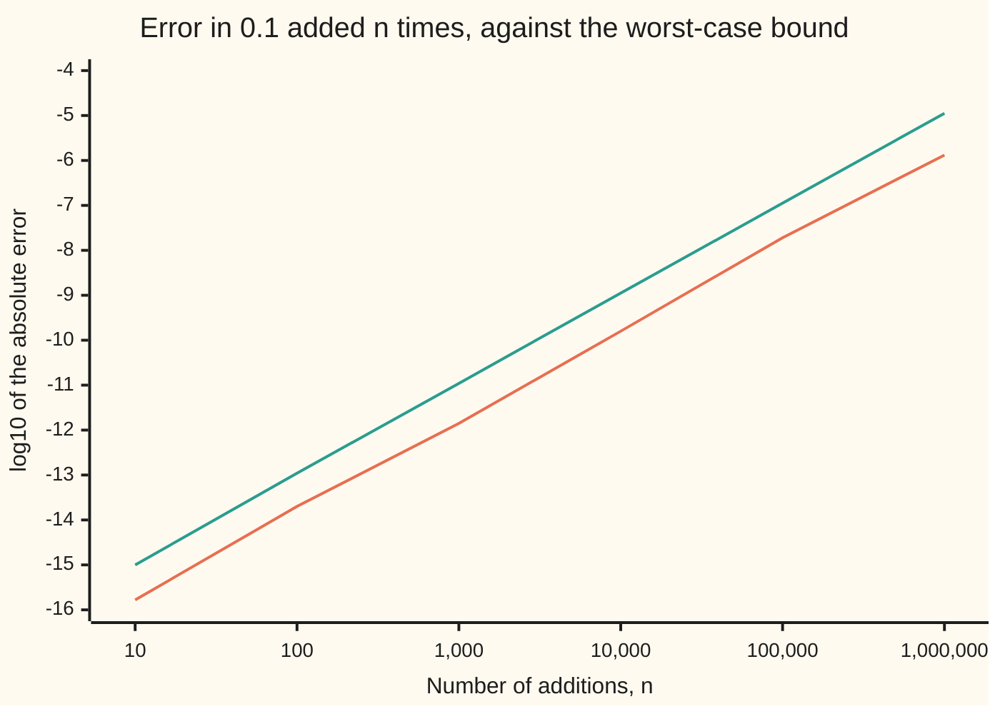

# Floating point: why 0.1 plus 0.2 is not 0.3, and what the machine does promise

[Syllabus](../../../SYLLABUS.md) → [Applied and computational](../README.md) → [Scientific Computing Practice](../README.md#s08) → Floating point

---

## General Overview

Type `0.1 + 0.2` into Python, or into almost any other language, and it prints **0.30000000000000004**. Ask whether that equals `0.3` and the answer is no. Nothing is broken. Python and Rust print the same digits on any standard machine, because both follow the same rulebook.

This library's check scripts meet that fact on every card. Each one recomputes the card's numbers in Python and in Rust, prints them, and stops on an assert (a line that halts the program if a claim is false). If an assert tested two computed numbers with `==`, a correct card could fail for the reason above. So the scripts need to know exactly what the machine gets wrong, and exactly what it never gets wrong.

Both answers come from one fact. A computer number is a whole number of 53 binary digits, scaled by a power of two. One tenth is not such a number, so the machine stores the nearest one. Then every addition or multiplication gives the exact answer to the stored inputs, rounded once to the nearest such number. The error from each step is tiny and has a known bound. It still makes the `==` test fail.

**A double stores the nearest of a fixed set of binary numbers, and every basic operation returns the exact answer rounded to the nearest one, so each result is off by at most one part in 2^53, but equality between two routes to "the same" number is never promised.**

**What kind of fact this is:** the layout and the rounding rule are a standard, IEEE 754: an agreement between engineers, not a law of nature. The error bound that follows from them is a theorem, proved on this card in Why it works.

### The picture: the 64 bits that hold 0.1

```
sign   exponent field (11 bits)   fraction field (52 bits)
 0     01111111011                1001100110011001100110011001100110011001100110011010
 +     1019, so a scale of 2^-4   1 + f/2^52 = 1.6
```

0.1 is stored as 1.6 × 2^−4. The fraction field repeats 1001 like 0.333… repeats 3, until the bits run out. The last bits, `1010`, are where the repeat was cut and rounded up.

---

## The formula

A **double** (double-precision number) is 64 bits split into three fields. It is the default type for numbers with a fractional part in Python, Rust, JavaScript and spreadsheets.

$$x = (-1)^{s} \times \left(1 + \frac{f}{2^{52}}\right) \times 2^{\,e-1023}$$

**Read it aloud:** the sign, times a number between 1 and 2 whose binary digits after the point are the fraction field, times two raised to the exponent field minus 1023.

That is [Scientific notation](../../01-Foundations/03-Powers%2C%20Roots%20and%20Logarithms/04-scientific-notation.md) in base two: a front number between 1 and 2, and a count of doublings or halvings.

The promise every basic operation keeps, for addition, subtraction, multiplication, division and square root:

$$\mathrm{fl}(a \circ b) = (a \circ b)(1 + \delta), \qquad |\delta| \le u = 2^{-53}$$

**Read it aloud:** the computed result is the exact result times one plus a tiny relative error, and that error is never bigger than u, one part in 2^53.

| Symbol | Plain meaning | In our example | Push it up and the answer… |
| --- | --- | --- | --- |
| $s$ | sign bit: 0 for plus, 1 for minus | 0 | flips the sign |
| $e$ | exponent field, 11 bits, a whole number from 1 to 2046 for ordinary numbers | 1019, so a scale of $2^{-4}$ | each step up doubles the number and doubles the gaps around it |
| $f$ | fraction field, 52 bits, read as a whole number | 2702159776422298 | the front number $1 + f/2^{52}$ creeps from 1 toward 2 |
| $E$ | the power of two at or below a number, so the number lies between $2^E$ and $2^{E+1}$ | −4 for 0.1 | gaps double with each step up |
| $m / 2^k$ | the same double as a 53-bit whole number $m$ over a power of two | 0.1 is 7205759403792794 / $2^{56}$ | — |
| $\varepsilon_{\text{mach}}$ | machine epsilon: the gap between 1 and the next double, $2^{-52}$ | 2.220e-16 | — |
| $\mathrm{ulp}(x)$ | unit in the last place: the gap from $x$ to the next double up | 5.551e-17 at 0.3 | doubles at every power of two |
| $u$ | unit roundoff: half of machine epsilon, $2^{-53}$, the most any one rounding can cost, relative | 1.110e-16 | — |
| $\mathrm{fl}(a \circ b)$ | the value the machine computes for one basic operation $\circ$ ($+$, $-$, $\times$ or $\div$) on stored numbers $a$ and $b$ | fl(0.1 + 0.2) = 0.30000000000000004 | — |
| $\delta$ | the relative error of one operation | 9.252e-17, which is 0.8333 $u$ | never past $u$ |
| $n$ | how many numbers are added in a running sum | 10 and 1,000,000 | the worst-case error grows like $n^2$ for equal terms |
| $x_i$; $S_i$, $\hat S_i$ | the terms of a sum; the exact and the computed total of the first $i$ | each $x_i$ is 0.1; $\hat S_{10}$ = 0.9999999999999999 | — |

Relative error, used throughout, is the error divided by the size of the true value: (computed − true) / true. It is what the promise controls. The absolute error (computed − true) grows with the size of the numbers.

### When it holds

- **Ordinary sizes.** The bound needs the result inside the ordinary range, which tops out at the largest double, 1.7976931348623157e308. Past the top, the result becomes `inf` (infinity): the largest double times 2 prints `inf`. Near the bottom the gaps stop shrinking, so tiny results lose relative accuracy.
- **One operation at a time.** The bound covers each step. A chain of steps can pile errors up: 0.1 added ten times is off by 1.110e-16, and Step 4 says how far that grows.
- **Round to nearest, ties to even.** This is the default mode of the standard. Hardware can be set to round up, down or toward zero; then results change, and two programs match only if both run in the same mode.
- **Real answers only.** `inf - inf` has no sensible value, so the standard returns NaN ("not a number"), which is not even equal to itself. Zero carries a sign: `-0.0 == 0.0` is true, though the stored bits differ.
- **The exact input, not the decimal you typed.** The promise is about the stored 0.1, not about one tenth. The typed decimal was already rounded once, on the way in.

---

## Why it works

### Step 0: a finite set, and one rule for leaving it

There are only 2^64 bit patterns, so most real numbers are not doubles. The standard does not try to avoid rounding. It fixes the rule: compute as if with infinite precision, then return the nearest double. Every guarantee follows from that rule and from how the doubles are spaced.

### Step 1: one tenth has no end in base two

[Decimals](../../01-Foundations/01-Everyday%20Arithmetic/08-decimals.md) shows that a fraction stops in base ten only when its bottom is built from twos and fives. A third never stops. In base two only twos are allowed. One tenth has a five in its bottom, so in binary it repeats forever: 0.000110011001100…

The machine keeps 53 significant bits and rounds the rest. The nearest double to one tenth is 7205759403792794 / 2^56, which is exactly

0.1000000000000000055511151231257827021181583404541015625.

It is 5.551e-18 too large. The code finds this number twice: from the hardware's bits, and by long division of 2^56 by 10 with its own rounding. The two agree, and they agree for 0.2 and 0.3 as well.

### Step 2: the doubles are evenly spaced between powers of two

Fix the exponent field. The fraction field then runs through 2^52 values, evenly spaced. So between 1 and 2 there are 2^52 doubles, a gap of 2^−52 apart. That gap is **machine epsilon**, 2.220e-16.

Between 2 and 4 the gap doubles; between ½ and 1 it halves. In general the gap, the ulp, is 2^−52 times the power of two at or below the number. Three values from the run:

| Where | Gap to the next double |
| --- | --- |
| 0.3 | 5.551e-17 |
| 100000 | 1.455e-11 |
| 2^53 = 9007199254740992 | 2 |

The gap grows with the number. Measured relative to the number, it stays between 2^−53 and 2^−52 everywhere in the ordinary range. That steady relative spacing is the point of floating point.

At 2^53 the gap reaches 2, so whole numbers stop being exact. 2^53 + 1 is a tie between 2^53 and 2^53 + 2; the tie goes to the even one, 2^53. In the run, 2^53 + 1 − 2^53 gives 0.

### Step 3: rounding to nearest costs at most half a gap

Take an exact answer $x$ between $2^E$ and $2^{E+1}$. The doubles there are $2^{E-52}$ apart, so the nearest one is at most half that away: $2^{E-53}$. Since $x \ge 2^E$, the relative error is at most

$$\frac{2^{E-53}}{2^E} = 2^{-53} = u.$$

That is the whole proof of the promise. It needs one more fact: the hardware really computes the exact answer before rounding. The standard requires this, and the code tests it. It draws 20,000 random sums and products from a seeded generator, works out each exact answer in whole numbers, rounds it with its own 53-bit rounding, and compares with the hardware. There are 0 disagreements. The worst relative error seen is 0.999585 $u$: close to the bound, never over it.

### Step 4: where rounding shows up

Each operation keeps the promise. Trouble comes from three habits.

**Long sums.** Every addition rounds the running total, and each rounding can cost up to $u$ times the total so far. Add $n$ numbers and the errors can pile up to about

$$(n - 1)\,u\,\sum |x_i|$$

to first order. For 0.1 added $n$ times, $\sum |x_i|$ is $n/10$, so the bound grows like $n^2$. In practice the roundings partly cancel, and the real error stays below the bound at every size:



Orange: the measured error, against the exact sum of the stored 0.1s. Green: the bound $(n-1)\,u\,(n/10)$. Each tenfold step in $n$ costs about two decades of accuracy, as the $n^2$ predicts. After a million additions the total reads 100000.00000133288, off by 1.333e-6.

**Long products.** Multiplication is gentler. Relative errors add, so $n$ multiplications cost at most about $n\,u$, whatever the sizes. The [Compound interest](../../01-Foundations/04-Compound%20Growth%20and%20Discounting/03-compound-interest.md) balance, 100 × 1.05 ten times, comes out 162.8894626777442. Its relative error is 3.59 $u$, inside the roughly 20 $u$ allowed: one rounding for storing 1.05, counted ten times over, plus ten multiplications.

**Comparisons.** Two routes to the same true number round differently, so `==` fails even when both are accurate. 0.1 + 0.2 and the stored 0.3 are one ulp apart. Subtracting two nearly equal numbers is the other trap. It keeps the inputs' absolute error but loses their size, so the relative error explodes. That is [Cancellation](02-catastrophic-cancellation-and-safe-formulas.md). The [Numerical derivatives](../../06-Calculus%20and%20analysis/03-What%20Derivatives%20Tell%20You/08-numerical-derivatives-and-sensitivity.md) card already uses machine epsilon, 2^−52, and shows this rounding swamping a difference quotient whose step is too small.

<details>
<summary>Detailed proof: the bound on a running sum</summary>

Write $S_i$ for the exact sum of the first $i$ terms and $\hat S_i$ for the computed one, with $\hat S_1 = x_1$. Each step computes $\hat S_i = (\hat S_{i-1} + x_i)(1 + \delta_i)$ with $|\delta_i| \le u$. Unroll the steps. Term $x_1$ is multiplied by $(1+\delta_2)\cdots(1+\delta_n)$, and term $x_i$ by the $n - i + 1$ factors from step $i$ on. A product of $j$ such factors lies within $j\,u + O(u^2)$ of 1, where $O(u^2)$ stands for terms about as small as $u^2$. So the computed sum is the exact sum plus a sum of terms, each at most $(n-1)\,u\,|x_i|$ to first order. Adding them gives $|\hat S_n - S_n| \le (n-1)\,u \sum |x_i| + O(u^2)$. The code checks the first-order bound at all six sizes.

</details>

---

## Worked numbers, by hand

0.1 + 0.2, done exactly as the hardware does it. Both stored inputs are written as whole numbers over a power of two, so the adding is exact. Only the last step rounds.

| Step | Arithmetic | Value |
| --- | --- | --- |
| 0.1, stored | 7205759403792794 / 2^56 | 0.1000000000000000055511151231257827021181583404541015625 |
| 0.2, stored | 7205759403792794 / 2^55, which is 14411518807585588 / 2^56 | 0.200000000000000011102230246251565404236316680908203125 |
| exact sum | (7205759403792794 + 14411518807585588) / 2^56 | 21617278211378382 / 2^56 = 0.3000000000000000166533453693773481063544750213623046875 |
| too many bits | 21617278211378382 needs 55 bits; drop 2 | 21617278211378382 = 4 × 5404319552844595 + 2 |
| the dropped part | 2 out of 4 | exactly half: a tie |
| tie to even | 5404319552844595 is odd, so round up | 5404319552844596 / 2^54 |
| stored 0.3, for comparison | the nearest double to 3/10 | 5404319552844595 / 2^54 |
| **the result** | one step above stored 0.3 | **0.3000000000000000444089209850062616169452667236328125** |
| relative error of the add | (result − exact sum) / exact sum | 9.252e-17, which is 0.8333 $u$ |

Python prints the shortest decimal that reads back to the same double. "0.3" already names the double below, so the sum needs 17 digits: 0.30000000000000004.

The add kept its promise: 0.8333 $u$ is under $u$. The `==` test failed anyway. Rounding 0.1 and 0.2 on the way in left their exact sum exactly halfway between two doubles, and the tie rule sent it up.

### What breaks if you drop a piece

| Mistake | Comes out at | What went wrong |
| --- | --- | --- |
| Test `0.1 + 0.2 == 0.3` | no: 0.30000000000000004 against 0.299999999999999988897769753748434595763683319091796875 | Two routes rounded to neighbouring doubles, one ulp apart |
| Add 0.1 ten times and test `== 1.0` | no: 0.9999999999999999, off −1.110e-16 | Nine roundings of a running total; the stored 0.1 was never one tenth |
| Count past 2^53 in doubles | 2^53 + 1 − 2^53 = 0 | Above 9007199254740992 the gap is 2, so adding 1 is a tie, and the tie goes back down |
| Read machine epsilon as "the smallest number" | `1 + 1e-17 == 1` is yes, but `1e-17 == 0` is no | Epsilon is a gap relative to 1, not a floor; tiny numbers are stored fine on their own |

---

## Code, from first principles, and it actually runs

The scripts take each double apart into its 64 bits, rebuild its exact value as a whole number over a power of two, and redo the machine's arithmetic in whole numbers, which cannot round. Four independent roads meet. The stored bits of 0.1, 0.2 and 0.3 are checked against long division in base two. The hardware's 0.1 + 0.2 is checked against the scripts' own ties-to-even rounding of the exact sum. Machine epsilon from the layout is checked against a halving loop. Finally, 20,000 seeded random sums and products are each checked against exact rounding. The summation errors are checked against their bound at six sizes.

### Python

```python
# Floating point in practice -- the check behind the card.  Standard library only.
# Every number on the card is printed here.  struct only hands over the 64 stored
# bits; every exact value is then worked out in whole numbers, which cannot round,
# and the machine's answers are checked against them.
import math, struct

U = 2.0 ** -53                                    # unit roundoff: half of machine epsilon

def bits(x):      return struct.unpack(">Q", struct.pack(">d", x))[0]
def from_bits(b): return struct.unpack(">d", struct.pack(">Q", b))[0]

def exact(x):     # a positive normal double as whole numbers: x = m / 2^k, m has 53 bits
    b = bits(x)
    return (1 << 52) + (b & ((1 << 52) - 1)), 52 - (((b >> 52) & 0x7FF) - 1023)

def round53(m, k):  # round m / 2^k to 53 significant bits, ties to the even neighbour
    drop = max(m.bit_length() - 53, 0)
    q, r, half = m >> drop, m & ((1 << drop) - 1), (1 << drop) >> 1
    if r > half or (drop > 0 and r == half and q & 1):
        q += 1
    if q >> 53:
        q, drop = q >> 1, drop + 1
    return q, k - drop

def nearest(p, q):  # the double nearest p/q, by long division in base two
    k = 0
    while (p << k) // q < (1 << 52): k += 1
    m, r = divmod(p << k, q)
    if 2 * r > q or (2 * r == q and m & 1): m += 1
    return m, k

def decimal(m, k):  # exact decimal expansion of m / 2^k: it always ends
    mask, out, r = (1 << k) - 1, "", m & ((1 << k) - 1)
    while r:
        r *= 10; out += str(r >> k); r &= mask
    return f"{m >> k}." + (out or "0")

def sci(x):
    a, b = f"{x:.3e}".split("e"); return f"{a}e{int(b)}"
def yn(flag): return "yes" if flag else "no"
def row(label, value): print(f"{label:<34} {value}")

# ---- 1. reading the 64 bits of 0.1 ----
b = bits(0.1)
s = f"{b:064b}"
row("0.1 as 64 bits", f"{s[0]} {s[1:12]} {s[12:]}")
row("sign, exponent field, fraction", f"{b >> 63} {(b >> 52) & 0x7FF} {b & ((1 << 52) - 1)}")
row("1 + f/2^52, and e - 1023", f"{1 + (b & ((1 << 52) - 1)) / 2**52!r} {((b >> 52) & 0x7FF) - 1023}")
for name, x, p in (("0.1", 0.1, 1), ("0.2", 0.2, 2), ("0.3", 0.3, 3)):
    assert exact(x) == nearest(p, 10), name + ": stored bits must be the nearest double to p/10"
    row(f"{name} stored exactly", decimal(*exact(x)))
m1, k1 = exact(0.1)
row("0.1 as a whole number over 2^k", f"{m1} / 2^{k1}")
row("0.3 as a whole number over 2^k", "{} / 2^{}".format(*exact(0.3)))
row("0.1 stored minus 1/10", sci((m1 * 10 - (1 << k1)) / (10 * (1 << k1))))

# ---- 2. the sum, rounded by hand and by the machine ----
m2, k2 = exact(0.2)
exact_sum = m1 + (m2 << (k1 - k2))                # both over 2^56, no rounding
rm, rk = round53(exact_sum, k1)
total = 0.1 + 0.2
assert (rm, rk) == exact(total), "own rounding must match the machine's sum"
assert bits(total) == bits(0.3) + 1, "the sum lands one step above stored 0.3"
assert exact_sum & 3 == 2, "the two dropped bits must be exactly half: a tie"
row("exact sum of the stored inputs", decimal(exact_sum, k1))
row("sum over 2^56; 53 bits over 2^54", f"{exact_sum}; {exact_sum >> 2} -> {rm}")
row("bits dropped to fit 53, out of", f"{exact_sum & 3} of 4: a tie, so round to even")
row("machine sum 0.1 + 0.2", f"{total!r} = {decimal(rm, rk)}")
row("gap to stored 0.3, in ulps", bits(total) - bits(0.3))
rel = (rm * 4 - exact_sum) / exact_sum            # (rounded - exact) / exact, both over 2^56
row("relative error of the add", f"{sci(rel)} = {rel / U:.4f} u")
row("0.1 + 0.2 == 0.3", yn(total == 0.3))

# ---- 3. machine epsilon: from the layout and by halving ----
eps_layout = from_bits(bits(1.0) + 1) - 1.0
eps = 1.0
while 1.0 + eps / 2 != 1.0: eps /= 2
assert eps == eps_layout == 2.0 ** -52, "halving loop must stop at the layout's gap"
row("next double after 1, minus 1", sci(eps_layout))
row("halving loop stops at", sci(eps))
row("unit roundoff u = eps/2", sci(U))
for name, x in (("0.3", 0.3), ("1", 1.0), ("100000", 1e5), ("2^53", 2.0 ** 53)):
    row(f"ulp at {name}", sci(from_bits(bits(x) + 1) - x))
big = 2.0 ** 53
row("2^53, and 2^53 + 1 - 2^53", f"{big:.0f} {big + 1.0 - big:.0f}")
assert big + 1.0 == big and big - 1.0 + 1.0 == big, "the 1 vanishes above 2^53 only"

# ---- 4. the promise, tested: 20,000 random sums and products ----
state, MASK = 2026, 2**64 - 1
def splitmix():
    global state
    state = (state + 0x9E3779B97F4A7C15) & MASK
    z = ((state ^ (state >> 30)) * 0xBF58476D1CE4E5B9) & MASK
    z = ((z ^ (z >> 27)) * 0x94D049BB133111EB) & MASK
    return z ^ (z >> 31)
bad, worst = 0, 0.0
for _ in range(10000):                            # exponent fields 1013..1033: 2^-10 up to 2^11
    x, y = (from_bits(((1013 + splitmix() % 21) << 52) | (splitmix() >> 12)) for _ in "xy")
    (mx, kx), (my, ky) = exact(x), exact(y)
    kk = max(kx, ky)
    for m, k, got in ((mx << (kk - kx)) + (my << (kk - ky)), kk, x + y), (mx * my, kx + ky, x * y):
        rm, rk = round53(m, k)
        bad += (rm, rk) != exact(got)
        worst = max(worst, abs((rm << (k - rk)) - m) / m / U)
row("random sums and products checked", 20000)
row("disagreements with own rounding", bad)
row("worst relative error, in u", f"{worst:.6f}")
assert bad == 0 and worst <= 1.0, "every operation must be the exact answer, rounded once"

# ---- 5. where it shows up: 0.1 added n times, 100 times 1.05 ten times ----
acc, n = 0.0, 0
for target in (10, 100, 1000, 10000, 100000, 1000000):
    while n < target: acc += 0.1; n += 1
    ma, ka = exact(acc)
    err = abs((ma << (k1 - ka)) - n * m1) / 2 ** k1  # against the exact sum of n stored 0.1s
    bound = (n - 1) * U * n * 0.1                  # worst case, to first order in u
    assert 0 < err <= bound, "the sum's error must stay under the worst-case bound"
    if n == 10: ten = acc
    if n in (10, 1000000): row(f"0.1 added {n} times", f"{acc!r}, off {sci(acc - n / 10)}")
    row(f"chart n={n}: log10 err, bound", f"{math.log10(err):.2f} {math.log10(bound):.2f}")
x = 100.0
for _ in range(10): x *= 1.05
mx, kx = exact(x)
N = 162889462677744140625                         # 100 * 1.05^10, exactly, over 10^18
rel_p = abs(mx * 10**18 - N * 2**kx) / (N * 2**kx)
row("100 * 1.05, ten times", f"{x!r}, rel. error {rel_p / U:.2f} u")
assert rel_p <= 20 * U, "a stored 1.05 and ten roundings: at most about 20 u"

# ---- 6. what breaks, and the special values ----
row("0.1 added ten times == 1.0", yn(ten == 1.0))
row("1 + 1e-17 == 1, 1e-17 == 0", f"{yn(1.0 + 1e-17 == 1.0)} {yn(1e-17 == 0.0)}")
top = from_bits(0x7FEFFFFFFFFFFFFF)
inf = top * 2
row("largest double", f"{top:.16e}".replace("e+", "e"))
row("largest * 2; is inf - inf itself", f"{inf} {yn(inf - inf == inf - inf)}")
row("-0.0 == 0.0; same bits", f"{yn(-0.0 == 0.0)} {yn(bits(-0.0) == bits(0.0))}")
print("ALL CHECKS PASS")
```

**Ran 2026-11-11 on macOS, Python 3.14.10, standard library only. All checks passed. Output, pasted from the run:**

```
0.1 as 64 bits                     0 01111111011 1001100110011001100110011001100110011001100110011010
sign, exponent field, fraction     0 1019 2702159776422298
1 + f/2^52, and e - 1023           1.6 -4
0.1 stored exactly                 0.1000000000000000055511151231257827021181583404541015625
0.2 stored exactly                 0.200000000000000011102230246251565404236316680908203125
0.3 stored exactly                 0.299999999999999988897769753748434595763683319091796875
0.1 as a whole number over 2^k     7205759403792794 / 2^56
0.3 as a whole number over 2^k     5404319552844595 / 2^54
0.1 stored minus 1/10              5.551e-18
exact sum of the stored inputs     0.3000000000000000166533453693773481063544750213623046875
sum over 2^56; 53 bits over 2^54   21617278211378382; 5404319552844595 -> 5404319552844596
bits dropped to fit 53, out of     2 of 4: a tie, so round to even
machine sum 0.1 + 0.2              0.30000000000000004 = 0.3000000000000000444089209850062616169452667236328125
gap to stored 0.3, in ulps         1
relative error of the add          9.252e-17 = 0.8333 u
0.1 + 0.2 == 0.3                   no
next double after 1, minus 1       2.220e-16
halving loop stops at              2.220e-16
unit roundoff u = eps/2            1.110e-16
ulp at 0.3                         5.551e-17
ulp at 1                           2.220e-16
ulp at 100000                      1.455e-11
ulp at 2^53                        2.000e0
2^53, and 2^53 + 1 - 2^53          9007199254740992 0
random sums and products checked   20000
disagreements with own rounding    0
worst relative error, in u         0.999585
0.1 added 10 times                 0.9999999999999999, off -1.110e-16
chart n=10: log10 err, bound       -15.78 -15.00
chart n=100: log10 err, bound      -13.70 -12.96
chart n=1000: log10 err, bound     -11.85 -10.96
chart n=10000: log10 err, bound    -9.80 -8.95
chart n=100000: log10 err, bound   -7.72 -6.95
0.1 added 1000000 times            100000.00000133288, off 1.333e-6
chart n=1000000: log10 err, bound  -5.88 -4.95
100 * 1.05, ten times              162.8894626777442, rel. error 3.59 u
0.1 added ten times == 1.0         no
1 + 1e-17 == 1, 1e-17 == 0         yes no
largest double                     1.7976931348623157e308
largest * 2; is inf - inf itself   inf no
-0.0 == 0.0; same bits             yes no
ALL CHECKS PASS
```

### Rust

Same roads, same labels. Rust has no big whole numbers, so the exact values live in `u128`, which is wide enough for every product of two 53-bit numbers.

```rust
// Floating point in practice -- the same check as floating_point_in_practice_check.py, in Rust.
// Standard library only, no crates.  to_bits only hands over the 64 stored bits;
// every exact value is then worked out in whole numbers (u128), which cannot round,
// and the machine's answers are checked against them.
// Compile: rustc --edition 2021 -O floating_point_in_practice_check.rs -o /tmp/fp_check
const U: f64 = 1.0 / 9007199254740992.0;          // unit roundoff 2^-53: half of machine epsilon

fn exact(x: f64) -> (u128, i32) {                 // a positive normal double: x = m / 2^k, m has 53 bits
    let b = x.to_bits();
    (((1u64 << 52) + (b & ((1u64 << 52) - 1))) as u128, 52 - (((b >> 52) & 0x7FF) as i32 - 1023))
}

fn round53(m: u128, k: i32) -> (u128, i32) {      // round m / 2^k to 53 significant bits, ties to even
    let mut drop = (128 - m.leading_zeros() as i32 - 53).max(0);
    let (mut q, r, half) = (m >> drop, m & ((1u128 << drop) - 1), (1u128 << drop) >> 1);
    if r > half || (drop > 0 && r == half && q & 1 == 1) { q += 1; }
    if q >> 53 != 0 { q >>= 1; drop += 1; }
    (q, k - drop)
}

fn nearest(p: u128, q: u128) -> (u128, i32) {     // the double nearest p/q, by long division in base two
    let mut k = 0;
    while (p << k) / q < (1u128 << 52) { k += 1; }
    let (mut m, r) = ((p << k) / q, (p << k) % q);
    if 2 * r > q || (2 * r == q && m & 1 == 1) { m += 1; }
    (m, k)
}

fn decimal(m: u128, k: i32) -> String {           // exact decimal expansion of m / 2^k: it always ends
    let mask = (1u128 << k) - 1;
    let (mut r, mut out) = (m & mask, String::new());
    while r != 0 { r *= 10; out.push_str(&(r >> k).to_string()); r &= mask; }
    format!("{}.{}", m >> k, if out.is_empty() { "0".to_string() } else { out })
}

fn sci(x: f64) -> String { format!("{:.3e}", x) }
fn yn(flag: bool) -> &'static str { if flag { "yes" } else { "no" } }
fn row(label: &str, value: String) { println!("{:<34} {}", label, value); }

struct SplitMix(u64);
impl SplitMix {
    fn next(&mut self) -> u64 {
        self.0 = self.0.wrapping_add(0x9E3779B97F4A7C15);
        let mut z = (self.0 ^ (self.0 >> 30)).wrapping_mul(0xBF58476D1CE4E5B9);
        z = (z ^ (z >> 27)).wrapping_mul(0x94D049BB133111EB);
        z ^ (z >> 31)
    }
}

fn main() {
    // ---- 1. reading the 64 bits of 0.1 ----
    let b = 0.1f64.to_bits();
    let s = format!("{:064b}", b);
    row("0.1 as 64 bits", format!("{} {} {}", &s[0..1], &s[1..12], &s[12..]));
    row("sign, exponent field, fraction", format!("{} {} {}", b >> 63, (b >> 52) & 0x7FF, b & ((1u64 << 52) - 1)));
    row("1 + f/2^52, and e - 1023", format!("{} {}", 1.0 + (b & ((1u64 << 52) - 1)) as f64 / (1u64 << 52) as f64,
        ((b >> 52) & 0x7FF) as i32 - 1023));
    for (name, x, p) in [("0.1", 0.1f64, 1u128), ("0.2", 0.2, 2), ("0.3", 0.3, 3)] {
        assert!(exact(x) == nearest(p, 10), "{}: stored bits must be the nearest double to p/10", name);
        let (m, k) = exact(x);
        row(&format!("{} stored exactly", name), decimal(m, k));
    }
    let (m1, k1) = exact(0.1);
    row("0.1 as a whole number over 2^k", format!("{} / 2^{}", m1, k1));
    row("0.3 as a whole number over 2^k", format!("{} / 2^{}", exact(0.3).0, exact(0.3).1));
    row("0.1 stored minus 1/10", sci((m1 * 10 - (1u128 << k1)) as f64 / (10u128 << k1) as f64));

    // ---- 2. the sum, rounded by hand and by the machine ----
    let (m2, k2) = exact(0.2);
    let exact_sum = m1 + (m2 << (k1 - k2));       // both over 2^56, no rounding
    let (rm, rk) = round53(exact_sum, k1);
    let total = 0.1f64 + 0.2;
    assert!((rm, rk) == exact(total), "own rounding must match the machine's sum");
    assert!(total.to_bits() == 0.3f64.to_bits() + 1, "the sum lands one step above stored 0.3");
    assert!(exact_sum & 3 == 2, "the two dropped bits must be exactly half: a tie");
    row("exact sum of the stored inputs", decimal(exact_sum, k1));
    row("sum over 2^56; 53 bits over 2^54", format!("{}; {} -> {}", exact_sum, exact_sum >> 2, rm));
    row("bits dropped to fit 53, out of", format!("{} of 4: a tie, so round to even", exact_sum & 3));
    row("machine sum 0.1 + 0.2", format!("{} = {}", total, decimal(rm, rk)));
    row("gap to stored 0.3, in ulps", format!("{}", total.to_bits() - 0.3f64.to_bits()));
    let rel = (rm * 4 - exact_sum) as f64 / exact_sum as f64;
    row("relative error of the add", format!("{} = {:.4} u", sci(rel), rel / U));
    row("0.1 + 0.2 == 0.3", yn(total == 0.3).to_string());

    // ---- 3. machine epsilon: from the layout and by halving ----
    let eps_layout = f64::from_bits(1.0f64.to_bits() + 1) - 1.0;
    let mut eps = 1.0f64;
    while 1.0 + eps / 2.0 != 1.0 { eps /= 2.0; }
    assert!(eps == eps_layout && eps == 2.0 * U, "halving loop must stop at the layout's gap");
    row("next double after 1, minus 1", sci(eps_layout));
    row("halving loop stops at", sci(eps));
    row("unit roundoff u = eps/2", sci(U));
    let big = 9007199254740992.0f64;              // 2^53
    for (name, x) in [("0.3", 0.3f64), ("1", 1.0), ("100000", 1e5), ("2^53", big)] {
        row(&format!("ulp at {}", name), sci(f64::from_bits(x.to_bits() + 1) - x));
    }
    row("2^53, and 2^53 + 1 - 2^53", format!("{:.0} {:.0}", big, big + 1.0 - big));
    assert!(big + 1.0 == big && big - 1.0 + 1.0 == big, "the 1 vanishes above 2^53 only");

    // ---- 4. the promise, tested: 20,000 random sums and products ----
    let mut g = SplitMix(2026);
    let (mut bad, mut worst) = (0, 0.0f64);
    for _ in 0..10000 {                           // exponent fields 1013..1033: 2^-10 up to 2^11
        let x = f64::from_bits(((1013 + g.next() % 21) << 52) | (g.next() >> 12));
        let y = f64::from_bits(((1013 + g.next() % 21) << 52) | (g.next() >> 12));
        let ((mx, kx), (my, ky)) = (exact(x), exact(y));
        let kk = kx.max(ky);
        for (m, k, got) in [((mx << (kk - kx)) + (my << (kk - ky)), kk, x + y), (mx * my, kx + ky, x * y)] {
            let (rm, rk) = round53(m, k);
            if (rm, rk) != exact(got) { bad += 1; }
            let diff = ((rm << (k - rk)) as i128 - m as i128).unsigned_abs();
            worst = worst.max(diff as f64 / m as f64 / U);
        }
    }
    row("random sums and products checked", "20000".to_string());
    row("disagreements with own rounding", format!("{}", bad));
    row("worst relative error, in u", format!("{:.6}", worst));
    assert!(bad == 0 && worst <= 1.0, "every operation must be the exact answer, rounded once");

    // ---- 5. where it shows up: 0.1 added n times, 100 times 1.05 ten times ----
    let (mut acc, mut n, mut ten) = (0.0f64, 0u64, 0.0f64);
    for target in [10u64, 100, 1000, 10000, 100000, 1000000] {
        while n < target { acc += 0.1; n += 1; }
        let (ma, ka) = exact(acc);
        let diff = ((ma << (k1 - ka)) as i128 - (n as u128 * m1) as i128).unsigned_abs();
        let err = diff as f64 / (1u128 << k1) as f64;   // against the exact sum of n stored 0.1s
        let bound = (n - 1) as f64 * U * n as f64 * 0.1; // worst case, to first order in u
        assert!(0.0 < err && err <= bound, "the sum's error must stay under the worst-case bound");
        if n == 10 { ten = acc; }
        if n == 10 || n == 1000000 {
            row(&format!("0.1 added {} times", n), format!("{}, off {}", acc, sci(acc - n as f64 / 10.0)));
        }
        row(&format!("chart n={}: log10 err, bound", n), format!("{:.2} {:.2}", err.log10(), bound.log10()));
    }
    let mut x = 100.0f64;
    for _ in 0..10 { x *= 1.05; }
    let (mx, kx) = exact(x);
    let big_n: i128 = 162889462677744140625;      // 100 * 1.05^10, exactly, over 10^18
    let num = (mx as i128 * 1_000_000_000_000_000_000 - (big_n << kx)).unsigned_abs();
    let rel_p = num as f64 / (big_n << kx) as f64;
    row("100 * 1.05, ten times", format!("{}, rel. error {:.2} u", x, rel_p / U));
    assert!(rel_p <= 20.0 * U, "a stored 1.05 and ten roundings: at most about 20 u");

    // ---- 6. what breaks, and the special values ----
    row("0.1 added ten times == 1.0", yn(ten == 1.0).to_string());
    row("1 + 1e-17 == 1, 1e-17 == 0", format!("{} {}", yn(1.0 + 1e-17 == 1.0), yn(1e-17 == 0.0)));
    let top = f64::from_bits(0x7FEFFFFFFFFFFFFF);
    let inf = top * 2.0;
    row("largest double", format!("{:.16e}", top));
    row("largest * 2; is inf - inf itself", format!("{} {}", inf, yn(inf - inf == inf - inf)));
    row("-0.0 == 0.0; same bits", format!("{} {}", yn(-0.0 == 0.0f64), yn((-0.0f64).to_bits() == 0.0f64.to_bits())));
    println!("ALL CHECKS PASS");
}
```

**Ran 2026-11-11 on macOS, rustc 1.98.1, no crates. All checks passed. Output, pasted from the run:**

```
0.1 as 64 bits                     0 01111111011 1001100110011001100110011001100110011001100110011010
sign, exponent field, fraction     0 1019 2702159776422298
1 + f/2^52, and e - 1023           1.6 -4
0.1 stored exactly                 0.1000000000000000055511151231257827021181583404541015625
0.2 stored exactly                 0.200000000000000011102230246251565404236316680908203125
0.3 stored exactly                 0.299999999999999988897769753748434595763683319091796875
0.1 as a whole number over 2^k     7205759403792794 / 2^56
0.3 as a whole number over 2^k     5404319552844595 / 2^54
0.1 stored minus 1/10              5.551e-18
exact sum of the stored inputs     0.3000000000000000166533453693773481063544750213623046875
sum over 2^56; 53 bits over 2^54   21617278211378382; 5404319552844595 -> 5404319552844596
bits dropped to fit 53, out of     2 of 4: a tie, so round to even
machine sum 0.1 + 0.2              0.30000000000000004 = 0.3000000000000000444089209850062616169452667236328125
gap to stored 0.3, in ulps         1
relative error of the add          9.252e-17 = 0.8333 u
0.1 + 0.2 == 0.3                   no
next double after 1, minus 1       2.220e-16
halving loop stops at              2.220e-16
unit roundoff u = eps/2            1.110e-16
ulp at 0.3                         5.551e-17
ulp at 1                           2.220e-16
ulp at 100000                      1.455e-11
ulp at 2^53                        2.000e0
2^53, and 2^53 + 1 - 2^53          9007199254740992 0
random sums and products checked   20000
disagreements with own rounding    0
worst relative error, in u         0.999585
0.1 added 10 times                 0.9999999999999999, off -1.110e-16
chart n=10: log10 err, bound       -15.78 -15.00
chart n=100: log10 err, bound      -13.70 -12.96
chart n=1000: log10 err, bound     -11.85 -10.96
chart n=10000: log10 err, bound    -9.80 -8.95
chart n=100000: log10 err, bound   -7.72 -6.95
0.1 added 1000000 times            100000.00000133288, off 1.333e-6
chart n=1000000: log10 err, bound  -5.88 -4.95
100 * 1.05, ten times              162.8894626777442, rel. error 3.59 u
0.1 added ten times == 1.0         no
1 + 1e-17 == 1, 1e-17 == 0         yes no
largest double                     1.7976931348623157e308
largest * 2; is inf - inf itself   inf no
-0.0 == 0.0; same bits             yes no
ALL CHECKS PASS
```

The two outputs are identical, down to the last digit of the random test. That is the standard at work: two languages, one rounding rule.

> [!TIP]
> **Try changing**
> Guess first, then run it. Each change breaks one claim on this card, and an assert should stop the script.
> - **Guess first:** what if rounding chopped the extra bits instead of rounding to nearest? In `round53`, replace the `if r > half …` test with `if False:`. Answer: the hand-rounded 0.1 + 0.2 becomes 5404319552844595 / 2^54, exactly stored 0.3. Chopping would have made this one sum "right". The machine does not chop, so the assert "own rounding must match the machine's sum" stops it.
> - **Guess first:** do ties matter, or are they too rare to notice? Delete `and q & 1` so that every tie rounds up. Answer: 0.1 + 0.2 is unchanged, because rounding up and rounding to even agree there. But among 20,000 random operations, some ties should have stayed on an even neighbour below, and the random-test assert stops it.
> - **Guess first:** does the sum bound need the size of the numbers? Change `n * 0.1` in the bound to `0.1`. Answer: at 10 additions the bound falls below the measured error, and the bound assert stops it. The bound is relative to the total, not to one term.
> - **Guess first:** is 2^52 already past the exact whole numbers? Change `big = 2.0 ** 53` to `big = 2.0 ** 52`. Answer: no. At 2^52 the gap is 1, so adding 1 is exact, and the assert "the 1 vanishes above 2^53 only" stops it.

---

## The usual mistake

> [!warning]
> **Treating rounding error as a bug that a better machine would fix.** It is the design. Every result is rounded to one of a fixed set of numbers, and the machine promises the nearest one, off by at most one part in 2^53. It never promises that two different routes reach the same double. So the fix is never "more care with `==`". Compare computed numbers with a tolerance sized to the work done: [Tolerances](05-tolerances-and-comparing-computed-numbers.md).
>
> - **Blaming the printout.** 0.30000000000000004 is not a display glitch. The stored sum is 0.3000000000000000444…, one ulp above the stored 0.3.
> - **Using machine epsilon as an absolute tolerance.** 2.220e-16 is a gap near 1. Near 100000 the gap is 1.455e-11, so `abs(a - b) < 2.2e-16` there means "exactly equal".
> - **Storing money in doubles.** Ten payments of £0.10, stored as 0.1, add to 0.9999999999999999. Keep whole pence, as the [Decimals](../../01-Foundations/01-Everyday%20Arithmetic/08-decimals.md) card's pump keeps whole cents.
> - **Counting in doubles past 2^53.** A counter at 9007199254740992 stops moving when you add 1.

---

## Where you meet it in real life

- **This library's check scripts.** Each card's Python and Rust outputs match line for line because both follow the same round-to-nearest-even rule. An assert that compares two routes to one value uses a tolerance. It uses `==` only where the rounding rule makes the answer exact, as in this card's bit-level checks. How the scripts are built is [The check script](07-writing-a-check-script.md). Why a test needs two roads is [Two roads and a mutation](06-testing-numerical-code-two-roads-and-mutations.md).
- **Spreadsheets.** A column of prices that should total 0 can show a tiny remainder, a few units of $u$ times the size of the totals. That is the long-sum error above, not a formula bug.
- **JavaScript and JSON.** Every JavaScript number is a double. A database ID above 2^53 can come back changed by one, because the ID landed in a gap.
- **Games and maps.** Positions far from the origin sit where the ulp is large. Objects there jitter, because their coordinates can only move in coarse steps.

> **Say it back**
> A double is 53 binary digits times a power of two, so most decimals, one tenth among them, are stored as the nearest such number. Every basic operation returns the exact answer to its stored inputs, rounded once to the nearest double, so its relative error is at most u = 2^−53. Machine epsilon, 2^−52, is the gap just above 1; the gap grows with the number, which is why whole numbers stop being exact at 2^53. Errors pile up in long sums, stay mild in products, and break `==` between two routes to the same value. 0.1 + 0.2 lands one step above the stored 0.3 because the exact sum sat on a tie and the tie went to even.

---

## What this builds on

- [Decimals](../../01-Foundations/01-Everyday%20Arithmetic/08-decimals.md): why a fraction ends only when its bottom is built from the base's factors. In base two that rules out one tenth.
- [Scientific notation](../../01-Foundations/03-Powers%2C%20Roots%20and%20Logarithms/04-scientific-notation.md): a front number times a power of the base. A double is the same thing in base two.
- [Numerical derivatives](../../06-Calculus%20and%20analysis/03-What%20Derivatives%20Tell%20You/08-numerical-derivatives-and-sensitivity.md): machine epsilon at work, with rounding swamping a difference quotient whose step is too small.

## Where this goes next

- [Cancellation](02-catastrophic-cancellation-and-safe-formulas.md): subtracting nearly equal numbers, the one place a single operation loses most of its digits, and the rewrites that avoid it.
- [Cost in practice](04-computational-cost-and-vectorisation.md): counting operations. Arrays may add in a different order from a loop, so their sums differ in the last bits.
- [Tolerances](05-tolerances-and-comparing-computed-numbers.md): how to compare two computed numbers, with a tolerance sized by the error bounds on this card.
- [IEEE 754](../../16-Numerical%20analysis/01-Floating%20Point%20and%20Error/02-ieee-floating-point.md): the full standard, with subnormal numbers, the other rounding modes and exceptions.
- [Machine epsilon and cancellation](../../16-Numerical%20analysis/01-Floating%20Point%20and%20Error/03-rounding-cancellation-and-machine-epsilon.md): the error analysis of whole algorithms, built on the one-operation promise.

The promise covers one operation; how far a whole calculation can drift depends on the order of its steps, which is the question the error analysis of algorithms takes up.

---

## Sources

Verified 2026-11-11: every link below resolves to the publisher's page.

- *IEEE Standard for Floating-Point Arithmetic*, IEEE Std 754-2019. [doi:10.1109/IEEESTD.2019.8766229](https://doi.org/10.1109/IEEESTD.2019.8766229). The standard itself: the 64-bit layout, round to nearest with ties to even, infinities, NaN and signed zero.
- Goldberg, David. "What Every Computer Scientist Should Know About Floating-Point Arithmetic." *ACM Computing Surveys* 23, no. 1 (1991). [doi:10.1145/103162.103163](https://doi.org/10.1145/103162.103163). Machine epsilon, ulps and the one-operation promise, explained for programmers.
- Higham, Nicholas J. *Accuracy and Stability of Numerical Algorithms*, 2nd ed. SIAM, 2002. [doi:10.1137/1.9780898718027](https://doi.org/10.1137/1.9780898718027). The model fl(a ∘ b) = (a ∘ b)(1 + δ) and the summation bound in Step 4.
- Steele, Guy L., and Jon L. White. "How to Print Floating-Point Numbers Accurately." *Proceedings of the ACM SIGPLAN 1990 Conference on Programming Language Design and Implementation* (1990). [doi:10.1145/93542.93559](https://doi.org/10.1145/93542.93559). Why the printout is the shortest decimal that reads back to the same double: 0.30000000000000004.
- Muller, Jean-Michel, and others. *Handbook of Floating-Point Arithmetic*, 2nd ed. Birkhäuser, 2018. [doi:10.1007/978-3-319-76526-6](https://doi.org/10.1007/978-3-319-76526-6). Exact rounding, ties to even and the exactness of whole numbers up to 2^53.
