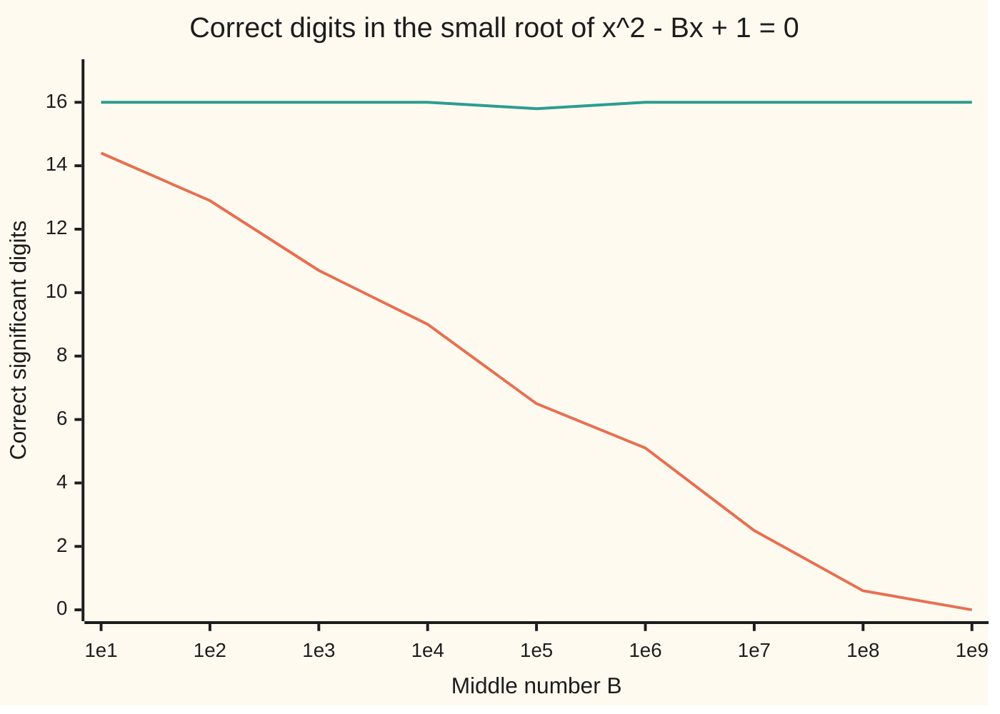

# Cancellation: subtracting near-equal numbers, and the rewrite that saves the digits

[Syllabus](../../../SYLLABUS.md) → [Applied and computational](../README.md) → [Scientific Computing Practice](../README.md#s08) → Cancellation

---

## General Overview

A check script on this library has to solve one equation: x² − 100000000x + 1 = 0. It has two answers. One is close to 100,000,000. The other is tiny, close to 0.00000001, one hundred-millionth.

The school formula, typed in as written, returns the big answer to full accuracy. For the small one it returns 0.000000007450580596923828. The true value is 0.00000001. The computer printed sixteen confident digits and the answer is a quarter too small. Nothing crashed and nothing warned.

The fault is one subtraction. Inside the formula, 100,000,000 has a number almost equal to it taken away: a square root. 100,000,000 is exact, but the square root carries a tiny rounding error, invisible beside its size. The subtraction removes the shared leading digits and leaves only the part where they differ, and that part is mostly the error. This is called **cancellation**. The cure is not more digits. It is a rewrite of the formula that never subtracts two nearly equal numbers. One such rewrite returns 0.00000001, right to all sixteen digits.

The same trap sits in the textbook variance formula, and a cousin of it in a long running total. This card gives a safe rewrite for each and checks it against a road that shares none of its arithmetic.

**Subtracting two nearly equal numbers is exact, but it throws away the digits they share and promotes their rounding errors to the front; the fix is to rewrite the formula so the subtraction never happens.**

**What kind of fact this is:** a theorem about how relative errors grow under subtraction, proved on this card in Why it works, plus three safe rewrites, each checked by the code; the quadratic and Welford rewrites are proved there, and Kahan's error bound is quoted from a named source.

### The picture: correct digits as the middle number grows

Each point solves x² − Bx + 1 = 0 for a middle number B = 10, 100, and so on up to a billion. The height is how many significant digits of the small answer are right, out of about 16, measured against the exact small root.



Orange: the school formula. It loses about two digits each time B grows tenfold, and at B = 1e9 (a billion) it has none left. Green: the safe rewrite from this card, flat at full accuracy all the way. A score of 16.0 means the nearest stored number to the true root; the one dip, 15.8 at B = 1e5, is one step away from it.

---

## The formula

Three pieces. First, the measure of how badly a subtraction can go. Write $u$ and $v$ for the two numbers being subtracted. (Here $u$ is a number; the unit roundoff that [Floating point](01-floating-point-in-practice.md) calls $u$ is written $\varepsilon/2$ on this card.)

$$\kappa = \frac{|u| + |v|}{|u - v|}, \qquad \text{relative error of } u - v \;\le\; \kappa \times \text{relative error of the inputs}$$

**Read it aloud:** kappa is the size of the two numbers over the size of their difference, and the subtraction multiplies the inputs' relative error by up to kappa.

Kappa, written $\kappa$, is the **condition number** of the subtraction: how much it magnifies errors already in its inputs. A relative error is an error divided by the size of the true value.

Second, the safe quadratic. For $ax^2 + bx + c = 0$ with $a$ not zero ([The quadratic formula](../../03-Algebra/02-Polynomials/03-quadratic-formula.md)):

$$q = -\tfrac12\left(b + \operatorname{sign}(b)\,\sqrt{b^2 - 4ac}\right), \qquad x_1 = \frac{q}{a}, \qquad x_2 = \frac{c}{q}$$

**Read it aloud:** add the square root to $b$ with $b$'s own sign, so the two never cancel; that gives the big root, and the small root is $c$ divided by the same number.

Third, two safe recipes for long lists. Welford's update finds the variance in one pass. For the $k$-th reading $x_k$:

$$\mu_k = \mu_{k-1} + \frac{x_k - \mu_{k-1}}{k}, \qquad M_k = M_{k-1} + (x_k - \mu_{k-1})(x_k - \mu_k), \qquad \text{variance} = \frac{M_n}{n}$$

**Read it aloud:** nudge the running mean toward each new reading, add the product of the reading's distance from the old mean and from the new mean, and divide the final total by the count.

Kahan's summation adds the list $x_1, x_2, \ldots$ into a running total $t$, carrying the error $e$ lost so far:

$$y = x_i - e, \qquad t' = t + y, \qquad e = (t' - t) - y, \qquad t = t'$$

**Read it aloud:** take back what was lost last time, add, then measure what just fell off the end and carry it to the next step.

| Symbol | Plain meaning | In our example | Push it up and the answer… |
| --- | --- | --- | --- |
| $a$, $b$, $c$; $B$ | the quadratic's three numbers: in front of $x^2$, in front of $x$, and alone; $B = -b$, the size of the middle number, for $x^2 - Bx + 1$ | 1, −100000000, 1; $B$ = 100000000 | a bigger $B$ pulls the roots apart and makes the school formula worse |
| $x$; $x_1$, $x_2$ | the unknown; the big and the small root | 100000000.0 and 1.000000000000000e-8 | — |
| $D$ | the discriminant $b^2 - 4ac$, under the square root | 9999999999999996.0 | — |
| $q$ | the big root times $a$, built with no cancellation | 100000000.0 | — |
| $u$, $v$ | the two numbers in a subtraction | 100000000 and the true $\sqrt{D}$, 2.000000000000000e-8 below it | closer together, worse answer |
| $\kappa$ | condition number: how much a subtraction magnifies input error | 1.000e16 for the quadratic, 8.889e16 for the variance | more digits lost, about $\log_{10}\kappa$ |
| $\varepsilon$; $\delta$, $\delta_1$, $\delta_2$ | machine epsilon, $2^{-52}$, the gap from 1 to the next stored number; the inputs' relative errors, $\delta$ the larger in size | $\varepsilon/2$ for one rounding; up to $4 \times \varepsilon/2$ for the mean of squares | bigger input errors, bigger output error |
| $x_k$, $x_i$; $k$, $i$; $n$, $N$ | one reading or one term, its position in the list, and how many there are | four weighings, $n = 4$; a million 0.1s, $N$ = 1000000 | a longer plain sum loses more |
| $\mu_k$, $\mu$, $E[X^2]$ | the mean (average) of the first $k$ readings; the mean of all; the mean of the squares | $\mu$ = 1000000010.0 mg | — |
| $M_k$, $d$ | the running sum of squared distances from the mean; the newest reading's distance from the old mean | $M_4 / 4$ = 22.5 mg² | — |
| $t$, $t'$ | the running total, before and after one addition | Kahan's ends at 100000.00000000000 | — |
| $e$, $y$ | minus the part lost so far, and the next term with that part taken back | — | — |

### When it holds

- **The inputs carry error.** If $u$ and $v$ are exact and within a factor of 2 of each other, so is $u - v$ (Step 0), and nothing is lost. Cancellation bites only on numbers that were computed, rounded or measured.
- **The rewrite is the same mathematics.** Each safe formula equals the unsafe one in exact arithmetic. Get the rewrite wrong and it cancels again: flip the sign inside $q$ and the big root comes out at 134217728.0.
- **Kahan needs the order kept.** The step $e = (t' - t) - y$ is zero in exact arithmetic, so a compiler allowed to reorder sums (a "fast maths" switch in C) deletes it, and the total falls back to the plain 100000.00000133288.
- **Welford and two-pass fix the formula, not the data.** Readings rounded on the way in stay rounded.

---

## Why it works

### Step 0: the subtraction is innocent; it exposes old errors

A computer stores each number to about 16 significant digits, and each operation rounds its result to the nearest stored number, a relative error of at most $\varepsilon/2$ ([Floating point](01-floating-point-in-practice.md)).

Subtracting two stored numbers within a factor of 2 of each other is exact. (This is Sterbenz's lemma: the difference has no more significant bits than the inputs, so nothing needs rounding.) So the loss never happens in the subtraction itself. It happens earlier, when $u$ and $v$ were rounded. Those errors were in the 16th digit. After the shared digits are stripped away they sit in the first.

[Numerical derivatives](../../06-Calculus%20and%20analysis/03-What%20Derivatives%20Tell%20You/08-numerical-derivatives-and-sensitivity.md) met this already: a bump below a millionth of a dollar made the delta worse, because two nearly equal prices were subtracted. That was cancellation.

### Step 1: the magnification is at most kappa

Suppose the stored values are $u(1 + \delta_1)$ and $v(1 + \delta_2)$, where $\delta_1$ and $\delta_2$ are small relative errors, each at most $\delta$ in size. Their exact difference is

$$u(1 + \delta_1) - v(1 + \delta_2) = (u - v) + u\delta_1 - v\delta_2.$$

The error is $u\delta_1 - v\delta_2$, at most $(|u| + |v|)\,\delta$ in size. Divide by the true answer $|u - v|$ to get the relative error:

$$\frac{|u\delta_1 - v\delta_2|}{|u - v|} \le \frac{|u| + |v|}{|u - v|}\,\delta = \kappa\,\delta.$$

When $u$ and $v$ are nearly equal, the bottom is tiny and $\kappa$ is huge: about $\log_{10}\kappa$ decimal digits are lost. Adding two numbers of the same sign is the opposite case. The same algebra for $u + v$ gives $(|u| + |v|)/|u + v| = 1$, so it is always safe. That fact is the whole trick behind the safe quadratic.

### Step 2: the quadratic, done by hand at full size

For $x^2 - 100000000x + 1$, the discriminant is $10^{16} - 4$ = 9999999999999996.0, stored exactly. Its true square root is 2.000000000000000e-8 below 100,000,000. But near 100,000,000 the stored numbers are 1.490116119384766e-8 apart. The square root rounds to the stored neighbour just below, 99999999.9999999851.

The small root is $(100000000 - \sqrt{D})/2$. The subtraction is exact and returns 1.490116119384766e-8, one spacing, where the truth is 2.000000000000000e-8. Halved: 7.450580596923828e-9, an error of 25.49%.

Kappa for this subtraction uses the true difference: $(10^8 + 10^8)/(2 \times 10^{-8})$ = 1.000e16. The square root had a relative error of at most $\varepsilon/2$, so Step 1 allows an error up to $\kappa\varepsilon/2$ = 1.11, that is 111%. The run lost 25.49%, inside the bound.

### Step 3: the safe quadratic, from the product of the roots

Any quadratic with roots $x_1$ and $x_2$ factors as $a(x - x_1)(x - x_2)$. Multiply out: the constant term is $a x_1 x_2$. Matching it to $c$ gives

$$x_1 x_2 = \frac{c}{a}.$$

So only one root needs the formula. Pick the one where $b$ and the square root add with like signs: $q = -\tfrac12(b + \operatorname{sign}(b)\sqrt{D})$. Here $b$ is negative, so $q = \tfrac12(100000000 + 99999999.9999999851)$ = 100000000.0. Kappa is 1, and the rounding in the root stays in the 16th digit. Then the big root is $x_1 = q/a$ and the small one is $x_2 = c/q$ = 1/100000000.0 = 1.000000000000000e-8. A division has no cancellation, so it keeps all the digits.

### Step 4: the variance shortcut cancels; subtract the mean first

The probability wing proves that variance equals the mean of the squares minus the square of the mean, $E[X^2] - \mu^2$ ([Variance](../../09-Probability%20and%20statistics/02-Random%20Variables/03-variance-and-standard-deviation.md)). In exact arithmetic it is true. In floating point it is the worst formula available.

Take four weighings of a 1-tonne calibration mass, in milligrams: 1,000,000,004; 1,000,000,007; 1,000,000,013; 1,000,000,016. The mean is 1000000010.0 mg. The true variance is 22.5 mg², a standard deviation of 4.743 mg.

Each square is about $10^{18}$. Near $10^{18}$ the stored numbers are 128 apart, so each square is rounded by up to 64. The shortcut then subtracts two numbers near $10^{18}$ to find 22.5. Kappa is 8.889e16. With one rounding per input, Step 1's bound would be $\kappa\varepsilon/2$ = 9.87. But the mean of squares went through seven roundings: four squares, then three additions. The squares cost up to $\varepsilon/2$ each, and by the sum bound on [Floating point](01-floating-point-in-practice.md) the additions up to $3 \times \varepsilon/2$ more, so its relative error is at most about $4 \times \varepsilon/2$. The bound is therefore $\kappa \times 4 \times \varepsilon/2$ = 39.47: the error may be forty times the answer. The run returns **−128.0000 mg²**, a negative variance, which no set of numbers can have.

The **two-pass** fix finds the mean first, then squares the distances 6, 3, 3 and 6 from it. Those distances are small and exact, every term added is positive, and positive terms add with $\kappa = 1$. It returns 22.5000.

**Welford's update** gets the same answer in one pass, for readings that stream past and cannot be stored. It too squares only distances from a mean, never raw readings. It returns 22.5000.

<details>
<summary>Detailed proof: Welford's update gives the sum of squared distances</summary>

Let $M_k = \sum_{i \le k} (x_i - \mu_k)^2$ and write $d = x_k - \mu_{k-1}$. Then $\mu_k = \mu_{k-1} + d/k$, so $x_k - \mu_k = d(k-1)/k$.

Split $M_k$ into the old readings and the new one. For the old ones, $x_i - \mu_k = (x_i - \mu_{k-1}) - d/k$. Squaring and adding over $i < k$, the cross term is $-2(d/k)\sum_{i<k}(x_i - \mu_{k-1})$, which is zero because distances from a mean add to zero. That leaves $M_{k-1} + (k-1)d^2/k^2$.

The new reading adds $(x_k - \mu_k)^2 = d^2(k-1)^2/k^2$.

Together: $M_k = M_{k-1} + d^2 \frac{k-1}{k^2}\big(1 + (k - 1)\big) = M_{k-1} + d^2\frac{k-1}{k}$. And $d^2(k-1)/k = (x_k - \mu_{k-1})(x_k - \mu_k)$, the update on the card.

</details>

### Step 5: a long total loses the small end of each term; Kahan carries it

A plain running total of a million copies of 0.1 has no cancellation: every term is positive. It loses digits another way. Once the total is near 100,000, each new 0.1 is rounded to the spacing of numbers near 100,000, and its last digits fall off. A million small losses add up. Rounding errors in a sum of $N$ terms can grow to about $N \times \varepsilon/2 \times$ the total, here 1.110e-5. The run's error is 1.333e-6.

Kahan's method catches what fell off, using a deliberate cancellation. After $t' = t + y$, the difference $t' - t$ is computed exactly (Step 0), and it is the part of $y$ that actually got in. Subtract $y$ and what remains, $e$, is minus the part that was lost. The next step takes it back. The error no longer grows with $N$. Its bound is about $2 \times \varepsilon/2 \times$ the total, here 2.220e-11, and the run is off by −5.551e-12. That is no more than rounding the exact answer once.

The exact answer is known because the stored 0.1 is exactly 3602879701896397 divided by $2^{55}$. A million of them total 100,000 plus 5.551e-12, found in whole numbers with no rounding. Kahan's bound is proved in Higham's book (Sources); this card states it and checks the run against it.

---

## Worked numbers, by hand

The quadratic $x^2 - 100000000x + 1 = 0$, both ways.

| Step | Arithmetic | Value |
| --- | --- | --- |
| discriminant | $10^{16} - 4 \times 1 \times 1$ | 9999999999999996.0 |
| stored square root | nearest stored number to $\sqrt{D}$ | 99999999.9999999851 |
| school: the cancelling subtraction | 100000000 − 99999999.9999999851 | 1.490116119384766e-8 (truth 2.000000000000000e-8) |
| school: small root | that, divided by 2 | 7.450580596923828e-9 |
| school: relative error | (1e-8 − 7.45e-9) / 1e-8 | 25.49% |
| kappa of the subtraction | (1e8 + 1e8) / 2e-8, the true gap | 1.000e16 |
| safe: $q$, like signs added | (100000000 + 99999999.9999999851) / 2 | 100000000.0 |
| safe: big root | $q / a$ | 100000000.0 |
| safe: small root | $c / q$ = 1 / 100000000.0 | **1.000000000000000e-8** |
| check by bisection | halve [0, 2e-8] 200 times on $x(x - 10^8) + 1$ | 1.000000000000000e-8 |
| check by series | $(1/B)(1 + 1/B^2)$, with $B$ = 100000000 | 1.000000000000000e-8 |

The safe small root is right to all sixteen digits, where the school formula kept none of them reliably.

### What breaks if you drop a piece

| Mistake | Comes out at | What went wrong |
| --- | --- | --- |
| School formula for the small root | 7.450580596923828e-9, not 1e-8 | Subtracted the stored square root from a number almost equal to it |
| Safe recipe with the sign flipped | big root 134217728.0, not 100000000.0 | $q$ became the cancelling difference, and $c/q$ magnified it |
| Shortcut variance on the four weighings | −128.0000 mg², not 22.5 | Two numbers near $10^{18}$ subtracted to find 22.5 |
| Plain running total of a million 0.1s | 100000.00000133288, error 1.333e-6 | The small end of each 0.1 rounded away against a big total |
| $1 - \cos x$ at $x$ = 1e-8 | 0.000e0, not 5.000e-17 | cos(1e-8) rounds to exactly 1; use $2\sin^2(x/2)$ |

---

## Code, from first principles, and it actually runs

The scripts run three jobs, each the unsafe way and the safe way, against roads that share none of the arithmetic. The safe quadratic meets bisection on the equation and a series for the small root: three roads. The digit chart scores both formulas against a fourth, the small root $2/(B + \sqrt{B^2 - 4})$ worked out in whole numbers and rounded once at the end. The variance recipes face the exact answer in whole numbers. The sums face the exact total, counted in whole units of $2^{-55}$. Python's built-in `sum` is avoided on decimals: since Python 3.12 it compensates its own rounding, which would hide the plain total's error.

### Python

```python
# Cancellation and safe formulas -- the check behind the card.  Standard library only.
# Three jobs: the roots of x^2 - 100000000x + 1, the spread of four weighings,
# and a total of one million 0.1s.  Each unsafe formula is run beside a safe one,
# and both are measured against a road that does not share their arithmetic.
from math import sqrt, log10, cos, sin, isqrt, ulp

def sci(x, p):                        # 7.450580596923828e-9, the same in Rust
    m, e = f"{x:.{p}e}".split("e")
    return f"{m}e{int(e)}"

def naive_roots(a, b, c):             # the school formula, both signs as written
    r = sqrt(b * b - 4 * a * c)
    return (-b + r) / (2 * a), (-b - r) / (2 * a)

def safe_roots(a, b, c):              # add like signs only, then roots multiply to c/a
    r = sqrt(b * b - 4 * a * c)
    q = -(b - r) / 2 if b < 0 else -(b + r) / 2
    return q / a, c / q

def bisect_small(b):                  # road 2: halve [0, 2/b] on f(x) = x(x - b) + 1
    lo, hi = 0.0, 2.0 / b
    for _ in range(200):
        mid = (lo + hi) / 2
        if mid * (mid - b) + 1 > 0: lo = mid
        else: hi = mid
    return (lo + hi) / 2

def digits(x, ref):                   # correct significant digits, capped at 16
    e = abs(x - ref) / ref
    return 16.0 if e < 1e-16 else 0.0 if e >= 1 else min(16.0, -log10(e))

def exact_small(k):                   # road 4: 2/(B + sqrt(B^2 - 4)), B = 10^k, in whole
    B, S = 10 ** k, 10 ** (19 - k)    # numbers; the one rounding is the final division
    return 2 * S / (B * S + isqrt((B * B - 4) * S * S))

a, b, c = 1.0, -1e8, 1.0
D = b * b - 4 * a * c
r = sqrt(D)
nbig, nsmall = naive_roots(a, b, c)
sbig, ssmall = safe_roots(a, b, c)
bis = bisect_small(-b)
series = (1 / -b) * (1 + 1 / (b * b))     # road 3: x = (1/B)(1 + 1/B^2 + ...), B = -b
true_gap = 2 * bis                        # what -b - sqrt(D) should have been
rel = abs(nsmall - bis) / bis
kappa = (abs(b) + r) / true_gap           # condition number, true difference
eps = 2.0 ** -52
wrong_big = c / (-(b + r) / 2)            # safe recipe with the sign flipped
print("quadratic,x^2 - 100000000x + 1")
print(f"discriminant,{D:.1f}")
print(f"sqrt stored,{r:.10f}")
print(f"gap -b - sqrt stored,{sci(-b - r, 15)}")
print(f"gap true,{sci(true_gap, 15)}")
print(f"naive roots,{nbig:.1f},{sci(nsmall, 15)}")
print(f"safe roots,{sbig:.1f},{sci(ssmall, 15)}")
print(f"bisection small root,{sci(bis, 15)}")
print(f"series small root,{sci(series, 15)}")
print(f"naive small root error,{rel * 100:.2f}%")
print(f"kappa,{sci(kappa, 3)}")
print(f"bound kappa*eps/2,{kappa * eps / 2:.2f}")
print(f"wrong sign big root,{wrong_big:.1f}")
assert abs(ssmall - bis) / bis < 4e-16     # safe formula meets bisection
assert abs(series - bis) / bis < 4e-16     # and the series
assert 0.25 < rel < 0.26                  # a quarter of the small root is lost
assert rel <= kappa * eps / 2             # and the loss sits inside the kappa bound
assert abs(sbig * bis - c / a) < 4e-16 and wrong_big == 2.0 ** 27   # big root x bisection
for k in range(1, 10):
    B = 10.0 ** k
    ref = exact_small(k)
    print(f"digits,B=1e{k},{digits(naive_roots(1.0, -B, 1.0)[1], ref):.1f},"
          f"{digits(safe_roots(1.0, -B, 1.0)[1], ref):.1f}")
assert digits(safe_roots(1.0, -1e9, 1.0)[1], exact_small(9)) > 15

def add(xs):                          # plain left-to-right float sum (Python's sum()
    t = 0.0                           # compensates since 3.12, so it is not used)
    for x in xs: t += x
    return t

def shortcut(xs):                     # mean of squares minus squared mean
    n = len(xs); m = add(xs) / n
    return add(x * x for x in xs) / n - m * m

def two_pass(xs):                     # find the mean first, then square distances
    n = len(xs); m = add(xs) / n
    return add((x - m) * (x - m) for x in xs) / n

def welford(xs):                      # one pass, running mean and running sum of squares
    n, m, s = 0, 0.0, 0.0
    for x in xs:
        n += 1; d = x - m; m += d / n; s += d * (x - m)
    return s / n

mg = [1_000_000_004, 1_000_000_007, 1_000_000_013, 1_000_000_016]
n = len(mg)
num = n * sum(x * x for x in mg) - sum(mg) ** 2   # exact, whole numbers only
exact = num / (n * n)
xs = [float(x) for x in mg]
m = add(xs) / n
ms = add(x * x for x in xs) / n
print(f"weighings mean,{m:.1f}")
print(f"variance exact,{exact:.4f}")
print(f"variance shortcut,{shortcut(xs):.4f}")
print(f"variance two-pass,{two_pass(xs):.4f}")
print(f"variance welford,{welford(xs):.4f}")
print(f"std dev,{sqrt(exact):.3f}")
print(f"distances from mean,{','.join(f'{abs(x - m):.0f}' for x in xs)}")
print(f"spacing near the squares,{ulp(ms):.0f},largest rounding,{ulp(ms) / 2:.0f}")
kv = (ms + m * m) / exact
print(f"kappa,{sci(kv, 3)},bound kappa*eps/2,{kv * eps / 2:.2f},kappa*4*eps/2,{kv * 4 * eps / 2:.2f}")
for off in (1e7, 1e8, 1e9):
    ys = [off + d for d in (4.0, 7.0, 13.0, 16.0)]
    print(f"shortcut at offset {sci(off, 0)},{shortcut(ys):.4f},two-pass,{two_pass(ys):.4f}")
assert exact == 22.5 and two_pass(xs) == exact
assert welford(xs) == exact
assert abs(shortcut(xs) - exact) > 10
assert abs(shortcut(xs) - exact) / exact <= kv * 4 * eps / 2   # 7 roundings: 4 eps/2

N = 1_000_000
plain, kahan, comp = 0.0, 0.0, 0.0
for _ in range(N):
    plain += 0.1
    y = 0.1 - comp; t = kahan + y
    comp = (t - kahan) - y; kahan = t
TEN = 3602879701896397                # the stored 0.1 is exactly TEN / 2^55
true_num = TEN * N                    # the exact total of the stored 0.1s, over 2^55
S = 2.0 ** 55
err_plain = (int(plain * S) - true_num) / S
err_kahan = (int(kahan * S) - true_num) / S
print(f"sum of {N} x 0.1,plain,{plain:.11f},kahan,{kahan:.11f}")
print(f"exact total,{true_num >> 55} + {sci((true_num % 2**55) / S, 3)},stored 0.1,{TEN} / 2^55")
print(f"error plain,{sci(err_plain, 3)},bound,{sci(N * eps / 2 * N * 0.1, 3)}")
print(f"error kahan,{sci(err_kahan, 3)},bound,{sci(2 * eps / 2 * N * 0.1, 3)}")
assert 1e-6 < abs(err_plain) <= N * eps / 2 * N * 0.1
assert abs(err_kahan) <= 2 ** -37 and abs(err_kahan) < abs(err_plain) / 1e4
x = 1e-8
print(f"1 - cos(1e-8),{sci(1 - cos(x), 3)},2sin^2(x/2),{sci(2 * sin(x / 2) ** 2, 3)}")
assert 1 - cos(x) == 0.0 and abs(2 * sin(x / 2) ** 2 - x * x / 2) < 1e-30
print("ALL CHECKS PASS")
```

**Ran 2026-11-11 on macOS, Python 3.14.10, standard library only. All checks passed. Output, pasted from the run:**

```
quadratic,x^2 - 100000000x + 1
discriminant,9999999999999996.0
sqrt stored,99999999.9999999851
gap -b - sqrt stored,1.490116119384766e-8
gap true,2.000000000000000e-8
naive roots,100000000.0,7.450580596923828e-9
safe roots,100000000.0,1.000000000000000e-8
bisection small root,1.000000000000000e-8
series small root,1.000000000000000e-8
naive small root error,25.49%
kappa,1.000e16
bound kappa*eps/2,1.11
wrong sign big root,134217728.0
digits,B=1e1,14.4,16.0
digits,B=1e2,12.9,16.0
digits,B=1e3,10.7,16.0
digits,B=1e4,9.0,16.0
digits,B=1e5,6.5,15.8
digits,B=1e6,5.1,16.0
digits,B=1e7,2.5,16.0
digits,B=1e8,0.6,16.0
digits,B=1e9,0.0,16.0
weighings mean,1000000010.0
variance exact,22.5000
variance shortcut,-128.0000
variance two-pass,22.5000
variance welford,22.5000
std dev,4.743
distances from mean,6,3,3,6
spacing near the squares,128,largest rounding,64
kappa,8.889e16,bound kappa*eps/2,9.87,kappa*4*eps/2,39.47
shortcut at offset 1e7,22.5000,two-pass,22.5000
shortcut at offset 1e8,22.0000,two-pass,22.5000
shortcut at offset 1e9,-128.0000,two-pass,22.5000
sum of 1000000 x 0.1,plain,100000.00000133288,kahan,100000.00000000000
exact total,100000 + 5.551e-12,stored 0.1,3602879701896397 / 2^55
error plain,1.333e-6,bound,1.110e-5
error kahan,-5.551e-12,bound,2.220e-11
1 - cos(1e-8),0.000e0,2sin^2(x/2),5.000e-17
ALL CHECKS PASS
```

### Rust

```rust
// Cancellation and safe formulas -- the check behind the card.  std only, no crates.
// Three jobs: the roots of x^2 - 100000000x + 1, the spread of four weighings,
// and a total of one million 0.1s.  Each unsafe formula is run beside a safe one,
// and both are measured against a road that does not share their arithmetic.

fn sci(x: f64, p: usize) -> String { format!("{:.*e}", p, x) } // 7.450580596923828e-9

fn naive_roots(a: f64, b: f64, c: f64) -> (f64, f64) { // the school formula
    let r = (b * b - 4.0 * a * c).sqrt();
    ((-b + r) / (2.0 * a), (-b - r) / (2.0 * a))
}

fn safe_roots(a: f64, b: f64, c: f64) -> (f64, f64) { // like signs only, then c/a
    let r = (b * b - 4.0 * a * c).sqrt();
    let q = if b < 0.0 { -(b - r) / 2.0 } else { -(b + r) / 2.0 };
    (q / a, c / q)
}

fn bisect_small(b: f64) -> f64 { // road 2: halve [0, 2/b] on f(x) = x(x - b) + 1
    let (mut lo, mut hi) = (0.0f64, 2.0 / b);
    for _ in 0..200 {
        let mid = (lo + hi) / 2.0;
        if mid * (mid - b) + 1.0 > 0.0 { lo = mid } else { hi = mid }
    }
    (lo + hi) / 2.0
}

fn digits(x: f64, rf: f64) -> f64 { // correct significant digits, capped at 16
    let e = (x - rf).abs() / rf;
    if e < 1e-16 { 16.0 } else if e >= 1.0 { 0.0 } else { (-e.log10()).min(16.0) }
}

fn exact_small(k: u32) -> f64 { // road 4: 2/(B + sqrt(B^2 - 4)), B = 10^k, in whole numbers
    let (bb, s) = (10u128.pow(k), 10u128.pow(19 - k));
    let (p, q) = (2 * s, bb * s + ((bb * bb - 4) * s * s).isqrt());
    let mut e = 0; // scale p/q until the quotient has 53 bits, then round once, ties to even
    while (p << e) / q < (1u128 << 52) { e += 1; }
    let (mut m, r) = ((p << e) / q, (p << e) % q);
    if 2 * r > q || (2 * r == q && m & 1 == 1) { m += 1; }
    m as f64 / 2f64.powi(e)
}

fn add(xs: &[f64]) -> f64 { // plain left-to-right float sum
    let mut t = 0.0;
    for x in xs { t += x; }
    t
}

fn shortcut(xs: &[f64]) -> f64 { // mean of squares minus squared mean
    let n = xs.len() as f64;
    let m = add(xs) / n;
    let sq: Vec<f64> = xs.iter().map(|x| x * x).collect();
    add(&sq) / n - m * m
}

fn two_pass(xs: &[f64]) -> f64 { // find the mean first, then square distances
    let n = xs.len() as f64;
    let m = add(xs) / n;
    let sq: Vec<f64> = xs.iter().map(|x| (x - m) * (x - m)).collect();
    add(&sq) / n
}

fn welford(xs: &[f64]) -> f64 { // one pass, running mean and running sum of squares
    let (mut n, mut m, mut s) = (0.0f64, 0.0f64, 0.0f64);
    for &x in xs {
        n += 1.0;
        let d = x - m;
        m += d / n;
        s += d * (x - m);
    }
    s / n
}

fn main() {
    let (a, b, c) = (1.0f64, -1e8f64, 1.0f64);
    let d = b * b - 4.0 * a * c;
    let r = d.sqrt();
    let (nbig, nsmall) = naive_roots(a, b, c);
    let (sbig, ssmall) = safe_roots(a, b, c);
    let bis = bisect_small(-b);
    let series = (1.0 / -b) * (1.0 + 1.0 / (b * b)); // road 3: (1/B)(1 + 1/B^2 + ...), B = -b
    let true_gap = 2.0 * bis; // what -b - sqrt(D) should have been
    let rel = (nsmall - bis).abs() / bis;
    let kappa = (b.abs() + r) / true_gap; // condition number, true difference
    let eps = 2.0f64.powi(-52);
    let wrong_big = c / (-(b + r) / 2.0); // safe recipe with the sign flipped
    println!("quadratic,x^2 - 100000000x + 1");
    println!("discriminant,{:.1}", d);
    println!("sqrt stored,{:.10}", r);
    println!("gap -b - sqrt stored,{}", sci(-b - r, 15));
    println!("gap true,{}", sci(true_gap, 15));
    println!("naive roots,{:.1},{}", nbig, sci(nsmall, 15));
    println!("safe roots,{:.1},{}", sbig, sci(ssmall, 15));
    println!("bisection small root,{}", sci(bis, 15));
    println!("series small root,{}", sci(series, 15));
    println!("naive small root error,{:.2}%", rel * 100.0);
    println!("kappa,{}", sci(kappa, 3));
    println!("bound kappa*eps/2,{:.2}", kappa * eps / 2.0);
    println!("wrong sign big root,{:.1}", wrong_big);
    assert!((ssmall - bis).abs() / bis < 4e-16); // safe formula meets bisection
    assert!((series - bis).abs() / bis < 4e-16); // and the series
    assert!(0.25 < rel && rel < 0.26); // a quarter of the small root is lost
    assert!(rel <= kappa * eps / 2.0); // and the loss sits inside the kappa bound
    assert!((sbig * bis - c / a).abs() < 4e-16 && wrong_big == 2f64.powi(27)); // big root x bisection
    for k in 1..10 {
        let bb = 10f64.powi(k);
        let rf = exact_small(k as u32);
        println!("digits,B=1e{},{:.1},{:.1}", k,
            digits(naive_roots(1.0, -bb, 1.0).1, rf), digits(safe_roots(1.0, -bb, 1.0).1, rf));
    }
    assert!(digits(safe_roots(1.0, -1e9, 1.0).1, exact_small(9)) > 15.0);

    let mg: [i128; 4] = [1_000_000_004, 1_000_000_007, 1_000_000_013, 1_000_000_016];
    let n = mg.len() as i128;
    let s1: i128 = mg.iter().sum();
    let s2: i128 = mg.iter().map(|x| x * x).sum();
    let num = n * s2 - s1 * s1; // exact, whole numbers only
    let exact = num as f64 / (n * n) as f64;
    let xs: Vec<f64> = mg.iter().map(|&x| x as f64).collect();
    let nf = xs.len() as f64;
    let m = add(&xs) / nf;
    let sq: Vec<f64> = xs.iter().map(|x| x * x).collect();
    let ms = add(&sq) / nf;
    println!("weighings mean,{:.1}", m);
    println!("variance exact,{:.4}", exact);
    println!("variance shortcut,{:.4}", shortcut(&xs));
    println!("variance two-pass,{:.4}", two_pass(&xs));
    println!("variance welford,{:.4}", welford(&xs));
    println!("std dev,{:.3}", exact.sqrt());
    println!("distances from mean,{}", xs.iter().map(|x| format!("{:.0}", (x - m).abs())).collect::<Vec<_>>().join(","));
    let ulp = f64::from_bits(ms.to_bits() + 1) - ms; // the gap to the next stored number
    println!("spacing near the squares,{:.0},largest rounding,{:.0}", ulp, ulp / 2.0);
    let kv = (ms + m * m) / exact;
    println!("kappa,{},bound kappa*eps/2,{:.2},kappa*4*eps/2,{:.2}", sci(kv, 3), kv * eps / 2.0, kv * 4.0 * eps / 2.0);
    for off in [1e7f64, 1e8, 1e9] {
        let ys: Vec<f64> = [4.0, 7.0, 13.0, 16.0].iter().map(|d| off + d).collect();
        println!("shortcut at offset {},{:.4},two-pass,{:.4}", sci(off, 0), shortcut(&ys), two_pass(&ys));
    }
    assert!(exact == 22.5 && two_pass(&xs) == exact);
    assert!(welford(&xs) == exact);
    assert!((shortcut(&xs) - exact).abs() > 10.0);
    assert!((shortcut(&xs) - exact).abs() / exact <= kv * 4.0 * eps / 2.0); // 7 roundings: 4 eps/2

    let nn: i128 = 1_000_000;
    let (mut plain, mut kahan, mut comp) = (0.0f64, 0.0f64, 0.0f64);
    for _ in 0..nn {
        plain += 0.1;
        let y = 0.1 - comp;
        let t = kahan + y;
        comp = (t - kahan) - y;
        kahan = t;
    }
    let ten: i128 = 3602879701896397; // the stored 0.1 is exactly ten / 2^55
    let true_num = ten * nn; // the exact total of the stored 0.1s, over 2^55
    let s = 2f64.powi(55);
    let err_plain = ((plain * s) as i128 - true_num) as f64 / s;
    let err_kahan = ((kahan * s) as i128 - true_num) as f64 / s;
    let total = nn as f64 * 0.1;
    println!("sum of {} x 0.1,plain,{:.11},kahan,{:.11}", nn, plain, kahan);
    println!("exact total,{} + {},stored 0.1,{} / 2^55", true_num >> 55, sci((true_num % (1i128 << 55)) as f64 / s, 3), ten);
    println!("error plain,{},bound,{}", sci(err_plain, 3), sci(nn as f64 * eps / 2.0 * total, 3));
    println!("error kahan,{},bound,{}", sci(err_kahan, 3), sci(2.0 * eps / 2.0 * total, 3));
    assert!(1e-6 < err_plain.abs() && err_plain.abs() <= nn as f64 * eps / 2.0 * total);
    assert!(err_kahan.abs() <= 2f64.powi(-37) && err_kahan.abs() < err_plain.abs() / 1e4);
    let x = 1e-8f64;
    println!("1 - cos(1e-8),{},2sin^2(x/2),{}", sci(1.0 - x.cos(), 3), sci(2.0 * (x / 2.0).sin().powi(2), 3));
    assert!(1.0 - x.cos() == 0.0 && (2.0 * (x / 2.0).sin().powi(2) - x * x / 2.0).abs() < 1e-30);
    println!("ALL CHECKS PASS");
}
```

**Ran 2026-11-11 on macOS, rustc 1.98.1, no crates. All checks passed. Output, pasted from the run:**

```
quadratic,x^2 - 100000000x + 1
discriminant,9999999999999996.0
sqrt stored,99999999.9999999851
gap -b - sqrt stored,1.490116119384766e-8
gap true,2.000000000000000e-8
naive roots,100000000.0,7.450580596923828e-9
safe roots,100000000.0,1.000000000000000e-8
bisection small root,1.000000000000000e-8
series small root,1.000000000000000e-8
naive small root error,25.49%
kappa,1.000e16
bound kappa*eps/2,1.11
wrong sign big root,134217728.0
digits,B=1e1,14.4,16.0
digits,B=1e2,12.9,16.0
digits,B=1e3,10.7,16.0
digits,B=1e4,9.0,16.0
digits,B=1e5,6.5,15.8
digits,B=1e6,5.1,16.0
digits,B=1e7,2.5,16.0
digits,B=1e8,0.6,16.0
digits,B=1e9,0.0,16.0
weighings mean,1000000010.0
variance exact,22.5000
variance shortcut,-128.0000
variance two-pass,22.5000
variance welford,22.5000
std dev,4.743
distances from mean,6,3,3,6
spacing near the squares,128,largest rounding,64
kappa,8.889e16,bound kappa*eps/2,9.87,kappa*4*eps/2,39.47
shortcut at offset 1e7,22.5000,two-pass,22.5000
shortcut at offset 1e8,22.0000,two-pass,22.5000
shortcut at offset 1e9,-128.0000,two-pass,22.5000
sum of 1000000 x 0.1,plain,100000.00000133288,kahan,100000.00000000000
exact total,100000 + 5.551e-12,stored 0.1,3602879701896397 / 2^55
error plain,1.333e-6,bound,1.110e-5
error kahan,-5.551e-12,bound,2.220e-11
1 - cos(1e-8),0.000e0,2sin^2(x/2),5.000e-17
ALL CHECKS PASS
```

> [!TIP]
> **Try changing**
> - Guess first: how many correct digits does the school formula keep at B = 1e9? Read the last `digits` line: 0.0. The discriminant 1e18 − 4 rounds to 1e18, its square root to exactly 1000000000, and the subtraction returns 0. The safe root scores 16.0. Set `b = -1e9` in the main block and neither script reaches `ALL CHECKS PASS`. The cancelling difference is now exactly 0: the Python stops with a division by zero on the flipped-sign line, and the Rust at the assert that a quarter of the small root is lost.
> - Guess first: does a smaller offset save the shortcut variance? Read the `shortcut at offset` lines. Near 1e8 it returns 22.0000, close but wrong; near 1e7, 22.5000. The two-pass answer is 22.5000 at every offset.
> - Guess first: what does the safe recipe give with its sign flipped? Change `-(b - r) / 2` to `-(b + r) / 2`. The `safe roots` line prints 0.0 and 1.342177280000000e8: $q$ is now the cancelling difference, and 1 divided by it gives 134217728.0 as the big answer. The assert against bisection fails.
> - Guess first: what is Kahan's method without its correction? Replace `comp = (t - kahan) - y` with `comp = 0.0`. Kahan's total becomes the plain 100000.00000133288, and an assert fails.

---

## The usual mistake

> [!warning]
> **Trusting a result because it prints many digits.** The school formula printed 7.450580596923828e-9: sixteen digits, no warning, a quarter wrong. A floating-point number always prints its full width. Only an error estimate, such as $\kappa$, or a second road says how many of those digits are real.
>
> Smaller traps:
> - **Adding precision instead of rewriting.** The school formula loses two digits per tenfold step in $B$, so any fixed precision runs out at some $B$. The rewrite works at every $B$.
> - **The shortcut variance in a one-pass loop.** Summing $x$ and $x^2$ as data streams past is the tempting way to save memory. On the four weighings it gives −128.0000 mg². Welford's update is just as one-pass and gives 22.5000.
> - **Flipping the sign in the safe formula.** The sign of $b$ must match the sign put on the square root. The wrong one turns the safe recipe into the cancelling one and gives 134217728.0 for the big root.
> - **Tiny angles in $1 - \cos x$.** At $x$ = 1e-8 it gives 0.000e0. The identity $1 - \cos x = 2\sin^2(x/2)$ gives 5.000e-17 with no subtraction at all.

---

## Where you meet it in real life

- **Distance between two nearby points on a map.** The haversine formula for great-circle distance uses $\sin^2$ of half the angle instead of $1 - \cos$, for exactly the reason in the last trap: with $1 - \cos$, two points close enough together come out exactly 0 metres apart.
- **Statistics software.** Spreadsheets and statistics libraries compute variances by two passes or by Welford-style updates. Code that uses the shortcut returns wrong, sometimes negative, variances on data with a large offset, such as dates or serial numbers, as the weighings showed.
- **Maths libraries.** Functions named `log1p` and `expm1` compute $\ln(1 + x)$ and $e^x - 1$ for small $x$ without forming $1 + x$ or subtracting 1. They exist only because of cancellation.
- **This library's check scripts.** Every long total on a card risks a plain-sum error, and every difference of two computed prices risks cancellation. Two independent roads catch both.

> **Say it back**
> Subtracting two nearly equal numbers is exact, but it strips the digits they share and leaves their rounding errors in front. The condition number kappa, the size of the inputs over the size of the difference, says how much the error is magnified. The cure is a rewrite that gives the same answer in exact arithmetic without the subtraction. For the quadratic, add like signs for the big root and divide for the small one; for the variance, subtract the mean before squaring; for a long total, carry the lost part forward with Kahan's method. Then check the result against a road that shares none of its arithmetic.

---

## What this builds on

- [Floating point](01-floating-point-in-practice.md): how numbers are stored to about 16 digits, machine epsilon, and why each operation's result is within $\varepsilon/2$ of the truth.
- [The quadratic formula](../../03-Algebra/02-Polynomials/03-quadratic-formula.md): the school formula this card rewrites, and where the discriminant comes from.
- [Variance](../../09-Probability%20and%20statistics/02-Random%20Variables/03-variance-and-standard-deviation.md): the definition and the shortcut $E[X^2] - \mu^2$, proved there and shown here to cancel.
- [Numerical derivatives](../../06-Calculus%20and%20analysis/03-What%20Derivatives%20Tell%20You/08-numerical-derivatives-and-sensitivity.md): the first place this library met cancellation, as the rounding error that grows when the bump shrinks.

## Where this goes next

- [Tolerances](05-tolerances-and-comparing-computed-numbers.md): once a result carries known error, an equality test must allow for it. That card turns this card's bounds into the tolerance an assert should use.
- [Seeds](03-reproducible-simulation-and-seeds.md): the numerical analysis wing's full error analysis, with backward error and the general condition number of a problem.
- [Cost in practice](04-computational-cost-and-vectorisation.md): pairwise summation, Kahan's method and their proved bounds side by side.

The question left open: given any formula, how do you find its condition number before you run it, rather than after a second road disagrees?

---

## Sources

Verified 2026-11-11: every link below resolves to the publisher's page.

- Goldberg, David. "What Every Computer Scientist Should Know About Floating-Point Arithmetic." *ACM Computing Surveys* 23, no. 1 (1991): 5–48. [doi:10.1145/103162.103163](https://doi.org/10.1145/103162.103163). Cancellation, the exact subtraction of nearby numbers, and the safe quadratic formula.
- Kahan, W. "Pracniques: Further Remarks on Reducing Truncation Errors." *Communications of the ACM* 8, no. 1 (1965): 40. [doi:10.1145/363707.363723](https://doi.org/10.1145/363707.363723). The compensated summation of Step 5.
- Welford, B. P. "Note on a Method for Calculating Corrected Sums of Squares and Products." *Technometrics* 4, no. 3 (1962): 419–420. [doi:10.1080/00401706.1962.10490022](https://doi.org/10.1080/00401706.1962.10490022). The one-pass variance update.
- Chan, Tony F., Gene H. Golub, and Randall J. LeVeque. "Algorithms for Computing the Sample Variance: Analysis and Recommendations." *The American Statistician* 37, no. 3 (1983): 242–247. [doi:10.1080/00031305.1983.10483115](https://doi.org/10.1080/00031305.1983.10483115). Why the shortcut variance fails and how its condition number governs the loss.
- Higham, Nicholas J. *Accuracy and Stability of Numerical Algorithms*, 2nd ed. SIAM, 2002. [doi:10.1137/1.9780898718027](https://doi.org/10.1137/1.9780898718027). Condition numbers, and the error bounds for plain and Kahan summation quoted in Step 5.
