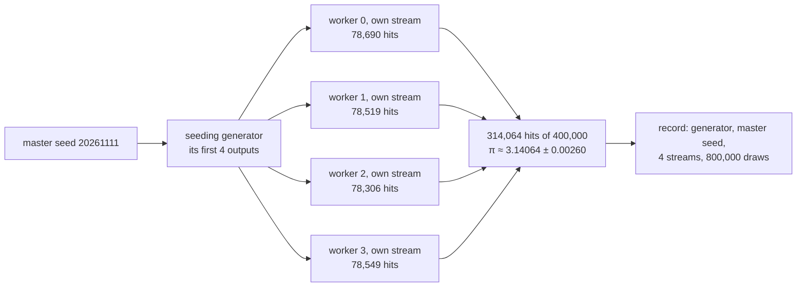

# Seeds: a random result that anyone can reproduce, line for line

[Syllabus](../../../SYLLABUS.md) → [Applied and computational](../README.md) → [Scientific Computing Practice](../README.md#s08) → Seeds

---

## General Overview

Every simulated number in this library is printed twice: once by a Python script and once by a Rust program. The two outputs must match to the last character, or the card is not published. This card's own example throws 400,000 darts at a unit square, split across 4 workers of 100,000 darts each, to estimate π.

Python prints 3.14064, give or take a standard error of 0.00260. Rust prints 3.14064 too. Both print the estimate's 64 binary digits, written in hexadecimal (base 16), as 40092007dd441355.

The two programs share no code, yet they agree bit for bit. Both ran on the same computer here; Step 1 shows why any machine that follows the floating-point standard gives the same bits.

That only works because nothing in the run is left to chance. A computer's random numbers come from a fixed rule applied to a starting number, the **seed** ([Random numbers from a computer](../../09-Probability%20and%20statistics/11-Simulation/01-pseudo-random-numbers.md)). Same rule and same seed give the same stream of numbers, so the same answer. The practice on this card is three habits that turn that fact into a result someone else can check:

1. **Seed every generator explicitly.** Here the master seed is 20261111, written in the code, never taken from the clock.
2. **Record the seed beside the answer.** The output line says which generator, which seed, how many streams and how many draws.
3. **Give independent parts independent streams.** Each of the 4 workers gets its own stream, derived from the master seed, and the card proves the streams cannot overlap.

**A simulation is reproducible when its answer is a fixed function of things written down: record the generator, the seed and how the streams were split, give each independent part a stream of its own, and a second run anywhere replays the first bit for bit.**

**What kind of fact this is:** a practice, resting on one theorem: the bound on the chance that two streams overlap, proved on this card in Why it works. That a seeded stream lands at a random-looking place on the generator's loop is a model, not a theorem.

### The picture: one master seed, four streams, one recorded answer



The four hit counts and the total are printed by both checks. Each dart takes two draws, so the 4 workers use 800,000 draws between them.

---

## The formula

The generator on this card is **SplitMix64**: a 64-bit counter that steps by a fixed odd number $\gamma$ (gamma, `0x9E3779B97F4A7C15`), followed by a scrambler that turns each count into a random-looking 64-bit output. The counter wraps round after $2^{64}$ steps, so the states form one loop of length $P = 2^{64}$. A **stream** is a run of consecutive states round that loop, starting from its seed.

Give each of $N$ independent parts its own stream of $L$ draws, each started from a seed that lands at a random-looking place on the loop. The one thing that can go wrong is two streams running into each other, so that two "independent" parts reuse the same numbers. The chance of that is bounded:

$$p_{\text{overlap}} \;\le\; \frac{N(N-1)}{2}\cdot\frac{2L-1}{P}$$

**Read it aloud:** the chance that any two of the streams share a state is at most the number of pairs of streams, times the chance that one given pair overlaps, which is $2L - 1$ positions out of the $P$ on the loop.

For this card's run: $N = 4$ streams, $L = 200{,}000$ draws each, $P = 2^{64}$. The bound is $1.3 \times 10^{-13}$.

The answer itself, the π estimate, is the share of darts that land inside the quarter circle, times 4:

$$\hat\pi = \frac{4h}{n}, \qquad \text{se} = 4\sqrt{\frac{(h/n)(1 - h/n)}{n}}$$

**Read it aloud:** four times the hits over the darts, with a standard error of four times the square root of the hit share, times the miss share, over the number of darts ([Monte Carlo](../../09-Probability%20and%20statistics/11-Simulation/04-monte-carlo-estimates-and-error.md)).

| Symbol | Plain meaning | In our example | Push it up and the answer… |
| --- | --- | --- | --- |
| $x_0$ | the master seed: the one number written in the code | 20261111 | a different, equally valid run |
| $s_k$ | stream $k$'s seed, the $k$-th output of a generator started from $x_0$ | `fbfc5102a7266b8b` for worker 0 | — |
| $\gamma$ | the counter's step, an odd 64-bit number | `0x9E3779B97F4A7C15` | — |
| $\gamma^{-1}$ | the step's inverse: times $\gamma$ it leaves remainder 1 after dividing by $2^{64}$; state $t$ sits at position $t \cdot \gamma^{-1}$ on the loop | found by Newton's rule in the checks | — |
| $P$ | the loop length: how many states before the counter repeats | $2^{64}$ | overlap far less likely |
| $N$ | the number of independent streams | 4 workers | overlap chance grows like $N^2$ |
| $L$ | the draws each stream uses | 200,000 | overlap chance grows in step |
| $p_{\text{overlap}}$ | the chance that some two streams share a state | at most $1.3 \times 10^{-13}$ | — |
| $n$ | the number of darts | 400,000 | standard error shrinks like $1/\sqrt{n}$ |
| $h$ | darts landing inside the quarter circle | 314,064 | estimate rises |
| $\hat\pi$ | the estimate of π, $4h/n$ | 3.14064 | — |
| se | the standard error of $\hat\pi$: its typical distance from π | 0.00260 | — |

### When it holds

- **Every source of randomness is seeded in code.** A generator seeded from the clock, or a library call that draws from a hidden generator, makes the answer depend on something nobody wrote down.
- **The generator is named, not only the seed.** The seed 20261111 fed to a different generator gives a different run: 3.13665 instead of 3.14064.
- **The order of floating-point operations is fixed.** IEEE 754, the standard every common processor follows for floating-point numbers (numbers stored as a fraction times a power of 2), rounds each single operation the same way everywhere, but a sum taken in a different order rounds differently. Four partial sums instead of one pass move a result by 40 ulp (units in the last place, [Floating point](01-floating-point-in-practice.md)).
- **The streams start apart.** The bound assumes each seed lands at a uniform random place on the loop. Seeds that are the same, or placed by hand too close together, break it at once: the "What breaks" table has both.
- **Each part's draw count stays its own business.** On a shared stream, a part that changes how many draws it takes shifts every number used after it.

---

## Why it works

### Step 0: the answer is a function of what was written down

A pseudo-random generator is a fixed rule. Started from the same seed it hands out the same list of numbers, in the same order, every time. So a simulation is an ordinary deterministic program whose inputs include the generator and its seed:

$$\text{answer} = F(\text{inputs},\ \text{code},\ \text{generator},\ \text{seed}).$$

Write all four down and the answer is pinned. The three habits are what that means once there are several streams and two languages.

### Step 1: the same bits in two languages

Two separate programs agree to the last bit only if every operation they perform is defined to the last bit.

- **The generator is integer arithmetic.** SplitMix64 adds $\gamma$, then XORs (compares two numbers digit by digit, 1 where they differ), shifts and multiplies, all keeping the remainder after dividing by $2^{64}$. Integer arithmetic is exact in every language: from seed 0, Python and Rust both give the first output `e220a8397b1dcdaf`, the same value as the separately written generator on [Random numbers from a computer](../../09-Probability%20and%20statistics/11-Simulation/01-pseudo-random-numbers.md).
- **The conversion to a number between 0 and 1 is exact.** The top 53 bits of an output, divided by $2^{53}$, give a draw between 0 and 1. A double (the 64-bit floating-point number both languages use) holds 53 significant bits, so this division loses nothing.
- **The dart test uses only correctly rounded operations.** Multiply, add, compare and square root are each required by IEEE 754 to give the exactly rounded true result. Same inputs, same bits, on any conforming machine.

What the standard does not pin down is where reproducibility usually breaks. Functions such as `exp`, `log` and `sin` are not required to be correctly rounded, so two maths libraries may differ in the last bit. A compiler may fuse a multiply and an add into one step with one rounding instead of two.

And order matters: the mean distance of a dart from the corner, summed in one pass, is 0.7645605934070648; summed as four partial sums, one per worker, it is 0.7645605934070693, 40 ulp away. Even the one pass depends on which worker's distances come first: with the workers in reverse order it gives 0.7645605934070685, 33 ulp from worker order.

A parallel program that adds results in whatever order its workers finish can change its last digits from run to run. The fix is a fixed order: the checks add every sum in worker order, always.

### Step 2: two ways to give each part its own stream

All streams live on the same loop of $2^{64}$ states. Giving each part a stream means giving it a stretch of that loop that no other part touches. There are two standard ways.

**Block splitting.** Start part $k$ exactly $k \times L$ steps along from the master seed. SplitMix64 makes the jump free: its state after $j$ steps is the seed plus $j\gamma$. The blocks then sit end to end and cannot overlap, by construction. The catch: $L$ must be known before the run, and must count draws, not darts or points.

**Seeding from a master.** Start a generator from the master seed and use its first $N$ outputs as the stream seeds $s_k$. No draw counts are needed in advance, which matters when a part's needs depend on its own numbers.

A part that keeps points in a disc by **rejection** (draw a point in the square, keep it only if it falls in the disc, [Rejection sampling and Box-Muller](../../09-Probability%20and%20statistics/11-Simulation/03-rejection-sampling-and-box-muller.md)) used 25,552 draws to keep 10,000 points; nobody could have written that number down beforehand.

The price is that the streams now land at random-looking places on the loop, so they could in principle collide. Step 3 bounds that chance. This card's workers use this method.

An older trap belongs to the generator, not the method: with some generators, seeds 1 and 2 give streams tied together by simple algebra, as the minstd (minimal standard) generator example on [Random numbers from a computer](../../09-Probability%20and%20statistics/11-Simulation/01-pseudo-random-numbers.md) shows. SplitMix64's scrambler hides neighbouring seeds well, but deriving seeds from a master is the habit that does not depend on which generator is in use.

### Step 3: the overlap bound

Think of the loop as a circular running track with $P$ marked positions. A stream occupies the $L$ positions after its start.

1. **One pair.** Fix where stream A starts. Stream B overlaps A exactly when B's start lies within $L - 1$ positions before A's start, at A's start, or within $L - 1$ positions after it. That is $2L - 1$ positions. If B's start is uniform over all $P$ positions, the chance is $(2L - 1)/P$.
2. **Many pairs.** $N$ streams make $N(N-1)/2$ pairs. The chance that at least one pair overlaps is at most the sum of the pairs' chances (the **union bound**: the probability of "this or that" never exceeds the two probabilities added). That gives the formula.

The checks test step 1 by brute force on a toy generator with a loop of 256: $x \to (5x + 3) \bmod 256$, segments of $L = 10$. Out of all 65,536 ordered pairs of seeds, the segments share a state in 4864 pairs. The formula predicts $256 \times 19 = 4864$: 19 clashing seeds for each of the 256 starting seeds, a probability of 0.0742.

For this card's run the bound is $1.3 \times 10^{-13}$. But a bound is a promise about seeds in general. For the four seeds actually used, the checks measure the answer directly.

A SplitMix64 state $t$ sits at position $t \cdot \gamma^{-1}$ on the loop, where $\gamma^{-1}$ is the number that, multiplied by $\gamma$, leaves remainder 1 after dividing by $2^{64}$. The checks find $\gamma^{-1}$ by Newton's rule for inverses (repeat $v \to v(2 - \gamma v)$, which doubles the number of correct low bits each time), confirm $\gamma \cdot \gamma^{-1}$ leaves 1, and place the four starts.

The nearest two are 2144390933074202976 draws apart; each stream uses 200,000. These four streams cannot meet.

The bound also says when 64 bits stop being enough. A large job with 10,000 streams of a billion draws each has 49,995,000 pairs; the bound is 0.00542, about 1 in 184. With a 128-bit loop the same job's bound is $2.9 \times 10^{-22}$. That is why generators built for large parallel work keep 128 bits of state or more, or hand out streams by a key and a counter instead of by a seed.

### Step 4: own streams keep an edit in one part from moving another

The checks run two parts back to back. Part A keeps points in the unit disc by rejection and averages their distance from the centre (exact value 2/3; it gives 0.66556). Part B throws 10,000 darts for π. Then part A is cut from 10,000 points to 5,000, the kind of edit made for a quick test.

- **On one shared stream**, part A's draws come first. Cutting it from 25,552 draws to 12,814 slides every draw part B sees, and part B's answer moves from 3.1548 to 3.1172. Part B's code never changed.
- **On own streams**, part B gives 3.1612 before the edit and 3.1612 after.

Both of part B's shared-stream answers are honest estimates. The harm is that two versions of a script disagree about a part nobody touched, which hides real changes among false ones.

---

## Worked numbers, by hand

The four workers' hits, combined, then the overlap bound for their streams.

| Step | Arithmetic | Value |
| --- | --- | --- |
| total hits | 78,690 + 78,519 + 78,306 + 78,549 | 314,064 |
| hit share | 314,064 / 400,000 | 0.78516 |
| estimate $\hat\pi$ | 4 × 0.78516 | 3.14064 |
| standard error | 4 × √(0.78516 × (1 − 0.78516) / 400,000) | 0.00260 |
| pairs of streams | 4 × 3 / 2 | 6 |
| one pair's overlap chance | (2 × 200,000 − 1) / $2^{64}$ = 399,999 / $2^{64}$ | 2.2 × 10⁻¹⁴ |
| any pair's overlap chance | 6 × 2.2 × 10⁻¹⁴ | **at most 1.3 × 10⁻¹³** |

The estimate sits 0.00095 below π = 3.14159, well inside one standard error, and the chance that any two of the four streams shared a number is far too small to matter; for these four seeds, the measured gap rules it out entirely.

### What breaks if you drop a piece

| Mistake | Comes out at | What went wrong |
| --- | --- | --- |
| Every worker seeded with the master 20261111 | 3.14112, claimed se 0.00260, true se 0.00519 | four identical runs of 78,528 hits: 100,000 darts reported as 400,000, error bar half its true size |
| Block splitting by darts, not draws: jump 100,000 instead of 200,000 | 3.14220 from 250,000 distinct darts of 400,000 | each block's second half is the next block's first half |
| Seed recorded, generator not: 20261111 in the 32-bit linear congruential generator (LCG) of [Monte Carlo pricing](../../12-Financial%20mathematics/06-Numerical%20Methods%20for%20Pricing/01-monte-carlo-pricing.md) | 3.13665 | a seed means nothing without its generator |
| Two parts on one shared stream, part A cut from 10,000 to 5,000 points | part B moves from 3.1548 to 3.1172 | part B's draws slid by part A's change |
| Summing the 400,000 distances as four partial sums, not one pass | 0.7645605934070693 against 0.7645605934070648 | a different order rounds differently: 40 ulp apart |

---

## Code, from first principles, and it actually runs

Both programs write out SplitMix64 and a 32-bit linear congruential generator, and import no random module. They throw the 400,000 darts, derive and place the four streams, run every mistake in the table, and run the two-part experiment. The roads to the answer are four. The Python and Rust runs pin each other: each program asserts the other's hit count and the estimate's 64-bit pattern. The overlap formula meets brute force over every pair of seeds of a toy generator. SplitMix64's first output meets the value printed by the separately written generator on Random numbers from a computer. And the simulated estimates are held to their exact values, π, 2/3 and $(\sqrt{2} + \ln(1 + \sqrt{2}))/3 = 0.76520$, within four standard errors.

### Python

```python
# Seeds -- the check behind the card.  Standard library only, no random module:
# the generator is SplitMix64, written out.  Roads: the Python and Rust runs pin
# each other's numbers; the overlap formula meets brute force on a toy generator;
# the first output on the Random numbers card; estimates held to a few standard errors.
import math, struct
M64, GAMMA, MASTER = 2**64 - 1, 0x9E3779B97F4A7C15, 20261111
WORKERS, DARTS = 4, 100000                     # darts per worker, two draws per dart

def mix(z):                                    # SplitMix64's scrambler
    z = ((z ^ (z >> 30)) * 0xBF58476D1CE4E5B9) & M64
    z = ((z ^ (z >> 27)) * 0x94D049BB133111EB) & M64
    return z ^ (z >> 31)

class Stream:                                  # one stream: a counter stepped by GAMMA, then mixed
    def __init__(self, state): self.state, self.used = state & M64, 0
    def next(self):
        self.state = (self.state + GAMMA) & M64
        self.used += 1
        return mix(self.state)
    def u(self): return (self.next() >> 11) * 2.0**-53   # top 53 bits: exact in both languages

class Lcg:                                     # the 32-bit LCG of the Monte Carlo pricing card
    def __init__(self, seed): self.x = seed
    def u(self):
        self.x = (1664525 * self.x + 1013904223) % 2**32
        return (self.x + 0.5) / 2**32

def seeds(master, n):                          # stream seeds: the first n outputs from the master
    g = Stream(master)
    return [g.next() for _ in range(n)]

def darts(g, n, starts=None):                  # n darts at the unit square
    hits, dist = 0, []
    for _ in range(n):
        if starts is not None: starts.add(g.state)
        x, y = g.u(), g.u()
        hits += x * x + y * y < 1.0
        dist.append(math.sqrt(x * x + y * y))
    return hits, dist

def total(xs):                                 # plain left-to-right sum (Python's sum() compensates)
    s = 0.0
    for x in xs: s += x
    return s

def disc_mean(g, n):                           # part A: n points in the unit disc, by rejection
    tot, got = 0.0, 0
    while got < n:
        x, y = 2 * g.u() - 1, 2 * g.u() - 1
        if x * x + y * y < 1.0:
            tot, got = tot + math.sqrt(x * x + y * y), got + 1
    return tot / n

def two_parts(n_a, shared):                    # part A, then part B: 10000 darts for pi
    s = seeds(MASTER, 2)
    a = Stream(s[0])
    b = a if shared else Stream(s[1])
    mean_a = disc_mean(a, n_a)
    used = a.used
    return mean_a, used, 4 * darts(b, 10000)[0] / 10000

bits = lambda x: struct.pack(">d", x).hex()
pi_se = lambda h, n: 4 * math.sqrt(h / n * (1 - h / n) / n)
print(f"splitmix64,seed 0,first output {Stream(0).next():016x},Random numbers card e220a8397b1dcdaf")
s = seeds(MASTER, WORKERS)
print(f"streams,master seed {MASTER},stream seeds {', '.join(f'{x:016x}' for x in s)}")
runs = [darts(Stream(x), DARTS) for x in s]
hits = [h for h, _ in runs]
n, H = WORKERS * DARTS, sum(hits)
est, se = 4 * H / n, pi_se(H, n)
for k in range(WORKERS):
    print(f"worker {k},{DARTS} darts,hits {hits[k]},estimate {4 * hits[k] / DARTS:.5f}")
print(f"answer,pi from {n} darts,hits {H},share {H / n:.5f},estimate {est:.5f},se {se:.5f},bits {bits(est)}")
print(f"answer,pi {math.pi:.5f},estimate below pi by {math.pi - est:.5f}")
print(f"record,generator splitmix64,master seed {MASTER},streams {WORKERS} seeded from the master,"
      f"draws {2 * n},answer {est:.5f} +- {se:.5f}")
ginv = GAMMA
for _ in range(6): ginv = ginv * (2 - GAMMA * ginv) & M64   # Newton: GAMMA's inverse mod 2^64
pos = [x * ginv & M64 for x in s]              # where each stream starts on the 2^64 loop
gap = min((pos[j] - pos[i]) & M64 for i in range(WORKERS) for j in range(WORKERS) if i != j)
L = 2 * DARTS
print(f"loop,gamma x inverse mod 2^64 = {GAMMA * ginv & M64},nearest two stream starts {gap} draws apart,"
      f"each stream uses {L}")
pair = (2 * L - 1) / 2**64
print(f"overlap bound,{WORKERS} streams of {L},pairs {WORKERS * (WORKERS - 1) // 2},2L - 1 = {2 * L - 1},per pair {pair:.1e},any pair {WORKERS * (WORKERS - 1) / 2 * pair:.1e}")
big = 10000 * 9999 / 2 * (2 * 10**9 - 1)
print(f"overlap bound,10000 streams of 10^9,pairs {10000 * 9999 // 2},64-bit loop {big / 2**64:.5f} (1 in {2**64 / big:.0f}),"
      f"128-bit loop {big / 2**128:.1e}")
seg = lambda x: {x := (5 * x + 3) % 256 for _ in range(10)}   # toy loop of 256, segments of 10
segs = [seg(x) for x in range(256)]
clash = sum(1 for a in segs for b in segs if a & b)
print(f"toy,(5x + 3) mod 256,ordered seed pairs whose 10-draw segments share a state {clash} of 65536,"
      f"formula 256 x 19 = {256 * 19},probability {clash / 65536:.4f}")
d_ser = total(d for _, ds in runs for d in ds) / n
d_par = total(total(ds) for _, ds in runs) / n
d_rev = total(d for _, ds in runs[::-1] for d in ds) / n   # one pass, workers in reverse order
exact = (math.sqrt(2) + math.log(1 + math.sqrt(2))) / 3
key = lambda x: struct.unpack(">q", struct.pack(">d", x))[0]   # a double's 64 bits as a whole number
print(f"sum order,mean distance one pass {d_ser!r},four partial sums {d_par!r},apart by {abs(key(d_ser) - key(d_par))} ulp,exact {exact:.5f}")
print(f"sum order,one pass with the workers in reverse order {d_rev!r},apart by {abs(key(d_ser) - key(d_rev))} ulp")
same = [darts(Stream(MASTER), DARTS)[0] for _ in range(WORKERS)]
print(f"mistake,every worker seeded {MASTER},hits {same},estimate {4 * sum(same) / n:.5f},"
      f"claimed se {pi_se(sum(same), n):.5f},true se {pi_se(same[0], DARTS):.5f}")
starts, hb = set(), 0
for k in range(WORKERS):
    hb += darts(Stream(MASTER + k * DARTS * GAMMA), DARTS, starts)[0]   # jumped by darts, not draws
print(f"mistake,jump ahead by {DARTS} draws not {L},distinct darts {len(starts)} of {n},estimate {4 * hb / n:.5f}")
hl = darts(Lcg(MASTER), n)[0]
print(f"mistake,seed {MASTER} recorded without its generator,32-bit LCG gives {4 * hl / n:.5f}")
p1, p2, p3, p4 = two_parts(10000, True), two_parts(5000, True), two_parts(10000, False), two_parts(5000, False)
for name, (pa, pb) in [("one shared stream", (p1, p2)), ("own streams", (p3, p4))]:
    print(f"parts,{name},A 10000 points used {pa[1]} draws,B {pa[2]:.4f},A 5000 points used {pb[1]} draws,B {pb[2]:.4f}")
print(f"parts,A mean distance in the disc {p3[0]:.5f},exact 2/3")
assert Stream(0).next() == 0xE220A8397B1DCDAF                   # as on the Random numbers card
assert H == 314064 and bits(est) == "40092007dd441355"          # pinned by the Rust run
assert abs(est - math.pi) < 4 * se                              # pi, within 4 standard errors
assert abs(d_ser - exact) < 4 * 0.29 / math.sqrt(n)             # closed form, sd about 0.285
assert abs(p3[0] - 2 / 3) < 4 * 0.24 / 100                      # disc: sd about 0.236
assert GAMMA * ginv & M64 == 1                                  # Newton found the inverse
assert gap > L                                                  # no two streams can meet
assert clash == 256 * (2 * 10 - 1)                              # brute force = (2L - 1) per seed
assert 0 < abs(d_ser - d_par) < 1e-14 and 0 < abs(d_ser - d_rev) < 1e-14   # order moves bits
assert same == [same[0]] * WORKERS and len(set(hits)) == WORKERS   # one seed: 4 copies; own: 4 runs
assert len(starts) == n - (WORKERS - 1) * DARTS // 2            # half of each block repeated
assert p3[2] == p4[2] and p1[2] != p2[2]                        # own stream: B does not move
assert p3[2] != 4 * darts(Stream(s[0]), 10000)[0] / 10000       # and B's stream is not A's
print("ALL CHECKS PASS")
```

**Ran 2026-11-11 on macOS, Python 3.14.10, standard library only. All checks passed. Output, pasted from the run:**

```
splitmix64,seed 0,first output e220a8397b1dcdaf,Random numbers card e220a8397b1dcdaf
streams,master seed 20261111,stream seeds fbfc5102a7266b8b, 4d299f0370e6186b, e0300aa22b3714f3, 43207c09b5d5e859
worker 0,100000 darts,hits 78690,estimate 3.14760
worker 1,100000 darts,hits 78519,estimate 3.14076
worker 2,100000 darts,hits 78306,estimate 3.13224
worker 3,100000 darts,hits 78549,estimate 3.14196
answer,pi from 400000 darts,hits 314064,share 0.78516,estimate 3.14064,se 0.00260,bits 40092007dd441355
answer,pi 3.14159,estimate below pi by 0.00095
record,generator splitmix64,master seed 20261111,streams 4 seeded from the master,draws 800000,answer 3.14064 +- 0.00260
loop,gamma x inverse mod 2^64 = 1,nearest two stream starts 2144390933074202976 draws apart,each stream uses 200000
overlap bound,4 streams of 200000,pairs 6,2L - 1 = 399999,per pair 2.2e-14,any pair 1.3e-13
overlap bound,10000 streams of 10^9,pairs 49995000,64-bit loop 0.00542 (1 in 184),128-bit loop 2.9e-22
toy,(5x + 3) mod 256,ordered seed pairs whose 10-draw segments share a state 4864 of 65536,formula 256 x 19 = 4864,probability 0.0742
sum order,mean distance one pass 0.7645605934070648,four partial sums 0.7645605934070693,apart by 40 ulp,exact 0.76520
sum order,one pass with the workers in reverse order 0.7645605934070685,apart by 33 ulp
mistake,every worker seeded 20261111,hits [78528, 78528, 78528, 78528],estimate 3.14112,claimed se 0.00260,true se 0.00519
mistake,jump ahead by 100000 draws not 200000,distinct darts 250000 of 400000,estimate 3.14220
mistake,seed 20261111 recorded without its generator,32-bit LCG gives 3.13665
parts,one shared stream,A 10000 points used 25552 draws,B 3.1548,A 5000 points used 12814 draws,B 3.1172
parts,own streams,A 10000 points used 25552 draws,B 3.1612,A 5000 points used 12814 draws,B 3.1612
parts,A mean distance in the disc 0.66556,exact 2/3
ALL CHECKS PASS
```

### Rust

Same numbers, same labels, built with `rustc --edition 2021 -O`.

```rust
// Seeds -- the same check as the Python, in Rust.  No crates, no rand: the
// generator is SplitMix64, written out.  Roads: the Python and Rust runs pin
// each other's numbers; the overlap formula meets brute force on a toy generator;
// the first output on the Random numbers card; estimates held to a few standard errors.
use std::collections::HashSet;
const GAMMA: u64 = 0x9E3779B97F4A7C15;
const MASTER: u64 = 20261111;
const WORKERS: usize = 4;
const DARTS: usize = 100000; // darts per worker, two draws per dart

fn mix(mut z: u64) -> u64 { // SplitMix64's scrambler
    z = (z ^ (z >> 30)).wrapping_mul(0xBF58476D1CE4E5B9);
    z = (z ^ (z >> 27)).wrapping_mul(0x94D049BB133111EB);
    z ^ (z >> 31)
}

trait Gen { fn u(&mut self) -> f64; fn state(&self) -> u64; }
struct Stream { state: u64, used: usize } // one stream: a counter stepped by GAMMA, then mixed
impl Stream {
    fn new(state: u64) -> Self { Stream { state, used: 0 } }
    fn next(&mut self) -> u64 {
        self.state = self.state.wrapping_add(GAMMA);
        self.used += 1;
        mix(self.state)
    }
}
impl Gen for Stream { // top 53 bits: exact in both languages
    fn u(&mut self) -> f64 { (self.next() >> 11) as f64 * (1.0 / 9007199254740992.0) }
    fn state(&self) -> u64 { self.state }
}
struct Lcg { x: u64 } // the 32-bit LCG of the Monte Carlo pricing card
impl Gen for Lcg {
    fn u(&mut self) -> f64 { self.x = (1664525 * self.x + 1013904223) % (1 << 32); (self.x as f64 + 0.5) / 4294967296.0 }
    fn state(&self) -> u64 { self.x }
}

fn seeds(master: u64, n: usize) -> Vec<u64> { // stream seeds: the first n outputs from the master
    let mut g = Stream::new(master);
    (0..n).map(|_| g.next()).collect()
}

fn darts(g: &mut dyn Gen, n: usize, mut starts: Option<&mut HashSet<u64>>) -> (u64, Vec<f64>) {
    let (mut hits, mut dist) = (0u64, Vec::with_capacity(n)); // n darts at the unit square
    for _ in 0..n {
        if let Some(s) = starts.as_mut() { s.insert(g.state()); }
        let (x, y) = (g.u(), g.u());
        if x * x + y * y < 1.0 { hits += 1; }
        dist.push((x * x + y * y).sqrt());
    }
    (hits, dist)
}

fn total(xs: &[f64]) -> f64 { let mut s = 0.0; for x in xs { s += x; } s } // left to right

fn disc_mean(g: &mut Stream, n: usize) -> f64 { // part A: n points in the unit disc, by rejection
    let (mut tot, mut got) = (0.0, 0);
    while got < n {
        let (x, y) = (2.0 * g.u() - 1.0, 2.0 * g.u() - 1.0);
        if x * x + y * y < 1.0 { tot += (x * x + y * y).sqrt(); got += 1; }
    }
    tot / n as f64
}

fn two_parts(n_a: usize, shared: bool) -> (f64, usize, f64) { // part A, then part B: 10000 darts
    let s = seeds(MASTER, 2);
    let mut a = Stream::new(s[0]);
    let mean_a = disc_mean(&mut a, n_a);
    let used = a.used;
    let mut own = Stream::new(s[1]);
    let b: &mut Stream = if shared { &mut a } else { &mut own };
    (mean_a, used, 4.0 * darts(b, 10000, None).0 as f64 / 10000.0)
}

fn pi_se(h: u64, n: usize) -> f64 { let p = h as f64 / n as f64; 4.0 * (p * (1.0 - p) / n as f64).sqrt() }

fn main() {
    println!("splitmix64,seed 0,first output {:016x},Random numbers card e220a8397b1dcdaf", Stream::new(0).next());
    let s = seeds(MASTER, WORKERS);
    let hexs: Vec<String> = s.iter().map(|x| format!("{:016x}", x)).collect();
    println!("streams,master seed {},stream seeds {}", MASTER, hexs.join(", "));
    let runs: Vec<(u64, Vec<f64>)> = s.iter().map(|&x| darts(&mut Stream::new(x), DARTS, None)).collect();
    let n = WORKERS * DARTS;
    let h: u64 = runs.iter().map(|r| r.0).sum();
    let (est, se) = (4.0 * h as f64 / n as f64, pi_se(h, n));
    for k in 0..WORKERS {
        println!("worker {},{} darts,hits {},estimate {:.5}", k, DARTS, runs[k].0, 4.0 * runs[k].0 as f64 / DARTS as f64);
    }
    println!("answer,pi from {} darts,hits {},share {:.5},estimate {:.5},se {:.5},bits {:016x}", n, h, h as f64 / n as f64, est, se, est.to_bits());
    println!("answer,pi {:.5},estimate below pi by {:.5}", std::f64::consts::PI, std::f64::consts::PI - est);
    println!("record,generator splitmix64,master seed {},streams {} seeded from the master,draws {},answer {:.5} +- {:.5}",
             MASTER, WORKERS, 2 * n, est, se);
    let mut ginv = GAMMA;
    for _ in 0..6 { ginv = ginv.wrapping_mul(2u64.wrapping_sub(GAMMA.wrapping_mul(ginv))); } // Newton
    let pos: Vec<u64> = s.iter().map(|x| x.wrapping_mul(ginv)).collect(); // stream starts on the loop
    let mut gap = u64::MAX;
    for i in 0..WORKERS { for j in 0..WORKERS { if i != j { gap = gap.min(pos[j].wrapping_sub(pos[i])); } } }
    let l = 2 * DARTS;
    println!("loop,gamma x inverse mod 2^64 = {},nearest two stream starts {} draws apart,each stream uses {}",
             GAMMA.wrapping_mul(ginv), gap, l);
    let two64 = 18446744073709551616.0f64;
    let pair = (2 * l - 1) as f64 / two64;
    println!("overlap bound,{} streams of {},pairs {},2L - 1 = {},per pair {:.1e},any pair {:.1e}", WORKERS, l, WORKERS * (WORKERS - 1) / 2, 2 * l - 1, pair, (WORKERS * (WORKERS - 1)) as f64 / 2.0 * pair);
    let big = 10000.0 * 9999.0 / 2.0 * (2e9 - 1.0);
    println!("overlap bound,10000 streams of 10^9,pairs {},64-bit loop {:.5} (1 in {:.0}),128-bit loop {:.1e}",
             10000u64 * 9999 / 2, big / two64, two64 / big, big / (two64 * two64));
    let segs: Vec<HashSet<u64>> = (0..256u64).map(|mut x| (0..10).map(|_| { x = (5 * x + 3) % 256; x }).collect()).collect();
    let clash = segs.iter().map(|a| segs.iter().filter(|b| !a.is_disjoint(b)).count()).sum::<usize>();
    println!("toy,(5x + 3) mod 256,ordered seed pairs whose 10-draw segments share a state {} of 65536,formula 256 x 19 = {},probability {:.4}",
             clash, 256 * 19, clash as f64 / 65536.0);
    let all: Vec<f64> = runs.iter().flat_map(|r| r.1.iter().copied()).collect();
    let parts: Vec<f64> = runs.iter().map(|r| total(&r.1)).collect();
    let (d_ser, d_par) = (total(&all) / n as f64, total(&parts) / n as f64);
    let exact = (2f64.sqrt() + (1.0 + 2f64.sqrt()).ln()) / 3.0;
    let ulps = (d_ser.to_bits() as i64 - d_par.to_bits() as i64).abs();
    println!("sum order,mean distance one pass {:?},four partial sums {:?},apart by {} ulp,exact {:.5}", d_ser, d_par, ulps, exact);
    let rev: Vec<f64> = runs.iter().rev().flat_map(|r| r.1.iter().copied()).collect(); // workers reversed
    let d_rev = total(&rev) / n as f64;
    println!("sum order,one pass with the workers in reverse order {:?},apart by {} ulp", d_rev,
             (d_ser.to_bits() as i64 - d_rev.to_bits() as i64).abs());
    let same: Vec<u64> = (0..WORKERS).map(|_| darts(&mut Stream::new(MASTER), DARTS, None).0).collect();
    let ss: u64 = same.iter().sum();
    println!("mistake,every worker seeded {},hits {:?},estimate {:.5},claimed se {:.5},true se {:.5}",
             MASTER, same, 4.0 * ss as f64 / n as f64, pi_se(ss, n), pi_se(same[0], DARTS));
    let (mut starts, mut hb) = (HashSet::new(), 0u64);
    for k in 0..WORKERS { // jumped by darts, not draws
        let jump = MASTER.wrapping_add(((k * DARTS) as u64).wrapping_mul(GAMMA));
        hb += darts(&mut Stream::new(jump), DARTS, Some(&mut starts)).0;
    }
    println!("mistake,jump ahead by {} draws not {},distinct darts {} of {},estimate {:.5}", DARTS, l, starts.len(), n, 4.0 * hb as f64 / n as f64);
    let hl = darts(&mut Lcg { x: MASTER }, n, None).0;
    println!("mistake,seed {} recorded without its generator,32-bit LCG gives {:.5}", MASTER, 4.0 * hl as f64 / n as f64);
    let (p1, p2, p3, p4) = (two_parts(10000, true), two_parts(5000, true), two_parts(10000, false), two_parts(5000, false));
    for (name, pa, pb) in [("one shared stream", p1, p2), ("own streams", p3, p4)] {
        println!("parts,{},A 10000 points used {} draws,B {:.4},A 5000 points used {} draws,B {:.4}", name, pa.1, pa.2, pb.1, pb.2);
    }
    println!("parts,A mean distance in the disc {:.5},exact 2/3", p3.0);
    assert_eq!(Stream::new(0).next(), 0xE220A8397B1DCDAF); // as on the Random numbers card
    assert!(h == 314064 && format!("{:016x}", est.to_bits()) == "40092007dd441355"); // pinned by Python
    assert!((est - std::f64::consts::PI).abs() < 4.0 * se); // pi, within 4 standard errors
    assert!((d_ser - exact).abs() < 4.0 * 0.29 / (n as f64).sqrt()); // closed form, sd about 0.285
    assert!((p3.0 - 2.0 / 3.0).abs() < 4.0 * 0.24 / 100.0); // disc: sd about 0.236
    assert_eq!(GAMMA.wrapping_mul(ginv), 1); // Newton found the inverse
    assert!(gap > l as u64); // no two streams can meet
    assert_eq!(clash, 256 * (2 * 10 - 1)); // brute force = (2L - 1) per seed
    assert!((d_ser - d_par).abs() > 0.0 && (d_ser - d_par).abs() < 1e-14); // order moves bits
    assert!((d_ser - d_rev).abs() > 0.0 && (d_ser - d_rev).abs() < 1e-14); // so does worker order
    assert!(same.iter().all(|&x| x == same[0])); // one seed, four identical runs
    assert_eq!(runs.iter().map(|r| r.0).collect::<HashSet<u64>>().len(), WORKERS); // own seeds: four runs
    assert_eq!(starts.len(), n - (WORKERS - 1) * DARTS / 2); // half of each block repeated
    assert!(p3.2 == p4.2 && p1.2 != p2.2); // own stream: B does not move
    assert!(p3.2 != 4.0 * darts(&mut Stream::new(s[0]), 10000, None).0 as f64 / 10000.0); // and B's stream is not A's
    println!("ALL CHECKS PASS");
}
```

**Ran 2026-11-11 on macOS, rustc 1.98.1, no crates. All checks passed. Output, pasted from the run:**

```
splitmix64,seed 0,first output e220a8397b1dcdaf,Random numbers card e220a8397b1dcdaf
streams,master seed 20261111,stream seeds fbfc5102a7266b8b, 4d299f0370e6186b, e0300aa22b3714f3, 43207c09b5d5e859
worker 0,100000 darts,hits 78690,estimate 3.14760
worker 1,100000 darts,hits 78519,estimate 3.14076
worker 2,100000 darts,hits 78306,estimate 3.13224
worker 3,100000 darts,hits 78549,estimate 3.14196
answer,pi from 400000 darts,hits 314064,share 0.78516,estimate 3.14064,se 0.00260,bits 40092007dd441355
answer,pi 3.14159,estimate below pi by 0.00095
record,generator splitmix64,master seed 20261111,streams 4 seeded from the master,draws 800000,answer 3.14064 +- 0.00260
loop,gamma x inverse mod 2^64 = 1,nearest two stream starts 2144390933074202976 draws apart,each stream uses 200000
overlap bound,4 streams of 200000,pairs 6,2L - 1 = 399999,per pair 2.2e-14,any pair 1.3e-13
overlap bound,10000 streams of 10^9,pairs 49995000,64-bit loop 0.00542 (1 in 184),128-bit loop 2.9e-22
toy,(5x + 3) mod 256,ordered seed pairs whose 10-draw segments share a state 4864 of 65536,formula 256 x 19 = 4864,probability 0.0742
sum order,mean distance one pass 0.7645605934070648,four partial sums 0.7645605934070693,apart by 40 ulp,exact 0.76520
sum order,one pass with the workers in reverse order 0.7645605934070685,apart by 33 ulp
mistake,every worker seeded 20261111,hits [78528, 78528, 78528, 78528],estimate 3.14112,claimed se 0.00260,true se 0.00519
mistake,jump ahead by 100000 draws not 200000,distinct darts 250000 of 400000,estimate 3.14220
mistake,seed 20261111 recorded without its generator,32-bit LCG gives 3.13665
parts,one shared stream,A 10000 points used 25552 draws,B 3.1548,A 5000 points used 12814 draws,B 3.1172
parts,own streams,A 10000 points used 25552 draws,B 3.1612,A 5000 points used 12814 draws,B 3.1612
parts,A mean distance in the disc 0.66556,exact 2/3
ALL CHECKS PASS
```

The two outputs agree line for line, including the bit pattern `40092007dd441355` and the sums printed to full precision.

### Lean

Lean proves Step 3's overlap bound for every number of streams, stream length and loop length, and checks the card's SplitMix64 numbers exactly.

- Take $N$ streams of $L$ draws, each started independently at a uniform random place on a loop of $P$ positions. Then the chance that some two streams share a position is at most the number of pairs times $(2L - 1)/P$.
- Take $L$ of at least 1 and $2L - 1 \le P$, and fix where stream A starts. Then exactly $2L - 1$ starts for stream B make it overlap A.
- Suppose a counter steps by an odd number and keeps the remainder after dividing by a power of 2. Then it first returns to its start after exactly that many steps.
- SplitMix64's first output from seed 0, the four stream seeds and $\gamma^{-1}$ are all right.
- The nearest two of the four starts are 2144390933074202976 draws apart, far more than 200,000.
- The worked numbers are right: 314,064 hits, 6 pairs, $2L - 1 = 399{,}999$, the toy formula's 4864, and 49,995,000 pairs.

The darts, the π estimate, the floating-point sums and the toy generator's brute-force count are left to the Python and Rust checks.

```lean
-- Seeds: with N streams of L draws started at independent uniform places on a loop of P states, the chance that two streams share a state is at most N(N-1)/2 times (2L-1)/P.
import Mathlib.Data.ZMod.Basic
import Mathlib.Data.Fintype.Pi
import Mathlib.Basic.Real.Basic
import Mathlib.GroupTheory.OrderOfElement
import Mathlib.Tactic.NormNum
import Mathlib.Data.Int.Interval
import Mathlib.Order.Interval.Finset.Fin
import Mathlib.Algebra.BigOperators.Intervals
import Mathlib.Algebra.Order.BigOperators.Group.Finset
import Mathlib.Tactic

theorem overlap_diff_mem (L P : ℕ) (a b : ZMod P) (h : ∃ i < L, ∃ j < L, a + (i : ZMod P) = b + (j : ZMod P)) :
    b - a ∈ (Finset.Ioo (-(L : ℤ)) L).image (fun d : ℤ => (d : ZMod P)) := by
  obtain ⟨i, hi, j, hj, h⟩ := h
  refine Finset.mem_image.mpr ⟨(i : ℤ) - j, Finset.mem_Ioo.mpr ⟨by omega, by omega⟩, ?_⟩
  push_cast
  linear_combination h

theorem card_Ioo_neg (L : ℕ) : (Finset.Ioo (-(L : ℤ)) L).card = 2 * L - 1 := by
  rw [Int.card_Ioo]; omega

theorem pair_overlap_card_le (N L P : ℕ) [NeZero P] (i j : Fin N) (hij : i ≠ j) :
    (Finset.univ.filter (fun s : Fin N → ZMod P =>
        ∃ a < L, ∃ b < L, s i + (a : ZMod P) = s j + (b : ZMod P))).card
      ≤ (2 * L - 1) * P ^ (N - 1) := by
  classical
  set D := (Finset.Ioo (-(L : ℤ)) L).image (fun d : ℤ => (d : ZMod P))
  have hD : D.card ≤ 2 * L - 1 := (Finset.card_image_le).trans (card_Ioo_neg L).le
  let f : (Fin N → ZMod P) → ZMod P × ({k : Fin N // k ≠ j} → ZMod P) :=
    fun s => (s j - s i, fun k => s k)
  refine (Finset.card_le_card_of_injOn (t := D ×ˢ (Finset.univ)) f ?_ ?_).trans ?_
  rotate_left 2
  · rw [Finset.card_product, Finset.card_univ, Fintype.card_fun, ZMod.card]
    have : Fintype.card {k : Fin N // k ≠ j} = N - 1 := by simp
    rw [this]
    exact Nat.mul_le_mul_right _ hD
  · intro s hs
    simp only [Finset.coe_filter, Finset.mem_univ, true_and, Set.mem_ofPred_eq] at hs
    simp only [Finset.coe_product, Finset.coe_univ, Set.mem_prod, Finset.mem_coe, Set.mem_univ, and_true, f]
    exact overlap_diff_mem L P (s i) (s j) hs
  · intro s _ t _ hst
    simp only [f, Prod.mk.injEq] at hst
    obtain ⟨h1, h2⟩ := hst
    have hi : s i = t i := congrFun h2 ⟨i, hij⟩
    funext k
    by_cases hk : k = j
    · subst hk; rw [hi] at h1; simpa using h1
    · exact congrFun h2 ⟨k, hk⟩

theorem lt_sum_card_Ioi (N : ℕ) : (∑ i : Fin N, (Finset.Ioi i).card) * 2 = N * (N - 1) := by
  simp only [Fin.card_Ioi]
  rw [Fin.sum_univ_eq_sum_range (fun i => N - 1 - i) N, Finset.sum_range_reflect (fun i => i) N]
  exact Finset.sum_range_id_mul_two N

#print axioms overlap_diff_mem
#print axioms card_Ioo_neg
#print axioms pair_overlap_card_le
#print axioms lt_sum_card_Ioi

/-- The overlap bound. Put each of `N` streams at an independent, uniformly random start on a
loop of `P` positions (`ZMod P`), and let each stream use the `L` positions from its start on.
The share of all `P ^ N` choices of starts in which two different streams share a position
is at most the number of pairs, `N(N-1)/2`, times `(2L - 1)/P`. -/
theorem stream_overlap_probability_le (N L P : ℕ) [NeZero P] :
    ((Finset.univ.filter (fun s : Fin N → ZMod P =>
        ∃ i j : Fin N, i ≠ j ∧ ∃ a < L, ∃ b < L, s i + (a : ZMod P) = s j + (b : ZMod P))).card : ℝ)
      / (P : ℝ) ^ N
    ≤ ((N : ℝ) * ((N : ℝ) - 1) / 2) * ((2 * L - 1 : ℕ) : ℝ) / (P : ℝ) := by
  classical
  rcases Nat.eq_zero_or_pos N with rfl | hN
  · simp
  set S := Finset.univ.filter (fun s : Fin N → ZMod P =>
        ∃ i j : Fin N, i ≠ j ∧ ∃ a < L, ∃ b < L, s i + (a : ZMod P) = s j + (b : ZMod P))
  let T : Fin N → Fin N → Finset (Fin N → ZMod P) := fun i j =>
    Finset.univ.filter (fun s : Fin N → ZMod P =>
        ∃ a < L, ∃ b < L, s i + (a : ZMod P) = s j + (b : ZMod P))
  have hsub : S ⊆ Finset.univ.biUnion (fun i => (Finset.Ioi i).biUnion (fun j => T i j)) := by
    intro s hs
    simp only [S, Finset.mem_filter, Finset.mem_univ, true_and] at hs
    obtain ⟨i, j, hij, a, ha, b, hb, h⟩ := hs
    simp only [Finset.mem_biUnion, Finset.mem_univ, true_and, Finset.mem_Ioi, T,
      Finset.mem_filter]
    rcases lt_or_gt_of_ne hij with hlt | hgt
    · exact ⟨i, j, hlt, a, ha, b, hb, h⟩
    · exact ⟨j, i, hgt, b, hb, a, ha, h.symm⟩
  have hcard : S.card ≤ ∑ i : Fin N, (Finset.Ioi i).card * ((2 * L - 1) * P ^ (N - 1)) := by
    refine (Finset.card_le_card hsub).trans ((Finset.card_biUnion_le).trans ?_)
    refine Finset.sum_le_sum fun i _ => (Finset.card_biUnion_le).trans ?_
    rw [← smul_eq_mul, ← Finset.sum_const]
    refine Finset.sum_le_sum fun j hj => ?_
    exact pair_overlap_card_le N L P i j (ne_of_lt (Finset.mem_Ioi.mp hj))
  rw [← Finset.sum_mul] at hcard
  have hnat : S.card * 2 ≤ N * (N - 1) * ((2 * L - 1) * P ^ (N - 1)) := by
    rw [← lt_sum_card_Ioi N]; nlinarith
  have hreal : (S.card : ℝ) * 2 ≤ (N : ℝ) * ((N : ℝ) - 1) * (((2 * L - 1 : ℕ) : ℝ) * (P : ℝ) ^ (N - 1)) := by
    have := (Nat.cast_le (α := ℝ)).mpr hnat
    push_cast [Nat.cast_sub (show 1 ≤ N from hN)] at this
    simpa using this
  have hP : (0 : ℝ) < P := by exact_mod_cast Nat.pos_of_ne_zero (NeZero.ne P)
  have hpow : (P : ℝ) ^ N = (P : ℝ) ^ (N - 1) * P := by
    rw [← pow_succ]; congr 1; omega
  rw [div_le_iff₀ (by positivity), hpow]
  have : ((N : ℝ) * ((N : ℝ) - 1) / 2) * ((2 * L - 1 : ℕ) : ℝ) / (P : ℝ) * ((P : ℝ) ^ (N - 1) * P)
      = (N : ℝ) * ((N : ℝ) - 1) * (((2 * L - 1 : ℕ) : ℝ) * (P : ℝ) ^ (N - 1)) / 2 := by
    field_simp
  rw [this]
  linarith

/-- One pair. Fix where stream A starts on a loop of `P` positions. Stream B, also `L` long,
shares a position with A for exactly `2L - 1` starting places: within `L - 1` before A's start,
at it, or within `L - 1` after it (as long as those places are all different, `2L - 1 ≤ P`). -/
theorem one_pair_overlap_positions (L P : ℕ) [NeZero P] (hL : 0 < L) (hLP : 2 * L - 1 ≤ P)
    (a : ZMod P) :
    (Finset.univ.filter (fun b : ZMod P =>
        ∃ i < L, ∃ j < L, a + (i : ZMod P) = b + (j : ZMod P))).card = 2 * L - 1 := by
  classical
  have hset : Finset.univ.filter (fun b : ZMod P =>
        ∃ i < L, ∃ j < L, a + (i : ZMod P) = b + (j : ZMod P))
      = (Finset.Ioo (-(L : ℤ)) L).image (fun d : ℤ => a + (d : ZMod P)) := by
    ext b
    simp only [Finset.mem_filter, Finset.mem_univ, true_and, Finset.mem_image, Finset.mem_Ioo]
    constructor
    · intro h
      obtain ⟨i, hi, j, hj, h⟩ := h
      refine ⟨(i : ℤ) - j, ⟨by omega, by omega⟩, ?_⟩
      push_cast
      linear_combination h
    · rintro ⟨d, ⟨h1, h2⟩, rfl⟩
      rcases le_or_gt 0 d with hd | hd
      · refine ⟨d.toNat, by omega, 0, hL, ?_⟩
        have : ((d.toNat : ℕ) : ZMod P) = (d : ZMod P) := by
          rw [← Int.cast_natCast, Int.toNat_of_nonneg hd]
        simp [this]
      · refine ⟨0, hL, (-d).toNat, by omega, ?_⟩
        have : (((-d).toNat : ℕ) : ZMod P) = ((-d : ℤ) : ZMod P) := by
          rw [← Int.cast_natCast, Int.toNat_of_nonneg (by omega)]
        rw [this]; push_cast; ring
  rw [hset, Finset.card_image_of_injOn, card_Ioo_neg]
  intro x hx y hy hxy
  simp only [Finset.coe_Ioo, Set.mem_Ioo] at hx hy
  simp only [add_right_inj] at hxy
  rw [ZMod.intCast_eq_intCast_iff_dvd_sub] at hxy
  have := Int.eq_zero_of_abs_lt_dvd hxy (by rw [abs_lt]; constructor <;> omega)
  omega

/-- The counter's loop. A counter that steps by an odd number `γ` and keeps the remainder after
dividing by `2 ^ k` comes back to its start only after `2 ^ k` steps, so its states form one loop
of length `2 ^ k` (for SplitMix64, `k = 64`). -/
theorem odd_step_counter_period (k γ : ℕ) (hγ : Odd γ) :
    addOrderOf (γ : ZMod (2 ^ k)) = 2 ^ k := by
  have hc : Nat.Coprime (2 ^ k) γ := (Nat.coprime_two_left.mpr hγ).pow_left k
  rw [ZMod.addOrderOf_coe _ (by positivity), hc, Nat.div_one]

/-- SplitMix64's scrambler, as in the card's code. -/
def splitmixMix (z : ℕ) : ℕ :=
  let z := ((z ^^^ (z >>> 30)) * 0xBF58476D1CE4E5B9) % 2 ^ 64
  let z := ((z ^^^ (z >>> 27)) * 0x94D049BB133111EB) % 2 ^ 64
  z ^^^ (z >>> 31)

-- From seed 0, the first output is e220a8397b1dcdaf, as on the Random numbers card.
example : splitmixMix ((0 + 0x9E3779B97F4A7C15) % 2 ^ 64) = 0xE220A8397B1DCDAF := by decide

-- The step gamma is odd, and 0xF1DE83E19937733D is its inverse: the product leaves 1 after dividing by 2^64.
example : Odd 0x9E3779B97F4A7C15 := by decide
example : (0x9E3779B97F4A7C15 * 0xF1DE83E19937733D) % 2 ^ 64 = 1 := by norm_num

-- The four stream seeds are the first four outputs from the master seed 20261111.
example : [1, 2, 3, 4].map (fun k => splitmixMix ((20261111 + k * 0x9E3779B97F4A7C15) % 2 ^ 64))
    = [0xFBFC5102A7266B8B, 0x4D299F0370E6186B, 0xE0300AA22B3714F3, 0x43207C09B5D5E859] := by decide

-- Placed on the loop, the nearest two starts are 2144390933074202976 draws apart, far more than 200000.
example :
    let pos := [0xFBFC5102A7266B8B, 0x4D299F0370E6186B, 0xE0300AA22B3714F3, 0x43207C09B5D5E859].map
      (fun s => s * 0xF1DE83E19937733D % 2 ^ 64)
    ((List.finRange 4).flatMap fun i => (List.finRange 4).filterMap fun j =>
        if i = j then none else some ((pos[j]! + 2 ^ 64 - pos[i]!) % 2 ^ 64)).min?
      = some 2144390933074202976 := by decide

-- Worked numbers, by hand.
example : 78690 + 78519 + 78306 + 78549 = 314064 := by norm_num
example : 4 * 100000 = 400000 ∧ 2 * 400000 = 800000 := by norm_num
example : 4 * 3 / 2 = 6 := by norm_num
example : 2 * 200000 - 1 = 399999 := by norm_num
-- The toy loop of 256 with segments of 10: 19 clashing seeds for each of 256 seeds.
example : 256 * (2 * 10 - 1) = 4864 := by norm_num
-- 10,000 streams make 49,995,000 pairs.
example : 10000 * 9999 / 2 = 49995000 := by norm_num

#print axioms stream_overlap_probability_le
#print axioms one_pair_overlap_positions
#print axioms odd_step_counter_period
```

**Checked 2026-11-14 on macOS, Lean 4.36.0-rc2, Mathlib v4.36.0-rc2. Every proof is complete and uses only Lean's standard axioms. Output, pasted from the run:**

```
'overlap_diff_mem' depends on axioms: [propext, Classical.choice, Quot.sound]
'card_Ioo_neg' depends on axioms: [propext, Classical.choice, Quot.sound]
'pair_overlap_card_le' depends on axioms: [propext, Classical.choice, Quot.sound]
'lt_sum_card_Ioi' depends on axioms: [propext, Classical.choice, Quot.sound]
'stream_overlap_probability_le' depends on axioms: [propext, Classical.choice, Quot.sound]
'one_pair_overlap_positions' depends on axioms: [propext, Classical.choice, Quot.sound]
'odd_step_counter_period' depends on axioms: [propext, Classical.choice, Quot.sound]
```

> [!TIP]
> **Try changing**
> Guess first, then run it.
> - **Neighbouring seeds.** In the Python, replace `s = seeds(MASTER, WORKERS)` with `s = [MASTER + k for k in range(WORKERS)]`. Guess: the `loop` line still shows the nearest two starts about 10^18 draws apart, far more than 200,000; the estimate changes, and the assert that pins the Rust run's hits stops the script. The record line must now say how the seeds were made.
> - **Part B first.** In `two_parts`, run part B's darts before part A. Guess: on the shared stream, part B no longer moves when part A is cut, because nothing comes before it; the assert that expects it to move stops the run. Order on a shared stream decides who is disturbed.
> - **Python's own sum.** Replace `total(` with `sum(` in the `d_ser` line. Guess: Python's built-in `sum` compensates for rounding, the Rust loop does not, so the last digits of the one-pass mean no longer match between the two programs. A reproducible result must say how it sums.
> - **Longer toy segments.** Change `range(10)` in the toy line to `range(20)`. Guess: the clash count becomes 256 × 39, as the formula with $L = 20$ says, and the assert written for $L = 10$ stops the run.

---

## The usual mistake

> [!warning]
> **Giving parallel workers the same seed.** It is the default in many setups: each worker starts its generator from the configured seed. With seed 20261111 in all four workers, every worker scores 78,528 hits, the combined estimate is 3.14112, and the reported standard error is 0.00260. That error bar assumes 400,000 independent darts. There were 100,000 darts, run four times; the true standard error is 0.00519. Nothing in the output looks wrong.
>
> - **Recording the seed but not the generator.** The same 20261111 through the 32-bit LCG gives 3.13665 instead of 3.14064. The record line names the generator, and a library version if a library supplies it, since libraries have changed their generators between versions.
> - **Splitting blocks by the wrong unit.** Jumping 100,000 draws when each worker uses 200,000 leaves 250,000 distinct darts out of 400,000, and the estimate 3.14220 carries an error bar that is too small.
> - **Letting thread timing set the order.** A sum gathered in whatever order the workers finish can move by tens of ulp from run to run. Here one pass in worker order gives 0.7645605934070648, and the same pass with the workers reversed 0.7645605934070685, 33 ulp apart. Gather results in a fixed order.
> - **Re-running until the seed looks good.** A seed is fixed before the run. Trying seeds until the answer pleases is running many tests and reporting one; the seed then records the choice, not the chance.

---

## Where you meet it in real life

- **This library.** Every check script on every wing writes out its generator, states its seed in the code and prints it in the output; the Python and Rust outputs must match line for line before a card is published. [The check script](07-writing-a-check-script.md) builds the full script; [Two roads and a mutation](06-testing-numerical-code-two-roads-and-mutations.md) shows how a pinned number catches an edit.
- **Published research.** A simulation study that states its generator, seed and stream scheme can be re-run by a referee; one that says only "10,000 random replications" cannot.
- **Parallel and GPU computing.** Thousands of threads each need their own stream. Generators built for this hand each thread a key and a counter, so streams are separated by design rather than by luck.
- **Software testing.** Tests that feed random inputs print their seed when they fail, so the failing case replays exactly on the developer's machine.

> **Say it back**
> A computer's random numbers come from a fixed rule and a seed, so a simulation is a deterministic program whose inputs include the generator and the seed. Write both in the code, and print them beside the answer. Give each independent part its own stream, by jumping ahead in blocks or by seeding each stream from a master; with seeded streams, the chance of overlap is at most the number of pairs times $2L - 1$ over the loop length. Fix the order of every floating-point sum, because a different order changes the last digits. Then a second run, in another language or on another computer, gives the same answer bit for bit.

---

## What this builds on

- [Randomised algorithms](../02-Randomised%20and%20Approximate%20Algorithms/01-randomised-algorithms-and-expectation.md): algorithms that flip coins, whose answer or cost is a random quantity that a seed makes repeatable.
- [Random numbers from a computer](../../09-Probability%20and%20statistics/11-Simulation/01-pseudo-random-numbers.md): what a generator and a seed are, linear congruential and Mersenne generators, SplitMix64, and the trap of neighbouring seeds with a weak generator.
- [Monte Carlo pricing](../../12-Financial%20mathematics/06-Numerical%20Methods%20for%20Pricing/01-monte-carlo-pricing.md): a full simulation whose seed and recurrence are printed so its price can be audited; its 32-bit generator is this card's "wrong generator".

## Where this goes next

- [Cost in practice](04-computational-cost-and-vectorisation.md): counting the operations a simulation like this one performs.
- [Tolerances](05-tolerances-and-comparing-computed-numbers.md): how close two computed numbers must be to count as equal, and why a simulated number is held to its standard error.
- [Two roads and a mutation](06-testing-numerical-code-two-roads-and-mutations.md): checking an answer by a second route, and breaking the code on purpose to prove the checks notice.
- [The check script](07-writing-a-check-script.md): the script every card ships, of which the seed and record line are one part.

A seed makes a run repeatable, but it does not make the run right: whether a repeatable simulated number is close enough to the truth is a question of tolerances, not seeds.

---

## Sources

Verified 2026-11-11: every link below resolves to the publisher's page.

- Steele, Guy L., Doug Lea, and Christine H. Flood. "Fast splittable pseudorandom number generators." OOPSLA 2014. [DOI 10.1145/2660193.2660195](https://doi.org/10.1145/2660193.2660195). The SplitMix64 generator, its counter-and-scrambler design, and splitting one generator into independent streams.
- L'Ecuyer, Pierre, David Munger, Boris Oreshkin, and Richard Simard. "Random numbers for parallel computers: requirements and methods, with emphasis on GPUs." *Mathematics and Computers in Simulation* 135 (2017). [DOI 10.1016/j.matcom.2016.05.005](https://doi.org/10.1016/j.matcom.2016.05.005). Block splitting against seeded streams, and the overlap risk of random seeding.
- Salmon, John K., Mark A. Moraes, Ron O. Dror, and David E. Shaw. "Parallel random numbers: as easy as 1, 2, 3." SC11, 2011. [DOI 10.1145/2063384.2063405](https://doi.org/10.1145/2063384.2063405). Counter-based generators that give each thread a key and a counter.
- IEEE. *IEEE Standard for Floating-Point Arithmetic*, IEEE 754-2019. [DOI 10.1109/IEEESTD.2019.8766229](https://doi.org/10.1109/IEEESTD.2019.8766229). Which operations must be correctly rounded, and hence give the same bits everywhere.
- Goldberg, David. "What every computer scientist should know about floating-point arithmetic." *ACM Computing Surveys* 23, no. 1 (1991). [DOI 10.1145/103162.103163](https://doi.org/10.1145/103162.103163). Rounding, and why the order of a sum changes its result.
